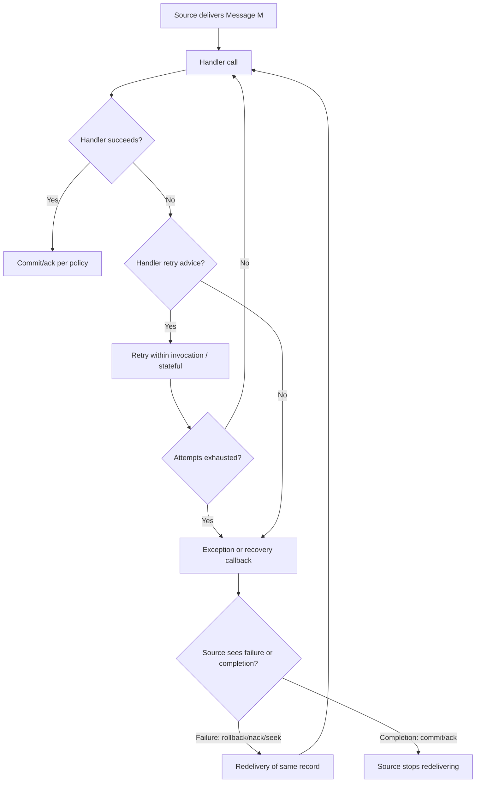

# Poison Messages After Restart in Spring Integration

## 1. Why Can an Old Message Keep Failing Continuously After a Restart?

In Spring Integration, a **poison message** is a message that a consumer cannot process successfully with its current configuration and code. When a message source has durable storage and a redelivery mechanism, the same message may be processed repeatedly. If the error is deterministic, every attempt fails. When the application restarts, the unacknowledged/uncommitted message remains and keeps causing failures.

The lesson **Poison Messages After Restart** belongs to the **Persistence and Restarts** chapter of the `SPRING_INTEGRATION_RUNTIME` module. Its scope covers message flow across channels, endpoints, consumers, pollers, executors, transactions, retries, message stores, and error flows; how to decide commit/rollback, isolate bad messages, and recover the system safely.

A realistic scenario:

1. The application receives message `POISON-17` and writes it to a `QueueChannel` backed by `JdbcChannelMessageStore`.
2. A poller fetches the message inside a transaction; the handler attempts to process it but always throws `IllegalArgumentException` due to invalid data.
3. The transaction rolls back, including removing the message from the JDBC store. The message still exists.
4. The application stops and restarts. The queue reuses the same database, `region`, and group ID, so `POISON-17` is picked up again.
5. The consumer continues throwing on every poll. Depending on source/ordering semantics, this message can consume resources and delay valid work behind it.

**"Poison" is not a Spring Integration exception type.** It is an operational classification based on the behavior that *the same record keeps failing*. The fault may stem from data, schemas, serializers, a code bug, infrastructure dependencies, or configuration. A single transient network error is not enough to classify a message as poison.

### Learning Objectives

- Explain why a message survives a restart, and when it is genuinely lost.
- Distinguish **retries within a single invocation**, **source redelivery**, and **post-restart replay**.
- Identify the exact transaction boundary across pollers, message stores, handlers, executors, and error channels.
- Choose between bounded retries, rollback, quarantine/dead-lettering, and fix-and-replay.
- Build a JDBC queue flow that reproduces a poison message and routes deterministic failures into a quarantine table.
- Test restarts, durability, idempotency, ordering, serialization, and concurrent consumers.

## 2. Journey of a Durable Message Across Two Application Runs

```mermaid
sequenceDiagram
    participant P as Producer
    participant S as Persistent message store
    participant R1 as Runtime run 1
    participant H as Handler
    participant R2 as Runtime after restart
    P->>S: Persist message M (commit)
    R1->>S: BEGIN TX; poll/remove M
    S-->>R1: M
    R1->>H: handle(M)
    H--xR1: Permanent exception
    R1->>S: ROLLBACK TX
    Note over S: M stays persisted in store
    Note over R1: Process stops/restarts
    R2->>S: BEGIN TX; poll M
    S-->>R2: M
    R2->>H: handle(M)
    H--xR2: Error recurs
    R2->>S: ROLLBACK TX
```

The diagram illustrates **the case** where the source restores the message on rollback, the handler exception escapes the transaction, and no recovery handler marks completion. Not every adapter, broker, or channel shares the exact same semantics.

An accurate way to analyze this is to separate three states:

| Aspect | Question | Evidence |
|---|---|---|
| **Message delivery** | Was the message received and acknowledged/committed? | JDBC queue row, JMS ack, Kafka offset/commit, broker delivery count. |
| **Business effect** | Did the DB/remote operation complete or roll back? | Business row, outbox record, transaction log, idempotency key. |
| **Consumer outcome** | Did the method return, throw, get retried, or get swallowed by an error handler? | Exception stack, attempt log, `ErrorMessage`, advice chain. |

For example, the business DB has a `DONE` row, yet the source still redelivers because acknowledgment failed: that message is **no longer an unprocessed command**, but a **duplicate delivery** of an already completed operation. Handle it via idempotency/result lookup, rather than blindly executing again.

## 3. Identifying Poison Messages and Classifying Failures

| Failure Type | Example | Should It Be Retried As-Is? | Strategy |
|---|---|---|---|
| **Deterministic invalid data** | Missing required field, negative amount, unsupported enum | Usually no | Quarantine with reason, inspect source, fix data under control. |
| **Schema/serialization incompatibility** | Class, `serialVersionUID`, or header type changed after deploy; deserializing old message fails | Retrying immediately is futile | Restore compatible reader, migrate store, or isolate raw record at source level. |
| **Deterministic code bug for specific input** | `NullPointerException` only for one payload shape | No on the same binary | Fix code, add regression test, replay after deploying the fix. |
| **Transient dependency failure** | DB unavailable, HTTP 503, broker disconnected | Yes, bounded with backoff | Bounded retry, circuit breaker, backpressure. |
| **Constraint violation from duplicate processing** | Unique key already exists because previous attempt committed | Not via the same write | Inspect business state; return/record idempotent completion. |
| **Concurrency/locking** | Deadlock, optimistic locking, optimistic conflict | Possibly | Bounded retry with a fresh transaction, jitter/backoff. |
| **System-wide misconfiguration** | Wrong credentials, missing schema tables | Per-message retry rarely helps | Stop/pause consumer, fix configuration, verify, then restart. |

**Do not label a message "poison" based solely on attempt count.** A 10-minute outage can push many valid messages past retry limits. Combine exception classification, payload/schema checks, dependency health, start timestamps, and operational policies.

## 4. Decision Point: Can the Message Source Actually Roll Back?

Whether a failed message returns after a restart depends on its storage source and transaction/acknowledgment scope.

| Source | Preservation Point | Risk If Misconfigured |
|---|---|---|
| Default in-memory `QueueChannel` | Lives only in the JVM | Crash after enqueue loses the message; poll is not a DB-rollback operation. |
| `QueueChannel` + `JdbcChannelMessageStore` | Can persist messages and roll back removal when poller uses transactions | Handler throws but exception is swallowed -> transaction commits, message is deleted. |
| JMS consumer with transacted session/container | Broker can redeliver after rollback per broker policy | Ack before business commit, wrong listener container, or message moves to DLQ after broker limit. |
| AMQP/RabbitMQ listener | Container/broker ack/nack/reject and requeue policy | Infinite requeue, misconfigured dead-letter routing, conversion errors unintentionally acked. |
| Kafka inbound adapter | Offset commits, seek/error handlers, DLQ/record recovery per container and adapter | Committing offset before processing completes; or one poison record blocking a partition. |
| Aggregator's persistent `MessageGroupStore` | Preserves groups and correlation metadata across runs | Group not yet ready to release, wrong expiry/dedup; not equivalent to an inbound queue. |
| `MetadataStore` | Stores only markers/checkpoints/accept-once state | Marker stays "seen" even when business work failed; suppresses replay. |

Spring Integration recommends `JdbcChannelMessageStore` when a JDBC-backed queue is needed, rather than using the aggregator-oriented `JdbcMessageStore` as a default queue. Even so, the documentation warns against choosing a relational database as a high-throughput queue when a dedicated broker fits better.

### 4.1. Why Must the Poller Transaction Wrap `receive()`?

```text
Correct: transactional poller
  BEGIN
    QueueChannel.receive()       -> deletes message in JDBC store (uncommitted)
    Handler.process(message)     -> updates business DB
  COMMIT or ROLLBACK

Insufficient: @Transactional only on handler
  QueueChannel.receive()         -> message may already be deleted/committed
  BEGIN
    Handler.process(message)
  ROLLBACK                       -> business rolls back, but source may be lost
```

If the message store and business DB share the same datasource and transaction manager, a rollback can restore both the queue row removal and business data. If they use different datasources or cross a thread boundary before the handler, a single local transaction does not automatically roll back both.

**Thread boundaries:** `DirectChannel` typically runs on the same thread; `ExecutorChannel` hands off to a worker; `QueueChannel` + poller decouples execution timing. A thread-bound transaction does not follow messages onto another thread. Worker errors after handoff can occur too late to roll back the sender's transaction.

## 5. Why Poison Messages Only Surface After a Deploy or Restart

A hallmark of post-restart poison messages is **a message created under the old runtime state being read by the new runtime**.

Several causes exist:

1. **Broken class compatibility:** a Java object was serialized with an old binary, and after restart the new reader cannot decode it; failure can happen **inside `MessageStore.receive()`**, before `MessageHandler`.
2. **Payload schema changes:** fields renamed, types/enums altered; the converter parses it, but new business validation rejects it.
3. **Header changes:** missing `contentType`, version, tenant, or `correlationId`; a handler that previously routed fine now fails route selection.
4. **Stricter new code:** newly added uniqueness checks, required headers, signature verification, or hard-coded rules.
5. **Changed dependencies:** credentials, network, or unmigrated DB schemas; many valid messages fail simultaneously.
6. **Reset retry counters:** stateless `RequestHandlerRetryAdvice` only remembers attempts within a single invocation; after restart a new retry cycle begins. Stateful retry keeps state in advice memory, which also does not automatically survive process restarts.
7. **Changed poller paths:** channel name, `region`, group ID, or database changed; may accidentally read an old queue or fail to read persisted backlog.

### 5.1. Serialization Failures Are a Special Case

If `JdbcChannelMessageStore` uses default Java serialization in Spring Integration 6.5, a class change can render old records undeserializable. When that happens:

- The business handler **is never invoked**.
- Retry advice attached to the handler cannot catch the error.
- Retrying/resuming the poller repeatedly fails on the same row.
- Logs may show `MessageStoreException`, `SerializationException`, `InvalidClassException`, or `ClassNotFoundException`, depending on wrapper/cause layers.
- You cannot simply forward a `Message<?>` to an error flow if constructing the `Message<?>` object itself failed at the source.

Handle this by inspecting raw persisted data, serializer/allowlists, class versions, and migration strategies; you can run a compatibility reader to extract and rewrite messages in the new format via a dedicated backed-up process. **Do not delete rows directly just because deserialization failed.** First keep a copy, assess blast radius, and plan how to replay.

## 6. Handler Retries Differ from Source Redelivery



Three concepts to distinguish:

- **Stateless retry:** multiple handler calls within **a single** message delivery, controlled by `RequestHandlerRetryAdvice`/retry policy. Specific counts depend on config/version.
- **Stateful retry:** advice keys on a submission identifier; exceptions bubble back to the source so the source redelivers, and the advice resumes retry state for that message. That state is not durable across restarts without dedicated storage.
- **Source redelivery:** JDBC poller rollback, JMS broker redelivery, Kafka consumer seek/reprocessing. Redelivery counts may be independent of handler invocation counts.

**Total actual attempts do not necessarily equal `maxAttempts` on retry advice.** For example, each redelivery triggers 3 handler retries; if the broker allows 5 deliveries, total handler invocations can reach `3 × 5 = 15`. A restart can restart the count again if state is not durable.

### Recommended Retry Policy

- For transient errors: bound attempts, use exponential backoff/jitter, and cap total duration to avoid burning threads.
- For validation/schema errors: do not retry blindly; quarantine or halt with an explanation.
- For DB deadlock errors: each attempt should use a fresh transaction so the prior failed attempt rolls back; verify advice ordering.
- For widespread outages: pause upstream consumers or use a circuit breaker; do not dump every message into DLQ merely because infrastructure is down.
- For terminal failures: ensure clear transactional/ack coordination between source acknowledgment and writing the recovery record.

## 7. ErrorChannel, Acks, and the Risk of Swallowing Errors

In Spring Integration, exceptions can unwind synchronously or be published as `ErrorMessage`s at an asynchronous boundary. The appearance of an `ErrorMessage` **does not prove** the source rolled back.

Specifically with inbound JMS: if an adapter has an `error-channel`, conversion errors may be routed to the error flow. Per Spring Integration documentation, if the error flow handles it and **returns normally**, the container transaction may commit and remove the message. To trigger rollback, the error flow must rethrow the exception across the proper boundary.

For other sources, the principle is similar though specific APIs/semantics vary by adapter:

| What Does the Error Flow Do? | Possible Consequence | When to Use |
|---|---|---|
| Logs only and returns | Upstream may treat handling as successful and ack/commit | Only when dropping the message is acceptable or it is already durably stored elsewhere |
| Sends to in-memory `QueueChannel` and returns | Source commits, yet quarantine can be lost on crash | Avoid for errors that must be preserved |
| Writes durable DLQ/quarantine in same transaction and returns | Source removal and quarantine record commit or roll back together | Suitable when sharing resource/transaction; test crash windows |
| Throws exception after logging | Source can roll back/redeliver per policy | Transient errors or when wanting to retain unprocessed messages |
| Catches exception and returns fallback DTO | Caller/flow may observe successful invocation | Only when business contract allows fallback results and source disposition is explicit |

**Do not use the global `errorChannel` as a durable message store by default.** It is an error-routing channel; if consumers only log or disconnect, data may be insufficient for replay. A proper DLQ must capture source origin, error code, payload or recoverable reference, schema version, correlation, and retention policy.

## 8. Hands-On Example: Reproducing Poison Messages with JDBC QueueChannel

This lab uses Spring Boot 3.x, Spring Integration 6.5, Java 17, and H2 or PostgreSQL. The goal is to **observe a message surviving rollback and restart** without needing an external broker. In production, you can swap the JDBC queue for JMS/AMQP if throughput warrants it.

### 8.1. Dependencies and Database

Use dependency management compatible with your Spring Boot version:

```groovy
dependencies {
    implementation 'org.springframework.boot:spring-boot-starter-integration'
    implementation 'org.springframework.boot:spring-boot-starter-jdbc'
    implementation 'org.springframework.integration:spring-integration-jdbc'

    runtimeOnly 'org.postgresql:postgresql'
    testImplementation 'org.springframework.boot:spring-boot-starter-test'
    testRuntimeOnly 'com.h2database:h2'
}
```

Initialize message store tables using the script **bundled in `spring-integration-jdbc` for your exact DB vendor**, such as `org/springframework/integration/jdbc/schema-h2.sql` for H2. Do not hand-craft partial message store tables missing columns; Spring Integration 6.2+ checks table existence at startup.

Create additional business tables for the experiment:

```sql
CREATE TABLE completed_job (
    job_id VARCHAR(128) PRIMARY KEY,
    completed_at TIMESTAMP DEFAULT CURRENT_TIMESTAMP
);

CREATE TABLE job_quarantine (
    job_id VARCHAR(128) PRIMARY KEY,
    reason_code VARCHAR(64) NOT NULL,
    recorded_at TIMESTAMP DEFAULT CURRENT_TIMESTAMP
);
```

The sample quarantine table keeps only job ID and error code for brevity. Production needs source address, raw message or safe payload reference, schema version, root cause, attempts, checksum, timestamps, and operator resolution; avoid storing unredacted secrets/PII.

### 8.2. Store and Queue Configuration

```java
import java.time.Duration;
import javax.sql.DataSource;

import org.springframework.context.annotation.Bean;
import org.springframework.context.annotation.Configuration;
import org.springframework.integration.channel.QueueChannel;
import org.springframework.integration.dsl.IntegrationFlow;
import org.springframework.integration.dsl.Pollers;
import org.springframework.integration.jdbc.store.JdbcChannelMessageStore;
import org.springframework.integration.jdbc.store.channel.H2ChannelMessageStoreQueryProvider;
import org.springframework.integration.store.MessageGroupQueue;
import org.springframework.messaging.PollableChannel;
import org.springframework.transaction.PlatformTransactionManager;

@Configuration
public class DurableJobFlowConfig {

    @Bean
    JdbcChannelMessageStore jobStore(DataSource dataSource) {
        var store = new JdbcChannelMessageStore(dataSource);
        store.setChannelMessageStoreQueryProvider(
                new H2ChannelMessageStoreQueryProvider());
        store.setRegion("job-runtime-v1");
        return store;
    }

    @Bean("jobs.queue")
    PollableChannel jobsQueue(JdbcChannelMessageStore jobStore) {
        // Group ID is the queue's identity: reuse across restarts.
        return new QueueChannel(new MessageGroupQueue(
                jobStore, "jobs.queue"));
    }

    @Bean
    IntegrationFlow durableJobs(JobWorker jobWorker,
                                PlatformTransactionManager transactionManager) {
        return IntegrationFlow.from("jobs.queue")
                .handle(jobWorker, "process", endpoint -> endpoint
                        .poller(Pollers.fixedDelay(Duration.ofMillis(200))
                                .maxMessagesPerPoll(1)
                                .transactional(transactionManager)))
                .get();
    }
}
```

**For PostgreSQL**, replace `H2ChannelMessageStoreQueryProvider` with `PostgresChannelMessageStoreQueryProvider` and apply the corresponding schema. Every instance sharing a logical queue must connect to the same store, `region`, and group ID; changing them during a rolling restart can make the queue look empty or strand old messages.

A `MessageGroupQueue` holds messages in the store; `QueueChannel` wraps the queue so producers/consumers interact via the standard `MessageChannel` interface. The poller opens a transaction **before** `receive()`, so an exception escaping the handler rolls back the message removal. To combine with business DB writes, ensure the store and `JdbcTemplate` share the same `DataSource` and `PlatformTransactionManager` without switching threads inside the transaction scope.

**Note:** This is a low-concurrency single-consumer example for clarity; across multiple threads/nodes, verify MVCC, locking, isolation, and JDBC message store caching options per the official docs.

### 8.3. Handler Intentionally Producing a Poison Failure

```java
import org.springframework.jdbc.core.JdbcTemplate;
import org.springframework.stereotype.Component;

@Component
public class JobWorker {
    private final JdbcTemplate jdbc;

    public JobWorker(JdbcTemplate jdbc) {
        this.jdbc = jdbc;
    }

    public void process(String jobId) {
        jdbc.update(
                "INSERT INTO completed_job(job_id) VALUES (?)", jobId);

        if (jobId.startsWith("POISON-")) {
            // Exception escapes the transactional poller.
            throw new IllegalArgumentException(
                    "Invalid job format: " + jobId);
        }
    }
}
```

**Explanation:** For `POISON-17`, the DB insert executes and then the exception escapes. Because the poller transaction wraps both queue removal and the business insert, **both changes roll back**. Each poll sees the message again; `completed_job` contains no `POISON-17` row.

**Sending test messages** (e.g., in a `CommandLineRunner`/integration test with the channel bean injected):

```java
import org.springframework.messaging.MessageChannel;
import org.springframework.messaging.support.MessageBuilder;

void enqueue(MessageChannel jobsQueue) {
    jobsQueue.send(MessageBuilder.withPayload("OK-11")
            .setHeader("requestId", "REQ-11")
            .build());

    jobsQueue.send(MessageBuilder.withPayload("POISON-17")
            .setHeader("requestId", "REQ-17")
            .build());
}
```

Because producer enqueueing and the poller run concurrently, do not rely on log ordering to infer DB commits. Query `completed_job` rows and message store counts by group ID after transactions settle. For real restart experiments, use PostgreSQL or a **file-based** H2 database; in-memory H2 loses data when the JVM process exits, which does not test durability across process restarts.

### 8.4. Reading the Symptoms

```text
09:00:00.000 poll jobs.queue -> POISON-17
09:00:00.008 JobWorker.process -> IllegalArgumentException
09:00:00.010 transaction rollback -> queue row remains
09:00:00.210 poll jobs.queue -> POISON-17
09:00:00.220 transaction rollback -> queue row remains
... restart process ...
09:03:00.000 poll jobs.queue -> POISON-17
09:03:00.010 transaction rollback -> queue row remains
```

This is a **simulated timeline** to illustrate the mechanics, not default Spring Integration log output. After a restart, if code or source configuration changed, the timing or exception type may differ.

## 9. Quarantining Deterministic Bad Messages Without Losing Them

You must decide explicitly where terminal failures are handled. With a shared JDBC queue and business database, a straightforward pattern is **writing the quarantine record inside the same transaction removing the message**, then returning normally so the transaction commits both operations.

### 9.1. Replacing the Handler with Terminal Classification

In the previous experiment, replace the entire `JobWorker` class with:

```java
import org.springframework.jdbc.core.JdbcTemplate;
import org.springframework.stereotype.Component;

@Component
public class JobWorker {
    private final JdbcTemplate jdbc;

    public JobWorker(JdbcTemplate jdbc) {
        this.jdbc = jdbc;
    }

    public void process(String jobId) {
        if (jobId.startsWith("POISON-")) {
            // Terminal validation failure:
            // write quarantine before allowing queue removal to commit.
            jdbc.update(
                    "INSERT INTO job_quarantine(job_id, reason_code) "
                            + "VALUES (?, ?)",
                    jobId, "INVALID_JOB_ID");
            return;
        }

        // Successful business outcome.
        jdbc.update(
                "INSERT INTO completed_job(job_id) VALUES (?)",
                jobId);
    }
}
```

**Behavior when re-run:**

- Poller fetches `POISON-17` and stages removal inside the transaction.
- Handler identifies a validation failure, inserts into `job_quarantine`, and returns normally.
- Transaction commits: the queue row disappears **and** the quarantine row exists.
- After restart, the message does not return to the main queue; operators can inspect the quarantine record for investigation/replay.

If a crash occurs before commit, both queue removal and quarantine insert roll back, leaving the message for retry. If writing to quarantine fails and an exception escapes, the transaction rolls back; no message is lost. This is the crucial requirement: **source removal and recovery state persistence must occur atomically within the same transaction/store**.

**Do not return `null` to signify "quarantine succeeded" in flows expecting a reply.** This example is a one-way consumer with no gateway waiting on a return value. In request–reply flows, define an explicit error response or throw an exception per contract.

### 9.2. Adding Idempotency for Retries or Duplicate Delivery

`completed_job(job_id PRIMARY KEY)` helps detect duplicates, but a raw SQL duplicate-key exception **does not constitute complete idempotent semantics**. Define:

- If the job ID is already `DONE` with an identical payload/fingerprint, return/record the existing outcome.
- If the job ID matches with a different payload, raise a conflict.
- If the job is `IN_PROGRESS`, callers should know its status and retry eligibility.
- If external side effects already ran, use an idempotency key at the external system or an outbox/inbox pattern.

After quarantine, never replay a message by simply deleting the error row and resending the unfixed payload; verify the fix, track versions, and preserve an audit trail.

### 9.3. When Sharing a Single Transaction Is Not Possible

If the source is JMS/Kafka and quarantine lives in an RDBMS, never assume DB writes and broker acks/offset commits share an ACID transaction. Common approach:

1. Persist a **durable inbox/quarantine** with a unique key and status via the business DB transaction.
2. Only ack/commit the source after durable persistence is confirmed.
3. If a crash happens after DB commit but before ack, the source redelivers; the unique key protects the record and logic detects it was already saved.
4. If the DLQ is another broker, use appropriate publisher confirms/transactions, an outbox, or a retryable DLQ sender.
5. Expect at-least-once delivery; design for idempotency instead of claiming end-to-end exactly-once.

## 10. Poison Messages in JMS, AMQP, and Kafka: No One-Size-Fits-All Recipe

| Platform | Post-Restart Redelivery | Terminal Failure Decision | What to Verify |
|---|---|---|---|
| **JMS** | Can redeliver when transacted session rolls back or ack is incomplete | Broker redelivery policy, DLQ, error flow throw/return | `JMSXDeliveryCount` if provided by broker, transaction mode, conversion exceptions. |
| **RabbitMQ/AMQP** | Unacked deliveries return to queue on connection loss; `nack/requeue` per policy | `basicReject/basicNack`, DLX/DLQ, retry/delay | Ack mode, `x-death` or broker retry metadata, poison requeue loops. |
| **Kafka** | Records are re-read if offset uncommitted or error handler seeks/retries | Container error handler, recoverer, DLT, and offset policy | Partition ordering, `max.poll.interval.ms`, DLT publish result, offset commit after recovery. |
| **JDBC QueueChannel** | Message remains in store if transactional receive rolls back | Write quarantine in same local transaction or stop consumer | Store region/group ID, isolation, schema, and deserialization. |

Spring Integration's JMS inbound adapter supports an error channel for conversion failures. If the error flow catches and returns, the transaction can commit; to trigger broker redelivery, configure exception propagation properly. Spring Integration's Kafka adapter supports retry templates/recovery callbacks; blocking retries for too long can trigger rebalances by exceeding `max.poll.interval.ms`. For Kafka, select container error handlers and DLT behavior based on your Spring Kafka version rather than assuming they match `RequestHandlerRetryAdvice`.

**Head-of-line blocking:** With a FIFO queue or Kafka partition, a poison message near the head can delay valid records behind it across many retry cycles. Some brokers allow separate retry queues/topics or DLQs to isolate failures, though skipping records alters ordering guarantees. Decide at the business level whether subsequent messages may proceed before resolving the failing one.

## 11. Counting Attempts Across Restarts: Where to Store Them?

Counters in a handler's `AtomicInteger` or in-RAM retry state **are not durable**. When the process restarts, the counter resets to 0 even if the message already failed dozens of times.

Options:

| Where Attempts Are Kept | Survives Restart? | Issues to Address |
|---|---|---|
| RAM variable / stateless retry state | No | Restarts reset; total attempts may become unbounded. |
| Header attached before redelivery | Depends on source and header persistence | Headers added inside the handler may roll back/vanish. |
| JMS delivery count / broker header | Possible, per broker/policy | May reset after DLQ/requeue or broker-specific rules. |
| Kafka record metadata / DLT headers | Depends on retry topic/container config | Not every reprocess of the same offset preserves a durable count. |
| Independent durable `job_attempt` table | Yes, if committed | Must not be written inside the rolling-back tx; needs dedup/concurrency/versioning. |
| Dedicated delayed retry queue | Yes if broker store is durable | Protect keys, TTLs, max attempts, and loop-free routing. |

If using a dedicated attempts table, a sketch schema:

```sql
CREATE TABLE job_attempt (
    source_name VARCHAR(64) NOT NULL,
    business_id VARCHAR(128) NOT NULL,
    attempt_count INTEGER NOT NULL,
    last_error_code VARCHAR(64),
    updated_at TIMESTAMP NOT NULL,
    PRIMARY KEY (source_name, business_id)
);
```

To prevent the counter from rolling back with the failed run, write it in an independent transaction (for example a service bean using `REQUIRES_NEW` via a Spring proxy) or read the delivery count from the source. However, **counter writes and processing still have crash windows**, so use reconciliation/idempotency rather than treating a counter row as proof of whether the message was processed. With multiple workers, counter updates need atomic increments or compare-and-set.

**Never retry indefinitely thinking "it's safe because the message stays in the queue."** Poison loops burn CPU, DB connections, broker quota, and log storage, starving valid traffic.

## 12. Designing Quarantine/DLQ for Safe Replay

A well-structured quarantine record typically includes:

| Field | Purpose |
|---|---|
| `sourceType`, `sourceName`, partition/channel | Pinpoints the exact origin. |
| Technical `messageId` and stable `businessId` | Correlates logs and prevents duplicate replays. |
| `payloadRef` / access-controlled raw bytes | Restores exact input; restricts PII/secrets exposure. |
| `contentType`, `schemaVersion`, serializer version | Enables decoding after future deployments. |
| `errorCode`, root cause, failed component | Classifies failure and guides fixes. |
| `firstSeenAt`, `lastSeenAt`, attempts | Tracks frequency and timeline. |
| `status`, `resolvedBy`, `resolutionNote` | Governs quarantine lifecycle. |
| `replayId`, `replayedAt`, target version | Audits re-injection into the flow. |

Replay workflow:

1. Preserve the original record and checksum/hash for comparison.
2. Classify root cause: schema, business rule, code bug, or dependency.
3. Fix code/schema or repair payload **under controlled audit**, saving the edited revision.
4. Run a dry-run/conversion check in isolation without real side effects.
5. Resend with an appropriate business idempotency key and updated event version if required by contract.
6. Mark quarantine `REPLAYED/RESOLVED` only after confirmed processing/ack success.
7. Include a circuit-stop if the replayed message fails again, preventing infinite replay loops.

**Never replay a stale temporary `MessageChannel` header from an old gateway** after a restart. Temporary reply channels belong to the previous invocation/JVM and no longer have a waiting caller. For long-running work, return a job ID and query status, or construct a fresh request with a valid reply address/correlation for the new run.

## 13. Deterministic Crash/Restart Testing

### 13.1. What Should the Test Suite Prove?

| Scenario | Setup | Key Assertions |
|---|---|---|
| Valid message | Enqueue `OK-11`, transactional poller | Business row exists, queue row removed after commit. |
| Poison validation | Enqueue `POISON-17`, handler throws | No business row; message remains in source after rollback. |
| Restart before completion | Commit enqueue, stop process, restart with same store/group | New runtime reads the same business ID. |
| Restart after successful quarantine | Poison atomically quarantined and source committed | Queue row gone; exactly one quarantine record. |
| Quarantine DB failure | Fail quarantine INSERT inside transaction | Source record preserved, zero lost messages. |
| Crash between source removal and business commit | Kill process while transaction is uncommitted | Source or inbox can redeliver; business effect neither lost nor duplicated. |
| Crash after business commit before ack | Block ack/reply post-commit | Source may redeliver, but idempotency prevents a second side effect. |
| Incompatible schema | Message serialized with old version, new reader | Root cause fails before handler; recovery does not depend on handler advice. |
| Two consumers sharing store | Concurrent polling on MVCC-capable DB | Same message not processed concurrently outside policy; requires stress test. |
| DLQ replay | Fix version/condition, replay once | Final data accurate, quarantine updated, zero duplicate effects. |

**How to make tests reliable:**

- Use **Testcontainers PostgreSQL or a real broker** to observe transactions/acks; in-memory H2 is insufficient for process-restart testing.
- Run two `ApplicationContext`s/processes against the same database across two phases without dropping schemas between runs. Keep `region` and group ID unchanged.
- Control endpoints explicitly via `@SpringIntegrationTest(noAutoStartup=...)`, `MockIntegrationContext`, or consumer lifecycle start/stop; verify exact endpoint IDs in config.
- For pollers, use `OnlyOnceTrigger` or a finite-poll test trigger to avoid runaway poison loops while asserting.
- Synchronize using latches/conditions with deadlines; **never use `Thread.sleep(...)` as proof** that transactions/acks finished.
- Do not annotate the entire test with `@Transactional` when verifying real DB commits/rollbacks; test-managed transactions roll back by default and mask bugs.
- Inspect DB/store state in an **independent transaction after completion**. For JMS/Kafka, inspect queues/topics/offsets/DLTs from a separate client.
- For crash tests, kill a real process inside a controlled window and then restart; normal `context.close()` does not simulate power loss mid-transaction.

### 13.2. Two-Phase Test Scenario

```text
Run 1: startup with persistent queue
  1. Stop/disable polling consumer, then enqueue POISON-17.
  2. Wait to confirm enqueue committed in the store.
  3. Start consumer once -> verify exception & rollback.
  4. Stop context/process while source row still exists.

Run 2: restart with same DB/schema/region/group ID
  5. Confirm source row still exists before polling.
  6. Start consumer -> observe the same POISON-17 again.
  7. Switch handler to transactional-quarantine version.
  8. Wait for completion -> assert queue empty, quarantine has POISON-17.
  9. Restart again -> assert poison no longer loops.
```

To test "schema change after deploy," persist messages using the V1 binary/schema and start a V2 reader in a separate process. A single-context JUnit test does not prove rolling-upgrade serialization compatibility.

### 13.3. Assertions You Can Use in Tests

```java
// Assertion pseudocode: helpers query via an independent transaction.
assertEquals(0, countCompletedJob("POISON-17"));
assertEquals(1, countStoredQueueMessage("POISON-17"));

// After applying the quarantine handler and committing:
assertEquals(0, countStoredQueueMessage("POISON-17"));
assertEquals(1, countQuarantineRow("POISON-17"));

// After another restart, no duplicate quarantine row is created:
assertEquals(1, countQuarantineRow("POISON-17"));
```

These helpers are *assertion outlines*, not built-in Spring Integration functions. `JdbcChannelMessageStore` stores serialized messages in its own schema; querying by business ID may require safe deserialization or an auxiliary inbox/test-hook table. Do not assume a `job_id` column exists in the default `INT_CHANNEL_MESSAGE` table.

## 14. Diagnosing an Incident: "Every Restart Brings Back the Same Old Error"

Follow this investigation sequence, prioritizing evidence preservation:

1. **Identify the source:** JDBC queue, JMS/AMQP, Kafka, aggregator, or polling source. Check service/endpoint IDs, `started` consumer/poller status, and ack/transaction settings.
2. **Isolate one concrete message:** business key, technical message ID, correlation ID, partition/offset, or queue group; avoid dumping full sensitive payloads into logs.
3. **Find the root exception:** handler validation, pre-handler serializer/converter, dependency outage, group release, or channel routing.
4. **Trace the transaction:** are `receive()` and business writes in the same transaction? Is an advice catching errors inside the transaction boundary?
5. **Count invocations and redeliveries separately:** retry advice attempts, broker deliveries, poller cycles, and restart count.
6. **Check business data:** is the message unprocessed, half-processed, or did business work commit while ack/reply failed?
7. **Stop the loop safely:** pause the affected consumer/partition or throttle the poller; preserve raw records and back up. Do not purge queues or reset offsets wholesale.
8. **Choose the resolution branch:** transient -> bounded retry; deterministic poison -> durable quarantine; serializer/schema break -> compatibility migration; config outage -> fix infrastructure first.
9. **Test recovery in isolation:** verify zero lost messages, zero duplicate business effects, and clean replayability.
10. **Resume with observability:** watch backlog, DLQ, retry rate, throughput, latency, and DB connections; scale concurrency only after confirming root cause.

### Symptom Matrix

| Observation | First Cause to Check | Action |
|---|---|---|
| Same message ID logged every 200 ms | Transaction rollback and poller loop; unbounded source retries | Bounded retry, quarantine, or pause consumer. |
| Handler never logs, yet queue stalls | Deserialization/conversion failing before handler | Check serializer/class version, raw store, root cause. |
| Message missing after restart | In-memory store, changed schema/region/channel/group ID, message already acked/committed | Reconcile storage identity and transaction evidence. |
| `ErrorMessage` emitted, yet message vanished | Error flow swallowed exception and source committed/acked | Verify error-flow outcome; write quarantine before commit. |
| Multiple business rows despite message rollback | External side effect outside transaction, retry after commit/reply failure | Idempotency, transactional outbox/inbox. |
| One poison blocks subsequent records | FIFO/partition ordering, same-key retries | Separate DLQ/retry, clarify ordering contract. |
| Errors only after V2 deploy | Schema/version/serializer or validation changes | Run compatible reader, migrate/replay. |
| Replicas process duplicates | Misconfigured shared store locking/tx/isolation, at-least-once broker delivery | Unique business keys, distributed locking/consumer semantics. |
| Recovery row exists yet source redelivers | Quarantine and source commit not atomic, or recoverer threw | Verify transactions, acks, and dedup recovery. |
| DLQ spikes during DB outage | Transient infrastructure failures treated as poison | Pause/bound retries, investigate dependency before bulk DLQ. |

## 15. IntegrationFlow Lifecycle and Runtime State

A restart does more than restore messages; it also restarts endpoints according to lifecycle rules:

- `IntegrationFlow` can be statically declared or dynamically registered via `IntegrationFlowContext`. A flow registration existing does not automatically mean its consumer has `start()`ed.
- `PollingConsumer` receives messages only when the endpoint is started and the poller trigger is running; seeing no errors might mean **it hasn't polled yet**, not that the message was fixed.
- `maxMessagesPerPoll` and executor thread counts change a poison message's impact on throughput; raising concurrency can flood logs or cause row contention.
- With JDBC queues, startup table/schema checks can fail application startup before pollers ever run; that is an **infrastructure/schema error**, not proof of a poison message.
- `SmartLifecycle` start/stop and shutdown drain periods affect how long running tasks execute; test clean shutdowns and hard crashes separately.
- When modifying dynamic flows, preserve or migrate destination/region/group identity. A new queue with the same name on a different store will not pick up old messages.

Between V1 and V2 releases, follow a rolling-deploy contract: old messages remaining in the store must be readable by V2; otherwise, run a migration/dual-read step. For messages carrying custom Java classes, format/version management is part of resilience.

## 16. Observability: Measuring Poison Messages by Message and Source

Metrics to capture (names below are **recommendations**, not default auto-generated Spring Integration metrics):

| Metric/Log Field | Purpose |
|---|---|
| `message.businessId`, `messageId`, `source` | Know whether a single record is being reprocessed. |
| `handler.attempts` | Distinguish handler retries from source redeliveries. |
| `source.redeliveries`, `restartEpoch` | Detect a poison message surviving multiple restarts. |
| `queue.depth`, oldest-message-age, partition-lag | Spot head-of-line blocking. |
| `transaction.rollback.count`, `commit.count` | Observe actual source disposition. |
| `quarantine.count`, reason, age, `replay.outcome` | Track isolated messages and resolution progress. |
| `conversion.failure.count` | Detect post-deploy schema/serialization breaks. |
| `consumer.started`, poller-lag, executor-queue-size | Verify whether the source is actively dispatching messages. |
| `business.idempotency.conflict.count` | Measure duplicates after retries/timeouts. |
| `dependency.failure.rate` | Distinguish a lone poison message from a broad outage. |

On every error event, log **business ID + exception code + thread + source position + transaction disposition**, not just repeated stack traces. For failing payloads, avoid logging raw bytes/headers that may contain sensitive data.

Depending on framework version and infrastructure, you can configure Spring Integration management/Micrometer Observation for handlers/channels; metrics like "poison messages per restart" typically require application/broker-level instrumentation.

## 17. Design Checklist to Avoid Post-Restart Poison Loops

1. Use durable storage whenever messages must survive crashes; test with actual **process** restarts.
2. For JDBC queues, place the transaction on the **poller wrapping receive + handler** if you expect removal to roll back.
3. Trace the exact exception path: handler advice, error channels, recoverers, and listener containers may catch/throw at different layers.
4. Classify permanent vs. transient errors; bound retries and apply appropriate backoff.
5. Persist terminal failures to quarantine/DLQ **before committing/acking** the source, guarding against loss and duplication.
6. Move critical attempt state to durable storage if limits must hold across restarts.
7. Use business idempotency keys and unique constraints or inbox/outbox for at-least-once processing.
8. Version payloads/serializers; maintain a migration path for legacy messages across deployments.
9. Manage queue identity: keep schemas, `region`, group IDs, channel names, credentials, and consumer groups stable.
10. Test hard crashes, error-flow swallowing, deserialization failures, concurrent delivery, and DLQ replays.
11. Monitor queue depth/oldest age, rollback rate, poison keys, and recovery outcomes; pause automatically when risk spikes.
12. Maintain a runbook for preserving evidence, deciding replays, and auditing manual interventions.

## 18. Self-Check Questions

**1.** Why does `POISON-17` remain in `JdbcChannelMessageStore` after a restart?  
**Answer:** If the poller starts a transaction before `receive()` and the handler throws, causing a rollback, removing the message from the store also rolls back. Upon restart with the same store/region/group ID, the message remains to be polled.

**2.** Is adding `@Transactional` to the handler alone enough to ensure messages return to the queue on failure?  
**Answer:** No. `receive()` may already have occurred before the method's transaction begins; the transaction must wrap both the poller's `receive()` and synchronous downstream handling.

**3.** Handler retry advice tries 3 times — why are there hundreds of attempts after restarts?  
**Answer:** Retries within a single invocation differ from source redelivery. Rollback causes the source to redeliver the message, and in-RAM retry state does not survive restarts.

**4.** An error flow only logs the exception and returns. Does that guarantee source rollback?  
**Answer:** No. Many adapters/containers treat a normal return as successful handling and may commit/ack; check the exact boundary.

**5.** A message fails deserialization before reaching the handler. Does attaching `RequestHandlerRetryAdvice` to the handler help quarantine it?  
**Answer:** No, because the handler is never invoked. It must be handled at the source/converter/error infrastructure layer or via store management tooling.

**6.** Does writing a quarantine record and throwing an exception within the same JDBC poller transaction move the message to quarantine?  
**Answer:** Typically both the quarantine insert and source removal roll back, leaving the message in the queue. For terminal quarantine, persist durably and complete the transaction per policy, or use an alternative atomic source-to-DLQ mechanism.

**7.** Business state committed, but the reply was lost. Should a message retry re-run business logic?  
**Answer:** Side effects must not be re-executed when the business idempotency key is already complete; look up the existing status/result or return the appropriate status.

**8.** How can a poison message on a Kafka partition delay healthy records behind it?  
**Answer:** If the error handler keeps retrying/seeking the same offset before advancing, the partition stays pinned on the failing record. Controlled DLT/skipping alters ordering and requires an explicit policy.

**9.** Can in-memory H2 prove durability across JVM restarts?  
**Answer:** No. Use file-based H2, PostgreSQL Testcontainers, or a durable broker for process-restart tests.

**10.** Why can you not rely solely on `MessageHeaders.ID` for business deduplication?  
**Answer:** Retries/replays can produce new technical messages with different IDs for the same job; only a stable business key reflects the same business effect.

## 19. Official References

1. [Spring Integration 6.5 — Configuring Message Channels](https://docs.spring.io/spring-integration/reference/6.5/channel/configuration.html): persistent `QueueChannel`, transactional pollers, message removal, and in-memory queues.
2. [Spring Integration 6.5 — JDBC Message Store](https://docs.spring.io/spring-integration/reference/6.5/jdbc/message-store.html): `JdbcChannelMessageStore`, query providers, schema/versioning, and concurrent polling.
3. [Spring Integration 6.5 — Transaction Support](https://docs.spring.io/spring-integration/reference/6.5/transactions.html): poller transactions before `receive()`, commits/rollbacks, and synchronization.
4. [Spring Integration 6.5 — Provided Advice Classes](https://docs.spring.io/spring-integration/reference/6.5/handler-advice/classes.html): `RequestHandlerRetryAdvice`, stateful/stateless retry, and `ErrorMessageSendingRecoverer`.
5. [Spring Integration 6.5 — Error Handling](https://docs.spring.io/spring-integration/reference/6.5/error-handling.html): error flows, sync/async boundaries, and global `errorChannel`.
6. [Spring Integration 6.5 — JMS Support](https://docs.spring.io/spring-integration/reference/6.5/jms.html): transacted containers, conversion errors, error channels, and redelivery.
7. [Spring Integration 6.5 — Apache Kafka Support](https://docs.spring.io/spring-integration/reference/6.5/kafka.html): `KafkaMessageDrivenChannelAdapter`, retry/recovery, and offset/error handling.
8. [Spring Integration 6.5 — Testing Support](https://docs.spring.io/spring-integration/reference/6.5/testing.html): `@SpringIntegrationTest`, `MockIntegrationContext`, and `OnlyOnceTrigger`.
9. [Spring Integration 6.5 API — MessageGroupQueue](https://docs.spring.io/spring-integration/docs/6.5.0/api/org/springframework/integration/store/MessageGroupQueue.html): queue backed by a message group store with stable group IDs across restarts.
10. [Spring Integration 6.5 API — JdbcChannelMessageStore](https://docs.spring.io/spring-integration/docs/6.5.0/api/org/springframework/integration/jdbc/store/JdbcChannelMessageStore.html): channel-specific store and database properties.
