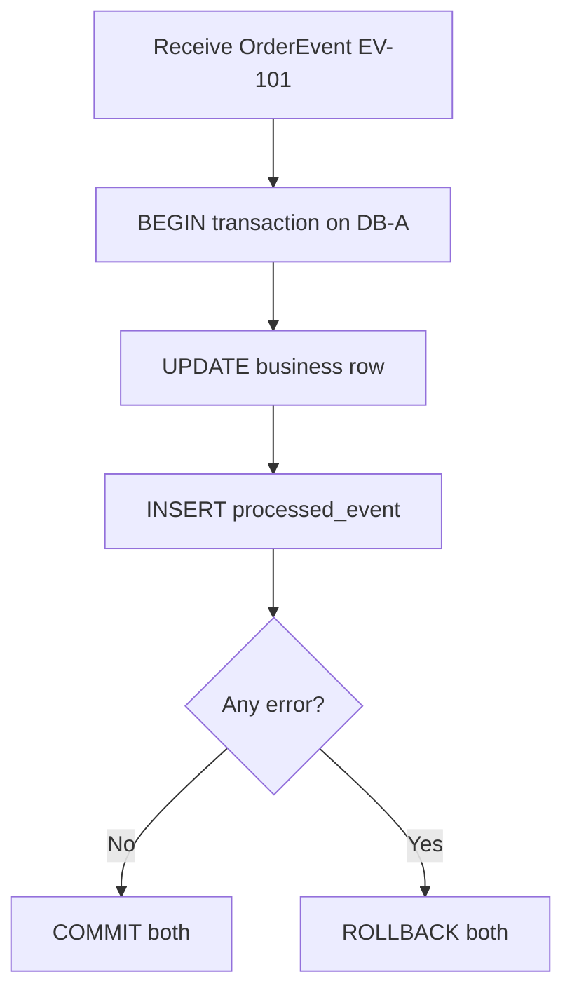
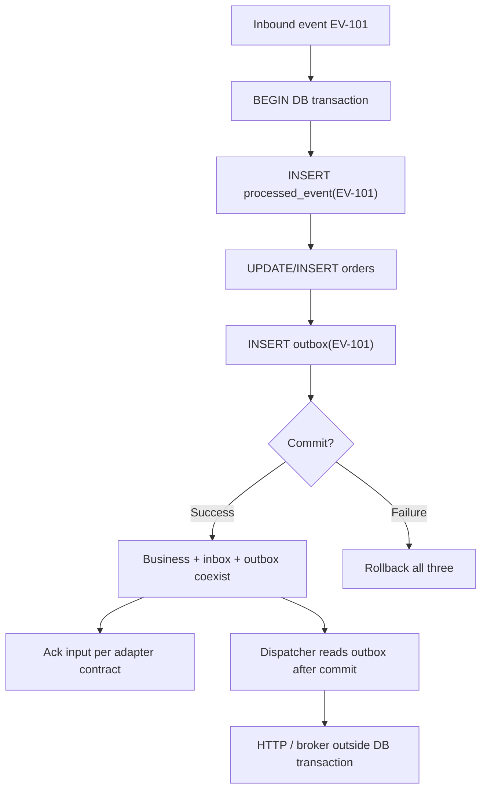
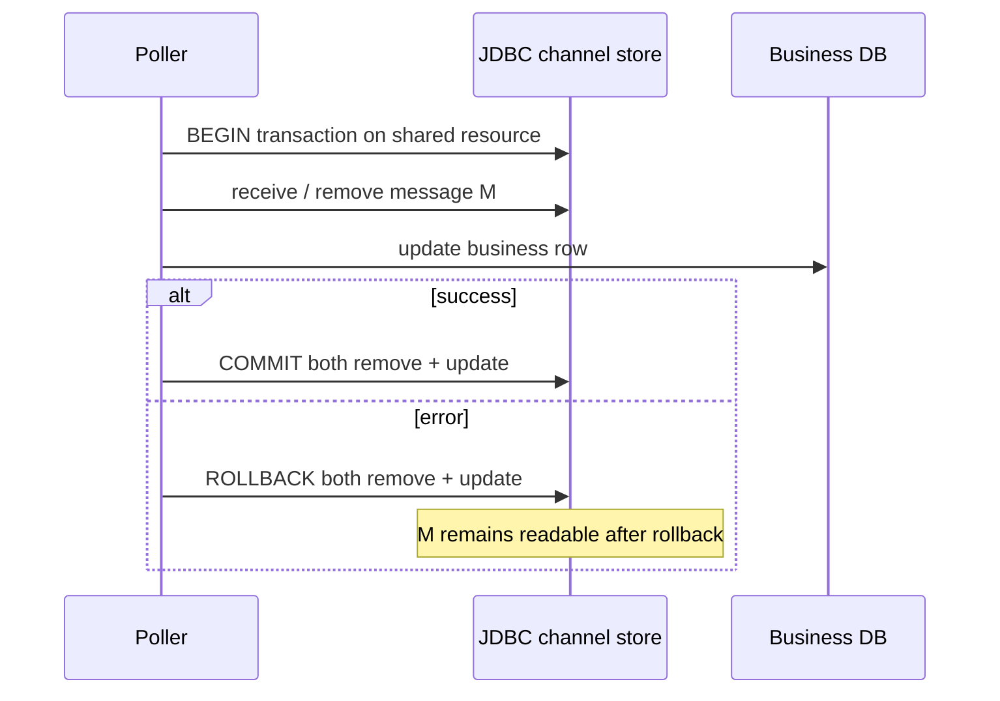
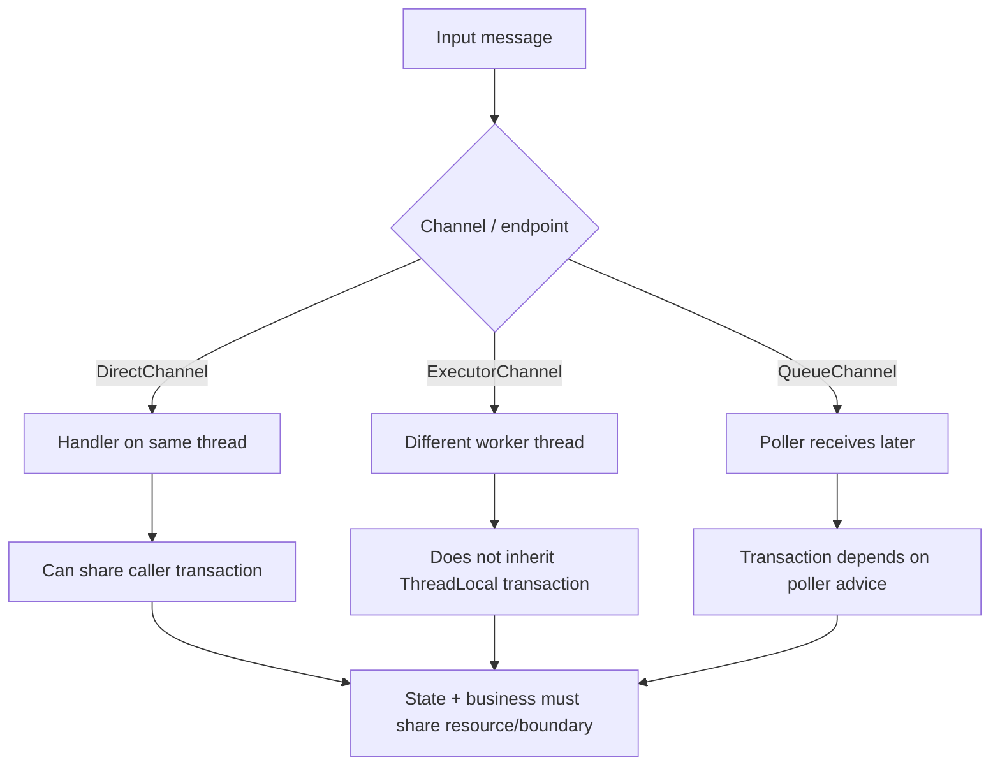
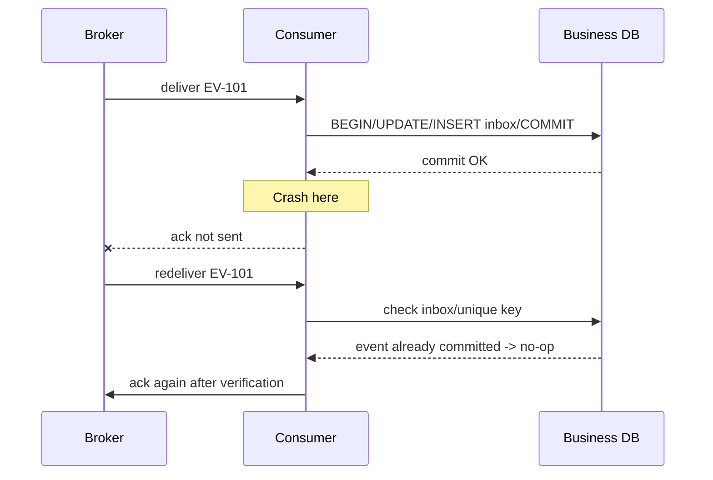

# Atomicity Between State Persistence and Business Resources in Spring Integration

## Lesson Objectives

A message flow in **SPRING_INTEGRATION_RUNTIME** can update both state that Spring Integration uses to continue processing (messages in a store, aggregator groups, checkpoints, metadata) and business data such as orders, payments, or inventory. When the application restarts, the danger is not only **losing a message**, but also **runtime state and business data advancing to two different points in time**.

This lesson belongs to the **Persistence and Restarts** chapter and centers on the question:

> How do we make persisting processing state and modifying business resources **succeed or fail together**, and what happens when those two operations cannot share a single transaction?

After this lesson, you will be able to:

- Distinguish **atomicity** within a local transaction from durability, idempotency, redelivery, and an exactly-once effect.
- Precisely identify resources participating in a Spring transaction; understand why "the same JDBC database" is insufficient if two operations do not run **within the same transaction boundary**.
- Design persisting **checkpoint/inbox/outbox** records and business rows inside a short transaction.
- Analyze `JdbcMessageStore`, `JdbcChannelMessageStore`, group state, `JdbcMetadataStore`, and consumer/poller commit points.
- Spot boundaries across `DirectChannel`, `ExecutorChannel`, `QueueChannel`, endpoints, schedulers, retry advice, and error flows.
- Apply idempotency, transactional outbox, reconciliation, and compensation when brokers, HTTP services, or other databases cannot commit atomically.
- Design crash tests at every step, covering rollbacks, redeliveries, concurrent workers, and restarts.

Technical context: Spring Framework 6.x, Spring Integration 6.x, Java 17+, JDBC. Code snippets using application tables are illustrative examples; concrete schema names, transaction managers, and endpoints must be configured per deployment environment.

## 1. What Does Atomicity Actually Guarantee?

Suppose a system must process `OrderEvent(eventId=EV-101)` in two steps:

1. Update the orders table: `orders.status = CONFIRMED`.
2. Record the processing marker: `processed_event(eventId=EV-101)`.

If step 1 commits while step 2 does not, after a restart the event may be received again and processed twice. If step 2 commits before step 1 succeeds, the system may believe the event was processed even though the order never changed.



With **a true local database transaction**, these two changes can commit/roll back atomically, provided that:

- Both use **the same resource** controlled by the transaction manager, or a real distributed transaction mechanism has enlisted all participants.
- Both run inside **the same transaction boundary** (right thread, transaction context, and propagation).
- Neither operation intentionally starts a separate transaction via `REQUIRES_NEW` or a different transaction manager.
- Errors requiring rollback actually propagate to the transaction manager and are not swallowed by an advice or recovery callback.
- Storage and transaction logs are configured with durability matching system requirements.

**Atomicity != exactly-once delivery.** The source may deliver a message multiple times. Atomicity lets you write the marker and business change together once; **idempotency** decides what to do when receiving an already committed event again.

### Four Terms Commonly Confused

| Concept | Question It Answers | What It Does Not Automatically Guarantee |
|---|---|---|
| **Atomicity** | Do changes within one transaction commit or roll back together? | That the source will never resend the message |
| **Durability** | Does committed state survive restarts/crashes? | That a remote service also succeeded |
| **Idempotency** | Does retrying the same business operation create duplicate effects? | Zero duplicate messages |
| **Consistency across resources** | Do two independent systems eventually agree on state? | Guaranteed by a single local `@Transactional` |
| **Exactly-once effect** | Does the user observe the business effect exactly once? | Exactly-once network delivery |

Systems typically achieve **at-least-once delivery + idempotent processing** rather than hoping redelivery never happens.

## 2. Which "State" Needs to Be Persisted in Spring Integration?

Not everything called state lives in the same store.

| State Type | Example | Common Storage Location | Relevance to Restarts |
|---|---|---|---|
| **Business state** | `orders`, `inventory`, `payments` | Business database | Must stay consistent with processing progress |
| **Message queue state** | Messages waiting for a consumer | `QueueChannel` with in-memory store or `JdbcChannelMessageStore` | Durable only if store is genuinely persistent |
| **Message group state** | Aggregator holding 2/3 parts of `batch-7` | `MessageGroupStore` such as `JdbcMessageStore` | Needs recovery/expiry when groups are incomplete |
| **Checkpoint / metadata** | How far a file was read, last source ID | `MetadataStore`, optionally `JdbcMetadataStore` | Early checkpoints can lose data |
| **Inbox / processed marker** | `eventId` applied to business DB | Application table with unique constraint | Protects when input redelivers |
| **Outbox** | Intent to emit command/event after DB commit | Application table in the same DB | Preserves task across restarts |
| **Broker offset / ack** | Kafka offset, JMS ack, AMQP acknowledgment | Broker/container/source | Not automatically part of a DB transaction |
| **Retry state** | Attempt count, backoff deadline | Memory, repository, or transport | Can be lost on restart unless persisted |

### Easily Confused Stores

- `JdbcMessageStore`: uses JDBC to persist messages and message groups; suited for aggregator/resequencer state when configured properly.
- `JdbcChannelMessageStore`: JDBC implementation designed for appropriate pollable channels to store queued messages; message retrieval/removal must be checked under transactions.
- `JdbcMetadataStore`: persists key/value metadata. It is **not** a transactional business inbox unless you explicitly design DB-coupled atomicity and conflict handling.
- `SimpleMessageStore`/in-memory queues: lose state on JVM restart, even when the business DB committed.
- `LockRegistry`: synchronizes group/state access within the registry's scope; locks do not add transactions or persistence by themselves.

**Same `DataSource`** is a helpful condition for local atomicity, yet you must verify actual connection binding, that the transaction spans both operations, isolation levels, and how the store implementation executes SQL. Do not go by database/bean names alone.

## 3. Failure Windows When Saving State and Business Data Separately

### Anti-pattern 1: Write Business Data Then Mark Processed Outside the Transaction

```text
T0  Receive EV-101
T1  UPDATE orders, commit
T2  Process crashes before INSERT processed_event
T3  Restart, source redelivers EV-101
T4  App thinks EV-101 is unprocessed -> UPDATEs again
```

If the business operation increments inventory, charges money, or adds loyalty points, the second run produces wrong results.

### Anti-pattern 2: Checkpoint Before Business Update

```text
T0  Receive EV-101
T1  Save checkpoint "EV-101 read", commit
T2  Process crashes before updating orders
T3  Restart skips EV-101 based on checkpoint
T4  Business change is lost
```

This is dangerous with file adapters, pollers using metadata stores, offsets, or custom sources. The source will not replay the event once the checkpoint advances past it, unless a reset/replay mechanism exists.

### Anti-pattern 3: Using Two Independent Transactions

```mermaid
sequenceDiagram
    participant M as Message flow
    participant S as State Store DB-A
    participant B as Business DB-B
    M->>S: TX-A BEGIN, write checkpoint
    S-->>M: TX-A COMMIT
    M->>B: TX-B BEGIN, update order
    B--xM: DB error -> TX-B ROLLBACK
    Note over S,B: Checkpoint already committed; not atomic!
```

Even if DB-A and DB-B reside on the same server, two separate transactions do not become a single transaction. Resources and transaction managers must be properly enlisted.

### Typical Failure Table

| Crash Timing | Business State | Integration State | Consequence Without Safeguards |
|---|---|---|---|
| Before both changes | Unwritten | Unwritten | Can safely reprocess |
| After business commit, before state commit | Written | Unwritten | Duplicate effect on replay |
| After state commit, before business commit | Unwritten | Written | Lost work because system thinks it finished |
| Both in one DB transaction, before commit | Both roll back | Both roll back | Replays; idempotency needed |
| Both commit together | Written | Written | Business complete; source may still redeliver |
| After local commit, before broker ack | Written | Written | Broker redelivers; marker/inbox must block duplicates |

## 4. Minimal Design: Business Row + Inbox + Outbox in One DB Transaction

A reliable pattern persists three kinds of data in **the same local database transaction**:

1. Business state (the change users care about).
2. Inbox/processed marker (confirming this event has been applied to the business DB).
3. Outbox record (a follow-up task/event to emit externally).



### Example Schema

```sql
-- Illustrative SQL; adjust dialect/indexes/types for your RDBMS.
CREATE TABLE orders (
    order_id         VARCHAR(64) PRIMARY KEY,
    status           VARCHAR(24) NOT NULL,
    updated_at       TIMESTAMP NOT NULL
);

CREATE TABLE processed_event (
    event_id         VARCHAR(64) PRIMARY KEY,
    order_id         VARCHAR(64) NOT NULL,
    processed_at     TIMESTAMP NOT NULL
);

CREATE TABLE integration_outbox (
    event_id         VARCHAR(64) PRIMARY KEY,
    order_id         VARCHAR(64) NOT NULL,
    event_type       VARCHAR(64) NOT NULL,
    payload_json     TEXT NOT NULL,
    status           VARCHAR(24) NOT NULL,
    created_at       TIMESTAMP NOT NULL
);
```

`event_id` in `processed_event` is protected by a primary key so two workers cannot both commit markers for the same business event. When multiple events target the same order, `order_id` can appear multiple times in the marker table, while the `orders` table needs its own concurrency control (versioning/locking) per business invariants.

### Spring Service Example: Local Atomicity

```java
import java.time.Instant;

import org.springframework.jdbc.core.JdbcTemplate;
import org.springframework.stereotype.Service;
import org.springframework.transaction.annotation.Transactional;

public record OrderEvent(
        String eventId,
        String orderId,
        String status,
        String payloadJson) {
}

@Service
public class AtomicOrderWriter {

    private final JdbcTemplate jdbc;

    public AtomicOrderWriter(JdbcTemplate jdbc) {
        this.jdbc = jdbc;
    }

    @Transactional(transactionManager = "ordersTransactionManager")
    public void record(OrderEvent event) {

        // 1. Guard against reprocessing the same business event.
        jdbc.update(
                "INSERT INTO processed_event "
              + "(event_id, order_id, processed_at) VALUES (?, ?, ?)",
                event.eventId(),
                event.orderId(),
                java.sql.Timestamp.from(Instant.now()));

        // 2. Update only an existing order, per business rule example.
        int updated = jdbc.update(
                "UPDATE orders SET status = ?, updated_at = ? "
              + "WHERE order_id = ?",
                event.status(),
                java.sql.Timestamp.from(Instant.now()),
                event.orderId());

        if (updated != 1) {
            throw new IllegalStateException(
                    "Order does not exist: " + event.orderId());
        }

        // 3. Record publish intent inside the same transaction.
        jdbc.update(
                "INSERT INTO integration_outbox "
              + "(event_id, order_id, event_type, payload_json, "
              + "status, created_at) VALUES (?, ?, ?, ?, ?, ?)",
                event.eventId(),
                event.orderId(),
                "ORDER_STATUS_CHANGED",
                event.payloadJson(),
                "READY",
                java.sql.Timestamp.from(Instant.now()));
    }
}
```

This snippet is an **illustrative two-type sample**; each `public` top-level class/record belongs in its own `.java` file to compile. The application needs `JdbcTemplate`, a transaction manager bean named `ordersTransactionManager`, a `DataSource`, created schemas, and an existing `orders` row. In Spring Boot, the transaction manager configuration must match the specified bean name.

**Why are all three updates atomic?** `JdbcTemplate` uses a connection enlisted in the Spring-managed transaction when sharing the same `DataSource`. A `RuntimeException` from the order update or outbox insert rolls back the transaction by default. Marker, business update, and outbox never commit independently.

**Handling duplicate events:** inserting an existing marker triggers a unique constraint exception. Never catch `DuplicateKeyException` and keep executing SQL inside **the same transaction** on databases that enter an aborted-transaction state (such as PostgreSQL). You may pre-check existence as an optimization, yet the unique constraint remains the final barrier. After rollback, the caller layer can classify duplicates and return an appropriate outcome or open a **new transaction** to verify the event already committed.

### Wiring into Spring Integration

```java
import org.springframework.integration.annotation.ServiceActivator;
import org.springframework.stereotype.Component;

@Component
public class OrdersEndpoint {

    private final AtomicOrderWriter writer;

    public OrdersEndpoint(AtomicOrderWriter writer) {
        this.writer = writer;
    }

    @ServiceActivator(inputChannel = "ordersToRecord")
    public void handle(OrderEvent event) {
        writer.record(event); // Goes through Spring bean/proxy.
    }
}
```

Define the input channel and enable Integration:

```java
@Configuration
@EnableIntegration
public class OrdersChannelConfig {

    @Bean
    public MessageChannel ordersToRecord() {
        return new DirectChannel();
    }
}
```

The snippet above requires importing the corresponding annotations, `MessageChannel`, and `DirectChannel`; Spring components must be component-scanned or registered in the context. `OrdersEndpoint` does **not** open an outer transaction; `AtomicOrderWriter.record` is the short, explicit transaction boundary.

A producer sending over a `DirectChannel` invokes the endpoint synchronously in a typical configuration, yet **the producer must still hold the source message or have a redelivery mechanism if the DB rolls back**. Local DB atomicity does not regenerate lost source messages.

### If State Is an Application-Defined Checkpoint Table

You can replace an outbox insert with updating `integration_checkpoint` inside the same transaction:

```java
jdbc.update(
    "UPDATE integration_checkpoint SET last_event_id = ? "
  + "WHERE source_name = ?",
    event.eventId(),
    "partner-orders");
```

Check the updated row count and design monotonically advancing checkpoints with source/ordering constraints. **Never use a string `last_event_id` to infer ordering** unless the source guarantees monotonic IDs. When processing multiple partitions/keys, partition checkpoints accordingly.

## 5. Synchronizing Actual Spring Integration State with the Business DB

The `processed_event` table above is **application-managed state**, not proof that a `QueueChannel` or aggregator marked a message as processed. For atomicity between **framework-managed state** and business rows, the transaction must wrap **the message store operation itself**.

### 5.1. Writing MessageStore and Business DB in the Same Transaction

Short example using a JDBC-backed `MessageStore` and shared `DataSource`:

```java
import org.springframework.integration.store.MessageStore;
import org.springframework.messaging.Message;
import org.springframework.jdbc.core.JdbcTemplate;
import org.springframework.transaction.annotation.Transactional;

public class AtomicStateAndBusiness {

    private final MessageStore messageStore;
    private final JdbcTemplate jdbc;

    public AtomicStateAndBusiness(
            MessageStore messageStore, JdbcTemplate jdbc) {
        this.messageStore = messageStore;
        this.jdbc = jdbc;
    }

    @Transactional(transactionManager = "ordersTransactionManager")
    public void save(Message<?> message, String orderId) {
        // Only saves a message/copy to MessageStore;
        // this is NOT yet a QueueChannel receive/ack operation.
        messageStore.addMessage(message);

        jdbc.update(
                "UPDATE orders SET status = ? WHERE order_id = ?",
                "ACCEPTED", orderId);
    }
}
```

For this to actually be atomic, all of the following must hold:

- `messageStore` is an appropriate JDBC implementation (e.g., `JdbcMessageStore`), not `SimpleMessageStore`.
- The store's and business's `JdbcTemplate` use **the same resource** managed by `ordersTransactionManager`.
- The method is invoked through a Spring transaction proxy with no separate transaction propagation.
- Message serializer, store tables, and implementation transaction behavior work properly.
- A test proves that a failure after `addMessage` rolls back both the message insert and business update.

**Limitation of the example:** `MessageStore.addMessage(message)` persists one message; it does **not** mean "sent to `QueueChannel`" or "acknowledged the inbound message." Atomicity during **remove/poll/release** requires inspecting the actual APIs used by the endpoint.

### 5.2. JDBC-Backed QueueChannel

For a pollable channel that must recover messages after a restart, use an appropriate store like `JdbcChannelMessageStore`. However, inspect **message fetch/delete operations**:



This is a **configuration goal**, not automatic behavior from merely using JDBC. To make it true, poller/transaction advice must wrap receiving from the store and updating the DB on the same resource. If a transaction commits right after `receive` and the handler writes to the DB afterward, a failure between the two steps can lose the message.

An outline of a poller transaction configuration:

```java
@Bean
public PollerMetadata transactionalPoller(
        PlatformTransactionManager ordersTransactionManager) {

    PollerMetadata poller = new PollerMetadata();
    poller.setTrigger(new PeriodicTrigger(100L));

    TransactionInterceptor txAdvice = new TransactionInterceptor();
    txAdvice.setTransactionManager(ordersTransactionManager);
    txAdvice.setTransactionAttribute(
            new DefaultTransactionAttribute());

    poller.setAdviceChain(List.of(txAdvice));
    return poller;
}
```

This is a **sketch** requiring imports for `PollerMetadata`, `PeriodicTrigger`, `TransactionInterceptor`, `DefaultTransactionAttribute`, `List`, and wiring the poller metadata into the target endpoint. Do not treat it as a standalone compilable snippet. In real apps, you can use `@Poller`, Java DSL, or XML transaction support; verify that advice wraps both `receive` and synchronous downstream handling.

Do not equate transaction advice on a **handler** with transaction advice on a **poller**. If a message was already removed/acked before the handler started its transaction, a DB rollback in the handler cannot undo the earlier removal.

### 5.3. MessageGroupStore, Aggregators, and Release

An aggregator holds messages in groups by `correlationId`, after which `ReleaseStrategy` may trigger a release. State includes:

- The group containing received parts.
- Metadata for counts, timestamps, and completion status.
- Releasing or removing the group.
- "Tombstone" state to reject late-arriving messages.

With `JdbcMessageStore` as the group store, **adding a part** may commit long before the group meets release conditions. When the group releases, output may travel over another channel, another thread, or a new transaction. Never assume **group updates + business DB updates** are automatically atomic with each other.

```text
Aggregator:
  store.add(part A)        -- TX-1
  store.add(part B)        -- TX-2
  release group            -- TX-3 / endpoint context
     -> ExecutorChannel
         -> businessHandler -- TX-4

TX-3 and TX-4 are not automatically atomic even on the same DB.
```

If atomicity is required between the group result and business writes, you can:

1. Design the business update to run **synchronously inside the same transaction** wrapping the store operations that truly must commit together; carefully verify aggregator/endpoint scope, locks, and release behavior.
2. Or, simpler and more reliable for complex workflows: have the aggregator emit a **durable result event** into a transactional outbox/queue, and let a downstream consumer update the business DB idempotently.
3. Use unique business group/version keys to prevent duplicate releases or replays after crashes.
4. Configure orphan cleanup/`MessageGroupStoreReaper` so incomplete state after restarts does not linger forever.

**Caution:** forcing a transaction to hold a group lock across slow remote I/O can cause deadlocks and bottleneck the message store. Atomicity must be achieved through short boundaries, not by stretching one transaction across an entire flow.

### 5.4. MetadataStore and Checkpoints

Adapters such as file/remote-file adapters can store metadata tracking "which files have been seen" or sync state. `JdbcMetadataStore` provides durable storage, but if the adapter updates metadata outside the business DB transaction, crashes can still lose or duplicate data.

Distinguish clearly:

- **Filter metadata** may serve only to avoid re-reading, not as a commitment that business work completed.
- **Business checkpoint/inbox** must be updated when the business transaction achieves the intended outcome.
- Adapters may not allow folding every metadata write into one transaction with business resources. In that case, prefer replay-at-least-once and deduplication in the business layer rather than assuming false atomicity.

## 6. Transaction Boundaries by Channel, Consumer, Poller, and Executor



| Component | Impact on Atomicity |
|---|---|
| `DirectChannel` | Dispatches synchronously on the same thread in standard setups; an outer transaction can span downstream steps. |
| `ExecutorChannel` | Worker runs on another thread; producer's transaction/`ThreadLocal` does not propagate automatically. |
| `QueueChannel` | `send`/`receive` usually happen at different times; evaluate enqueue and dequeue commits separately. |
| `Poller` | Can open a transaction around message source and synchronous handling; scope depends on advice, scheduler, and endpoint. |
| `@Transactional` service | Takes effect when called through an appropriate proxy/weaving; self-invocation bypasses the annotation. |
| `RequestHandlerRetryAdvice` | Can re-invoke the handler, yet cannot undo already committed source operations. |
| `ErrorMessage`/`errorChannel` | Assists error handling, but does not mean business DB and message source rolled back atomically. |
| Dynamic `IntegrationFlow` | Start/stop changes active receiving endpoints; does not automatically clean up or checkpoint durable state. |

### Transactions Split at Async Boundaries

```text
Producer thread:
  BEGIN DB transaction
  update progress
  send(ExecutorChannel) -> enqueue task
  COMMIT

Worker thread:
  receive task
  update business DB (different transaction or none)
```

The two operations are not atomic. If the producer commits progress before the worker writes business state, a worker crash can drop work. If the worker retries, duplicates can occur. Persist processing intent durably and make consumers idempotent.

### Self-Invocation and Propagation

```java
@Service
class OrderService {

    public void handle(OrderEvent event) {
        this.save(event); // Default proxy mode: bypasses proxy.
    }

    @Transactional
    public void save(OrderEvent event) {
        // Do not assume a new transaction was opened.
    }
}
```

Similarly, when an outer method already has `@Transactional` and an inner method uses `REQUIRED`, the inner joins the outer; the transaction may stay open across HTTP/broker calls longer than intended. `REQUIRES_NEW` opens an independent transaction — **it does not make two resources atomic**, and may even keep the outer connection/lock held.

## 7. Broker Acknowledgments Are Not Automatically Atomic with DB Writes

### Consumer Scenario



**DB commit before broker ack** can produce duplicate deliveries, so handling must be idempotent. The reverse order (**ack before DB commit**) risks losing work if the DB rolls back or the process crashes.

No ordering of two independent operations yields absolute atomicity. Options include:

| Option | Idea | Limitation |
|---|---|---|
| DB transaction + inbox, ack after commit | Accept redeliveries, deduplicate by event ID | May receive duplicates; must be idempotent |
| Transactional outbox | DB business change + publish intent in one commit | Dispatcher may publish multiple times |
| XA/JTA | Coordinates transactional participants that truly support XA | Operational complexity; inapplicable to standard HTTP |
| Kafka transactions/offset coordination | Secures certain consume-process-publish steps within Kafka per config | Does not fold arbitrary JDBC/HTTP into one commit |
| Saga/compensation | Multi-resource workflow with compensating actions | Eventual consistency; compensation itself can fail |

**Never call a Spring Integration flow "exactly once" just because it uses a persistent queue or Kafka transactions.** Define precisely where "once" applies: message delivery, DB row, remote API, or business effect.

## 8. Outbox Solves the DB -> External Resource Boundary

When a business DB write must emit a broker message or call an external system, **transactional outbox** writes the send intent inside the same DB transaction; a dispatcher executes the side effect after commit.

```text
TX-A:
   update orders
   insert processed_event
   insert outbox READY
COMMIT

Dispatcher:
   claim outbox (short TX)
   publish to broker / call HTTP outside DB transaction
   mark SENT (short TX)
```

Mandatory rules:

- Keep `event_id` stable; never generate a new one on dispatcher retries.
- Outbox claiming must be **atomic** across workers, e.g., appropriate DB row locking/CAS/lease tokens.
- If the remote call succeeds yet `markSent` fails, the outbox may republish; the receiver needs idempotency or a status-check mechanism.
- Use short DB transactions for `markSent` and retry scheduling; never hold a DB transaction open across HTTP timeouts/backoffs.
- Manage statuses (`READY`, `IN_PROGRESS`, `RETRY_WAIT`, `SENT`, `FAILED`) and retention.
- The dispatcher needs restart recovery, lease timeouts, and alerts for aging backlogs or expired DLQs.

**An after-commit callback is not enough for durability.** Publishing solely from `@TransactionalEventListener(phase = AFTER_COMMIT)` risks losing the event if the process dies right after commit and before the callback executes. A durable outbox preserves that work so a restart can finish it.

## 9. Atomicity with Aggregator/Resequencer State

Group completion in correlation runtimes is particularly crash-sensitive:

```text
group batch-42: received 3/3 parts
ReleaseStrategy -> true
   |
   v
Framework marks/removes group from store
   |
   v
Business handler updates report
```

If releasing group state and running the business handler sit in **two transactions**, a crash in between can lose the business output. Reversing the order — business commits before the group is marked complete — can cause duplicate output after a restart.

### Two Options

**Option A — truly shared transaction.** If the group store and business DB share a `DataSource`, one transaction wrapping **both the release operation and business update** can ensure atomicity. Inspect carefully whether the framework releases before/after output, channel types, callbacks, interceptors, and locks. Do not merely annotate the business handler with `@Transactional` and assume the store also rolls back.

**Option B — durable/idempotent handoff.** Upon group release, write a result carrying a business group/version ID to a durable handoff/store, then let downstream services process idempotently. If atomicity between group state and handoff is needed, put them in one transaction on the same resource; otherwise, design replay/reconciliation so groups are never lost.

### Late Arrivals and Orphans

A persistent `MessageGroupStore` preserves groups across restarts, yet `groupTimeout` scheduled inside the old JVM is not automatically persisted. Configure `expireTimeout`/`expireDuration` or `MessageGroupStoreReaper` to handle orphans. Once a group's metadata is deleted after completion/timeout, a late-arriving message can start a new group; therefore, business idempotency must be independent of tombstone retention in the store.

A lock registry only coordinates **threads/instances using that same lock mechanism**. `DefaultLockRegistry` is JVM-local; it does not protect JDBC group state against two independent pods mutating it simultaneously. Across multiple replicas, use distributed ownership/locking or DB concurrency controls.

## 10. Error Handling, Retries, and Rollback Capability

### When Errors Propagate

If a handler throws a `RuntimeException`, Spring's transaction typically rolls back. The caller/poller/broker layer decides whether to resend the message. With `DirectChannel`, exceptions typically bubble back to the caller; with executors/pollers, an error publisher may emit an `ErrorMessage` to an error flow.

### When Errors Are Handled as "Success"

`RequestHandlerRetryAdvice` may use a `RecoveryCallback`/`ErrorMessageSendingRecoverer` after attempts are exhausted. If the callback does not rethrow, the outer transaction/source may treat processing as finished.

```text
TX poller BEGIN
    read message
    handler fails 3 attempts
    recovery logs error, returns null
TX poller COMMIT  <-- message may be removed/acked
```

This is **valid** if recovery persisted the message to a durable quarantine/DLQ within a compatible transaction; it is **wrong** if recovery only logged while business work remained unfinished and the source can no longer redeliver.

Never equate an `ErrorMessage` being published with a transaction rolling back. Scheduler/worker error flows may run on another thread, and publishing an error to an in-memory channel provides no durability.

### Advice Ordering

```text
RetryAdvice -> TransactionAdvice -> handler
  each attempt may open a fresh DB transaction

TransactionAdvice -> RetryAdvice -> handler
  may hold one transaction across attempts/backoffs
```

Ordering changes rollback-only behavior and connection hold duration. Even so, it never merges two stores on separate resources. When combining poller transaction advice and handler transaction advice, map out the exact scope of each advice.

## 11. Concurrency and Transaction Correctness

Even on the same database, two consumers can process the same `eventId` concurrently:

```text
Worker A: SELECT processed_event: not found
Worker B: SELECT processed_event: not found
Worker A: INSERT processed_event(EV-101) -> COMMIT
Worker B: INSERT processed_event(EV-101) -> unique violation
```

Thus, **pre-checking with SELECT is insufficient**. Use primary keys/unique constraints in the database, UPSERT/CAS, or duplicate handling at the appropriate transaction boundary.

For state keyed by `orderId`, different events may race to update the same row; choose optimistic locking/versioning or pessimistic locks according to business invariants.

| Mechanism | Scope | Benefit | Limitation |
|---|---|---|---|
| Unique constraint on event ID | Database | Never commits two markers for the same key | Requires duplicate classification and retention design |
| Optimistic locking / version | Business row | Detects concurrent updates | Requires appropriate retry/merge |
| `DefaultLockRegistry` | Single registry/JVM instance | Reduces local races | Does not protect multi-JVM setups |
| `JdbcLockRegistry`/distributed lock | Multiple instances when configured properly | Serializes coordination over shared resources | Does not replace business transactions/idempotency |
| Atomic claim + lease token | Outbox/inbox worker ownership | Reduces double dispatch | Lease expiry can still allow duplicate requests |
| Isolation/row locks | Database transaction | Controls in-DB concurrency | Does not roll back remote HTTP calls |

### Transactions Should Not Be Too Wide

Never hold a DB transaction open from the moment a poller reads a message across a 5-second remote HTTP call before committing. That holds connections/locks and still **cannot roll back the remote call**.

Instead:

1. Short transaction writes business state and durable intent (outbox).
2. Commit.
3. Worker calls the remote service outside the DB transaction, with timeouts/retries/idempotency.
4. Short transaction updates the outcome.

Good atomicity does not require **one giant transaction**. It requires identifying the exact set of changes that must commit together, and establishing reliable protocols between sets that cannot be merged.

## 12. Diagnosing Restarts That Cause Data Loss or Duplicates

When you see "DB updated yet message remains" or "message vanished yet DB was not updated," do not rush to bump retry counts. Investigate in order:

1. **List all resources:** business DB, JDBC channel/group/metadata store, broker, filesystem, remote APIs.
2. **Map each transaction boundary:** who opens the transaction? Which transaction manager? Where are begin/commit/rollback?
3. **Mark thread boundaries:** `DirectChannel`, `ExecutorChannel`, pollers, schedulers, and async handoffs.
4. **Identify concrete state operations:** enqueue, dequeue, add to group, release, checkpoint, or ack; never say vaguely "state was saved."
5. **Correlate logs/traces:** `eventId`, `messageId`, `correlationId`, transaction outcome, and timestamps.
6. **Check recovery paths:** when handlers throw, does any advice swallow exceptions? Did the error flow/DLQ commit durably?
7. **Check redelivery:** does the broker redeliver? Does the inbox marker exist? Are unique constraints enforced?
8. **Check restart compatibility:** do persistent stores have compatible schemas/serializers? Are there orphaned groups or expired leases?
9. **Reconcile side effects:** did the remote API receive the request? Are idempotency keys stable across retries?
10. **Reproduce the failure window** by killing processes or injecting faults before and after each commit.

### Incident Table

| Symptom | Possible Cause | Fix |
|---|---|---|
| Business row changed yet checkpoint did not | Two separate transactions; crash before checkpoint | Combine into one DB transaction or use an inbox |
| Checkpoint changed yet business row did not | Checkpoint committed before business work | Reverse design, shared transaction, or replay-safe processing |
| JDBC queue lost message after DB rollback | Dequeue committed before business transaction | Wrap `receive` + business work in poller transaction on shared resource |
| Message applied twice after redelivery | Broker ack after DB commit; missing or mismatched marker | Inbox/unique event ID, idempotent handler |
| Aggregator lost group yet output was not saved | Group release state and downstream write in separate tx | Durable handoff/right-scoped transaction, idempotent output |
| Outbox sent twice | Remote succeeded then `SENT` update failed | Target-side idempotency key, reconciliation |
| Metadata filter skips file despite business failure | Metadata/checkpoint saved prior to business commit | Separate metadata filter from business inbox; controlled reset/replay |
| `@Transactional` has no effect | Self-invocation, wrong manager, unmanaged bean | Inspect proxy and injection |
| One pod overwrites another | Local-only registry, missing DB concurrency control | Unique/version/atomic claim or distributed coordination |
| Cannot read old messages after deploy | Serializer/schema/message converter changed | Migration/compatibility, rolling-upgrade tests, and backups |

## 13. Testing Atomicity: Test **Crash Windows**, Not Just Happy Paths

### 13.1. Test Rollback Between Two Writes

Create an initial `orders` row, send a new `OrderEvent`, and intentionally throw a `RuntimeException` after updating business data but before writing the marker/outbox. After the transaction:

- Business row is unchanged.
- No new `processed_event` or outbox rows exist.
- Source still retains a retry/redelivery path.
- No premature remote side effects occurred.

Never use unit tests that merely mock `JdbcTemplate` to assert database rollback; run integration tests against a real transaction manager and real database.

### 13.2. Test Committed State with Unsent Ack

Allow business + inbox + outbox to commit, then simulate consumer death before inbound ack. When the broker redelivers the event:

- Unique event ID prevents a second business side effect.
- Consumer classifies the duplicate as "already processed" rather than infinitely retrying a constraint violation.
- If the outbox was not dispatched yet, the dispatcher can still finish it.
- Ack/durable DLQ policies are verified on the real adapter/container.

### 13.3. Test Receiving from JDBC Queue and Business Update

With `JdbcChannelMessageStore` and a transaction-compatible poller:

1. Enqueue message M and verify it persisted.
2. Fetch M and start a business update inside **the same transaction** per actual configuration.
3. Inject a failure to force rollback before commit.
4. Confirm M can be received again and the business row is unchanged.
5. Process M successfully on the next run; confirm the row updated and M is no longer pending.
6. Restart the application between steps 3 and 4; confirm store durability.

If M disappears after rollback, first check the poller/`ChannelMessageStore` transaction scope rather than immediately blaming `@Transactional` on the handler.

### 13.4. Test Aggregator Across Restarts

1. Send 2/3 parts to a persistent `MessageGroupStore`; verify the group exists.
2. Restart before the third part arrives.
3. Send part three; verify release happens only once.
4. Test restarting right after group release but before business output commits: verify durable handoff/inbox prevents lost or duplicate results.
5. Verify orphan cleanup and late arrivals via `expireTimeout`/`MessageGroupStoreReaper`.

### 13.5. Test Remote Succeeding While Response Is Lost

Simulate a shipping API creating a shipment while the client times out; the dispatcher retries:

- Every retry uses **the same `eventId`** as the idempotency key.
- Remote creates exactly one shipment per business invariant.
- Outbox transitions to `SENT` once outcome is verified.
- If outcome cannot be verified, the event enters reconciliation/quarantine instead of infinite retries.

### Test Pseudocode

```java
// Spring integration test with a real database transaction.
// assertThat(orders.find(orderId).status()).isEqualTo("NEW");

// Send message; inject RuntimeException before commit.
// assertThrows(RuntimeException.class, () -> sendAndFail(event));

// Both business and state changes rolled back.
// assertThat(orders.find(orderId).status()).isEqualTo("NEW");
// assertThat(inbox.exists(eventId)).isFalse();
// assertThat(outbox.exists(eventId)).isFalse();

// For redelivery test, resend event successfully.
// assertThat(orders.find(orderId).status()).isEqualTo("CONFIRMED");
// assertThat(inbox.count(eventId)).isEqualTo(1);
// assertThat(outbox.count(eventId)).isEqualTo(1);
```

When testing transaction boundaries, avoid accidentally placing `@Transactional` on **the entire test method**, as a test-level transaction can hold uncommitted changes and mask real poller/background-thread behavior. Use a real DB/Testcontainers for concurrency and restart processes/contexts as needed.

## 14. Production Design Checklist

- [ ] Mapped where business state, framework message/group state, checkpoints, inbox/outbox, and broker acks reside.
- [ ] Single transaction manager targeting the right resource for JDBC writes that must be atomic.
- [ ] Transaction genuinely wraps **both state store operations** and business writes, not just a downstream handler.
- [ ] `JdbcMessageStore`/`JdbcChannelMessageStore`/`JdbcMetadataStore` chosen for the right purpose and tested against a real DB.
- [ ] Do not rely on `SimpleMessageStore` or in-memory queues for restart durability.
- [ ] Do not assume transactions cross `ExecutorChannel` or other thread boundaries.
- [ ] Poller advice and handler advice distinguished regarding receive/ack scope and business updates.
- [ ] Error handling/recovery does not unintentionally swallow exceptions required for rollback.
- [ ] Stable business event ID protected by unique constraints or inbox idempotency.
- [ ] Outbox written in the same business DB transaction whenever events must go to a broker/remote service post-commit.
- [ ] Dispatcher uses atomic claims/leases, bounded retries, and remote idempotency.
- [ ] Database locks/versioning and multi-instance ownership explicitly designed, not relying solely on local lock registries.
- [ ] Aggregator/group stores have restart recovery, late-arrival policies, and orphan cleanup.
- [ ] Broker acknowledgments/offset commits tested independently from DB commits.
- [ ] Schemas, serializers, message converters, and rolling upgrades compatible with stored data.
- [ ] Monitoring covers oldest queued message, outbox lag, retries, duplicate rates, DB rollbacks, and orphan groups.
- [ ] Crash tests cover before/after every commit, before/after ack, after remote success, and during restarts.

## References

- [Spring Integration Reference — Message Store](https://docs.spring.io/spring-integration/reference/message-store.html): `MessageStore`, persistent stores, channel/group persistence.
- [Spring Integration Reference — Transactions](https://docs.spring.io/spring-integration/reference/transactions.html): transaction support, pollers, and transaction synchronization.
- [Spring Integration Reference — Poller](https://docs.spring.io/spring-integration/reference/endpoint.html): lifecycle, schedulers, and polling endpoints.
- [Spring Integration Reference — Aggregator](https://docs.spring.io/spring-integration/reference/aggregator.html): group state, release, and expiration after restarts.
- [Spring Integration Reference — Error Handling](https://docs.spring.io/spring-integration/reference/error-handling.html): synchronous/asynchronous error flows.
- [Spring Integration Reference — JDBC Message Store](https://docs.spring.io/spring-integration/reference/jdbc/message-store.html): JDBC-backed message/group state and configuration.
- [Spring Framework Reference — Declarative Transaction Management](https://docs.spring.io/spring-framework/reference/data-access/transaction/declarative.html): proxies, rollback semantics, and transaction boundaries.
- [Spring Framework Reference — Transaction Propagation](https://docs.spring.io/spring-framework/reference/data-access/transaction/declarative/tx-propagation.html): `REQUIRED`, `REQUIRES_NEW`, and transaction resources.

**Key Takeaway:** Atomicity between Spring Integration state and business resources exists only when the required operations **genuinely participate in the same transaction/resource or a guaranteed coordination mechanism**. A persistent message store, a `@Transactional` annotation on a handler, or a standalone broker acknowledgment is not enough on its own. When resources cannot be merged, design **at-least-once + inbox/idempotency + outbox + recovery/reconciliation**, verify with crash tests, and keep transactions short.
