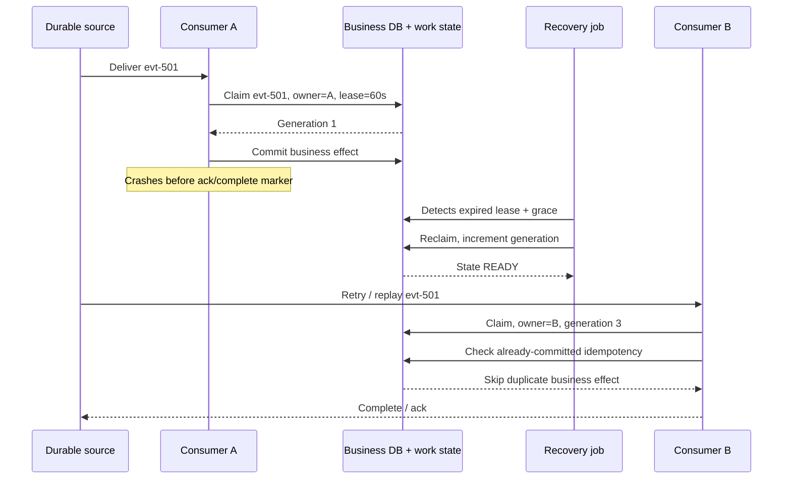
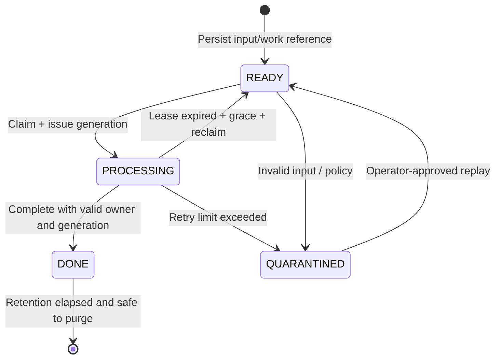
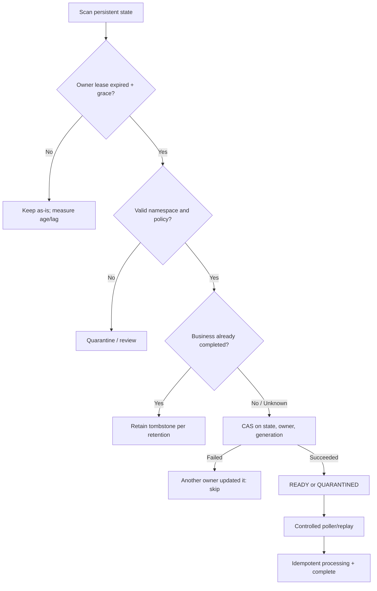

# Cleaning Up Ownerless State in Spring Integration

## 1. Why Do Restarts Create "Ownerless" State?

In the `SPRING_INTEGRATION_RUNTIME` module, Spring Integration executes and orchestrates message flows through **channels, endpoints, consumers, pollers, and executors**. In a persistent flow, data continues to live in databases, message stores, or metadata stores even after the process handling that data stops. This is necessary for recovery, yet it also produces **orphaned state**: records or message groups remain, while the component once responsible for them is no longer running or cannot resume the old work.

For example: pod A picks up message `payment:evt-501`, writes `owner=A`, `status=PROCESSING`, and begins calling a business service. Pod A is killed before confirming completion. After restart, the database still shows `status=PROCESSING`, yet no worker is actually finishing that work. If the system only processes `READY` records, the event may stay stuck indefinitely. If a cleanup task **simply deletes** the record, the event can be lost and the business effect can repeat if the source resends.

**Safe cleanup is usually an evaluation and ownership-reclaim workflow to resume processing**, not simply `DELETE`-ing stale records. To decide accurately, you must know: what the state represents, how ownership is verified, whether the business effect already committed, whether replay is possible, and whether the record is used to block duplicates.

### Learning Outcomes

After this lesson, you will be able to:

1. Distinguish message backlogs, message groups, lock records, checkpoints/metadata, and business-processing state on restart.
2. Identify **genuinely ownerless state** without confusing it with a slow worker, a paused worker, or a temporary disconnect.
3. Design **lease, heartbeat, grace period, generation/fencing, and compare-and-set** mechanisms for safe reclamation.
4. Coordinate cleanup with transactions, pollers, retries, message stores, idempotency, and error/recovery flows.
5. Use appropriate features of `MessageGroupStoreReaper`, orphan-group purge, and `JdbcLockRegistry` instead of manually deleting framework tables.
6. Write verifiable restart/crash tests: no lost state, old owners cannot illegally complete work, and messages can resume processing.

## 2. "Owner" Is Not One Universal Concept Across All Stores

An "owner" is the component with **processing responsibility or mutation rights over a piece of state at a given moment**. This term varies by resource type; not every Spring Integration table has an `owner_id` column.

| State Type | Semantic "Owner" | On Restart or Crash | Cleanup/Recovery Considerations |
|---|---|---|---|
| Application-claimed work item in JDBC | Worker/node holding processing rights with a lease | Record stays `PROCESSING`, worker may be gone | Conditionally reclaim then retry; do not delete payload |
| `JdbcLockRegistry` | Owner of the lock record in the repository | Lock may persist until TTL expires | Let repository expire/reacquire logic handle it; never blindly `DELETE INT_LOCK` |
| `MessageGroupStore` of aggregator/resequencer | Correlating endpoint responsible for completing the group | Group exists, yet timeout/release triggers may vanish on restart | Group timeout, orphan purge, or reaper; decide partial release vs. discard |
| Durable `QueueChannel`/broker | Consumer/in-flight delivery per queue or broker contract | Unacked messages may reappear, or get stuck if claims aren't revoked | Recover via transactions/acks/visibility timeouts; idempotency on redelivery |
| `MetadataStore` | Component holding checkpoints, dedup markers, or poller state | Persistent keys may no longer match the new lifecycle | Reconcile key semantics; delete only per verified TTL/policy |
| Dynamic `IntegrationFlow`/runtime endpoint | Application-managed registration/lifecycle | In-RAM flows do not recreate themselves from persistent state | Rebuild desired state/registrations at startup before deleting metadata |
| Temporary gateway reply channel | A single call awaiting a reply | Caller and temporary address may vanish after restart | Do not expect late replies to find old callers; use a response store or new protocol |

**There is no single "global reaper" for all state types.** Removing a group, pruning metadata, expiring a JDBC lock, or transitioning a work item from `PROCESSING` back to `READY` each follow the contract of **the component that owns that state**.

### Cases Where Checking Timestamps Alone Fails

- Worker A is executing an unusually slow HTTP call, yet it is **still alive**.
- JVM A hits a stop-the-world GC pause; heartbeats stop updating, yet A will resume shortly.
- Pod B reads from a lagging database replica and assumes owner A is gone.
- The app is undergoing a rolling deploy with mixed pod versions sharing a store.
- An aggregator is awaiting a final fragment by `correlationId`; the group is "old" yet **still valid** under SLA.
- Metadata `idempotent:evt-501` is a tombstone intentionally retained to block stale replays.

Therefore, **"missing heartbeat" or "stale update timestamp" is only a suspicion signal**. Correct reclamation requires combining leases, version checks, transactions, and business rules.

## 3. Crashing Between Milestones: Why a Surviving Row Is Not Enough

Look at a message-processing timeline:



In practice, **not** every source immediately redelivers once state is reclaimed; the system must ensure a path exists for producers/pollers to pick up `READY` items again, or that the message remains in a durable source. A reaper flipping state without a worker polling it leaves recovery incomplete.

Milestones to distinguish:

| Milestone | Meaning | Risk on Subsequent Crash |
|---|---|---|
| Message durably persisted | Source committed data per contract | New consumer must be able to re-read |
| Worker claims state | Owner holds temporary processing rights | Lease abandoned; requires reclamation |
| Business effect commits | Business data/side effect mutated | Replay may cause duplicates |
| Completion marker/ack commits | System records completion | If out of sync with business commit, may lose or duplicate effects |
| Cleanup of completed state | Deletes records no longer needed | Deleting too early strips recognition for late replays |

**A JDBC transaction is atomic only across resources actually enlisted in that transaction.** Committing the business DB does not ack the broker. Sending emails/HTTP requests cannot roll back via a JDBC transaction. Design idempotency/outbox/reconciliation whenever external side effects exist.

## 4. Classifying Actions When State Appears Ownerless

Before running cleanup, classify state into four buckets:

| Category | Example | Appropriate Action |
|---|---|---|
| **Recoverable work** | `PROCESSING` with expired lease; payload still in durable store | Revoke owner via CAS/fencing, reset to `READY`, let workers re-claim |
| **Completed state requiring retention** | Idempotency ledger, aggregator tombstones, verified checkpoints | Retain through retry/replay/late-message windows; never purge by arbitrary age |
| **Expired requiring business decision** | Incomplete aggregator group, pending approval, uncertain payment state | Partial result, discard, quarantine, or reconcile per contract; write audit trail |
| **State safe to delete** | `DONE` records past retention, unused lease caches, verified unreferenced temporary logs | Batch delete with version checks and monitoring |

Never conflate `retry` with `cleanup`. A record moved back to `READY` should travel through the same intake and error/retry policies as fresh work; do not let a reaper invoke external HTTP business side effects directly without idempotency.

### Minimum Principles

1. Clean up only records belonging to **your owned namespace/component**.
2. Decide using **state + lease + version**, never timestamps alone.
3. Mutate owner/state **atomically inside the shared store**.
4. **Increment `generation`** on reclaim so old owners cannot validly write "completed" with stale tokens.
5. Keep payloads/references for reprocessing; if unsure how to proceed safely, **quarantine** rather than delete.
6. Purge completed records only after **all replay, retry, DLQ, and restore windows** expire, keeping an independent ledger if needed.

## 5. Designing a Lease + Fencing Protocol for Owned State

For a work item that multiple pods can process, store at least:

- `work_id`: stable business ID across retries/redeliveries.
- `state`: e.g., `READY`, `PROCESSING`, `DONE`, `QUARANTINED`.
- `owner_id`: unique instance/boot identifier; avoid reusing plain pod names across restarts.
- `lease_until`: ownership deadline using **the shared backend's clock**.
- `generation`: monotonically incremented on each claim or reclaim; rejects writes from stale owners.
- `attempts`, `updated_at`, and `payload_ref`: for backoff, recovery, observability, and retrieving contents.

### 5.1. State Transitions



**The "lease expired" condition is part of the recovery policy.** If a paused worker resumes after its lease expired, `generation` acts as the fence for **token-checked writes**. It does not automatically block external APIs that do not verify fencing tokens.

### 5.2. Example PostgreSQL Schema

```sql
CREATE TABLE runtime_work (
    work_id VARCHAR(160) PRIMARY KEY,
    payload_ref VARCHAR(512) NOT NULL,
    state VARCHAR(24) NOT NULL
        CHECK (state IN ('READY', 'PROCESSING', 'DONE', 'QUARANTINED')),
    owner_id VARCHAR(160),
    lease_until TIMESTAMPTZ,
    generation BIGINT NOT NULL DEFAULT 0,
    attempts INTEGER NOT NULL DEFAULT 0,
    updated_at TIMESTAMPTZ NOT NULL DEFAULT CURRENT_TIMESTAMP,
    CHECK (
        (state = 'PROCESSING' AND owner_id IS NOT NULL
            AND lease_until IS NOT NULL)
        OR
        (state <> 'PROCESSING' AND owner_id IS NULL
            AND lease_until IS NULL)
    )
);

CREATE INDEX runtime_work_expired_idx
    ON runtime_work(lease_until)
    WHERE state = 'PROCESSING';

CREATE INDEX runtime_work_ready_idx
    ON runtime_work(updated_at)
    WHERE state = 'READY';

-- Event is durably persisted before dispatching to consumers.
INSERT INTO runtime_work(work_id, payload_ref, state)
VALUES ('evt-501', 'blob://invoices/evt-501.json', 'READY');
```

This schema is an **illustrative application-designed business table**, not internal Spring Integration DDL. `payload_ref` represents a retrievable data reference; when an object store is used, blob retention must outlive record retry/replay durations.

### 5.3. Atomic Claim, Never "SELECT Then UPDATE"

Once a worker sees `READY`, it claims using **a single conditional UPDATE** and receives the issued generation. PostgreSQL supports `RETURNING`:

```sql
UPDATE runtime_work
   SET state = 'PROCESSING',
       owner_id = :owner_id,
       lease_until = clock_timestamp() + INTERVAL '60 seconds',
       generation = generation + 1,
       attempts = attempts + 1,
       updated_at = clock_timestamp()
 WHERE work_id = :work_id
   AND state = 'READY'
RETURNING work_id, generation, lease_until;
```

If two pods claim simultaneously, the database serializes updates on the same row; **only the winning pod** receives a row matching `state='READY'`. The losing pod gets 0 rows and must not run business logic.

- `owner_id` should include a startup session identifier, e.g., `consumer-a:boot-uuid`.
- Returned `generation`/`lease_until` must be carried through to every completion update or heartbeat.
- If claim fails, the consumer must decide whether to retry later or end the duplicate delivery per contract — never pretend it ran business logic.
- `attempts` enforces retry budgets. With multiple duplicate sources, evaluate both total attempts and failure causes.

### 5.4. Renewing on the Same Owner/Generation

```sql
UPDATE runtime_work
   SET lease_until = clock_timestamp() + INTERVAL '60 seconds',
       updated_at = clock_timestamp()
 WHERE work_id = :work_id
   AND state = 'PROCESSING'
   AND owner_id = :owner_id
   AND generation = :generation
   AND lease_until > clock_timestamp();
```

If the update returns **0 rows**, the worker no longer holds a valid lease per the backend; **do not commit further side effects** without handling loss of ownership. `clock_timestamp()` comes from the database to prevent skewed pod clocks from misjudging lease deadlines.

Heartbeats should run early relative to the TTL based on **observed latency/GC pauses**. For long-running work on one thread, heartbeating from another thread works if **ownership is an application DB row/generation protocol**. This custom design **differs from `JdbcLockRegistry.renewLock()`**, which requires the current thread to hold the lock.

### 5.5. Completing Only While Ownership Still Holds

```sql
UPDATE runtime_work
   SET state = 'DONE',
       owner_id = NULL,
       lease_until = NULL,
       updated_at = clock_timestamp()
 WHERE work_id = :work_id
   AND state = 'PROCESSING'
   AND owner_id = :owner_id
   AND generation = :generation
   AND lease_until > clock_timestamp();
```

If the update returns 0 rows: **do not ack success** merely because the business method returned; investigate whether the old worker lost its lease or a new worker already handled the message. For JDBC business updates on the same datasource, put the business effect and this completion update in **the same transaction**; if completion fails, throw an exception to roll back the business effect.

If **payment/email/HTTP** already ran before completion, rolling back the DB still cannot undo the external side effect. You need provider idempotency keys, outbox/inbox, or reconciliation; generation only protects writes that actually **verify generation**.

### 5.6. Reclaiming When Lease Expires Past the Grace Period

```sql
UPDATE runtime_work
   SET state = CASE
           WHEN attempts >= 5 THEN 'QUARANTINED'
           ELSE 'READY'
       END,
       owner_id = NULL,
       lease_until = NULL,
       generation = generation + 1,
       updated_at = clock_timestamp()
 WHERE state = 'PROCESSING'
   AND lease_until < clock_timestamp() - INTERVAL '30 seconds'
RETURNING work_id, state, generation;
```

This **changes state**, without deleting the event. Incrementing `generation` during reclaim prevents the old worker from using its prior token to mark `DONE` under Section 5.5. Reapers running across multiple pods remain safe at the row-update level: the second pod cannot re-reclaim a row already transitioned out of `PROCESSING` when predicates are rechecked inside the transaction.

The 30-second **grace period** and 60-second TTL are **illustrative values only**. Tune them based on SLAs, actual processing duration, GC pauses, backend latency, and retry characteristics. If the reaper runs every 1 minute, an item may sit expired for nearly an extra cycle before reclamation.

### 5.7. Do Not Delete DONE Just Because It Looks "Old"

Completed records can be batch-deleted once recovery is definitely unnecessary and a sufficiently long-lived idempotency ledger exists. For example:

```sql
-- Illustrative only; verify real retention requirements before running.
DELETE FROM runtime_work
 WHERE state = 'DONE'
   AND updated_at < clock_timestamp() - INTERVAL '30 days';
```

If `runtime_work` is the **sole ledger** identifying processed events, deleting rows can allow old events to be re-imported and processed a second time. Retention must cover retries, dead-letter replays, source retention, backup restores, and audit policies.

## 6. Connecting the Reaper to Spring Integration Runtime

The SQL in Section 5 is an application-specific state protocol. You can schedule a **periodic recovery job**, then let a polling consumer pick up `READY` work items and feed them into the flow.

### 6.1. Periodic Reaper Task Using JdbcTemplate

Example using Java 17+, Spring JDBC, and Spring Scheduling; PostgreSQL table `runtime_work` from Section 5 already exists. This is a **state cleanup task**, not a direct payload processor.

```java
package example.integration;

public record RecoveredWork(String workId, String newState, long generation) {}
```

```java
package example.integration;

import java.util.List;

import org.springframework.jdbc.core.JdbcTemplate;
import org.springframework.scheduling.annotation.Scheduled;
import org.springframework.stereotype.Component;

@Component
public class OrphanLeaseReaper {

    private final JdbcTemplate jdbc;

    public OrphanLeaseReaper(JdbcTemplate jdbc) {
        this.jdbc = jdbc;
    }

    @Scheduled(fixedDelay = 60_000L)
    public void reclaimExpired() {
        String sql = """
            UPDATE runtime_work
               SET state = CASE
                       WHEN attempts >= 5 THEN 'QUARANTINED'
                       ELSE 'READY'
                   END,
                   owner_id = NULL,
                   lease_until = NULL,
                   generation = generation + 1,
                   updated_at = clock_timestamp()
             WHERE state = 'PROCESSING'
               AND lease_until < clock_timestamp() - INTERVAL '30 seconds'
            RETURNING work_id, state, generation
            """;

        List<RecoveredWork> recovered = jdbc.query(sql, (rs, row) ->
                new RecoveredWork(
                        rs.getString("work_id"),
                        rs.getString("state"),
                        rs.getLong("generation")));

        for (RecoveredWork item : recovered) {
            // Demo: replace with structured logging + metrics.
            System.out.println("reclaimed " + item.workId()
                    + " -> " + item.newState()
                    + " generation=" + item.generation());
        }
    }
}
```

Add `@EnableScheduling` to an application configuration class if not already enabled:

```java
import org.springframework.context.annotation.Configuration;
import org.springframework.scheduling.annotation.EnableScheduling;

@Configuration
@EnableScheduling
public class RecoverySchedulingConfig {
}
```

**Why can multiple pods run the reaper concurrently?** The sample task uses a single `UPDATE ... WHERE state='PROCESSING' AND lease_until ...` against the shared database; PostgreSQL's predicates and row locks prevent two jobs from mutating an already reclaimed row. If the job also needs to **write audits, outbox rows, or send recovery commands**, ensure related updates share the transaction or use a durable outbox; never send a message to an external channel right after updating and assume it is an atomic commit.

**Downstream processing path:** a poller/adapter should read `runtime_work.state='READY'` (ordered/bounded in batches), emit `work_id` into the channel, and let the handler perform the **conditional claim** from Section 5.3 before running business logic. Two instances may spot the same `READY` ID; the claim `UPDATE` protects against the race. If downstream is an `ExecutorChannel`, the poller's transaction **does not propagate** to the worker; the business/completion transaction must open on the worker thread.

Sample channel and ID-receiving handler configuration:

```java
import org.springframework.context.annotation.Bean;
import org.springframework.integration.annotation.ServiceActivator;
import org.springframework.integration.channel.DirectChannel;
import org.springframework.messaging.MessageChannel;

@Bean
public MessageChannel recoverableWorkIn() {
    return new DirectChannel();
}

@ServiceActivator(inputChannel = "recoverableWorkIn")
public void processReadyWork(String workId) {
    // 1. Claim workId with UPDATE ... WHERE state='READY'.
    // 2. Run business logic only if claim succeeds.
    // 3. Renew lease if needed; complete conditionally inside transaction.
    // 4. On error, let retry/error flow preserve state for recovery.
}
```

This fragment illustrates **the entry point into Spring Integration**; place the methods in the corresponding `@Configuration` / `@MessageEndpoint` beans, and ensure the app has an actual poller/source emitting `work_id`. It is not a complete runnable flow without an ID source and implementation of the four commented steps. That separation is intentional so you do not assume sending to an in-memory channel equals a persistent queue.

### 6.2. Controlling Frequency and Failures

- Cap batch sizes per scan — for example using `LIMIT` via a CTE and `FOR UPDATE SKIP LOCKED` in PostgreSQL — to avoid long transactions and pressure during large backlogs.
- Index `state/lease_until` and inspect actual execution plans; avoid full table scans on every poll cycle.
- If the database is unavailable, the job must log/record metrics and retry next cycle; **never** fall back to deleting local state.
- Do not run CPU-heavy cleanup on a scheduler thread shared with critical pollers if it can delay processing; isolate schedulers/executors and bound query durations.
- `QUARANTINED` records do not automatically return to `READY`: they require operator review, fixing the root cause, and controlled replay.
- Track metrics `orphan_age`, `reclaimed_total`, `quarantined_total`, `late_owner_completion_rejected_total`, and `recovery_backlog` to distinguish "reaper ran" from "system recovered."

## 7. For MessageGroupStore: Expiring Groups Differs from Reclaiming Work Items

An `Aggregator` or `Resequencer` backed by `MessageGroupStore` may still hold groups after a restart. In Spring Integration docs, an "orphaned" group typically means **a group sitting in the persistent store with no incoming message stream left to trigger release**, rather than necessarily having an owner or lease column.

For example, three fragments of a transaction:

```text
A1(groupId=ORDER-7, seq=1, size=3)
A2(groupId=ORDER-7, seq=2, size=3)
... restart ...
A3 never arrives
```

Waiting solely for the third message leaves the group hanging forever. Spring Integration provides dedicated mechanisms:

| Mechanism | How to Use | Business Decision Required |
|---|---|---|
| `groupTimeout` / `groupTimeoutExpression` | Force-completes/expires groups when timeout conditions apply | Emit partial result or discard? |
| `MessageGroupStoreReaper` | Periodic task expiring groups older than a threshold in `MessageGroupStore` | Schedule, TTL, callbacks, release rules, and store scope |
| `expireTimeout` and `expireDuration` on aggregator/resequencer | Automatically purges orphaned groups at startup and periodically (when configured) | Dedicated store per correlating endpoint; partial/expire policy |
| Retaining completed empty groups | Tombstone to reject late-arriving messages when `expireGroupsUponCompletion=false` | How long to retain tombstones to prevent accidental group recreation? |

Spring Integration XML example (fragment): a reaper scheduled externally to the endpoint:

```xml
<bean id="groupReaper"
      class="org.springframework.integration.store.MessageGroupStoreReaper">
    <constructor-arg ref="ordersGroupStore"/>
    <property name="timeout" value="600000"/>
</bean>

<task:scheduled-tasks scheduler="groupCleanupScheduler">
    <task:scheduled ref="groupReaper"
                    method="run"
                    fixed-delay="60000"/>
</task:scheduled-tasks>
```

Requires declaring the Spring `task` namespace, an `ordersGroupStore` bean implementing `MessageGroupStore`, and an appropriate scheduler. `timeout=600000` is a **10-minute group-age threshold** in this example; since the task runs every minute, expiration can lag by nearly one period. **Use this only for groups properly owned by the endpoint**, because expiration invokes callbacks that can release a **partial group** or discard it depending on configuration.

When using the aggregator's built-in `purgeOrphanedGroups`/`expireTimeout` mechanism, the documentation requires **a dedicated message group store per correlating endpoint** so one aggregator does not purge another aggregator's groups. Settings like `expireGroupsUponTimeout` or `sendPartialResultOnExpiry` alter business state after timeout. Never run raw SQL `DELETE` on message group tables instead of expiring via the API: you bypass callbacks, tombstones, and idempotency semantics.

**Critical point for late messages:** Once a group is **deleted completely**, a late-arriving message can create a new group with the same correlation ID. If you retain empty completed groups to **reject late messages**, deleting tombstones too early can cause duplicate releases. Retention must match source latency and replay windows.

## 8. For JdbcLockRegistry: Lock Reclamation Must Follow Repository TTL

`JdbcLockRegistry` uses `DefaultLockRepository` and the `INT_LOCK` table to coordinate distributed locks across instances. If an owner dies while holding a lock, the repository provides a TTL mechanism so other instances can acquire the lock once eligible.

- **Never run ad-hoc cleanup jobs like `DELETE FROM INT_LOCK WHERE ...`** without understanding owner, region, TTL, and schema. An unexpired lock may still be held by an active thread.
- `DefaultLockRepository` and `JdbcLockRegistry` handle reclamation automatically during acquisition; you do not need scheduled row cleanup like an application-defined `runtime_work` table.
- `JdbcLockRegistry.renewLock()` may only be called when **the current thread** holds the lock; an arbitrary background scheduler thread cannot renew a handler's lock.
- TTL expiration **does not interrupt the old owner's code**. Owner A can resume after a GC pause even after owner B has acquired the lock.
- In newer versions, `unlock()` can throw when ownership was lost (e.g., `ConcurrentModificationException` with JDBC locks); reconcile the protected data instead of ignoring it.

**Schema versions:** Spring Integration 7.0 adds per-lock TTL support for `JdbcLock` and an `EXPIRED_AFTER` column in DDL. Projects on 6.x must follow the schema, API, and migrations of their running version. Fields like `created_date`/`expired_after` are not targets for arbitrary application cleanup.

If business state must guarantee it cannot be overwritten by an old owner after lease expiry, use **fencing tokens/versions on the business resource**, optimistic concurrency, or appropriate transactions/unique constraints. A leased distributed lock does not by itself guarantee exactly-once at an external system.

## 9. For MetadataStore: Old Keys Do Not Equal Useless Keys

`MetadataStore` commonly persists offsets, "files seen," idempotency markers, or inbound adapter checkpoints. A key can outlive the component version that created it, yet **deleting the key** can cause old data to be re-read or an event to be reprocessed.

Semantic classification:

| Key/Metadata | When to Suspect Orphaned? | When Safe to Delete? |
|---|---|---|
| `idempotent:orders:evt-501` | Old component version no longer runs | Only after replay window closes and policy confirms duplicate blocking is unneeded |
| `file-filter:invoices:path+timestamp` | File processed, though source may persist long-term | Depends on source replayability and file delete/move ownership |
| `poller:source:last-offset` | Old adapter replaced by another adapter | Must plan migration/start position; deleting can reset cursor |
| Application-managed `owner:instance:boot-uuid` | Heartbeat stopped past lease/grace | Revoke via CAS/version; delete only when no consumer references it |
| Temporary routing mapping | Call timed out / instance restarted | Delete per registry lifecycle and reply/error flow design; do not retain forever |

`SimpleMetadataStore` lives only inside `ApplicationContext`; restarts **automatically lose** its state, requiring no durable cleanup. `JdbcMetadataStore`/Redis/Properties stores preserve keys across restarts; for those, define TTLs, retention, and reconcile **key namespace + consumer version + source of truth**.

`ConcurrentMetadataStore.replace(key, expected, newValue)` provides conditional updates against an expected value, but protects **only one key/value**. If an owner ledger and business DB live on separate resources, a successful metadata replacement does not create an atomic commit across both.

**Tombstones are not garbage by default.** Completed group markers or idempotency records often exist *specifically* to stop stale requests from running again; every cleanup policy must account for broker replay windows, DLQs, backup restores, and external APIs.

## 10. Durable Queues, Message Stores, and Dynamic IntegrationFlow Lifecycles

### 10.1. Durable Queues and Consumer Ownership

A consumer crashing after receiving a message can leave **in-flight state**. Depending on the adapter:

- Brokers can redeliver unacknowledged messages via their own mechanisms.
- JDBC-backed queues can return messages via rollback if **receive and business processing share the right transaction/resource**.
- In-memory `QueueChannel`s do not get dequeue rollback from a JDBC transaction manager; restarts can lose messages.
- `ExecutorChannel` hands work to a new thread; transactions/leases on the sending thread do not automatically follow to the worker.

**Never "reclaim" a queue by manually re-inserting rows that look "old."** Doing so can create duplicates or break adapter ordering/ack contracts. Follow the source's visibility timeout, ack/nack, message store transactions, and retry policies. If the source cannot replay, build an inbox/outbox or durable work table before treating cleanup as safe.

### 10.2. Dynamic IntegrationFlows Cannot "Resurrect" from Old Metadata

Flows registered dynamically via `IntegrationFlowContext` have a runtime lifecycle. Restarting the JVM creates a fresh `ApplicationContext`; old in-memory registrations do not reappear just because metadata describes a previously existing flow.

If the application must resume dynamic flows, persist **desired configuration** in a durable store, and at startup:

1. Read the list of flows to run and their versions/configs.
2. Re-register flows via supported runtime APIs.
3. Start adapters/pollers/consumers once dependencies and stores are ready.
4. Reconcile runtime registrations against desired state.
5. Delete **only metadata of genuinely decommissioned flows** — never wipe configs just because a flow hasn't initialized yet.

In rolling multi-instance deployments, decide whether a flow runs on all instances or a single leader, and guard against duplicate source polling and cross-instance correlation issues. Leader election or distributed locks do not replace desired-state management.

## 11. Identifying Reclaimable State Without Races

A safe recovery job evaluates these conditions together:



### Common Race Conditions

**Race with heartbeat:** the reaper reads "expired" and the worker renews before the reaper updates. If the reaper uses a **direct conditional UPDATE** instead of read-then-delete, one operation wins in the database; predicates are evaluated against the current row state.

**Race with a returning old worker:** the reaper resets state to `READY` and increments `generation`, and worker B claims it. Worker A wakes up and attempts to complete with its old token; `UPDATE ... WHERE generation=:old` returns 0. However, if A already sent an email or called an external HTTP API, **DB-row fencing alone** is insufficient.

**ABA problem:** an owner named `worker-1` reappears after restart; comparing `owner_id` alone conflates old and new ownership. Use `boot UUID + generation`, not just hostnames or pod names.

**Clock skew:** if each pod computes lease deadlines using its local clock, clock drift triggers premature or delayed reclamation. Use **the shared backend's clock** for claim, renew, and expire in JDBC patterns.

**Split-brain or network partition:** a pod unable to reach the store has not necessarily stopped executing business calls. When ownership cannot be confirmed, **fail closed** on side effects needing exclusive ownership and enforce fencing/idempotency at the target.

**Multi-resource updates:** flipping state to `READY` in JDBC and publishing a broker message are two separate writes. Crashing in between can lose the notification or duplicate it; use **polling on the source of truth** or a transactional outbox.

## 12. Observability and Post-Restart Cleanup Runbook

A reaper running successfully does not mean the system finished clearing lingering state. Measure **items reclaimed**, **items subsequently completed**, and **final business effects**.

| Metric/Log | Question It Answers |
|---|---|
| `orphan_candidates` by state type | How many records are past lease/grace? |
| `oldest_orphan_age` | How long has the oldest stuck record waited? |
| `reclaimed_total`, `reclaimed_failed_total` | Is cleanup actually transitioning state or failing? |
| `late_owner_completion_rejected_total` | Are stale workers attempting commits with invalid generations? |
| `ready_backlog`, `quarantined_total` | Are recovered items re-entering processing or piling up? |
| `group_expired_total`, `partial_release_total` | Did aggregators expire or emit partial groups? |
| `lock_acquire_latency`, `lease_expired_total` | Is the lock registry seeing contention or overly short TTLs? |
| `duplicate_detected_total`, `business_commit_total` | Are replays multiplying business effects? |
| `recovery_drain_duration` | How long does draining post-restart backlog take relative to SLA? |

### Incident Response Sequence

1. **Identify the source of truth:** JDBC queue, `MessageGroupStore`, metadata table, lock repository, or durable broker. Never apply another table's SQL cleanup.
2. **Reconstruct the timeline:** `received -> claimed -> heartbeat -> business commit -> ack/complete -> process exit -> lease expiry -> reclaim`. Join by business event ID, owner ID, and generation.
3. **Assess blast radius:** how many work items are `PROCESSING`, how many groups are incomplete, what is oldest queue age, and how many instances are running?
4. **Check liveness and leases:** are owners mutating state, are there GC pauses/DB outages, rolling deploys, or clock skew?
5. **Run a dry-run:** list candidates with the matching `SELECT`; check age, status, namespace, and unfinished business state. Quarantine suspicious rows rather than bulk deleting.
6. **Conditionally reclaim:** let the scheduled reaper or component API update; log modified row counts and outcomes; cap batch sizes.
7. **Verify reprocessing:** have sources/consumers/pollers resumed, do states reach `DONE` or `QUARANTINED`, are there serialization/correlation errors?
8. **Reconcile business state:** check invoices/payments/emails/orders and idempotency markers, especially when crashes occurred post-commit and pre-ack.
9. **Fix root causes:** TTL/heartbeat, transactions, executor handoffs, group timeouts, schema/serializers, retry backoff, or capacity.
10. **Re-measure RTO/RPO:** confirm recovery finished within SLA without losing or duplicating business effects outside contract.

Never log payloads, secrets, or raw PII when logging candidates; use `work_id`/correlation tokens compliant with data policies.

## 13. Common Symptoms

| Symptom | Likely Cause | First Diagnostic Step |
|---|---|---|
| `PROCESSING` lingers forever after pod crash | Missing TTL/reaper or reaper not running | Check `lease_until`, scheduler, indexes, error logs |
| Reaper runs yet no worker reprocesses | No source/poller reading `READY`, or payload missing from queue | Check durable source, `payload_ref`, and dispatch path |
| Item processed twice after reclaim | Business committed before ack; missing idempotency | Inspect ledger by `work_id` and transaction outcomes |
| Old worker commits after lease expiry | Missing generation/owner check on commit, or external API lacks idempotency | Audit versioning/fencing and side-effect origins |
| Reapers across pods "fight over rows" | Non-atomic read-then-update | Switch to conditional CAS/UPDATE on shared DB |
| Aggregator group never disappears after restart | Missing group timeout/reaper/orphan purge, or schedule hasn't fired | Inspect component config, group store, and release strategy |
| Late message creates a new group causing duplicates | Group tombstone deleted too early | Check `expireGroupsUponCompletion` and retention |
| `JdbcLockRegistry` stays locked | TTL not expired, failing DB/owner, wrong region | Check lock owner, TTL/renew, and repository logs |
| "Processed" metadata causes permanent message skip | Marker written before side effect, then transaction rolled back | Compare marker with business effect and retry path |
| Gateway reply arrives post-restart with no caller | Temporary reply address vanished | Design durable response store/correlation if required |
| Cleanup deletes too much after deploy | Overly short TTL/grace or wrong clock/namespace | Stop job, audit logs, and restore from backup if needed |

## 14. Practice Labs: Verifiable Crash/Restart Drills

Use the PostgreSQL `runtime_work` table from Section 5 and the reaper from Section 6 in a test environment. For each drill, record **row before/after**, **generation**, **owner**, **business effect**, **receive/ack status**, and **restart timestamp**.

1. **Baseline:** insert `evt-501` as `READY`; worker A claims (generation 1) and completes before TTL; reaper leaves `DONE` untouched.
2. **Crash after claim:** worker A claims and stops without completing; wait `lease_until + grace`; reaper moves `PROCESSING -> READY` and increments generation; worker B re-claims.
3. **Old owner resumes:** retain A's old owner/generation token; after reaper reclaims and B claims, attempt `COMPLETE` from A; verify 0 rows updated and final state untouched.
4. **Heartbeat race:** have worker A renew close to a reaper scan; verify conditional SQL does not reclaim a lease still valid at update time.
5. **Crash after business commit before ack:** simulate event replay after effect commits; use the idempotency ledger to verify the business effect happens only once.
6. **Retry budget:** fail an item repeatedly until `attempts >= 5`; after expiry, confirm the reaper moves it to `QUARANTINED` requiring an operator replay decision.
7. **Two instances running reaper concurrently:** run two app instances pointing to the same database; verify each row is reclaimed with a single generation bump, not flipped to `READY` redundantly.
8. **Temporary database outage:** disconnect the test DB; observe workers failing closed and the reaper retrying next cycle; verify no arbitrary local cleanup happens.
9. **MessageGroupStore:** create a group missing its final message, restart the app, and apply group expiration policy; measure partial/discard and late-message behavior.
10. **Retention:** create `DONE` and idempotency markers, simulate source replay past cleanup time; prove why markers must be retained long enough.
11. **Dynamic flow:** persist desired registrations to a durable store, restart context, rebuild flows before letting sources accept messages; verify no stale metadata is deleted prematurely.

Verification checklist:

| Property | Values to Record |
|---|---|
| `work_id`, `owner_id`, `generation` | Is current ownership unambiguous? |
| `lease_until`, `updated_at`, grace | Was the state genuinely eligible for reclaim? |
| `state` before and after cleanup | `READY`, `PROCESSING`, `DONE`, `QUARANTINED`? |
| Poller/source status | Was the reclaimed work re-read? |
| Transaction/ack | Commit, rollback, nack, or redelivery? |
| Idempotency key and business outcome | Were any side effects duplicated or lost? |
| Error flow, DLQ, recovery | Was the terminal failure handled or still stuck? |
| Restart metrics | RPO/RTO, backlog drain, orphan age? |

## 15. Design Checklist Before Enabling Cleanup in Production

- **Distinguish resources:** work leases, JDBC locks, message groups, message queues, and metadata have distinct cleanup contracts.
- **Never rely on timestamps alone:** identify owner, state, TTL, grace, generation, and source of truth.
- **Conditional reclamation:** `UPDATE ... WHERE state/owner/generation/lease`; avoid read-then-delete, and increment generation on reclaim.
- **Never delete payloads of unfinished work:** transition to `READY` or `QUARANTINED` and ensure poller/replay paths remain active.
- **Protect business effects:** transactions on the right resource, idempotency ledgers, and fencing/optimistic concurrency; external APIs need idempotency or reconciliation.
- **Use framework APIs properly:** use `MessageGroupStoreReaper`/group timeouts for aggregators and `JdbcLockRegistry`'s TTL/reacquisition; avoid raw SQL deletes on internal tables bypassing lifecycle.
- **Retain tombstones and metadata long enough:** account for retries, DLQs, source replays, backup restores, and late messages.
- **Bound batches and backend load:** indexes, schedulers, timeouts, backoff, and quotas; observe throughput and orphan age.
- **Test real crashes:** before/after commits, before acks, pauses longer than lease, rolling restarts, multiple instances, and backend outages.
- **Maintain manual recovery paths:** auditing, quarantine, controlled replay, and data reconciliation when states are uncertain.

### Official References

- [Spring Integration Reference — Aggregator](https://docs.spring.io/spring-integration/reference/aggregator.html): `MessageGroupStoreReaper`, group timeouts, orphaned group purge, completed groups/tombstones, and late arrivals.
- [Spring Integration Javadoc — MessageGroupStoreReaper](https://docs.spring.io/spring-integration/docs/latest-ga/api/org/springframework/integration/store/MessageGroupStoreReaper.html): lifecycle and `run()` for scheduled expiration.
- [Spring Integration Reference — JDBC Lock Registry](https://docs.spring.io/spring-integration/reference/jdbc/lock-registry.html): lock TTL, ownership, renewal, expiration, and lost-ownership behavior.
- [Spring Integration Reference — Metadata Store](https://docs.spring.io/spring-integration/reference/meta-data-store.html): storing metadata, persistent stores, and marker retention.
- [Spring Integration Reference — Message Store](https://docs.spring.io/spring-integration/reference/message-store.html): persisting messages/groups and state recovery.
- [Spring Integration Reference — Transaction Support](https://docs.spring.io/spring-integration/reference/transactions.html): transactions for polling endpoints, thread boundaries, and rollbacks.
- [Spring Integration Reference — Dynamic Integration Flows](https://docs.spring.io/spring-integration/reference/dsl/java-runtime-flows.html): managing `IntegrationFlowContext` at runtime.
