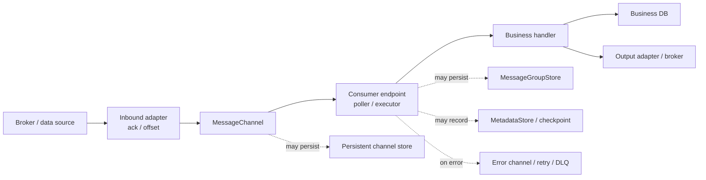
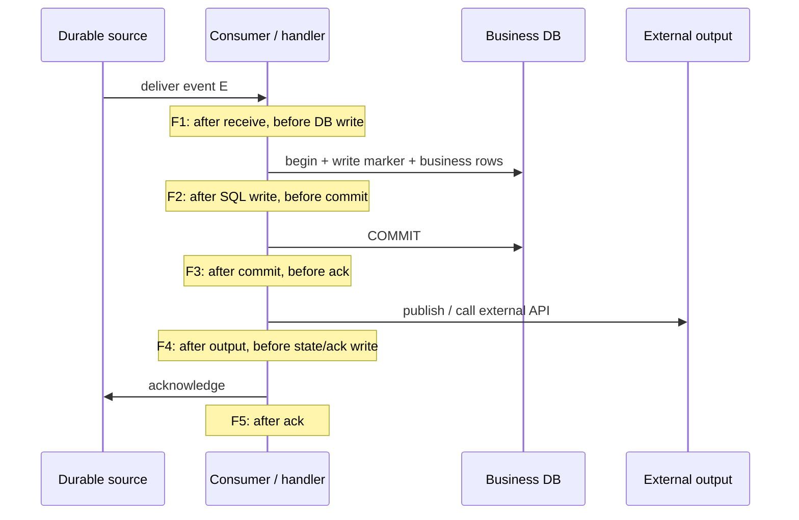
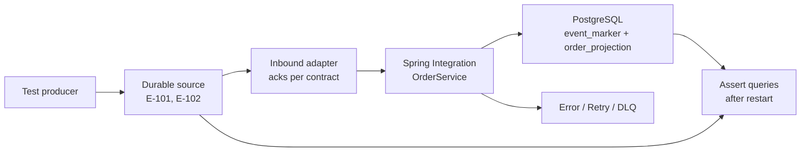
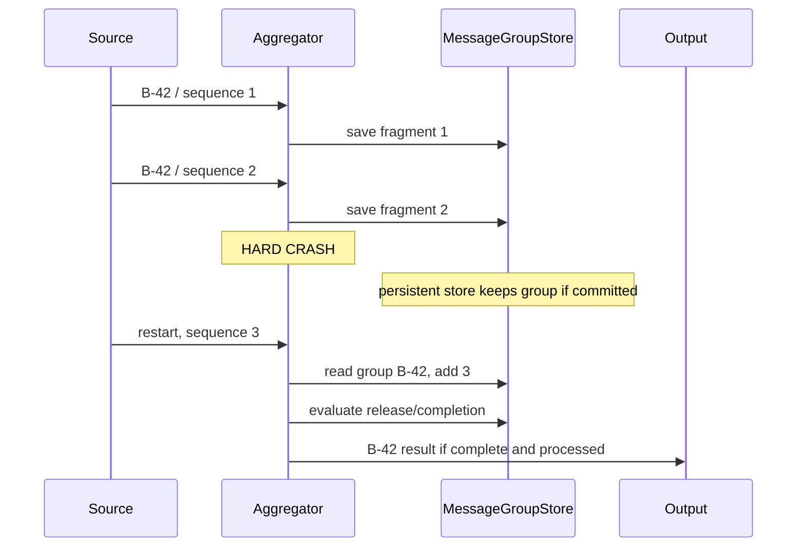
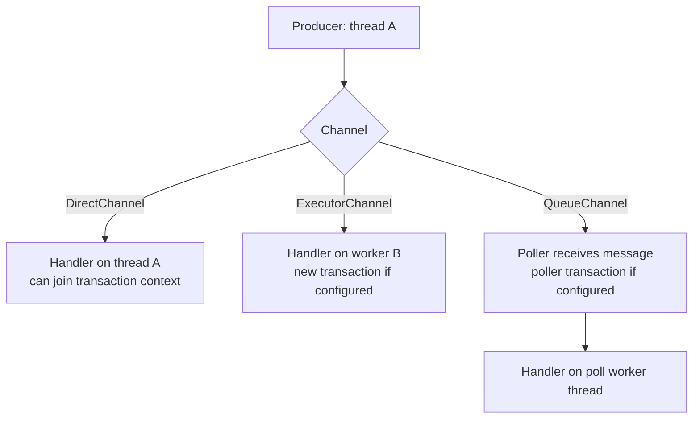

# Testing Crashes, Restarts, and Recovery

## 1. Goal: What Must Be Proven After a Sudden JVM Death?

A Spring Integration system typically includes inbound adapters, channels, consumer endpoints, pollers, executors, and business handlers. A message may be sitting in a `QueueChannel`, stored inside an aggregator's `MessageGroupStore`, or already written to a database when the process is suddenly terminated. After restart, the question is not simply "is the app running again?" but rather:

1. **Which data still exists?** Where were messages, group state, checkpoints, metadata, and transactions durably saved?
2. **Which work is reprocessed?** Does the message source redeliver, and who decides acknowledgment?
3. **Do side effects repeat?** Did the database commit, did an HTTP API accept a command, or was an event emitted before the JVM died?
4. **Do flows automatically resume?** Are consumers, pollers, schedulers, error handlers, and dynamic `IntegrationFlow`s re-registered and restarted properly?
5. **Can it be proven with numbers?** Do logs, correlation IDs, message stores, transaction states, and final data match expectations?

This lesson belongs to the **Persistence and Restarts** chapter of the **SPRING_INTEGRATION_RUNTIME** module. The focus is designing and executing controlled tests to evaluate message-flow recovery across channels, endpoints, pollers, executors, transactions, retries, message stores, error channels, and correlation.

> **Foundational Principle:** "Restarted cleanly," "message remains in store," "message delivered at least once," and "side effect occurred exactly once" are **four distinct claims**. Each claim requires its own test and evidence.

## 2. Understanding Crashes, Stops, and Restarts Accurately

| Scenario | Meaning | Used to Verify |
| --- | --- | --- |
| **Graceful stop** | App receives shutdown signal, runs shutdown hooks, stops pollers, and closes resources | Lifecycle, draining, shutdown timeouts, zero lost messages during controlled stops. |
| **Crash / hard kill** | JVM process terminates abruptly with no guarantee that `finally`, shutdown hooks, or open transactions finish | Ability to recover from durable state without cleanup. |
| **Restart with same durable backend** | New JVM reuses the previous database/broker/store | That committed data and checkpoints can be read back. |
| **Restart with fresh/empty storage** | New JVM with replaced database/broker/volume | **Not** a durable state recovery test; used to verify cold-start bootstrap behavior. |
| **Crash between two systems** | DB committed yet broker unacked, or external API succeeded yet marker unwritten | Duplicates, idempotency, reconciliation, outbox. |
| **Disconnection / partition** | JVM stays alive but loses connectivity to source or store | Retries, timeouts, leases, split-brain; distinct from hard kills. |

A standard stop command like `docker compose restart` or `systemctl stop` is insufficient to simulate an instant JVM kill. Conversely, `SIGKILL` only simulates **process loss**, not necessarily **power loss, disk corruption, or database failover**. Explicitly document which failure mode is being tested.

**Safety Rule:** run tests only in test environments with synthetic data and resettable databases and brokers. Never run kill commands in production without an approved operational procedure.

## 3. State Map Inside an IntegrationFlow



After a crash, each location has different durability mechanics:

| State | Example | What Happens If Only in RAM? |
| --- | --- | --- |
| Queued messages | `QueueChannel`, executor queues | Vanish with the process unless replayed by an external source. |
| Incomplete message groups | Aggregator, resequencer, `MessageGroupStore` | Waiting fragments can be lost; post-restart batches lack full groups. |
| Metadata/checkpoints | `MetadataStore`, accept-once markers, `PROCESSING/DONE` states | May re-read files/events from the beginning or forget what was processed. |
| Correlation/sequence | `correlationId`, `sequenceNumber`, `sequenceSize` | Preserved if kept in durable message headers; not preserved by default in logs or local variables. |
| Business database | Committed JDBC/JPA transactions | Survives if the database stays up and persists durably; uncommitted transactions roll back on connection loss. |
| Broker ack/offsets | Kafka offsets, RabbitMQ acknowledgments, JMS sessions | Governs redelivery per configured transport and mode. |
| Locks/leases | `LockRegistry`, ownership, and fencing metadata | In-JVM locks vanish when process dies; shared backends have their own expiry/renewal policies. |

**`MessageStore` does not replace `MetadataStore`.** A message store holds payloads/headers or groups; a metadata store holds checkpoints and conditional markers. Persisting messages while forgetting deduplication can still cause duplicate side effects upon redelivery.

## 4. Guarantees Commonly Confused

Distinguish **delivery semantics** from **business effect semantics**:

| Property | Required Conditions | What It Does *Not* Promise |
| --- | --- | --- |
| **At-most-once delivery** | May acknowledge before processing or never redeliver | May lose messages on crash. |
| **At-least-once delivery** | Durable source that redelivers when unacknowledged | May deliver and process duplicates. |
| **Durable message storage** | Store and state-writing tx committed, storage persists | Does not guarantee consumer processed successfully. |
| **Idempotent business effect** | Stable business key, unique constraint, or target-side idempotency | Does not mean the message is delivered only once. |
| **Atomic local database transaction** | Changes share a resource and matching transaction manager | Does not roll back HTTP calls or broker acks outside that transaction. |
| **End-to-end exactly-once** | Very specific contracts across source, state, output, and transactions/offsets/idempotency | Cannot be inferred merely from `@Transactional` or `JdbcMessageStore`. |

A practical goal in many architectures is **at-least-once delivery + idempotent side effects**. The broker may resend events, while the business database applies the effect of `eventId` only once. Verify **business effect count**, not just handler invocation count.

## 5. Designing a Crash-Window Matrix Before Running Tests

Place *failpoints* at exact moments. Killing a process at random makes it hard to tell whether the crash occurred before or after commit/ack.



This is an **illustrative timeline**, not a mandatory order for every adapter. Some systems emit output before DB commit; others use an outbox to emit **after** commit. Measure the exact order on your own flow.

| Failpoint | State Remaining After Crash | What to Verify |
| --- | --- | --- |
| **F0 – Before source persists message** | No durable event yet | Does producer retry/confirm properly? This is producer-side. |
| **F1 – After receive, before business work** | Source likely still holds unacked event | Is event redelivered; did the inbound adapter ack too early? |
| **F2 – SQL executed, not committed** | DB changes should roll back when transaction aborts | Did any business row or marker leak outside the transaction? |
| **F3 – DB committed, source unacked** | DB updated, message may redeliver | Do unique keys/idempotency block a second business effect? |
| **F4 – External output received, checkpoint/ack incomplete** | External resource may have side effect unrecorded in store | Does the target have an idempotency key or reconciliation mechanism? |
| **F5 – Source acked** | Event may not redeliver | Did ack happen **after** required state was persisted? |
| **Aggregator – Holds 2/3 fragments** | Group waiting for release | Do fragments survive restart and keep the same group ID? |
| **Aggregator – Released, output not yet published** | Group may be marked completed | Is output lost or duplicated after restart? |
| **Checkpoint – Metadata written before processing** | Marker exists even though side effect never finished | Is the event permanently skipped due to an early checkpoint? |

**PASS criteria** must be written **before** testing: "E can redeliver, `event_marker` has exactly one row, `order_projection` has exactly one effect, and zero messages remain stuck without recovery." Avoid vague criteria like "no errors seen."

## 6. The Lab: An Architecture Small Enough to Measure Recovery

Choose a test setup consisting of:

1. A **durable source** (e.g., a broker with durable storage, or a `QueueChannel` backed by a compatible persistent message store).
2. A Spring Integration consumer flow with a JDBC handler.
3. A **separate database preserved across restarts**.
4. An error/recovery path for persistently failing events.
5. A test driver sending events with stable `eventId`s and asserting outcomes.



In the Java example below, `DirectChannel` serves only as a **mock entry point to test the handler and local transaction**. It **does not create a durable source** and provides no ack/redelivery. To run end-to-end crash tests, place an inbound adapter or a polling channel backed by durable storage in front of that channel, configuring acks and transactions per your chosen transport.

### Demo Schema (PostgreSQL)

```sql
CREATE TABLE event_marker (
    event_id VARCHAR(120) PRIMARY KEY,
    applied_at TIMESTAMP NOT NULL DEFAULT CURRENT_TIMESTAMP
);

CREATE TABLE order_projection (
    order_id VARCHAR(120) PRIMARY KEY,
    quantity INTEGER NOT NULL
);
```

Here, `eventId` is the idempotency key for **one processed event**, while `orderId` identifies the business entity. Multiple valid events can update the same `orderId`; therefore, do not use `orderId` as the unique deduplication key that drops subsequent updates.

### JDBC Handler with Marker and Business Write in the Same Transaction

```java
import org.springframework.jdbc.core.JdbcTemplate;
import org.springframework.stereotype.Service;
import org.springframework.transaction.annotation.Transactional;

@Service
public class DurableOrderService {

    public record OrderEvent(
            String eventId, String orderId, int quantityDelta) {}

    private final JdbcTemplate jdbc;

    public DurableOrderService(JdbcTemplate jdbc) {
        this.jdbc = jdbc;
    }

    @Transactional
    public void process(OrderEvent event) {
        if (event.eventId() == null || event.eventId().isBlank()
                || event.orderId() == null || event.orderId().isBlank()) {
            throw new IllegalArgumentException("Missing eventId / orderId");
        }

        // PostgreSQL-specific ON CONFLICT syntax.
        int inserted = jdbc.update(
            "INSERT INTO event_marker(event_id) VALUES (?) " +
            "ON CONFLICT (event_id) DO NOTHING",
            event.eventId());

        if (inserted == 0) {
            // Message may be redelivered, but business effect already committed.
            return;
        }

        jdbc.update(
            "INSERT INTO order_projection(order_id, quantity) " +
            "VALUES (?, ?) " +
            "ON CONFLICT (order_id) " +
            "DO UPDATE SET quantity = " +
            "order_projection.quantity + EXCLUDED.quantity",
            event.orderId(), event.quantityDelta());

        if (Boolean.getBoolean("demo.failAfterWrite")) {
            // Failure injection togglable across restarts.
            throw new IllegalStateException("Injected failure");
        }
    }
}
```

**Mandatory conditions:** the `process` handler is invoked through a Spring bean with a transaction proxy, an appropriate `PlatformTransactionManager` exists, and `JdbcTemplate` uses the same database/transaction manager. Never call `this.process(...)` from another method in the same bean and expect `@Transactional` to run via the proxy.

If an exception is thrown before commit, **both marker and projection** must roll back together. If the DB commits yet the source did not ack, redelivery sees `event_marker` already exists and does not add `quantity` again. This is why the marker and business update **must share the same local transaction**.

### A Small IntegrationFlow Calling the Handler

```java
import org.springframework.context.annotation.Bean;
import org.springframework.context.annotation.Configuration;
import org.springframework.integration.channel.DirectChannel;
import org.springframework.integration.config.EnableIntegration;
import org.springframework.integration.dsl.IntegrationFlow;
import org.springframework.messaging.MessageChannel;

@Configuration
@EnableIntegration
public class RecoveryFlowConfig {

    @Bean("orders.work")
    MessageChannel ordersWork() {
        return new DirectChannel();
    }

    @Bean
    IntegrationFlow ordersFlow(DurableOrderService service) {
        return IntegrationFlow.from("orders.work")
            .handle(service, "process")
            .get();
    }
}
```

Quick in-app test producer:

```java
import org.springframework.messaging.MessageChannel;
import org.springframework.messaging.support.MessageBuilder;

MessageChannel work = context.getBean(
    "orders.work", MessageChannel.class);

work.send(MessageBuilder.withPayload(
        new DurableOrderService.OrderEvent("E-101", "O-77", 2))
    .setHeader("traceId", "test-run-001")
    .build());
```

`context` is a started `ApplicationContext`. Sending `E-101` twice via a synchronous channel tests **handler idempotency**; it is not proof of crash recovery. To test redelivery after `SIGKILL`, you need a durable adapter/store and a test harness controlling ack timing.

## 7. Distinguishing Store Types Across Restarts

| Component | What State Does It Store? | In-Memory Configuration | Persistence Testing Approach |
| --- | --- | --- | --- |
| `QueueChannel` | Pending messages | In-memory queue loses everything when JVM dies | Use a suitable persistent channel message store, e.g., channel-specific JDBC store, or an upstream durable broker. |
| `MessageStore` | Messages by ID | In-memory store is lost on restart | Use a durable implementation and compatible serializer. |
| `MessageGroupStore` | Aggregator/resequencer fragments and state | Waiting groups can be lost | Use a persistent group store; check group IDs, completion markers, timeouts/reapers. |
| `MetadataStore` / `ConcurrentMetadataStore` | Checkpoints, accept-once, processed markers | In-memory map dies with JVM | Use shared JDBC/Redis/suitable backend and test atomicity/durability. |
| `LockRegistry` | Lock ownership by key | Local locks vanish when process dies | Shared registry with leases/reclaim; test stale owners and fencing. |
| Retry context / scheduled tasks | Attempt counts, wait schedules | May live only in memory | Identify implementation and cross-restart persistence needs; never assume automatic recovery. |

**Important note:** some message store types serve **channels** while others serve **message groups**. For instance, `JdbcChannelMessageStore` and `JdbcMessageStore` have different purposes and configuration APIs; do not pick one merely because both have "JDBC" in the name. Check the exact interface, schema, and transaction manager required by your version's channel/aggregator.

With a **persistent `QueueChannel`**, test both scenarios:

- **Before receive:** message committed to the store, JVM dies, restart -> can be received again.
- **After receive, before handler completion:** message removed from queue, JVM dies -> whether it returns depends on whether a transaction wraps receive and the store rolls back dequeue per contract.

A durable queue **does not automatically guarantee** recovering a message that was already dequeued but unfinished. Tests must exercise this exact boundary.

## 8. Poller Transactions, Receive, and Replayability

Suppose a polling consumer fetches messages from a persistent `QueueChannel` and calls a JDBC handler. Two configurations are common:

**Model A — Transaction Only Around the Handler**

```text
poller: receive message from queue
handler: begin transaction
handler: update database
handler: commit/rollback
```

If the JVM dies **after receive but before DB write**, the message may already be gone from the queue depending on implementation and receive policy; the handler's transaction **cannot undo** the earlier dequeue.

**Model B — Transaction on the Poller**

```text
poller: begin transaction
  receive message from compatible store
  invoke handler on same compatible thread/transaction
poller: commit or rollback
```

When the message source and business DB can participate in a single suitable transaction, Model B can coordinate rolling back receive alongside database changes. However, this is **not true simply because `.transactional(txManager)` is declared**: verify store type, transaction manager, propagation, threading, and acknowledgment timing.

DSL example illustrating transaction declaration on a polling endpoint:

```java
import java.time.Duration;

import org.springframework.context.annotation.Bean;
import org.springframework.integration.dsl.IntegrationFlow;
import org.springframework.integration.dsl.Pollers;
import org.springframework.messaging.PollableChannel;
import org.springframework.transaction.PlatformTransactionManager;

@Bean
IntegrationFlow replayableOrderFlow(
        PollableChannel pendingOrders,
        DurableOrderService service,
        PlatformTransactionManager txManager) {

    return IntegrationFlow.from(pendingOrders,
        source -> source.poller(
            Pollers.fixedDelay(Duration.ofMillis(500))
                .maxMessagesPerPoll(1)
                .transactional(txManager)))
        .handle(service, "process")
        .get();
}
```

The snippet above **does not declare `pendingOrders`**: it must be a pollable channel bean backed by a persistent store configured separately for the test. Do not accidentally attach a second competing flow consuming the same message. With some sources or channel types, rolling back `receive` may not be supported; verify against the real backend.

Also, `fixedDelay(500 ms)` is the **poll interval**, not a transaction timeout. If a handler hangs, when the next poll runs depends on workers/schedulers and concurrency settings.

## 9. Real Crashes: Creating and Verifying Failpoints

### Distinguishing Exception Tests from Hard-Kill Tests

Throwing `throw new RuntimeException(...)` in a handler is useful to test rollbacks, retries, and error channels **while the JVM stays alive**. However, it does not test sudden connection drops, `finally` blocks never executing, or RAM contents vanishing.

To test crash/restart, terminate **the application process itself** in a way that prevents graceful shutdown. For example with Docker in a test environment:

```bash
# Example: assuming the container is named runtime-app.
docker kill --signal=SIGKILL runtime-app

# Restart with the same configured deployment/storage.
docker compose up -d runtime-app
```

These commands are meaningful only when `runtime-app` is managed by your Compose project. If Compose has an automatic restart policy, the container may already have restarted; inspect **container ID, restart count, and startup logs** rather than assuming the second command performed the restart.

**Critical condition:** do not kill the database and broker alongside the app unless the test intentionally evaluates storage failures too. Deleting Docker volumes or using ephemeral databases across restarts leaves no data to verify persistence.

### Placing Observable Breakpoints

In a test environment, you can inject failpoints at specific boundaries: after receive, after SQL write before commit, after commit before ack, after output publish before checkpoint. A *latch/barrier* controlled by the test harness holds the process at the exact spot before sending `SIGKILL`.

Each failpoint should log:

```text
run=test-017 event=E-101 phase=RECEIVED
run=test-017 event=E-101 phase=DB_WRITTEN_NOT_COMMITTED
run=test-017 event=E-101 phase=DB_COMMITTED
run=test-017 event=E-101 phase=ACK_PENDING
```

Not all phases happen in the same method. For instance, when a handler is wrapped by a `@Transactional` proxy, **method return is not necessarily when the transaction commits** if it participates in an outer transaction. Use transaction synchronization or observe commit events at the actual transaction-management boundary; never log `"COMMITTED"` right after a SQL `UPDATE`.

Send `SIGKILL` at the confirmed phase, restart against **the same durable storage**, then query the DB/broker/store and compare against predefined expectations.

## 10. Assertions to Check After Every Restart

With the PostgreSQL demo, after sending two distinct events and deliberately redelivering the first:

```sql
SELECT event_id, applied_at
FROM event_marker
ORDER BY event_id;

SELECT order_id, quantity
FROM order_projection
ORDER BY order_id;
```

Suppose `E-101 = +2` and `E-102 = +3` were sent for order `O-77`, then `E-101` was resent. If both valid events committed, the expected state is:

| Metric | Expected Value | Meaning |
| --- | --- | --- |
| `event_marker` for `E-101` | 1 row | Effect recorded only once. |
| `event_marker` for `E-102` | 1 row | Second event processed. |
| `order_projection.quantity` for `O-77` | 5 | `E-101` was not added twice on redelivery. |
| Message source | Zero infinitely stuck events once recovery succeeds | Verify ack/offset/queue state per transport. |
| Error/retry/DLQ | Zero messages dropped without policy | Traces exist for poison messages and exhausted retries. |

With `-Ddemo.failAfterWrite=true` enabled and only `E-101` sent, when the error escapes the transaction you expect **neither an `E-101` marker nor a new projection**. Disable the failpoint on restart, let the durable source redeliver the message, and confirm the effect appears exactly once.

**Common pitfall:** `order_projection.quantity = 5` is only valid if the test database started empty and no other worker or event wrote to the same order. Reset or version test data before each run.

### Verifying Source State

Depending on the source:

- **Broker:** check published counts, delivery attempts, committed acknowledgments/offsets, redeliveries/retries, and DLQ. Exact fields depend on Kafka, RabbitMQ, JMS, or other adapters.
- **Persistent `QueueChannel`:** check remaining queued messages and whether messages can be re-received after crash, especially in the post-dequeue window.
- **Aggregator:** check pending group counts, fragments per group, completion markers, and emitted outputs.
- **MetadataStore:** check checkpoints/keys before and after restart, TTL/retention, and whether markers were written before side effects.

Merely seeing `"Started Application"` in logs proves none of these assertions.

## 11. Aggregator Crashes, Correlation, and Late Messages

Aggregators and resequencers must remember multiple messages sharing a `correlationId` to release once eligible. Suppose batch `B-42` has three fragments and received parts 1 and 2 before crashing.



Tests should verify **both windows**:

1. **Crash before group completes:** the persistent `MessageGroupStore` retains the group and committed fragments; a new fragment after restart completes the group.
2. **Crash after group completes but before or during output publish:** output may be lost or duplicated depending on transactions spanning group persistence, completion marking, and output adapters. Never treat a group being marked "completed" as proof the downstream consumer received the result.

Challenging cases:

- `correlationId` altered by a transformer/adapter creating a new message without preserving headers: post-restart fragments fail to join the right group.
- Wrong `sequenceSize`/`ReleaseStrategy` or missing fragment: group lingers forever; requires expiration/reaper and explicit partial/discard policies.
- Duplicate messages from redelivery: `group.size()` may grow without reflecting the number of **distinct business fragments**.
- Group metadata deleted after completion: late-arriving messages with the same key may start a new group depending on config. Needs deduplication/retention and late-arrival tests.

With multiple application instances, test the aggregator's **lock registry/store concurrency** to prevent two workers from releasing the same group. A persistent store alone does not make multi-JVM updates/releases atomic.

## 12. Retries, Poison Messages, Error Channels, and DLQs

Recovery does not mean **retrying every error infinitely**. A malformed message will fail the handler even after 20 restarts. If the consumer always rolls back and the broker immediately redelivers, the system enters a **poison-message loop**.

| Failure Category | Typically Appropriate Action |
| --- | --- |
| Transient failures such as DB timeouts, broker disconnects | Bounded retries with backoff and recovery; classify real error codes. |
| Unfixable schema/validation errors | Reject and route to controlled error/DLQ channels, preserving cause and IDs. |
| Error channel has no subscriber | Fix endpoint/lifecycle/routing; never retry endlessly toward an unsubscribed error destination. |
| Transaction rolled back cleanly yet broker still redelivers | Expected under at-least-once; combine idempotency and retry bounds. |
| External API accepted request yet client timed out | Reconcile via idempotency key/status API before retrying. |
| Incompatible store schema/migration after deploy | Fix migration/serialization before starting consumers; avoid deleting state as a "quick fix." |

When an `ErrorMessage` is emitted, typically inspect `Throwable` and `MessagingException.failedMessage` if present, rather than assuming all business details sit directly on the error message. On synchronous paths via `DirectChannel`, exceptions may return to the producer; on asynchronous paths via pollers/executors, an error handler may publish to an error channel. Both paths require separate tests.

**DLQs are not places to ignore failures:** maintain a review process, controlled replay, retention, and verification that replays cause no duplicate side effects. Replaying a message whose business work already committed but wasn't acked must still be safe.

## 13. Threads, Transactions, Shutdown, and Post-Restart Lifecycle

### Thread Boundaries

`DirectChannel` normally processes on the sending thread. `ExecutorChannel` and pollers can switch messages to worker threads; thread-bound transaction contexts **do not automatically follow** onto worker threads. Thus a crash test passing with `DirectChannel` can break its rollback/ack boundary once an executor is added.



To recover a queue after a crash, verify whether **receive and business write** execute in one suitable transaction on the same thread, or whether recovery relies on broker ack/redelivery.

### Endpoint and Flow Lifecycle

After a restart, durable storage **is not enough** without an active consumer:

- Consumer endpoint has `autoStartup=false` or is not started: queue grows with no processing.
- Misconfigured poller/scheduler: persistent queue holds messages while nothing calls `receive`.
- Dynamic `IntegrationFlow` registered only in RAM before crash: if restart does not rebuild the flow from durable config, the endpoint never appears.
- Error handler unstarted or wrong error channel: error messages have no consumer.
- Adapter starts before migrations/database/broker are ready: fails repeatedly during the startup window.

Distinguish **liveness** (JVM running) from **readiness** (all dependencies and flows ready to accept work). Startup logs are a milestone, not confirmation that backlogs drained.

### Graceful Shutdown Also Needs Testing

Besides `SIGKILL`, test controlled stops with 100 messages in the source. Observe whether pollers stop accepting new work, executors wait for running tasks up to configured timeouts, and unfinished state is preserved for retry/restart. Never rely on `finally` or shutdown hooks as the sole mechanism to persist critical state, since hard crashes bypass them.

## 14. Layered Test Scenarios Worth Automating

A strong test suite has **three layers**:

**Layer A — Single-JVM unit/integration tests:** verify handler rollbacks, retry policies, `MessageStore` contracts, and aggregator releases. Can throw exceptions directly. Fast, yet **does not prove** restart recovery.

**Layer B — Process-level crash tests:** run the app as a real process/container with separate storage, trigger failpoints, send `SIGKILL`, restart the app, and assert on the DB/broker/store. Mandatory whenever crash tolerance is required.

**Layer C — Distributed/operational tests:** two or more instances consuming concurrently, rolling restarts, broker/database disconnects, and instances dying while holding distributed locks; verify leases/fencing, idempotency, duplicates, and backlogs. Never conflate network-partition failures with hard crashes without isolating scenarios.

### Suggested Test Matrix

| ID | Test Action | Post-Recovery Expectation |
| --- | --- | --- |
| C01 | Hard kill after durable enqueue, before receive | Message remains and is delivered once consumer restarts. |
| C02 | Hard kill after dequeue, before handler | Receive rolls back/redelivers **if source contract supports it**; otherwise test must flag message-loss risk. |
| C03 | Throw exception after SQL write, before commit | Both marker and business data roll back; retry can re-run. |
| C04 | Hard kill after DB commit, before ack | Redelivery produces no second business effect thanks to idempotency. |
| C05 | Hard kill after external API success, before checkpoint | Reconciliation or target-side idempotency prevents duplicate side effects. |
| C06 | Crash while aggregator holds 2/3 fragments | Group and both fragments survive if persistent store committed. |
| C07 | Crash during group release/output | No silent output loss; duplicates handled properly. |
| C08 | Restart with unstarted error handler/poller | Readiness/monitoring catches backlog; starting endpoint drains it. |
| C09 | Retry poison event across multiple restarts | Bounded attempts, routed to DLQ with trace preserved, zero infinite loops. |
| C10 | Two instances receive the same `eventId` | Business effect occurs exactly once despite multiple deliveries. |
| C11 | Store/broker temporarily unavailable at startup | Endpoint handles failure cleanly without faking ack/commit. |
| C12 | Graceful stop while executor is busy | Tasks finish or hand back per contract; zero "orphaned/lost" tasks. |

For every case, record **kill point, before/after data, thread, transaction, ack, group/key, and PASS/FAIL**. If the app lacks a hook to kill cleanly inside window F3/F4, mark that case unverified rather than declaring PASS by luck.

## 15. Observability, Metrics, and Diagnosing Faulty Recovery

| Symptom | Suspect to Inspect | Evidence to Collect |
| --- | --- | --- |
| Message vanished after restart | In-memory queue, early ack, dequeue outside transaction | Store rows/queue depth, ack logs, receive and commit timestamps. |
| Message processed twice | Redelivery after commit, missing idempotency, or unstable key | `eventId`, marker table, delivery count, business row count. |
| Grouped messages fail to release | In-memory group store or missing fragments/correlation headers | Group ID, sequence, store snapshot, release logs. |
| Aggregator output duplicated | Crash at group completion/output boundary; no deduplication | Output event ID, group completion marker, downstream idempotency. |
| Backlog stalls while app reports healthy | Poller/endpoint unstarted, wrong channel, or DB unready | Lifecycle status, subscriber count (if applicable), poll count, error logs. |
| Message stuck in `PROCESSING` | Claim metadata written early, crash before DONE | Claim age, business DB state, recovery/fencing mechanism. |
| Post-restart retry storm | Poison event, immediate redelivery, inactive error handler | Retry count, root cause, DLQ depth, error channel. |
| DataSource pool exhausted post-restart | SQL lock waits, long transactions, oversized executor concurrency | Connection pool stats, DB locks, thread dumps, transaction durations. |
| Failures only under multiple replicas | Unsynchronized shared store/lock registry or differing namespaces | Instance IDs, metadata keys, backend identity, concurrent claims. |
| Restoring old data fails | Incompatible payload/header serialization or schema migration | Deserialization stack trace, versions, migration history. |
| JDBC enabled yet messages still lost | Store not wired to the right channel, uncommitted tx, reset volume/DB | Actual wiring, store type, schema, transaction traces, and storage identity. |

### Useful Metrics

- **Source:** received, delivered, redelivered, acknowledged counts, backlog, DLQ count.
- **Flow:** per-endpoint message counts, p50/p95/p99 processing latency, error counts, retry attempts.
- **Executor/poller:** active threads, queue depth, poll lag, active poller count.
- **State:** message/group store rows, pending group count, max group age, `PROCESSING/DONE` metadata.
- **Database:** commits, rollbacks, unique-conflict rate, lock waits, connection usage.
- **Correctness:** unique business events committed, duplicates blocked, unreconciled side effects.

Propagate the same `eventId` or `correlationId` across logs/metrics, yet **never** assume transactions propagate via message headers. Avoid logging full payloads containing personal data or secrets. Since local logs can be lost with a dying process, use centralized log collection or reconcile against durable external state.

## 16. Checklist Before Declaring "Recovery Verified"

- **Source:** messages are durably stored; ack/offset commits occur at explicit points.
- **Store:** queues, groups, metadata, or checkpoints use the right backend and survive restarts.
- **Transactions:** rollbacks tested with real data, not merely inferred from `@Transactional`.
- **Crash windows:** tested before/during/after commits and acks, not only graceful restarts.
- **Idempotency:** stable event IDs, unique constraints, or target-side mechanisms prevent duplicate business effects.
- **Output:** plan exists for the gap after DB commit before publish (e.g., outbox), and for duplicates on republish.
- **Aggregator:** tested partial groups, completion markers, late arrivals, duplicates, timeouts, and expiration.
- **Lifecycle:** endpoints/pollers/error handlers/dynamic flows rebuild and start properly after restart.
- **Concurrency:** tested multi-threading/multi-instance setups with lock leases/fencing where needed.
- **Observability:** dashboards and assertions reconcile business state, message backlog, DLQ, redeliveries, and side-effect counts.
- **Operations:** bounded replay/DLQ procedures, backup/restore drills, and schema migrations tested independently.

If any item is missing, test reports must state **the exact boundary of guarantees proven**, e.g., "proved JDBC rollback on thrown exception; have not yet proved message recovery after `SIGKILL`."

## 17. Practice Exercises and Self-Check Questions

**Exercise 1 — Rollback is not a crash:** run `DurableOrderService` with `-Ddemo.failAfterWrite=true`, send event `E-101`, and verify the DB has neither marker nor projection after the exception. Disable the flag and resend the same event, confirming a single commit. Explain why this test alone is insufficient to prove cross-restart recovery.

**Exercise 2 — Crash before receive:** wire the flow to a properly configured durable inbound broker or persistent polling channel; send an event, confirm it is persisted at the source while unconsumed, hard-kill the app, and restart against the same storage. Verify the event is received and processed after restart.

**Exercise 3 — Crash after commit before ack:** place a failpoint at a verified boundary where **the DB committed while the source has not acked**. Kill the app, restart, let the event redeliver, and query `event_marker`/`order_projection`. Prove the handler can run multiple times while the business effect occurs only once.

**Exercise 4 — In-memory vs. persistent `QueueChannel`:** send several messages and kill the app before consumption. Compare the default queue with a persistently stored channel, checking where commits actually landed. Next, test crashing after dequeue and explain the dependency on poller transactions/stores.

**Exercise 5 — Waiting aggregator:** configure a persistent `MessageGroupStore`, send two fragments of a three-part batch; kill the app; restart and send the third fragment. Verify correlation keys, sequences, and a single batch output. Test duplicate fragments and add a deduplication policy.

**Exercise 6 — Poison messages and DLQs:** send an event failing validation, configure bounded retries and a recovery channel. Restart multiple times; verify no retry storms or stuck states occur, and the DLQ stores enough IDs and causes for safe replay.

**Exercise 7 — Two replicas, same event:** run two instances sharing a database and a distributing/redelivering source. Send multiple copies of the same `eventId`, verifying the unique marker blocks double effects; contrast with local `SimpleMetadataStore` to see why single-JVM controls fail.

**Exercise 8 — Rolling restarts and readiness:** with backlog present, stop and start each instance one by one. Verify pollers, error handlers, and dynamic flows rebuild; readiness turns green only once critical dependencies and endpoints are active. Watch the backlog drain back to normal.

### Self-Check Questions

1. Why is a graceful restart not equivalent to a `SIGKILL` crash?
2. Does a persistent `QueueChannel` guarantee dequeued-but-unfinished messages return? Which conditions must be checked?
3. Why can `@Transactional` not roll back an already succeeded HTTP call?
4. What happens if the database commits while the broker remains unacked before the app dies?
5. Why must the marker table and business update share the same transaction?
6. Does a handler invoked twice necessarily create two business effects?
7. How does a persistent `MessageGroupStore` help when an aggregator crashes at 2/3 fragments?
8. Why does a released group not prove downstream received the output?
9. Why can a schema-error message trigger a retry loop across multiple restarts?
10. When `ExecutorChannel` replaces `DirectChannel`, which assumptions about threads and transactions change?
11. If the app restarted and health checks are green yet backlog keeps rising, which components must be inspected?
12. What evidence should a good recovery test report record to distinguish PASS from "untested"?

**Operational Principle:** execute recovery tests using **explicit failpoints and controlled hard crashes**; restart the application against **the same durable storage**; verify **delivery, transactions, idempotency, group state, endpoint lifecycle, and outputs** against real data. Only when the system handles windows **before commit, after commit but before ack, and after out-of-transaction side effects** can you credibly assess message-flow reliability across crashes and restarts.
