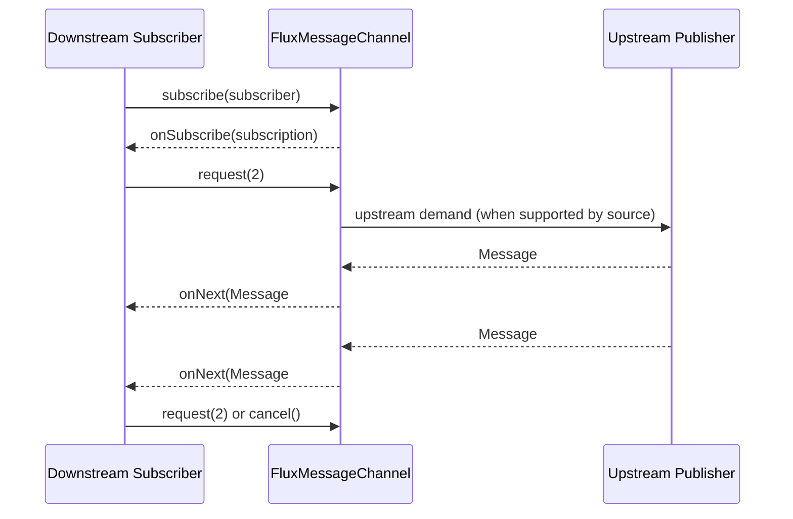
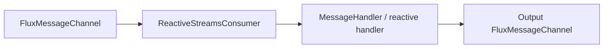
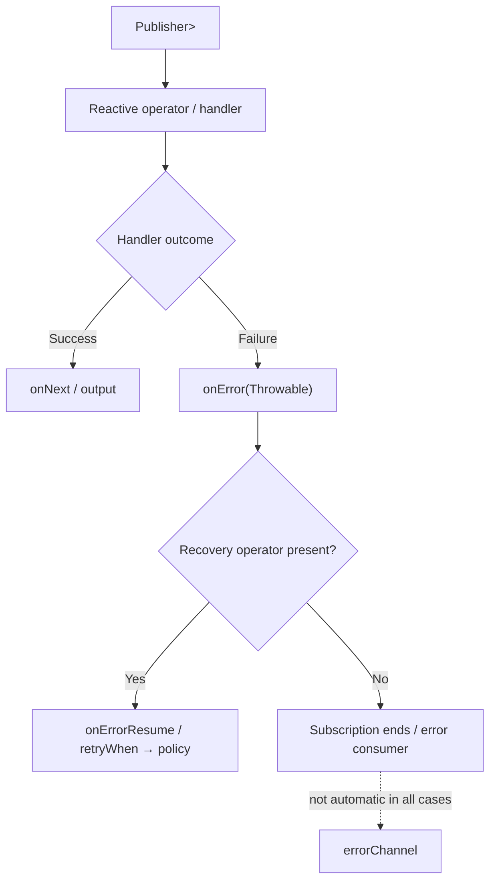

# FluxMessageChannel and Publisher Messages in Spring Integration

## 1. The Problem: How Can a Message Flow Operate with Reactive Streams?

In traditional Spring Integration, a producer typically calls `MessageChannel.send(message)` and an endpoint receives the message for processing. With `DirectChannel`, delivery to the consumer usually happens directly on the sender's call stack. With `ExecutorChannel`, the task is handed off to an executor, but the producer is not necessarily throttled based on the amount of work downstream can handle.

When the data source is a Project Reactor `Flux`, WebFlux, RSocket, or an API returning a `Publisher`, we gain another mechanism: **the consumer sends demand signals upstream**, specifying how many elements it is ready to receive according to the Reactive Streams contract. Spring Integration provides `FluxMessageChannel` and `ReactiveStreamsConsumer` to fit this model into the message–channel–endpoint architecture.

In the **Reactive runtime** chapter of the **SPRING_INTEGRATION_RUNTIME** module, this lesson focuses on the question: **how does `FluxMessageChannel` bridge a `Message<?>` to a Publisher; who creates the subscription; and how do demand, threading, errors, lifecycle, and persistence operate?** Relationships with consumers, pollers, executors, retries, transactions, message stores, and correlation will be explained according to actual runtime behavior.

> **Key takeaway:** Reactive does not automatically mean running on another thread, does not mean every adapter is non-blocking, and does not mean messages are durably persisted. `FluxMessageChannel` is a **Reactive Streams interaction bridge**, not a broker or a persistent `QueueChannel`.

## 2. Three Layers of Background Knowledge Before Starting

### 2.1. Reactive Streams Has Four Roles

Reactive Streams defines four main interfaces:

- `Publisher<T>`: a source capable of publishing elements of type `T`.
- `Subscriber<T>`: the receiving side, handling `onSubscribe`, `onNext`, `onError`, and `onComplete`.
- `Subscription`: the relationship between a Publisher and a Subscriber; the receiving side calls `request(n)` to request more elements or `cancel()` to cancel.
- `Processor<T,R>`: both a Subscriber and a Publisher; in Reactor, operator chains can serve a similar role.

`Mono<T>` represents at most one element; `Flux<T>` represents 0..N elements. Spring Integration uses **Project Reactor** to implement Reactive Streams support. Operators such as `map`, `flatMap`, `publishOn`, and `retryWhen` only build a pipeline; **subscription** is the step that triggers processing for a suitable source Publisher.



In practice, buffering, prefetch, and intermediate operators may exist, so do not interpret the diagram as meaning each `request(2)` call will always correspond to exactly two immediate events going upstream. This is the **logical model of consumption demand**.

### 2.2. Message<T> Differs from Publisher<T>

Three data types are very easy to confuse:

| Type | What does it represent? |
| --- | --- |
| `Message<Order>` | **A single message** with an `Order` payload and headers |
| `Publisher<Message<Order>>` | **A stream of messages** that a subscriber can request by demand |
| `Message<Flux<Order>>` | **A single message** containing a publisher in its payload; the channel itself does not necessarily subscribe to or flatten this publisher |

With `FluxMessageChannel`, the key contract is **`Publisher<Message<?>>`**: downstream receives **Spring Messages**, not bare `Order` or `String` values directly. If you want `Flux<Order>` data, you can transform it via `Flux.from(channel).map(m -> (Order) m.getPayload())` when the payload type is controlled.

A `Message<Flux<T>>` only has proper reactive semantics if the handler or downstream knows how to subscribe to, flatten, or convert that payload into the corresponding pipeline structure. Do not infer that a message carrying a `Flux` payload automatically makes every endpoint reactive.

### 2.3. Hot and Cold Publishers

- **Cold Publishers** such as `Flux.range(...)` or `Flux.defer(...)` usually create a new data source for each subscription.
- **Hot Publishers** such as a sink receiving pushed events usually depend on when a subscriber joins; they do not necessarily replay past data.
- `FluxMessageChannel` has an internal `Flux` source acting as a **hot sink**, receiving messages from `send()`. At the same time, it can subscribe to an upstream `Publisher` to consume according to downstream demand.

Consequence: do not send messages to a `FluxMessageChannel` with no downstream yet and assume those messages are stored permanently. For storage/replay requirements, choose an appropriate broker or persistent store.

## 3. What Is FluxMessageChannel Really?

`org.springframework.integration.channel.FluxMessageChannel` was introduced in Spring Integration 5.0. It combines two capabilities:

1. Being a `MessageChannel`: imperative code can call `send(Message<?>)`.
2. Being an `org.reactivestreams.Publisher<Message<?>>`: reactive code can call `subscribe(Subscriber)`, commonly via `Flux.from(channel)`.

It also implements the `ReactiveStreamsSubscribableChannel` contract, providing `subscribeTo(Publisher<? extends Message<?>>)` to connect a source Publisher to the channel.

```mermaid
flowchart LR
    P["Imperative producer"] -->|send(Message)| F["FluxMessageChannel"]
    R["Publisher<Message<?>>"] -->|subscribeTo(...)| F
    F -->|subscribe + request(n)| S["Reactive Subscriber"]
    S --> H["ReactiveStreamsConsumer / MessageHandler"]
```

This pattern makes it possible to bring both **traditional push messages** and **source publishers** onto a single Reactive Streams surface.

### Interfaces That Should NOT Be Misused

`FluxMessageChannel` is neither a `PollableChannel` nor a traditional `SubscribableChannel`. Therefore:

- Do not call `channel.receive()` as with `QueueChannel`; `FluxMessageChannel` does not provide polling receive.
- Do not register handlers in the `SubscribableChannel.subscribe(MessageHandler)` style directly on this object.
- Instead, connect through a `Subscriber`/`Flux` or let Spring Integration create a `ReactiveStreamsConsumer` for the downstream endpoint.
- Do not configure a poller just to "read" from a `FluxMessageChannel`; pollers belong to `PollableChannel`s or corresponding source polling adapters.

### Quick Comparison Table

| Channel | How it receives/consumes | Typical threading | Backpressure | Default persistence |
| --- | --- | --- | --- | --- |
| `DirectChannel` | `MessageHandler` via `SubscribableChannel` | Synchronous on the `send` calling thread | Not Reactive Streams demand | No |
| `ExecutorChannel` | Dispatches handler via `TaskExecutor` | Worker thread | Executor queue/capacity/rejection, not end-to-end Reactive Streams | No |
| `QueueChannel` | `receive()` via a poller | Poller thread | Capacity/poll rate, not Reactive Streams `request(n)` | No; a store can be added |
| `PublishSubscribeChannel` | Broadcasts to subscribers | Sender thread or executor | Does not turn into `Publisher<Message<?>>` | No |
| **`FluxMessageChannel`** | Reactive `Subscriber`, combines `Publisher` source | Follows scheduler/source/operators | **Can propagate demand**, if the whole chain is compatible | **No** |

Even if a channel is reactive, any upstream or downstream step with blocking I/O, infinite buffering, or a push-only listener can negate demand throttling benefits in that part of the pipeline.

## 4. Inside FluxMessageChannel: Two Entry Paths, One Output Stream

### Path A: Imperative Code Calling send()

```text
producer.send(message)
         |
         v
  FluxMessageChannel.doSend(...)
         |
         v
 Reactor hot sink
         |
         v
 Registered Subscriber + downstream operators
```

`send()` returns a `boolean` according to the `MessageChannel` contract; that value does not mean all downstream steps have completed, nor does it confirm business side effects have committed. Because the subscriber may process asynchronously or on a different scheduler, errors can occur **after** the `send()` call.

If imperative code pushes continuously without backpressure awareness, the sink and downstream queues/operators can run into situations with no demand yet or excessive backlog; having Reactive Streams downstream does not make an imperative producer naturally call `request(n)`. You must control rate, bound memory, handle rejection/overflow, and verify the behavior of your implementation version.

### Path B: Connecting an Upstream Publisher

```text
Flux<Message<?>> upstream
         |
   subscribeTo(upstream)
         |
   FluxMessageChannel
         |
   downstream subscriber (request(n))
         |
     demand-driven processing
```

When upstream is also a `Publisher` and downstream subscribes, `FluxMessageChannel` can propagate the subscription to upstream right when the consumer is ready. This is the appropriate model for preserving reactive semantics across steps.

**Do not confuse `subscribeTo(publisher)` with `publisher.subscribe(...)`:** the first attaches a source to the channel; the second attaches a consumer to a source. **Both the producing path and the consuming path** must exist for messages to be processed.

## 5. Basic Example: Using a FluxMessageChannel Directly

This example shows that the channel object can simultaneously accept `send()` and be used as a `Publisher<Message<?>>`. It does not require a Spring ApplicationContext because it only demonstrates the channel API.

```java
import org.springframework.integration.channel.FluxMessageChannel;
import org.springframework.messaging.Message;
import org.springframework.messaging.support.MessageBuilder;
import reactor.core.Disposable;
import reactor.core.publisher.Flux;

public class FluxChannelBasics {

    public static void main(String[] args) {
        FluxMessageChannel channel = new FluxMessageChannel();

        // Register downstream BEFORE sending messages into the hot channel.
        Disposable subscription = Flux.from(channel)
                .map(Message::getPayload)
                .doOnNext(value -> System.out.println("Received: " + value))
                .doOnError(error -> System.err.println(
                        "Stream failed: " + error.getMessage()))
                .subscribe();

        try {
            boolean accepted = channel.send(
                    MessageBuilder.withPayload("order-101").build());

            System.out.println("Accepted by channel: " + accepted);
        } finally {
            subscription.dispose();
            channel.destroy();
        }
    }
}
```

Expected behavior under normal conditions: the subscriber receives payload `order-101` and `send()` reports that the channel accepted the message. **This is not a durable queue example**. `subscription.dispose()` cancels the subscription, and `destroy()` releases channel resources at the end of the demo lifecycle.

In real applications, do not create/dispose subscribers arbitrarily per request. Let Spring manage `IntegrationFlow` and endpoint subscriptions, or manage subscriber/`Disposable` lifetimes in a single place with a clear lifecycle.

### Second Example: Publisher<Message<?>> Source

```java
import org.springframework.integration.channel.FluxMessageChannel;
import org.springframework.messaging.Message;
import org.springframework.messaging.support.MessageBuilder;
import reactor.core.publisher.Flux;

FluxMessageChannel channel = new FluxMessageChannel();

Flux<Message<?>> source = Flux.range(1, 5)
        .<Message<?>>map(number ->
                MessageBuilder.withPayload("order-" + number)
                        .setHeader("correlationId", "batch-A")
                        .build());

// Connect upstream first; source subscription is coordinated
// according to channel capability and when downstream is ready.
channel.subscribeTo(source);

// Downstream subscribes to receive Message<?>.
Flux.from(channel)
        .take(5)
        .subscribe(msg -> System.out.println(msg.getPayload()),
                error -> System.err.println(error.getMessage()));
```

This snippet directly demonstrates the `subscribeTo` contract. In an application, manage lifecycle and subscriptions through Spring; avoid calling `subscribe()` manually in multiple places if subscribers might compete or duplicate business behavior unexpectedly.

## 6. How Does ReactiveStreamsConsumer Connect to Handlers?

With traditional channels, `SubscribingConsumer` can register a `MessageHandler` directly with a `SubscribableChannel`. With `FluxMessageChannel`, the consumer must participate via Reactive Streams. Spring Integration provides `ReactiveStreamsConsumer` as the bridge: upstream is `Flux<Message<?>>`, and downstream are the appropriate message handlers.



In many cases, developers only configure an `IntegrationFlow`; the framework builds the appropriate consumer based on the input channel and handler.

### Being a "Reactive" Endpoint Does Not Guarantee a Non-Blocking Handler

For example, a `@ServiceActivator` using blocking JDBC, calling `Thread.sleep`, or using a synchronous HTTP client: placing it after a `FluxMessageChannel` does not automatically replace blocking calls with asynchronous Reactor calls. If it runs on an unsuitable event-loop/scheduler, latency and throughput will degrade.

How to handle this:

- Use truly reactive clients (R2DBC, WebClient, corresponding reactive adapters) when available.
- If a blocking API must be used, offload work to an appropriate scheduler (`Schedulers.boundedElastic()`) or isolate it via a suitable executor with bounded concurrency.
- Do not use `Schedulers.parallel()` to run long-running blocking I/O.
- Check transactions/acknowledgments when switching threads, because JDBC's `ThreadLocal` transaction does not automatically propagate across Reactor schedulers.

Since Spring Integration 5.5, the endpoint DSL has a `reactive()` option to request creating a `ReactiveStreamsConsumer` even when the input channel is not a `FluxMessageChannel`; you can supply a `Flux` customization function via `publishOn`, `doOnNext`, etc. This is a **way to create a reactive processing boundary**, not a flag that guarantees the entire system becomes non-blocking.

## 7. Java DSL: An IntegrationFlow with Two FluxMessageChannels

The following example places reactive channels at both input and output so the endpoints between them can participate in the reactive model. Declare these beans in a Spring application with Project Reactor on the classpath.

```java
import java.util.Locale;

import org.springframework.beans.factory.annotation.Qualifier;
import org.springframework.context.annotation.Bean;
import org.springframework.context.annotation.Configuration;
import org.springframework.integration.channel.FluxMessageChannel;
import org.springframework.integration.config.EnableIntegration;
import org.springframework.integration.dsl.IntegrationFlow;

@Configuration
@EnableIntegration
public class ReactiveOrdersFlow {

    @Bean("reactiveOrdersIn")
    public FluxMessageChannel reactiveOrdersIn() {
        return new FluxMessageChannel();
    }

    @Bean("reactiveOrdersOut")
    public FluxMessageChannel reactiveOrdersOut() {
        return new FluxMessageChannel();
    }

    @Bean
    public IntegrationFlow normalizeOrders(
            @Qualifier("reactiveOrdersIn") FluxMessageChannel input,
            @Qualifier("reactiveOrdersOut") FluxMessageChannel output) {

        return IntegrationFlow.from(input)
                .transform(String.class,
                        text -> text.trim().toUpperCase(Locale.ROOT))
                .channel(output)
                .get();
    }
}
```

`@EnableIntegration` initializes the integration infrastructure; the input/output channels are registered as beans. `IntegrationFlow.from(input)` connects a consumer to input; `.transform(...)` converts the `String` payload to a normalized String, while Spring Integration preserves relevant headers across the transformation appropriately.

To observe the result after the application has started:

```java
import org.springframework.integration.channel.FluxMessageChannel;
import org.springframework.messaging.support.MessageBuilder;
import reactor.core.Disposable;
import reactor.core.publisher.Flux;

FluxMessageChannel input =
        context.getBean("reactiveOrdersIn", FluxMessageChannel.class);
FluxMessageChannel output =
        context.getBean("reactiveOrdersOut", FluxMessageChannel.class);

Disposable observer = Flux.from(output)
        .subscribe(message ->
                System.out.println("Output: " + message.getPayload()),
                error -> System.err.println("Pipeline error: " + error));

// Register consumer before sending.
input.send(MessageBuilder.withPayload("  order-101  ").build());

// When stopping the observer/lab:
observer.dispose();
```

The expected output payload is `ORDER-101` provided the flow and subscribers are functioning properly. Note: the `context` variable represents a started `ApplicationContext`, not a built-in global variable; the snippet illustrates **how to use the beans** after configuration is loaded.

### When Is the Example Only "Partially Reactive"?

The transformer in the example is a short, synchronous Java function, which is fine. However, if replaced with a blocking JDBC or HTTP call, the pipeline may still contain a blocking stage. A chain of `FluxMessageChannel`s **does not** turn a blocking function into a non-blocking one.

In real production systems, you must test throughput, thread names, queue depth, timeouts, duplicates, and the semantics of the adapters used rather than just looking at the channel class.

## 8. Starting an IntegrationFlow from a Publisher

The Java DSL supports `IntegrationFlow.from(Publisher<Message<T>>)`. This approach fits when the application already has a `Flux<Message<?>>` from a reactive client or a source producer.

```java
import org.springframework.context.annotation.Bean;
import org.springframework.integration.dsl.IntegrationFlow;
import org.springframework.messaging.Message;
import org.springframework.messaging.support.MessageBuilder;
import reactor.core.publisher.Flux;
import reactor.core.publisher.Mono;

@Bean
public IntegrationFlow fromReactiveSource() {

    Flux<Message<?>> source = Flux.range(1, 5)
            .<Message<?>>map(number ->
                    MessageBuilder
                            .withPayload("job-" + number)
                            .build());

    return IntegrationFlow.from(source)
            // handleReactive() is a terminal operator since Spring Integration 6.1.
            .handleReactive(message ->
                    Mono.fromRunnable(() ->
                            System.out.println(
                                    "Handled: " + message.getPayload())));
}
```

This is a **demo** example: `Mono.fromRunnable(...)` only wraps a log statement in a lazily executed Publisher; it does not turn `println` into non-blocking I/O. With a real reactive client, the handler returns a `Mono<Void>` from WebClient or an equivalent asynchronous operation mechanism.

**Activation order depends on the flow/subscription lifecycle**, not on the moment `Flux.range` is created. A cold Publisher source may replay elements upon resubscription; when designing retry/resubscribe logic, you must consider source replayability and downstream idempotency.

## 9. Exporting an IntegrationFlow as a Publisher with toReactivePublisher()

The reverse direction is also supported: turning a built `IntegrationFlow` into a `Publisher<Message<?>>` so external code can apply Reactor operators or register a downstream subscriber.

```text
IntegrationFlow:
   source → transform → route → toReactivePublisher()
                                       |
                             Publisher<Message<?>>
                                       |
                            Flux.from(...).subscribe(...)
```

`IntegrationFlowBuilder.toReactivePublisher()` uses a `FluxMessageChannel` internally. The `toReactivePublisher(boolean autoStartOnSubscribe)` variant was introduced in Spring Integration 5.5.6 to control when the flow's components start upon subscription:

- With `autoStartOnSubscribe=true`, the flow can be configured not to auto-start during normal startup, and instead `start()` on `doOnSubscribe` of the exported Publisher.
- When the reactive stream is canceled or terminates, this mechanism can stop the related components according to the flow's lifecycle rules.
- Do not assume every Publisher automatically starts a flow: choose the appropriate overload and verify against your actual Spring Integration version.

This is a **very important** aspect when creating dynamic `IntegrationFlow`s. If the publisher has no subscriber, the source may not be activated yet; if the subscriber is canceled, the flow may stop. Do not use this as a guarantee of durability or automatic resumption of in-flight messages after a restart.

`toReactivePublisher()` is suitable when you need to hand a stream out to a reactive client or processing layer; an ordinary application using Spring-managed endpoints does not necessarily need to call this API.

## 10. FluxMessageChannel, ReactiveMessageHandler, and Mono/Flux Results

Since Spring Integration 5.3, `ReactiveMessageHandler` is supported for handlers that interact with reactive clients and return a reactive signal. In an imperative flow, the framework can use `ReactiveMessageHandlerAdapter` and subscribe immediately to perform processing. In a `ReactiveStreamsConsumer`, the handler's response is wired into the pipeline via operators like `flatMap` to respect demand where possible.

Since Spring Integration 6.1, the DSL includes the terminal operator `handleReactive(ReactiveMessageHandler)`, suitable for one-way processing returning `Mono<Void>`.

Asynchronous reactive client example:

```java
import org.springframework.context.annotation.Bean;
import org.springframework.integration.dsl.IntegrationFlow;
import reactor.core.publisher.Mono;

@Bean
IntegrationFlow outboundReactiveFlow() {
    return IntegrationFlow.from("outboundRequests")
            .handleReactive(message ->
                    Mono.fromRunnable(() ->
                            System.out.println(message.getPayload())));
}
```

Here `handleReactive` is subscribed to by the framework. In real business logic, the body is typically a `Mono<Void>` or `Mono<Something>.then()` call from a reactive client, not a logging `Runnable`.

### Handlers Returning a Publisher in the Reply Payload

This is a different scenario from `ReactiveMessageHandler`: a **reply-producing handler** may return a `Mono<T>` or `Flux<T>` as the result payload.

According to the Spring Integration documentation:

- When the output channel is a `ReactiveStreamsSubscribableChannel` (such as `FluxMessageChannel`), the framework can connect/flatten the Publisher appropriately so downstream receives events according to demand.
- With an imperative output channel and appropriate async configuration, reactive result handling differs: for multi-value publishers, the payload may still be wrapped inside a `Mono` containing the publisher itself; downstream may need to explicitly subscribe/flatten.
- Do not mistakenly assume a `Message<Flux<Order>>` automatically produces N `Message<Order>` instances on every channel. Behavior depends on the handler, publisher type, output channel, and async options.

If you need one output element per publisher item, verify the actual pipeline with an integration test rather than relying solely on the word `Flux` in the method return type.

## 11. Where Does Backpressure Work and Where Does It Not?

Backpressure is the mechanism by which a subscriber signals how many elements it is ready to receive (`request(n)`). It helps control flow across a chain of source–operators–consumer that supports Reactive Streams, but it is not magic.

### Flow with Cross-Stage Backpressure


When `FluxMessageChannel.subscribeTo(publisher)` connects a compliant publisher, the source can be requested to emit according to demand. Depending on operators (e.g., `flatMap` with prefetch) and implementations, upstream may receive larger demand than individual small downstream requests; clear concurrency/buffering policies are still required.

### Backpressure Breakpoints

- **Imperative `send()`:** the producer actively pushes; it does not receive `Subscription.request(n)` from the consumer. If the producer sends too fast, it must be throttled separately.
- **Non-reactive adapters:** a blocking listener or client does not natively support demand; a bounded queue or a different adapter may be required.
- **Unbounded buffers:** `onBackpressureBuffer` without a limit can turn a bottleneck into an OOM.
- **Blocking I/O:** a subscriber unable to free the event-loop; demand does not replace timeouts, bulkheads, and proper schedulers.
- **Broker/DB:** ack/commit, message retention, and redelivery belong to transport semantics; Reactor demand does not automatically commit transactional offsets.

### Example Limiting Concurrent Requests

```java
import reactor.core.publisher.Flux;
import reactor.core.publisher.Mono;

Flux<String> orderIds = Flux.just("o-1", "o-2", "o-3");

// remoteCall(String) is an application-provided method
// returning Mono<String> from an asynchronous API.
Flux<String> results = orderIds.flatMap(
        orderId -> remoteCall(orderId),
        4); // Limits to at most 4 active inner publishers.
```

`flatMap` may complete **out of input order**. If strict ordering is required, use `concatMap` or an explicit ordering solution; the trade-off may be reduced concurrency. This is critical when downstream relies on `correlationId` and `sequenceNumber`.

## 12. publishOn, subscribeOn, and Thread Boundaries

Reactive **does not mean** always running on a separate thread. When no scheduler is switched, many operators can execute on the thread emitting the source or the thread delivering signals.

- `publishOn(scheduler)` switches execution of operators downstream of it to the specified scheduler; it has its own queue/prefetch.
- `subscribeOn(scheduler)` affects where subscription happens and the upstream portion according to the Reactor model.
- `Schedulers.parallel()` is meant for short CPU work; do not put long-running blocking I/O on it.
- `Schedulers.boundedElastic()` is better suited for isolating legacy blocking APIs still present in the system, with bounds/sizing.

Example wrapping a blocking call:

```java
import reactor.core.publisher.Mono;
import reactor.core.scheduler.Schedulers;

Mono<Invoice> invoiceMono =
        Mono.fromCallable(() ->
                legacyJdbcInvoiceService.loadInvoice("INV-101"))
            .subscribeOn(Schedulers.boundedElastic());
```

`Invoice` and `legacyJdbcInvoiceService` are application components, not built-in Spring Integration APIs. The example shows how to keep a blocking JDBC call from running directly on the event-loop.

### Why Care About Transactions?

Traditional JDBC transactions are typically bound to `ThreadLocal`. If a flow starts a transaction on thread A and then uses `publishOn` or crosses an `ExecutorChannel` to thread B, do not assume thread A's transaction and resources are carried over to B.

With R2DBC and a reactive transaction manager, the transactional context typically resides in the **Reactor Context** and must be properly established/propagated in the pipeline. Replacing a `MessageChannel` with a `FluxMessageChannel` **does not** automatically convert the application's entire transaction handling into reactive transactions.

Only claim that enqueue/dequeue/DB updates share the same transaction after verifying that the transaction manager, adapter, subscription point, and operator region genuinely participate in the same commit boundary.

## 13. Pollers and Reactive Message Sources

A traditional `SourcePollingChannelAdapter` uses a `TaskScheduler` to invoke `MessageSource.receive()` on a schedule. When the output channel is a `ReactiveStreamsSubscribableChannel`, Spring Integration can coordinate polling via a publisher and rely on downstream demand instead of merely dispatching infinite scheduled loops.

According to the documentation, this combination uses a Reactor chain to determine the next poll time, then fetches up to `maxMessagesPerPoll` and pushes the messages to the reactive output. Since Spring Integration 5.5, if `maxMessagesPerPoll=0`, the source is not called in that cycle; runtime control mechanisms can be used to pause pulling messages.

`ReactiveMessageSourceProducer` (since Spring Integration 5.3) is another approach: turning a `MessageSource` into a reactive producer by repeating a `Mono` subscription and waiting when the source temporarily returns `null`. For blocking sources, the framework can use `Schedulers.boundedElastic()`. The source adapter can also handle acknowledgment callbacks based on the success/failure context of message processing.

**Watch out:** "Poller uses Reactor" does not mean `MessageSource.receive()` itself becomes non-blocking. If the source reads files or a DB in a blocking manner, watch the scheduler and connection pool; if the source receives messages from a broker, ack/requeue depends on the adapter/broker. `request(n)` does not mean committed successfully at the source.

## 14. Splitter, Aggregator, and Correlation When Publishers Participate

A splitter can return a `Publisher` instead of an in-memory list. If the output channel is a `FluxMessageChannel`, emitting the parts can participate in the reactive pipeline and serve downstream according to demand.

Suppose a message contains a batch of 3 orders:

```text
Incoming batch: batch-42
    |
    | split
    v
 Flux<Message<OrderPart>>
    |
 FluxMessageChannel → consumers
    |
    v
 Aggregator / resequencer by correlationId + sequence
```

Essential requirements:

- **Correlation key:** keep `correlationId`/business key stable across parts and retries.
- **Sequence headers:** if the aggregator/resequencer expects all N parts, the source or splitter must supply accurate `sequenceNumber` and `sequenceSize`.
- **Ordering:** concurrent `flatMap` can cause parts to finish out of order; if downstream requires sequential order, use `concatMap`/resequencer or an explicit strategy.
- **Cancellation:** a subscriber canceling mid-stream can leave a batch missing parts; timeout/expiry/discard policies are needed.
- **Store:** `FluxMessageChannel` does not durably store waiting parts; the aggregator uses `MessageGroupStore` and can use a persistent implementation.

Spring Integration also provides `FluxAggregatorMessageHandler` for certain reactive aggregation strategies based on operators like `groupBy` and `window`/`buffer`. It does not share all the same lifecycle/persistence characteristics as an aggregator backed by `MessageGroupStore`, so choose according to whether you need **stream processing** or **durable message group/correlation state**.

## 15. Reactive Errors: How Does onError Differ from ErrorMessage?

Two error-reporting models must be distinguished:

1. **Reactor `onError(Throwable)`**: a terminal signal of a subscription. An unrecovered error can terminate the entire stream, not merely "report one message's failure and continue."
2. **Spring Integration `ErrorMessage`/`errorChannel`**: a message carrying a `Throwable` published through the framework's error-handling mechanism at appropriate boundaries/adapters.



**Do not equate `doOnError` with error handling:** `doOnError` only performs side effects like logging/metrics; it **does not swallow** the error. `onErrorResume` can switch to a fallback value or dead-letter branch; `retryWhen` can resubscribe according to a policy.

### Per-Message Error Handling Pattern

If you want one failed message not to terminate the entire stream, consider placing recovery inside the per-message processing:

```java
import java.time.Duration;
import reactor.core.publisher.Flux;
import reactor.core.publisher.Mono;
import reactor.util.retry.Retry;

// processOne(Message<?>) returns Mono<Void> implemented by the application.
Flux<?> processed = Flux.from(inputChannel)
        .flatMap(message ->
                processOne(message)
                        .retryWhen(
                                Retry.backoff(2, Duration.ofMillis(200)))
                        .onErrorResume(error -> {
                            // publishFailure(...) must have a policy ensuring
                            // the error is sent/stored and return an appropriate Mono<Void>.
                            return publishFailure(message, error);
                        }),
                8);
```

`inputChannel` is a `FluxMessageChannel`/`Publisher<Message<?>>`; `processOne` and `publishFailure` are application functions. This is an **operator pattern**, not a complete bean. There must be a terminal subscriber or `ReactiveStreamsConsumer` executing the resulting publisher, otherwise the pipeline remains only a definition.

Placing `retryWhen` inside `flatMap` scopes retries to processing **one** message. If `retryWhen` is placed on the outer `Flux` source, it can **resubscribe the entire upstream**, reprocessing multiple messages from a cold publisher or altering behavior with a hot publisher. For side effects like creating a payment, idempotency is required regardless of where the operator is placed.

The **failure sink** must emit its completion signal only after meeting the required confirmation level. If `publishFailure` only calls `errorChannel.send()` in memory and returns `Mono.empty()`, you cannot claim the failure was durably persisted.

### ErrorMessage on Async Boundaries

When an exception escapes a handler running in an `ExecutorChannel`/poller managed by Spring Integration, the framework can publish an `ErrorMessage` to the `errorChannel` header or global bean. However, an exception inside an isolated `Flux` follows Reactor signals and its subscription; do not assume every `onError` becomes a global `ErrorMessage`.

Error flow design must answer: **does the final error surface at the subscriber `onError`, a recovery publisher, a Spring Integration error channel, or get redelivered by a broker?** Clearly define where terminal failures are recorded and avoid double-reporting during retries/redelivery.

## 16. Cancellation, Lifecycle, and Restart

`FluxMessageChannel` can manage the source subscription via `subscribeTo` and lifecycle depending on the version. `Subscription.cancel()` indicates downstream no longer wants further elements; a reactive-integrated source producer can stop or cancel the source when the subscription ends.

Implications:

- **Cancel is not a success ack.** If a reactive consumer cancels due to a timeout or client disconnect, in-flight or waiting messages may not be finished.
- **A hot channel is not a replay store.** Restarting the application creates a new channel and subscription, without recovering events sitting in the hot sink before the process died.
- **Dynamic IntegrationFlows must be recreated.** `toReactivePublisher(true)` drives lifecycle by subscription; it does not persist flow registrations or pending work.
- **Error/termination can stop the producer.** A policy-driven restart mechanism or handing work off through a durable source is needed if the flow must run continuously.
- **Retry can resubscribe.** With a cold source, previous messages may reappear; with a hot source, resubscribing may not replay missed items.

If business logic must survive restarts, use a **durable broker, persistent `QueueChannel`, `MessageStore`, checkpoints, idempotency records, or outbox** at the appropriate boundary. Reactive subscription only governs how data is **read/processed**; it does not provide durability guarantees.

## 17. Backpressure and Durability Are Two Different Questions

| Concern | Question to answer | Related tools |
| --- | --- | --- |
| Backpressure | How many elements can the consumer request/receive concurrently? | `Publisher`/`Subscription.request(n)`, `flatMap(concurrency)`, bounded buffers |
| Threading | Who runs the handler, and does it block the event-loop? | `publishOn`, `subscribeOn`, `Schedulers.boundedElastic`, executor |
| Persistence | Do messages survive a restart? | Broker, `JdbcChannelMessageStore`, durable inbox/outbox |
| Transaction | When a step fails, which operations can roll back? | Appropriate transaction manager, broker ack, reactive transaction context |
| Error recovery | Does a failure affect one message or terminate the whole subscription? | `onErrorResume`, `retryWhen`, error channel, DLQ |
| Correlation | Do parts of a batch share the same key and sequence? | Message headers, aggregator/resequencer, `MessageGroupStore` |
| Observability | Are backlog, saturation, and end-to-end latency visible? | Micrometer, tracing, Reactor instrumentation, logs |

Placing `FluxMessageChannel` between two `MessageHandler`s does not automatically solve all of the above. Conversely, a system can still be **partially reactive**: a source Publisher → reactive transform → an isolated blocking step → output broker. What matters is accurately documenting where demand is preserved and where reactive semantics end.

## 18. Runtime Diagnostics: Why Is There a Publisher Yet No Messages?

Common symptom table:

| Symptom | Possible cause | How to verify |
| --- | --- | --- |
| Built `Flux` but handler never runs | No subscription to the Publisher | Check `ReactiveStreamsConsumer`/terminal subscriber |
| Sent before subscriber appeared, messages not received | Hot source is not a durable backlog | Register subscriber first in lab; use persistent queue for production |
| Thread changed after adding `publishOn` | Operator changes downstream execution context | Log thread names before/after operator |
| Fast producer, memory grows | `send()` pushes continuously, unbounded buffers/prefetch/concurrency | Measure queue depth, backpressure, overflow, and sink behavior |
| `onError` stops the entire stream | Unrecovered terminal error | Place `onErrorResume` or retry at the per-message scope |
| Retry creates duplicates | Cold Publisher resubscription or broker redelivery | Stable business idempotency key, attempt tracking |
| Downstream JDBC is still blocking | Reactive channel does not turn synchronous JDBC reactive | Use boundedElastic/bulkhead or R2DBC where appropriate |
| No errors seen in `errorChannel` bean | Errors are traveling via Reactor `onError` instead of framework publisher | Observe the proper subscription and error strategy |
| Messages lost after restart | Hot channel/executor buffers are non-durable | Identify durable handoffs, broker/MessageStore |
| `Flux` returned as payload, consumer gets only one message | No flattening or non-reactive output channel | Check publisher reply handling and subscriber |
| Batch missing parts | Cancellation, errors, duplicates, or wrong sequence headers | Correlation ID, group store, timeout/expiry |
| Process stops while publisher stays active | Inconsistent subscription/lifecycle cleanup | Manage `Disposable`, endpoint start/stop, dynamic flow |

### What to Measure?

Useful metrics/traces include:

- Number of messages received at ingress, number actually started and completed by handlers.
- Reactive subscription count, cancellation count, terminal onError count, retry exhausted count.
- Time from enqueue to processing start; p95/p99 processing time of handlers/remote APIs.
- Active inner publishers (`flatMap` concurrency), timeout rate, scheduler queue/saturation.
- Broker or persistent queue backlog, oldest message age, and in-flight message count.
- Correlation/group age, partial/expired batch count, and duplicate business side effects.
- Error flow health, DLQ, replay, and transaction rollback/nack.

Metric names are application-defined; do not assume every Spring Integration version exposes the exact same names out of the box. Do not put `orderId` or `correlationId` into high-cardinality metric tags; use logs and controlled tracing instead.

## 19. Hands-On Labs to Verify FluxMessageChannel

### Lab A: `send()` and Subscription

1. Create a `FluxMessageChannel` as in Section 5's example.
2. Register the subscriber first, then send two messages using `send()`.
3. Observe payload contents, receive order, and thread.
4. Cancel the subscription and try sending another message; inspect sink behavior and do not infer a durable queue.
5. Create a new channel after a "simulated restart"; verify old messages are not automatically replayed.

**Expectation:** Subscription determines whether a receiver can observe messages; `send()` is not equivalent to durable acknowledgment.

### Lab B: Demand-Bounded Source Publisher

1. Create `Flux.range(1,10)` mapped to `Message<?>`.
2. Connect via `subscribeTo(source)` or an `IntegrationFlow.from(source)`.
3. Use `reactor-test`/`StepVerifier` to incrementally drive requests or write a manual subscriber calling `request(1)`.
4. Observe upstream `doOnRequest`, `onNext` counts, and cancellation.
5. Insert an operator with prefetch to see that upstream demand is not always one-to-one with each downstream request.

**Expectation:** Compliant publishers honor demand per contract, but intermediate buffering/operators can make request patterns differ from naive expectations.

### Lab C: Reactive vs. Blocking

1. Use a reactive handler returning `Mono<Void>` after a simulated delay.
2. Measure latency and thread without `publishOn`.
3. Replace the handler with a blocking call and shift it onto `Schedulers.boundedElastic()`, capping concurrency.
4. Compare throughput and thread names, verifying the event-loop is not blocked.
5. Test timeout errors and per-message recovery policies.

**Expectation:** The scheduler is the thread boundary; `FluxMessageChannel` does not handle blocking I/O on its own.

### Lab D: Single-Message Failure vs. Whole-Stream Failure

1. Create a source of 5 messages where the 3rd message fails.
2. Place `onErrorResume` **outside** the pipeline and observe whether the remaining messages are processed.
3. Move recovery inside `flatMap` per message, ensuring one failure event is produced for the 3rd message.
4. Test `retryWhen` on the whole upstream vs. per-message, recording side effect and duplicate counts.
5. Add a durable dead-letter sink, intentionally fail the sink, and verify the error signal propagates according to policy.

**Expectation:** Error operator placement determines whether a failure terminates the subscription or isolates a single message.

### Lab E: Cancellation, Lifecycle, and Restart

1. Use a source Publisher with onSubscribe/onCancel counters.
2. Create a reactive flow and the `toReactivePublisher(true)` variant when supported by your API version.
3. Subscribe, cancel the subscriber, and monitor endpoint running state and upstream cancellation.
4. Restart the application with a durable source (broker/JDBC queue) to distinguish recovered data from freshly recreated publishers/channels.
5. Verify correlationId/idempotency key remain unchanged when a message is redelivered.

**Expectation:** Subscription-driven lifecycle and durable data are two independent mechanisms that must be coordinated.

### Reactor StepVerifier Example for Observing a Hot Channel

```java
import org.springframework.integration.channel.FluxMessageChannel;
import org.springframework.messaging.support.MessageBuilder;
import reactor.core.publisher.Flux;
import reactor.test.StepVerifier;

FluxMessageChannel channel = new FluxMessageChannel();

StepVerifier.create(Flux.from(channel).take(2))
        .then(() -> {
            channel.send(
                    MessageBuilder.withPayload("A").build());
            channel.send(
                    MessageBuilder.withPayload("B").build());
        })
        .expectNextMatches(msg -> "A".equals(msg.getPayload()))
        .expectNextMatches(msg -> "B".equals(msg.getPayload()))
        .verifyComplete();
```

`reactor-test` is an additional test dependency. The key point: `then(...)` sends messages **after the StepVerifier subscription is established**; attempting to send before `StepVerifier.create(...).verifyComplete()` tests a different hot-channel behavior, not queue durability.

## 20. Pre-Production Checklist

- **Source:** Does the Publisher genuinely support Reactive Streams demand? Is it cold or hot, and what happens on resubscription?
- **Channel:** At which stages is `FluxMessageChannel` used? Are there imperative `send()` push points lacking flow control?
- **Subscriber:** Who subscribes, who manages `Disposable`, cancellation, and lifecycle when there is no demand?
- **Handler:** Is there blocking I/O? If so, is it isolated with a scheduler/bulkhead and bounded concurrency?
- **Payload:** Is the stream `Publisher<Message<?>>` or `Message<Publisher<?>>`? Have flattening/async reply semantics been verified?
- **Thread/transaction:** Are there `publishOn`/`subscribeOn`/executor boundaries? Where are source transactions/acks managed?
- **Error:** Will terminal errors end the subscription or be handled per-message? Which `ErrorMessage` and error channel are actually used?
- **Retry:** Does resubscribing replay already-completed messages/work? Is the business key idempotent?
- **Correlation:** Are sequence headers and ordering sound under `flatMap` concurrency, cancellation, and timeouts?
- **Durability:** Do pending messages, retries/delays, failure records, and group state survive restarts as promised?
- **Observability:** Are subscriptions, cancellations, exhausted retries, backlogs, latency, and publish/recovery errors measured?
- **Integration tests:** Have you tested no subscriber, slow subscriber, terminal failure, cancellation, restart, concurrency, and real adapters?

## 21. Summary

`FluxMessageChannel` is the **bridge between Spring Integration messaging and Reactive Streams**: it accepts `Message<?>` via `send()`, publishes as `Publisher<Message<?>>` for downstream, and can register a source Publisher via `subscribeTo(...)`. `ReactiveStreamsConsumer` enables Spring Integration endpoints to participate in subscription/demand without forcing developers to write a `Subscriber` for every handler.

System reactivity depends on **the entire path**: source Publisher, channel, handler, scheduler, adapters, and error policy. Reactive demand does not replace persistence, transactions, or idempotency. When designing real runtimes, always distinguish **message sent**, **message requested by subscriber**, **handler completed**, **error recovered**, and **business operation committed**.

## References

- [Spring Integration Reference — Reactive Streams Support](https://docs.spring.io/spring-integration/reference/reactive-streams.html)
- [Spring Integration Reference — Message Channel Implementations](https://docs.spring.io/spring-integration/reference/channel/implementations.html)
- [Spring Integration Reference — Reactive Endpoint DSL](https://docs.spring.io/spring-integration/reference/dsl/java-reactive.html)
- [Spring Integration Reference — Annotation Support / @Reactive](https://docs.spring.io/spring-integration/reference/configuration/annotations.html)
- [Spring Integration API — FluxMessageChannel](https://docs.spring.io/spring-integration/docs/6.5.x/api/org/springframework/integration/channel/FluxMessageChannel.html)
- [Project Reactor Reference — Backpressure and Schedulers](https://projectreactor.io/docs/core/release/reference/)
