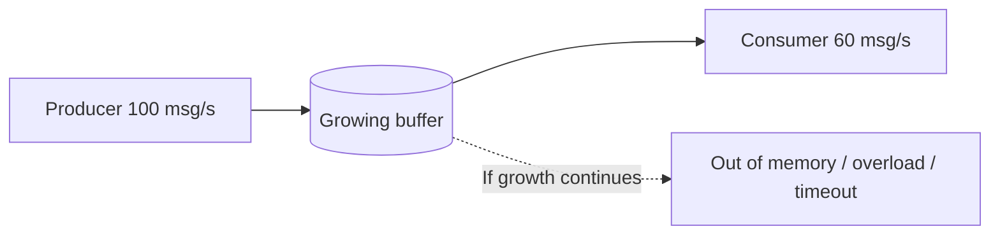
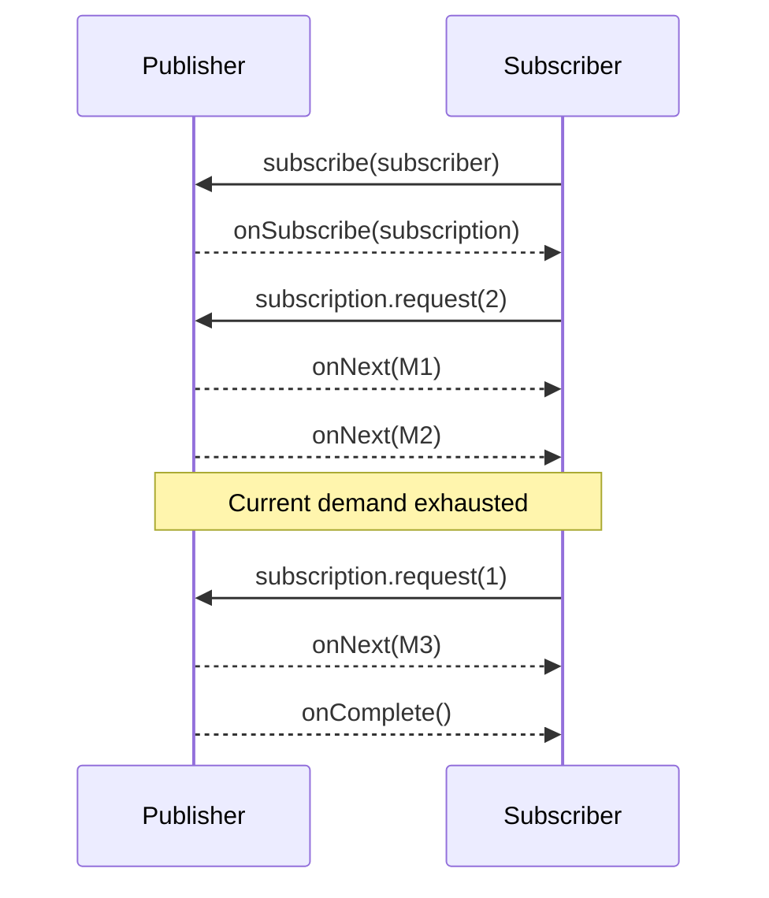
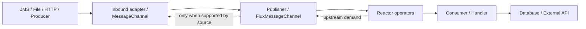
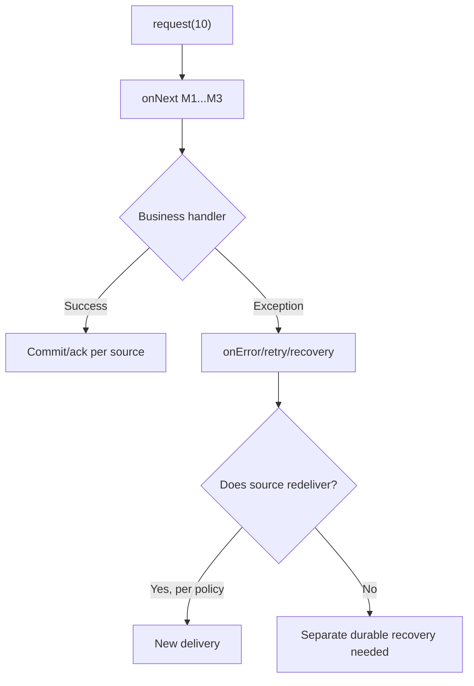
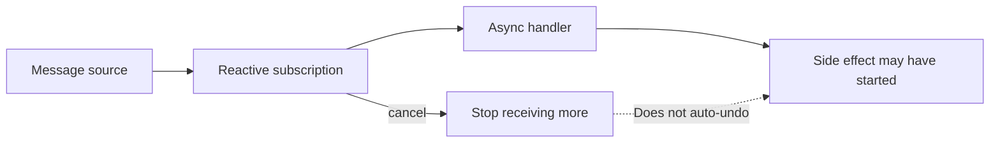
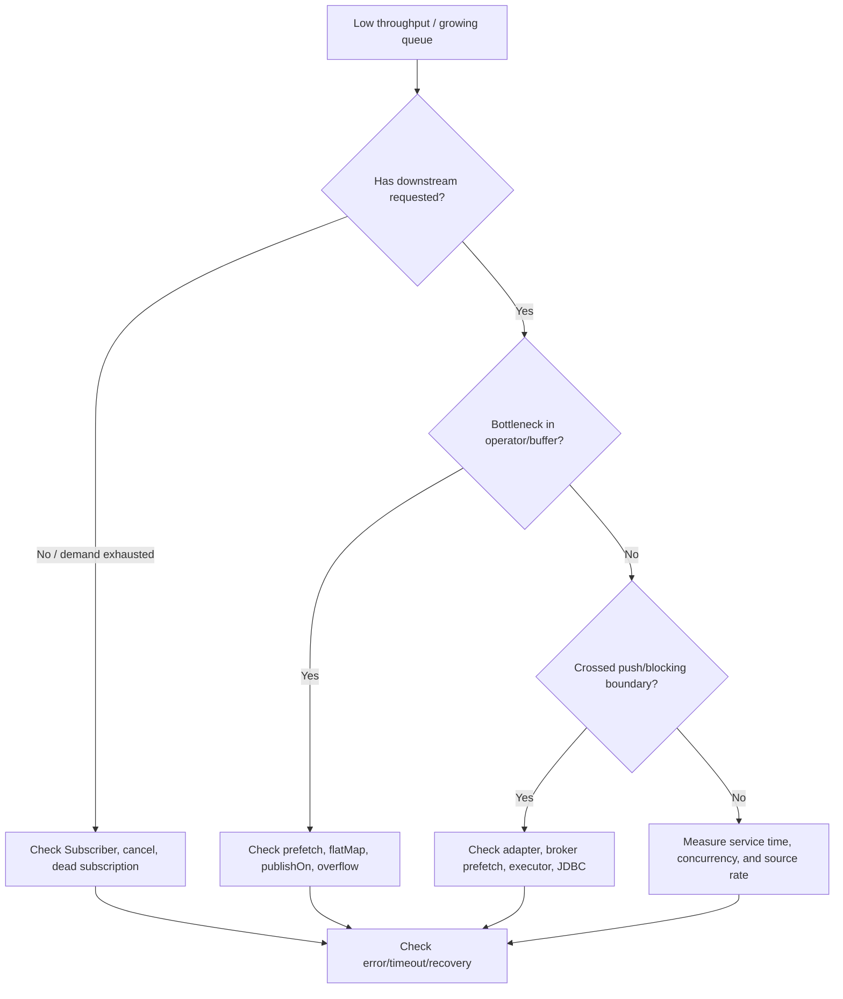

# Reactive Streams Backpressure

In **Spring Integration runtime**, messages move through channels, endpoints, consumers, pollers, and executors at widely varying speeds. A producer may emit thousands of messages per second, while a handler must write to a database, make HTTP calls, or wait on an external system. If every component keeps pushing data without considering downstream capacity, queues grow, memory runs out, latency climbs, and eventually messages can fail or be lost.

**Reactive Streams backpressure** is the mechanism that allows the receiving side to signal how much data it is **ready to receive** via the `request(n)` signal. It is a contract between `Publisher` and `Subscriber`, not a promise that every channel, adapter, or broker automatically runs according to reactive demand.

This lesson belongs to the **Reactive runtime** chapter of the `SPRING_INTEGRATION_RUNTIME` module. Its content connects Reactive Streams with Reactor `Flux`/`Mono`, `FluxMessageChannel`, Spring Integration message flows, memory bounds, executors/threading, transactions, retries, message stores, correlation, and how to diagnose backlog conditions at runtime.

## 1. Why Is Backpressure Necessary?

Suppose a producer emits **100 messages/second**, while a handler processes **60 messages/second**. Without throttling, the backlog grows on average by about **40 messages/second** under steady load. A buffer with room for 400 messages can fill up in roughly 10 seconds, not counting load bursts and pre-existing queued data.



There are three distinct ways to cope, often needing to be combined:

| Mechanism | Meaning | Limitation |
| --- | --- | --- |
| **Demand-based backpressure** | Downstream requests a bounded number of elements it can accept | Only works across `Publisher`s/operators that honor demand |
| **Buffering** | Temporarily holds elements when speeds differ | Memory/disk are finite; does not make the consumer faster |
| **Admission control / load shedding** | Slows down, rejects, delays, or drops items under overload | Must clearly define how unaccepted elements are handled |

**Backpressure is not equivalent to buffering.** A buffer only shifts where overload surfaces. If a source keeps pushing uncontrollably for a long period, even a "very large" buffer can still fill up.

## 2. The Reactive Streams Contract: Publisher, Subscriber, Subscription

Reactive Streams standardizes four core interfaces:

- `Publisher<T>` emits elements and accepts `subscribe(subscriber)`.
- `Subscriber<T>` receives `onSubscribe`, `onNext`, `onError`, and `onComplete` signals.
- `Subscription` represents the link between a Publisher and a Subscriber; supports `request(long n)` and `cancel()`.
- `Processor<T,R>` is both a Subscriber and a Publisher; in Reactor, `Flux`/`Mono` and operators are normally used instead of writing custom Processors.



### 2.1. Five Rules to Remember

1. `request(n)` with `n > 0` adds **permission to emit up to n elements** to the outstanding demand. It does **not** guarantee the Publisher must immediately emit all n.
2. A Publisher **must not emit more `onNext` signals than the total unfulfilled valid demand** on a subscription.
3. When there is no demand, a spec-compliant Publisher must **wait**, or a fast-pushing source can use a buffer/overflow policy at the appropriate boundary; it must not silently exceed downstream demand.
4. `onError` and `onComplete` are **terminal signals**: after a terminal signal, that subscription will emit no further `onNext`.
5. `cancel()` signals that no more data is needed on the subscription; it **does not automatically roll back** database transactions, resend messages, or stop every external I/O operation already started.

`request(0)` or negative values are invalid requests under Reactive Streams and must trigger spec-defined error handling. Do not use `request(0)` as a way to "pause"; to stop receiving more, simply **do not request additional demand**.

### 2.2. Demand Is a Per-Subscription Signal

If a `Flux` has two independent Subscribers, each Subscriber has its own demand. Do not sum those two numbers and treat them as a shared budget for a single business job. With a **hot source** having multiple subscribers, multicasting, buffering, and overflow policies can be more complex than for a cold sequence.

A `request(10)` also **does not** mean "process only ten messages per second." It is strictly a count of elements allowed to be forwarded, containing no timing information. To limit requests/second or concurrent active transactions, add rate limiting, bounded concurrency, or an appropriate quota.

## 3. Backpressure in Reactor: Observing Demand with BaseSubscriber

Project Reactor implements Reactive Streams via `Flux` (0..N elements) and `Mono` (0..1 element). `BaseSubscriber` makes it easy to control demand in a minimal example.

```java
import org.reactivestreams.Subscription;
import reactor.core.publisher.BaseSubscriber;
import reactor.core.publisher.Flux;

public class DemandDemo {
    public static void main(String[] args) {
        Flux<Integer> events = Flux.range(1, 5)
                .doOnRequest(n -> System.out.println("request = " + n));

        events.subscribe(new BaseSubscriber<Integer>() {
            @Override
            protected void hookOnSubscribe(Subscription subscription) {
                request(1); // Request the first element.
            }

            @Override
            protected void hookOnNext(Integer value) {
                System.out.println("received = " + value);
                // Only request more after finishing processing this element.
                request(1);
            }

            @Override
            protected void hookOnComplete() {
                System.out.println("completed");
            }
        });
    }
}
```

The example uses `Flux.range` synchronously and simply so `request(1)` is easy to see. With a real producer, the `hookOnNext` callback **should not contain long blocking I/O** on an event-loop thread; instead, use appropriate operators or schedulers.

If the Subscriber only calls `request(2)` initially and never requests more, it receives at most two elements; the sequence may not emit a completion signal yet because data is still waiting for demand. This is **active downstream control**.

## 4. Three Layers to Distinguish: Source, Pipeline, and Handler

A Spring Integration flow can combine traditional adapters with reactive pipelines:



**Important:** `request(n)` only propagates upstream through components that support the Reactive Streams contract. An adapter pushing data on a `poller` schedule, a broker pushing into a listener, or a `MessageChannel.send()` call **does not necessarily** slow down just because the final subscriber asks for less.

| Component | Common flow style | Does it natively honor `request(n)`? |
| --- | --- | --- |
| `Flux` from a compliant Reactive Streams source | Demand-driven Publisher | Yes, within the contract |
| `Mono` | At most one element/terminal signal | Yes, as a Publisher |
| `FluxMessageChannel` | Bridge between message channel and reactive Publisher | Supports reactive interaction on the subscription side; inspect ingress/buffering |
| `DirectChannel` | Invokes subscriber handler synchronously on `send()` | Not inherently a Reactive Streams Publisher |
| `ExecutorChannel` | Dispatches to an executor thread | Has queue/executor, does not automatically convert to `request(n)` |
| `QueueChannel` | Pollable channel with `receive()` | Has its own queue/polling bounds, not Reactive Streams demand |
| JMS/AMQP/Kafka adapter | Driven by broker, listener, ack/prefetch, and configuration | Depends on connector/adapter; cannot be assumed by default |

From the table above, **"using Reactor in a handler" does not automatically make all inputs reactive backpressure-aware**. You must map each adapter boundary to know where the demand signal stops.

## 5. FluxMessageChannel: A Bridge, Not an Unfillable Memory Promise

`FluxMessageChannel` belongs to Spring Integration; it acts both as a `MessageChannel` for the system to send messages into and exposes a `Publisher<Message<?>>` surface for downstream to subscribe to. This makes it possible to feed messages from a traditional flow into a Reactor-based pipeline.

### 5.1. Spring Integration Configuration Fragment

A Java 17+ example demonstrating how to declare a source channel and a reactive channel:

```java
import org.springframework.beans.factory.annotation.Qualifier;
import org.springframework.context.annotation.Bean;
import org.springframework.context.annotation.Configuration;
import org.springframework.integration.annotation.EnableIntegration;
import org.springframework.integration.channel.DirectChannel;
import org.springframework.integration.channel.FluxMessageChannel;
import org.springframework.integration.dsl.IntegrationFlow;
import org.springframework.messaging.MessageChannel;

@Configuration
@EnableIntegration
public class ReactiveChannelConfig {
    @Bean
    MessageChannel ingressChannel() {
        return new DirectChannel();
    }

    @Bean
    FluxMessageChannel reactiveMessages() {
        return new FluxMessageChannel();
    }

    @Bean
    IntegrationFlow bridgeToReactive(
            @Qualifier("ingressChannel") MessageChannel ingress,
            @Qualifier("reactiveMessages") FluxMessageChannel reactiveMessages) {

        return IntegrationFlow.from(ingress)
                .channel(reactiveMessages)
                .get();
    }
}
```

Once the Spring context starts, downstream can subscribe to `reactiveMessages` via Reactive Streams:

```java
import org.reactivestreams.Subscription;
import org.springframework.integration.channel.FluxMessageChannel;
import org.springframework.messaging.Message;
import reactor.core.publisher.BaseSubscriber;
import reactor.core.publisher.Flux;

// Illustrative call snippet: reactiveMessages is an injected bean.
void attachConsumer(FluxMessageChannel reactiveMessages) {
    Flux.from(reactiveMessages)
            .doOnRequest(n -> System.out.println("downstream requested " + n))
            .subscribe(new BaseSubscriber<Message<?>>() {
                @Override
                protected void hookOnSubscribe(Subscription subscription) {
                    request(1);
                }

                @Override
                protected void hookOnNext(Message<?> message) {
                    System.out.println("consume " + message.getPayload());
                    request(1);
                }
            });
}
```

This is a **reactive boundary illustration**, not a durable queue system. In a real application, manage subscription lifecycles alongside the application context and ensure the consumer has subscribed before the producer begins sending. `FluxMessageChannel` has push/buffer handling depending on implementation/version; **do not conclude that `send()` blocks waiting for subscriber demand** or that every message is safely preserved across restarts.

### 5.2. Questions to Verify Before Production Use

- If the subscriber is slow or does not exist yet, are messages **buffered**, **rejected**, **errored**, or **dropped** by the implementation?
- What is the buffer limit, and what signal is emitted when full?
- What does `MessageChannel.send()` return when no more data can be accepted?
- With multiple subscribers, is delivery multicast or does it require specific configuration?
- When canceling a subscription or restarting the JVM, must messages be replayed from a broker/store?

Conclusions must be tested against the **deployed Spring Integration and Reactor versions**, not inferred solely from class names.

## 6. `limitRate`, `prefetch`, and Concurrency Are Different Mechanisms

Reactor has operators that shape demand, such as `limitRate`:

```java
import reactor.core.publisher.Flux;

Flux.range(1, 100)
    .doOnRequest(n -> System.out.println("upstream request: " + n))
    .limitRate(8)
    .subscribe(System.out::println);
```

`limitRate(8)` splits demand sent upstream into smaller batches according to the operator's internal refill mechanism. This is **not** a hard cap of eight total messages and **does not** guarantee eight messages/second. Nor does it replace queue bounds outside the pipeline.

### 6.1. `flatMap` and In-Flight Work

One way to control the number of concurrent asynchronous calls is using the `flatMap(mapper, concurrency)` overload:

```java
import reactor.core.publisher.Flux;
import reactor.core.publisher.Mono;

Flux<String> orderIds = Flux.just("O-1", "O-2", "O-3", "O-4");

Flux<String> results = orderIds.flatMap(
    orderId -> nonBlockingClient.fetch(orderId),  // returns Mono<String>
    2                                             // at most two active inner publishers
);
```

Here `nonBlockingClient.fetch()` is an illustrative application API, not a built-in Spring Integration class. `concurrency=2` limits the number of active inner publishers `flatMap` subscribes to concurrently in this stage; it **does not** necessarily cap every buffer, scheduler task, TCP connection, or all instances across a cluster to two.

| Operator | Primary behavior | Note |
| --- | --- | --- |
| `map` | Synchronously transforms each element | Do not run long blocking I/O on the event-loop |
| `flatMap` | Merges multiple async Publishers | May complete/emit **out of input order** |
| `concatMap` | Processes inner publishers sequentially to preserve order | May reduce throughput |
| `flatMapSequential` | Runs inner publishers concurrently but emits in source order | May have to buffer early-arriving results |
| `limitRate` | Tunes the demand requested from upstream | Not a time-based rate limiter |
| `onBackpressureBuffer` | Buffers extra items when downstream is slow | Needs size limits and an overflow policy |

`prefetch` is the number of elements certain operators proactively request/buffer from upstream. That is why when downstream calls `request(1)`, upstream logs sometimes show a request larger than 1 because the operator prefetched. **That is not necessarily a Reactive Streams violation**; demand is coordinated segment by segment along the pipeline.

## 7. Bounded Buffers, Overflow, and Data-Loss Policies

A pipeline using `onBackpressureBuffer` can temporarily hold data when the source pushes fast. For critical business events, you must explicitly decide what happens when the buffer fills up.

```java
import reactor.core.publisher.Flux;

Flux<MessageEvent> safeToObserve = upstream
        .onBackpressureBuffer(256)
        .doOnError(ex -> log.error("Reactive pipeline error", ex));
```

`upstream` and `log` are assumed variables already declared; this fragment illustrates the operator. When a bounded buffer is exceeded, Reactor can emit an **overflow error** rather than storing unbounded items. `doOnError` only observes the error; it **does not** automatically retry, DLQ, or recover the message.

Policies to distinguish:

| Strategy | Outcome | Suitable for |
| --- | --- | --- |
| Bounded buffer and fail when full | Signals overload clearly so upstream/source has a chance to react | Events requiring preservation, with reliable retry/redelivery |
| Unbounded buffer | Holds items until resources run out | OOM risk; not recommended for unbounded load |
| Drop latest/oldest or `onBackpressureDrop` | Loses some elements | Telemetry where sampling drops are acceptable; **unsuitable** for payment commands |
| `onBackpressureLatest` | Keeps the newest value, drops intermediates | Continuously updated state/snapshots, not an event ledger |
| Rate limit/admission control before pipeline | Rejects or delays at ingress | When appropriate errors/acks must be returned to the source |
| Durable broker/message store | Stores backlog off-heap | Still requires consumer throttling and a retention policy |

Never silently switch from overflow error to dropping when the system carries financial data, orders, or messages requiring completeness. The overload path must be part of the business contract.

### 7.1. Simple Capacity Calculation

Suppose the average gap between arrival rate and processing rate is 40 messages/second. A buffer with remaining capacity for 400 messages only withstands about 10 seconds at that load. The system needs to measure:

- Arrival rate and service rate **per time window**, not just daily averages.
- **In-flight** messages and **queued** messages separately.
- Individual message sizes, because "400 messages" could be a few KB or multiple GB.
- Burst conditions, retry storms, and downstream outage durations.

A large buffer cannot solve a source that is permanently faster than the consumer. You must **throttle ingress, legitimately scale processing capacity, or offload backlog to a durable source**.

## 8. Distinguishing Reactive Demand from Queues and Pollers

A `QueueChannel` can bound capacity and a `poller` pulls at most a set number of messages per cycle. This is throttling **via queue/schedule**, not Reactive Streams `Subscription.request(n)` signaling.

```text
Reactive:
Subscriber request(5)  -> Publisher may emit up to 5 onNext per demand

Polling:
Poller tick            -> calls receive(), up to maxMessagesPerPoll per cycle

Queue capacity:
Producer send()        -> may block / fail to send depending on channel type
                          and timeout/capacity configuration
```

A poller taking fewer messages can **shift backlog back to the queue/source**, but it does not automatically throttle a remote producer outside the JVM. If `maxMessagesPerPoll=10` and `fixedDelay=1s`, actual observed throughput still depends on processing time, poller thread count, source type, and the result of each poll; do not naively infer "always exactly 10 messages/second."

### 8.1. Boundaries That Can Stop Backpressure Signals

| Boundary | Question to ask |
| --- | --- |
| `Flux` → `Flux` | Do operators honor demand or proactively buffer/prefetch? |
| `FluxMessageChannel` ← `MessageChannel.send` | Is `send` constrained by demand or does it just push into a buffer? |
| `QueueChannel` → poller | What are the queue's capacity, receive rate, and transactions? |
| JMS/AMQP listener → channel | What are the container/broker's prefetch, concurrency, ack, and requeue settings? |
| HTTP inbound gateway → reactive handler | Does the HTTP client wait for a response? Does it return 429/503 under overload? |
| File inbound adapter → channel | Does the scanner/poller stop scanning? Is the file accept-once guarded before processing? |

When crossing from a reactive pipeline into a blocking handler or push channel, never assume backpressure flows through automatically. You need an explicit capacity mechanism and failure policy **at the transition point**.

## 9. Blocking I/O, Schedulers, and Reactor Context

Reactive Streams backpressure does not mean there are no threads. The difference is **never holding an event-loop thread waiting on blocking I/O**, especially if a handler invokes JDBC, blocking HTTP, or slow filesystem APIs.

### 9.1. Offloading Blocking Calls to boundedElastic

```java
import reactor.core.publisher.Flux;
import reactor.core.publisher.Mono;
import reactor.core.scheduler.Schedulers;

// blockingRepository is an application dependency.
Flux<Receipt> receipts = incomingMessages.flatMap(
        message -> Mono.fromCallable(() -> blockingRepository.save(message))
                .subscribeOn(Schedulers.boundedElastic()),
        8
);
```

In this example, `incomingMessages` is a `Flux<Message<?>>` and `save` is a blocking operation returning an application-defined `Receipt`. `boundedElastic()` is the right scheduler for short/bounded blocking tasks; it **does not** turn JDBC into non-blocking I/O and does not allow unbounded concurrent execution. The `8` parameter limits concurrency at the `flatMap` stage; you must still measure thread pools, queues, and connection pools.

### 9.2. `publishOn` and `subscribeOn`

| Operator | Primary effect | Common pitfalls |
| --- | --- | --- |
| `subscribeOn(scheduler)` | Affects where subscription/source executes per operator mechanics | Does not mean every callback on all sides switches threads |
| `publishOn(scheduler)` | Shifts downstream signals after its placement to the scheduler | Can introduce internal queues/prefetch and shift thread boundaries |
| `flatMap(...subscribeOn(...))` | Coordinates each async/blocking inner call | Requires concurrency limits and per-call error handling |

`ThreadLocal`, MDC, and blocking-style transaction contexts do not propagate reliably across every thread hop. If tracing is needed, use context propagation mechanisms compatible with Reactor and your observability stack. **Do not** equate `Reactor Context` with `PlatformTransactionManager`'s `ThreadLocal`-bound transactions.

## 10. Transactions: Demand Does Not Determine Commit/Rollback

Suppose a Subscriber called `request(10)` but only processed 3 messages before hitting an exception. `request(10)` only describes **capacity to emit `onNext`**, not that 10 messages have been committed or acknowledged.



Distinguish these cases:

1. **Blocking JDBC:** transactions are usually managed via `PlatformTransactionManager`/`@Transactional` on the appropriate thread; switching work to another scheduler can break the intended transaction boundary.
2. **R2DBC/reactive transactions:** can use `ReactiveTransactionManager` or `TransactionalOperator`; the transaction context propagates along the appropriate reactive subscription/context.
3. **JMS/AMQP/Kafka:** broker ack/nack and listener transactions **do not automatically align** with `onNext`/`onComplete` in an arbitrary Reactor pipeline. You must inspect and test the adapter's ack mode, commit, and retry/redelivery behavior.
4. **Message store:** only a source designed with transactional dequeue can restore messages when rolling back at the proper boundary; `FluxMessageChannel` alone is not a durable store.

If reactive processing switches to async and the listener/poller already finished handing off to a channel, **the source transaction may commit before the handler actually finishes**. Downstream backpressure does not reopen an already-committed transaction.

## 11. Retries, Resubscription, and Idempotency

Reactor provides `retry` and `retryWhen`, but understand that retrying in a reactive chain typically **resubscribes to the upstream Publisher** rather than asking a broker to redeliver an already-acked message.

```java
import java.time.Duration;
import reactor.core.publisher.Mono;
import reactor.util.retry.Retry;

Mono<String> result = Mono.defer(() -> remoteService.call("ORDER-42"))
        .retryWhen(
                Retry.backoff(3, Duration.ofMillis(200))
                     .filter(this::isTransientFailure)
        );
```

`remoteService` and `isTransientFailure` are application APIs in this illustration. In Reactor, the `3` in `Retry.backoff(3, ...)` is the number of **additional retries** beyond the initial invocation, not total attempts: if all fail, up to **4 attempts** can execute. Bound total retry duration, backoff, and retryable exception types.

### 11.1. Watch Out for Cold and Hot Sources

- **Cold Publisher:** resubscribing can re-run data-producing work, such as a query or HTTP call; if there are side effects, they risk executing again.
- **Hot Publisher:** resubscribing may receive **new** events instead of replaying exact past elements; do not treat `retryWhen` as broker redelivery.
- **Already-acked message source:** retrying downstream does not guarantee the original message still exists at the source if the pipeline crashes.
- **Recovery:** `onErrorResume` can convert an error into a fallback/normal terminal completion; upstream ack/transaction paths may treat this as success depending on the bridge.

```text
Broker delivery #1
  -> reactive handler attempt #1: fails
  -> reactive handler attempt #2: fails
  -> reactive handler attempt #3: succeeds
  -> ack (if integration is designed properly)

Or:
  -> onErrorResume(fallback)
  -> subscriber completes normally
  -> source may treat the message as processed
```

**A fallback result is not proof that the business action succeeded.** If durable recovery is required, persist the business key and error to a store/DLQ before acknowledging the message, aligned with the source's transaction/ack semantics.

### 11.2. Idempotency Remains Mandatory

Backpressure controls **how much work is in flight**, not whether two messages share the same `eventId`. A retry or redelivery can still cause duplicate side effects even when demand strictly follows the spec.

Use:

- Stable `businessKey`/`eventId` across attempts and deliveries.
- Inbox/unique constraints tied to the business database transaction whenever possible.
- Idempotency keys for HTTP/payment APIs when downstream supports them.
- Outbox to publish events outward after the business transaction commits.
- Correlation/trace IDs to link attempts and final states.

## 12. Error Signals: Reactive Errors Do Not Always Reach errorChannel

Reactor has `onError` on subscriptions. Spring Integration has error handling via exceptions, `ErrorMessage`, and `errorChannel` depending on endpoints/adapters. **This is not an automatic uniform mechanism in every hybrid architecture**.

| Where the error occurs | Observable symptom | What to check |
| --- | --- | --- |
| `MessageChannel.send()` before reactive bridge | Exception / false return from send | Does the producer retry/ack improperly? |
| `FluxMessageChannel` or full sink/buffer | Overflow/emit failure depending on implementation | How far does the error signal propagate? |
| `map/flatMap` in Reactor | `onError` / retry / fallback | Does the Subscriber have an onError handler? |
| Synchronous Spring Integration handler | Direct exception or ErrorMessage depending on endpoint | Did it reach the transaction boundary? |
| Reactive handler calling DB/HTTP | Error in `Mono`/`Flux` | Is someone subscribed to observe and handle the terminal signal? |

`doOnError` **does not** handle/swallow errors; it is purely a side-effect as errors pass by. `onErrorResume` picks a fallback; `onErrorMap` transforms exceptions; `onErrorContinue` has tricky semantics and should not be used as "ignore all errors" for critical messages.

If you manually call `subscribe()` and discard the `Disposable`/subscription, exceptions may only be reported at the subscriber without **returning to the `send()` caller or source listener**. Design clearly who owns the subscription, who is responsible for acknowledgment, and where final errors are recorded.

## 13. Correlation and Ordering Under Asynchronous Processing

When `flatMap` runs concurrently, messages with the same `correlationId` can finish out of `sequenceNumber` order. Reactive Streams only guarantees **`onNext` signal ordering on a single subscription** as emitted by the Publisher, not that inner async tasks finish in source order.

```text
Input order:     ORDER-42 #1, #2, #3
flatMap start:   #1, #2, #3
Completion:      #3, #1, #2
```

Options:

| Goal | Trade-off to consider |
| --- | --- |
| High throughput, order doesn't matter | `flatMap` with bounded concurrency |
| Step-by-step processing in exact order | `concatMap`/serial processing within appropriate scope |
| Run concurrently but emit in input order | `flatMapSequential`, watch buffering |
| Preserve order per `orderId` while keeping orders parallel | Partition/group by key with group caps and draining design |
| Aggregate multiple parts into one result | Aggregator/MessageGroupStore, release strategy, and duplicate policy |

Reactor's `groupBy` also creates dynamic groups by key. If the number of keys is very large or a `GroupedFlux` is not fully consumed/drained, memory can grow and stall the pipeline. **`groupBy` does not replace** a durable aggregator, message group store, expiry policy, or Spring Integration business correlation strategy.

## 14. Cancellation, Timeouts, and Endpoint Lifecycle

A Subscription can be canceled due to HTTP client disconnects, service shutdown, timeouts, or business logic itself. What happens to already-received messages depends on the source and boundaries:



- `cancel()` does not mean an already-sent HTTP request will be undone.
- `timeout(Duration)` emits a timeout error in the reactive pipeline; it does not necessarily abort work running on a remote server.
- When stopping an `IntegrationFlow` or application context, subscription lifecycles and in-flight tasks must be handled intentionally.
- If a message was already removed from an in-memory `QueueChannel` or acked at a broker before cancel, do not expect automatic replay.
- With transactional sources, tie commit/rollback and acknowledgment to the **actual processing outcome**, not merely to enqueuing the message onto an executor.

For processing that must recover after crashes, persist work state to a durable source (broker, DB work queue, outbox/inbox) instead of relying on a subscription living in RAM.

## 15. Observing Backpressure in Production

Proper backpressure can still produce high latency if consumers lack capacity; misconfigured backpressure can cause backlogs or errors even when CPU is below 100%.

| Signal / metric | Question answered |
| --- | --- |
| `requested/demand` observed at Publisher | Has downstream requested more data? |
| `onNext` rate | How many elements/second are being emitted? |
| Async handler `inFlight` | How many tasks are currently executing? |
| Buffer/queue depth | Is backlog building in heap, channel, broker, or store? |
| Buffer overflow/drop/reject count | Is data being lost or rejected due to overload? |
| `onError`/cancel/timeout count | Why are subscriptions ending prematurely? |
| Handler latency p50/p95/p99 | Where is downstream slow? |
| Executor active threads/queue | Is there contention at a blocking boundary? |
| Broker lag/prefetch/redelivery | Is backlog pushed back to source or being replayed? |
| Retry attempts and committed business outcomes | Is there a retry storm or duplicate processing? |

Do not use the `request(n)` count logged at **one operator** to deduce the exact number of elements waiting across the **entire system**. `publishOn`/`flatMap` can create internal prefetches and queues; brokers or `FluxMessageChannel` also have their own buffering.

### 15.1. Diagnostic Logging Without Blocking the Pipeline

```java
Flux<MessageEvent> observed = upstream
        .doOnRequest(n -> metrics.recordDemand(n))
        .doOnNext(event -> metrics.recordReceived())
        .doOnError(error -> metrics.recordError(error))
        .doOnCancel(() -> metrics.recordCancel());
```

`metrics` and `upstream` are illustrative dependencies. Metric callbacks should be lightweight and avoid blocking I/O per message. Do not attach `orderId`/`messageId` as unbounded-cardinality metric labels; keep detailed IDs in bounded logs/traces and avoid putting sensitive payloads into telemetry.

### 15.2. Diagnosing Abnormal Throughput



If demand increases yet `onNext` does not appear, the source may have no data, be blocked, waiting on I/O, or have a canceled subscription. If `onNext` is very fast yet business commits are low, the bottleneck lies downstream of the reactive pipeline or processing results are failing — simply increasing prefetch will not help.

## 16. Testing Backpressure with reactor-test

The `reactor-test` library provides `StepVerifier` to assert that a Publisher **does not emit beyond demand**. Example using a cold `Flux.range` source starting with zero demand:

```java
import reactor.core.publisher.Flux;
import reactor.test.StepVerifier;

public class BackpressureTestExample {
    public static void main(String[] args) {
        StepVerifier.create(Flux.range(1, 10), 0L)
                .thenRequest(2)
                .expectNext(1, 2)
                .thenRequest(3)
                .expectNext(3, 4, 5)
                .thenCancel()
                .verify();
    }
}
```

This test verifies `Flux.range`'s contract on a single subscription; it **does not** prove that messages from a file/JMS adapter are properly acked or that buffering in `FluxMessageChannel` has safe bounds.

### 16.1. Things to Assert in Spring Integration Tests

1. Subscribe the consumer **before** sending messages into the bridge; verify results with `request(1)` and `request(k)`.
2. When the consumer stops requesting demand, measure how far buffers/queues grow; verify overflow/failure policies.
3. Inject a slow handler and verify concurrent in-flight limits; do not rely solely on log ordering.
4. Inject failures at DB/HTTP and verify error propagation, retry counts, and source ack/redelivery.
5. Cancel mid-processing and determine which messages committed, are in-flight, remain in the store, and will replay.
6. Restart while backlog exists; distinguish RAM buffers from a durable broker/message store.
7. Run two instances and messages sharing the same `eventId`; verify idempotency/ordering by business key.

**Note:** a test with `Flux.range` only shows Reactor handles demand properly in a purely reactive setting. End-to-end flow tests must cover real sources, adapters, channels, and transaction boundaries.

## 17. Common Pitfalls in Reactive Streams Backpressure

| Misconception / anti-pattern | Consequence | How to address |
| --- | --- | --- |
| "Using `Flux` makes every source slow down automatically" | Brokers/pollers keep pushing fast and fill buffers | Identify where demand stops; add admission control |
| "`FluxMessageChannel` is a durable queue" | Backlog lost on restart if only in RAM | Use a durable broker/message store when required |
| "`request(100)` means 100 messages/second" | No time-based rate limit | Add rate limiting and concurrency bounds |
| Unbounded buffers for critical messages | OOM and uncontrolled latency | Bounded buffers + failure/recovery policies |
| Dropping to cure every overflow | Business events lost | Only drop when the contract allows |
| Unbounded `flatMap` around HTTP/JDBC | Too many concurrent connections/tasks | Bound concurrency, pools, and timeouts |
| Running blocking JDBC on Reactor event loop | Thread starvation and higher latency | Appropriate scheduler or reactive driver |
| Assuming `publishOn` preserves thread-bound transactions | Lost transaction/MDC or wrong commit scope | Design context/transactions at proper boundaries |
| Treating `retryWhen` as broker redelivery | Resubscribes wrong source or repeats side effects | Separate reactive retries from source retry/redelivery |
| Returning fallback in `onErrorResume` and treating as business success | Errors hidden; message may be acked | Record final outcome and durable recovery |
| Calling ad-hoc `subscribe()` inside a handler and forgetting it | Errors/cancellations detached from caller; ack may fire too early | Manage subscriptions and report true completion |
| Using `flatMap` and expecting ordered commits | Async completion reorders execution | `concatMap`/key partitioning when needed |
| Treating `cancel` as rollback | Already-executed side effects remain | Transactions/idempotency/reconciliation |
| Measuring only heap, ignoring broker lag and executor queues | Thinking backlog is gone when it shifted elsewhere | Monitor end-to-end |

## 18. Hands-On Exercises

### Exercise 1 — Element-by-Element Demand

Use `Flux.range(1, 20)` and `BaseSubscriber`. Initially call `request(1)`, then request another after each `onNext`; record logs. Try requesting only `request(3)` and stopping, and explain why the remaining elements are not emitted. Try `cancel()` and observe terminal behavior.

### Exercise 2 — Backpressure vs. Rate Limit

Create a `Flux.range` with `limitRate(8)` and `doOnRequest`, comparing logs with a pipeline without `limitRate`. Measure execution time and explain why `limitRate(8)` is not equivalent to eight events/second.

### Exercise 3 — Bounded Concurrency

Simulate an async `Mono` with varying latencies; use `flatMap(..., 2)` then switch to `concatMap`. Record max active inner publishers, completion order, and total latency. Identify the right choice when ordering must be guaranteed per business key.

### Exercise 4 — Bridging into FluxMessageChannel

Build `DirectChannel → FluxMessageChannel`; subscribe using `BaseSubscriber`. Send many messages while intentionally withholding requests for a period. Observe buffering/overflow/return value of `send()` on your running version and document the actual policy. Do not conclude from this test that state survives restarts.

### Exercise 5 — Containing Blocking I/O

Place a blocking DB/mock HTTP call inside `doOnNext` on an event-loop and measure responsiveness. Switch to `Mono.fromCallable` with `Schedulers.boundedElastic()` and cap concurrency. Compare threads, service time, and in-flight counts; ensure all measurements remain in a test environment.

### Exercise 6 — Retries, Ack, and Redelivery

Create a reactive handler that fails transiently twice before succeeding. Count `retryWhen` attempts; then attach it to a source adapter with transactional redelivery to count deliveries separately. Use `eventId` in a business inbox to verify handler invocation count differs from business commit count.

### Exercise 7 — Cancel and Durable Recovery

Simulate a client cancel while a handler is calling downstream. Identify which I/O already started, whether the result committed, and whether the source still holds the message. Propose a recovery path that does not depend on an in-RAM subscription.

### Exercise 8 — Backlog Stress Test

Create a producer faster than the consumer, bound buffers and concurrency; measure queue depth, `onNext` rate, demand, overflow, and p95 latency. Compare a fail-fast policy with durable retry against drop/latest, and explain why only certain data types may be dropped.

## 19. Knowledge Self-Check

1. **What does `request(n)` mean?** The Subscriber grants additional demand for up to `n` `onNext` elements on a subscription.
2. **Does `request(10)` mean exactly 10 messages/second?** No; it contains no time unit.
3. **Does `cancel()` roll back a DB transaction?** Not automatically.
4. **Does `FluxMessageChannel` automatically guarantee every external source stops pushing by demand?** No; inspect bridges/adapters and buffering.
5. **Does `limitRate(8)` mean emitting only eight elements total?** No; it shapes upstream requests.
6. **Why can `flatMap` reorder output?** Inner publishers complete asynchronously and are merged.
7. **If messages must be preserved, should `onBackpressureDrop` be used?** No, if the business contract prohibits data loss.
8. **Why isolate blocking JDBC from the event-loop?** Because blocking holds threads and degrades responsiveness.
9. **Is `retryWhen` always equivalent to broker redelivery?** No; it typically resubscribes to the upstream Publisher.
10. **Does `onErrorResume` guarantee source rollback?** No; a fallback can let the pipeline complete normally.
11. **Does resequenced/`concatMap` output guarantee transactions at the source adapter?** No; transactions/acks are a separate boundary.
12. **Does backpressure replace idempotency?** No; messages can duplicate due to retries or redeliveries.

## 20. References for Version Cross-Checking

- [Reactive Streams — Specification](https://www.reactive-streams.org/): Publisher, Subscriber, Subscription, and demand contract.
- [Project Reactor Reference Guide](https://projectreactor.io/docs/core/release/reference/): Reactor `Flux`/`Mono`, threading, `flatMap`, backpressure, and testing.
- [Spring Integration Reference Documentation](https://docs.spring.io/spring-integration/reference/): reactive streams support, channels, endpoints, transactions, and error handling.

When applying examples, cross-check APIs, sink/buffer policies, and integration boundaries against **the specific Spring Integration and Reactor versions in use**; adapter/broker details may vary by implementation.

## 21. Summary

**Reactive Streams backpressure is the contract "downstream requests first, upstream emits only within demand"—not magic that makes the entire system self-balancing.** Reactor provides tools to shape demand, bound concurrency, and handle overflow; `FluxMessageChannel` helps connect Spring Integration messaging with Reactive Streams. However, push sources, pollers, executors, JDBC, broker acks, and message stores have their own boundaries that may not propagate backpressure signals end-to-end.

When diagnosing an overloaded flow, trace **source rate → adapter → channel/buffer → demand → operator/prefetch → thread/executor → handler → transaction/ack → recovery**. Only when you know precisely where demand stops, where backlog accumulates, and when messages are acknowledged can you pick the right fix: bounded concurrency, rate limiting, bounded queues, durable stores, controlled retries, or scaling downstream capacity. **Even when backpressure works flawlessly, idempotency, transactions, and correlation are still required to keep business state accurate.**
