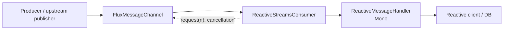
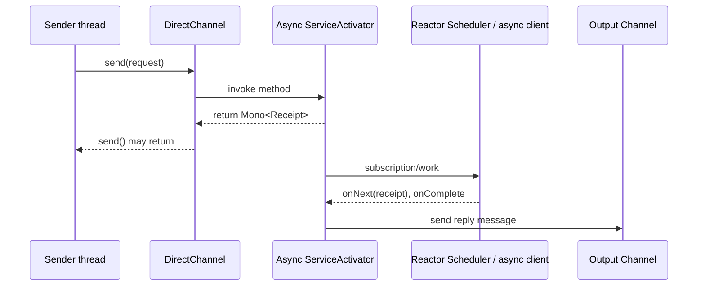
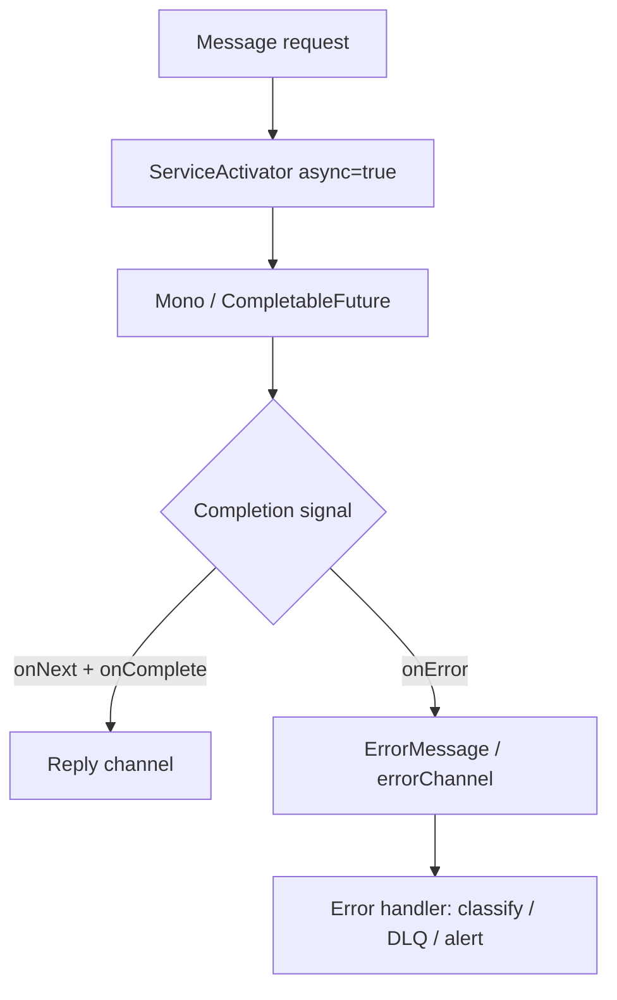
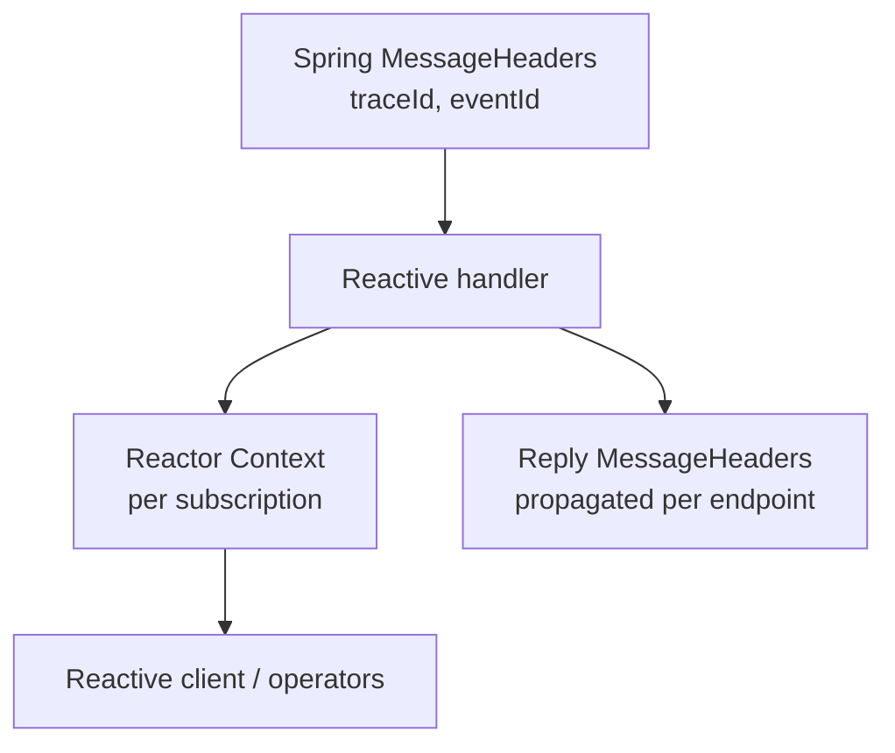

# Reactive Handlers and Async Return Types in Spring Integration Runtime

## 1. Why Does a Handler Returning `Mono` Not Automatically Make a Reactive Flow?

A message enters a `DirectChannel`, a service activator calls an external service to calculate shipping fees, and then sends the result to the next endpoint. If the service makes a blocking HTTP call, the consumer thread waits on network I/O. As request volume grows, thread pools and connection pools can fill up. If the service returns `Mono<Quote>` or `CompletableFuture<Quote>`, work **can** proceed without holding the caller thread; however, the result is only handled properly if Spring Integration knows **when to subscribe/await the future**, **where to route the reply**, and **where asynchronous errors are sent**.

In the **SPRING_INTEGRATION_RUNTIME** module, this lesson focuses on **Reactive handlers and async return types** in the **Reactive runtime** chapter. The focus is not isolated Reactor syntax, but its impact on the message flow: channels, endpoints, consumers, pollers, executors, reply/error channels, correlation, retries, transactions, and performance.

After this lesson, you will be able to:

1. Distinguish synchronous handlers, handlers with async replies, and `ReactiveMessageHandler`.
2. Explain `Mono<T>`, `Flux<T>`, `Mono<Void>`, and `CompletableFuture<T>` when returned from handlers.
3. Use `@ServiceActivator(async = "true")`, `FluxMessageChannel`, and `IntegrationFlow.handleReactive(...)` in appropriate scenarios.
4. Identify who the subscriber is, when work executes, and where backpressure exists.
5. Explain thread switches, transactions, and error propagation across asynchronous boundaries.
6. Design timeouts, retries, correlation, cancellation, and observable tests.

**Reference versions:** examples use Java 17+, Spring Integration 6.1+, and Reactor 3.x. Some features such as automatically enabling async when the output channel is reactive began in Spring Integration 6.1. Cross-check APIs against your project's exact dependency versions, as different configurations and adapters may behave differently.

## 2. Three Processing Models Often Confused

| Model | Input / output | Execution timing | Consequence |
| --- | --- | --- | --- |
| **Imperative synchronous** | `Message<?> → T` | Method runs immediately on the consumer thread; reply is sent when the method returns | Exceptions typically propagate back up the same call stack if the channel is synchronous. |
| **Async reply-producing handler** | `Message<?> → CompletableFuture<T>` or `Mono<T>` | Method returns early; framework handles completion/reply per `async` and output channel | Caller can be released; reply/error appears later on another thread. |
| **Reactive terminal handler** | `Message<?> → Mono<Void>` via `ReactiveMessageHandler` | Publisher is subscribed to as configured by the adapter/consumer | One-way model; does not emit a business reply payload. |

A **reactive flow** also requires a chain of publisher/subscriber genuinely participating in Reactive Streams, not just a method returning a `Mono` object. A traditional channel can still carry a **`Mono` as a payload**, meaning downstream receives the *publisher object* rather than receiving `Quote`.

### 2.1. Reactive Streams Concepts to Understand

| Concept | Meaning in the flow |
| --- | --- |
| `Publisher<T>` | Describes a signal source; may not have done I/O before subscription. |
| `Subscriber<T>` | Receiver of `onNext`, `onError`, `onComplete` according to demand. |
| `Subscription.request(n)` | Requests the number of items desired; foundation of backpressure. |
| `Mono<T>` | At most one value, or empty completion, or error. |
| `Flux<T>` | Can emit 0..N values; must determine whether they represent N messages or one publisher-typed payload. |
| `Mono<Void>` | Carries only completion/error signals, no reply value. |
| `CompletableFuture<T>` | Promise for a single result/exception; **has no demand/backpressure protocol** like Reactor. |

With a **cold** publisher like `Mono.defer(...)`, multiple subscriptions can trigger side effects multiple times. With a **hot** publisher like a live event stream, late subscribers may miss earlier items. Never claim every `Mono` "runs exactly once" or every `Flux` supports replay.

## 3. Async Return Types vs. Reactive-Typed Payloads

Suppose a business service returns:

```java
Mono<Quote> computeQuote(Order order);
```

There are two critical cases:

**A — The framework treats `Mono` as an async reply:** it subscribes/flattens according to the endpoint contract, and when the publisher emits `Quote`, downstream receives a reply message carrying `Quote`. Exceptions inside the publisher become **async error signals**.

**B — The framework treats `Mono` as an ordinary payload:** downstream receives a `Message<Mono<Quote>>`. If no subscriber subscribes, operations in a cold `Mono` will not run; if a consumer calls `block()`, the thread is held waiting for the result.

When using a regular **imperative output channel**, a service activator needs `async = true` enabled for the framework to treat reactive return types in async reply mode. When the output channel is a `ReactiveStreamsSubscribableChannel` (such as `FluxMessageChannel`), Spring Integration can flatten the publisher according to downstream demand. Starting in 6.1, a handler with such an output channel automatically switches to async mode if the result is reactive/`CompletableFuture`.

Important note for **multi-value publishers**: in an imperative output channel scenario, the framework may preserve the publisher as a single value/wrapped inside `Mono.just(...)` instead of automatically sending N replies for every `onNext`. Do not rely on a method returning `Flux<Order>` to assume 100 items always turn into 100 Spring messages. To emit multiple messages, choose a splitter, reactive channel, or adapter matching that contract.

### 3.1. Quick Selection Table

| Method result | Single business reply? | Recommendation |
| --- | --- | --- |
| `Receipt` | Yes, immediately | Use a synchronous service activator if processing is brief. |
| `CompletableFuture<Receipt>` | Yes, when future completes | Enable async reply and specify error channel/reply destination. |
| `Mono<Receipt>` | Yes, when publisher emits | Use async reply or a reactive output channel. |
| `Mono.empty()` | No data | Explicitly design no-reply semantics, especially when a gateway expects a response. |
| `Mono<Void>` | No reply data | Fits `ReactiveMessageHandler`/`handleReactive` for one-way outbound. |
| `Flux<Receipt>` | Potentially multiple items | Choose reactive downstream to flatten properly; avoid assuming an imperative channel sends N replies. |
| `Mono<Message<Receipt>>` | One message if handled as async reply | Check header propagation and reply routing; do not casually treat publisher as payload. |

## 4. Example: `@ServiceActivator` Returning `Mono<Receipt>`

Scenario: each order is confirmed asynchronously, taking roughly 200 ms to simulate an external service. The handler does not call `block()` and does not manually call `subscribe()`.

**`OrderProcessing.java`** — data types and handler:

```java
package demo.reactive;

import java.time.Duration;
import org.springframework.integration.annotation.MessageEndpoint;
import org.springframework.integration.annotation.ServiceActivator;
import reactor.core.publisher.Mono;

record OrderRequest(String orderId, int quantity) {}
record Receipt(String orderId, String status) {}

@MessageEndpoint
public class OrderProcessing {

    @ServiceActivator(
            inputChannel = "ordersIn",
            outputChannel = "ordersOut",
            async = "true")
    public Mono<Receipt> process(OrderRequest order) {
        // Reactor demo. In production, replace Mono.delay with a reactive HTTP/R2DBC client.
        return Mono.defer(() -> {
            if (order.quantity() <= 0) {
                return Mono.error(
                        new IllegalArgumentException("Quantity must be positive"));
            }

            return Mono.delay(Duration.ofMillis(200))
                    .map(tick -> new Receipt(order.orderId(), "ACCEPTED"));
        });
    }
}
```

**`OrderFlowConfiguration.java`** — two channels and reply consumer:

```java
package demo.reactive;

import java.util.concurrent.CountDownLatch;
import org.springframework.context.annotation.Bean;
import org.springframework.context.annotation.ComponentScan;
import org.springframework.context.annotation.Configuration;
import org.springframework.integration.annotation.ServiceActivator;
import org.springframework.integration.channel.DirectChannel;
import org.springframework.integration.config.EnableIntegration;
import org.springframework.messaging.MessageChannel;
import org.springframework.messaging.MessageHandler;

@Configuration
@EnableIntegration
@ComponentScan(basePackageClasses = OrderProcessing.class)
public class OrderFlowConfiguration {

    @Bean("ordersIn")
    public MessageChannel ordersIn() {
        return new DirectChannel();
    }

    @Bean("ordersOut")
    public MessageChannel ordersOut() {
        return new DirectChannel();
    }

    @Bean
    public CountDownLatch receiptLatch() {
        return new CountDownLatch(1);
    }

    @Bean
    @ServiceActivator(inputChannel = "ordersOut")
    public MessageHandler receiptConsumer(CountDownLatch receiptLatch) {
        return message -> {
            Receipt receipt = (Receipt) message.getPayload();
            System.out.println("Received: " + receipt.orderId());
            receiptLatch.countDown();
        };
    }
}
```

**`Demo.java`** — sending a message and observing completion:

```java
package demo.reactive;

import java.util.concurrent.CountDownLatch;
import java.util.concurrent.TimeUnit;
import org.springframework.context.annotation.AnnotationConfigApplicationContext;
import org.springframework.messaging.MessageChannel;
import org.springframework.messaging.support.MessageBuilder;

public class Demo {
    public static void main(String[] args) throws InterruptedException {
        try (var context = new AnnotationConfigApplicationContext(
                OrderFlowConfiguration.class)) {

            MessageChannel input = context.getBean("ordersIn", MessageChannel.class);
            CountDownLatch latch = context.getBean(CountDownLatch.class);

            input.send(MessageBuilder
                    .withPayload(new OrderRequest("SO-42", 2))
                    .setHeader("traceId", "trace-42")
                    .build());

            System.out.println("send() returned; reply may not have arrived yet.");
            if (!latch.await(3, TimeUnit.SECONDS)) {
                throw new IllegalStateException("No receipt within test timeout");
            }
        }
    }
}
```

**Exact interpretation:**

1. `DirectChannel` invokes `process(...)` on the sender thread; **creating** the `Mono` happens immediately.
2. `async = "true"` instructs the service activator to handle the reactive result asynchronously rather than forwarding the `Mono` as a regular payload to `ordersOut`.
3. `Mono.delay(...)` emits a signal after the delay; the framework sends the `Receipt` reply to `ordersOut` when the result is ready.
4. `receiptConsumer` may execute on the thread completing the publisher, not necessarily the `input.send(...)` thread.
5. `CountDownLatch` is only for demo/testing; production uses gateway/reply flows, metrics, and appropriate timeouts.

A handler does not need to spawn threads manually or call `subscribe()` to benefit from async return types. Calling `subscribe()` internally and returning `void` usually blinds the framework to when side effects finish or errors occur.

### 4.1. When Is `async = "true"` Required?

With regular output channels such as `DirectChannel`, explicitly enable `async = "true"` when returning `Mono<T>` or `CompletableFuture<T>` as an async reply. With a `FluxMessageChannel`/`ReactiveStreamsSubscribableChannel` output channel, starting in version 6.1 async mode is enabled automatically for supported results, though declaring it explicitly still clarifies intent and improves readability.

Do not turn on async merely because every method is slow: if the method itself blocks while **constructing** the publisher, the caller is still blocked before the method returns. Blocking execution must be eliminated or intentionally shifted to an appropriate scheduler.

## 5. `CompletableFuture`: Asynchronous, Not Reactive Streams

`CompletableFuture<T>` represents a result that will become available in the future, or an exceptional completion. When a service activator has `async = "true"`, Spring Integration can send the reply once the future completes and release the caller thread beforehand.

Example when integrating a blocking SDK without a reactive API:

```java
import java.util.concurrent.CompletableFuture;
import java.util.concurrent.Executor;
import org.springframework.integration.annotation.MessageEndpoint;
import org.springframework.integration.annotation.ServiceActivator;

@MessageEndpoint
public class FutureQuoteHandler {
    private final Executor blockingIoExecutor;
    private final LegacyQuoteClient client;

    public FutureQuoteHandler(Executor blockingIoExecutor, LegacyQuoteClient client) {
        this.blockingIoExecutor = blockingIoExecutor;
        this.client = client;
    }

    @ServiceActivator(
            inputChannel = "legacyQuoteRequests",
            outputChannel = "legacyQuoteReplies",
            async = "true")
    public CompletableFuture<String> quote(String orderId) {
        return CompletableFuture.supplyAsync(
                () -> client.fetchQuote(orderId), blockingIoExecutor);
    }

    public interface LegacyQuoteClient {
        String fetchQuote(String orderId); // Blocking SDK API.
    }
}
```

This example assumes the two channels, client, and an appropriately **bounded executor** bean are configured. `supplyAsync` shifts blocking work to the executor; it **does not make a blocking API non-blocking**. Worker count, queue capacity, timeouts, and task rejection policies must be controlled. Avoid abusing the common `ForkJoinPool` for long-blocking I/O.

| `CompletableFuture<T>` | `Mono<T>` |
| --- | --- |
| The operation may have already started when creating the future. | Cold publishers can defer until subscription; other publishers may still be eager/hot. |
| Single result or error; no N-element demand protocol. | At most one result or error; participates in Reactive Streams. |
| Uses `thenApply`, `exceptionally`, `whenComplete`. | Uses `map`, `flatMap`, `onErrorResume`, `doOnError`. |
| `CompletableFuture` cancellation and timeouts do not always stop underlying tasks. | Reactive cancellation propagates along the subscription if operators/drivers support it. |
| No built-in Reactor Context. | Has Reactor `Context` bound to the subscription flow. |

Avoid calling `future.join()` or `future.get()` on a poller/event-loop thread: doing so turns an async result into blocking waiting. If you must wait synchronously at an application boundary, enforce a timeout and understand resource limits.

## 6. `ReactiveMessageHandler` and Terminal `handleReactive(...)`

In Spring Integration, `ReactiveMessageHandler` is designed for handlers performing **one-way reactive operations**. It accepts a Spring `Message<?>` and returns a `Mono<Void>` representing processing completion/error, **not a reply payload**.

Since Spring Integration 6.1, the Java DSL provides the `handleReactive(ReactiveMessageHandler)` operator. The framework is responsible for subscribing to the returned publisher; the application must not call `subscribe()` inside the lambda:

```java
import java.time.Duration;
import org.springframework.context.annotation.Bean;
import org.springframework.context.annotation.Configuration;
import org.springframework.integration.dsl.IntegrationFlow;
import reactor.core.publisher.Mono;

@Configuration
public class ReactiveAuditFlow {

    @Bean
    public IntegrationFlow auditFlow() {
        return IntegrationFlow.from("auditRequests")
                .handleReactive(message ->
                        Mono.delay(Duration.ofMillis(50))
                            .doOnNext(ignored ->
                                    System.out.println(
                                        "Audited event " + message.getHeaders().get("eventId")))
                            .then());
    }
}
```

Meaning: `auditRequests` is an input channel that must be configured separately to fit the flow; `Mono<Void>` simply signals when the audit operation completes. The demo uses `Mono.delay` to illustrate the mechanism clearly; production code should substitute a real reactive client (e.g., R2DBC, WebClient) returning an actual `Mono<Void>`.

**Do not confuse:**

- `handleReactive(...)` is **terminal** for one-way handlers: it completes without emitting a business reply.
- `handle(service, "method")` / `@ServiceActivator` can **produce replies** if the method returns `Mono<T>`, `CompletableFuture<T>` and is configured for result handling accordingly.
- A regular imperative `MessageHandler` has a `void handleMessage(Message<?>)` method, distinct from the reactive contract returning a completion publisher.

### 6.1. When the Input Channel Is Imperative

If a `ReactiveMessageHandler` is used in an imperative flow, Spring Integration uses `ReactiveMessageHandlerAdapter` to subscribe to the publisher immediately after calling the handler, because the current flow cannot form an end-to-end demand chain. The result is **async execution**, without automatic end-to-end backpressure.

### 6.2. When the Input Channel/Consumer Is Reactive

When a `ReactiveStreamsConsumer` is present—for example consuming from a `FluxMessageChannel`—the `ReactiveMessageHandler`'s publisher can be **composed** into the reactive stream via Reactor operators such as `flatMap`. At this point, pipeline demand and concurrency can govern handler invocations. Distinguish in-flight task counts from completed message counts rather than only counting method invocations.

## 7. `FluxMessageChannel` and `ReactiveStreamsConsumer`

`FluxMessageChannel` is a dual-role channel: it implements `MessageChannel` for sending Spring messages and provides `Publisher<Message<?>>` per Reactive Streams. It uses an internal `Flux` to forward messages to subscribers and implements `ReactiveStreamsSubscribableChannel` to consume from upstream publishers by demand.



Key point: `FluxMessageChannel` is **not a durable queue** and does not replace `JdbcChannelMessageStore`, a broker, or an outbox. It connects reactive components; load tolerance, buffering, imperative producer behavior, and overflow policies must be verified specifically.

### 7.1. A Flow Using `FluxMessageChannel`

```java
import java.time.Duration;
import org.springframework.context.annotation.Bean;
import org.springframework.context.annotation.Configuration;
import org.springframework.integration.channel.FluxMessageChannel;
import org.springframework.integration.dsl.IntegrationFlow;
import reactor.core.publisher.Mono;

@Configuration
public class FluxChannelDemo {

    @Bean
    public FluxMessageChannel reactiveInput() {
        return new FluxMessageChannel();
    }

    @Bean
    public IntegrationFlow reactiveInputFlow(FluxMessageChannel reactiveInput) {
        return IntegrationFlow.from(reactiveInput)
                .handleReactive(message ->
                        Mono.delay(Duration.ofMillis(25))
                            .doOnNext(i -> System.out.println(
                                    "processed " + message.getPayload()))
                            .then());
    }
}
```

This sample illustrates the reactive consumer path. `reactiveInput` has no persistent buffer; for production use, establish source, backpressure, lifecycle, error handling, and restart plans matching your SLA. Printing in `doOnNext` is an illustrative side effect, not a durability guarantee.

### 7.2. `reactive()` on Endpoints

Spring Integration 5.5+ provides `reactive()` on `ConsumerEndpointSpec` (and the `@Reactive` annotation on messaging annotations). It instructs the framework to build a `ReactiveStreamsConsumer` even when the input is not directly a `FluxMessageChannel`, and lets you customize the source `Flux<Message<?>>` with operators like `publishOn`, `doOnNext`, or `retry`.

Do not configure both `poller()` and `reactive()` on the same endpoint annotation because those two consumer models impose mutually exclusive constraints. When combining a polling source and a reactive stage, define the boundary between the **polling source** and the **downstream reactive consumer**.

### 7.3. How Far Does Backpressure Reach?

It **holds** when producer, channel/bridge, consumer, and adapters all honor `request(n)`. You **cannot assume** end-to-end backpressure when:

- An adapter calls a blocking API and prefetches large volumes of data on its own.
- `DirectChannel` uses imperative push without a `Subscription` mechanism.
- A `CompletableFuture` callback has already launched 1,000 tasks before a reactive subscriber ever requests them.
- A consumer calls ad-hoc `subscribe()`, detaching work from the main subscription.
- A broker uses protocol-specific prefetch/ack not properly bridged to demand.

Merely seeing `Mono`/`Flux` in code is never enough to declare an entire system backpressure-ready.

## 8. Reactive `@MessagingGateway`: Executing Upon Subscription

An easy way to start with reactive request–reply is defining a gateway returning `Mono<T>`:

```java
import org.springframework.integration.annotation.Gateway;
import org.springframework.integration.annotation.MessagingGateway;
import reactor.core.publisher.Mono;

@MessagingGateway
public interface OrderGateway {
    @Gateway(requestChannel = "gatewayOrderRequests")
    Mono<Receipt> submit(OrderRequest order);
}
```

With a reactive gateway, Spring Integration builds the send-and-receive operation lazily like `Mono.defer(...)`: **calling the method returns a `Mono`**, while sending into the flow and waiting for the reply starts only when subscribed. A service activator behind it handles the reply:

```java
import org.springframework.integration.annotation.MessageEndpoint;
import org.springframework.integration.annotation.ServiceActivator;
import reactor.core.publisher.Mono;

@MessageEndpoint
public class GatewayOrderHandler {

    @ServiceActivator(inputChannel = "gatewayOrderRequests", async = "true")
    public Mono<Receipt> process(OrderRequest order) {
        return Mono.just(new Receipt(order.orderId(), "ACCEPTED"));
    }
}
```

Notes:

1. For the gateway to receive the reply, the handler must route the result to the appropriate reply destination; this example **does not** hardcode an output channel and relies on the gateway's `replyChannel` header.
2. When code calls `gateway.submit(order)` without subscribing, **do not assume the request was processed**.
3. Subscribing multiple times to a cold `Mono` returned by a gateway can trigger send-and-receive multiple times. Never automatically retry or double-subscribe on operations with side effects without an idempotency key.
4. `block()` at an imperative boundary may be used sparingly in tests or bootstrap code, never on a reactive event-loop as standard operation.

### 8.1. Practice: Avoiding Double Subscription

```java
Mono<Receipt> result = gateway.submit(new OrderRequest("SO-42", 2));

// Does not mean the request was sent if nobody subscribed yet.
// result.subscribe(...); result.subscribe(...); can trigger two requests.

// In reactive code, compose further:
Mono<String> status = result.map(Receipt::status);
// Only the final subscriber at the end of the pipeline triggers execution.
```

Do not blindly apply `cache()` just to prevent duplicate subscriptions: caching impacts memory, cached errors, and expiration semantics. The right approach depends on request semantics and business idempotency mechanisms.

## 9. `Flux<T>`, Splitters, and Multiple Replies in a Message Flow

`Flux<T>` can emit multiple values, but "multiple values" does not automatically mean "multiple Spring messages." Semantics depend on the endpoint:

- A service activator returning `Flux<T>` on an imperative channel may cause downstream to receive **the publisher as a single payload** instead of individual items.
- An `AbstractMessageSplitter` supporting publishers can turn emitted elements into separate messages when configured properly.
- `FluxMessageChannel`/reactive consumers can participate in flattening publishers per Reactive Streams with downstream demand.
- A one-way outbound adapter using `ReactiveMessageHandler` generally cares about `Mono<Void>` **completion/error**, not producing multiple replies.

Example using a splitter to emit parts from a batch:

```java
import java.util.List;
import org.springframework.integration.annotation.MessageEndpoint;
import org.springframework.integration.annotation.Splitter;
import reactor.core.publisher.Flux;

record OrderBatch(String batchId, List<String> orderIds) {}

@MessageEndpoint
public class BatchSplitter {
    @Splitter(inputChannel = "batchesIn", outputChannel = "partsOut")
    public Flux<String> split(OrderBatch batch) {
        return Flux.fromIterable(batch.orderIds());
    }
}
```

So that a downstream aggregator knows which parts belong to the same batch and when the sequence is complete, verify **`correlationId`, `sequenceNumber`, and `sequenceSize`** set or configured by the splitter/adapter. An unbounded/unknown-length `Flux` typically lacks a finite `sequenceSize` for an aggregator to await completion; an appropriate **release strategy or timeout** is required. If a source filters out certain parts, the aggregator may wait forever unless the release condition accounts for it.

`Flux.flatMap(...)` can also alter completion order when tasks have varying latencies. If business logic requires ordering, consider `concatMap`, `flatMapSequential`, or a resequencer, weighing concurrency and throughput limits.

## 10. Threading: Who Invokes the Handler and Who Sends the Reply?

**There is no single shared "reactive thread."** `Mono` and `Flux` are composition models; operators, schedulers, channels, and adapters determine execution threads.



This diagram shows a common async reply scenario; it **does not guarantee** every operator switches threads or that `send()` always returns immediately under all configurations. If the method blocks before returning `Mono`, the sender still waits through that part.

### 10.1. `subscribeOn` and `publishOn`

| Operator | Typical effect | When to use |
| --- | --- | --- |
| `subscribeOn(scheduler)` | Affects scheduling for subscription and related upstream steps | When shifting a blocking source onto an appropriate pool. |
| `publishOn(scheduler)` | Shifts execution of downstream operators to that scheduler | When a clear thread boundary is needed between processing stages. |
| No scheduler attached | May execute on subscriber/producer thread or async client thread | When the pipeline is already non-blocking, avoid pointless thread hops. |
| `Mono.delay(...)` | Emits signals on a Reactor scheduler | Demos/timers; does not represent real network I/O. |

**Example wrapping a legacy blocking API** when no non-blocking client exists:

```java
import reactor.core.publisher.Mono;
import reactor.core.scheduler.Schedulers;

public Mono<String> fetchLegacyQuote(String orderId) {
    return Mono.fromCallable(() -> blockingQuoteClient.fetchQuote(orderId))
            .subscribeOn(Schedulers.boundedElastic());
}
```

This is a **bridge for blocking operations**: it occupies a `boundedElastic` thread during execution. Never place blocking JDBC or `Thread.sleep` directly on the Reactor event loop/`Schedulers.parallel()` and assume you have reactive scaling. `boundedElastic` has thread/queue bounds; measure saturation and consider R2DBC/WebClient if genuine non-blocking behavior is required.

### 10.2. Channels and Thread-Bound Transactions

| Boundary | Execution | Consequence |
| --- | --- | --- |
| `DirectChannel` → synchronous method | Same call stack | Imperative transactions can span it if manager/resources match. |
| `DirectChannel` → method returning async `Mono` | Method called on same thread; completion may occur on another | Caller's thread-bound transaction **does not automatically extend** to the async reply. |
| `ExecutorChannel` | Hands off to executor | Upstream transactions and thread-local MDC do not propagate automatically. |
| `QueueChannel` + poller | Poller fetches messages on its own thread | Poller needs its own transaction/error policy; downstream retry differs from source receive. |
| `FluxMessageChannel` | Subscriber/demand drives the stream | Thread depends on publisher/operators/schedulers; still check blocking boundaries. |

**Conclusion:** an async return type does not keep an imperative transaction alive until the `Mono` completes. If business code requires reactive transactions, use reactive resource drivers and a reactive transaction manager.

## 11. Reactive Transactions and Side Effects

### 11.1. Imperative JDBC and Reactive R2DBC Differ

Common imperative transaction managers use `ThreadLocal` to bind transactions to the executing thread. Reactive transactions use the **Reactor Context** to manage state across a subscription. A service activator like:

```java
@Transactional
public Mono<Receipt> process(OrderRequest order) {
    return reactiveRepository.save(order)
            .map(saved -> new Receipt(saved.orderId(), "ACCEPTED"));
}
```

**This is not enough to conclude** a transaction spans the entire pipeline. The actual behavior depends on whether the application configures a `ReactiveTransactionManager`, the repository type, and how framework/proxies apply `@Transactional`. If only a `DataSourceTransactionManager` for JDBC exists, you cannot assume that transaction propagates across Reactor schedulers.

### 11.2. Example Using `TransactionalOperator`

With reactive resources (such as R2DBC) and `ReactiveTransactionManager`, transactions can be scoped explicitly around a publisher:

```java
import org.springframework.transaction.ReactiveTransactionManager;
import org.springframework.transaction.reactive.TransactionalOperator;
import reactor.core.publisher.Mono;

public final class ReactiveOrderService {
    private final ReactiveOrderRepository repository;
    private final TransactionalOperator tx;

    public ReactiveOrderService(
            ReactiveOrderRepository repository,
            ReactiveTransactionManager transactionManager) {
        this.repository = repository;
        this.tx = TransactionalOperator.create(transactionManager);
    }

    public Mono<Receipt> save(OrderRequest order) {
        return tx.transactional(
                repository.save(order)
                        .thenReturn(new Receipt(order.orderId(), "SAVED")));
    }

    public interface ReactiveOrderRepository {
        Mono<Void> save(OrderRequest order);
    }
}
```

The transaction belongs to **the subscription executing the publisher**. When the publisher completes normally, the manager can commit; on error, it rolls back per rollback semantics; on cancel, verify driver/manager policies and the state of any side effects already produced.

**Do not stretch transactions across external APIs** merely because they share a `flatMap`. For example, an R2DBC commit cannot automatically roll back an HTTP request, JMS acknowledgment, or message already published to Kafka. Use stable idempotency keys, outboxes, and choreography/compensation when crossing resource boundaries.

### 11.3. Poller Opens a Transaction, Then Handler Returns `Mono`

```text
Poller thread
  BEGIN JDBC TX
  receive()
  invoke handler -> Mono<Receipt>
  return from handler
  COMMIT JDBC TX

Async continuation thread
  subscription to Mono
  save/order processing happens later
```

This is a **risky scenario** when `async = true` and the author assumes the poller's JDBC transaction wraps the asynchronous continuation. Some sources/adapters have dedicated callback or transaction-specific handling, but never assume it universally. If atomic receive + processing is required, inspect the actual transaction boundaries of the source/broker and data store.

## 12. Async Errors: Exceptions Occurring After the Caller Moves On

With synchronous handlers on `DirectChannel`, exceptions usually unwind back to `send(...)` or the gateway caller. With `Mono.error(...)` / futures completing exceptionally **after the method returns**, errors are no longer on the caller's stack. Spring Integration can publish an `ErrorMessage` to the request message's `errorChannel` header, if present, or to the configured default error channel.



**Do not assume** every error across the whole pipeline reaches the global `errorChannel`: behavior depends on the endpoint, adapter, subscription, error handler, and whether an operator caught/transformed the exception.

### 12.1. Demo: Handling Errors in Reactor

```java
import java.time.Duration;
import reactor.core.publisher.Mono;

public Mono<Receipt> processWithFallback(OrderRequest order) {
    return remoteClient.reserve(order) // Mono<Receipt>
            .timeout(Duration.ofSeconds(2))
            .onErrorResume(RemoteUnavailableException.class,
                    ex -> Mono.just(
                            new Receipt(order.orderId(), "PENDING_MANUAL_REVIEW")));
}
```

Here `remoteClient.reserve(...)` is an assumed application API returning `Mono<Receipt>`. `onErrorResume` **turns certain failures into business success results**, so they no longer emit `onError` to the error flow. This is a **business recovery decision**, not mere logging. For unrecoverable errors, let the error signal propagate and design error channels/alerts/DLQs per contract.

### 12.2. Do Not Call `subscribe()` Inside a Handler and Return `void`

```java
// RISKY: manual subscribe returning void hides completion from the framework.
@ServiceActivator(inputChannel = "paymentsIn")
public void handle(Payment payment) {
    client.charge(payment).subscribe();
}
```

In this flawed example, the caller may think the handler finished while the network call is still in flight. Post-subscription exceptions may miss the flow's `errorChannel`/retry handling, and the caller's transaction has already ended. A better design is returning the publisher to an endpoint with an async/reactive contract:

```java
@ServiceActivator(inputChannel = "paymentsIn", async = "true")
public Mono<Receipt> handle(Payment payment) {
    return client.charge(payment);
}
```

Both snippets illustrate the approach; `Payment`, `client`, and output routing must be configured per application. For one-way outbound, use `ReactiveMessageHandler` returning `Mono<Void>` instead of forcing a payment result into an unnecessary reply.

### 12.3. `ErrorMessage` and Correlation

In an error handler, `ErrorMessage.getPayload()` is a `Throwable`; `getOriginalMessage()` can be `null`. `MessagingException.getFailedMessage()` may contain the message at the point of failure, though it is **not always present**. Across async continuations and multi-step transformations, carry stable `eventId`/`traceId` headers rather than relying solely on `MessageHeaders.ID` to identify a business operation across every stage.

Logs should include: endpoint, event ID, correlation ID, exception type, attempt count, duration, thread/scheduler, and error destination. Do not dump tokens, customer data, or arbitrary payloads into logs.

## 13. Timeouts, Retries, Backoff, and Cancellation

Reactive publishers carry error signals, so retries can be expressed via operators. However, **publisher retry** differs from **Spring Integration handler retry** and also differs from **JMS/Kafka source redelivery**.

### 13.1. Reactor Retry Can Re-Trigger Side Effects

```java
import java.time.Duration;
import reactor.core.publisher.Mono;
import reactor.util.retry.Retry;

public Mono<Receipt> reserveWithRetry(OrderRequest order) {
    return Mono.defer(() -> remoteClient.reserve(order))
            .timeout(Duration.ofSeconds(2))
            .retryWhen(
                    Retry.backoff(2, Duration.ofMillis(100))
                            .maxBackoff(Duration.ofSeconds(1))
                            .filter(ex -> ex instanceof TransientRemoteException));
}
```

Here `remoteClient.reserve(...)` is an application-provided reactive API; `TransientRemoteException` is a business exception classifying transient errors. `Retry.backoff(2, ...)` allows **at most 2 retries after the initial attempt** (up to 3 subscriptions/attempts in the retried branch). Do not retry validation, authorization, or schema mismatch errors when inputs have not changed.

Note operator ordering: in this example, `timeout` sits **before** `retryWhen`, so each attempt gets its own timeout. To cap the **total duration** of the entire chain including backoff and retries, place an outer timeout outside retry:

```java
return attemptWithRetry(order)
        .timeout(Duration.ofSeconds(5)); // Overall limit, including backoff time.
```

**Major risk:** A remote request times out even though the server processed it successfully. Resubscribing to retry can double-charge a payment or double-deduct inventory. For side effects, require a **stable idempotency key**, query remote state when needed, and design retries by error classification.

### 13.2. Three Retry Layers Can Stack

```text
JMS/Kafka redelivery
  └─ Spring Integration RequestHandlerRetryAdvice
       └─ Mono.retryWhen(...)
            └─ HTTP call / DB operation
```

If each layer retries up to 3 times uncoordinated, remote calls can multiply to `3 × 3 × 3 = 27` under sustained failure. Exact counts depend on retry rules, acknowledgments, recovery, timeouts, and where exceptions are translated.

Policy design should define:

- One primary layer responsible for retrying each error category.
- Total retry budget, gateway deadline, and backoff/jitter.
- A DLQ or parking lot for poison messages after retries exhaust.
- Correlation ID and attempt count across both broker redelivery and Reactor subscriptions.
- Idempotency and commit/ack state independent of retry counts.

### 13.3. Cancellation Does Not Automatically Roll Back All Systems

A subscriber canceling a `Mono`/`Flux` can stop upstream from emitting further signals if adapters/drivers support it. However, cancellation **does not reliably** abort an already-sent network request or roll back a committed database transaction. For example:

```text
Gateway timeout → cancel subscription
               → HTTP payment request already reached recipient
               → remote payment may still succeed
```

Therefore, never equate `cancel()` with "the business action never executed." When reconciliation is required, query remote status and use idempotency/compensation or recovery workflows.

## 14. Reactor Context, Message Headers, and Correlation

Spring Integration uses `MessageHeaders` such as `correlationId`, `replyChannel`, `errorChannel`, and custom `traceId` to carry metadata. Reactor has its own `Context` for **subscription-bound** data, distinct from Java `ThreadLocal`/MDC.



Do not assume `MessageHeaders` are automatically copied into Reactor Context or `MDC` by every adapter. When needed, pass metadata explicitly:

```java
import org.springframework.messaging.Message;
import reactor.core.publisher.Mono;

public Mono<Receipt> processWithTrace(Message<OrderRequest> request) {
    String traceId = String.valueOf(
            request.getHeaders().getOrDefault("traceId", "unknown"));

    return Mono.deferContextual(contextView -> {
        String activeTrace = contextView.getOrDefault("traceId", "unknown");
        return traceAwareClient.reserve(request.getPayload(), activeTrace);
    }).contextWrite(context -> context.put("traceId", traceId));
}
```

The example assumes `traceAwareClient.reserve(...)` returns `Mono<Receipt>`. It demonstrates controlled transfer of metadata from message headers into Reactor Context; it does not automatically enable end-to-end tracing across every protocol.

**Security:** headers supplied by external clients are untrusted input. If using `tenantId`/`traceId` for routing or auditing, validate and sanitize them first. Never stuff tokens, passwords, or entire header maps into Reactor Context for indiscriminate logging.

## 15. Lifecycle, Subscriptions, and Recoverability

In imperative flows, a `running` endpoint can accept messages as soon as a sender sends. In reactive flows, **lifecycle state** and **subscription** are related but distinct concepts:

- A registered `IntegrationFlow` bean does not guarantee a subscriber exists at the end of the chain.
- With a `@MessagingGateway` returning `Mono`, request–reply usually starts when the publisher is subscribed to.
- A `FluxMessageChannel` needs a reactive consumer/subscriber so messages have somewhere to go; do not assume it is a durable queue holding every message prior to subscription.
- On cancel/stop, source publishers or adapters may stop producing depending on lifecycle implementation; restarting requires properly restoring subscriptions and adapter states.
- An `IntegrationFlow` with a reactive source can have a subscription-bound lifecycle, distinct from `TaskScheduler`-based pollers.

The Java DSL offers `toReactivePublisher(...)` to export a flow as a publisher. Some variants support `autoStartOnSubscribe`; when using it, remember the flow may **start on subscribe and stop on cancel/termination**, so do not repeatedly create and discard publishers in production causing constant start/stop churn.

### 15.1. A Reactor Flow Does Not Replace a Durable Message Store

If a producer sends a message into a reactive channel and the application crashes before processing completes, a `Flux` by itself does not have the semantics of a JMS queue, Kafka topic, or `JdbcChannelMessageStore`. To support replay/recovery after restarts, you need:

1. A source/broker whose delivery/ack/checkpoint mechanics meet your requirements.
2. Ack coordination tied to pipeline completion/error per the specific adapter.
3. A `MessageStore`, outbox, or durable queue where required.
4. Stable event IDs, correlation, and idempotency keys for redelivery.
5. Monitoring of backlogs, in-flight tasks, timeouts, and unsubscribed messages.

With `ReactiveMessageSourceProducer` and sources offering acknowledgment callbacks, Spring Integration can coordinate ack/reject from completion/error signals in certain cases, but this is **source- and adapter-dependent behavior**. Never infer that all inbound adapters react identically to `onComplete` and `onError`.

## 16. Performance: Fewer Threads Does Not Always Mean Faster

### 16.1. What to Measure?

| Signal | Why it matters |
| --- | --- |
| Handler invocations/second | Shows requests **received**, not completed. |
| Completion rate and p95/p99 latency | Reflects results finished via reply/error channels. |
| In-flight publisher count | Indicates concurrency, backlog, and pending external operations. |
| Demand/`request(n)` and buffer occupancy | Checks real backpressure, overflow, and burst behavior. |
| Executor/`boundedElastic` active/queued counts | Reveals saturation in blocking bridges. |
| HTTP connection pool and R2DBC pool | Bottlenecks beneath the reactive pipeline. |
| Timeout/retry/cancel rates | Detects slow downstreams or retry storms. |
| `ErrorMessage` and dead-letter rates | Separates business, infrastructure, and failover errors. |
| Poller receive duration / queue depth | Assesses whether async returns freed poller threads while building downstream backlogs. |
| Late reply/gateway timeout rates | Detects responses arriving past deadlines. |

**Do not measure only the time until a method returns `Mono`**: I/O may not have even started yet. Measure until the publisher signals `onComplete` or `onError`, including retry/backoff, and correlate traces between endpoint entry and completion.

### 16.2. Increasing Concurrency Can Make Things Worse

High `flatMap` concurrency can open too many HTTP calls; `parallel()` does not make blocking code non-blocking; adding workers to an `ExecutorChannel` can exhaust DB connection pools. If a downstream aggregator locks by correlation ID, increasing upstream threads only queues more requests behind the same group lock.

The fix is not simply "add `publishOn(parallel())`":

- Cap concurrency based on downstream capacity.
- Use genuine non-blocking clients, or bridge blocking calls with bounded executors.
- Define timeouts, bulkheads, backpressure policies, and retry budgets.
- Separate long-I/O branches from sensitive transactions/critical sections.
- Instrument **completion** and **backlog**, not just ingress rate.

## 17. Common Errors and Diagnostic Table

| Symptom | Possibilities to check | How to resolve |
| --- | --- | --- |
| Handler returns `Mono` but HTTP call never runs | Nobody subscribed, `Mono` treated as payload, cold publisher never triggered | Check `async=true`, output channel, and downstream subscriber. |
| Downstream receives `Mono` instead of `Receipt` | Imperative handler did not handle async return in async mode | Enable async mode or switch to a reactive channel/consumer matching the contract. |
| `send()` returns immediately yet business work is incomplete | Async reply or handoff across another channel | Measure completion and ack separately; do not mark success on `send()` alone. |
| Gateway hangs with no reply | `Mono.empty()`, missing subscriber, lost `replyChannel`, low timeout | Verify reply/error routing, no-reply contract, and deadlines. |
| Errors in `Mono` never reach the error flow | Manual `subscribe()`, swallowed by `onErrorResume`, async branch lacks handler | Let the framework manage subscriptions or configure error destinations. |
| `block()` freezes the event loop | Blocking on a scheduler meant for non-blocking work | Use a reactive client or a bounded `boundedElastic` bridge. |
| `@Transactional` fails to roll back async side effects | Thread-bound transaction already ended; wrong transaction manager | Switch to reactive transactions or design explicit boundaries. |
| External operation executes twice | Two subscriptions, `retryWhen` resubscription, or broker redelivery | Stable idempotency key; audit attempts at every layer. |
| `Flux` loses ordering | `flatMap` with concurrent tasks | Use `concatMap`/`flatMapSequential` or a resequencer as needed. |
| Many messages yet low completion rate | Saturated connection pools, lock contention, retry storms | Measure in-flight, p95, backlog, lock waits, and pools. |
| Side effects still occur after cancel | Request reached remote before subscription canceled | Use reconciliation/compensation; never equate cancel with undo. |
| MDC/transaction context lost in callbacks | Thread switch via scheduler or async boundary | Use proper Reactor Context/propagation and reactive transactions. |
| Flow stops after cancel and stops receiving data | Subscription tied to source/flow lifecycle | Check start/stop mechanics, resubscription, and health endpoints. |
| Reactive output grows memory | Unbounded buffers, slow subscriber, hot producer | Measure demand/buffers; cap concurrency and set overflow policies. |

### Step-by-Step Investigation Process

1. **Identify the handler's contract:** returns `T`, `CompletableFuture<T>`, `Mono<T>`, `Flux<T>`, or `Mono<Void>`.
2. **Identify the subscriber:** framework or application manually subscribing? How many subscriptions exist on the same publisher?
3. **Identify the channel:** `DirectChannel`, `ExecutorChannel`, `QueueChannel`, or `FluxMessageChannel`; does the output channel have a reactive contract?
4. **Inspect configuration:** `async`, `reactive()`, `handleReactive(...)`, `replyChannel`, and `errorChannel`.
5. **Draw a thread timeline:** when method returns, when subscribed, when remote is called, when `onNext`/`onError`/`onComplete` fires, when reply is sent.
6. **Cross-check transactions and retries:** which resources commit/ack when, how many attempts/subscriptions occur, and is business idempotency enforced?
7. **Measure bottlenecks:** in-flight counts, pool utilization, demand/buffers, p99 latency, event-loop blocking, downstream errors.
8. **Fix systematically:** write a test reproducing the failure mode, then adjust async/subscribe/timeout settings before adding threads.

## 18. Testing Reactive Handlers and Async Flows

### 18.1. Testing `Mono` with Reactor `StepVerifier`

For Section 4's `OrderProcessing.process(...)` example, `StepVerifier` can test outputs without booting an entire Spring context:

```java
import java.time.Duration;
import org.junit.jupiter.api.Test;
import reactor.test.StepVerifier;

class OrderProcessingTest {

    @Test
    void emitsReceipt() {
        OrderProcessing service = new OrderProcessing();

        StepVerifier.withVirtualTime(
                    () -> service.process(new OrderRequest("SO-42", 2)))
                .thenAwait(Duration.ofMillis(200))
                .expectNext(new Receipt("SO-42", "ACCEPTED"))
                .verifyComplete();
    }

    @Test
    void rejectsInvalidQuantity() {
        OrderProcessing service = new OrderProcessing();

        StepVerifier.create(
                    service.process(new OrderRequest("SO-42", -1)))
                .expectError(IllegalArgumentException.class)
                .verify();
    }
}
```

`withVirtualTime` is especially useful with `Mono.delay` or `retryWhen` backoff because you do not wait in wall-clock time. Create the publisher inside the supplier per virtual-time testing rules so timers are not initialized before the virtual scheduler is configured.

### 18.2. Integration Tests Must Assert Both Replies and Errors

A unit test of a `Mono` does not prove:

- `@ServiceActivator(async="true")` was initialized properly.
- The framework subscribes to the publisher in the real flow.
- Replies reach the right channel/gateway.
- Errors after async completion reach `errorChannel` properly.
- `traceId`/`correlationId` headers survive.
- Pollers ack properly on downstream success or failure.

Write integration tests sending a real message through the channel/gateway and using latches or bounded-timeout assertions to wait for **reply messages or ErrorMessages**. Do not use `Thread.sleep(...)` as proof of completion. Cover at least: success; error before returning the publisher; `Mono.error` after subscription; timeout; cancel; retry success; retry exhaustion; double subscription; and non-reactive output channels.

### 18.3. Important Cases for Load Testing

| Case | What to observe |
| --- | --- |
| 1,000 concurrent requests with slow downstream | Concurrency caps, in-flight counts, queue/pool saturation. |
| Subscriber cancels mid-flight | Does upstream stop? Could side effects have already occurred? |
| Publisher emits `onError` after method return | `ErrorMessage` reaches right destination with correlation ID. |
| `Mono.empty()` through request–reply gateway | No-reply semantics and gateway timeout. |
| Downstream blocking before/after `publishOn` | Which thread blocks; is there event-loop starvation? |
| Switching `DirectChannel` to `FluxMessageChannel` | Subscriptions, demand, and downstream payload shape. |
| Restart while publishers are in flight | Does the durable source redeliver; is the consumer idempotent? |
| Reactor retry combined with broker retry | Total attempts, duplicate side effects, deadlines. |

## 19. Production Readiness Checklist for Reactive Handlers

1. Explicitly distinguish **one-way (`Mono<Void>`)** from **request–reply (`Mono<T>`/`CompletableFuture<T>`)**.
2. Know **who subscribes**: framework, gateway caller, or a pipeline-end subscriber.
3. Never call ad-hoc `subscribe()` dropping completion/errors; avoid `block()` on event loops.
4. Use **`async=true` or reactive output** when async replies must be flattened; verify actual channel behavior.
5. Distinguish **imperative threading** from **Reactive Streams backpressure**; measure demand and buffered messages.
6. Choose proper clients and schedulers: non-blocking WebClient/R2DBC or bounded bridges for legacy blocking APIs.
7. Intentionally design **reply/error channels**, timeouts, no-reply, and late replies.
8. Preserve **event ID/correlation ID** across async continuations, mappings, and retries.
9. Choose **`ReactiveTransactionManager`** if transactions must wrap reactive resources; do not expect thread-local transactions to cross subscriptions.
10. Enforce **idempotency** for side effects in the face of retries/resubscriptions/redeliveries.
11. Define source and transport **cancellation/restart/recovery** policies rather than treating Flux as a durable queue.
12. Test success/error/cancel/double subscription and performance under slow downstreams.

### Self-Assessment Questions

1. Why might a handler returning `Mono<Receipt>` cause downstream to receive a `Mono` instead of a `Receipt`?
2. What is the difference between `handleReactive(...)` and a service activator returning `Mono<T>`?
3. Does `FluxMessageChannel` inherently provide durable storage and exactly-once delivery?
4. At what moment does a `@MessagingGateway` returning `Mono` initiate send-and-receive?
5. Why can subscribing twice to a cold `Mono` trigger side effects twice?
6. When should `subscribeOn(boundedElastic())` be used, and why does it not make blocking JDBC non-blocking?
7. Does an imperative transaction opened in a poller automatically wrap Reactor callbacks executing afterward?
8. Why can `onErrorResume` prevent errors from reaching an error channel?
9. With `Retry.backoff(2, ...)`, what is the maximum total number of subscriptions including the initial attempt?
10. Why does canceling a subscription not prove a remote payment was reverted?
11. `Flux.flatMap` can break ordering; which operators/endpoints should you pick when ordering matters?
12. When a method returns very fast yet p99 latency is high, which timestamps should you measure?

## 20. References

- [Spring Integration Reference — Reactive Streams Support](https://docs.spring.io/spring-integration/reference/6.4/reactive-streams.html)
- [Spring Integration Reference — Service Activator / Asynchronous Service Activator](https://docs.spring.io/spring-integration/reference/6.4/service-activator.html)
- [Spring Integration Reference — Java DSL](https://docs.spring.io/spring-integration/reference/dsl.html)
- [Spring Integration Reference — Messaging Gateway](https://docs.spring.io/spring-integration/reference/gateway.html)
- [Spring Integration Reference — Error Handling](https://docs.spring.io/spring-integration/reference/error-handling.html)
- [Spring Framework Reference — Reactive Transactions](https://docs.spring.io/spring-framework/reference/data-access/transaction/programmatic.html)
- [Project Reactor Reference — Reactor Core Features](https://projectreactor.io/docs/core/release/reference/)
- [Project Reactor Reference — Testing](https://projectreactor.io/docs/core/release/reference/testing.html)
