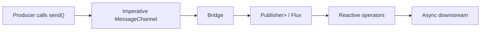
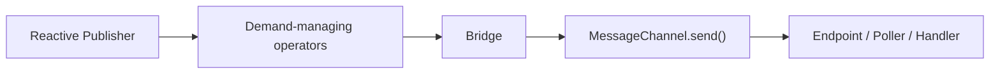
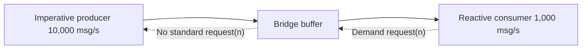
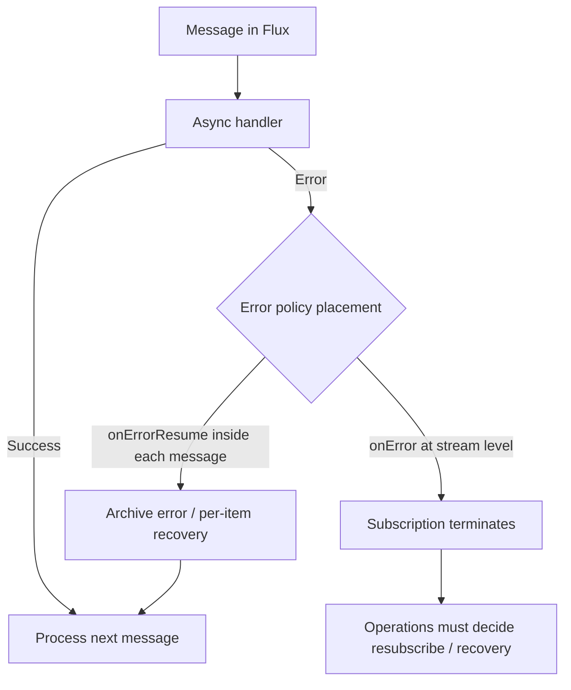
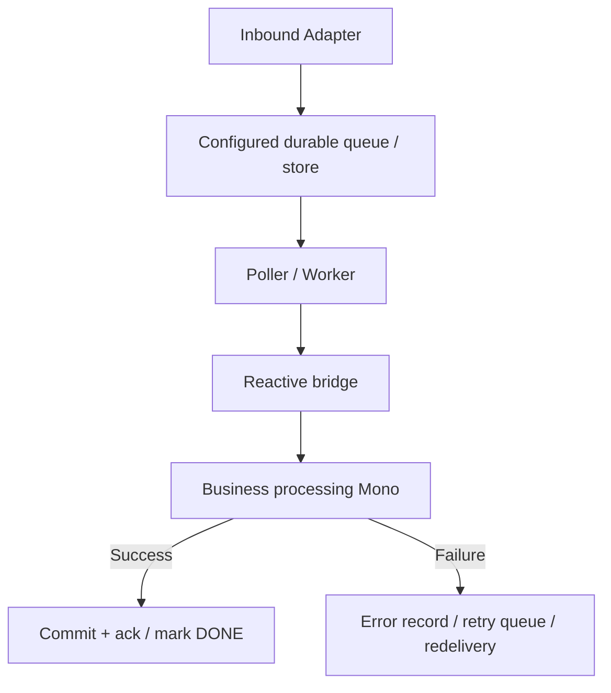

# Bridging Imperative Channels and Reactive Flows in Spring Integration

## Learning Objectives

In Spring Integration, many applications begin with an **imperative** model: a producer calls `MessageChannel.send(message)`, the channel delivers the message to an endpoint, and a handler executes the work. Another part of the system may use **Reactive Streams** with `Publisher`, `Flux`, `Mono`, subscribers, and data demand signals (*demand*). When these two programming styles need to interoperate, we must define the exact **boundary** between the side pushing messages via method calls and the side processing via a reactive stream.

The lesson **Bridging Imperative Channels and Reactive Flows** belongs to the **Reactive runtime** chapter in the **SPRING_INTEGRATION_RUNTIME** module. The goal is not merely wiring two APIs together, but understanding how messages actually flow across channels, endpoints, consumers, pollers, and executors, while designing lifecycle, transactions, retries, message stores, error flows, correlation, backpressure, threading, and runtime observability.

After this lesson, you will be able to:

- Distinguish the contract of `MessageChannel` from `Publisher<Message<?>>`, especially the meaning of `send()`, `subscribe()`, `request(n)`, and `cancel()`.
- Use `FluxMessageChannel` as a bridge from an imperative flow to a reactive subscriber; know where to place subscriptions and manage start/stop.
- Convert a `Flux<Message<?>>` back into `MessageChannel.send()` calls without accidentally blocking an event-loop.
- Explain why a bridge does not automatically make a blocking handler non-blocking, does not automatically guarantee durable persistence, and does not turn `send()` into confirmation that business work succeeded.
- Design backpressure, buffers, timeouts, errors, retries, idempotency, and concurrency on each side of the boundary.
- Test messages arriving before/after subscription, per-message failures, cancellation, restarts, and cases where downstream is slower than the producer.

## 1. Where Do the Two Execution Models Meet?

### 1.1. Imperative Message Channels

The fundamental interface of Spring Messaging is `MessageChannel`:

```java
boolean accepted = messageChannel.send(message);
```

Calling `send()` performs a send operation through the channel according to its specific contract. In a flow using `DirectChannel`, sending may invoke **the handler synchronously on the producer's own thread**; if the handler blocks on I/O for 3 seconds, the sender can also wait 3 seconds.

However, **not every channel is synchronous**. `ExecutorChannel` hands delivery off to a worker; `QueueChannel` holds messages awaiting a consumer or poller; `PublishSubscribeChannel` broadcasts to subscribers per configuration. Thus "imperative" here mainly refers to **the function-call push API**, not a claim that every downstream endpoint runs on the same thread.

The boolean return value of `send()` mainly indicates **acceptance/delivery according to the channel's contract**. Especially across asynchronous boundaries, it is **not** a receipt confirming that a database committed or an external API completed the business operation.

### 1.2. Reactive Streams and Reactor

Reactive Streams centers on four core concepts:

- **`Publisher<T>`** advertises the capability to emit data.
- **`Subscriber<T>`** receives `onSubscribe`, `onNext`, `onError`, `onComplete`.
- **`Subscription`** allows requesting more elements via `request(n)` and canceling via `cancel()`.
- **Demand/backpressure** lets a subscriber express its desired consumption rate to a demand-capable publisher.

Reactor implements this model with `Flux<T>` (0 to many elements) and `Mono<T>` (0 or 1 element). Example processing messages asynchronously:

```java
Flux<Message<OrderCommand>> stream = ...;

Mono<Void> processing = stream
        .concatMap(msg -> orderService.handle(msg.getPayload()))
        .then();
```

Here `orderService.handle(command)` is assumed to return `Mono<Void>`. The `processing` variable only describes a pipeline; with a **cold** publisher, work usually does not execute until subscribed. Conversely, a **hot** publisher can emit events independently of individual subscribers, so emission and buffering policies must be checked.

**Warning:** the word "reactive" does not mean all code automatically runs on another thread. If `orderService.handle()` calls blocking JDBC/HTTP directly on an event-loop, the application can still stall. When necessary, use asynchronous clients or shift blocking work to an appropriate scheduler.

### 1.3. The Bridge Boundary





A bridge must translate **not only data**, but also differences in speed, subscriptions, errors, cancellation, lifecycle, and transactions.

## 2. Runtime Comparison of Channels

| Component | How it receives/delivers messages | Where the handler runs | Backpressure/buffering to watch |
| --- | --- | --- | --- |
| `DirectChannel` | `send()` delivers directly to subscriber | Typically the sender's thread | No Reactive Streams demand; sender may block |
| `ExecutorChannel` | `send()` offloads delivery to an executor | Worker thread | Pool/queue/rejection must be configured; does not create end-to-end demand |
| `QueueChannel` | `send()` enqueues; consumer calls `receive()` or polls | Consumer/poller thread | Queue capacity and send/receive timeouts; can exhaust memory |
| `FluxMessageChannel` | Channel bridged to reactive `Publisher<Message<?>>` model | Depends on subscriber and operators/schedulers | Requires subscription, demand, handling emits before subscriber joins, and buffering policy |
| `PublishSubscribeChannel` | Broadcasts to multiple subscribers per configuration | Synchronous or via executor | Fan-out differs from competing consumers; does not inherently honor demand |

`FluxMessageChannel` is part of Spring Integration, serving as a bridge between `MessageChannel` sends and Reactive Streams subscribers. It is especially useful when an existing producer still uses `send()`, while the consuming side wants to use `Flux`/Reactor.

**Version note:** queue/buffer policies, missing-subscriber behavior, emission failures, and detailed reactive channel APIs must be verified on your actual Spring Integration and Reactor versions. Do not conclude every message is held infinitely or survives restarts merely because the channel name includes `Flux`.

## 3. Imperative → Reactive via FluxMessageChannel

Suppose a service receives `OrderCommand` from a legacy application over a `DirectChannel`. New processing logic wants to read messages as a Reactor stream.

```text
Sender.send(Message<OrderCommand>)
      |
      v
ordersInput: DirectChannel
      |
      v
Bridge IntegrationFlow
      |
      v
ordersReactive: FluxMessageChannel
      |
      v
Reactor subscriber -> Mono processing orders
```

### 3.1. Declaring Channels and Bridge with Java DSL

Conceptually suitable example for Spring Integration 6.x:

```java
import org.springframework.beans.factory.annotation.Qualifier;
import org.springframework.context.annotation.Bean;
import org.springframework.context.annotation.Configuration;
import org.springframework.integration.channel.DirectChannel;
import org.springframework.integration.channel.FluxMessageChannel;
import org.springframework.integration.config.EnableIntegration;
import org.springframework.integration.dsl.IntegrationFlow;
import org.springframework.messaging.MessageChannel;

@Configuration
@EnableIntegration
class OrderBridgeConfiguration {

    @Bean("ordersInput")
    MessageChannel ordersInput() {
        return new DirectChannel();
    }

    @Bean("ordersReactive")
    FluxMessageChannel ordersReactive() {
        return new FluxMessageChannel();
    }

    @Bean
    IntegrationFlow imperativeToReactive(
            @Qualifier("ordersInput") MessageChannel ordersInput,
            @Qualifier("ordersReactive") FluxMessageChannel ordersReactive) {

        return IntegrationFlow.from(ordersInput)
                .channel(ordersReactive)
                .get();
    }
}
```

Key point: upstream still sends via `ordersInput.send(message)`; the flow forwards messages into `FluxMessageChannel`. **At this stage, no reactive business processing occurs** unless a subscriber consumes the corresponding publisher.

There is no need to strip a `Message` down to a DTO before the bridge; `FluxMessageChannel` works with `Message<?>`. Using `Flux.from(ordersReactive)` as a message publisher preserves payloads and headers so downstream can access correlation, business keys, and reply/error headers per contract.

### 3.2. Creating Messages on the Imperative Side

```java
import org.springframework.messaging.Message;
import org.springframework.messaging.MessageChannel;
import org.springframework.messaging.support.MessageBuilder;

// Bean ordersInput is injected from the Spring context.
// OrderCommand is an application-defined business DTO.
record OrderCommand(String orderId, int quantity) {}

Message<OrderCommand> request = MessageBuilder
        .withPayload(new OrderCommand("ORD-42", 2))
        .setHeader("correlationId", "tenant-a:ORD-42")
        .setHeader("businessKey", "ORD-42")
        .build();

boolean accepted = ordersInput.send(request);
```

With `DirectChannel` at the input, `accepted` reflects the send status per the channel's contract. It must not be treated as proof that `OrderService` in the reactive subscriber has finished. A message crossing the bridge may **already be accepted into the pipeline yet still waiting to be processed**.

### 3.3. Reading the Publisher from FluxMessageChannel

A reactive subscriber can receive messages from the channel:

```java
import org.springframework.integration.channel.FluxMessageChannel;
import org.springframework.messaging.Message;
import reactor.core.publisher.Flux;

Flux<Message<?>> messages = Flux.from(ordersReactive);

Flux<String> orderIds = messages.map(message -> {
    OrderCommand command = (OrderCommand) message.getPayload();
    return command.orderId();
});
```

This is a **declarative pipeline**. Without a subscription, do not expect `map()` to execute for incoming messages. In an application, the subscription should be owned by a component with an explicit lifecycle, or managed by the framework when using an appropriate reactive endpoint.

**Important:** attaching multiple subscribers to a publisher/hot channel can produce fan-out semantics rather than *competing consumers*. If business rules require each message to be handled by a single worker, choose a queue/group/consumer structure and ownership policy; do not assume multiple subscriptions automatically partition items evenly.

## 4. Managing Subscriptions with Spring Lifecycle

A common mistake is writing `Flux.from(channel).subscribe(...)` inside a constructor, `@Bean` factory, or handler and forgetting the subscription. When the component is recreated, **multiple subscribers** may appear. When the context stops, undisposed subscriptions can hold resources or keep executing side effects on other publishers.

One illustrative option is a `SmartLifecycle` bean owning the `Disposable`:

```java
import org.springframework.beans.factory.annotation.Qualifier;
import org.springframework.context.SmartLifecycle;
import org.springframework.integration.channel.FluxMessageChannel;
import org.springframework.messaging.Message;
import org.springframework.stereotype.Component;
import reactor.core.Disposable;
import reactor.core.publisher.Flux;
import reactor.core.publisher.Mono;

record OrderCommand(String orderId, int quantity) {}

interface AsyncOrderService {
    Mono<Void> process(OrderCommand command);
}

interface AsyncErrorArchive {
    Mono<Void> record(Message<?> message, Throwable failure);
}

@Component
final class ReactiveOrderConsumer implements SmartLifecycle {
    private final FluxMessageChannel input;
    private final AsyncOrderService service;
    private final AsyncErrorArchive errorArchive;

    private volatile boolean running;
    private Disposable subscription;

    ReactiveOrderConsumer(
            @Qualifier("ordersReactive") FluxMessageChannel input,
            AsyncOrderService service,
            AsyncErrorArchive errorArchive) {
        this.input = input;
        this.service = service;
        this.errorArchive = errorArchive;
    }

    @Override
    public synchronized void start() {
        if (running) {
            return;
        }

        subscription = Flux.from(input)
                // One message at a time within this subscription;
                // avoids concurrent writes for the same order.
                .concatMap(message ->
                        Mono.defer(() -> service.process(
                                (OrderCommand) message.getPayload()))
                            // A single message's error is handled inside
                            // concatMap, without terminating the whole stream
                            // if archiving succeeds.
                            .onErrorResume(error ->
                                    errorArchive.record(message, error)))
                .subscribe(
                        ignored -> { },
                        fatal -> System.err.println(
                                "Reactive subscription terminated: " + fatal));

        running = true;
    }

    @Override
    public synchronized void stop() {
        running = false;
        if (subscription != null) {
            subscription.dispose();
            subscription = null;
        }
    }

    @Override
    public boolean isRunning() {
        return running;
    }
}
```

**Example assumptions:**

- `AsyncOrderService.process` returns `Mono<Void>` and performs I/O appropriately; `AsyncErrorArchive.record` also returns `Mono<Void>` and persists errors per application contract.
- Only illustrates a single component-owned subscriber; in production, inspect auto-startup order, shutdown flow, terminal subscription states, and restart recovery if the pipeline hits a fatal error.
- `concatMap` serializes processing within **this single subscription**. It does not automatically serialize across multiple pods or multiple independent subscribers.
- If `errorArchive.record` fails, the error can become a **terminal error** stopping the subscription. This requires alerting and a recovery strategy; never silently `onErrorResume(... -> Mono.empty())` for all errors.
- `stop()` disposes the subscription; that **does not** guarantee every I/O operation completed, rolled back, or that unprocessed messages are durably saved. Graceful shutdown and a replayable source are needed when durability is required.

The snippet defines `OrderCommand` at top level to stay self-contained; when integrating into a project, declare the DTO once and avoid redefining the example record in other files. It only illustrates the bridge mechanism and does not configure databases, `AsyncOrderService` beans, or an error store.

### 4.1. Why Not Call subscribe() Per Message?

Avoid writing logic like:

```java
.handle(message -> {
    asyncService.process((OrderCommand) message.getPayload())
            .subscribe();
    // Handler returns immediately, even though work is still running.
})
```

This detaches work completion from message processing outcome at the endpoint. The caller or adapter may think the handler finished, causing **premature ack/commit**; exceptions surface on another subscriber and may miss the expected error flow. For reliable workflows, use an endpoint with a reactive completion contract, or design an explicit durable handoff before completing receipt.

## 5. Reactive → Imperative via MessageChannel.send()

In the opposite direction, you have a `Flux<Message<OrderCommand>>` from a reactive source and need to feed messages into existing Spring Integration channels/handlers.

```text
Publisher / Flux
   -> operator limiting concurrency
   -> offload if send() may block
   -> MessageChannel.send(message)
   -> DirectChannel / QueueChannel / ExecutorChannel
   -> existing handler
```

### 5.1. Converting a Flux into Sequential Sends

The following snippet turns each element into a `send()` call. It preserves processing order at the bridge via `concatMap` while offloading potentially blocking calls to `boundedElastic`:

```java
import org.springframework.messaging.Message;
import org.springframework.messaging.MessageChannel;
import reactor.core.publisher.Flux;
import reactor.core.publisher.Mono;
import reactor.core.scheduler.Schedulers;

static Mono<Void> forwardToChannel(
        Flux<Message<OrderCommand>> source,
        MessageChannel target) {

    return source
            .concatMap(message ->
                    Mono.fromCallable(() -> {
                        boolean accepted = target.send(message);
                        if (!accepted) {
                            throw new IllegalStateException(
                                    "Channel rejected message "
                                            + message.getHeaders().getId());
                        }
                        return true;
                    }).subscribeOn(Schedulers.boundedElastic()))
            .then();
}
```

**Meaning:**

- `forwardToChannel()` returns a `Mono<Void>` representing **the forwarding run**. The caller must subscribe or include it in a framework-subscribed chain for work to actually happen.
- `concatMap` avoids concurrent `send()` calls within the same subscription, suitable when order matters or when avoiding overwhelming an existing channel.
- `Schedulers.boundedElastic()` isolates **potentially blocking calls**; it does not make underlying JDBC/HTTP clients non-blocking. The scheduler has finite threads and queues; never use it to mask an unbounded, uncontrolled source.
- If `target` is a `DirectChannel`, `send()` may include handler execution time; if it is a queue/executor, `send()` may return before business work finishes.
- A `false` return from `send()` is promoted to an error at **the bridge**. Synchronous handler exceptions can also surface from `send()`, whereas async errors may arrive at a worker thread's error handler.

To preserve `correlationId`, `businessKey`, and headers, forward the same `Message`; if creating a new message, establish an explicit header-copy policy. A new message may receive a new UUID even when business correlation stays identical.

### 5.2. When Parallel Processing Is Desired

A variant can use `flatMap` with bounded concurrency:

```java
return source
        .flatMap(message ->
                Mono.fromCallable(() -> target.send(message))
                    .subscribeOn(Schedulers.boundedElastic()),
                8)
        .then();
```

This illustrates **at most 8 concurrent send calls in this operator**; add the boolean `false` check and error handling from Section 5.1 before production use. `flatMap` can change **completion order**; if two events sharing the same business key must run sequentially, partition by key or use `concatMap` per group.

Do not raise concurrency when downstream only has one DB connection or when the handler is not thread-safe. Concurrency must match thread pools, queues, and target system limits.

### 5.3. Risk of Resubscribing a Cold Source

```java
Mono<Void> task = forwardToChannel(sourceFlux, targetChannel);

// If sourceFlux is cold, each subscribe may re-read/re-emit data.
task.subscribe();
task.subscribe();
```

In this example, `sourceFlux` may run twice and send duplicate messages to the target. Never use repeated `subscribe()` calls as a "guaranteed delivery" mechanism. Understand whether your source is hot/cold, delivery semantics, error handling, and idempotency; manage subscriptions inside a lifecycle instead of subscribing ad hoc.

## 6. Backpressure Does Not Automatically Cross a send() Call

Reactive Streams backpressure is the mechanism where **a subscriber requests how many elements it can accept**. A properly written reactive source can slow down emission when demand is small. However, `MessageChannel.send()` only returns a boolean or throws an exception; this API does not propagate `request(n)` back to an independent imperative producer.



If input arrives faster than consumption over a sustained period, the system must handle the **rate mismatch**. Simply adding a `Flux` does not produce end-to-end backpressure.

### 6.1. Buffer Accumulation Over Time

Suppose a producer pushes 5,000 messages/second and the consumer processes 3,000 messages/second. Average backlog growth is:

```text
5,000 - 3,000 = 2,000 messages/second

After 60 seconds:
2,000 × 60 = 120,000 queued messages (approx.)

Assuming 2 KB/message on average (including overhead):
120,000 × 2 KB ≈ 240 MB, excluding object/queue overhead
```

This is an **illustrative estimate**, not a Spring Integration metric. In-RAM buffers can grow rapidly, triggering GC pauses and OOMs, while DB/broker buffers can inflate latency, I/O, and storage usage. If the consumer stalls completely, backlog grows even faster.

### 6.2. Throttling Strategies

| Strategy | Useful when | Trade-off |
| --- | --- | --- |
| Slow the producer at source | Producer can adjust rate | May increase upstream latency |
| Bounded durable queue/broker | Must absorb spikes and survive restarts | I/O, ack, retention, redelivery, and ops overhead |
| Bounded concurrency | Downstream has finite capacity | Explicitly caps max throughput |
| Bounded buffer + overflow policy | Messages can be rejected/deferred or handled per policy | Must explicitly choose drop/error/block/alternate route |
| Batch/coalesce | Data can be legitimately combined | Can alter per-message semantics |
| Delayed retry queue | Downstream temporarily unavailable | Requires idempotency, schedules, and retry limits |
| Load shedding / fail fast | Individual requests matter less than system stability | Some requests are intentionally rejected |

Reactor operators like `onBackpressureBuffer`, `limitRate`, and `onBackpressureDrop` have no magical effect on an imperative producer: identify where the buffer sits, whether it is bounded, and which component **actually reacts** when space runs out. For financial/order messages, **dropping** is generally unacceptable without durable storage or a contracted error path.

### 6.3. When Must Sending Stop?

A solid bridge should define a policy when downstream is unresponsive:

- If a channel rejects or a queue is full, propagate the error to the caller or a durable retry store instead of ignoring `false`.
- If upstream is a poller, slow down or pause the poller per policy.
- If inbound comes from a broker, use appropriate prefetch/concurrency/ack/nack rather than building unbounded in-JVM buffers.
- If input is a hot source, define an overflow policy; losing a subscriber or canceling does not imply upstream automatically stops.
- If durability is required, ensure the message is persisted **before** acknowledging the source.

## 7. Threading: "Reactive" Is Different from "Running in the Background"

A `Flux` does not automatically switch threads. Operators can run on the signaling thread or on a specified scheduler. Two commonly confused operators:

- `subscribeOn(scheduler)`: affects where subscription and associated source work execute.
- `publishOn(scheduler)`: shifts execution of operators downstream of that point to the specified scheduler.

Example:

```java
Flux.from(ordersReactive)
        .doOnNext(message ->
                System.out.println("before=" +
                        Thread.currentThread().getName()))
        .publishOn(Schedulers.parallel())
        .doOnNext(message ->
                System.out.println("after=" +
                        Thread.currentThread().getName()));
```

This snippet has no subscription yet, and `parallel()` **is not intended for blocking JDBC/HTTP**. Never add `publishOn(Schedulers.parallel())` and then call a synchronous REST client to "make it reactive." If a blocking API must be used, isolate it on `boundedElastic()` or use a properly sized executor and monitor its queue. With genuinely non-blocking I/O, adding extra threads just to "look async" is usually unnecessary.

### 7.1. Thread Boundaries in Spring Integration

| Location | Typical execution thread | Impact on transactions/context |
| --- | --- | --- |
| `DirectChannel` → handler | `send()` caller thread | Thread-bound transaction can continue if resources participate |
| `ExecutorChannel` → handler | Worker thread | Standard ThreadLocal transaction/MDC does not propagate automatically |
| Poller → handler | Scheduler/poller thread | Transactions may open per poller advice/configuration |
| `FluxMessageChannel` → Reactor subscriber | Depends on publisher, subscription, and schedulers/operators | Do not infer a fixed thread from `Flux` |
| `publishOn` / `subscribeOn` | Reactor-managed scheduler | ThreadLocal/MDC requires dedicated context propagation |
| Async HTTP/database client | Client-managed event-loop/callback | Not automatically inside an open imperative transaction |

### 7.2. Correlation Headers vs. Reactor Context

`MessageHeaders` holds per-message metadata. `Reactor Context` holds context propagated along a subscription/reactive chain per the Reactor contract. MDC/ThreadLocal holds thread-bound state. They **do not automatically synchronize** with each other.

```text
Message:
  id            = UUID-1
  correlationId = tenant-a:ORD-42

Reactor Context:
  trace/tenant metadata if explicitly propagated

ThreadLocal/MDC:
  may be empty after switching schedulers or executors
```

The safe practice is keeping business keys/correlation IDs in the message, populating Context/MDC only where needed for logging/tracing, and ensuring proper scope cleanup/restoration. Never rely on MDC from the producer thread as the sole source for grouping messages in a post-bridge aggregator.

## 8. How Do Errors Cross the Bridge?

Imperative and reactive models handle errors differently:

- In synchronous `DirectChannel` flows, exceptions can propagate back to the `send()` caller.
- With `ExecutorChannel` or pollers, errors can be turned into an `ErrorMessage` by an error handler at the async boundary.
- In Reactor, `onError` is a **terminal signal** of a Publisher/Subscription. Without proper handling, an error from a single message can **permanently halt** the subscription processing subsequent messages.



### 8.1. Per-Message Failure vs. Stream-Terminal Failure

Dangerous example:

```java
Flux.from(ordersReactive)
        .flatMap(message ->
                orderService.process((OrderCommand) message.getPayload()))
        .doOnError(error -> System.err.println(error))
        .subscribe();
```

If an inner `Mono` emits an error and `flatMap` has no local policy, the error propagates out and stops the subscription. `doOnError` only observes; it **does not handle/swallow errors**. Adding `onErrorResume` **at the end of the whole stream** can also replace the active stream with another publisher or terminate it; it does not automatically resume receiving skipped or subsequent messages.

When failures must be isolated per message:

```java
Flux.from(ordersReactive)
        .concatMap(message ->
                Mono.defer(() -> orderService.process(
                        (OrderCommand) message.getPayload()))
                    .onErrorResume(error ->
                            errorArchive.record(message, error)))
        .subscribe(
                ignored -> { },
                fatal -> System.err.println(
                        "Fatal stream error: " + fatal));
```

This example holds only if `errorArchive.record()` reliably persists errors per contract. If archiving also fails, the subscription can still terminate. Avoid returning `Mono.empty()` for all errors without a durable record when data matters.

### 8.2. ErrorMessage and Reactor Errors Are Not Identical

A `Throwable` in `onError` **does not automatically become an `ErrorMessage`** on Spring Integration's `errorChannel`. To use Spring Integration error flows, translate the error signal to a message/channel or use endpoints/adapters configured with error publishing.

Example turning a business error into an `ErrorMessage` at a defined boundary:

```java
import org.springframework.messaging.Message;
import org.springframework.messaging.MessageChannel;
import org.springframework.messaging.support.ErrorMessage;

void publishFailure(
        MessageChannel errorChannel,
        Message<?> original,
        Throwable failure) {

    ErrorMessage error = new ErrorMessage(failure, original);

    boolean accepted = errorChannel.send(error);
    if (!accepted) {
        throw new IllegalStateException("Could not publish error message");
    }
}
```

This snippet uses an application-configured error channel/consumer. If `errorChannel` is synchronous and its handler blocks, `send(error)` can also block; place it on an appropriate scheduler/endpoint. `ErrorMessage.getPayload()` is the `Throwable`, and `originalMessage` preserves context for tracing correlation and source payloads if present.

### 8.3. Retry Per Message, Never Blindly Retry the Whole Hot/Cold Source

To retry only the failed operation, place `retryWhen` inside the **per-message** transformation:

```java
import java.time.Duration;
import reactor.util.retry.Retry;

Flux.from(ordersReactive)
        .concatMap(message ->
                Mono.defer(() -> orderService.process(
                        (OrderCommand) message.getPayload()))
                    .retryWhen(Retry.backoff(2, Duration.ofMillis(200))
                            .filter(TemporaryRemoteFailure.class::isInstance))
                    .onErrorResume(error ->
                            errorArchive.record(message, error)))
        .subscribe(
                ignored -> { },
                fatal -> System.err.println(fatal));
```

`Retry.backoff(2, ...)` in Reactor means **up to 2 retries after the initial attempt**, allowing **3 attempts total**. This differs from `maxAttempts=3` naming in many Spring Retry policies, which typically counts the first try.

`TemporaryRemoteFailure` is an illustrative application-defined business exception. Retrying only transient failures avoids retrying schema errors, validation failures, or programming bugs. If an API accepted the command yet timed out before replying, retrying can trigger duplicate side effects; an idempotency key is required.

**Caution:** `sourceFlux.retryWhen(...)` at the **outer** pipeline level can resubscribe the entire source. With a cold source, it can replay already-succeeded elements; with a hot source, messages emitted while unsubscribed may be unrecoverable. Scope retries at the **right unit of work**, and never treat resubscription as durable redelivery.

## 9. Transactions, Acks, and "Received" vs. "Completed"

A bridge opens a boundary between message delivery and reactive completion. The critical question is **when the source is allowed to ack**.

```text
Broker delivery / Poller
       |
       v
Imperative send() -> Flux bridge receives message
       |
       |   May return before Mono finishes processing
       v
Reactive process -> side effect -> commit/DONE
```

If the upstream adapter acks as soon as `send()` returns true, while the reactive subscriber has not yet called the API or is waiting in backoff, a crash can **lose unfinished work**. Using `FluxMessageChannel` does not automatically create a single transaction spanning both sides.

### 9.1. Three Handoff Models

| Contract | When upstream may complete | When appropriate | Additional requirements |
| --- | --- | --- | --- |
| **Fire-and-forget, loss tolerated** | After `send()` accepts | Droppable telemetry, best-effort | Explicit monitoring/drop policy |
| **Durable handoff** | After message is durably stored in queue/store | Async business processing with recovery | Durable broker/DB, workers, ack/retry/idempotency |
| **End-to-end completion** | After reactive outcome completes and is confirmed | Request/reply needing guaranteed result | Gateway/endpoint with async completion contract, deadlines, timeouts, propagation |

You cannot achieve the third model simply by calling `subscribe()` inside a `MessageHandler` and returning immediately. If business logic requires final completion before acking, tie completion to the source adapter/gateway or use a durable work queue as the responsibility boundary.

### 9.2. ThreadLocal Transactions Do Not Cross Schedulers Automatically

Imperative Spring transactions are typically thread-bound. When a flow moves from `DirectChannel` to `ExecutorChannel` or across another Reactor scheduler, the original thread-bound transaction usually **does not automatically span** subsequent operations. Reactive transactions manage context differently, relying on `ReactiveTransactionManager` and supportive reactive resource clients.

Example:

```text
Caller thread:
  begin JDBC transaction
  send(message)
  commit JDBC transaction
           |
           v
Reactive subscriber thread:
  call async downstream / reactive DB
  finish later
```

Never assume both actions share **one transaction** merely because they sit in the same `IntegrationFlow`. To atomically persist "pending work" alongside business state, consider an outbox/durable enqueue within the right transaction, then let reactive workers process and update status.

### 9.3. Idempotency and Correlation Across the Bridge

A bridge should preserve `businessKey` and `correlationId`. During replays or when building new `Message` instances, message IDs may change; deduplication should rely on stable business keys rather than message instance UUIDs alone. For external systems, enforce idempotency keys or unique constraints on target resources.

```text
eventId = E-42
businessKey = tenant-a:ORD-42
correlationId = flow-42

attempt 1: Message ID = UUID-A
attempt 2 / redelivery: Message ID may = UUID-B

=> Deduplicate by eventId/businessKey,
   not implicitly by UUID-A.
```

## 10. Cancellation, Stopping, and Restarting a Reactive Bridge

A `Subscription.cancel()` or Reactor `Disposable.dispose()` is a **signal to stop receiving/emitting on that subscription**, not a business commit or rollback command. When stopping the application:

- Imperative producers may still call `send()` if the source is not paused first.
- Messages may have entered the channel without finishing downstream.
- In-flight async I/O may continue or abort depending on the client.
- In-memory queues/buffers can lose data when the JVM exits.
- Subscribers may be disposed while the source does not know work remains unfinished.

### 10.1. A Graceful Shutdown Sequence to Verify

1. Stop or throttle **new message ingress** (pollers, consumer containers, producers).
2. Await in-flight tasks within a bounded deadline where possible.
3. For unfinished tasks, verify durable state exists or the source can redeliver.
4. Only then dispose subscriptions and close schedulers/resources.
5. Record remaining backlog metrics, final message states, exceptions, and correlation.
6. On restart, initialize subscribers/consumers first or coordinate with sources to avoid emitting while no subscriber exists.
7. Reopen ingress in a controlled manner and monitor retries, duplicates, and backlog.

This sequence is an **operational reference policy**, not an automatic guarantee of `FluxMessageChannel`. When a process is forcibly killed, durable queues/stores + idempotency are your real safety net.

### 10.2. Hot Sources and Subscription Timing

If a hot publisher emits before any subscriber exists, data may be buffered temporarily, rejected, or dropped depending on implementation and configuration. Therefore, tests must cover:

```text
A. subscribe first -> send message
B. send first -> subscribe later
C. dispose subscriber -> producer keeps sending
D. terminal error on subscriber -> producer keeps sending
E. process restart -> source redelivers or buffer lost
```

Never extrapolate from Test A that B–E are also safe. A reactive publisher is not a durable message broker.

## 11. MessageStore, QueueChannel, and Where to Place Durable Boundaries

For critical flows where messages originate from an imperative source and a reactive subscriber may be slow or temporarily absent, a durable store is typically needed **before upstream acks**.



`MessageStore`, `MessageGroupStore`, and `MetadataStore` serve distinct purposes:

| Store type | What can it contribute to a bridge? | What it does NOT do automatically |
| --- | --- | --- |
| `MessageStore` | Stores a `Message<?>` by UUID for claim-check or recovery | Does not replay/schedule consumers or manage acks |
| `MessageGroupStore` | Groups messages by correlation/group ID if bridge participates in an aggregator | Does not decide group completion/safe release |
| `MetadataStore` | Stores small checkpoint/dedupe/claim metadata | Does not hold full message payloads or build a durable queue |
| Persistent broker/queue | Holds work and redelivers per contract | Does not automatically make side effects exactly-once |
| Business repository/outbox | Persists order/event state transactionally | Requires workers and idempotency to deliver/read onward |

If using a `FluxMessageChannel` wired straight to a subscriber, verify whether work is **durably persisted elsewhere** before the source acknowledges. Without durable state, restarts can lose messages that were sent but not yet finished.

## 12. Ordering and Concurrency in a Reactive Pipeline

`concatMap` and `flatMap` behave differently:

| Operator/pattern | Characteristics | When to use |
| --- | --- | --- |
| `map` | Synchronously transforms each value; no async I/O wait | Lightweight, non-blocking mapping |
| `concatMap` | Processes inner publishers sequentially, preserving source order | Sequential updates sharing a business key |
| `flatMap` | Runs multiple inner publishers concurrently; interleaved output | Independent messages, async I/O |
| `flatMap(..., n)` | Caps concurrent inner subscriptions at that stage | Controlling downstream load |
| `flatMapSequential` | Runs concurrently while emitting output in source order | Ordered output needed; can tolerate result buffering |
| `groupBy(key)` + `concatMap` | Sequential within each group if structured carefully | Ordering per `orderId`/partition |

Example: Order `ORD-42` receives `CREATED` then `PAID`; if `flatMap` sends both concurrently to the DB, `PAID` may finish before `CREATED`. When order matters, partition by a stable key or serialize per business key, and cap active groups to prevent unbounded queues.

Note: `concatMap` guarantees order **within one subscription** of that operator; it does not enforce global ordering across multiple pods or broker partitions. With retries/durable queues, ordering also depends on redelivery and failure handling.

## 13. Observing the Bridge in Production

Looking only at "`send()` returned true" makes it hard to tell whether a subscriber is alive, waiting in backoff, or terminally stopped. Measure on **both sides** of the bridge:

| Signal | Where | Purpose |
| --- | --- | --- |
| `imperative.send.attempt` | Producer / input channel | Source rate and send attempts |
| `imperative.send.reject` | At `send()` or error handler | Rejected sends or thrown exceptions |
| `bridge.emitted` | After emission into publisher | Messages actually crossing the bridge |
| `bridge.subscription.active` | Subscriber lifecycle | Detects missing subscriber / stopped stream |
| `reactive.process.started` | Inner `Mono` start | Messages entering processing |
| `reactive.process.succeeded` | Inner `Mono` normal completion | Business successes within instrumented scope |
| `reactive.process.failed` | Inside per-message error policy | Actual processing failures |
| `reactive.stream.terminated` | Terminal onError/onComplete | Unexpectedly terminated subscriptions |
| `bridge.buffer.depth` | Queue/buffer if observable | Detecting growing backlogs |
| `executor.active/queue` | Thread pool or scheduler | Detecting worker/blocking saturation |
| `message.age` / `endToEnd.latency` | Correlating ingress and commit | Measuring bridge/backpressure delay |
| `error.archive.persisted` | Error flow/recovery | Confirming failures can be replayed |

These are **suggested custom metric names**, not guaranteed built-in Spring Integration metrics. Never attach `messageId` or `correlationId` as metric labels due to extreme cardinality; keep them in structured logs/traces with appropriate retention and security controls.

### 13.1. Logs Need Sufficient Context Across Threads

Example:

```text
time=... stage=imperative-send thread=http-42
  messageId=UUID-A correlationId=tenant-a:ORD-42 accepted=true

time=... stage=reactive-start thread=reactor-http-nio-3
  messageId=UUID-A correlationId=tenant-a:ORD-42

time=... stage=reactive-end thread=reactor-http-nio-3
  messageId=UUID-A correlationId=tenant-a:ORD-42 outcome=SUCCESS
```

Distinguish **message ID** from **correlation ID**. If a message is transformed/converted, a new message ID may appear; preserve business keys/correlation to join logs. Never log payloads containing tokens, PII, or sensitive data without protection policies.

## 14. Troubleshooting Common Issues

| Symptom | Possible cause | Check first |
| --- | --- | --- |
| `send()` succeeds yet reactive handler never runs | Not subscribed, dead subscriber, source emitted before subscriber joined | Subscription state, channel wiring, lifecycle |
| `subscribe()` called twice and work runs twice | Cold source replaying or fan-out across multiple subscribers | Hot/cold semantics, where subscriptions are created |
| Low CPU yet growing queue | Slow downstream, backoff delays, blocked workers | Demand, buffers, pools/queues, latency |
| Reactor event-loop stalled | Blocking JDBC/HTTP running directly on event-loop | Thread dumps, schedulers, blocking APIs |
| One bad message stops the whole flow | Terminal `onError`, error policy at wrong scope | Place error handling inside per-message mapping |
| `doOnError` logs yet no error record exists | `doOnError` only observes; does not archive | Corresponding error handler / MessageChannel |
| `send()` returns true yet work lost after restart | Acked before reactive completion, no durable handoff | Persistence boundary, source ack, retries |
| Consumer on pod B never sees messages from pod A | Bridge/channel uses local RAM without shared durable source | Backend/instance/namespace |
| Retries create duplicate orders | Timeout after side effect, cold resubscribe, missing idempotency | Business key, downstream ledger, retry scope |
| Correlation lost after bridge | Created new `Message` without copying headers | Headers before/after, MessageBuilder/header mapper |
| Worker MDC differs from sender | ThreadLocal does not cross schedulers automatically | Reactor Context, context propagation, log scope |
| Single order processed out of order | `flatMap` concurrency, executor/broker ordering | Operators, partition keys, redelivery |
| App shutdown drops in-flight items | Disposed before draining, no broker redelivery | Shutdown policy, durable state, timeouts |
| Buffer grows until OOM | Fast push source, demand not throttling upstream | Bounded queues, overflow strategy, backpressure |
| Error channel empty when Mono fails | Reactor error not translated to `ErrorMessage` | Reactive error policy, endpoint/error-channel publisher |

### 14.1. Investigating a Message Lost After the Bridge

1. Capture `businessKey`, `correlationId`, and `MessageHeaders.ID` at ingress.
2. Check which channel the producer called `send()` on, what `send()` returned, or whether it threw.
3. Verify the bridge wired the right `FluxMessageChannel` and has an **active** subscriber.
4. Record when the subscriber started processing, the operator/scheduler, and thread name.
5. Inspect error signals: per-message failures, terminal errors, archive records, and `ErrorMessage`s if any.
6. Check queue/buffer depth, in-flight counts, concurrency, and downstream latency.
7. Pinpoint when the source acked, where work is durably persisted, and the final business state.
8. Only replay after checking idempotency and duplicate risks.

## 15. Minimum Bridge Test Suite

Do not test only that "a message reaches Reactor." Your test suite must verify the hardest scenarios on both sides of the bridge:

| Scenario | Input | Expectation |
| --- | --- | --- |
| Basic flow | Send a message after subscriber starts | Reactor processes payload/headers correctly |
| No subscription yet | Send before subscriber starts | Observe your channel version's behavior; do not assume safe buffering |
| Multiple subscribers | Register two subscribers | Confirm fan-out/ownership; prevent duplicate side effects |
| Slow subscriber | Producer sends fast over sustained window | Buffers/queues stay bounded; overflow follows policy |
| Per-message failure | Message #2 fails, #3 valid | #2 archived; #3 still proceeds if policy allows |
| Fatal error | Error archive also fails | Terminal subscription detected and recovered in controlled way |
| Blocking downstream | Slow synchronous API | Event-loop not blocked; pool usage measured |
| Forward returns false | Target channel rejects | Bridge raises error instead of dropping message |
| Cancellation | Dispose while tasks remain | Inspect in-flight/durable state; no false ack |
| Restart | Kill app after send, before side effect | Message redelivered or not, matching design |
| Duplicate/retry | Timeout after side effect | Idempotency prevents duplicate business commands |
| Correlation | Create new message, switch schedulers | `businessKey` and `correlationId` preserved |
| Ordering | Message 1 slower than 2 | `concatMap`/partitioning preserves required order |

### 15.1. Testing Pure Reactor Pipelines with StepVerifier

When verifying pure reactive logic, Reactor Test provides `StepVerifier`. The example below needs no Spring context to verify a transformation chain:

```java
import reactor.core.publisher.Flux;
import reactor.test.StepVerifier;

record OrderCommand(String orderId, int quantity) {}

Flux<String> orderIds = Flux.just(
        new OrderCommand("ORD-42", 1),
        new OrderCommand("ORD-43", 2))
        .map(OrderCommand::orderId);

StepVerifier.create(orderIds)
        .expectNext("ORD-42")
        .expectNext("ORD-43")
        .verifyComplete();
```

This requires the `reactor-test` dependency in test scope. It proves ordering/values of this Reactor pipeline; it **does not prove** `FluxMessageChannel` has durable buffering or that an imperative source handles acks properly. To test the real bridge, write integration tests that start channels, endpoints, and subscribers and verify the actual message flow.

### 15.2. Avoid Using sleep to "Guess" Completion

Do not write tests with `Thread.sleep(500)` and assume the subscriber finished. For pipelines that complete, await completion signals, returned `Mono`s, `StepVerifier`, latches, or test probes with finite timeouts. For long-lived hot channels, use a probe/counter awaiting **the exact expected events** and ensure proper disposal after the test.

When testing restarts/durability, run sources/workers across real process/context boundaries and assert committed backend state. A standalone `StepVerifier` never replaces ack/redelivery and business idempotency tests.

## 16. Hands-On Exercises

### Exercise A — Connecting DirectChannel to FluxMessageChannel

Create the two channel beans from Section 3, implement the bridging flow, and write a lifecycle-managed subscriber. Send three `Message<OrderCommand>` instances with distinct business keys through `ordersInput`; log message IDs, correlation, threads, and outcomes in the subscriber.

**Expected result:** producer still uses `send()`, receiver uses `Flux.from(ordersReactive)`. Explain why `send()` returning true does not mean business processing finished.

### Exercise B — Reactive → DirectChannel and Blocking

Create a `Flux<Message<OrderCommand>>` of 20 messages, forwarding via `concatMap` into a `DirectChannel` with a handler sleeping 200 ms. Measure thread names, elapsed time, and call counts; then move `send()` onto `boundedElastic`.

**Expected result:** another scheduler isolates blocking from the signaling event-loop, though sequential total elapsed time does not shrink automatically. When switching to `flatMap(..., n)`, explain ordering risks and concurrency bounds.

### Exercise C — Backpressure and Overflow

Have a producer generate 1,000 messages/second while the consumer processes only 100 messages/second over a bounded window. Measure backlog/buffers and end-to-end latency. Add a bounded queue and an explicit overflow policy (reject or durable retry), avoiding drops for critical orders.

**Expected result:** understand that `request(n)` does not throttle an imperative producer; the system needs explicit throttling or buffering policies.

### Exercise D — Single-Message Error Without Killing the Stream

Make `AsyncOrderService.process` fail for `ORD-42` while succeeding for `ORD-43`. Compare placing `onErrorResume` at the end of the stream vs. inside `concatMap` per message. Force `AsyncErrorArchive.record` to fail to verify terminal error handling.

**Expected result:** local errors are recorded; subsequent messages proceed when archiving succeeds. When archiving fails, terminal subscription shutdown is observed instead of ignored.

### Exercise E — Scoping Retries and Idempotency

Simulate an order-creation API that succeeds remotely yet returns a client timeout. Apply `retryWhen` on the per-message `Mono` and count actual invocations. Compare with `retryWhen` at the outer `Flux` level; add an idempotency key keyed by `orderId`.

**Expected result:** distinguish Reactor retries from Spring Retry attempts/broker redelivery, and observe duplicate risks when resubscribing a cold source.

### Exercise F — Restart After Durable Handoff

Set up a source with a durable broker/queue or recovery store and configured worker. Stop the application after the source delivers a message yet before the reactive `Mono` completes. Restart and inspect invocation counts, ack/redelivery status, and business state.

**Expected result:** an in-memory bridge does not protect messages across restarts; durable handoff, source policy, and idempotency determine data safety.

### Exercise G — Correlation Across Schedulers

Send messages sharing the same `correlationId` with distinct UUIDs through `publishOn` and `flatMap`. Observe `MessageHeaders`, MDC, and `Reactor Context`; configure controlled context propagation and compare logs before/after.

**Expected result:** headers remain the source of message correlation; MDC/ThreadLocal can go missing or change without cross-thread propagation; never group messages solely by thread name.

## 17. Self-Check Questions

1. What two contract types do `MessageChannel.send()` and `Subscriber.request(n)` represent?
2. Does `FluxMessageChannel` automatically turn a blocking handler into a non-blocking one?
3. What does `send()` returning `true` prove, and what does it not prove?
4. Why is a lifecycle-managed subscriber needed when forwarding from `DirectChannel` to `FluxMessageChannel`?
5. What can happen if `subscribe()` is called twice on a cold publisher?
6. Why does `doOnError` not replace `onErrorResume` or a real error archive?
7. What is the difference between placing `onErrorResume` inside `concatMap` vs. at the end of the entire `Flux`?
8. Why shouldn't you call `subscribe()` asynchronously inside a `MessageHandler` and return immediately when the source must ack after business outcome?
9. Is `publishOn(Schedulers.parallel())` suitable for running blocking JDBC? If not, what should be used instead?
10. Why does Reactor-side backpressure not automatically slow down a producer's `MessageChannel.send()`?
11. When a queue/buffer is full, which policies are valid for an order stream that cannot lose data?
12. How do `concatMap` and `flatMap` differ in concurrency and completion order?
13. Why does an imperative JDBC transaction not automatically cover execution on another Reactor scheduler?
14. Does `cancel()` or `dispose()` automatically roll back a broker or erase business state?
15. Do `MessageStore` and `MetadataStore` automatically turn `FluxMessageChannel` into a durable bridge?
16. Why can whole-source retries cause already-succeeded items to be resent?
17. How do correlation headers differ from `Reactor Context` and MDC?
18. Which metrics detect a dead subscriber while upstream keeps calling `send()`?
19. How do you verify no messages are lost after a restart when the source supports redelivery?
20. When should you prefer a durable queue with reactive consumers over a direct in-memory bridge?

**Remember:** bridging imperative channels and reactive flows is **a semantic boundary**, not merely an API type conversion. `FluxMessageChannel` helps connect `send()` to reactive subscribers, while the reverse direction can use `Flux` to invoke `MessageChannel.send()` in a controlled manner. For a system to work reliably in practice, verify **subscriptions and lifecycle, demand/buffers, blocking threads, per-message error policies, transactions/acks, durable handoffs, correlation, and idempotency**. Never infer from "the message entered the Flux" that data was durably persisted or business work succeeded.
