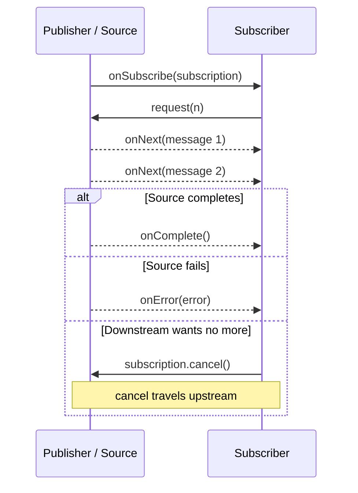
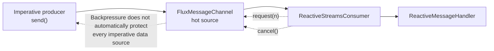
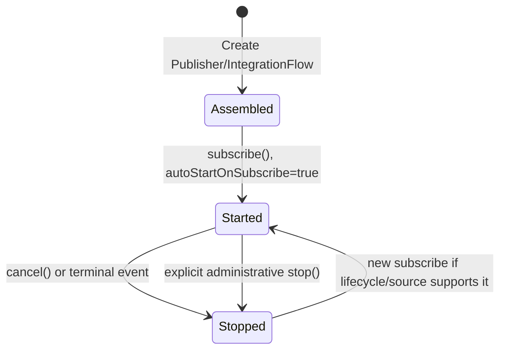
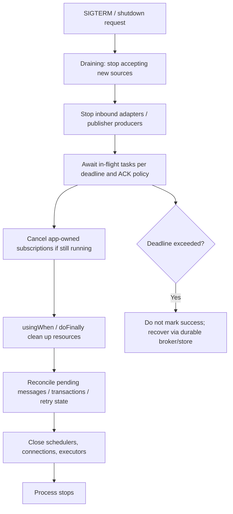

# Cancellation and Subscription Cleanup in Spring Integration Reactive Runtime

## 1. The Problem: The Subscription Was Canceled, Yet Work Is Still Running?

In **Spring Integration Runtime**, messages can be pushed through a `DirectChannel`, queued in a `QueueChannel` and consumed by a poller, or flow through a `FluxMessageChannel` to integrate with Project Reactor. In the reactive model, a consumer expresses processing demand via a **`Subscription`**; when downstream no longer wants data, it can send a **`cancel()`** signal upstream.

An HTTP request disconnected by the client, a gateway timing out, the application stopping an `IntegrationFlow`, or a subscriber taking only the first three results can render a subscription no longer needed. However, cancellation **does not automatically mean**:

- Every already-running async/blocking task stops immediately.
- Transactions rolled back, the broker nacked, or the message was redelivered.
- Application-opened files, sockets, DB sessions, timers, and callbacks closed properly.
- Messages in a `MessageStore` or aggregator were deleted.
- Cancellation errors were sent as an `ErrorMessage` to the global `errorChannel`.

The lesson **Cancellation and Subscription Cleanup** belongs to the **Reactive runtime** chapter of the `SPRING_INTEGRATION_RUNTIME` module. It connects directly to orchestrating channels, endpoints, consumers, pollers, executors, `IntegrationFlow` lifecycles, transactions, retries, message stores, errors, correlation, threading, and performance.

**Learning objectives:**

1. Distinguish `onComplete`, `onError`, and `cancel` in Reactive Streams.
2. Properly manage `Subscription` and `Disposable` instances, including during flow shutdown.
3. Use `doFinally`, `doOnCancel`, `doOnDiscard`, `Flux.using`, and `usingWhen` to clean up at the right scope.
4. Understand how `FluxMessageChannel`, `ReactiveStreamsConsumer`, and `toReactivePublisher(true)` integrate with lifecycle.
5. Design cancellation-safe handling for async resources, message acknowledgments, transactions, and retries.
6. Write cancellation tests, detect subscription leaks, and evaluate backpressure impact.

**Reference versions:** Spring Integration **6.x** (especially reference 6.5), Reactor Core 3.x, Java 17+. Reactor snippets require `reactor-core`; tests require `reactor-test`; Spring Integration flows require `spring-integration-core` and corresponding Spring dependencies. Do not assume new APIs/behaviors from Spring Integration 7.x exist in 6.x.

## 2. Three Ways a Publisher Ends

### 2.1. Reactive Streams Protocol



A Reactive Streams `Publisher` may only emit `onNext` up to `request(n)` demand and conclude with at most one terminal signal: `onComplete` or `onError`. **`cancel()` is a request from the subscriber to the subscription**, not a terminal `onCancel()` callback sent downstream to the consumer like `onComplete`.

| Situation | Who initiates? | What the subscriber receives | Cleanup action |
|---|---|---|---|
| Completion (`onComplete`) | Upstream | `onComplete` | `doFinally(ON_COMPLETE)`, resource cleanup |
| Failure (`onError`) | Upstream | `onError` | `doFinally(ON_ERROR)`, resource cleanup |
| Cancellation (`cancel`) | Downstream | Usually **no** new terminal callback | `doOnCancel`, `doFinally(CANCEL)`, and resource cleanup |
| Timeout operator | Downstream operator | `onError(TimeoutException)` downstream if unrecovered | Upstream is canceled; downstream enters error path |
| `take(n)` receives n items | Downstream operator | `onComplete` after `take` | Upstream may observe `CANCEL` |
| Reactor subscriber `Disposable.dispose()` | Subscription owner | Not equivalent to `onComplete` | Usually translates to upstream `cancel` |

**Implication:** if you only put cleanup in `doOnError` or `doOnComplete`, you can miss the cancel branch. If you only put cleanup in `doOnCancel`, you miss normal completion and error termination. When you need to cover all three, `doFinally` is usually more appropriate.

### 2.2. Cancellation Is a Cooperative Signal, Not Forcible Interruption

`Subscription.cancel()` asks upstream to stop producing and release related resources. The `Publisher` provider may have already emitted signals or started operations that cannot be aborted immediately; due to races, in-flight work may still need to finish or be handled safely.

You cannot rely on cancellation to guarantee side effects have not occurred. For example:

```text
t0: send payment request to remote API
t1: HTTP client cancels subscription (cancel)
t2: bank already recorded the transaction
t3: response is discarded because downstream is no longer listening
```

At `t3`, receiving no reply does not mean the transaction failed. On reprocessing, use a **business idempotency key** and reconcile actual status rather than replaying blindly.

## 3. Ownership Layers: Who Owns the Subscription?

### 3.1. Subscription, Disposable, Lifecycle, and Messages

| Object | Owned by | Responsibility |
|---|---|---|
| `org.reactivestreams.Subscription` | Subscriber receiving from the publisher | `request(n)`, `cancel()` |
| `reactor.core.Disposable` returned from `Flux.subscribe(...)` | Code directly calling `subscribe` | `dispose()` when no longer wanting data |
| `ReactiveStreamsConsumer` | Spring Integration endpoint | Coordinates consuming a reactive channel within lifecycle |
| `MessageProducerSupport` reactive adapter | Spring Integration adapter | Manages subscription to external source via adapter API |
| `IntegrationFlow` / `SmartLifecycle` | ApplicationContext, IntegrationFlowContext | Starts/stops endpoints and producers |
| `MessageStore` / consumer transaction | Corresponding runtime/store/adapter | Persists/removes/commits/nacks per contract |
| Custom `Sinks`, schedulers, files/connections | Component creating the resource | Cleans up according to resource lifetime and policy |

**Ownership rule:** only the code that **owns** the subscription should hold the `Disposable` and call `dispose()`. If Spring Integration already subscribes on your behalf, do not create an extra subscriber just to "manage cleanup": that can cause double processing, resource contention, or wrong broadcast/competing semantics.

### 3.2. Assembling a Publisher Does Not Mean It Is Subscribed

```java
import reactor.core.publisher.Flux;

Flux<String> messages = Flux.just("A", "B", "C")
        .map(String::toLowerCase);

// No terminal subscription is created by the lines above.
```

Reactive chains are typically **lazy**. Creating a `Flux`/`Mono` does not trigger work; a subscriber or terminal operator starts it. Conversely, calling `subscribe()` manually **creates a new subscription**, and you must know who will cancel it.

```java
import reactor.core.Disposable;

Disposable subscription = messages.subscribe(
        value -> System.out.println("value=" + value),
        error -> System.err.println(error.getMessage()),
        () -> System.out.println("completed"));

subscription.dispose();
```

With `Flux.just(...)`, the publisher may complete synchronously before `dispose()` executes; in that case `dispose()` does not turn completion into an actual cancel. To observe cancellation, use a publisher **that does not complete immediately on its own**, such as `Flux.interval` or `Flux.never`.

### 3.3. Multiple Subscribers: Never Dispose a Subscription You Do Not Own

A `Publisher` can have multiple subscribers. Subscriber A's `Disposable` only represents subscription A and must not be used to assume the entire source/broker stopped for subscriber B. With hot sources, whether multiple subscriptions are allowed and how messages fan out depends on the implementation.

In particular, `FluxMessageChannel` follows a hot publisher model; never rely on "a newly joined subscriber will receive the entire history." If replay is needed, use a persistent channel/broker/store with a concrete retention contract.

## 4. Reactor Cleanup Hooks: Which Hook Should You Use?

### 4.1. Hook Comparison

| Hook/Operator | When it runs | Use case |
|---|---|---|
| `doOnSubscribe` | New subscription arrives | Logging, starting timers, recording owner |
| `doOnRequest` | Downstream requests `n` elements | Measuring demand, backpressure |
| `doOnCancel` | Downstream cancels subscription at operator position | Logging cancel, triggering intentional cancellation work |
| `doOnComplete` | Upstream completes normally | Success auditing; does **not** cover error/cancel |
| `doOnError` | Upstream emits an error | Error telemetry; does **not** cover cancel |
| `doOnTerminate` | Complete or error | Cleanup on terminal signals; does **not** cover cancel |
| `doFinally` | Complete, error, or cancel | General cleanup/metrics |
| `doOnDiscard` | Supporting operators discard undelivered items | Releasing resources of dropped/prefetched items |
| `Flux.using` | Allocates resource per subscription, synchronous close | File cursors, synchronous resource scopes |
| `Flux.usingWhen` / `Mono.usingWhen` | Resource with **asynchronous cleanup** on complete/error/cancel | Async DB sessions, remote connection/release |

`doFinally` receives `SignalType.ON_COMPLETE`, `SignalType.ON_ERROR`, or `SignalType.CANCEL`. The callback executes **after the corresponding terminal/cancel signal has passed through that operator position**; when multiple `doFinally` calls are chained, execution order can be reverse of declaration order. Therefore, cleanup assertions must account for when the callback actually executes.

### 4.2. Example 1: Observing Cancel Triggered by take(n)

```java
import java.util.concurrent.atomic.AtomicReference;
import reactor.core.publisher.Flux;
import reactor.core.publisher.SignalType;

public class CancellationSignalsDemo {

    public static void main(String[] args) {
        AtomicReference<SignalType> upstreamSignal =
                new AtomicReference<>();
        AtomicReference<SignalType> downstreamSignal =
                new AtomicReference<>();

        Flux.range(1, 100)
                .doOnCancel(() ->
                        System.out.println("upstream cancel received"))
                .doFinally(upstreamSignal::set)
                .take(3)
                .doFinally(downstreamSignal::set)
                .blockLast();

        // After hooks complete:
        // upstreamSignal == SignalType.CANCEL
        // downstreamSignal == SignalType.ON_COMPLETE
        System.out.println("upstream=" + upstreamSignal.get());
        System.out.println("downstream=" + downstreamSignal.get());
    }
}
```

Why does the same pipeline observe two different signals? `take(3)` received all three items, so it **cancels upstream** to stop further production while **completing downstream** for the consumer. Saying "the flow was canceled" must always specify **the observation point** in the operator chain.

Because `doFinally` runs after the terminal signal propagates downstream, code needing certainty that the callback finished before asserting should use `CountDownLatch`/`StepVerifier` rather than immediately reading mutable state after `blockLast()` across arbitrary schedulers.

### 4.3. Example 2: Metrics Without Missing the Cancel Branch

```java
import java.util.concurrent.atomic.LongAdder;
import reactor.core.publisher.Flux;
import reactor.core.publisher.SignalType;

LongAdder completed = new LongAdder();
LongAdder failed = new LongAdder();
LongAdder cancelled = new LongAdder();

Flux<String> flow = upstreamFlux
        .doFinally(signal -> {
            if (signal == SignalType.ON_COMPLETE) {
                completed.increment();
            }
            else if (signal == SignalType.ON_ERROR) {
                failed.increment();
            }
            else if (signal == SignalType.CANCEL) {
                cancelled.increment();
            }
        });
```

`upstreamFlux` above is an application-provided `Flux<String>`. This is an instrumentation pattern; it does not create a subscription itself, so metrics increment **when an actual subscriber runs**.

A stream with multiple subscriptions may increment multiple times, once per subscription. To count **business messages** rather than subscription terminations, add dedicated metrics keyed by message ID/correlation ID.

### 4.4. doOnDiscard Handles Elements Not Delivered Downstream

Certain operators (filters, buffers/prefetch, cancellation while fetched items remain) can drop messages from the stream before the consumer receives them. If payloads hold reference-counted resources (such as pooled buffers), discarded resources must be released per contract.

```java
Flux<AutoCloseable> stream = upstreamResources
        .filter(resource -> shouldKeep(resource))
        .doOnDiscard(AutoCloseable.class, resource -> {
            try {
                resource.close();
            }
            catch (Exception e) {
                recordCleanupFailure(e);
            }
        });
```

**Note:** `doOnDiscard` is only supported by **operators with "Discard Support"**; it is not a universal interceptor for every processed item. Cleanup must be **idempotent** and safe if the same resource could be touched by multiple discard paths. Never close a resource currently owned by a downstream consumer; establish ownership rules upfront.

`doOnDiscard` has a different goal from `doFinally`: one cleans up **discarded elements**, the other cleans up **subscription lifecycle**.

## 5. Per-Subscription Resource Cleanup

### 5.1. Why a try/finally Around Flux Creation Is Insufficient

The following pattern has a lifetime bug:

```java
Flux<String> readLines() throws Exception {
    ResourceHandle handle = openHandle();
    try {
        return handle.readAsFlux();
    }
    finally {
        handle.close(); // Closes immediately when returning Flux, before subscribe!
    }
}
```

Because reading typically starts only when a subscriber arrives, the publisher-creating method's `finally` runs far too early. You must **allocate and clean up resources within the subscription's lifetime**, not the Flux-building call's lifetime.

### 5.2. Flux.using for Synchronous Cleanup

```java
import java.util.Scanner;
import reactor.core.publisher.Flux;

Flux<String> words = Flux.using(
        () -> new Scanner("alpha beta gamma"),
        scanner -> Flux.generate(sink -> {
            if (scanner.hasNext()) {
                sink.next(scanner.next());
            }
            else {
                sink.complete();
            }
        }),
        Scanner::close
);
```

`Flux.using` allocates the resource **per subscription**, lets the subscriber consume data, and invokes cleanup on complete, error, or cancel. `Scanner.close()` is synchronous. With multiple subscriptions, each subscription needs its own resource instance (e.g., `new Scanner(...)` inside the supplier).

For real files/sockets, choose reading APIs compatible with your scheduler and backpressure; `Scanner` blocks threads and does not turn I/O non-blocking merely by wrapping it in a `Flux`.

### 5.3. usingWhen for Asynchronous Cleanup

Resources may need to be released via a Publisher—for example closing an async DB session, flushing/rolling back a transaction, or canceling a remote stream. `usingWhen` separates three branches:

```java
import java.time.Duration;
import reactor.core.publisher.Flux;
import reactor.core.publisher.Mono;

record DemoSession(String id) {
    Flux<String> events() {
        return Flux.interval(Duration.ofMillis(100))
                .map(n -> id + ":event-" + n);
    }

    Mono<Void> close(String reason) {
        return Mono.fromRunnable(
                () -> System.out.println(id + ": close on " + reason));
    }
}

Flux<String> stream = Flux.usingWhen(
        Mono.fromSupplier(() -> new DemoSession("S-1")),
        DemoSession::events,
        session -> session.close("complete"),
        (session, error) -> session.close("error:" + error.getClass().getName()),
        session -> session.close("cancel")
);
```

Here `events()` is a long-lived source. When a subscriber cancels, `usingWhen` executes the **asyncCancel cleanup publisher**; on complete/error, it runs the corresponding cleanup branch. In the example `close` just prints a log for illustration; real resources require actual close/rollback operations.

**Distinguish two guarantee levels:**

- `doFinally` suits metrics or synchronous cleanup, but it does **not wait** for an async close just because the callback calls `subscribe()`.
- `usingWhen` binds async cleanup into the lifecycle. On complete/error, the terminal signal can be delayed until cleanup finishes; on cancel, there is no normal terminal signal for downstream to await, so the owner needs monitoring and deadlines if cleanup hangs or fails.

Avoid doing:

```java
.doFinally(signal ->
        remoteClient.closeAsync().subscribe()) // fire-and-forget cleanup
```

This spawns a detached cleanup subscription with no clear owner or error monitoring. Prefer `usingWhen` or an observable resource abstraction.

## 6. Cancellation, Backpressure, and Threading

### 6.1. Cancel and request(n) Have Two Distinct Roles

- **`request(n)`:** how many more elements downstream is ready to accept.
- **`cancel()`:** downstream needs no further elements.
- **Backpressure:** producers/on-demand operators honor demand so they do not emit faster than subscribers can consume.

Cancellation is not a substitute for backpressure. For example, if an application uses `FluxMessageChannel` while an imperative producer continuously calls `send()` at too high a rate, you cannot claim upstream self-throttles just because downstream uses Reactor.



If blocking components or separately subscribed async side effects exist, the flow may no longer be purely reactive even with `FluxMessageChannel`. Inspect every boundary individually.

### 6.2. Reactor Schedulers Do Not Automatically Cancel Blocking Work

`subscribeOn` and `publishOn` only alter scheduling. `boundedElastic` is suitable for wrapping bounded blocking operations; however:

- `Disposable.dispose()` does not guarantee interrupting a blocking JDBC call or an HTTP client lacking cancellation support.
- A `Mono.fromCallable` on a scheduler may already be running when cancel arrives; how far interruption works depends on the scheduler, library, and resource.
- If a blocking call continues executing side effects after subscriber cancellation, plan replies/callbacks and idempotency accordingly.

Example isolating blocking work:

```java
import reactor.core.publisher.Mono;
import reactor.core.scheduler.Schedulers;

Mono<String> result = Mono.fromCallable(
            () -> blockingPartnerClient.lookup("ORD-42"))
        .subscribeOn(Schedulers.boundedElastic())
        .doFinally(signal -> recordSignal(signal));
```

`blockingPartnerClient` and `recordSignal` are application methods in this example. Placing blocking I/O on `boundedElastic` avoids starving the event-loop, yet **does not turn a blocking library into cancellable I/O**.

### 6.3. flatMap Concurrency and Prefetched Buffers

In a `flatMap` pipeline running multiple inner publishers concurrently, a downstream cancel asks active inner subscriptions to cancel, but it does not undo side effects already initiated.

```java
Flux<String> replies = sourceMessages
        .flatMap(message -> sendAsync(message)
                        .doFinally(signal -> observeItem(message, signal)),
                8); // Caps at most 8 active inner publishers
```

`sourceMessages` and `sendAsync` are application sources/methods. `flatMap` may prefetch according to configuration. If a user cancels mid-stream, determine whether buffered items had already been fetched or started processing.

If sequential processing is required, `concatMap` may fit better, though it does not inherently provide exactly-once delivery, durability, or cleanup of tasks outside Reactor. When side effects cannot be canceled, rely on idempotency and subscription-independent job state.

## 7. FluxMessageChannel and ReactiveStreamsConsumer

### 7.1. Role of FluxMessageChannel

`FluxMessageChannel` is both a `MessageChannel` and a `Publisher<Message<?>>`. It uses an internal hot `Flux` to push messages sent to the channel toward reactive subscribers, and implements `ReactiveStreamsSubscribableChannel` to consume upstream publishers by demand.

**Differences from regular channels:**

| Channel/endpoint | Consumption model | Relationship to cancellation |
|---|---|---|
| `DirectChannel` | Handler invoked synchronously on sender thread | Exceptions unwind call stack; no reactive subscription by default |
| `ExecutorChannel` | Handler invoked on worker | Producer may finish `send` while worker is still running |
| `QueueChannel` | Poller calls `receive()` | Messages can remain in queue; stopping poller does not mean losing messages |
| `FluxMessageChannel` | `Subscriber` per Reactive Streams contract | `Subscription.cancel()` stops demand/source along the reactive flow |
| `ReactiveStreamsConsumer` | Endpoint subscribing to reactive source and composing handlers | Manages subscription with endpoint lifecycle |

`FluxMessageChannel` is **neither** a `PollableChannel` nor a traditional imperative `SubscribableChannel` registering `MessageHandler` directly. Spring Integration uses `ReactiveStreamsConsumer` to connect handlers to reactive channels.

### 7.2. Backpressure Scope of ReactiveMessageHandler

When a handler is a `ReactiveMessageHandler` and the flow consumes via `ReactiveStreamsConsumer`, Spring Integration can compose the operation into the stream via `flatMap()`, allowing demand and cancellation to propagate toward the reactive client.

If a `ReactiveMessageHandler` is used in an imperative flow, the framework can wrap it in `ReactiveMessageHandlerAdapter` and **subscribe immediately** to the async result. That path does not share the same backpressure semantics as an end-to-end composed reactive chain.

**Never assume a method returning `Mono` is enough to make an entire Spring Integration flow end-to-end reactive.** Inspect channel types before/after the handler and who holds the final subscription.

### 7.3. Event-Driven Adapters and subscribeToPublisher()

`MessageProducerSupport` provides `subscribeToPublisher(Publisher<? extends Message<?>>)` for reactive data-source adapters. Spring Integration documentation describes:

- When the output channel is reactively compatible, downstream subscribers can trigger upstream consumption on demand.
- **Canceling the subscription to the source Publisher** can transition the adapter to a stopped state.
- Calling `stop()` on the adapter can complete message production from the source publisher.
- Restarting the adapter can create a new subscription to a fresh source publisher.

Do not misread this as meaning every JDBC/HTTP/Kafka adapter automatically has identical behavior. This describes the reactive `MessageProducerSupport` mechanism; each protocol implementation is responsible for stopping its source and releasing its resources.

## 8. Lifecycle: toReactivePublisher(true) and Stopping on Cancel

### 8.1. autoStartOnSubscribe

In the Java DSL, `IntegrationFlowBuilder.toReactivePublisher(boolean autoStartOnSubscribe)` (since Spring Integration 5.5.6) exposes a flow as `Publisher<Message<T>>`.

When `autoStartOnSubscribe=true`:

1. The flow and its components are marked not to auto-start on ApplicationContext startup.
2. When subscribed, the framework starts the `IntegrationFlow` from an internal `doOnSubscribe` operator.
3. When the publisher **cancels** or **terminates**, the framework stops the flow via `doOnCancel` / `doOnTerminate`.



**Important:** this is documented behavior for **`toReactivePublisher(...)`**; it does **not** mean **every** reactive `IntegrationFlow` automatically starts/stops whenever you cancel any application-created subscription.

### 8.2. Java DSL Example Returning a Publisher

```java
import org.reactivestreams.Publisher;
import org.springframework.context.annotation.Bean;
import org.springframework.context.annotation.Configuration;
import org.springframework.integration.dsl.IntegrationFlow;
import org.springframework.messaging.Message;
import org.springframework.messaging.support.MessageBuilder;
import reactor.core.publisher.Flux;

@Configuration
class ReactivePublisherConfig {

    @Bean
    Publisher<Message<String>> orderPublisher() {
        Publisher<Message<String>> source = Flux.range(1, 100)
                .map(i -> MessageBuilder
                        .withPayload("ORD-" + i)
                        .build());

        return IntegrationFlow.from(source)
                .<String>toReactivePublisher(true);
    }
}
```

A subscriber can consume the publisher when ready:

```java
import org.reactivestreams.Publisher;
import org.springframework.messaging.Message;
import reactor.core.Disposable;
import reactor.core.publisher.Flux;

Publisher<Message<String>> publisher = context.getBean(
        "orderPublisher", Publisher.class);

Disposable subscription = Flux.from(publisher)
        .take(5)
        .subscribe(
                message -> System.out.println(message.getPayload()),
                error -> System.err.println("Flow error: " + error),
                () -> System.out.println("Consumed five messages"));

// take(5) may have already canceled upstream and completed downstream;
// dispose() is only needed if the subscription is still active.
subscription.dispose();
```

The second snippet demonstrates the subscriber API where `context` is a started `ApplicationContext`. Depending on how fast the source publisher emits, `subscribe()` may finish before `Disposable` is assigned. In a real application, ensure lifecycle management has a clear **owner** and avoid creating unintended extra subscribers on the same flow or hot source.

**Verify at runtime:** canceling the subscription tells the framework to stop the publisher's flow per contract, yet any task that escaped the reactive chain (such as a detached manual `subscribe()`) may keep running. Stopping the flow does not replace cleaning up those external tasks/resources.

### 8.3. Stopping a Flow and Messages Remaining in a Store

When a flow stops:

- Source producers may stop generating messages.
- Reactive subscriptions may be canceled/disposed.
- Messages in `QueueChannel`/`MessageStore` may still remain unless removed by endpoint/store logic.
- Aggregators may still hold unreleased groups; cancellation does not expire all groups automatically.
- External brokers may hold unacked records and redeliver per protocol.
- Gateway callers may time out while backends are still executing side effects.

For a **graceful drain**, enforce endpoint/adapter-level stop policies, wait for in-flight operations, resolve pending messages, and finalize ACKs/recovery. Do not substitute calling `Disposable.dispose()` and assuming all resources are freed.

## 9. Example: Managing a Disposable Inside SmartLifecycle

### 9.1. When the Application Subscribes Manually, It Must Dispose Manually

There are cases where you **intentionally** create a manual subscriber—for instance, a managed component consuming a `Publisher` exposed by an internal system. Keep the `Disposable` in an owner with a concrete lifecycle rather than calling `subscribe()` scattered inside handlers per message.

Below is a **manual** consumer pattern exclusively reading a `FluxMessageChannel` without simultaneously registering `@ServiceActivator`/`ReactiveStreamsConsumer` on that same channel. It illustrates ownership/lifecycle, not a guaranteed graceful-drain implementation for a production backend.

```java
import org.springframework.context.SmartLifecycle;
import org.springframework.messaging.Message;
import reactor.core.Disposable;
import reactor.core.publisher.Flux;
import reactor.core.publisher.Mono;
import reactor.core.scheduler.Schedulers;

public final class ManagedReactiveConsumer implements SmartLifecycle {

    private final Flux<Message<?>> source;
    private volatile boolean running;
    private Disposable subscription;

    public ManagedReactiveConsumer(Flux<Message<?>> source) {
        this.source = source;
    }

    @Override
    public synchronized void start() {
        if (running) {
            return;
        }

        running = true;
        subscription = source
                .concatMap(message ->
                        Mono.fromRunnable(() -> process(message))
                                .subscribeOn(Schedulers.boundedElastic())
                                .then())
                .doFinally(signal ->
                        System.out.println("subscription ended: " + signal))
                .subscribe(
                        ignored -> { },
                        error -> System.err.println("consumer error: " + error));
    }

    @Override
    public synchronized void stop() {
        running = false;
        Disposable current = subscription;
        subscription = null;
        if (current != null) {
            current.dispose();
        }
    }

    @Override
    public boolean isRunning() {
        return running;
    }

    private void process(Message<?> message) {
        System.out.println("Processing " + message.getPayload());
        // In a real system: persist state and handle idempotent side effects.
    }
}
```

Bean wiring for the channel and owner:

```java
import org.springframework.beans.factory.annotation.Qualifier;
import org.springframework.context.annotation.Bean;
import org.springframework.context.annotation.Configuration;
import org.springframework.integration.channel.FluxMessageChannel;
import reactor.core.publisher.Flux;

@Configuration
class ManualReactiveConsumerConfig {

    @Bean("orders.reactive")
    FluxMessageChannel ordersReactive() {
        return new FluxMessageChannel();
    }

    @Bean
    ManagedReactiveConsumer managedConsumer(
            @Qualifier("orders.reactive") FluxMessageChannel channel) {

        return new ManagedReactiveConsumer(Flux.from(channel));
    }
}
```

**Lifecycle analysis:**

1. `start()` creates a single subscription and retains `Disposable`.
2. `stop()` calls `dispose()` if a subscription exists.
3. `concatMap()` enforces sequential processing per subscriber.
4. `boundedElastic` keeps blocking `process()` off the event loop, though it does not promise aborting in-flight side effects.
5. `doFinally` records why the subscription ended.

**Intentional limitations of the example:** `stop()` only requests cancellation and **does not wait for all async cleanup to finish**; `process()` may still be running. If the source completes or errors naturally without calling `stop()`, update `running` according to your production component's restart policy. Production code must add in-flight tracking, deadlines, error paths, and restart policies where appropriate.

Because Spring Integration already provides `ReactiveStreamsConsumer` and endpoint lifecycles, **prefer framework-managed mechanisms** when a flow just connects channels to ordinary handlers. Do not reinvent manual consumers without a concrete reason.

### 9.2. Why Not Subscribe Inside Each onNext?

Anti-pattern:

```java
// WRONG: each message spawns an inner subscription with no clear owner.
source.subscribe(message ->
        remoteCall(message).subscribe());
```

This is nested subscribing:

- The outer subscription can cancel while inner subscriptions keep running.
- Errors from `remoteCall` do not automatically feed into the outer pipeline's error handling.
- Backpressure/concurrency of the outer pipeline does not constrain inner tasks.
- At shutdown, it is hard to know how many remote calls remain in flight.

Instead, compose:

```java
Disposable subscription = source
        .flatMap(message -> remoteCall(message), 8)
        .doFinally(this::recordTermination)
        .subscribe(
                result -> handleResult(result),
                error -> handleError(error));
```

`source`, `remoteCall`, and the other methods are application components. `flatMap` keeps inner publishers inside **the same subscription graph**, so cancellation/error propagation and concurrency limits stay coherent.

Even then, cancellation does not undo remote calls already committed on external systems.

## 10. Cancellation, Acknowledgments, and Transactions

### 10.1. Consuming a Message Does Not Mean the Source Was ACKed

Scenario with a Kafka, RabbitMQ, JMS, or other `MessageSource`:

```text
Broker -> Reactive adapter -> FluxMessageChannel -> handler
                                             |
                                             +-- cancel occurs mid-way
```

Ask per transport:

- Is a record ACKed when **read from the source**, when **the handler finishes**, or via manual consumer ACK?
- When the subscription cancels, does the adapter reject/nack?
- Is transaction/pending-ACK state kept on the broker or in local memory?
- Are fetched messages still running inside inner publishers?
- On restart or rebalance, are records redelivered and is idempotency enforced?

**There is no universal rule that cancel always means nack or rollback.** That is the adapter/protocol's contract, not `org.reactivestreams.Subscription`'s contract.

### 10.2. ReactiveMessageSourceProducer Has Its Own ACK Logic

Spring Integration has included `ReactiveMessageSourceProducer` since 5.3. It uses a `MessageSource` to create a demand-driven stream, offloading reads onto `Schedulers.boundedElastic()` if the message source can block.

Spring Integration docs describe acknowledgment handling via `IntegrationMessageHeaderAccessor.ACKNOWLEDGMENT_CALLBACK` in headers: the callback can ACK after a successful processing path, or reject in an appropriate error path carrying `MessagingException`/failed message.

However, **do not generalize** from this that canceling anywhere in a reactive chain automatically rejects the right message. Verify the concrete implementation, ACK timing, subscription boundaries, and source semantics. Write integration tests for **canceling before/after processing** on the exact adapter you use.

### 10.3. Reactive Transactions and Cancellation

With Spring reactive transactions, a `TransactionalOperator` can manage transactions via Reactor context and publisher lifecycle. Cancellation can trigger cleanup/rollback depending on contract/version and operator placement, yet:

- An HTTP request already dispatched outside the DB transaction can still finish.
- Reactive transaction context does not automatically cross an imperative handler running on another thread in `ThreadLocal` style.
- Messages in a `MessageStore` outside the transaction manager can still persist.
- Gateway timeout/cancel does not guarantee rolling back tasks detached from the subscription graph.

Conceptual example:

```java
Mono<OrderResult> work = transactionalOperator.transactional(
        repository.updateOrder(orderId)
                .then(repository.fetchOrderResult(orderId))
);
```

`transactionalOperator` and `repository` are application beans using a compatible reactive transaction manager. Test canceling downstream while queries run and verify actual database state; never deduce the outcome solely from `SignalType.CANCEL`.

### 10.4. Retries and Cancellation

`retry()` or `retryWhen()` activates when the source emits **`onError`**, not whenever downstream cancels. If the application intentionally cancels after an HTTP timeout, whether automatic retries occur depends on how `timeout`, `onErrorResume`, and `retryWhen` are ordered.

Example:

```java
Mono<String> response = callPartner()
        .timeout(Duration.ofSeconds(2))
        .retryWhen(Retry.backoff(2, Duration.ofMillis(200)));
```

In this pipeline, `timeout` can **cancel the upstream attempt** and emit `TimeoutException` downstream; `retryWhen` can then resubscribe for a new attempt. If the earlier remote request still completes and causes side effects, you risk duplicate work. You may need policies restricting retries to safe errors, external status checks, overall deadlines, and idempotency keys.

`callPartner()` is a publisher created per subscription per the client's contract. If it is a shared hot publisher, resubscribing may not mean "re-executing the remote call"; always check cold/hot semantics.

## 11. Error Channels vs. Cancellation Signals

### 11.1. Why Does Cancel Not Automatically Create an ErrorMessage?

In Reactive Streams, `onError` is a terminal signal carrying a `Throwable`; `cancel()` is a downstream request to end a subscription. It **does not necessarily represent an error**. Therefore, never assume Spring Integration creates an `ErrorMessage` and publishes to `errorChannel` on every cancel.

| Event | Typical Reactor signal | Handling direction |
|---|---|---|
| Reactive handler fails | `onError` | Error path, retry/recovery per configuration |
| Caller cancels subscription | `cancel` | `doOnCancel`, `doFinally(CANCEL)`, resource cleanup |
| `take(3)` gets enough items | Cancels upstream, completes downstream | Normal termination for caller |
| `timeout` expires | Upstream cancel, downstream error | Catch timeout, intentional recovery/alerting |
| Error arrives after cancel | May be treated as a dropped signal | Trace source and cleanup/metrics |
| `onErrorResume` returns fallback | Downstream sees complete/success fallback | Do not confuse fallback with business success |

If cancellation must be audited (who canceled, when, which business request ID), **emit a dedicated event/metric** where full context exists. Do not rely on `doOnError` alone to track cancellations, nor artificially throw business exceptions just to generate `ErrorMessage` when cancellation is an expected termination path.

### 11.2. Dropped Errors, doOnDiscard, and Sensitive Data

After cancellation, you may encounter:

- Late I/O callbacks reporting errors.
- Pooled buffers that were prefetched yet never delivered downstream.
- An inner publisher completing after the parent subscription stopped.
- A manual nested `subscribe()` still running and producing events outside the original trace.

Reactor provides hooks for **dropped `onNext`/`onError`** and `doOnDiscard` on supporting operators. When debugging production, avoid setting arbitrary global hooks since they affect the entire application and obscure ownership. Prefer chain-scoped instrumentation and inspect resource implementations.

Never log an entire `Message<?>` on error: headers can carry auth tokens, temporary reply channels, or trace metadata; payloads can contain sensitive data.

## 12. Shutting Down and Cleaning Up Without Losing Messages

### 12.1. Recommended Shutdown Sequence



Exact implementation depends on adapters and SLAs. Some applications must cancel early to halt infinite streams; others must wait for received tasks to finish. Common principles:

1. Stop generating **new work** before cleaning up existing work.
2. Know **subscription owners** and the set of resources to close.
3. Enforce **finite deadlines** on in-flight tasks and async cleanup.
4. Do not shut down connection pools or lock backends while cleanup callbacks still need them.
5. Verify broker ACK/requeue and `MessageStore` state rather than assuming all messages were processed.
6. After a crash or `SIGKILL`, never expect Java `doFinally` or `@PreDestroy` to run.

### 12.2. dispose Does Not Mean Drained

`Disposable.dispose()` sends a cancellation request; it is **not** an API that waits for all in-flight tasks, socket closes, DB rollbacks, message ACKs, and persisted cleanup to complete.

If the application needs a "drained" guarantee, coordinate via other mechanisms: in-flight counters, completion Publishers, bounded waits, readiness flags, stop callbacks, metrics, and timeout recovery. `SmartLifecycle.stop(Runnable)` should not signal completion before the conditions the component actually promises are met.

Do not use a fixed `Thread.sleep(1000)` as a safety condition. Under heavy load, cleanup Publishers must be observed or deadline-tracked; on timeout, record message IDs for reconciliation/replay.

### 12.3. Cancellation and MessageStore

Spring Integration's `MessageStore` is a separate persistence/correlation system:

- `SimpleMessageStore` lives only in heap; shutdown loses unprocessed data.
- Persistent message stores can retain messages/groups across restarts according to transaction semantics.
- Aggregators may still hold groups awaiting release; canceling a downstream subscriber does not automatically purge groups.
- Channels may retain backlog, requiring valid consumers after restart to drain it.

**Never release or delete entire message groups in `doFinally` just because a subscriber canceled.** A group may belong to multiple messages and callers; deleting it can lose business data. Group expiry must be governed by `MessageGroupStore`/aggregator policies.

## 13. Testing Cancellation with StepVerifier

### 13.1. Verifying doFinally(CANCEL)

`reactor-test` provides `StepVerifier` to create subscriptions, request items, cancel, and assert expected signals. Standalone example runnable on Java 17:

```java
import java.time.Duration;
import java.util.concurrent.CountDownLatch;
import java.util.concurrent.TimeUnit;
import java.util.concurrent.atomic.AtomicReference;

import reactor.core.publisher.Flux;
import reactor.core.publisher.SignalType;
import reactor.test.StepVerifier;

public class CancellationCleanupTest {

    public static void main(String[] args) throws Exception {
        AtomicReference<SignalType> lastSignal =
                new AtomicReference<>();
        CountDownLatch cleanupObserved = new CountDownLatch(1);

        Flux<Long> events = Flux.interval(Duration.ofMillis(20))
                .doFinally(signal -> {
                    lastSignal.set(signal);
                    cleanupObserved.countDown();
                });

        StepVerifier.create(events)
                .expectNext(0L, 1L)
                .thenCancel()
                .verify(Duration.ofSeconds(3));

        if (!cleanupObserved.await(2, TimeUnit.SECONDS)) {
            throw new AssertionError("Cleanup callback did not run");
        }

        if (lastSignal.get() != SignalType.CANCEL) {
            throw new AssertionError(
                    "Expected CANCEL, got " + lastSignal.get());
        }

        System.out.println("PASS: cancellation triggered cleanup");
    }
}
```

Why `CountDownLatch`: `doFinally` can run after the cancellation signal propagates past the operator, especially when schedulers are involved. Do not test by calling `verify()` and immediately reading a mutable variable without synchronization.

### 13.2. Testing Each Terminal Mode

Beyond cancellation, test:

```java
StepVerifier.create(
        Flux.just("a", "b"))
        .expectNext("a", "b")
        .verifyComplete();

StepVerifier.create(
        Flux.<String>error(new IllegalStateException("boom")))
        .expectError(IllegalStateException.class)
        .verify();

StepVerifier.create(
        Flux.<String>never())
        .thenCancel()
        .verify();
```

These cases verify terminal signals. For components holding resources, attach `doFinally` or `usingWhen` and assert **close/rollback happens strictly within subscription scope**, not just checking `onNext`.

### 13.3. Testing usingWhen Cleanup on Cancel

Key checks for async cleanup:

1. The resource supplier is called **exactly once per subscriber**.
2. On completion, `asyncComplete` runs.
3. On error, `asyncError` receives the exact throwable and closes the resource.
4. On cancel, `asyncCancel` triggers even when the source emits no terminal signal.
5. If cleanup itself fails, log/metrics and recovery occur instead of silently dropping exceptions.
6. Test multiple subscriptions to confirm no closed resource is shared.

For real clients/reactive drivers, replace live resources in unit tests with a test double emitting close/rollback signals; avoid relying on flaky network timing in unit tests.

### 13.4. Testing IntegrationFlow Stop/Restart

A Spring Integration integration test should:

- Create a reactive source tracking active subscription counts.
- Start the flow or subscribe to `toReactivePublisher(true)`.
- Send several messages and verify downstream receipt.
- Cancel the subscriber via `Disposable.dispose()` or `StepVerifier.thenCancel()`.
- Verify the source receives cancellation and flow components transition to stopped state per API.
- If the flow supports restart, resubscribe and verify a fresh source is created without holding references to closed resources.
- Check `MessageStore`/broker ACK status of partially processed messages.

If the flow uses a hot channel with multiple subscribers, test multiplexing semantics explicitly rather than assuming every subscriber sees the same history.

## 14. Runtime Observability and Signs of Subscription Leaks

### 14.1. Useful Metrics

| Metric | Diagnostic question |
|---|---|
| Active subscriptions per endpoint | Are subscribers still running with no caller left? |
| Subscribe/cancel/complete/error counts | Which sources are getting canceled frequently? |
| Subscription lifetime p50/p95/p99 | Are streams outliving SLAs or stopping prematurely? |
| Resource open count, close count | Are files/sessions/sockets being cleaned up? |
| Async cleanup failures/duration | Is cleanup blocking, timing out, or failing? |
| In-flight inner publishers | Does `flatMap` leave tasks behind after cancel? |
| Reactive demand/`request(n)` | Is backpressure actually reaching upstream? |
| Prefetch/drop/discard count | Are pooled resources discarded without release? |
| Executor/`boundedElastic` queue & active tasks | Does blocking work stop after cancel? |
| Gateway timeouts/client disconnects | Do subscription cancellations match caller behavior? |
| Error-channel messages | Are errors actually being reported? |
| Broker pending ACK/requeue, group count | Where did cancel leave unprocessed messages? |

Not all of these metrics are provided automatically by Spring Integration. This is a **recommended observability set**; use Micrometer, scoped Reactor hooks, traces, and transport/executor metrics. Never use `messageId` or raw `correlationId` as high-cardinality metric tags; keep them in sampled logs with security policies.

### 14.2. Signs of Subscription Leaks

- Every handler invocation calls `subscribe()` without retaining the `Disposable`.
- When clients disconnect, scheduler task counts or open sockets do not drop.
- After stopping/starting a flow, a message is processed multiple times because an old subscriber stayed alive.
- `Flux.interval`/`Flux.never` stays alive long after any real consumer exists.
- `doOnError` logs nothing yet threads, buffers, and memory keep climbing.
- `usingWhen` only handles asyncComplete; the cancel branch is unhandled.
- Gateways repeatedly time out while remote APIs keep processing unboundedly.

A useful check is **after all subscribers are canceled and the cleanup deadline passes**, count open resources, active subscriptions, and pending tasks. If counts keep growing across subscribe/cancel cycles, investigate ownership or source publishers ignoring cancellation.

## 15. Diagnostics and Remediation Table

| Symptom | Likely cause | Check / remediation |
|---|---|---|
| `doOnError` not called when user aborts request | Cancel is not `onError` | Use `doOnCancel`/`doFinally(CANCEL)` |
| `take(3)` "cancels" upstream even though caller succeeded | `take` cancels source after 3 items | Inspect `doFinally` at the right operator position |
| `Disposable.dispose()` called yet HTTP call still finishes | Blocking/non-cancellable I/O already started | Check client cancel support, idempotency |
| Resource closed before stream runs | `finally` around Flux-returning method | Use `Flux.using` or `usingWhen` |
| Async close runs after app shut down connection pool | Cleanup not awaited or tracked | Order lifecycle and deadlines |
| Each restart adds another active handler | Manual `subscribe` never disposed | Clear owner; stop/cancel subscriptions properly |
| Messages processed twice | Duplicate subscribers or redelivery/retries | Check subscriber owner, ACK, business ID |
| No `ErrorMessage` on cancel | Cancel does not generate an exception | Audit cancellations separately if needed |
| Gateway times out yet business state still commits | Side effect detached from subscription or non-cancellable | Reconcile DB/provider, enforce idempotency |
| Error arriving after cancel is dropped | Async callback has no subscriber left | Instrument dropped errors, handle source properly |
| Memory grows even after downstream stops | Prefetch/buffers, hot publisher, orphan tasks | Buffer metrics, `doOnDiscard`, heap dump |
| `FluxMessageChannel` has no data after late subscribe | Hot source does not guarantee history replay | Order subscriptions properly or use persistent source |
| `ReactiveStreamsConsumer` doesn't honor backpressure as expected | Imperative segment or nested subscribe | Inspect topology, handler types, demand |
| `retryWhen` re-calls remote API after timeout | `timeout` emits error, retry resubscribes | Cap retries and enforce idempotency |
| Aggregator still holds groups after cancel | `MessageGroupStore` has independent lifecycle | Use release/expiry policies; never wipe blindly |
| Subscription stopped yet tasks still hold threads | Non-cooperative blocking code | Client timeouts, `boundedElastic`, task deadlines |
| Shutdown occasionally drops messages | ACK/store/queue lacks durability | Durable broker/store, retry/reconcile, stop ordering |

**Practical investigation sequence:**

1. Identify the **subscription owner**: framework endpoint, inbound adapter, gateway, or manual `subscribe()` code.
2. Locate the **cancel trigger**: client disconnect, `take`, `timeout`, explicit `dispose`, or flow stop.
3. Log `SignalType` **at the exact pipeline position**; inspect upstream and downstream of the operator.
4. Identify active **inner publishers**, blocking tasks, and resources needing cleanup.
5. Check whether `doFinally`/`usingWhen`/`doOnDiscard` cover all three terminal modes and discarded items.
6. Reconcile `MessageStore`, broker ACKs, transactions, reply channels, and correlation to spot unfinished work.
7. Across restarts, compare active subscriptions before/after stop; look for duplicate consumers or orphan resources.
8. Add `doCancel`/timeout/retry/shutdown tests to keep bugs from regressing.

## 16. Exercises and Production Checklist

### 16.1. Hands-On Exercises

**Exercise 1 — Placement of `doFinally`.** Create `Flux.range(1, 10).take(2)`; place `doFinally` before and after `take`. Record the signals at both spots. Why can upstream observe `CANCEL` while downstream observes `ON_COMPLETE`?

**Exercise 2 — Disposable Ownership.** Set up `Flux.interval`, hold the `Disposable` in a `SmartLifecycle`, and run three start/stop cycles. Confirm after stopping that no old subscriber receives values; observe if any delayed tasks still finish.

**Exercise 3 — Three-Way Cleanup.** Write `Flux.usingWhen` with a mock resource and a close counter. Make the source complete, error, and cancel, verifying the matching cleanup branch runs. Verify the resource supplier is called separately per subscription.

**Exercise 4 — Timeouts and Retries.** Simulate a service responding after three seconds; configure `timeout(Duration.ofSeconds(1))` and `retryWhen`. Count remote calls started, upstream cancellations, and side effects. Explain why idempotency is mandatory.

**Exercise 5 — FluxMessageChannel.** Create a `FluxMessageChannel`, attach a subscriber, send messages, cancel, and keep sending. Observe receipt/emit behavior without extrapolating lost-message semantics to other adapters.

**Exercise 6 — Shutdown with ACK.** Use a test transport with an ACK callback; cancel while a message is in progress. Verify whether the message is ACKed, rejected, or redelivered per the adapter/transaction configuration. Never test directly against a production queue.

**Exercise 7 — Discarded Resources.** Use `filter` or a prefetching operator with objects holding resources; verify `doOnDiscard` runs for dropped elements and cleanup is idempotent.

**Exercise 8 — Testing Flow Lifecycle.** Use `toReactivePublisher(true)`, subscribe, cancel, verify the `IntegrationFlow` stops, and resubscribe per source contract. Monitor active subscriptions and running tasks.

### 16.2. Pre-Deployment Checklist

- **Know who owns the subscription:** framework-managed or manual `subscribe()`.
- **Distinguish all three endings:** success, error, cancel; place `doFinally` and cleanup appropriately.
- **Scope resources per subscription:** `using` for synchronous close, `usingWhen` for async cleanup.
- **No nested subscribes:** compose with `flatMap`/`concatMap` and cap concurrency.
- **Never equate cancel with rollback:** check ACKs, transactions, side effects, and idempotency.
- **Control blocking:** right scheduler, I/O timeouts, and cooperative cancellation.
- **End-to-end backpressure:** inspect every imperative/reactive boundary, prefetch, and buffer.
- **Ordered shutdown:** stop new ingress, await/reconcile in-flight work, cancel remainder, clean up, then close resources.
- **Never purge `MessageStore` blindly on cancel:** groups and queues have independent lifecycles.
- **Monitor cancellations/resources:** active subscriptions, close failures, pending tasks, queue/group backlogs.
- **Write realistic tests:** `StepVerifier.thenCancel()`, client disconnects, timeouts, retries, restarts, and forced termination.

**Core takeaway:** cancellation is a request to stop producing more work, **not a guarantee that all work was rolled back or completed**. In Spring Integration, keeping runtime safe requires pairing every subscription with a clear owner, cleaning up per Reactor's lifecycle, and verifying ACKs, transactions, message stores, errors, and side effects in external systems.

## 17. Official References

- [Spring Integration 6.5 — Reactive Streams Support](https://docs.spring.io/spring-integration/reference/6.5/reactive-streams.html): `FluxMessageChannel`, `ReactiveStreamsConsumer`, `ReactiveMessageHandler`, event-driven adapters, `ReactiveMessageSourceProducer`, and `toReactivePublisher(autoStartOnSubscribe)`.
- [Spring Integration — Annotation Support / @Reactive](https://docs.spring.io/spring-integration/reference/configuration/annotations.html): using `ReactiveStreamsConsumer` and customizing streams via `@Reactive`.
- [Spring Integration 6.5 API — IntegrationFlowBuilder](https://docs.spring.io/spring-integration/docs/6.5.0/api/org/springframework/integration/dsl/IntegrationFlowBuilder.html): `toReactivePublisher(boolean)` overload.
- [Project Reactor — Reactive Streams and Backpressure](https://projectreactor.io/docs/core/release/reference/): `Subscription.cancel()`, demand, operator lifecycle, and threading.
- [Project Reactor — Flux API](https://projectreactor.io/docs/core/release/api/reactor/core/publisher/Flux.html): `doFinally`, `doOnCancel`, `doOnDiscard`, `using`, `usingWhen`, `flatMap`, and `concatMap`.
- [Project Reactor — Mono API](https://projectreactor.io/docs/core/release/api/reactor/core/publisher/Mono.html): terminal signals, cancellation, `timeout`, and `usingWhen`.
- [Project Reactor — StepVerifier](https://projectreactor.io/docs/test/release/api/reactor/test/StepVerifier.html): `thenCancel()`, `expectError`, `verify(Duration)`.
- [Reactive Streams — Specification](https://github.com/reactive-streams/reactive-streams-jvm#specification): semantics of `request(n)`, `cancel`, and terminal signals.
