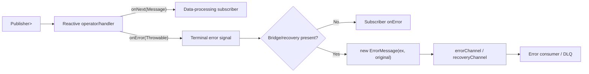
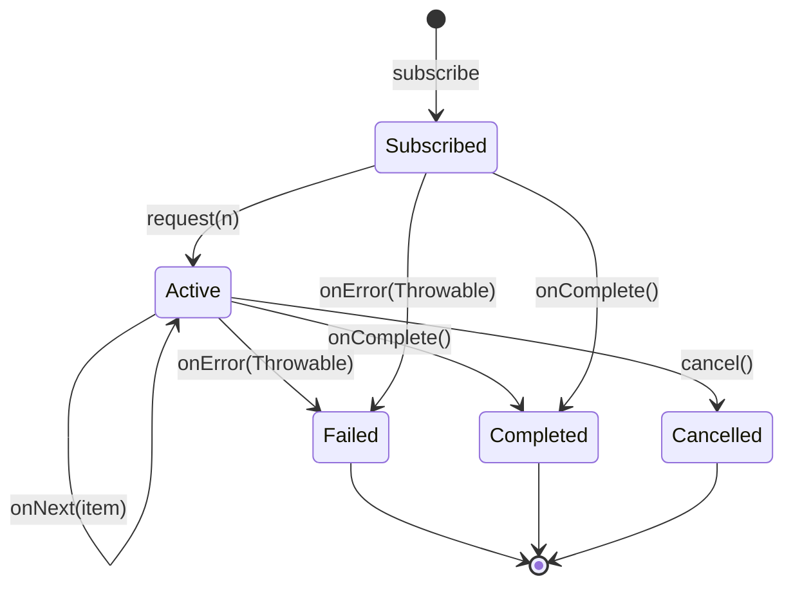
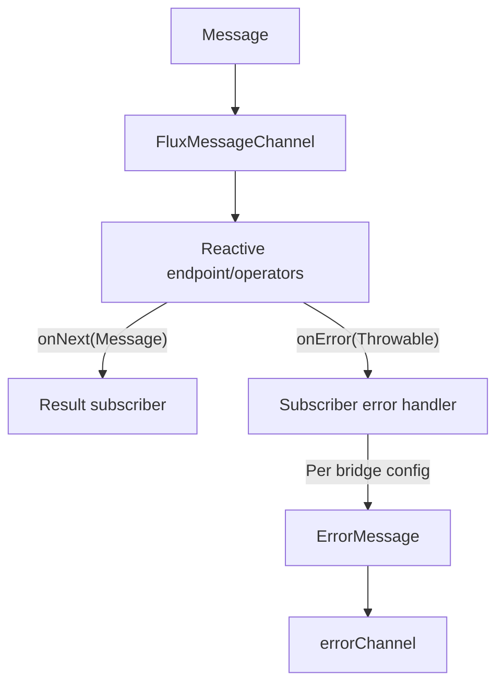

# Error Signals vs. ErrorMessage in Spring Integration Reactive Runtime

## 1. Same Throwable, Two Different Mechanisms

In the **SPRING_INTEGRATION_RUNTIME** module, messages flow through channels, endpoints, consumers, pollers, and executors. When a flow uses **Reactive Streams** or **Project Reactor**, failures do not appear solely as Java exceptions unwinding a call stack; they can also become an **`onError` signal** on a subscription. That signal is **not** an `ErrorMessage` sent on a `MessageChannel`.

The lesson **Reactive runtime → Error Signals vs. ErrorMessage** focuses on:

1. What terminal signal `onError(Throwable)` is, and why a `Flux` can stop on a failing item.
2. How Spring Messaging's `ErrorMessage` carries an exception and the original message.
3. When failures become messages on `errorChannel`, and when only a reactive signal occurs.
4. Differences between Reactor operator retry/recovery and Spring Integration error flows.
5. Impact on transactions, threading, acknowledgments, backpressure, message stores, and correlation.
6. Verifying behavior with runnable Java examples and controlled fault injection.

**Principle:** `onError` is a **terminal signal of a subscription**. `ErrorMessage` is **a message carrying a Throwable** that can be sent through a channel. There is no universal rule that every `onError` automatically causes Spring Integration to send an `ErrorMessage` to the global `errorChannel`.



An `ErrorMessage` can also arise **directly** from exceptions handled by a poller, executor, or inbound adapter; Reactive Streams is not required.

## 2. Comparing the Two Contracts

| Property | Reactive `onError` | Spring `ErrorMessage` |
| --- | --- | --- |
| Nature | Terminal signal from `Publisher` to `Subscriber` | `org.springframework.messaging.support.ErrorMessage` |
| Data | `Throwable` | Payload is `Throwable`, plus headers and optional original message |
| Delivery mechanism | `Subscriber.onError(Throwable)` | `MessageChannel.send(errorMessage)` or `onNext(errorMessage)` |
| After emission | Subscription ends; no further `onNext`/`onComplete` allowed | Channel/stream can keep accepting other messages |
| Backpressure | Not an `onNext` item consuming demand | If emitted via `onNext`, it is a demand-subjected item |
| Recovery | `onErrorResume`, `onErrorReturn`, `retryWhen`, subscriber | Error channel consumer, recoverer, DLQ |
| Auto rollback or requeue? | No | No |
| Carries original input message? | Must be captured explicitly in closure/context | Can use constructor taking `originalMessage` |

**Terminal signal** example:

```java
Flux.just("A", "B", "C")
    .map(value -> {
        if ("B".equals(value)) {
            throw new IllegalStateException("Cannot process B");
        }
        return value.toLowerCase();
    })
    .subscribe(
        value -> System.out.println("NEXT " + value),
        error -> System.out.println("ON_ERROR " + error.getMessage()),
        () -> System.out.println("COMPLETE")
    );
```

Output:

```text
NEXT a
ON_ERROR Cannot process B
```

`C` never reaches this subscriber, and the `COMPLETE` callback never runs, because the operator error terminated **the outer subscription**.

**ErrorMessage as data** example:

```java
Flux.<Message<?>>just(
        MessageBuilder.withPayload("A").build(),
        new ErrorMessage(new IllegalStateException("B failed")),
        MessageBuilder.withPayload("C").build())
    .subscribe(m -> System.out.println(
            "ON_NEXT payloadType=" +
            m.getPayload().getClass().getSimpleName()));
```

The second line emits an `ErrorMessage` via **`onNext`**, not `onError`; if the subscriber does not throw, all three items pass through and the publisher completes normally.

## 3. Reactive Streams Lifecycle: onError Is Terminal



`onError` and `onComplete` are **distinct** endings. `cancel()` also stops receiving events, though it implies neither business success nor failure. A subscriber receiving a terminal error must not expect more items from the same subscription.

Errors can be constructed directly:

```java
Mono<String> failed =
        Mono.error(new IllegalStateException("Remote service unavailable"));
```

Or converted into a signal when executing an operation:

```java
Mono<String> task = Mono.fromCallable(() -> callRemoteService());
```

With `Mono.fromCallable`, the **cold publisher** callback generally executes upon subscription. If `callRemoteService()` throws, Reactor turns the exception into `onError`. When a retry resubscribes, the callback **can run again**; this is crucial if it already called an external API or wrote data.

### Commonly Misunderstood Operators

| Operator | Behavior | Risk |
| --- | --- | --- |
| `doOnError` | Observes error for logs/metrics | Does **not** handle or swallow the error |
| `onErrorMap` | Translates `Throwable` to another type | Loses root cause if mapped poorly |
| `onErrorResume` | Replaces failed source with a new publisher | Turns failure into success/completion; may ack prematurely |
| `onErrorReturn` | Returns a fallback value | False success if fallback violates contract |
| `onErrorComplete` | Completes instead of signaling error | Can silently skip failed work |
| `retryWhen` | Resubscribes on error | Repeats side effects; may replay earlier items |
| `onErrorContinue` | Attempts to skip failing item in supporting operators | Operator-dependent, unpredictable; avoid blanket use |
| `doFinally` | Observes complete/error/cancel | Does not create an ErrorMessage |

`doOnError` is purely a side effect:

```java
Mono.fromCallable(() -> sendOrder())
    .doOnError(ex -> logger.warn("Send failed", ex));
```

The subscriber still receives `onError` unless another operator recovers it.

## 4. ErrorMessage Is a Message<Throwable>

`ErrorMessage` extends `GenericMessage<Throwable>`. It carries a `Throwable` payload, headers, and optionally the original message:

```java
Message<String> original = MessageBuilder
        .withPayload("ORDER-42")
        .setHeader("eventId", "evt-42")
        .setHeader("traceId", "trace-42")
        .build();

Throwable cause =
        new IllegalStateException("Shipping API unavailable");

ErrorMessage error = new ErrorMessage(cause, original);

Throwable exception = error.getPayload();
Message<?> input = error.getOriginalMessage();
```

**`getOriginalMessage()` can return `null`.** `new ErrorMessage(cause)` contains no original message. If the exception is a `MessagingException`, it may carry its own `failedMessage`; still, never assume every `Throwable` has that context.

A message-based consumer:

```java
@ServiceActivator(inputChannel = "integrationErrors")
public void handle(ErrorMessage error) {
    Message<?> original = error.getOriginalMessage();
    System.out.println("ERROR " + error.getPayload().getMessage());
    System.out.println("ORIGINAL " +
            (original == null ? "unknown" : original.getPayload()));
}
```

This handler consumes an error message from a channel. Completing normally **does not automatically roll back** a database or instruct a broker to redeliver the source message.

### Where Does errorChannel Operate?

Spring Integration publishes `ErrorMessage` to an error channel at **supported boundaries**, such as error handlers of certain pollers, executors, or inbound adapters. The target channel can be specified per adapter, via the `errorChannel` header, or via the global channel depending on configuration.

What matters is **who creates the ErrorMessage** and **who sends it**. A global bean named `errorChannel` cannot automatically catch every `Publisher.onError` across the entire application. In a custom reactive pipeline, you usually must bridge explicitly or rely on a specific component's error-publishing mechanism.

## 5. Three Runtime Scenarios That Must Not Be Equated

### 5.1. Synchronous DirectChannel

```text
sender.send(message)
    -> DirectChannel
    -> @ServiceActivator throws
    -> exception returns to sender unless caught/trapped
```

The `send()` caller may receive the exception/wrapper; an `ErrorMessage` **does not necessarily** appear on the global `errorChannel`. If an outer imperative transaction sits on the same call stack and the exception crosses the transaction boundary, it can trigger rollback.

### 5.2. ExecutorChannel or Poller

```text
Thread A: send -> ExecutorChannel -> handoff accepted
Thread B: handler throws -> worker error handler (if configured)
                           -> may publish ErrorMessage
```

Thread A generally cannot catch errors occurring later on Thread B. Spring Integration provides mechanisms like `MessagePublishingErrorHandler` at suitable boundaries, yet you must inspect the actual endpoint, adapter, and config. **Never** assume all asynchronous exceptions are published identically.

### 5.3. Publisher/FluxMessageChannel

```text
Publisher<Message<?>> -> reactive operators -> Subscriber
                                      |
                                      +-- terminal onError(Throwable)
```

Reactive operators can emit `onError` to the subscriber without creating an `ErrorMessage`. Whether a bridge exists depends on the reactive endpoint's API and subscription ownership.

## 6. Per-Message Recovery vs. Whole-Stream Recovery

Suppose a stream contains `order-1`, `broken`, `order-3`:

```java
Flux.just("order-1", "broken", "order-3")
    .map(this::process)
    .onErrorResume(ex -> Flux.empty())
    .subscribe(System.out::println);
```

If `process("broken")` throws, the **outer** `onErrorResume` replaces the entire failed source with an empty publisher. It does not jump back to `order-3`.

To continue with subsequent events, place the error boundary **inside each inner publisher**:

```java
Flux.just("order-1", "broken", "order-3")
    .concatMap(id ->
        Mono.fromCallable(() -> process(id))
            .onErrorResume(ex -> {
                recordFailure(id, ex);
                return Mono.empty();
            }))
    .subscribe(System.out::println);
```

`concatMap` awaits each inner publisher sequentially; an error recovered inside an inner `Mono` does not terminate the outer source. If `flatMap` is used instead, inner publishers can run concurrently and finish out of order. Bound concurrency to backend capacity and business contracts.

**Avoid:** using `onErrorContinue` as a general-purpose way to skip bad events. Its semantics depend on upstream operators and easily produce hard-to-trace side effects. Per-event `onErrorResume` has clearer semantics.

## 7. Runnable Java Example: Bridging Signals to ErrorMessage

Java 17+, Spring Boot, Spring Integration, and Reactor example. Put everything into **one file** `ReactiveErrorDemoApplication.java` in package `demo.integration`, using compatible Spring Integration core/starter and `reactor-core` versions. The app declares its own `integrationErrors` channel rather than **implicitly relying on the global errorChannel**.

```java
package demo.integration;

import java.util.concurrent.atomic.AtomicInteger;

import org.springframework.beans.factory.annotation.Qualifier;
import org.springframework.boot.ApplicationRunner;
import org.springframework.boot.SpringApplication;
import org.springframework.boot.autoconfigure.SpringBootApplication;
import org.springframework.context.annotation.Bean;
import org.springframework.integration.annotation.MessageEndpoint;
import org.springframework.integration.annotation.ServiceActivator;
import org.springframework.integration.channel.DirectChannel;
import org.springframework.integration.config.EnableIntegration;
import org.springframework.messaging.Message;
import org.springframework.messaging.MessageChannel;
import org.springframework.messaging.support.ErrorMessage;
import org.springframework.messaging.support.MessageBuilder;

import reactor.core.publisher.Flux;
import reactor.core.publisher.Mono;

@SpringBootApplication
@EnableIntegration
public class ReactiveErrorDemoApplication {

    public static void main(String[] args) {
        SpringApplication.run(ReactiveErrorDemoApplication.class, args);
    }

    @Bean("integrationErrors")
    MessageChannel integrationErrors() {
        return new DirectChannel();
    }

    @Bean
    ApplicationRunner demo(
            @Qualifier("integrationErrors") MessageChannel errors) {

        return args -> {
            Flux.just("order-1", "broken", "order-3")
                .concatMap(id -> {
                    Message<String> input = MessageBuilder
                        .withPayload(id)
                        .setHeader("eventId", "evt-" + id)
                        .setHeader("traceId", "trace-" + id)
                        .build();

                    return Mono.fromCallable(() -> process(input))
                        .doOnError(ex -> System.out.println(
                                "REACTOR_ERROR event=" + id))
                        .onErrorResume(ex -> {
                            // Explicit bridge: onError -> ErrorMessage.
                            errors.send(new ErrorMessage(ex, input));

                            // Complete the failing inner publisher;
                            // outer source moves on to the next event.
                            return Mono.empty();
                        });
                })
                .doOnNext(value ->
                        System.out.println("RESULT " + value))
                .doOnComplete(() ->
                        System.out.println("OUTER_COMPLETE"))
                .blockLast();
        };
    }

    private static String process(Message<String> message) {
        String id = message.getPayload();

        if ("broken".equals(id)) {
            throw new IllegalStateException(
                    "Simulated downstream failure");
        }

        return "processed:" + id;
    }
}

@MessageEndpoint
class ErrorConsumer {

    private final AtomicInteger count = new AtomicInteger();

    @ServiceActivator(inputChannel = "integrationErrors")
    public void handle(ErrorMessage error) {
        Message<?> original = error.getOriginalMessage();
        Object eventId = original == null
                ? "unknown"
                : original.getHeaders().get("eventId");

        System.out.println("ERROR_MESSAGE #" +
                count.incrementAndGet() +
                " event=" + eventId +
                " cause=" +
                error.getPayload().getClass().getSimpleName());
    }
}
```

Expected logical output:

```text
RESULT processed:order-1
REACTOR_ERROR event=broken
ERROR_MESSAGE #1 event=evt-broken cause=IllegalStateException
RESULT processed:order-3
OUTER_COMPLETE
```

Because `concatMap` runs sequentially and `DirectChannel` is synchronous, log ordering is predictable. Switching to `flatMap` or an asynchronous error channel alters ordering.

### Step-by-Step Breakdown

1. `blockLast()` creates a subscription so `Flux.just(...)` executes.
2. `concatMap` builds a `Message<String>` with `eventId` and `traceId` for each item.
3. `Mono.fromCallable` invokes `process(message)` when the inner Mono is subscribed.
4. When `broken` causes the method to throw `IllegalStateException`, the inner Mono emits **`onError`**.
5. `doOnError` only logs; `onErrorResume` **explicitly** sends `new ErrorMessage(ex, input)` to `integrationErrors`.
6. `ErrorConsumer`'s `@ServiceActivator` receives the ErrorMessage via `DirectChannel`.
7. The failing inner publisher returns `Mono.empty()`, allowing outer `concatMap` to continue to `order-3`.

**Crucial point:** `onErrorResume` in the demo turns the failure into **normal completion of the inner publisher**. The error consumer here only logs and has no durable failure storage. In a broker-backed system, similar recovery can acknowledge the message even though business work failed. Only swallow errors once your recovery contract allows it.

### Control Comparison: Outer Recovery

```java
Flux.just("order-1", "broken", "order-3")
    .map(id -> {
        if ("broken".equals(id)) {
            throw new IllegalStateException("broken event");
        }
        return "processed:" + id;
    })
    .onErrorResume(ex -> {
        System.out.println("RECOVER OUTER");
        return Flux.empty();
    })
    .subscribe(System.out::println);
```

Output shows `processed:order-1` and `RECOVER OUTER`, with no `processed:order-3`. Outer `onErrorResume` replaces **an already-terminated source** and never resumes at the next item.

## 8. Two Bridging Approaches with Different Semantics

### Approach A: Publish Error Then Complete

```java
Mono<Result> result = remoteCall(message)
    .onErrorResume(ex -> {
        errorChannel.send(new ErrorMessage(ex, message));
        return Mono.empty();
    });
```

Appropriate when you **intentionally** treat the original message as finished after handing it off to reliable recovery. Verify: did the channel accept the message, did the error consumer persist to DLQ, was there an async handoff, and on what condition does upstream ack?

### Approach B: Publish Error Yet Keep Propagating

```java
Mono<Result> result = remoteCall(message)
    .doOnError(ex -> errorChannel.send(
        new ErrorMessage(ex, message)));
```

`doOnError` does not swallow the signal, so downstream subscribers still see the failure. This can fit when the source adapter must observe failure to roll back/nack/redeliver. However, if the adapter's error publishing also emits an `ErrorMessage`, one failure can be recorded **twice**. Assign a single error-publishing owner or enforce eventId idempotency on error records.

If `errorChannel.send()` itself throws, that callback failure can also impact the pipeline. Never assume publishing an error always succeeds.

### materialize Differs from ErrorMessage

Reactor's `materialize()` turns `onNext`/`onError`/`onComplete` into `Signal<T>` objects; `dematerialize()` restores signals. A `Signal.error` is still **not** an `ErrorMessage`. To send onto a Spring MessageChannel, explicitly map it and preserve the original message.

## 9. FluxMessageChannel Is Not errorChannel

`FluxMessageChannel` is a Reactive Streams-capable channel in Spring Integration:

```java
@Bean("reactiveOrders")
FluxMessageChannel reactiveOrders() {
    return new FluxMessageChannel();
}
```

Import `org.springframework.integration.channel.FluxMessageChannel`. Declaring the bean does not automatically create subscribers, enable persistent storage, configure retries, or bridge errors.



A `Flux<Message<?>>` emitting an `ErrorMessage` as **`onNext`** can keep running. When a publisher emits **`onError`**, that subscription ends. How an `IntegrationFlow` or adapter manages subscriptions varies by endpoint and version; determine clearly who subscribes and who routes errors.

`FluxMessageChannel` is also **not a persistent queue** across restarts. Independent message stores/brokers and ack/replay policies are required for durability.

## 10. retryWhen: Resubscribing Does Not Necessarily Retry a Single Message

```java
Mono<String> request = Mono.defer(() -> remoteCall())
    .retryWhen(
        Retry.backoff(2, Duration.ofMillis(100))
            .filter(ex -> ex instanceof TransientServiceException)
    );
```

This snippet requires importing `reactor.util.retry.Retry`, `java.time.Duration`, and defining `remoteCall()`/`TransientServiceException`. `Retry.backoff(2,...)` allows **two retries after the initial try**, up to three attempts total. Retry only transient failures; include timeouts, backoff, deadlines, and idempotency.

### Place Retry Outside or Inside the Flux?

```java
Flux<Result> output = receiveEvents()
    .flatMap(this::process)
    .retryWhen(Retry.max(2));
```

With a **cold/replayable source**, an outer retry can resubscribe to the source and replay items that already succeeded before the error. With hot sources/broker adapters, replay depends on source semantics.

```java
Flux<Result> output = receiveEvents()
    .concatMap(event -> process(event)
        .retryWhen(Retry.backoff(2, Duration.ofMillis(100)))
        .onErrorResume(ex -> quarantine(event, ex)));
```

This is a skeleton; `receiveEvents`, `process`, and `quarantine` must return compatible publisher types. Inner retries typically scope retries to one logical event.

**Note:** a `Mono` that has cached an error will not necessarily re-execute I/O on resubscription; use `Mono.defer` or a compliant cold source if re-execution is intended.

| Mechanism | Scope | What to watch |
| --- | --- | --- |
| Reactor `retryWhen` | The enclosed Publisher | Resubscription, repeated side effects |
| `RequestHandlerRetryAdvice` | Request-handler invocation | May miss error signals emitted after handler returns a publisher |
| Broker redelivery | Message delivery per adapter | Ack/nack/transactions and multi-layer retry amplification |

Never enable retries across all three layers without knowing **actual total attempts**. An API that already applied a side effect before timing out can be invoked again; always consider idempotency keys.

## 11. Transactions, Acks, and Error Flows: Four Distinct Events

No two of these are identical:

```text
Reactive onError
    != Spring ErrorMessage
    != database rollback
    != broker redelivery
```

Imperative Spring transactions (JDBC/JPA) are normally thread-bound. `publishOn`, `subscribeOn`, or handoffs to executors can change threads and execution timing; a caller's transaction **does not automatically propagate** across an entire asynchronous publisher.

Reactive transactions with `ReactiveTransactionManager`, `TransactionalOperator`, or reactive `@Transactional` use the subscription's **Reactor Context** when properly configured. That is not a ThreadLocal JDBC transaction.

| Scenario | Downstream observes | Ack/rollback implication |
| --- | --- | --- |
| Inner Mono `onError`, unrecovered | Error signal | Reactive TX/adapter can respond per config |
| `onErrorResume(ex -> Mono.empty())` | Normal completion | Upstream may ack and treat message as handled |
| `doOnError` publishes ErrorMessage then propagates | Error signal still reaches subscriber | Adapter may nack/rollback; error records may duplicate |
| ErrorMessage sent to `DirectChannel` | Error consumer runs synchronously | Does not automatically roll back the source message |
| ErrorMessage sent to async channel | Handoff may succeed before DLQ write | Needs separate guarantee/persistence |
| Reactive transaction wraps whole publisher | Commits on complete, rolls back on error per policy | Depends on manager and subscription boundary |

With brokers, recover to normal completion only after the failing message has been durably stored per requirements. If redelivery is required, do not swallow the exception before the container/adapter observes it.

## 12. Correlation and Reactor Context

When creating an `ErrorMessage`, preserve:

- `eventId`/idempotency key to identify the same logical event across retries/replays.
- `correlationId`, `sequenceNumber`, `sequenceSize` when splitters/aggregators are involved.
- `traceId` to correlate logs across thread hops.
- Exception class, cause chain, and safe endpoint/channel metadata.
- Original message or durable reference to the raw payload for reprocessing.

`MessageHeaders.ID` may change when a message is rebuilt. `Reactor Context` belongs to a subscription, while `MessageHeaders` belongs to a **message object**. Copying context to headers (and vice versa) requires explicit mapping; never assume MDC/ThreadLocal crosses `publishOn`/`subscribeOn` automatically.

## 13. Backpressure, Concurrency, and Error Storms

In Reactive Streams, `request(n)` regulates `onNext` items. **`onError` is not an item consuming a demand slot**; it is a terminal signal.

If an application turns every error into an `ErrorMessage` emitted into a publisher via `onNext`, those become data items governed by demand. If sent to a `DirectChannel` inside `onErrorResume`, a synchronous error consumer **can block the Reactor thread**. If sent to an `ExecutorChannel`, backlog can shift into the executor queue.

Illustrative scenario:

```text
Input: 10,000 logical events/s
  -> 10,000 inner onError/s during downstream outage
  -> 10,000 ErrorMessages/s published
  -> error store processes only 1,000/s
  -> backlog +9,000/s if unbounded
```

These are illustrative numbers, not framework metrics. Error paths need concurrency limits, bounded buffers, rate limits, DLQ/storage capacity, and alerts; never let an error storm saturate the success path.

| Reactor operator | Role | Risk |
| --- | --- | --- |
| `flatMap(f, concurrency)` | Caps concurrent inner publishers | Outputs/errors can interleave |
| `concatMap(f)` | Sequential in source order | Head-of-line blocking |
| `onBackpressureBuffer` | Temporarily buffers waiting items | Unbounded buffers exhaust memory |
| `onBackpressureDrop` | Drops items under overload | Can lose business data |
| `publishOn` | Shifts downstream to a scheduler | Changes threads/ThreadLocal |
| `subscribeOn` | Changes subscription/source execution | Does not force all stages onto one thread |
| `timeout` | Converts slowness to an error signal | Retries can cause duplicate side effects |

With blocking JDBC/HTTP libraries, avoid calling them on event loops; use an appropriate scheduler like `Schedulers.boundedElastic()` or non-blocking clients. Switching threads alone does not fix transaction correctness or ack semantics.

## 14. Why Are Neither onError Nor ErrorMessage Observed?

A cold publisher may have been constructed yet **never subscribed to**:

```java
Mono<Void> call = Mono.fromRunnable(() -> sendRequest());
// Not subscribed yet => sendRequest() has not executed.
```

If the framework/endpoint does not compose/subscribe to the publisher and the method only returns a `Mono`, work may never execute. Whether the framework subscribes for you **depends on the API and endpoint version in use**.

A subscriber lacking an error consumer may cause Reactor to report errors via logs/global hooks; this is **not** a durable error store and not automatically a Spring `ErrorMessage`.

### Symptoms and Troubleshooting

| Symptom | Cause | How to verify |
| --- | --- | --- |
| `doOnError` logs yet `errorChannel` stays empty | No bridge/message publisher | Find where ErrorMessages are created |
| Events after a failing event never run | Outer stream terminal error | Add inner per-event recovery |
| ErrorMessage recorded yet broker still redelivers | Error still propagates | Align ack/recovery contract and deduplication |
| Remote call never happens | Cold publisher unsubscribed | Trace subscription lifecycle |
| Two error records for the same event | Manual bridge + adapter auto-publishing | Pick one owner or enforce idempotency |
| `onErrorResume` loses messages | Swallowed error before durable recovery | Quarantine/DLQ before ack |
| `retryWhen` causes duplicates | Source resubscription or repeated side effects | Retry per event; use stable eventId |
| Transaction fails to roll back | Async error occurs after caller TX ended | Establish proper reactive transaction boundary |
| Logs lose `traceId` | ThreadLocal/MDC not propagated | Use MessageHeaders/Reactor Context |
| Sender `send()` succeeds yet worker throws | Async channel boundary | Inspect worker error handler |
| Error consumer stalls | DirectChannel/blocking I/O or overloaded queue | Bounded capacity and metrics |
| Poison event retries endlessly | Same bad bytes/schema | Route to quarantine instead of infinite retries |

## 15. Metrics and Fault Injection

Separate metrics for **signals** and **messages**:

- `reactive.error.signal.count`: error signals observed at operators/subscribers.
- `integration.error.message.published` and `integration.error.message.handled`.
- `recovery.persisted`, `recovery.failed`, `deadletter.count`.
- `message.retry.attempts`, `message.redelivery.count`, timeouts/cancellations.
- `flow.inflight`, `flow.input.rate`, `flow.output.rate`.
- Executor queues, scheduler saturation, connection pool utilization.
- p50/p95/p99 latency from message receipt to ack/commit.

These names are **instrumentation suggestions**, not built-in default metrics. Avoid high-cardinality tags like raw `eventId`/`orderId`; tag by endpoint, event type, exception class, and outcome, keeping event IDs in traces/logs per security policy.

Perform controlled fault injection:

1. Outer `Flux.map` throws on the second event: confirm the third event never reaches the subscriber.
2. Inner `Mono` with `onErrorResume`: confirm the third event still processes.
3. `integrationErrors` error consumer throws: observe how the **new** exception from `send()` affects the pipeline.
4. Swap the error channel to an executor: observe timing, threads, backlog, and sender not waiting on the consumer.
5. Place `retryWhen` outside the stream vs. inside the inner publisher: count side-effect executions.
6. Cancel the subscription before the remote request returns: observe cleanup, timeouts, and acks.
7. Switch threads via `publishOn` and compare active transactions, trace headers, and Reactor context.
8. Inject DLQ/store failure: verify policy propagates or retries rather than silently acking.

## 16. Hands-On Exercises

1. Run `ReactiveErrorDemoApplication`; verify one `REACTOR_ERROR`, one `ERROR_MESSAGE`, two `RESULT`s, and `OUTER_COMPLETE`.
2. Remove inner `onErrorResume`; observe whether `order-3` and outer completion still occur.
3. Move recovery after `concatMap`; explain why an already-terminated source does not resume.
4. Emit `ErrorMessage` via `Flux.<Message<?>>just(...)` as a data item; contrast with `Flux.error(...)`.
5. Test `Retry.backoff(2,...)` on `Mono.defer` with a counter; observe at most three attempts.
6. Add `onErrorMap` preserving the cause; inspect `ErrorMessage.getOriginalMessage()` with and without passing `input` to the constructor.
7. Use `doOnError` to publish an error while propagating; identify where duplicate auditing could occur.
8. Try `flatMap` with concurrency 4, delay one event, and compare ordering with `concatMap`.
9. Build a `FluxMessageChannel` and reactive consumer using your project's API version; identify who owns the subscription.
10. With a test broker, compare propagating errors for redelivery vs. recovering after DLQ persistence; verify idempotency.
11. With a persistent message store, intentionally send a poison payload and determine whether decoding fails before or after the reactive operator.
12. Add alerts for error signal rate, ErrorMessage publish/handle rate, and recovery failures.

### Pre-Production Checklist

- Distinguish **terminal `onError`** from **`ErrorMessage` as message data**.
- If the stream must continue past failing events, recover at **per-event** scope.
- Never swallow errors before recovery/ack contracts allow.
- Have a single owner publish error events or enforce clear deduplication.
- Bound retries with backoff, timeouts, and idempotency.
- Verify who subscribes and where errors from async completions go.
- Preserve original message, eventId/correlationId, and traceId when routing errors.
- Verify transactions/acks/message stores/replay at every boundary.
- Apply bounded concurrency and backpressure to both success and error paths.
- Put metrics, fault injection, and DLQ outage plans in place.

## 17. Official References

- [Spring Integration — Reactive Streams Support](https://docs.spring.io/spring-integration/reference/reactive-streams.html): reactive channel and endpoint support.
- [Spring Integration — Error Handling](https://docs.spring.io/spring-integration/reference/error-handling.html): ErrorMessage, errorChannel, and error publishing boundaries.
- [Spring Integration — Message Channel Implementations](https://docs.spring.io/spring-integration/reference/channel/implementations.html): DirectChannel, ExecutorChannel, FluxMessageChannel.
- [Project Reactor — Error Handling](https://projectreactor.io/docs/core/release/reference/coreFeatures/error-handling.html): terminal signals and error operators.
- [Project Reactor — Schedulers](https://projectreactor.io/docs/core/release/reference/coreFeatures/schedulers.html): publishOn, subscribeOn, and boundedElastic.
- [Project Reactor — Context](https://projectreactor.io/docs/core/release/reference/advancedFeatures/context.html): per-subscription context.
- [Spring Framework Javadoc — ErrorMessage](https://docs.spring.io/spring-framework/docs/current/javadoc-api/org/springframework/messaging/support/ErrorMessage.html): payload and original message.
- [Reactive Streams Specification](https://www.reactive-streams.org/): Publisher/Subscriber and terminal signal contracts.
