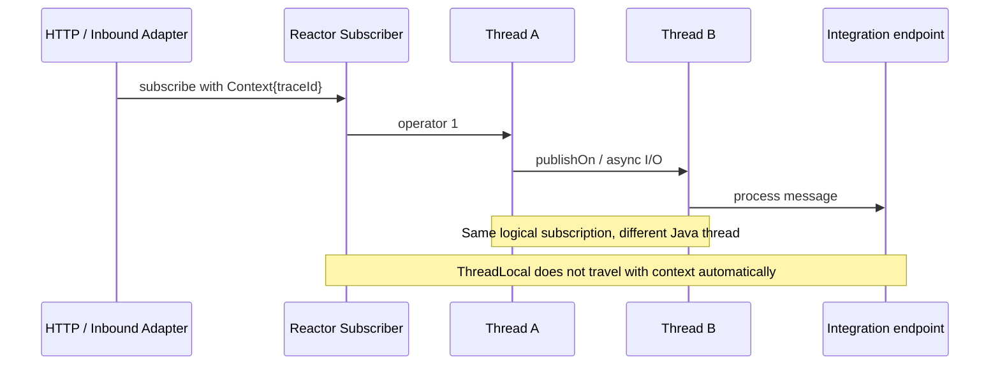
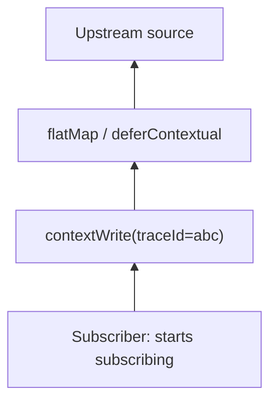
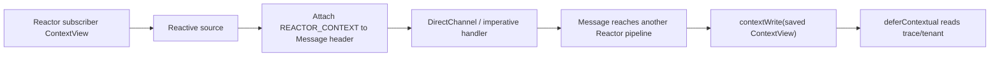
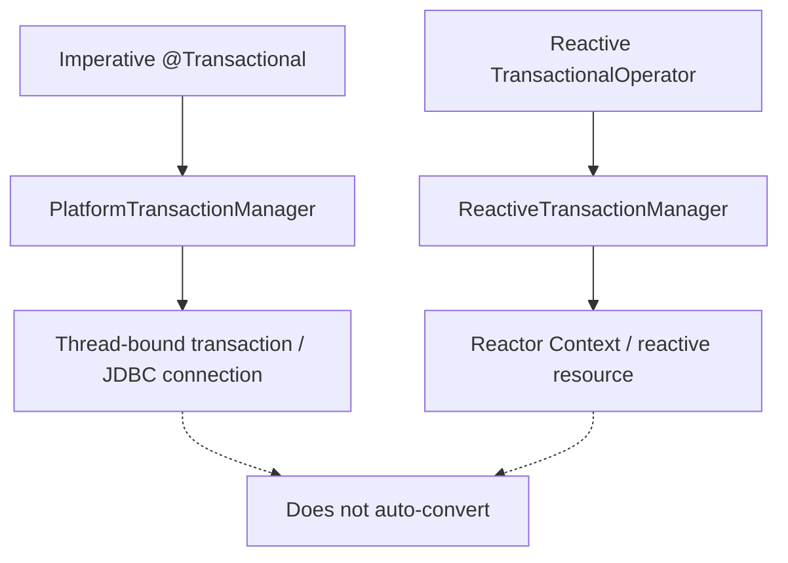
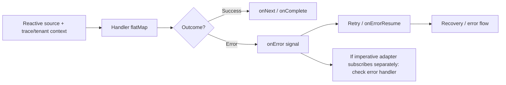

# Context Propagation in Spring Integration Reactive Execution

## Goals and Background

In the **SPRING_INTEGRATION_RUNTIME** module, a message may traverse a `MessageChannel`, consumer endpoint, poller, executor, and then a `Mono`/`Flux` stage before continuing. With asynchronous operations, the executing thread changes, subscriptions may begin after request receipt, and observability/authorization libraries may need contextual metadata (trace, security, tenant, locale). Confusing **Reactor Context**, **ThreadLocal**, and **Spring Message headers** makes it easy to lose correlation, log the wrong trace, or authorize using another request's context.

This lesson belongs to the **Reactive runtime** chapter and focuses on **context propagation in reactive execution** when Spring Integration mixes reactive flows with imperative endpoints. It is about **propagating execution context**, not a standalone replacement for tracing or Java thread management.

After this lesson, you will be able to:

- Distinguish Reactor `Context`/`ContextView`, `ThreadLocal`/MDC, Spring Integration `MessageHeaders`, and business values.
- Explain why `publishOn`, `subscribeOn`, and `ExecutorChannel` can switch threads while Reactor Context stays with a **subscription**, whereas `ThreadLocal` is not preserved automatically.
- Use `contextWrite`, `deferContextual`, `contextCapture`, and Micrometer Context Propagation in the proper data-flow direction.
- Use `IntegrationMessageHeaderAccessor.REACTOR_CONTEXT` and `StaticMessageHeaderAccessor.getReactorContext(message)` to cross reactive → imperative → reactive boundaries in Spring Integration 6.0.5+.
- Understand the limits of automatic context propagation, MDC, Micrometer Observation, SecurityContext, transaction context, backpressure, and error handling.
- Test per-subscriber isolation, context loss, thread switching, missing headers, concurrent requests, and restart/persistence boundaries.

Code examples use Java 17+, Spring Integration 6.5.x, Reactor Core 3.5+, and compatible Micrometer Context Propagation dependencies. Some Spring Boot properties differ across versions; real projects should use BOM/dependency management to align Reactor, Spring Integration, and Micrometer.

## 1. The Problem: A Thread No Longer Represents a Single Request

In traditional blocking applications, trace IDs are often stored in `ThreadLocal` or SLF4J `MDC`. When an entire request runs on one thread, that is convenient. When moving to reactive:



Key point: Reactor Context is **neither** a thread-global variable **nor** a map inside the message payload. It is attached to the `Subscriber`/`Subscription`. Operators within **the same reactive composition** can read it even when schedulers switch threads, provided context is wired properly across operators.

Conversely, `ThreadLocal` is stored on a **specific thread**. When an operator moves from a Netty event-loop to a bounded-elastic worker, calling `ThreadLocal.get()` may return `null` or an unrelated value unless code/frameworks properly capture and restore it.

### Four Places a "Trace ID" Can Live

| Storage location | Common API | Scope | Crosses threads automatically? |
|---|---|---|---|
| Reactor `ContextView` | `Mono.deferContextual(...)` | One subscriber/subscription and operators in the same chain | Yes within proper Reactor composition |
| Java `ThreadLocal` | `ThreadLocal.get()`, MDC | One Java thread | No |
| Spring `MessageHeaders` | `message.getHeaders().get(...)` | One message, when headers are preserved/copied properly | Yes, as message data; does not auto-become Reactor Context |
| Transport context carrier | HTTP trace headers, broker headers, baggage | Across network/processes per protocol and instrumentation | Only when explicitly **injected/extracted** |
| Business correlation ID | `orderId`, `batchId`, `correlationId` | Application-defined business workflow | Only when flow authors preserve/route it |

**Trace ID differs from correlation ID.** One trace can span multiple spans; one business correlation ID can link multiple requests, messages, or retry attempts. Never replace `traceId` with `correlationId` and assume distributed tracing is working.

## 2. How Does Reactor Context Work?

`reactor.util.context.Context` is an immutable-API key/value structure: operations like `put` return a new context. `ContextView` provides read-only access. Values inside the context can still point to mutable objects, so "immutable Context" does not mean every stored object is thread-safe.

```java
import reactor.core.publisher.Mono;
import reactor.util.context.Context;

Mono<String> operation =
        Mono.deferContextual(ctx ->
                Mono.just("trace=" + ctx.getOrDefault(
                        "traceId", "missing")));

String result = operation
        .contextWrite(Context.of("traceId", "trace-001"))
        .block();

System.out.println(result); // trace=trace-001
```

Key takeaways:

- `Mono.deferContextual` reads context at **subscription time**, rather than reading a mutable variable captured while assembling the pipeline.
- `contextWrite(...)` adds/overrides context for **upstream operators** (closer to the source). Context flows from downstream subscriber toward upstream during subscription.
- Multiple subscribers can subscribe to the same `Mono` definition with different contexts.
- `ContextView.get(key)` throws if the key is absent; `getOrDefault(...)` or `hasKey(...)` fits optional keys.

### Which Direction Is Context Visible From?



Do not assume `contextWrite` is a global mutation applying both backward and forward across the whole pipeline. It modifies the context visible to upstream. Operator placement matters, especially with multiple `contextWrite` calls for the same key.

### Testing Multiple Subscribers

```java
Mono<String> sharedDefinition =
        Mono.deferContextual(ctx ->
                Mono.just(ctx.get("tenantId")));

String a = sharedDefinition
        .contextWrite(Context.of("tenantId", "tenant-A"))
        .block();

String b = sharedDefinition
        .contextWrite(Context.of("tenantId", "tenant-B"))
        .block();

// a = tenant-A; b = tenant-B
```

If you used a `static ThreadLocal` and forgot cleanup, tenant data could leak across requests due to thread-pool reuse. Reactor Context is designed to bind values to subscribers rather than arbitrary global state.

## 3. Scheduler Thread Switches Do Not Automatically Lose Reactor Context

`publishOn` and `subscribeOn` adjust the execution context (scheduler/thread) of signals/subscriptions. They **do not automatically erase Reactor Context** for a properly composed subscription.

```java
import reactor.core.publisher.Mono;
import reactor.core.scheduler.Schedulers;
import reactor.util.context.Context;

Mono<String> flow =
        Mono.deferContextual(ctx -> Mono.just(
                        "tenant=" + ctx.get("tenantId")))
                .publishOn(Schedulers.parallel())
                .map(value -> value
                        + ", thread=" + Thread.currentThread().getName())
                .contextWrite(Context.of("tenantId", "shop-7"));

String result = flow.block();
// Starts with "tenant=shop-7", thread depends on scheduler.
```

Notes:

- `publishOn` shifts execution downstream of itself to the specified scheduler per Reactor semantics.
- `subscribeOn` changes where subscription/source execution runs; never infer the entire chain always stays on a single thread.
- `parallel()`, `flatMap`, or async operators can introduce concurrency. Context still belongs to each respective subscription/subscriber.
- `Thread.currentThread().getName()` helps diagnose scheduling; it never proves the identity of a business request.

### When Does Context Actually Break?

The dangerous boundary is **creating a separate subscription** or leaving Reactor composition:

```java
Mono.just("input")
    .doOnNext(value -> {
        // Anti-pattern: detached subscription does not inherit outer Context.
        Mono.deferContextual(ctx ->
            Mono.just(ctx.getOrDefault("traceId", "missing")))
            .subscribe(System.out::println);
    })
    .contextWrite(Context.of("traceId", "outer-trace"))
    .block();
```

Inner `subscribe()` creates an **independent** subscription that is not guaranteed to inherit the outer subscriber's context. It also turns the side effect into fire-and-forget, making errors/completion hard to tie back to acknowledging the original message.

Replace with **composition**:

```java
Mono<String> composed =
        Mono.just("input")
                .flatMap(value ->
                        Mono.deferContextual(ctx ->
                                Mono.just(value + ":"
                                        + ctx.get("traceId"))))
                .contextWrite(Context.of("traceId", "outer-trace"));

// Result: input:outer-trace
```

If an independent subscription is unavoidable (such as dispatching a message to another flow), select an appropriate **context carrier** and design lifecycle/error handling rather than expecting context to "jump" across automatically.

## 4. Spring Integration Reactive Execution Is Not Always Pure Reactive Streams

Spring Integration centers on messages, channels, and endpoints. Reactive support adds `FluxMessageChannel`, `ReactiveStreamsConsumer`, `ReactiveMessageHandler`, and Reactor-integrated adapters/gateways, yet many endpoints/adapters still perform blocking or imperative calls.

| Component | Main characteristic | Context risk |
|---|---|---|
| `FluxMessageChannel` | Both `MessageChannel` and `Publisher<Message<?>>`; connects reactive subscribers | Context depends on subscriber/subscription path; inspect headers when bridging |
| `ReactiveStreamsConsumer` | Consumes via Reactive Streams; can apply `flatMap` for reactive handlers | Threads can switch; do not read arbitrary `ThreadLocal`s |
| `ReactiveMessageHandler` | Handler returning `Mono<Void>`, supporting reactive clients | In imperative flows may be subscribed independently; different composition scope |
| `DirectChannel` | Typically dispatches synchronously on sender thread | Creates no new Reactor subscription, yet doesn't guarantee caller carries full Reactor Context |
| `ExecutorChannel` | Dispatches on worker thread | Sender's ThreadLocal is not automatically inherited |
| `QueueChannel` + poller | Receiver runs later on another thread | Old thread-local/subscriber context does not stay alive with the message automatically |
| `@MessagingGateway` returning `Mono<?>` | May defer send-and-receive until subscription | Check context at subscription time, not just method invocation |
| WebFlux/RSocket inbound gateway | Has a reactive request scope | Can copy `ContextView` into Spring Integration message headers |
| Blocking JDBC/JPA handler | Does not become non-blocking just by sitting next to a Flux | Blocks event-loops; transaction/ThreadLocal semantics differ |

With `FluxMessageChannel`, a Reactive Streams consumer can genuinely maintain backpressure across reactive-capable segments. If the flow calls blocking JDBC or `.block()` on an event-loop, proper context propagation will not solve performance; use non-blocking drivers or isolate blocking calls with an appropriate scheduler.

## 5. Specific Feature: REACTOR_CONTEXT Message Header Since Spring Integration 6.0.5

Since **Spring Integration 6.0.5**, the framework provides:

```java
IntegrationMessageHeaderAccessor.REACTOR_CONTEXT
StaticMessageHeaderAccessor.getReactorContext(message)
```

The `REACTOR_CONTEXT` header carries a `reactor.util.context.ContextView`. It helps bridge across imperative code or into a separate Reactor pipeline.



Spring Integration documentation notes that components such as `WebFluxInboundEndpoint` and `RSocketInboundGateway` can populate context into message headers. `FluxMessageChannel.subscribeTo(Publisher)` supports using this header to restore context for messages emitted from a source publisher. These are **specific capabilities of those integration components**, not proof that every custom `MessageChannel.send()` or every producer adds the header automatically.

### This Header Is Not MDC

Even if a message carries `REACTOR_CONTEXT`, an imperative handler calling `MDC.get("traceId")` can still get `null`. The header is a **carrier for `ContextView`**; restoring `ThreadLocal`/MDC requires Micrometer context propagation or explicit scoping code.

Likewise, sending `REACTOR_CONTEXT` in headers **does not** automatically start a reactive transaction in another endpoint or resurrect a completed subscriber.

## 6. End-to-End Example: Reactor → DirectChannel → Reading Context in Handler

The following Java configuration demonstrates how to **explicitly attach** Reactor context to a Spring message before sending over an imperative channel.

```java
import org.springframework.context.annotation.AnnotationConfigApplicationContext;
import org.springframework.context.annotation.Bean;
import org.springframework.context.annotation.Configuration;
import org.springframework.integration.IntegrationMessageHeaderAccessor;
import org.springframework.integration.StaticMessageHeaderAccessor;
import org.springframework.integration.annotation.ServiceActivator;
import org.springframework.integration.channel.DirectChannel;
import org.springframework.integration.config.EnableIntegration;
import org.springframework.messaging.Message;
import org.springframework.messaging.MessageChannel;
import org.springframework.messaging.support.MessageBuilder;
import reactor.core.publisher.Mono;
import reactor.core.scheduler.Schedulers;
import reactor.util.context.Context;
import reactor.util.context.ContextView;

@Configuration
@EnableIntegration
public class ReactorContextBridgeDemo {

    @Bean
    public MessageChannel orderRequests() {
        return new DirectChannel();
    }

    @Bean
    public OrderHandler orderHandler() {
        return new OrderHandler();
    }

    public static class OrderHandler {

        @ServiceActivator(inputChannel = "orderRequests")
        public void handle(Message<String> message) {
            ContextView saved =
                    StaticMessageHeaderAccessor.getReactorContext(message);

            String traceId = saved == null
                    ? "missing"
                    : saved.getOrDefault("traceId", "missing");

            String tenantId = saved == null
                    ? "missing"
                    : saved.getOrDefault("tenantId", "missing");

            System.out.printf(
                    "payload=%s trace=%s tenant=%s thread=%s%n",
                    message.getPayload(),
                    traceId,
                    tenantId,
                    Thread.currentThread().getName());
        }
    }

    public static void main(String[] args) {
        try (var ctx = new AnnotationConfigApplicationContext(
                ReactorContextBridgeDemo.class)) {

            MessageChannel input = ctx.getBean(
                    "orderRequests", MessageChannel.class);

            Mono<Boolean> operation = Mono.deferContextual(reactorContext -> {
                Message<String> message =
                        MessageBuilder.withPayload("ORDER-42")
                                .setHeader(
                                        IntegrationMessageHeaderAccessor.REACTOR_CONTEXT,
                                        reactorContext)
                                .build();

                // DirectChannel.send() is an imperative/blocking call.
                return Mono.fromCallable(() -> input.send(message))
                        .subscribeOn(Schedulers.boundedElastic());
            });

            Boolean sent = operation
                    .contextWrite(Context.of(
                            "traceId", "trace-42",
                            "tenantId", "tenant-9"))
                    .block();

            System.out.println("sent=" + sent);
        }
    }
}
```

**What to observe:**

1. `Mono.deferContextual` reads context only upon subscription (here `block()` creates the subscription at the demo boundary).
2. The context holding two keys is attached to the `Message` under Spring Integration's standard header name.
3. `DirectChannel` invokes `OrderHandler` on the thread calling `send`; because the example uses `boundedElastic`, the handler thread may differ from main.
4. The handler reads `ContextView` straight from the message header, **requiring no** `ThreadLocal` or automatic hooks.
5. `sent=true` only means the channel accepted the message per `send` contract; it does not mean a database transaction committed or an external reactive workflow completed.

In production code, return `Mono<Boolean>` to the reactive caller and let framework/protocol subscribers manage subscription. `block()` appears only in `main` for the demo—never call it on a Netty event-loop or inside a reactive operator.

### Remember to Check for Missing Headers

If a message arrives from a plain JMS/File adapter without `REACTOR_CONTEXT`, the getter may return null. Do not call `get("traceId")` without a missing-key policy; if correlation is mandatory, validate and raise a clear error instead of borrowing a stale value from an old thread.

Headers can also be dropped or altered by custom `MessageBuilder`s, transformers, or serialization; inspect transfer points and header types allowed by adapters.

## 7. How Does a New Reactor Pipeline Restore ContextView?

If an imperative handler passes a message into an **independent Reactor pipeline**, extract `ContextView` from the header and pass it to `contextWrite(...)`.

```java
import org.springframework.integration.StaticMessageHeaderAccessor;
import org.springframework.messaging.Message;
import reactor.core.publisher.Mono;
import reactor.util.context.ContextView;

public Mono<String> resumeReactive(Message<?> message) {
    ContextView saved =
            StaticMessageHeaderAccessor.getReactorContext(message);

    Mono<String> pipeline = Mono.deferContextual(ctx ->
            Mono.just("traceId=" +
                    ctx.getOrDefault("traceId", "missing")
                    + " payload=" + message.getPayload()));

    // If ContextView is absent, proceed with the default Context.
    return saved == null ? pipeline : pipeline.contextWrite(saved);
}
```

The `saved` data is attached to the new subscriber when the pipeline is subscribed. If `resumeReactive` merely returns a `Mono` without anyone subscribing, nothing executes. With a reply gateway, return the publisher per gateway/reactive-endpoint contract so the runtime composes it, rather than calling fire-and-forget `subscribe()` inside a message handler when backpressure and error propagation are needed.

### Distinguish These Two Operations

| Operation | Result |
|---|---|
| `message.getHeaders().get(REACTOR_CONTEXT)` | Reads the `ContextView` object stored in the header |
| `pipeline.contextWrite(saved)` | Supplies that context to a **new** subscriber so upstream operators can read it |
| `ctx.get("traceId")` in `deferContextual` | Reads the key from Reactor Context at subscription time |
| `MDC.get("traceId")` | Reads the current ThreadLocal-backed logging context; does **not automatically** reflect headers/context |
| `SecurityContextHolder.getContext()` | Thread-bound imperative security context; distinct from `ReactiveSecurityContextHolder` |

Only when a suitable `ThreadLocal` bridge/restore mechanism exists should you expect MDC or imperative `SecurityContext` to be populated at a given operator.

## 8. Micrometer Context Propagation: Bridging ThreadLocal and Reactor Context

The `io.micrometer:context-propagation` library provides these abstractions:

| Component | Role |
|---|---|
| `ThreadLocalAccessor<T>` | Reads, sets, and clears a `ThreadLocal` value for a given key |
| `ContextRegistry` | Registers accessors / context accessors |
| `ContextSnapshot` | Captures context values and restores them in another scope |
| Reactor `ReactorContextAccessor` | Teaches Micrometer about Reactor `Context`/`ContextView` via ServiceLoader when the dependency is present |
| Reactor `contextCapture()` | Captures **registered** ThreadLocals at subscription time into Reactor Context |
| Reactor `Hooks.enableAutomaticContextPropagation()` | Enables restoring ThreadLocals across many operators for **new subscriptions** |

Reactor 3.5+ integrates with Micrometer context-propagation when the library is on the classpath. That does not mean **every** arbitrary ThreadLocal is captured: you need a matching `ThreadLocalAccessor` key or instrumentation from the library in use.

### Example: ThreadLocalAccessor with Automatic Propagation

```java
import io.micrometer.context.ContextRegistry;
import reactor.core.publisher.Mono;
import reactor.core.publisher.Hooks;
import reactor.core.scheduler.Schedulers;
import reactor.util.context.Context;

public final class MicrometerContextExample {

    private static final ThreadLocal<String> TENANT = new ThreadLocal<>();

    public static void main(String[] args) {
        ContextRegistry registry = ContextRegistry.getInstance();
        registry.registerThreadLocalAccessor("tenantId", TENANT);

        // Call at application startup, before subscriptions are created.
        Hooks.enableAutomaticContextPropagation();

        try {
            String result = Mono.deferContextual(ctx -> Mono.just(
                            "context=" + ctx.get("tenantId")
                            + ", threadLocal=" + TENANT.get()))
                    .publishOn(Schedulers.parallel())
                    .contextWrite(Context.of("tenantId", "tenant-9"))
                    .block();

            System.out.println(result);
            // With automatic propagation + registered accessor:
            // context=tenant-9, threadLocal=tenant-9
        }
        finally {
            // Cleanup appropriate because this is a standalone demo program.
            Hooks.disableAutomaticContextPropagation();
            registry.removeThreadLocalAccessor("tenantId");
            TENANT.remove();
        }
    }
}
```

**Important:** this hook affects global Reactor behavior and applies to new subscriptions created after enabling it. In production, enable it once at bootstrap if you choose to use it; never toggle it per request. In shared-JVM test suites, clean up so other tests are not altered.

### What Happens Without Automatic Mode?

Reactor has a **default/limited** mode: when the Micrometer dependency is present, `handle(...)` and `tap(...)` operators can restore ThreadLocals for their callbacks from the corresponding `ContextView`. However, arbitrary **`doOnNext(...)` and `map(...)` calls are not guaranteed** to have ThreadLocals restored as in automatic mode.

Even in automatic mode, results depend on properly registered accessors, how context is captured, library instrumentation, and any code outside Reactor spawning custom threads/subscriptions.

### Capturing from Imperative ThreadLocal into Reactor Context

When an imperative callback already holds a ThreadLocal:

```java
ContextRegistry.getInstance()
        .registerThreadLocalAccessor("tenantId", TENANT);

TENANT.set("tenant-123");
try {
    String value = Mono.deferContextual(ctx ->
                    Mono.just(ctx.getOrDefault("tenantId", "missing")))
            .subscribeOn(Schedulers.parallel())
            .contextCapture()
            .block();

    // value = tenant-123, if accessor is properly registered.
}
finally {
    TENANT.remove();
}
```

`contextCapture()` captures registered ThreadLocals **at subscription time** and writes them into Reactor Context for upstream. It does not capture ThreadLocals from pipeline **assembly** time, nor does it recover a ThreadLocal already lost before subscribe.

In automatic mode, some blocking terminal operations such as `Mono.block()` may perform context capture automatically; do not rely on this detail across different APIs without testing. Across complex imperative/reactive boundaries, explicit context or `ContextSnapshot` is easier to verify.

## 9. Manually Restoring ThreadLocal/MDC in a Narrow Scope

When calling an imperative library that relies on MDC without automatic instrumentation, you can read Reactor Context and set MDC **strictly for the callback scope**:

```java
import org.slf4j.MDC;
import reactor.core.publisher.Mono;

public Mono<Void> logWithContext() {
    return Mono.deferContextual(ctx ->
            Mono.fromRunnable(() -> {
                String traceId = ctx.getOrDefault(
                        "traceId", "unknown");

                String previous = MDC.get("traceId");
                try {
                    MDC.put("traceId", traceId);
                    System.out.println("MDC trace=" + MDC.get("traceId"));
                }
                finally {
                    if (previous == null) {
                        MDC.remove("traceId");
                    }
                    else {
                        MDC.put("traceId", previous);
                    }
                }
            }));
}
```

This avoids global hooks for a simple case. Using `finally` protects against leaks across thread-pool reuse, yet limitations remain:

- Only callbacks **inside the scope** have MDC.
- Async calls kicked off inside the scope that finish later do not reliably inherit MDC.
- Never put an entire `Message` or sensitive tokens into MDC.
- `System.out` in the example is illustrative only; production uses loggers with proper patterns and redaction policies.
- For real tracing, prefer Micrometer Observation/Tracing + verified instrumentation instead of copying traceId into MDC and assuming it forms a valid span.

## 10. Spring Boot Auto Propagation and TaskExecutor

In Spring Boot versions supporting this configuration, one option is:

```yaml
spring:
  reactor:
    context-propagation: auto
```

This setting enables Reactor automatic context propagation in supported Boot releases (e.g., Boot 3.5). It does **not** automatically propagate all ThreadLocals across an application-created custom `ExecutorService`. For a dedicated Spring executor, use `ContextPropagatingTaskDecorator` to capture and restore task context:

```java
import org.springframework.context.annotation.Bean;
import org.springframework.context.annotation.Configuration;
import org.springframework.core.task.support.ContextPropagatingTaskDecorator;
import org.springframework.scheduling.concurrent.ThreadPoolTaskExecutor;

@Configuration
class ContextAwareExecutorConfig {

    @Bean
    ThreadPoolTaskExecutor integrationWorkerExecutor() {
        ThreadPoolTaskExecutor executor = new ThreadPoolTaskExecutor();
        executor.setCorePoolSize(4);
        executor.setMaxPoolSize(8);
        executor.setQueueCapacity(100);
        executor.setTaskDecorator(new ContextPropagatingTaskDecorator());
        return executor;
    }
}
```

By itself, this executor bean is not attached to an `ExecutorChannel` or endpoint; wire it into specific channel/handler configurations. The task decorator captures/restores contexts that have matching Micrometer accessors; it does not turn a thread-bound JDBC transaction into a safely shared transactional resource on another worker.

### Which Boundary Needs Which Solution?

| Boundary | Proper way to preserve context |
|---|---|
| `publishOn`/`subscribeOn` within one pipeline | `Reactor Context`; use `deferContextual` |
| Reactive callback → imperative `send(Message)` | Attach `REACTOR_CONTEXT` or copy needed business headers |
| Message → another Reactor pipeline | `StaticMessageHeaderAccessor.getReactorContext` + `contextWrite` |
| ThreadLocal at imperative entry → Reactor | Register accessor + `contextCapture`/`ContextSnapshot` |
| Reactor Context → imperative library using ThreadLocal | Automatic mode or scoped restore (Micrometer/explicit code) |
| `ExecutorChannel`/`@Async` custom executor | `TaskDecorator` or snapshot wrapper, plus appropriate message headers |
| Across broker/HTTP/network | Inject/extract trace/baggage via protocol instrumentation; never serialize raw ContextView |
| Across restart/JDBC message store | Persist only minimal, serializable, validated, protected IDs/metadata |

## 11. Security Context: Avoid Confusing ThreadLocal

In Spring Security Reactive, `ReactiveSecurityContextHolder` works with Reactor `Context`. It differs from `SecurityContextHolder` in imperative processing (typically ThreadLocal-based).

Example:

```java
import org.springframework.security.core.Authentication;
import org.springframework.security.core.context.ReactiveSecurityContextHolder;
import reactor.core.publisher.Mono;

public Mono<String> currentUserName() {
    return ReactiveSecurityContextHolder.getContext()
            .map(security -> security.getAuthentication().getName());
}
```

When setting up tests or authenticated pipelines:

```java
Mono<String> user =
        currentUserName()
                .contextWrite(
                        ReactiveSecurityContextHolder
                                .withAuthentication(authentication));
```

`authentication` is a valid object set up by the application/test. The snippet above does not create users, log in, or grant permissions on its own.

**Never trust a plain message header like `"user":"admin"` to bypass authorization.** Crossing a broker/transport or another endpoint requires authenticating identity and enforcing that boundary's security policy. Copying raw `SecurityContext`/`Authentication` objects into persistent messages can leak tokens/principals and cause serialization errors.

When passing identity to another system, use verified tokens/claims and proper security protocols—never just "propagate ThreadLocal" and assume permissions automatically travel across every thread.

## 12. Reactive Transaction Context Differs from Imperative Transactions

A typical `PlatformTransactionManager` such as `DataSourceTransactionManager`/`JpaTransactionManager` manages transactions via thread-bound state. A `ReactiveTransactionManager` (such as for R2DBC) uses **Reactor Context** to bind resources/transactions to the reactive pipeline.



Reactive transaction example:

```java
import org.springframework.transaction.ReactiveTransactionManager;
import org.springframework.transaction.reactive.TransactionalOperator;
import reactor.core.publisher.Mono;

public class ReactiveOrderService {

    private final ReactiveOrderRepository repository;
    private final TransactionalOperator operator;

    public ReactiveOrderService(
            ReactiveOrderRepository repository,
            ReactiveTransactionManager transactionManager) {
        this.repository = repository;
        this.operator =
                TransactionalOperator.create(transactionManager);
    }

    public Mono<Void> saveAndCheckpoint(OrderEvent event) {
        return repository.saveOrder(event)
                .then(repository.saveCheckpoint(event.eventId()))
                .as(operator::transactional)
                .then();
    }
}
```

`ReactiveOrderRepository` and `OrderEvent` are business APIs to implement with a reactive driver such as R2DBC. For atomicity, both operations must participate in the same compatible reactive transaction/resource.

**Do not confuse:** passing a `ContextView` from Reactor to an imperative handler does not make `JdbcTemplate` on another thread join an R2DBC transaction. Conversely, wrapping a JDBC call in `.subscribeOn(boundedElastic())` does not turn a JDBC transaction into a reactive transaction. Use consistent DB boundaries and outbox/idempotency protocols when multiple resources cannot be atomic.

### Cancellation and Transactions

Reactor has `onCancel`/`doFinally`; a subscriber can cancel on timeout, client disconnect, or early `take(...)`. Reactive transactions in Spring Framework support rollback on cancellation (per version/framework docs). Never infer "client disconnected" means remote side effects rolled back too: requests already dispatched to external systems may still finish.

If error handling turns `onError` into `Mono.empty()` or a success fallback, that can change transaction/gateway outcomes. Verify `TransactionalOperator`, retries, cancellation, and acknowledgments with real integration tests.

## 13. Correlation, MDC, Error Flows, and Retries in Reactive Runtime

An error does not vanish because reactive code runs on another thread. It can become an `onError` signal instead of a synchronous exception thrown to the caller.

### Error Paths and Context



With `FluxMessageChannel` and reactive consumers, errors usually travel within the reactive stream. When crossing into `DirectChannel`/pollers/executors, errors can transition to Spring Integration's `MessagingException`/`ErrorMessage` mechanisms depending on the endpoint. Never assume both paths fire together or that every reactive `onError` is sent to the global `errorChannel`.

### Retries and Context

`retryWhen(...)` creates resubscriptions per Reactor's policy. Context attached at the right place in the chain remains readable across attempts, yet if each attempt spawns detached threads/subscriptions or copies headers incompletely, context can change.

```java
Mono<String> retried =
        Mono.deferContextual(ctx ->
                remoteCall(ctx.get("traceId")))
            .retryWhen(
                    reactor.util.retry.Retry.backoff(
                            3, java.time.Duration.ofMillis(100)))
            .contextWrite(Context.of("traceId", "trace-42"));
```

`remoteCall` is an application API returning `Mono<String>` and should enforce timeouts and idempotency when side effects exist. `Retry.backoff(3, ...)` here allows at most **3 retries after the initial attempt** (unlike Spring Retry's `maxAttempts`). Never copy the number 3 between libraries without checking its meaning.

Keep business correlation keys stable across attempts/redeliveries, but never use a `traceId` as an idempotency key for payments or orders. Traces are for observability; business event IDs are the deduplication keys.

### ErrorMessage and ContextView

`ErrorMessage` carries a `Throwable` payload; `originalMessage` or `failedMessage` may hold the input message if provided by the publisher. If the input message carried a `REACTOR_CONTEXT` header and the publisher preserved the original context, the error handler can read that metadata. However, not every error publisher preserves headers or subscription context, so check for `null` and define clear fallbacks.

Never dump entire contexts into error logs: they may contain security data, object references, or sensitive baggage.

## 14. Persistence and Network: Never Serialize an Entire ContextView

The `REACTOR_CONTEXT` header is designed to **restore context within a JVM/coordinated flow**, not as a wire format or persistence schema.

When messages pass through `JdbcMessageStore`, a broker, a filesystem, or another service:

- `ContextView` may hold non-serializable objects, subscription-specific references, security contexts, or Observations/Spans.
- Placing a raw `ContextView` into broker headers risks serialization failures, memory leaks, or data exposure.
- Schedulers/jobs after a restart no longer have the old subscriber/context. Loading a serialized object (if even serializable) does not revive tracing spans or reactive transactions.
- The safe approach is **whitelisting only the values to propagate**: `traceparent`/`tracestate` per tracing protocol, correlation IDs, validated tenant IDs, business event IDs—all bounded in size and governed by security policies.
- When the target consumer receives the message, **extract** context via instrumentation, start a new observation/span, and use `contextWrite` or the tracing framework to attach it to the new subscriber.

### Example Carrier Design for a Broker

```text
Internal Spring Message:
  payload = OrderEvent(eventId=EV-42)
  headers:
    correlationId = batch-9
    reactorContext = ContextView(...)      // in-process only, when appropriate

Broker message:
  key = EV-42
  payload = versioned/schema-backed JSON
  headers:
    traceparent = 00-...                    // tracing standard
    tenantId = tenant-9                     // only if validated
    correlationId = batch-9

Consumer initializes new subscriber/observation from valid headers
```

Do not hand-assemble `traceparent` by concatenating arbitrary trace IDs; use auto-configured Micrometer Tracing/OpenTelemetry instrumentation and its propagators.

## 15. Debugging Lost Context or Cross-Request Mixing

| Symptom | Common explanation | How to inspect |
|---|---|---|
| `deferContextual` does not see `traceId` | `contextWrite` misplaced or key absent from subscription | Check operator order and actual subscriber |
| Context exists in Reactor yet MDC is empty | ThreadLocal not restored; limited mode or missing accessor | Check Micrometer library, `ThreadLocalAccessor`, automatic hook |
| MDC contains previous request's trace | Thread reuse + code setting MDC without cleanup | Use scoped/`finally`, `ContextSnapshot`, or tracing instrumentation |
| Context lost after `doOnNext(...subscribe())` | Independent inner subscription | Replace with `flatMap` or pass context explicitly |
| Security context lost after `ExecutorChannel` | ThreadLocal does not follow executor | Choose `TaskDecorator`/`ContextSnapshot`; never treat copying as authorization |
| `REACTOR_CONTEXT` header missing | Custom producer omitted it or transformer stripped headers | Log headers before and after channels/adapters |
| Message has header yet new pipeline cannot read it | Forgot `contextWrite(saved)` when creating new subscription | Restore `ContextView` at the new boundary |
| Trace parent lost across broker | Stored Java `ContextView` object instead of injecting wire headers | Configure tracing propagators and instrumentation |
| `@Transactional` has no effect in reactive method | Wrong transaction manager or crossed subscription/thread | Check `ReactiveTransactionManager`/`TransactionalOperator` |
| Async error never reaches global `errorChannel` | Error is `onError` on another subscriber | Inspect subscription/adapter/error handler at the right layer |
| Tenant IDs mix under concurrency | Shared mutable state/global cache or ThreadLocal leak | Test two concurrent subscriptions with distinct IDs |
| Performance drops after enabling hook | Many operators/ThreadLocal accessors captured/restored | Measure throughput/latency before/after; minimize context keys |

### Boundary-by-Boundary Diagnostic Sequence

1. Identify the current **subscriber**: who calls `subscribe()` / gateway `Mono` / `block()`? What context does it supply?
2. Before switching schedulers, check `deferContextual` to confirm keys exist.
3. After `publishOn`, re-check Reactor Context; **never use MDC as proof that Reactor context was lost**.
4. At `DirectChannel`/`ExecutorChannel`, inspect message headers and `REACTOR_CONTEXT`.
5. In the next Reactor pipeline, verify `contextWrite(saved)` is applied before subscription.
6. Check `ContextRegistry` for the needed ThreadLocal accessor; was the hook enabled before subscription?
7. When crossing brokers/JDBC stores, verify allowlists and extractors/injectors rather than serializing `ContextView`.
8. Inspect error signals, cancellation, gateway timeouts, and source acknowledgments before concluding processing succeeded.
9. Test concurrent tenants, thread reuse, and restart recovery—not just a single isolated request.

## 16. Hands-On Exercises and Testing

### Exercise 1 — Thread-Independent Context

Use `Mono.deferContextual` with `publishOn(Schedulers.parallel())` and `contextWrite(Context.of(...))`. Verify `tenantId` is accurate even though the thread name changes. Add `subscribeOn(Schedulers.boundedElastic())` and re-verify.

**Expected observation:** Context is bound to the subscription, independent of executing thread identity.

### Exercise 2 — Context Loss from Detached Subscribe

Run the `doOnNext(...subscribe())` anti-pattern from Section 3. Observe that the inner subscriber does not automatically receive the outer pipeline's `traceId`. Refactor to `flatMap` to preserve composition.

**Result:** no detached fire-and-forget subscription severed from error/cancellation/backpressure handling.

### Exercise 3 — Reactive → Imperative → Reactive

1. Run `ReactorContextBridgeDemo` with `traceId=trace-42`, `tenantId=tenant-9`.
2. Confirm imperative `OrderHandler` reads both values from `REACTOR_CONTEXT`.
3. Add `Mono<String> resumeReactive(Message<?>)` using `StaticMessageHeaderAccessor.getReactorContext` and `contextWrite`.
4. Confirm the new pipeline reads the context.
5. Send a message **without the header**; verify fallback or error behavior per contract.

### Exercise 4 — ThreadLocal and MDC

1. Register `ThreadLocalAccessor("tenantId", TENANT)`.
2. Use `contextCapture()` when ThreadLocal is populated at subscription time; confirm `deferContextual` reads it.
3. Compare limited mode and automatic mode; never assume `doOnNext` restores ThreadLocals when the hook is off.
4. Run two tenants concurrently and verify no value leaks across thread reuse.
5. If setting MDC manually, verify `finally` restores the previous value or clears the key.

### Exercise 5 — Transactions, Errors, and Restarts

1. Use a reactive repository and `TransactionalOperator`; observe commit/rollback states on `onError` and cancel.
2. Put a blocking JDBC call inside `FluxMessageChannel`; verify the need to offload to an executor/`boundedElastic` or switch to a reactive driver.
3. Pass a Spring message with `REACTOR_CONTEXT` into a serializer/persistent store test; design a policy **never to persist arbitrary `ContextView`s**.
4. Send minimal trace/correlation IDs across a broker and create a fresh tracing context at the consumer.
5. Verify retries preserve event IDs and context without creating duplicate business effects.

### Assertion Suggestions with Reactor Test

```java
import reactor.core.publisher.Mono;
import reactor.test.StepVerifier;
import reactor.util.context.Context;

Mono<String> operation = Mono.deferContextual(ctx ->
        Mono.just(ctx.get("traceId")));

StepVerifier.create(
        operation.contextWrite(Context.of("traceId", "trace-A")))
        .expectNext("trace-A")
        .verifyComplete();

StepVerifier.create(
        operation.contextWrite(Context.of("traceId", "trace-B")))
        .expectNext("trace-B")
        .verifyComplete();
```

To prove context isolation under concurrency, run two publishers concurrently with distinct IDs and separate assertions. To verify async effects, use `StepVerifier`/`VirtualTimeScheduler` where appropriate; avoid `Thread.sleep()` or asserting fixed thread names in CI.

In Spring Boot integration tests, tracing/exporters may not be auto-configured identically to production; verify test context, instrumentation, and registries before concluding propagation works.

## 17. Production Deployment Checklist

- [ ] Clearly distinguish business message headers, Reactor Context data, and ThreadLocal/Observation values.
- [ ] Use `deferContextual` to read context at subscription time; place `contextWrite` upstream-facing.
- [ ] Avoid ad-hoc inner `subscribe()` calls inside `doOnNext` or handlers needing error/cancellation/backpressure propagation.
- [ ] Map every `FluxMessageChannel`, `DirectChannel`, `ExecutorChannel`, poller, and reactive adapter boundary.
- [ ] Across reactive → imperative → reactive boundaries, use `REACTOR_CONTEXT`/`contextWrite` or an explicit carrier.
- [ ] Never assume a header carrying `ContextView` automatically restores MDC or `SecurityContextHolder`.
- [ ] Enable Reactor automatic propagation only when needed and after registering proper accessors.
- [ ] Enable global hooks at bootstrap before subscriptions; never toggle them per request.
- [ ] Configure `TaskDecorator`/snapshot wrappers on custom executors when ThreadLocal context is needed, while keeping lifecycle clear.
- [ ] Never persist raw `ContextView`/`Observation`/`SecurityContext` objects to brokers or JDBC stores.
- [ ] Carry valid tracing/correlation IDs in wire headers, injected/extracted via standard instrumentation/protocols.
- [ ] Never base security authorization on unvalidated external tenant/user headers.
- [ ] Distinguish imperative `PlatformTransactionManager` from reactive `ReactiveTransactionManager`.
- [ ] Never call `block()` on a Netty event-loop; isolate blocking I/O or switch to reactive drivers.
- [ ] Define clear contracts for retries, error flows, and cancellation; enforce idempotency on side effects.
- [ ] Test multi-subscriber isolation, scheduler switches, missing keys, concurrent tenants, async executors, and restarts.
- [ ] Measure capture/restore overhead, latency, queue backlogs, and log correlation after enabling instrumentation.

## References

- [Spring Integration 6.5 Reference — Reactive Streams Support](https://docs.spring.io/spring-integration/reference/6.5/reactive-streams.html): reactive gateways, `FluxMessageChannel`, `ReactiveStreamsConsumer`, and **Reactive to Imperative Context Propagation**.
- [Spring Integration 6.5 Javadoc — IntegrationMessageHeaderAccessor](https://docs.spring.io/spring-integration/docs/6.5.x/api/org/springframework/integration/IntegrationMessageHeaderAccessor.html): `REACTOR_CONTEXT` and `getReactorContext()`.
- [Spring Integration 6.5 Javadoc — StaticMessageHeaderAccessor](https://docs.spring.io/spring-integration/docs/6.5.0/api/org/springframework/integration/StaticMessageHeaderAccessor.html): reading `ContextView` from `Message`.
- [Spring Integration 6.5 Javadoc — FluxMessageChannel](https://docs.spring.io/spring-integration/docs/6.5.x/api/org/springframework/integration/channel/FluxMessageChannel.html): subscription and lifecycle.
- [Project Reactor Reference — Adding a Context to a Reactive Sequence](https://projectreactor.io/docs/core/release/reference/advancedFeatures/context.html): `contextWrite`, `deferContextual`, and subscriber context.
- [Project Reactor Reference — Context-Propagation Support](https://projectreactor.io/docs/core/release/reference/advanced-contextPropagation.html): limited/automatic modes, `contextCapture`, and `Hooks.enableAutomaticContextPropagation`.
- [Micrometer Context Propagation — Purpose](https://docs.micrometer.io/context-propagation/reference/purpose.html): `ContextRegistry`, `ThreadLocalAccessor`, `ContextSnapshot`.
- [Spring Boot Reference — Observability](https://docs.spring.io/spring-boot/3.5/reference/actuator/observability.html): `spring.reactor.context-propagation=auto` and task decorators.
- [Spring Security Reference — Reactive Method Security](https://docs.spring.io/spring-security/reference/reactive/authorization/method.html): `ReactiveSecurityContextHolder`.
- [Spring Framework Reference — Programmatic Transaction Management](https://docs.spring.io/spring-framework/reference/data-access/transaction/programmatic.html): `ReactiveTransactionManager` and `TransactionalOperator`.

**Remember:** In reactive execution, **Reactor Context belongs to the subscriber**, **ThreadLocal belongs to the thread**, and **MessageHeaders belong to the message**. Spring Integration 6.0.5+ can use `REACTOR_CONTEXT` to carry a `ContextView` across imperative segments, yet context is only restored if downstream endpoints/pipelines use the right mechanism. Preserving proper context is essential for tracing, security, and diagnostics; it does not automatically create shared transactions, exactly-once delivery, or durability across restarts.
