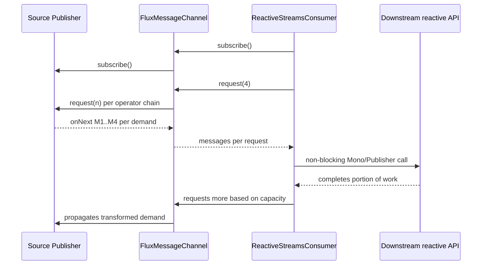
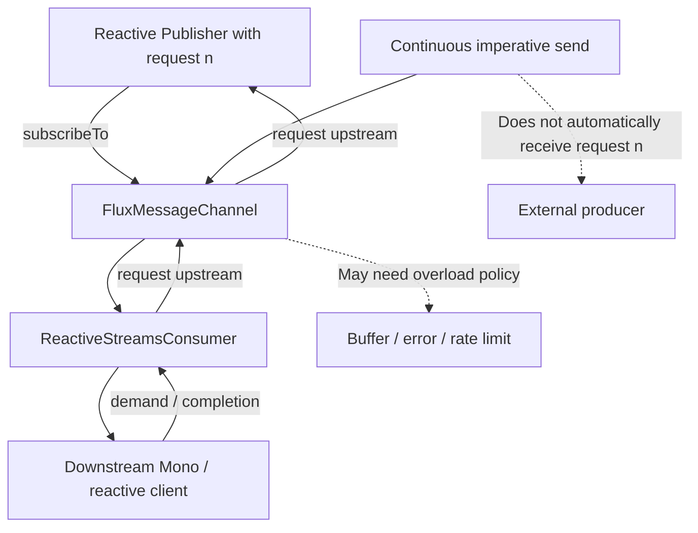
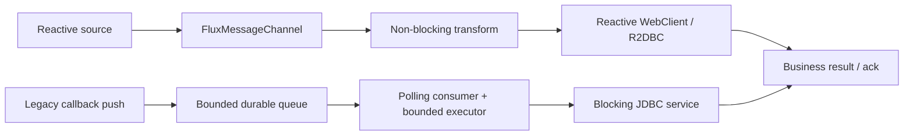

# Choosing a Reactive Runtime When Downstream Supports Backpressure in Spring Integration

## 1. The Problem to Solve: The Source Is Faster Than the Target

In the `SPRING_INTEGRATION_RUNTIME` module, Spring Integration coordinates messages across **channels, endpoints, consumers, pollers, and executors**, while handling transactions, retries, message stores, errors, correlation, and runtime state. The same flow can run on an **imperative push** model or combine **Reactive Streams**. Choosing a reactive runtime should begin with one question: **does downstream genuinely support requesting how many elements it can accept (backpressure), and can that signal propagate back to the source?**

Suppose an adapter reads events from a source capable of emitting 10,000 messages/second, while the target service processes only 1,000 messages/second:

- With unbounded push, the mismatch accumulates in `QueueChannel`s, executor queues, network driver buffers, or heap.
- If the source **exposes a Reactive Streams Publisher and truly honors `request(n)`**, downstream can throttle the rate of emitted messages.
- If the source is a callback/adapter unable to pause or slow down, merely adding `FluxMessageChannel` **does not turn it into an end-to-end backpressured source**.
- If a handler still invokes blocking JDBC or blocking HTTP on an event-loop, using Reactor APIs does not make that call non-blocking.

The goal is not "everything reactive," but **placing reactive boundaries precisely where both downstream and upstream honor demand**, while non-supporting stages use **bounded queues, overflow policies, concurrency limits, retries, and recovery**.

### Learning Outcomes

After this lesson, you should be able to:

1. Explain `Publisher`, `Subscriber`, `Subscription.request(n)`, and demand propagation paths.
2. Recognize boundaries where `FluxMessageChannel`, `ReactiveStreamsConsumer`, or a reactive adapter **preserves** or **loses** backpressure.
3. Use `IntegrationFlow`/`handleReactive` when downstream is a non-blocking API returning `Mono`/`Flux`.
4. Bound concurrency, prefetch, and memory; handle cases where the source cannot slow down.
5. Distinguish reactive `onError`/`cancel` from `errorChannel`, transactions, acks, retries, and idempotency.
6. Decide between **reactive, imperative, or hybrid** using runtime measurements, not merely API syntax.

## 2. Backpressure Is a Contract, Not a Channel Type

In Reactive Streams, a `Subscriber` receives a `Subscription` and calls `request(n)` to signal capacity for at most `n` more elements. The `Publisher` must not emit more `onNext` elements than unfulfilled demand. When downstream has no remaining demand, a compliant publisher must pause or pace emission accordingly.



This diagram is a **conceptual model**; operators such as `flatMap`, `publishOn`, and `limitRate` can **transform request amounts and prefetch**. Never assume a subscriber's request number passes verbatim through every component.

### Fundamental Concepts

| Concept | Runtime meaning | Extrapolations to avoid |
|---|---|---|
| `Publisher<T>` | Source able to emit `onNext`, `onError`, `onComplete` once subscribed | Having a Publisher does not prove external data supports real demand |
| `Subscriber<T>` | Consumer receiving `Subscription` and driving demand | Reactor's standard lambda `subscribe()` typically requests `Long.MAX_VALUE` |
| `Subscription.request(n)` | Signal requesting `n` additional elements | Not an API to grow a disk queue or retry messages |
| `Subscription.cancel()` | Cancels subscription and asks source to stop emitting | Does not roll back an already-committed HTTP/DB side effect |
| `Mono<T>` | Publisher emitting at most one item, or empty/error completion | Calling `Mono.just(blockingCall())` **still runs blockingCall immediately** |
| `Flux<T>` | Publisher emitting 0..N items | `Flux` does not mean every operator and adapter is non-blocking |
| `Demand / in-flight` | Open requested count vs. tasks currently executing | Demand, concurrency, and queue capacity are **three distinct quantities** |

The backpressure contract avoids forcing consumers into unbounded buffers in async models, yet **does not promise constant memory across the entire system**: operators still have prefetch and buffers; producers might ignore demand; concurrent in-flight requests can hold large payloads; and error/retry/tracing paths still consume resources.

## 3. Decision Rules: When to Choose Reactive?

Choose a reactive runtime when **all** of these key conditions hold together:

1. **The source can be throttled**: a `Publisher` from a reactive driver, a properly bridged polling source, or an adapter whose receive/ack pace can be controlled.
2. **The path preserves reactive semantics**: using `FluxMessageChannel`/`ReactiveStreamsConsumer` or verified bridges, avoiding accidentally reverting to unbounded push mid-way.
3. **Downstream yields results truly asynchronously**: Reactor Netty, WebFlux, R2DBC, reactive MongoDB, or Publisher-based clients; no `block()` calls on event-loops.
4. **Memory and concurrency are bounded**: defined in-flight caps, prefetch, queues, timeouts, overload handling, and metrics.
5. **Clear recovery contract**: what subscription cancellation or disconnects mean for unacked messages, transactions, retries, and idempotency.

If one of these conditions fails, **imperative or hybrid** is usually safer and easier to diagnose.

| Scenario | Option to evaluate | Why |
|---|---|---|
| Source is a reactive Publisher; target is demand-capable WebClient/R2DBC | Reactive flow with `FluxMessageChannel` and reactive endpoints | Enables end-to-end demand propagation, cutting push-induced buffer buildup |
| Non-reactive source pollable on schedule; reactive target | Reactive polling bridge or hybrid | Aligns message fetches with demand, though `receive()` semantics must be tested |
| Unthrottled push callback source; reactive target | **Bounded buffer** boundary + source flow control if available | Downstream cannot stop a backpressure-unaware source with `request(n)` alone |
| Handler uses blocking JDBC or synchronous file I/O | Imperative bounded executor/poller or hybrid isolating blocking | Reactor APIs do not turn blocking I/O non-blocking |
| Work requires large, sequential thread-bound JDBC transactions | Imperative `@Transactional` on consumer thread | Imperative transactions and reactive schedulers do not share context automatically |
| High throughput needed with many concurrent non-blocking I/O calls | Reactive, measuring concurrency/prefetch and saturation | Resource utilization gains can be substantial when I/O wait dominates |
| Target needs strict ordering per customer/correlation | Reactive with key partitioning/`concatMap` or serialized imperative consumer | `flatMap` can reorder completion without explicit ordering design |

**Practical trade-off:** at 100 events/minute with lightweight JDBC, an imperative model with clear transactions is usually simpler to operate. Reactive adds requirements to observe subscriptions, cancellations, schedulers, buffers, and resource cleanup. Decide using measurements of concurrency, I/O wait, and backlogs.

## 4. How FluxMessageChannel Differs from DirectChannel, ExecutorChannel, and QueueChannel

Spring Integration provides multiple channel implementations; channel properties determine execution paths.

| Channel | Primary mechanism | Backpressure/demand | Thread boundary | Durability |
|---|---|---|---|---|
| `DirectChannel` | Synchronous delivery to handler on producer's call stack | Throttles producer via synchronous processing time; **not** Reactive Streams demand | Usually same thread | Stores no backlog |
| `ExecutorChannel` | Hands message off to `TaskExecutor` | Governed by executor capacity/rejection; no end-to-end `Subscription.request(n)` | Shifts to executor thread | Executor queues are typically non-durable |
| `QueueChannel` | Stores messages for polling consumers | Has capacity/`sendTimeout`, not Reactive Streams demand | Decouples producer and poller | Depends on `MessageStore` |
| `FluxMessageChannel` | `MessageChannel` that is also `Publisher<Message<?>>` and `ReactiveStreamsSubscribableChannel` | Can link upstream Publishers to downstream Subscribers by demand | Follows operators/schedulers; does not switch threads by default | Does not automatically become a persistent queue |

`FluxMessageChannel` is **neither a standard `SubscribableChannel` nor a `PollableChannel`**. Reactive consumers attach via the `Publisher`/`Subscriber` contract, with `ReactiveStreamsConsumer` bridging Spring Integration endpoints.

### The Two Entry Points into FluxMessageChannel Are Not Equivalent

- **`subscribeTo(Publisher<? extends Message<?>>)`:** connects an upstream Publisher so the channel subscribes when ready; demand can propagate back via Reactive Streams.
- **`send(Message<?>)`:** an imperative caller pushes a message into the channel. Calling `send()` **does not turn into a reactive Publisher honoring `request(n)`** merely because the target is a `FluxMessageChannel`. For bursty pushes, verify your version's buffering, overflow/rejection semantics, producer rate limits, and source backpressure.



Exact reactive behavior depends on components and operators: there is no "automatic end-to-end backpressure" if a handler behind the channel pushes results into an unbounded queue or makes blocking calls unable to honor demand.

## 5. How Do ReactiveStreamsConsumer and Reactive Handlers Execute?

In Spring Integration, `ReactiveStreamsConsumer` connects Reactor subscriber semantics to endpoints/`MessageHandler`s. The core difference: **when using a reactive source and a Publisher-returning handler**, work can be composed into the stream rather than subscribed separately per message.

### 5.1. ReactiveMessageHandler

`ReactiveMessageHandler` returns a `Mono<Void>` describing asynchronous work. Example:

```java
@FunctionalInterface
public interface AsyncWorkClient {
    reactor.core.publisher.Mono<Void> execute(WorkRequest request);
}
```

If this handler is used inside an **imperative flow**, Spring Integration must subscribe to the result in an adapter to execute it; at that point, end-to-end demand across a reactive graph cannot be inferred. When input, output, and consumer are all reactive, the framework can compose the publisher into the flow so downstream throttles it.

Spring Integration 6.1+ includes the `handleReactive(...)` DSL for terminal handlers. For adapters calling external systems, ensure an **actual reactive client** is used rather than relying on a fake `Mono` return type.

### 5.2. Mono/Flux Replies

A service activator can return `Mono<Reply>` or `Flux<Reply>`. When the output is a `ReactiveStreamsSubscribableChannel` (such as `FluxMessageChannel`), Spring Integration can flatten/react according to demand. If the output is an imperative channel, results may be handled via async support or wrap the Publisher as payload; **never assume every `Flux` is subscribed/flattened identically on every output channel**.

With a gateway returning `Mono<?>`, request–reply execution can be deferred until a subscriber subscribes. However, **not every downstream branch behind the gateway is reactive**, especially if blocking JDBC or non-demand-aware adapters are involved.

### 5.3. Using Reactive Endpoints on Regular Channels

Since Spring Integration 5.5, the endpoint DSL offers `reactive()`, matching `@Reactive` on messaging annotations such as `@ServiceActivator`. This option puts an endpoint on a `ReactiveStreamsConsumer` even if the input channel is not `FluxMessageChannel`.

**Limitation:** switching a `DirectChannel` to a subscriber bridge **does not give an imperative caller `request(n)`**; you have created a hybrid boundary and must size its capacity and buffer/cancel policies.

## 6. Spring Boot + Spring Integration Example: Non-Blocking Mono Downstream

Example using Spring Boot, Spring Integration **6.1+**, Reactor Core, and Java 17+. The code simulates an asynchronous downstream with `Mono.delay()` so the pipeline can be observed without network calls; it **does not** represent real transactions or clients. In production, substitute reactive clients like `WebClient`/R2DBC or appropriate adapters.

Complete single Java class:

```java
package example.integration;

import java.time.Duration;

import org.springframework.boot.ApplicationRunner;
import org.springframework.boot.SpringApplication;
import org.springframework.boot.autoconfigure.SpringBootApplication;
import org.springframework.context.annotation.Bean;
import org.springframework.integration.channel.FluxMessageChannel;
import org.springframework.integration.config.EnableIntegration;
import org.springframework.integration.dsl.IntegrationFlow;
import org.springframework.messaging.Message;
import org.springframework.messaging.support.MessageBuilder;

import reactor.core.publisher.Flux;
import reactor.core.publisher.Mono;

@SpringBootApplication
@EnableIntegration
public class ReactiveRuntimeDemo {

    public record WorkRequest(String eventId) {}

    @FunctionalInterface
    public interface ReactiveWorkClient {
        Mono<Void> process(WorkRequest work);
    }

    @Bean
    public FluxMessageChannel reactiveWorkIn() {
        return new FluxMessageChannel();
    }

    @Bean
    public ReactiveWorkClient reactiveWorkClient() {
        return work -> Mono.delay(Duration.ofMillis(80))
                .doOnNext(tick ->
                        System.out.println("Completed " + work.eventId()
                                + " on " + Thread.currentThread().getName()))
                .then();
    }

    @Bean
    public IntegrationFlow reactiveWorkFlow(
            FluxMessageChannel reactiveWorkIn,
            ReactiveWorkClient reactiveWorkClient) {

        return IntegrationFlow.from(reactiveWorkIn)
                .handleReactive(message ->
                        reactiveWorkClient.process(
                                (WorkRequest) message.getPayload()));
    }

    @Bean
    public ApplicationRunner publishAfterStartup(
            FluxMessageChannel reactiveWorkIn) {

        return args -> {
            Flux<Message<?>> source = Flux.range(1, 100)
                    .doOnRequest(n ->
                            System.out.println("Publisher requested " + n))
                    .map(i -> (Message<?>) MessageBuilder
                            .withPayload(new WorkRequest("evt-" + i))
                            .build());

            // Connect a Publisher; do NOT loop 100 times calling send().
            reactiveWorkIn.subscribeTo(source);
        };
    }

    public static void main(String[] args) {
        SpringApplication.run(ReactiveRuntimeDemo.class, args);
    }
}
```

### 6.1. What Is Demonstrated

1. `reactiveWorkIn` is both a `MessageChannel` and a reactive `Publisher<Message<?>>`.
2. `IntegrationFlow.from(reactiveWorkIn)` attaches a reactive endpoint to the channel; `handleReactive(...)` executes `Mono<Void>` upon subscription.
3. `publishAfterStartup` connects an upstream `Flux` via `subscribeTo(source)`, letting the framework coordinate demand with the downstream subscriber.
4. `Mono.delay` simulates **non-blocking** I/O; the program uses neither `Thread.sleep` nor `Mono.block` inside the handler.
5. `doOnRequest` exposes demand emitted from downstream; printed values may be **batched/prefetched** by operators rather than strictly 1 per message.

**Do not interpret "subscribeTo succeeded" as all 100 events finished.** Subscription and processing follow publisher/endpoint lifecycles and may still be running after the source-setup callback returns. `Mono<Void>` completing only proves the mock handler finished; production business logic still requires ack/commit.

### 6.2. Why Doesn't the Example Explicitly Specify Max Concurrency?

`handleReactive` wires the handler into the framework, while in-flight work depends on how `ReactiveStreamsConsumer` coordinates the source, concurrency, prefetch, and operators. To enforce a **cap directly visible in code**, Section 7 looks at a pure Reactor pipeline. Do not infer "80 ms Mono.delay" means exactly 1 or exactly 8 concurrent requests automatically.

### 6.3. Dependencies and Versions

The example uses:

- `spring-integration-core` (typically via `spring-boot-starter-integration`) and a compatible Spring Boot version.
- Reactor Core via compatible Spring Integration/runtime dependencies.
- Java 17+.
- `handleReactive` was introduced in Spring Integration **6.1**; on 5.x/6.0, replace with corresponding `ReactiveMessageHandler`/endpoint configuration.
- When replacing the mock with WebClient or R2DBC, add the actual client/driver dependencies.

**This is an illustrative flow**, not a durable job queue. `Flux.range` is recreated on every run; if the app dies before finishing, nothing records offsets/acks from this mock source.

## 7. Setting Bounded Concurrency, Prefetch, and Demand

`flatMap` enables multiple asynchronous tasks in flight. Reactor offers `flatMap(mapper, concurrency)` and `flatMap(mapper, concurrency, prefetch)`. `concurrency` caps active inner publishers, while total memory also depends on buffers/prefetch, payload sizes, inner publishers, and target systems.

Standalone Reactor example assuming an existing `Flux<Message<?>> publisher`:

```java
import java.time.Duration;
import org.springframework.messaging.Message;
import reactor.core.publisher.Flux;
import reactor.core.publisher.Mono;

Flux<Message<?>> processed = publisher
        .flatMap(message ->
                Mono.delay(Duration.ofMillis(80))
                        .thenReturn(message),
                8)                      // at most 8 active inner publishers
        .limitRate(16);                 // shapes upstream request batching

processed
        .doOnNext(message ->
                System.out.println("Processed " + message.getHeaders().getId()))
        .doOnError(error -> System.err.println("Failure " + error))
        .subscribe();
```

This snippet is **not wired into Section 6's flow**; it illustrates pure Reactor mechanics to explain `concurrency`/`limitRate`. The `publisher` variable is an upstream `Flux<Message<?>>` supplied by the application.

**Three distinct limits:**

| Concept | What it controls | What it does NOT guarantee |
|---|---|---|
| `flatMap(..., 8)` | Max 8 inner publishers subscribed concurrently at that operator | Does not cap overall buffers, message sizes, or concurrency across other pipelines |
| `prefetch` | Elements proactively requested by an operator per its policy | Not a byte limit for heap or Redis/JDBC queues |
| `limitRate(16)` | Splits large requests into smaller upstream request batches | Not a token bucket/rate limiter of exactly 16 requests/second |
| `concatMap` | Processes/emits inner publishers sequentially | Can reduce throughput when I/O latency is high |
| `onBackpressureBuffer(capacity)` | Bounded buffer for push sources/non-demand segments | Does not stop external callbacks from emitting; overflow needs a policy |

If business rules require per-key ordering, partition by key/correlation and serialize within each partition. `flatMap` does not preserve **completion** order when requests have different latencies; `flatMapSequential` preserves output order while still running inner publishers concurrently and buffering early results.

### 7.1. Demand Does Not Equal a Fixed Rate

If downstream processes only `μ` events/second, operator demand can slow the source **if the source cooperates**. It is not rate limiting: a subscriber can request 32 elements and process them in a burst; spikes still happen within the requested window.

For downstream APIs with quotas (e.g., 200 calls/second), beyond backpressure you also need **rate limiters**, concurrency caps, retry backoff, and timeout protection. If the source ignores demand, define explicit overflow boundaries rather than unbounded buffers.

## 8. When Downstream Does Not Support Backpressure, How Do You Design a Hybrid?

Three scenarios to recognize:

### 8.1. Sources That Cannot Stop

A legacy library callback continuously calling `send(message)` can push faster than downstream processes. `FluxMessageChannel` presents a Publisher on the consuming side, yet the callback producer **does not receive `Subscription.request(n)`**.

Viable solutions:

- Use the driver's pause/resume API if available, or poll only while consumers have capacity.
- Apply bounded queues/buffers with **caps by message count and bytes**, timeouts, and overflow policies (reject/drop only when business rules allow).
- Use a durable broker or `JdbcChannelMessageStore` if messages must not be lost on overflow or restart.
- Instrument `rejected`, `oldestBacklogAge`, `bufferUsed`, `producerLag`, `inFlight`, and alert per SLA.
- When sources can replay, controlled rejection and protocol-compliant ack/nack can be safer than unbounded in-memory buffers.

**Never blindly use zero-arg `onBackpressureBuffer()`** on production streams with unknown load. Unbounded buffers shift pressure from downstream into heap, risking OOM. With `onBackpressureDrop`/`Latest`, confirm business rules permit dropping skipped events; never use them for payments or non-reconstructible commands.

### 8.2. Downstream Still Has Blocking JDBC

Calling JDBC directly inside a Reactor event-loop blocks threads, inflating latency across unrelated streams. When the driver cannot yet be replaced:

```java
import reactor.core.publisher.Mono;
import reactor.core.scheduler.Schedulers;

Mono<Receipt> bridgeBlockingJdbc(String eventId) {
    return Mono.fromCallable(() -> legacyJdbcService.loadReceipt(eventId))
            .subscribeOn(Schedulers.boundedElastic());
}
```

This illustration assumes `Receipt` and `legacyJdbcService` are application-defined. `boundedElastic` **isolates** the blocking call from event-loops and bounds resources per scheduler config; it **does not make JDBC non-blocking**. Measure thread/queue saturation, connection-pool capacity, and max `flatMap` subscriptions; a blocking call timing out in Reactor is not necessarily aborted in the driver.

If business logic needs an atomic JDBC transaction, keep all related statements inside a service running on **the same assigned blocking thread**, using `@Transactional` via proxy. Never assume a current thread's ThreadLocal transaction automatically carries across `publishOn` or `subscribeOn`.

### 8.3. Mixed Sources and Targets

A realistic architecture can look like:



There is no need to force both branches to be reactive merely for code uniformity. Choose bridges by **source/target contract**—using reactive for non-blocking HTTP alongside imperative for JDBC transactions.

## 9. Pollers and Publishers: How Far Does Demand Reach Upstream?

A typical `SourcePollingChannelAdapter` relies on a `TaskScheduler` to call a `MessageSource` on schedule. When the output is a `ReactiveStreamsSubscribableChannel`, Spring Integration provides a trigger/poll-driven publisher mechanism, allowing downstream subscriptions/demand to pace message retrieval.

`ReactiveMessageSourceProducer` can also wrap a `MessageSource` into a reactive-style source via repeated `Mono` resubscriptions, using an appropriate scheduler to avoid blocking reactive threads when polling blocking sources. This is a **bridge** coordinating demand, not proof that the underlying JDBC/file source has a native reactive API.

Mandatory boundaries to check:

- `receive()` on a source can **have side effects**: popping a queue, claiming a file, acking a broker, or committing an offset; if the subscriber cancels, already-executed operations may be irreversible.
- Pollers have `maxMessagesPerPoll`, triggers, and transaction advice; messages polled per cycle differ from subscriber demand counts.
- With an in-memory `QueueChannel`, restarts lose backlog; reactive channels do not replace persistence.
- When a JDBC transaction opens on the poller thread while results move across a reactive scheduler/executor, the transaction **does not automatically extend** downstream.
- When `MessageSource` returns `null` (no data), retry spacing and delays depend on the bridge/policy; avoid busy loops on empty sources.

Read the exact documentation for the **adapter** in use (JDBC, FTP, Kafka, HTTP, RSocket, MongoDB, R2DBC, etc.) to verify when messages are acked, whether pause/resume exists, whether native reactive APIs exist, and whether real backpressure is supported.

## 10. Subscriptions, Lifecycle, and Canceling Flows

In Reactor, **pipeline declaration** and **pipeline execution** are two distinct phases. A cold Publisher usually performs no event generation before subscription. Conversely, `FluxMessageChannel` holds an internal hot source/sink; calling `send()` can emit immediately at send time. Distinguish hot vs. cold when testing and designing startup:

| Action | What to understand |
|---|---|
| Declaring a cold `Flux`/`Mono` | Usually runs no work until `subscribe`; each subscription may re-run work |
| `subscribe()` | Starts execution; default lambda overloads typically request unbounded demand |
| `cancel()`/`Disposable.dispose()` | Cancels signal receipt, but does not roll back already-committed external resources |
| `onComplete` | Publisher finished emitting per contract; broker ack may not be done if source/handler contracts differ |
| `onError` | Terminal error of one subscription; retry/restart policies need a clear owner |
| ApplicationContext `stop()` / flow stop | Stops adapters/endpoints per lifecycle; does not erase persistent state or undo external requests |

Spring Integration's Java DSL offers `toReactivePublisher()` and `toReactivePublisher(boolean autoStartOnSubscribe)` to expose a flow as a Publisher and coordinate lifecycle. Dynamic flow registration requires checking startup/shutdown timing, subscriber cancellation, and multiple subscriptions on a hot Publisher.

**No subscriber ≠ no data needing storage.** With push sources or brokers, data may keep arriving upstream or in buffers. Know who holds messages while there is no demand or across restarts. `FluxMessageChannel` is not a durable message store.

## 11. Errors, Retries, and Cancellation Do Not Replace Rollback or Idempotency

The reactive signal model has three endings: `onComplete`, `onError`, and `cancel` (from downstream). A terminal error stops a subscription; in some flows, without recovery/retry, upstream stops emitting.

### 11.1. Scoped Retry Example

```java
import java.time.Duration;
import reactor.core.publisher.Mono;
import reactor.util.retry.Retry;

Mono<Receipt> callService(String businessId) {
    return webClientCall(businessId)
            .retryWhen(Retry.backoff(3, Duration.ofMillis(200))
                    .filter(this::isTransientFailure));
}
```

This snippet assumes `webClientCall` and `isTransientFailure` are application-defined. `retryWhen` **resubscribes** to the upstream publisher on error; if the producer has side effects, each attempt can re-run them. Retry only when operations have idempotency keys or duplicate-prevention mechanisms, failures are transient, and retry budgets are bounded.

**Distinguish:**

- Reactor `retryWhen`: resubscribes the reactive chain.
- Spring Integration `RequestHandlerRetryAdvice`: retries around a handler via advice chain.
- Broker redelivery: message re-arrives from source/ack mechanics, potentially after restarts.

Combining all three without bounds can multiply attempts unexpectedly. Track `attemptCount`, deadlines, backoff, and total attempt caps; always provide DLQ/quarantine/reconciliation paths for final failures.

### 11.2. Timeouts and Cancellation

`timeout(Duration)` can emit an error and cancel the subscription, yet **it does not guarantee the HTTP provider stopped** or the business DB rolled back. A server-side request may have committed before the client hit timeout. When retrying after a timeout, preserve the **business event ID/idempotency key**.

### 11.3. ErrorMessage vs. onError

In imperative message flows, handler errors can become `MessagingException`s sent as `ErrorMessage`s to `errorChannel` when an error publisher is wired. In a reactive subscription, errors travel as `onError` signals handled by `onErrorResume`, `doOnError`, or terminal subscribers. **Never assume every `onError` routes to the global `errorChannel`**.

With reactive source adapters, reject/ack semantics can depend on failed messages, `AcknowledgmentCallback`, and how the framework catches `MessagingException`. Verify explicitly:

1. Did the failure occur in the source adapter, mapper, reactive handler, output channel, or external API?
2. Is the error **propagated** as `onError`, converted to `ErrorMessage`, logged and swallowed, or retried?
3. Was an unprocessed message already acked? Can it replay or does it need a DLQ?
4. When a subscription cancels, how does the source stop, ack, or release claims?
5. When a flow restarts, is an idempotency marker protecting business side effects?

Never use `onErrorContinue` as a default way to ignore failures: it has specialized semantics and can lose upstream error context; to quarantine poison messages, classify errors and build an explicit recovery path.

## 12. Transactions in Reactive Flows: ThreadLocal vs. Reactor Context

In Spring's imperative transaction model, `PlatformTransactionManager` binds transactions to **the current thread**; `@Transactional` on a JDBC service only applies when invoked through a Spring proxy and kept within that thread boundary.

Reactive transactions use `ReactiveTransactionManager`, binding transactions to the reactive chain's **Reactor Context** rather than automatically inheriting from JDBC `ThreadLocal`. A chain using `publishOn`, `subscribeOn`, or multiple threads requires a transaction model matching its resources:

| Resource / call style | Suitable transaction model | Warning |
|---|---|---|
| Blocking `JdbcTemplate` | `PlatformTransactionManager` + service invoked on a proper blocking thread | Never push JDBC transactions onto an event-loop expecting non-blocking execution |
| Reactive R2DBC | `ReactiveTransactionManager`/`R2dbcTransactionManager` and reactive `@Transactional`/`TransactionalOperator` | Transaction covers only reactive operations sharing that context/resource |
| Reactive WebClient to external services | Outside local JDBC/R2DBC transactions | Target APIs must support idempotency/compensation |
| Broker ack/offset | Adapter-specific ack/transaction protocol | Never treat `Mono` completion as a durable ack if the adapter doesn't commit |

Reactor-style R2DBC transaction fragment (requires `TransactionalOperator` and a reactive repository):

```java
Mono<Void> saveInTransaction(OrderEvent event) {
    return reactiveRepository.save(event)
            .then()
            .as(transactionalOperator::transactional);
}
```

This fragment uses application-supplied `OrderEvent`, `reactiveRepository`, and `transactionalOperator`; a real `ReactiveTransactionManager` must be configured over the R2DBC resource. It does not cover HTTP/email/broker acks unless a dedicated distributed mechanism is specifically designed and tested.

## 13. Sizing: Backpressure Does Not Replace Capacity Planning

When adopting reactive execution, measure **hidden queue depths and in-flight work**.

Suppose:

- `λ` is the average ingress event rate (events/second).
- `μ` is the target completion rate (events/second).
- `L` is the average latency of one downstream request (seconds).
- `C` is the number of concurrent in-flight requests allowed (concurrency).
- `S` is the average serialized payload size.

To reach target throughput `μ` at I/O latency `L`, a rough estimate via Little's Law is:

\[
C \gtrsim \mu \times L
\]

For example, if downstream finishes 500 events/second and each API call averages 100 ms, initial target concurrency is roughly **50** if client and server have capacity. This estimate **must be re-measured against latency distributions, quotas, CPU, and database pools**—it is not a fixed Spring Integration tuning knob.

If an uncontrolled source pushes at `λ = 1,000` while `μ = 500` for 60 seconds:

\[
B \approx \max(0,\lambda-\mu)\times 60 = 30.000 \text{ events}
\]

30,000 messages × 20 KiB ≈ 586 MiB of raw payload before heap, header, and buffer overhead. Demand only shrinks backlogs if it genuinely **throttles the source** or pushes backpressure into durable upstream storage; annotations cannot erase a sustained rate mismatch.

### Essential Metrics

| Metric | Explanation |
|---|---|
| `source_requested_total`, `source_emitted_total` | Does the publisher honor demand and emit matching counts? |
| `inflight_async_operations` | How many downstream requests are currently waiting? |
| `flatmap_buffered` / queue size | Are buffers/prefetches hiding behind average throughput? |
| `p95/p99_processing_latency` | Latency under overload, not just mean throughput |
| `scheduler_queued_tasks`, `boundedElastic_active_threads` | Is a blocking source saturating a fallback thread pool? |
| `channel_send_failed`, `overflow_total` | Are push producers being rejected/dropped when downstream slows? |
| `retries_total`, `duplicates_total`, `dlq_total` | Are failures/cancellations replaying messages or duplicating side effects? |
| `oldest_unacked_age`, `pending_ack_count` | Is broker/queue recovery stalling after restarts? |
| `error_signal_total`, `subscription_cancel_total` | Why are reactive subscriptions terminating? |

These metric names are **application instrumentation suggestions**, not auto-generated Spring Integration Micrometer metrics. Attach business correlation IDs (without secrets) to trace messages across schedulers and adapters.

## 14. Hands-On Demand Verification: StepVerifier and Bounded Subscribers

### 14.1. Testing a Cold Publisher Before Wiring It into a Flow

Example using `reactor-test`:

```java
import reactor.core.publisher.Flux;
import reactor.test.StepVerifier;

Flux<Integer> source = Flux.range(1, 10)
        .doOnRequest(n -> System.out.println("upstream requested " + n))
        .doOnCancel(() -> System.out.println("cancelled"));

StepVerifier.create(source, 0)
        .thenRequest(1)
        .expectNext(1)
        .thenRequest(2)
        .expectNext(2, 3)
        .thenCancel()
        .verify();
```

`initialRequest = 0` proves no `onNext` occurs until the subscriber explicitly requests; this tests **basic Reactor demand**, not whether a broker/JDBC adapter honors end-to-end demand.

### 14.2. Subscriber Requesting One Message at a Time

A subscriber using `BaseSubscriber` can pace demand:

```java
import org.reactivestreams.Subscription;
import org.springframework.messaging.Message;
import org.springframework.messaging.support.MessageBuilder;
import reactor.core.publisher.BaseSubscriber;
import reactor.core.publisher.Flux;

Flux<Message<?>> stream = Flux.range(1, 10)
        .map(i -> (Message<?>) MessageBuilder
                .withPayload("item-" + i).build());
stream.subscribe(new BaseSubscriber<Message<?>>() {

    @Override
    protected void hookOnSubscribe(Subscription subscription) {
        request(1);
    }

    @Override
    protected void hookOnNext(Message<?> message) {
        System.out.println("Received " + message.getHeaders().getId());
        request(1);
    }
});
```

`Flux.range` here is an illustrative cold Publisher; to test a real adapter, swap in the adapter's Publisher and measure `request(n)` at the source. **Warning:** this snippet only shows subscriber-side demand. If `hookOnNext` invokes an async API and **requests immediately** before the API finishes, it does not limit concurrent downstream tasks. To throttle by completion, compose with `flatMap(concurrency)` or request more **only after** the async task actually completes, while handling errors and cancellation properly.

### 14.3. Intentional Fault Injection

In Section 6's sample flow, replace the mock client with a `Mono` that delays or throws with controlled probability. Measure upstream demand, error signals, and actual processed counts after a subscription fails. Add bounded retries and compare attempt counts against business event IDs. Never run random fault injection in production; keep deterministic fault injection in tests.

## 15. Reactive Runtime Selection Playbook

Walk through these questions in order:

1. **Is the source a true Reactive Streams Publisher?** If not, does it provide pause/resume APIs, broker consumer flow control, or throttled polling?
2. **Can downstream return Mono/Flux without blocking?** If synchronous JDBC/file/HTTP remains, decide whether to isolate onto a bounded scheduler or stay imperative.
3. **Does demand cross every boundary?** Inspect `FluxMessageChannel`, `ReactiveStreamsConsumer`, output channels, splitters/aggregators, and adapters.
4. **How many messages/requests are in flight?** Bound concurrency, prefetch, buffer capacity, rates, and byte sizes.
5. **Where do errors go?** Distinguish `onError`, `errorChannel`, retry advice, redelivery, timeouts, and cancellation.
6. **When does the source ack?** Have business effects committed; could work replay after crash/timeout; is there a stable idempotency key?
7. **Are ordering and correlation mandatory?** `flatMap` can finish out of order; evaluate `concatMap`, partitioning, and message group state.
8. **Which transaction actually holds?** Thread-bound JDBC or Reactor Context R2DBC; are there executor/poller boundaries?
9. **Does stop/restart preserve unprocessed messages?** Use durable queues/stores or replay, never relying on in-memory channels.
10. **Do you have load-test evidence?** Compare throughput, heap, p95 latency, backlog age, and failure recovery between reactive and imperative setups.

### Final Decision Table

| Criterion | Reactive | Imperative / hybrid |
|---|---|---|
| Upstream Publisher honors real demand | Strong fit | Possible, though usually forfeits end-to-end throttling |
| Non-blocking downstream, high in-flight I/O | Strong fit | Consumes more threads if blocking-waiting |
| Large blocking JDBC transactions | Needs separate boundary; do not force onto event-loop | Usually clearer |
| Unthrottled push source | Insufficient without bounded buffers/overflow policies | Bounded queues/workers and recovery policies can be easier to control |
| Replay and durable delivery required | Still needs brokers/stores and idempotency | Also needs durable sources and idempotency |
| Team lacks tracing/subscription/error observability | Raises operational risk | Simpler model may be preferable first |

## 16. Runtime Verification Exercises

1. **Demand-driven publisher:** run Section 14's `StepVerifier`, observe `request(1)` then `request(2)`, and explain why the source did not emit all 10 items.
2. **Reactive flow:** run Section 6's Boot demo, observe `doOnRequest`, thread names, and total time for 100 events.
3. **Slow downstream:** increase `Mono.delay` from 80 ms to 500 ms; measure in-flight counts, throughput, buffers, and completion after stopping the flow.
4. **Swap source wiring:** replace `subscribeTo(source)` with an imperative `send(message)` loop in a test variant; verify why subscriber demand signals do not pace the producer loop.
5. **Concurrency:** run Reactor `flatMap` with 4, 8, and 32 inner subscriptions, measuring p95 latency and throughput; explain target saturation.
6. **Ordering:** give requests varying delays and compare `flatMap` vs. `concatMap` outputs. Use business keys/correlation to verify required ordering.
7. **Blocking calls:** put JDBC/`Thread.sleep` inside a Reactor operator in a test; observe scheduler saturation, then offload blocking work to `boundedElastic` (strictly as a bridge) and re-measure.
8. **Retries and idempotency:** make the client fail transiently and apply bounded retries; verify the same event ID never creates duplicate side effects.
9. **Cancel and restart:** cancel a subscription while tasks are in flight and restart the app; explain which messages need retry/ack on a real source and why an in-memory demo cannot guarantee recovery.
10. **Transactions:** compare a `@Transactional` JDBC handler on `boundedElastic` with a Reactor Context R2DBC transaction; identify commit/rollback scopes.

For each exercise, record at minimum: **source type**, demand and request logs, in-flight count, scheduler/thread, processing duration, queue/overflow, `onError`/`cancel`, ack/retry, and final business outcome. That evidence determines whether a reactive runtime genuinely improves your system.

## 17. Rules to Remember

- Choose **a reactive runtime for backpressure** only when both source and downstream coordinate via `request(n)`, not simply because an API returns `Flux`/`Mono`.
- `FluxMessageChannel` is a `Publisher<Message<?>>` and `ReactiveStreamsSubscribableChannel`; use `subscribeTo(Publisher)` to connect reactive sources. An imperative `send()` producer **does not automatically honor demand**.
- `ReactiveStreamsConsumer` and `handleReactive` compose reactive handlers, yet end-to-end effectiveness depends on **all intermediate adapters and endpoints**.
- `flatMap(concurrency)`, prefetch, `limitRate`, and bounded buffers are **distinct tools**; never rely on a single parameter to claim the system cannot overload.
- Blocking JDBC/sync HTTP stays blocking inside a `Mono`. Use bounded schedulers for isolation or genuine reactive drivers; distinguish ThreadLocal JDBC transactions from Reactor Context reactive transactions.
- `onError`, cancellation, timeouts, retries, `errorChannel`, and broker acks have **different contracts**; verify idempotency and crash recovery.
- Reactive does not replace durable message stores, DLQs, correlation, or observability. Evaluate using **throughput, p95/p99 latency, in-flight counts, backlogs, errors, and recovery**, not code style alone.

### Official References

- [Spring Integration Reference — Reactive Streams Support](https://docs.spring.io/spring-integration/reference/reactive-streams.html): `FluxMessageChannel`, `ReactiveStreamsConsumer`, reactive handlers/adapters, gateways, source polling, and Java DSL.
- [Spring Integration Reference — Message Channels](https://docs.spring.io/spring-integration/reference/channel.html): `DirectChannel`, `ExecutorChannel`, `QueueChannel`, `FluxMessageChannel`, and processing boundaries.
- [Spring Integration Reference — Annotation Support](https://docs.spring.io/spring-integration/reference/configuration/annotations.html): `@Reactive` and endpoint configuration.
- [Spring Integration Javadoc — FluxMessageChannel](https://docs.spring.io/spring-integration/api/org/springframework/integration/channel/FluxMessageChannel.html): `subscribeTo`, `subscribe`, and lifecycle.
- [Project Reactor Reference — Backpressure](https://projectreactor.io/docs/core/release/reference/subscribe-backpressure.html): `request(n)`, `limitRate`, prefetch, `BaseSubscriber`, and demand shaping.
- [Project Reactor Reference — Schedulers](https://projectreactor.io/docs/core/release/reference/coreFeatures/schedulers.html): `boundedElastic` and isolating blocking work.
- [Spring Framework Reference — Reactive Transaction Management](https://docs.spring.io/spring-framework/reference/data-access/transaction/programmatic.html): reactive transactions and `TransactionalOperator`.
