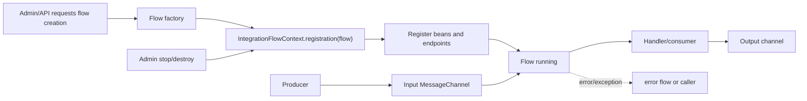
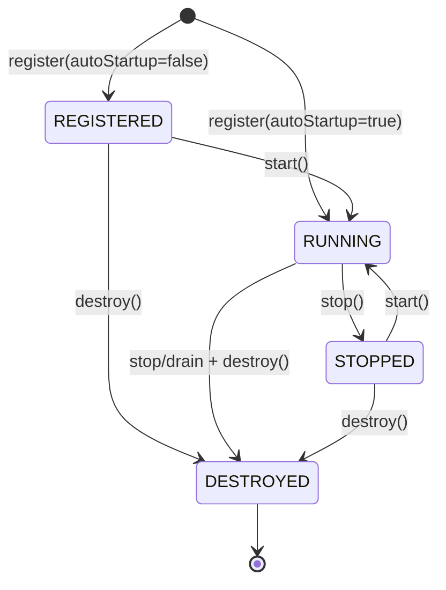
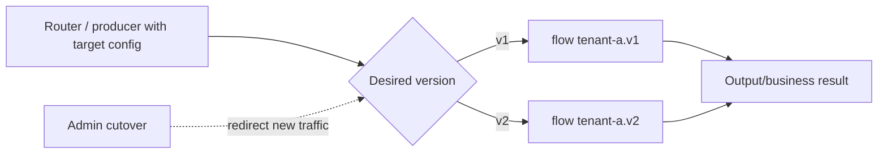
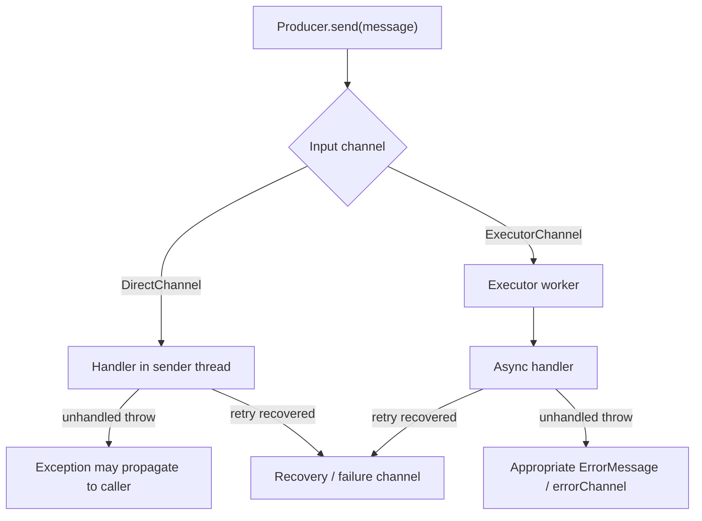
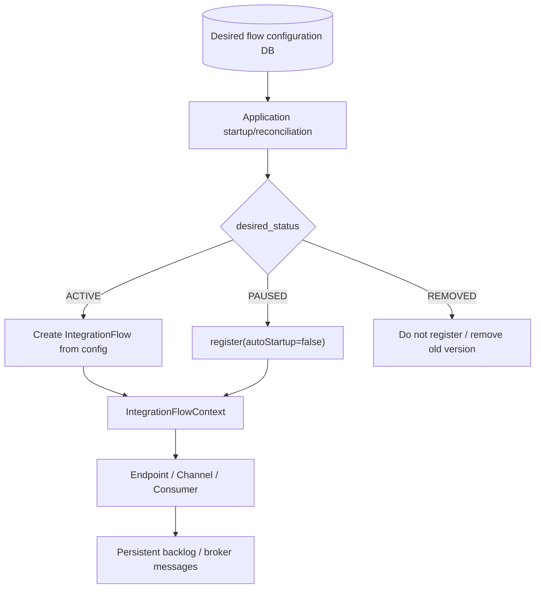

# Registering Channels, Endpoints, and Flows at Runtime in Spring Integration

## 1. Why Do We Need a Dynamic Runtime?

Normally, Spring Integration builds `MessageChannel`s, consumer endpoints, and `IntegrationFlow`s when the `ApplicationContext` starts up. However, there are systems where the number of flows or their configurations are only known **after startup**:

- A multi-tenant SaaS platform allows customers to add or pause SFTP, FTP, TCP, or JMS connections on demand.
- An administrator enables a new order-processing route without restarting the entire service.
- An application creates one flow per partner, with dedicated endpoints, credentials, filters, and output channels.
- A subscription or `Publisher<Message<?>>` source only exists while a user registers a processing session.
- When a partner stops collaborating, the application must **stop, release resources, and remove the flow** without affecting other tenants.

In the **Dynamic runtime** chapter of the **SPRING_INTEGRATION_RUNTIME** module, the lesson **"Registering Channels, Endpoints, and Flows at Runtime"** focuses on using the proper Spring Integration APIs to configure, register, operate, stop, and remove components in an already-running application context.

The goal is not merely to "create more beans." A proper solution must also answer:

1. Which channel receives messages, and which endpoint subscribes to or polls it?
2. Do beans, flows, and endpoints have **unique identifiers**?
3. When adding or removing a flow, how are in-flight messages managed?
4. Do retries, transactions, `errorChannel`, executors, and message stores still preserve the right semantics?
5. Which state must survive a restart, and what rebuilds the flows after a restart?

> **Principle:** Dynamic flow registration is different from persistent flow storage. `IntegrationFlowContext` manages **runtime beans and lifecycle** in the current JVM; it does not automatically persist flow definitions to a database to self-recover after a restart.

## 2. Three Levels of Runtime Changes

Not every dynamic requirement calls for recreating an entire `IntegrationFlow`.

| Need | Tool to Consider | Notes |
| --- | --- | --- |
| Enable or disable an existing endpoint | `SmartLifecycle`, `IntegrationFlowRegistration.start()/stop()` | Keeps the registration and beans intact |
| Add a subscriber/consumer to an existing channel | Register a new flow starting from that channel | Distinguish `DirectChannel` dispatch from `PublishSubscribeChannel` broadcast |
| Create channels, endpoints, handlers, and wire them into a new flow | **`IntegrationFlowContext.registration(flow).register()`** | Simplifies bean registration, dependencies, and lifecycle |
| Create a standalone channel bean that other systems look up by name | `GenericApplicationContext.registerBean(...)` or bean definition registry | You must manage naming, ownership, and cleanup yourself |
| Change the configuration of a running flow | Stop/register a new flow, controlled cutover | Not an atomic hot swap by default |
| Create multiple instances of the same flow template | `.id(flowId).useFlowIdAsPrefix()` | Reduces name collisions among internal beans/endpoints |
| Retain flows across restarts | Store **desired configuration** separately; rebuild at startup | In-JVM registrations are not automatically persistent |

When you need to register **both channels and endpoints** so they work together, start with `IntegrationFlowContext`. This mechanism is purpose-built for managing dynamic integration flows, rather than manually registering individual beans and calling `afterPropertiesSet()` and `start()`, which is error-prone.

## 3. What Components Make Up a Runtime Flow?

A flow is more than just a handler. When registering via the Java DSL, Spring Integration may also need:

- **Input channel:** the entry point receiving `Message<?>`; it can be created automatically or be an existing channel.
- **Endpoint:** for example, an `EventDrivenConsumer` for publish/subscribe-style channels or a polling consumer for a `PollableChannel`.
- **Message handler:** transformer, filter, router, service activator, gateway, or handler adapter.
- **Output/reply/error channel:** where results or error events are routed.
- **Source adapter or poller:** file, JDBC, TCP, broker, or publisher source; has its corresponding `SmartLifecycle`.
- **Support beans:** referenced connection factory, serializer, header mapper, retry advice, or transaction manager.
- **Executor/scheduler:** threads used for async boundaries or polling; has its own ownership and lifecycle.



Spring Integration creates **dependent beans** and performs the required initialization/lifecycle steps when registering a flow through the official API. However, "registered" does not mean messages have been processed or outputs have been committed.

## 4. Foundational API: IntegrationFlowContext

`org.springframework.integration.dsl.context.IntegrationFlowContext` is the primary API for registering and managing `IntegrationFlow` instances that are **not static configuration beans at startup**.

Workflow:

```text
IntegrationFlow flow = ... built with Java DSL ...;

IntegrationFlowRegistration registration =
    flowContext.registration(flow)
        .id("flow-unique-id")
        .useFlowIdAsPrefix()
        .autoStartup(true)
        .register();

registration.getInputChannel();
registration.getMessagingTemplate();
registration.start();
registration.stop();
registration.destroy();
```

In the code above, `IntegrationFlowRegistration` is a nested type inside `IntegrationFlowContext`; import `IntegrationFlowContext.IntegrationFlowRegistration`. `getInputChannel()` and `getMessagingTemplate()` are only appropriate if the flow starts from a `MessageChannel`. For flows starting with a `MessageSource`/inbound adapter or a source without that kind of input channel, calling these methods may throw an `IllegalStateException`.

### Key APIs

| API | Meaning |
| --- | --- |
| `registration(flow)` | Creates a builder for the flow to be registered |
| `.id(flowId)` | Specifies a unique flow ID within the application context |
| `.useFlowIdAsPrefix()` | Uses the flow ID as a prefix for internal bean names; requires declaring `id` |
| `.autoStartup(false)` | Registers the flow without automatically starting it |
| `.addBean(name, bean)` | Registers a support bean owned by the flow's lifecycle |
| `.setSource(source)` | Attaches a configuration source description to aid diagnostics |
| `.register()` | Registers the flow along with its dependent components; returns a registration |
| `registration.start()/stop()` | Controls the registration's lifecycle |
| `registration.destroy()` | Removes the flow and dependent beans owned by the registration |
| `flowContext.remove(flowId)` | Destroys the flow by ID and cleans up internal management caches |
| `flowContext.getRegistrationById(flowId)` | Looks up a registration if present |
| `flowContext.getRegistry()` | Inspects the mapping of registered flows |

**Version note:** Both Spring Integration 6.x and 7.x documentation describe the `IntegrationFlowContext` model; overloads and builder metadata vary by version. The examples in this lesson favor common APIs; if you use newer methods, check the Javadoc for your project's exact dependency version.

## 5. End-to-End Example: Creating an Order Normalization Flow at Runtime

This pattern creates a flow on demand without requiring a predefined `@Bean IntegrationFlow`. Each flow receives a `String`, normalizes its casing, and forwards it to a dedicated result `QueueChannel` for that flow.

### 5.1. Registration Manager Class

```java
import java.util.Locale;

import org.springframework.integration.channel.QueueChannel;
import org.springframework.integration.dsl.IntegrationFlow;
import org.springframework.integration.dsl.context.IntegrationFlowContext;
import org.springframework.integration.dsl.context.IntegrationFlowContext.IntegrationFlowRegistration;

public final class RuntimeFlowManager {

    private final IntegrationFlowContext flowContext;

    public RuntimeFlowManager(IntegrationFlowContext flowContext) {
        this.flowContext = flowContext;
    }

    public record FlowHandle(
            IntegrationFlowRegistration registration,
            QueueChannel resultChannel) {}

    public FlowHandle registerOrderNormalizer(String flowId) {

        // Each registration has its own dedicated result channel.
        QueueChannel results = new QueueChannel();

        IntegrationFlow flow = f -> f
                .<String, String>transform(
                        text -> text.strip().toUpperCase(Locale.ROOT))
                .channel(results);

        IntegrationFlowRegistration registration =
                flowContext.registration(flow)
                        .id(flowId)
                        .useFlowIdAsPrefix()
                        .autoStartup(true)
                        .register();

        return new FlowHandle(registration, results);
    }

    public IntegrationFlowRegistration find(String flowId) {
        return flowContext.getRegistrationById(flowId);
    }

    public void destroy(String flowId) {
        flowContext.remove(flowId);
    }
}
```

`RuntimeFlowManager` is an application service; it needs to be declared as a bean in the Spring context (e.g., `@Component` or `@Bean` in configuration) so that `IntegrationFlowContext` is injected. Admin permission checks, desired-state persistence, and synchronization of configuration requests will be added in the production section.

`IntegrationFlow flow = f -> ...` uses the lambda-style Java DSL: if no input channel is explicitly specified, the framework creates a suitable input channel for the flow to receive messages. The `results` output is an *in-memory* `QueueChannel`; it helps the lab wait for results, and is **not a persistent queue across restarts**.

### 5.2. Initializing the Manager in Spring

```java
import org.springframework.context.annotation.Bean;
import org.springframework.context.annotation.Configuration;
import org.springframework.integration.config.EnableIntegration;
import org.springframework.integration.dsl.context.IntegrationFlowContext;

@Configuration
@EnableIntegration
public class DynamicFlowsConfiguration {

    @Bean
    public RuntimeFlowManager runtimeFlowManager(
            IntegrationFlowContext flowContext) {
        return new RuntimeFlowManager(flowContext);
    }
}
```

`IntegrationFlowContext` is an infrastructure bean provided by Spring Integration; you do not need to manually instantiate a `StandardIntegrationFlowContext` outside the application context.

### 5.3. Sending Messages and Receiving Results

```java
import org.springframework.messaging.Message;
import org.springframework.messaging.support.MessageBuilder;

RuntimeFlowManager.FlowHandle handle =
        runtimeFlowManager.registerOrderNormalizer(
                "tenant-a.order-normalizer");

try {
    handle.registration()
            .getInputChannel()
            .send(MessageBuilder
                    .withPayload("  order-42  ")
                    .setHeader("correlationId", "checkout-42")
                    .build());

    Message<?> result = handle.resultChannel().receive(2000);

    if (result == null) {
        throw new IllegalStateException("No output in 2 seconds");
    }
    System.out.println(result.getPayload()); // ORDER-42

} finally {
    handle.registration().destroy();
}
```

**Expectation:** a flow is registered and auto-started, receives a message from its input channel, runs the transformer, forwards the result to the queue, and is destroyed in `finally`. You must not reuse the same `flowId` for two concurrent registrations; the ID must be unique within the context.

`receive(2000)` **consumes** the message from the `QueueChannel`; in production, do not use this operation merely to "peek" at a queue that needs to be retained for replay. For durable output, a persistent channel store and appropriate transactions are required.

## 6. Two Approaches to Dynamic Channel Registration

There are two main approaches, with different ownership consequences.

### 6.1. Channel as Part of a Dynamic Flow

When a flow uses `MessageChannels.direct()` or `MessageChannels.queue()` in the DSL, the framework creates the channel along with its associated endpoints, registers dependent beans, and can destroy them with the registration.

```java
import org.springframework.integration.dsl.IntegrationFlow;
import org.springframework.integration.dsl.MessageChannels;

// Standalone flow: the input channel is created by the DSL.
IntegrationFlow flow = IntegrationFlow
        .from(MessageChannels.direct())
        .filter((String value) -> !value.isBlank())
        .channel(MessageChannels.queue())
        .get();

// Register via flowContext.registration(flow).id(...).register()
```

In this example, `MessageChannels.queue()` creates an **in-memory pollable channel**. You must register a poller if you add a downstream handler reading from the queue; if the flow ends at the output queue, other code can use a suitable reference or bean to retrieve messages.

Pros: the registration owns the components it creates, making cleanup simpler. Cons: if the channel needs to be shared by multiple flows or outlive the current flow, it should not be treated as a resource strictly private to one registration.

### 6.2. Channel as a Shared Bean in the ApplicationContext

Suppose there is a long-lived `tenantEvents` channel, while subscribers are added/removed per tenant.

```java
import org.springframework.context.annotation.Bean;
import org.springframework.integration.channel.PublishSubscribeChannel;

@Bean("tenantEvents")
public PublishSubscribeChannel tenantEvents() {
    return new PublishSubscribeChannel();
}
```

We can dynamically create a flow starting from `tenantEvents`:

```java
import org.springframework.integration.channel.PublishSubscribeChannel;
import org.springframework.integration.dsl.IntegrationFlow;

// auditHandler is a shared MessageHandler/bean configured separately.
IntegrationFlow auditFlow =
        IntegrationFlow.from(tenantEvents)
                .handle(auditHandler)
                .get();

flowContext.registration(auditFlow)
        .id("tenant-a.audit-listener")
        .useFlowIdAsPrefix()
        .register();
```

When destroying the registration, the flow and endpoints belonging to the registration are stopped/removed. **A shared channel defined as an independent bean should not be deleted** just because one subscriber is removed. When managing lifecycle, distinguish **owned components** from **shared dependencies**.

### 6.3. Creating a Standalone Channel Bean After Startup

When you truly need to register a `MessageChannel` bean first so other flows can look it up by name, you can use Spring Framework's bean definition APIs, such as a `GenericApplicationContext`:

```java
import org.springframework.context.support.GenericApplicationContext;
import org.springframework.integration.channel.DirectChannel;
import org.springframework.messaging.MessageChannel;

public MessageChannel registerChannel(
        GenericApplicationContext context,
        String beanName) {

    // Simple example: called from a coordinator that already verified ID uniqueness.
    context.registerBean(
            beanName,
            DirectChannel.class,
            DirectChannel::new);

    return context.getBean(beanName, MessageChannel.class);
}
```

This is a **foundational Spring technique**, not a replacement for `IntegrationFlowContext`. It has limitations:

- Applies directly only when the application context supports the corresponding API; do not cast an arbitrary `ApplicationContext` to `GenericApplicationContext`.
- Bean names must be valid and unique; admin requests registering the same name must be synchronized.
- Creating a channel bean does not create a consumer. Sending to a `DirectChannel` with no subscribers can fail dispatch.
- If you want to remove the bean, you must follow proper procedures regarding referencing endpoints, bean definitions, singleton instances, and lifecycle; never delete a bean still used by another flow.
- For endpoints depending on a channel, **registering a dynamic `IntegrationFlow` is usually safer and easier to control**.

Spring Integration documentation notes that since Spring Framework 5, `BeanDefinitionBuilder.genericBeanDefinition(..., instanceSupplier)` can be used to register a bean definition instead of only calling `BeanFactory.registerSingleton()`. The bean definition approach lets Spring perform standard initialization/lifecycle steps.

## 7. Dynamic Endpoints: What to Understand About Consumers and Channels

When adding an endpoint to a running channel, the channel type determines **who receives the message**.

| Channel | If Two Consumers/Subscribers Exist | Suitable Use Case |
| --- | --- | --- |
| `DirectChannel` | Unicast dispatch: each message typically goes to **one** subscriber per dispatcher/load-balancing/failover policy | Two handlers sharing load, not broadcasting |
| `PublishSubscribeChannel` | Broadcasts each message to matching subscribers, as configured | Multiple listeners observing the same event |
| `ExecutorChannel` | Unicast dispatch via an executor; producer may return before the handler runs | Fanning out asynchronous processing work per endpoint |
| `QueueChannel` | Pollers/consumers compete to take messages via `receive()` | Work queue with one or more competing consumers |
| `FluxMessageChannel` | Reactive Streams subscribers with demand/cancellation | Reactive source/processor pipeline |

For example, if you expect **one** order message to reach both billing and audit, attaching two consumers to a `DirectChannel` may result in only one side receiving it. Use a `PublishSubscribeChannel` or an explicit router instead. Conversely, if audit is a mandatory side effect that can fail, synchronous publish-subscribe can expose upstream callers to the subscriber's exception; you must define your transaction/error policy.

### Endpoints Do Not Receive Messages Until Started

A static `@ServiceActivator` scanned at startup is an endpoint. A dynamic flow declaring `.handle(handler)` also creates an endpoint under the framework lifecycle. When a registration uses `autoStartup(false)`, the endpoint may be created but **not yet subscribed/polling**. Therefore:

```text
Bean exists       != endpoint running
Endpoint running  != handler has processed message
Message sent      != durable/business commit
```

If the input is a `QueueChannel`, messages may wait in the queue until the poller starts. If the input is a `DirectChannel` and there is no consumer yet, the send call can fail immediately. If using a source adapter, the connector may not open its connection or start listening until started.

## 8. Lifecycle: Registered, Started, Stopped, Destroyed

A dynamic flow should be operated according to a clear state machine:



This is an **application-defined governance model**, not an official enum on `IntegrationFlowRegistration`. Within the framework, `start()`/`stop()` delegate down to the lifecycle components inside the flow.

### Registering Without Opening Intake

```java
import org.springframework.integration.dsl.context.IntegrationFlowContext.IntegrationFlowRegistration;

IntegrationFlowRegistration registration =
        flowContext.registration(flow)
                .id("tenant-a.manual-flow")
                .useFlowIdAsPrefix()
                .autoStartup(false)
                .register();

// Beans may already be registered, but endpoints are not actively running yet.
registration.start();

// Can be paused temporarily.
registration.stop();

// When you truly want to remove the entire flow belonging to the registration:
registration.destroy();
```

`autoStartup` defaults to `true` when registering a dynamic flow. If set to `false`, the application is **responsible for calling `start()`** when it wants the flow active.

### Why Is `stop` Different From `destroy`?

- `stop()`: stops `SmartLifecycle` components while keeping the registration and beans; can be `start()`ed again.
- `destroy()`: removes the dynamic registration and the dependent beans it manages, rather than just pausing endpoints.
- `flowContext.remove(flowId)`: looks up the registration by ID and performs the corresponding destroy/cleanup.
- `close ApplicationContext`: shuts down the entire application, which also causes in-JVM dynamic registrations to disappear.

**Do not assume `stop` waits for all in-flight tasks to finish.** Some inbound endpoints may stop accepting new work while handlers already dispatched to an executor are still running. Guaranteeing graceful drain must be designed and tested against the actual adapter, scheduler, broker acknowledgments, and transactions.

## 9. Flow IDs, Bean Names, and Collisions Across Multiple Registrations

When creating multiple instances of a flow template, a common error is having internal endpoints/handlers share the same ID.

For instance, suppose two customers `tenant-a` and `tenant-b` both use a flow template declaring a handler with `.id("client")`. Registering those beans directly with that name can cause context collisions.

Spring Integration handles this cleanly with:

```java
flowContext.registration(buildFlow(tenantAConfig))
        .id("tenant-a.connector")
        .useFlowIdAsPrefix()
        .register();

flowContext.registration(buildFlow(tenantBConfig))
        .id("tenant-b.connector")
        .useFlowIdAsPrefix()
        .register();
```

The official documentation notes that `useFlowIdAsPrefix()` is useful when multiple flows share the same internal component IDs and **requires `.id(...)`**. For example, a handler named `client` can have its bean name prefixed with the flow ID.

Rules to enforce:

1. Flow IDs must be **unique within a context**; they are not merely UI labels.
2. Use a stable naming convention, such as `tenant.<tenantSlug>.connector.<version>`.
3. Never concatenate arbitrary user input directly into IDs/bean names; validate, bound length, and restrict characters.
4. Never register two active flows with the same ID; destroy the old registration before reusing that ID.
5. For shared channels/beans, do not rename or destroy them simply because a tenant flow changes.
6. If component names need to be queried in monitoring or management APIs, keep the convention stable across deployments.

**Do not write `if (getRegistrationById(id) == null) register(id)` and treat it as synchronized.** Two concurrent admin requests can both pass the check; design a coordination mechanism or allow one request to fail on duplicate ID and return an appropriate status.

## 10. Registering Support Beans Alongside a Flow

A dynamic connection may need a `ConnectionFactory`, serializer, header mapper, or client bean built from tenant configuration. `IntegrationFlowRegistrationBuilder.addBean(...)` lets you register a support bean as a **dependent component of the registration**.

```java
import org.springframework.integration.dsl.context.IntegrationFlowContext.IntegrationFlowRegistration;

// connectionFactory and flow are built from validated configuration,
// e.g., TCP/JMS/SFTP; this snippet only illustrates the builder API.
IntegrationFlowRegistration registration =
        flowContext.registration(flow)
                .id("tenant-a.remote-input")
                .useFlowIdAsPrefix()
                .addBean("tenant-a.clientResources", connectionFactory)
                .register();
```

When the flow is destroyed, dependent beans **owned by the registration** are cleaned up by the framework. However, never place a bean **shared across 10 flows** under one tenant's ownership just for lookup convenience; it could be destroyed when that single flow stops, breaking other tenants.

### Never Forget Resources Outside Spring

A dynamic connector can hold TCP sockets, JMS consumers, SFTP sessions, timer threads, or file watchers. Resources may require `stop()`/`destroy()` in the proper order and the adapter library's closing mechanism. Never just remove an entry from a `Map<String, IntegrationFlow>` and assume threads, sockets, and subscriptions have vanished.

## 11. Reconfiguring/Hot-Swapping a Flow While Receiving Messages

A practical requirement: change a partner's HTTP endpoint or payload transformation on an existing flow without restarting.

There are two approaches:

### 11.1. Stop–Destroy–Re-register Under the Same ID

```text
1. Pause accepting new messages for the tenant.
2. Wait for / coordinate in-flight messages according to SLA.
3. Stop the old registration.
4. Destroy the old registration, releasing dependent beans.
5. Register the new flow with the same ID and new configuration.
6. Start; reopen intake and monitor.
```

Pros: simple and easy ID management. Cons: incurs downtime and risks message loss or duplicates if durable sources, acks, transactions, and retries are not designed properly.

### 11.2. Blue/Green or Versioned Flow IDs



Workflow:

1. Register `tenant-a.v2` with a new ID before shifting primary traffic.
2. Verify health, connectivity, metrics, and schema for v2.
3. Route new messages to v2 via a coordinated router/configuration.
4. Let v1 drain per policy; once safe, stop/destroy v1.
5. Keep an audit trail of applied configurations and rollback steps.

**Do not treat cutover as atomic by default:** if routers read configuration asynchronously across multiple instances, there may be a window where traffic enters both versions. Define idempotency, correlation, and business ordering for concurrent execution. If v1 and v2 outputs write to the same business table, unique keys and transactions remain the final safeguard.

## 12. What Happens to In-Flight Messages When Destroying a Flow?

Suppose a producer sent a message to an `ExecutorChannel` and a worker is still processing it; an admin calls `registration.destroy()`.

What can happen:

- The endpoint stops accepting new messages, but already-dispatched tasks are still executing.
- A broker source has polled a message without acking yet; stopping the adapter affects requeue/redelivery depending on the transport.
- An active transaction may commit or roll back; removing the bean alone does not determine that outcome.
- If a dependent output channel/handler is removed before the task finishes, an in-flight call can fail dispatch.
- An in-memory `QueueChannel` owned by the flow can lose its backlog when the bean is destroyed.

Therefore, production procedures typically require a **drain protocol**:

```text
ACTIVE
  |
  v
QUIESCING: block new intake, retain sufficient resources for in-flight work
  |
  v
DRAINING: wait for in-flight work, deterministic ack/commit/rollback
  |
  v
STOPPED
  |
  v
DESTROYED: cleanup owned beans
```

These states represent **application operational design**, not built-in methods on `IntegrationFlowRegistration`. The framework provides start/stop/destroy; the application decides when it is safe to invoke them.

### If You Need "Zero Message Loss," You Need a Durable Handoff

`DirectChannel` and `ExecutorChannel` do not persist messages. A default `QueueChannel` only stores messages in RAM. For critical workloads, use a broker source with proper redelivery/ack, a persistent `QueueChannel` (e.g., `JdbcChannelMessageStore`), or a transactional inbox/outbox before allowing flow changes or destruction.

## 13. Dynamic Pollers, Adapters, and Executors

A dynamic flow can start from a polling source or an active listener.

### Polling Source

Example of a flow polling data every second:

```java
import java.util.concurrent.atomic.AtomicInteger;

import org.springframework.integration.dsl.IntegrationFlow;
import org.springframework.integration.dsl.Pollers;

AtomicInteger sequence = new AtomicInteger();

IntegrationFlow flow = IntegrationFlow.fromSupplier(
            sequence::incrementAndGet,
            e -> e.poller(Pollers.fixedDelay(1000)))
        .handle(message ->
            System.out.println("Polled: " + message.getPayload()))
        .get();

flowContext.registration(flow)
        .id("lab.counter-poller")
        .useFlowIdAsPrefix()
        .autoStartup(false)
        .register();
```

Before calling `start()`, the endpoint does not poll. Once started, the poller runs on the application's scheduler. If every tenant creates a poller, you must enforce resource budgets and flow limits. Registering 10,000 pollers on the same schedule can trigger a **polling storm**, even if each flow does very little work.

### Listening Source

With inbound TCP/JMS/RabbitMQ/SFTP, each dynamic flow may open connections/sessions or listener containers. Distinguish:

- Beans/connection factories **shared** across multiple flows must not be destroyed with a single flow.
- **Tenant-specific** resources are registered as owned support beans and cleaned up on destroy.
- Configuration of thread pools, schedulers, connection pools, and subscription limits.
- Credential rotation, authentication failures, and reconnect policies can leave a flow "running" while actually receiving no messages.

### Executor Boundary

If a flow includes an `ExecutorChannel`, the producer can return before the consumer completes. On stop/destroy, do not assume every task in the executor queue has been processed. If work cannot be lost, move it into a durable queue or ensure an explicit shutdown/retry protocol before destroying the endpoint.

## 14. Transactions, Retries, and Error Flows After Dynamic Registration

Registering the right beans is not enough to guarantee correct error handling. Each flow may involve:

- `RequestHandlerRetryAdvice` wrapping a handler.
- Poller transaction advice or container transactions.
- `ErrorMessage` / `errorChannel` header or global error channel.
- Failure channel, dead-letter sink, and persistent message store.
- Correlation IDs linking attempts, flow versions, and outcomes.

### `DirectChannel` vs. `ExecutorChannel` Differences



A dynamic flow using a `DirectChannel` can throw errors back to the caller when the handler does not catch them. A dynamic flow using an `ExecutorChannel` can publish errors from the worker thread to an error channel. If a retry advice sends an `ErrorMessage` to a recovery channel and returns normally, callers or outer metrics might consider the call "recovered" even though business processing did not complete.

When a flow is destroyed, a pending error consumer or DLQ writer may also be affected if it is a bean owned by the flow. For forensic/replay requirements, keep **durable failure records** in a system that does not disappear when a tenant connector is removed.

### Poller Transactions

If a polling source is configured with transactions, stopping mid-processing is subject to transaction boundaries and adapter-specific semantics. A recovery callback that swallows an exception can cause the transaction to commit; if rollback is required, the appropriate error must escape the boundary. Never assume all resources in a dynamic flow share a single transaction: brokers, JDBC, HTTP, and TCP each have different commit semantics.

## 15. What Is the Runtime Registry, and What Does It NOT Store?

`IntegrationFlowContext.getRegistry()` provides a mapping of flow IDs to registrations **in the current JVM**. This data is useful for observability and administration:

```java
import java.util.Set;
import org.springframework.integration.dsl.context.IntegrationFlowContext;

public Set<String> flowIds(IntegrationFlowContext flowContext) {
    return Set.copyOf(flowContext.getRegistry().keySet());
}
```

Under concurrent changes, treat this list as an **observational snapshot**; do not use it alone as the transactional source of truth for the configuration system. If a controller must report "flow active" under strict SLAs, you must also consider bean lifecycle, adapter readiness, and downstream health.

### The Runtime Registry Is Not Persistence

When the JVM restarts:

- A new `IntegrationFlowContext` is created.
- Flows dynamically registered in the previous session **do not reappear automatically**.
- Connections/sockets, poller timers, executor threads, and ephemeral reply channels no longer exist either.
- Messages in a broker or persistent `MessageStore` may **remain**, but will not be processed unless flows/pollers are rebuilt.

Therefore, you need a separate **desired state repository** for dynamic flow configurations.

## 16. Restoring Dynamic Flows After Restart

A simple production model:

```text
dynamic_flow_desired_state
  tenant_id
  flow_id
  flow_type
  config_version
  config_json / config_ref
  desired_status = ACTIVE | PAUSED | REMOVED
  updated_at
```

This is an **application schema**, not a table created automatically by Spring Integration.



Suggested startup workflow:

1. Migrate the database schema and ensure secrets/configurations are readable.
2. Read the approved set of desired flow configurations.
3. Validate versions, tenant permissions, flow ID names, and dependencies.
4. For `ACTIVE` configurations, register and start once adapters are ready.
5. For `PAUSED`, register with `autoStartup(false)`.
6. Rebuild pollers/reapers/retry schedulers and connect to persistent message stores if the flow requires state.
7. Reconcile the actual registry against desired state; alert on missing or extra flows.

If a user changes configuration while the application is restarting, you need a **reconciliation loop** (or event + version check) to avoid starting from a stale snapshot and overwriting newer requests. Multi-instance deployments must decide **whether every node registers the connector or only one node owns the connector**; never assume every tenant flow should run on every instance.

### Be Careful With Configuration Security

Never put plaintext passwords, tokens, or private keys into `setSource`, bean names, flow IDs, or exception logs. Store configurations securely, use a secret manager, restrict permissions to modify connectors, and validate target endpoints to prevent SSRF or connections to unauthorized hosts.

## 17. Concurrency When Multiple Admins Add/Remove Flows Simultaneously

Issues often occur not in handlers, but in the **control plane**:

| Race Condition | Consequence | Mitigation |
| --- | --- | --- |
| Two `register(sameId)` requests | One request hits an ID collision, partial rollback if management code is poorly written | Per-flow lock/serialize operations, handle duplicates explicitly |
| One admin deletes while another starts | UI state and runtime state diverge | Versioning/generation and state machine |
| Replacing v1 with v2 while producers send | Messages hit both versions, missed or duplicate processing | Quiesce + versioned routing cutover |
| Bean cleanup while handler still running | Dispatch errors, lost uncommitted tasks | In-flight/drain protocol |
| Two nodes start the same external connector | Duplicate consumers or duplicate pollers | Leader election/lease when a single owner is required |
| Config DB changed but registration failed | Desired state ≠ actual state | Reconciliation + alerts, backoff retry |

**Check-then-act is not atomic:** `if (getRegistrationById(id)==null) register(...)` does not stop two concurrent requests. You can use a lock keyed by flow ID in the admin service and unique constraints/versions in the DB; however, an in-JVM lock **does not** protect requests hitting two different application instances.

### When Registration Fails

Registration can fail due to invalid DSL, bean collisions, missing dependencies, failure to bind a listener port, credential errors, or component initialization failures. You should:

1. Log the flow ID, config version, **sanitized** error, and outcome.
2. Keep desired state as `ERROR`/`PENDING_RETRY` per your design; never report `ACTIVE` until startup succeeds.
3. Clean up partially created registrations/beans if the API returns an appropriate handle; avoid removing shared beans.
4. Do not retry registration indefinitely without delay in the control plane if a dependency is down.
5. Ensure an idempotent request does not accidentally create another flow every time the caller retries.

## 18. Observability for a Dynamic Runtime

A flow appearing or disappearing without logs/metrics is very difficult to diagnose. Things to monitor:

| Observation | Question Answered |
| --- | --- |
| Flow ID and config version | Which configuration is the runtime using? |
| Desired vs. actual state | Is the flow accurately ACTIVE/PAUSED/REMOVED? |
| Registration/start/stop/destroy result | Did lifecycle state transitions succeed? |
| Endpoint count by type | Are endpoints leaking after repeated updates? |
| Active connections/listeners | Are any sockets, file watchers, or JMS consumers left open? |
| Thread pool / scheduler | Running task count, queue depth, rejected tasks |
| Message count and p95/p99 latency | Is the flow handling traffic and where is it bottlenecked? |
| Retry/error/DLQ counters | Where are errors going and are they persisted durably? |
| Queue backlog / oldest age | Are messages stuck when a flow stops? |
| In-flight count during drain | When is it safe to destroy? |
| Correlation/trace ID | Can a message be traced across flow versions? |

Keep metric tags low-cardinality by using **flow type**, status, and error category; if the number of flow IDs/tenants is very large, evaluate cardinality costs before attaching every ID to meters. Use logs, traces, or a flow management table for per-tenant/per-flow-ID drilldowns.

### Distinguishing Three Kinds of "Healthy"

- **Registered:** beans/flows appear in the registry.
- **Running:** lifecycle endpoints are running.
- **Ready/processing:** adapters can connect, pollers actively work, consumers process messages, and downstream systems are available.

A TCP flow in the running state when the remote host is unreachable is not ready. An aggregator flow may be running without having received enough fragments to release. Health checks must reflect what operators actually need to know.

## 19. Troubleshooting Common Issues

| Symptom | Possible Cause | How to Check |
| --- | --- | --- |
| `getRegistrationById` returns `null` | Wrong flow ID or already destroyed; JVM recently restarted | Check desired state, startup reconciliation, registry |
| `send()` to input channel fails with "no subscribers" | Endpoint not started, input is `DirectChannel` | Check `autoStartup` and `registration.start()` |
| Handler runs twice | Two flows/subscribers exist or retry/redelivery occurred | Check channel semantics, registry, and business keys |
| Added listener receives no messages | Using `DirectChannel` instead of broadcast | Switch to `PublishSubscribeChannel` or explicit routing |
| ID collision | Multiple flows share the same component bean names | `.id(...).useFlowIdAsPrefix()` |
| Registration succeeds but TCP port is not open | Listener bind failed or lifecycle not started | Check adapter logs, port, credentials, readiness |
| Tasks still run after removal | Executor already dispatched in-flight tasks; stop did not drain | Thread dump, in-flight metrics, and commit/ack state |
| Flow lost after restart, messages remain in DB | Dynamic registrations are not persistent | Rebuild from desired config |
| Stopping flow causes backlog growth | Producers still send or sources still push | Quiesce intake, backpressure, broker lag |
| DLQ empty despite handler errors | Exception went to caller or recovered in advice | Trace retry/error channels and thread boundaries |
| Memory/thread growth after repeated register/destroy | Leaked support beans, subscribers, schedulers, connections | Compare thread/socket/subscription counts across cycles |
| Stopping one tenant breaks another tenant | Shared bean mistakenly placed under a flow's ownership | Audit `addBean` and shared dependencies |

### Systematic Debugging

1. Log admin requests: `flowId`, `operation`, `configVersion`, and request ID.
2. Verify the registry has the expected flow ID and component IDs without collisions.
3. Check whether endpoints are registered, running, or disabled.
4. Trace channel → handler → output/error; distinguish `DirectChannel`, `QueueChannel`, and `ExecutorChannel`.
5. Send a test message with a correlation ID; record send acceptance, handler attempts, replies, and errors.
6. Stop the flow, verify intake actually stops, and ensure the backlog is protected.
7. Destroy the flow, verify dependent beans, threads/sockets, and registry entries are released.
8. Restart the app, verify configuration is restored and flows are not registered twice.

## 20. Hands-on Labs

### Lab A: Registering and Destroying a Flow at Runtime

1. Start an application with only `@EnableIntegration` and `RuntimeFlowManager`.
2. Call `registerOrderNormalizer("tenant-a.order-normalizer")`.
3. Send `"  order-42  "`; verify output `"ORDER-42"`.
4. Send another message and read the result once via `QueueChannel`.
5. Call `registration.destroy()`; verify `flowContext.getRegistrationById(id) == null`.
6. Re-register with the same ID; verify there is no bean collision.

**Expectation:** the new registration works normally; no stale beans remain in the registry. Destroying one flow does not delete other shared dependencies.

### Lab B: `autoStartup` and Channel Behavior

1. Register a flow with a new ID and `autoStartup(false)`.
2. Do not send to a `DirectChannel` input before subscribers exist; predict and observe the dispatch failure.
3. Call `start()` and send a message; verify the handler runs.
4. Call `stop()`; inspect channel/endpoint and producer behavior.
5. Switch input to a `QueueChannel` with a poller and send while stopped; verify pending messages according to capacity/persistence.

**Expectation:** "bean exists" and "consumer running" are two distinct states; buffering depends on channel type.

### Lab C: Two Dynamic Endpoints on the Same Channel

1. Create a shared `PublishSubscribeChannel`.
2. Register two listener flows with distinct IDs; send one message.
3. Verify both subscribers receive the event per broadcast semantics.
4. Repeat with a `DirectChannel`; observe the unicast dispatch difference.
5. Destroy one registration and send again; verify the remaining listener still works.
6. Verify the shared channel still exists.

**Expectation:** adding an endpoint does not automatically change the channel's dispatch mechanism.

### Lab D: Concurrent Register/Remove

1. Launch 20 concurrent admin tasks registering the same flow ID.
2. Verify only one registration succeeds, while the others receive a duplicate error or idempotent result per policy.
3. Have two tasks race on stop/destroy/start; confirm the controller uses explicit locks/versions/state machine.
4. Repeat 100 register–start–stop–destroy cycles; compare thread, bean, and connection counts.
5. Add a variant using two application instances sharing a desired-state DB.

**Expectation:** no resource leaks, no two active flows for the same logical owner, and deterministic control-plane outcomes under contention.

### Lab E: Restart and Durable Backlog

1. Store flow configuration in a desired-state DB.
2. Register a flow reading a persistent `QueueChannel` or durable broker with a consumer.
3. Pause the flow, send several messages, and verify the backlog is persisted durably.
4. Restart the app; the loader reads the config and registers the flow with the same ID/channel/region.
5. Start the flow, verify messages are reprocessed, and idempotency guards against duplicates.
6. Change the config version during restart and test reconciliation.

**Expectation:** the flow is **rebuilt** and messages are **recovered from the durable source**; the JVM does not restore old registrations or threads by itself.

### Lab F: Recovery When Registration Succeeds but Dependencies Fail

1. Configure a dynamic connector that connects to an external service.
2. Make the target service unavailable.
3. Register the flow and observe lifecycle status and connection errors.
4. Distinguish registration failure from registration success where the connector is not yet ready.
5. Restore the dependency, enable bounded retry/reconnect, and observe metrics.
6. Destroy the flow and verify no connections/threads remain.

**Expectation:** administrators see the accurate failure type and do not mistake "registered" for "processing healthy."

## 21. Production Checklist

- **ID/namespace:** Unique flow IDs with a tenant/version convention; use `useFlowIdAsPrefix()` to avoid collisions.
- **Ownership:** Which components are owned by the registration, and which are shared beans?
- **Lifecycle:** Are start/stop/destroy APIs and state-machine/quiesce/drain steps in place before cleanup?
- **Channel semantics:** Unicast, publish-subscribe, executor, queue, or reactive; do you know who receives messages?
- **Concurrency:** How are concurrent admin requests with duplicate IDs, version swaps, and stop/delete coordinated?
- **Resource limits:** Are there quotas on flow count, pollers, sockets, threads, connections, and queue backlogs?
- **Failure handling:** Are retries, transactions, `errorChannel`, recovery sinks, DLQs, and source acks well-defined?
- **Persistence:** Do pending messages, correlation groups, metadata/checkpoints, and desired configs survive restarts?
- **Reconciliation:** Do restarts/rolling deploys recreate the right flows without duplicate listeners?
- **Security:** RBAC, connector endpoint validation, secrets, tenant isolation, and audit trails of who changed a flow?
- **Observability:** Flow registry, readiness, latency, throughput, memory, thread leaks, config version, correlation ID?
- **Tests:** Register/remove, autoStartup, stop/drain, hot swap, multi-instance races, crash/restart, and adapter failures?

**Synthesis question:** If a tenant updates a connector while two messages are in flight and one instance restarts, does your app know **which flow version owns each message**, preserve uncommitted data, avoid creating two unintended consumers, and clean up the old version's resources properly? If you cannot answer that, your dynamic runtime is only complete at the bean-registration level.

## 22. Conclusion

`IntegrationFlowContext` is the core API for **registering, controlling, and removing Spring Integration flows at runtime**. It manages dependent beans and endpoints in the application context, supporting `id`, `useFlowIdAsPrefix()`, `autoStartup`, `start()`, `stop()`, and `destroy()`. When you only need a standalone channel, you can register a bean definition via Spring Framework; however, for a channel paired with consumers/endpoints, a dynamic `IntegrationFlow` is usually the easier abstraction to operate.

Dynamic registration is only one piece of the runtime. Correctness also depends on **dispatch semantics, threads/executors, pollers, transactions, retry/error flows, message stores, correlation, and lifecycle**. For production, add control-plane concurrency control, drain before destroy, resource limits, desired-state persistence, and restart reconciliation.

## References

- [Spring Integration Reference — Dynamic and Runtime Integration Flows](https://docs.spring.io/spring-integration/reference/dsl/java-runtime-flows.html)
- [Spring Integration API — IntegrationFlowContext](https://docs.spring.io/spring-integration/api/org/springframework/integration/dsl/context/IntegrationFlowContext.html)
- [Spring Integration API — IntegrationFlowRegistrationBuilder](https://docs.spring.io/spring-integration/docs/6.5.0/api/org/springframework/integration/dsl/context/IntegrationFlowContext.IntegrationFlowRegistrationBuilder.html)
- [Spring Integration API — IntegrationFlowRegistration](https://docs.spring.io/spring-integration/docs/6.2.6/api/org/springframework/integration/dsl/context/IntegrationFlowContext.IntegrationFlowRegistration.html)
- [Spring Integration Reference — Java DSL](https://docs.spring.io/spring-integration/reference/dsl.html)
- [Spring Integration Reference — Channel Implementations](https://docs.spring.io/spring-integration/reference/channel/implementations.html)
- [Spring Integration Reference — Message Store](https://docs.spring.io/spring-integration/reference/message-store.html)
- [Spring Integration Reference — Error Handling](https://docs.spring.io/spring-integration/reference/error-handling.html)
