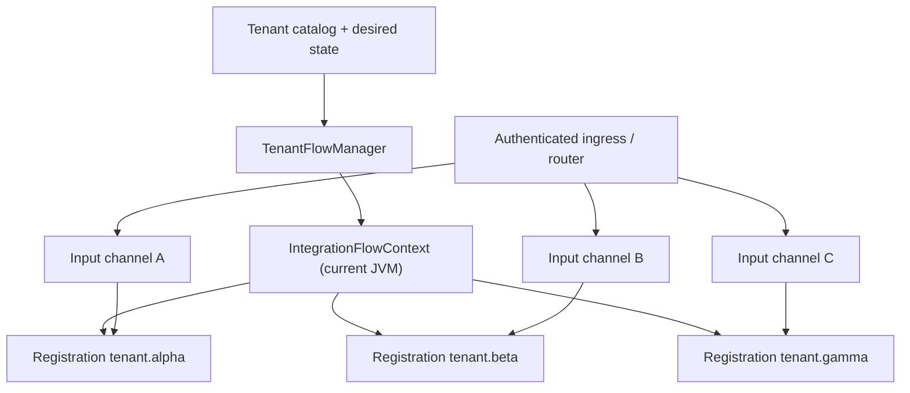
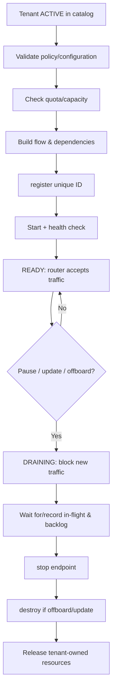
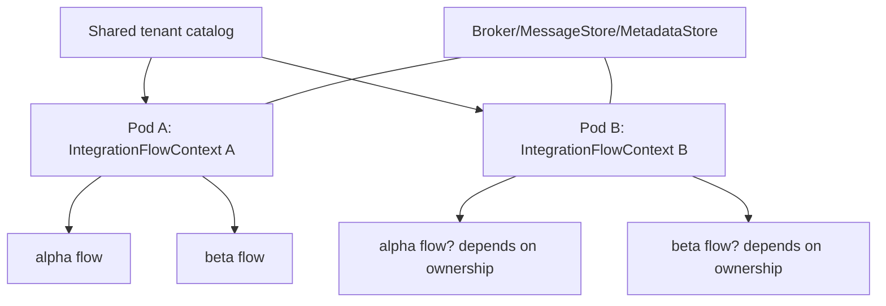

# IntegrationFlowContext for Per-Tenant Flows

## 1. Problem and Objectives

In Spring Integration, an `IntegrationFlow` is typically declared as a bean when the application context starts up. However, **multi-tenant** systems may need to create or destroy message flows while the application is running: a new tenant is activated, an existing tenant is paused, an SFTP source is reconfigured, or a tenant requires dedicated retry/connection settings.

`IntegrationFlowContext` is the API that allows **registering, starting, stopping, and destroying `IntegrationFlow`s created at runtime**. This lesson belongs to the **Dynamic runtime** chapter of the `SPRING_INTEGRATION_RUNTIME` module, connecting message orchestration across channels, endpoints, consumers, pollers, and executors; flow lifecycle management; transactions; retries; message stores; error handling; and correlation.

Real-world examples:

- Tenant `alpha` uses its own SFTP server; `beta` uses a different JMS destination.
- When onboarding `gamma`, the system registers a new flow, verifies connectivity, and then enables message intake.
- When `beta` suspends service, only the endpoints owned by `beta` are stopped/destroyed; `alpha` keeps running.
- When a tenant's configuration changes, the system creates a new flow version and switches routing without dropping in-flight requests.
- When the application restarts, tenant states are reloaded from a **persistent catalog** and flows are rebuilt.

**Learning outcomes:** build per-tenant dynamic flows with the Java DSL; use `IntegrationFlowContext.registration(...)` and `IntegrationFlowRegistration`; resolve ID/bean name collisions; control message dispatch when a flow is paused/offboarded; define thread/transaction boundaries, cross-tenant data isolation, and multi-replica scale-out; and test lifecycle, concurrency, and restarts.

> **Reference versions:** Spring Integration 6.5, Java 17, Spring Boot 3.x. The examples use `DirectChannel` + a synchronous transformer to focus on lifecycle. When moving to pollers or network adapters, corresponding cleanup and draining must be added.

## 2. Should You Create a Separate Flow for Each Tenant?



Two architectural models:

| Model | Best Suited For | Trade-offs |
|---|---|---|
| **Shared flow** with a router by `tenantId` | Many tenants, identical pipeline, differing only in business data | Must enforce header validation and isolation inside shared services |
| **One dynamic flow per tenant** | Tenants with dedicated protocol adapters, connections, pollers, schedules, timeouts, or retries | More beans/endpoints/pollers; requires a lifecycle controller and resource quotas |

Example of a shared flow:

```text
HTTP ingress -> Authentication -> tenantId header -> shared flow
                                              -> tenant-aware repository
```

Example of separate flows:

```text
alpha -> alpha SFTP inbound adapter -> alpha processor
beta  -> beta JMS inbound adapter  -> beta processor
gamma -> gamma TCP inbound gateway -> gamma processor
```

**Recommendation:** do not create 10,000 flows just because a method needs a different `tenantId` string. Dedicated flows make sense when lifecycle or resources are genuinely independent. A shared flow with a router is usually cheaper if the logic and infrastructure are identical.

### Who Owns Which Responsibility?

| Component | Responsibility |
|---|---|
| Tenant catalog | Desired state, revision, credential references, quotas; persists across restarts |
| Provisioning manager | Validates, serializes create/update/remove, manages registration handles |
| `IntegrationFlowContext` | Registers flows/dependent beans in the **current** Spring context |
| Request router | Identifies the authenticated tenant and routes requests to the right input channel |
| Handler/poller/adapter | Processes messages, transactions, retries, and errors per the tenant's contract |
| Message store/broker | Persists messages durably **if configured**; independent of bean lifecycle |

## 3. Key APIs of IntegrationFlowContext

`IntegrationFlowContext` is provided by Spring Integration as an infrastructure bean. Inject it into your flow management service rather than instantiating a separate context with its own registry.

### 3.1. Creating a Registration

```java
import org.springframework.integration.dsl.IntegrationFlow;
import org.springframework.integration.dsl.context.IntegrationFlowContext;
import org.springframework.integration.dsl.context.IntegrationFlowContext
        .IntegrationFlowRegistration;

IntegrationFlowRegistration registration = flowContext
        .registration(flow)
        .id("tenant-flow.alpha")
        .useFlowIdAsPrefix()
        .autoStartup(true)
        .register();
```

| Method | Meaning |
|---|---|
| `registration(flow)` | Builds a registration builder for the defined `IntegrationFlow` |
| `id(flowId)` | Sets the flow ID; **unique within the same application context** |
| `useFlowIdAsPrefix()` | Prefixes component bean names inside the flow; requires an explicit ID |
| `autoStartup(boolean)` | Whether to start automatically after registration; defaults to `true` |
| `addBean(bean)` / `addBean(name, bean)` | Registers a support bean that the flow depends on, such as a connection factory |
| `setDescription(String)` | Sets a description for the flow, available since Spring Integration 6.4 |
| `setSource(Object)` | Attaches a configuration source to aid diagnostics |
| `register()` | Completes bean registration and returns a handle to control the flow |

Spring Integration recommends setting an explicit ID. For flows whose components share internal IDs (for instance, a TCP outbound handler named `client`), `useFlowIdAsPrefix()` prevents bean name collisions between `alpha` and `beta`.

### 3.2. Lifecycle Operations

| Method | Important Details |
|---|---|
| `registration.getId()` | The flow's ID |
| `registration.getInputChannel()` | Input channel if the flow starts from a `MessageChannel` |
| `registration.getMessagingTemplate()` | Template whose default destination is the input channel, used for send/request–reply |
| `registration.getIntegrationFlow()` | Returns the flow object |
| `registration.start()` | Starts the endpoints belonging to the registration |
| `registration.stop()` | Stops endpoints while **keeping the registration** so it can be restarted |
| `registration.destroy()` | Destroys the flow and dependent beans managed by the registration |
| `flowContext.remove(flowId)` | Destroys the registration by ID |
| `flowContext.getRegistrationById(flowId)` | Looks up a registration or returns `null` |
| `flowContext.getRegistry()` | Inspects the ID → registration mapping **in this JVM** |
| `flowContext.messagingTemplateFor(flowId)` | Obtains the template by flow ID |

**Important:** `getMessagingTemplate()` and `messagingTemplateFor()` can only be used if the flow starts with an input `MessageChannel`. If the flow starts from a polling source or inbound network adapter, you cannot arbitrarily treat it as a request channel; the API may throw an `IllegalStateException`.

### 3.3. `stop` vs. `destroy`

```text
CREATE -> REGISTERED -> STARTED -> STOPPED -> STARTED ...
                          |          |
                          +-- destroy
                                |
                             REMOVED
```

- Tenant temporarily suspended: `stop()`, then `start()` when needed.
- Tenant offboarded: `destroy()` or `flowContext.remove(id)`; pick one path consistently.
- Tenant configuration updated: drain, destroy v1 and register v2 with the same ID, or use a revisioned ID to shift traffic.
- Destroying beans **does not mean** deleting data in Redis, a JDBC MessageStore, Kafka, SFTP, or a broker. Durable backlogs require their own policies.

## 4. Spring Boot Example: Per-Tenant Flow and Request–Reply

Let's build a service with two tenants `alpha`/`beta`. Each tenant is given its own `DirectChannel` and a transformer returning payloads formatted as `"tenant=<id>;body=<input>"`. The example avoids real SFTP/JMS so lifecycle behavior can be tested independently.

### 4.1. Dependencies and Application

```groovy
dependencies {
    implementation 'org.springframework.boot:spring-boot-starter-integration'
    testImplementation 'org.springframework.boot:spring-boot-starter-test'
}
```

```java
import org.springframework.boot.SpringApplication;
import org.springframework.boot.autoconfigure.SpringBootApplication;
import org.springframework.integration.config.EnableIntegration;

@SpringBootApplication
@EnableIntegration
public class TenantRuntimeApplication {
    public static void main(String[] args) {
        SpringApplication.run(TenantRuntimeApplication.class, args);
    }
}
```

### 4.2. Manager to Create, Run, and Destroy Flows

The manager maintains a `tenant → registration` map. Admin operations `provision/pause/resume/offboard` are serialized within one JVM; a per-tenant read/write lock protects **synchronous** calls while an admin is stopping/destroying. This is sample code for a single runtime process, not a distributed coordinator.

```java
import java.util.Map;
import java.util.concurrent.ConcurrentHashMap;
import java.util.concurrent.locks.Lock;
import java.util.concurrent.locks.ReentrantReadWriteLock;

import org.springframework.integration.channel.DirectChannel;
import org.springframework.integration.dsl.IntegrationFlow;
import org.springframework.integration.dsl.context.IntegrationFlowContext;
import org.springframework.integration.dsl.context.IntegrationFlowContext
        .IntegrationFlowRegistration;
import org.springframework.stereotype.Service;

@Service
public final class TenantFlowManager {

    private final IntegrationFlowContext context;
    private final Map<String, Slot> slots = new ConcurrentHashMap<>();

    public TenantFlowManager(IntegrationFlowContext context) {
        this.context = context;
    }

    private static final class Slot {
        final IntegrationFlowRegistration registration;
        final ReentrantReadWriteLock gate = new ReentrantReadWriteLock(true);
        volatile boolean enabled = true;

        Slot(IntegrationFlowRegistration registration) {
            this.registration = registration;
        }
    }

    private String checkedTenant(String tenantId) {
        // Standardized system ID; do not accept arbitrary raw user input.
        if (tenantId == null
                || !tenantId.matches("[a-z0-9][a-z0-9-]{0,39}")) {
            throw new IllegalArgumentException("Invalid tenant ID");
        }
        return tenantId;
    }

    public synchronized String provision(String tenantId) {
        String tenant = checkedTenant(tenantId);
        Slot found = slots.get(tenant);
        if (found != null) {
            return found.registration.getId();
        }

        String flowId = "tenant-flow." + tenant;
        IntegrationFlow flow = IntegrationFlow.from(new DirectChannel())
                .<String, String>transform(
                        body -> "tenant=" + tenant + ";body=" + body)
                .get();

        IntegrationFlowRegistration registration = context
                .registration(flow)
                .id(flowId)
                .useFlowIdAsPrefix()
                .autoStartup(true)
                .register();

        slots.put(tenant, new Slot(registration));
        return registration.getId();
    }

    public String execute(String tenantId, String payload) {
        String tenant = checkedTenant(tenantId);
        if (payload == null) {
            throw new IllegalArgumentException("Payload is required");
        }

        Slot slot = slots.get(tenant);
        if (slot == null) {
            throw new IllegalStateException("Tenant not provisioned");
        }

        Lock read = slot.gate.readLock();
        read.lock();
        try {
            if (!slot.enabled || slots.get(tenant) != slot) {
                throw new IllegalStateException("Tenant flow unavailable");
            }

            String reply = slot.registration.getMessagingTemplate()
                    .convertSendAndReceive(payload, String.class);

            if (reply == null) {
                throw new IllegalStateException("Tenant returned no reply");
            }
            return reply;
        }
        finally {
            read.unlock();
        }
    }

    public synchronized void pause(String tenantId) {
        Slot slot = required(tenantId);
        Lock write = slot.gate.writeLock();
        write.lock();
        try {
            slot.enabled = false;
            slot.registration.stop();
        }
        finally {
            write.unlock();
        }
    }

    public synchronized void resume(String tenantId) {
        Slot slot = required(tenantId);
        Lock write = slot.gate.writeLock();
        write.lock();
        try {
            slot.registration.start();
            slot.enabled = true;
        }
        finally {
            write.unlock();
        }
    }

    public synchronized void offboard(String tenantId) {
        String tenant = checkedTenant(tenantId);
        Slot slot = slots.get(tenant);
        if (slot == null) {
            return;
        }

        Lock write = slot.gate.writeLock();
        write.lock();
        try {
            slot.enabled = false;
            slot.registration.destroy();
            slots.remove(tenant, slot);
        }
        finally {
            write.unlock();
        }
    }

    private Slot required(String tenantId) {
        Slot slot = slots.get(checkedTenant(tenantId));
        if (slot == null) {
            throw new IllegalStateException("Tenant not provisioned");
        }
        return slot;
    }
}
```

**Explanation of each design choice:**

- Create a separate `new DirectChannel()` per flow so no two tenants accidentally share an input channel.
- The `tenant` variable captured by the transformer is an immutable string, avoiding a mutable singleton `currentTenant` that would mix data across concurrent requests.
- Use ID `tenant-flow.<tenant>`; the ID accepts only validated characters and never takes slashes, dots, or names directly from unvalidated input.
- `provision()` returns the existing ID if the tenant has already been created, avoiding duplicate registration; `synchronized` protects the check/register sequence within the JVM.
- `execute()` holds the read lock until the synchronous request–reply call completes; admins need the write lock to pause/offboard, preventing destruction mid-call.
- `resume()` calls `registration.start()` on the existing registration; `offboard()` is what destroys it and removes it from the map.
- `slots` is an **in-JVM memory** map, not persistent across restarts. It must be rehydrated from an external tenant catalog.

**Limitation:** This locking pattern only protects **synchronous** calls going through `execute()`. If a flow uses an `ExecutorChannel`, task scheduler, `QueueChannel`, or adapter receiving external messages, work continues after `execute()` returns. In that case, separate draining, in-flight tracking, and ack/queue handling are required—never treat `stop()` as proof that all tasks have finished.

For synchronous handlers that block indefinitely on I/O, holding the read lock can also make an admin offboard wait indefinitely. You must configure appropriate I/O timeouts, deadlines, and a forced-shutdown runbook.

### 4.3. Invoking the Manager

```java
manager.provision("alpha");
manager.provision("beta");

System.out.println(manager.execute("alpha", "hello"));
// tenant=alpha;body=hello

System.out.println(manager.execute("beta", "hello"));
// tenant=beta;body=hello

manager.pause("alpha");
// manager.execute("alpha", "hello") is rejected.

manager.resume("alpha");
manager.offboard("beta");
// Beta no longer has a registration.
```

A production controller layer must extract the tenant from an **authenticated principal/token** and check authorization, never trusting a `tenantId` sent by the client in a message header.

## 5. Lifecycle and Onboarding/Offboarding Sequence



### 5.1. Registering Without Starting

```java
IntegrationFlowRegistration registration = flowContext
        .registration(flow)
        .id("tenant-flow.alpha")
        .useFlowIdAsPrefix()
        .autoStartup(false)
        .register();

// Bean infrastructure has been created; endpoint traffic intake is not open yet.
registration.start();
```

`autoStartup(false)` only defers starting the lifecycle; constructor or bean initialization errors can still occur during registration. For inbound adapters, run a connectivity health check before marking the tenant READY. A successful `register()` does not by itself prove the remote system is ready.

### 5.2. Pause, Drain, and Destroy

Safe offboarding procedure:

1. Mark the tenant `DRAINING` in the catalog and prevent the router from accepting new messages.
2. Wait for running synchronous requests or async tasks/acks up to a deadline; record any unresolved outcomes.
3. Stop pollers/adapters to prevent new work from arriving.
4. Handle persistent queue backlogs per policy: retain for re-onboarding, move to a DLQ, or finish processing.
5. Destroy the registration and flow-owned beans; do not close shared resources belonging to other tenants.
6. Update the catalog and remove routing; record an audit event with the flow ID/revision.

**Do not accidentally delete persistent state:** `destroy()` removes the flow/dependent beans in the Spring context, but does not automatically delete rows from a JDBC MessageStore, metadata checkpoints, or broker messages.

### 5.3. Partial Registration Failures

When `register()` fails due to an ID collision, failing bean dependency, or invalid configuration, never record a READY status. You should:

- Inspect the root cause in the exception and the flow ID that was being created.
- Check `flowContext.getRegistrationById(id)`; clean up only components genuinely belonging to this provisioning attempt.
- Keep desired state as `FAILED`/`RECONCILING` and avoid unbounded retries that create duplicate beans.
- Use idempotent reconciliation to retry once the underlying cause is fixed.
- Test for resource leaks if a dependent bean opened sockets or threads during registration.

## 6. Bean Naming: Preventing Component ID Collisions

Two flows may use the same internal ID `"client"` (e.g., a TCP outbound handler), while being registered with different flow IDs:

```java
flowContext.registration(buildFlowFor("alpha"))
        .id("tenant.alpha")
        .useFlowIdAsPrefix()
        .register();

flowContext.registration(buildFlowFor("beta"))
        .id("tenant.beta")
        .useFlowIdAsPrefix()
        .register();
```

This snippet illustrates the API; `buildFlowFor(String)` is an application-defined factory method. For a component with ID `client`, the resulting bean names can be prefixed with `tenant.alpha.` and `tenant.beta.`. Verify actual bean names because manually registered beans are not automatically prefixed.

**Four rules:**

- A flow ID may be reused only after the previous registration has been `destroy()`ed/`remove()`d.
- `useFlowIdAsPrefix()` requires an explicit ID and prevents collisions when similar flows contain named endpoints.
- When using `addBean("name", dependency)`, dependent bean names must also be designed for uniqueness and clear ownership.
- Never register a shared `TaskExecutor`, shared `DataSource`, or global error channel as a dependent bean that gets destroyed along with one tenant.

## 7. Updating a Flow When Tenant Configuration Changes

### 7.1. Stop–Destroy–Register With the Same ID

```text
tenant.alpha v1 ACTIVE
  -> DRAINING
  -> stop
  -> destroy
  -> register v2 with same ID
  -> start + health check
  -> ACTIVE
```

Pros: simple, never has two flow instances with the same ID. Cons: incurs a downtime window, and if registering v2 fails, you must rebuild v1 from stored configuration.

### 7.2. Revision-Based Blue/Green

```text
tenant.alpha.v41 -- ACTIVE
tenant.alpha.v42 -- REGISTERED, verified
                  -> shift routing to v42
tenant.alpha.v41 -> DRAIN, STOP, DESTROY
```

Pros: reduces downtime and supports routing rollback. **However,** never start two inbound pollers reading from the same exclusive source before resolving ownership: doing so can cause duplicates/redelivery. For flows that only receive requests from a shared router, blue/green is usually simpler.

The catalog should store `desiredRevision`, `appliedRevision`, `desiredState`, source/credential IDs, and reconciliation status. `getRegistry()` only reflects registrations in a single context, not the durable source of truth.

## 8. Restart and Scale-Out: IntegrationFlowContext Does Not Auto-Sync Across Pods

**Each JVM/`ApplicationContext` has its own registry.** Calling `flowContext.registration(...)` on pod A does not make pod B automatically receive that flow. Calling `destroy()` on A does not stop the same tenant's flow on B either.



### 8.1. Two Operational Strategies

**Active-active:** multiple instances all run the flow for tenant `alpha`. You must ensure the broker/consumer group distributes messages properly, handlers are idempotent, and each instance has the configuration needed to keep tenant data isolated.

**One active consumer per tenant/source:** use a distributed lease, leader election, broker partition ownership, or an appropriate `LockRegistry` so only one node is allowed to start the source for a tenant. If a node loses its lease or hits a network partition, stop/fencing is required to prevent two nodes from processing a non-idempotent source.

`IntegrationFlowContext` **does not provide distributed locking or a tenant coordinator**. A shared metadata key can assist coordination, but does not automatically solve lease expiration, fencing, or crash windows.

### 8.2. Behavior on Application Restart

1. Load the persistent tenant catalog (e.g., database) with each tenant's desired state.
2. Validate the tenant's config version and credential references.
3. Re-register required flows with the proper ID/region/group ID.
4. Restore `ACTIVE`/`PAUSED` state; do not auto-start flows that policy requires to stay paused.
5. For persistent queues, reconnect to the **exact** storage, namespace, and group ID; avoid orphaned messages.
6. Reconcile the actual registry against desired state to clean up registrations that are no longer valid.
7. Open routing/ingress only after endpoints and dependencies are ready.

Do not treat the in-RAM registry as the source of tenant data. On restart, flow beans previously created at runtime are not automatically restored by Spring without **rehydrate/reconcile** logic.

### 8.3. Dynamic Flows Do Not Guarantee Data Durability

| Component | What Happens If the JVM Restarts? |
|---|---|
| Registration in `IntegrationFlowContext` | Must be re-registered from the catalog/application logic |
| In-memory `QueueChannel` | Backlog in RAM is lost |
| `JdbcChannelMessageStore` or durably configured broker | Messages can survive, but the new flow must point to the exact store/destination |
| `SimpleMetadataStore` | Markers in RAM are lost; items may be reprocessed |
| `JdbcMetadataStore`/Redis backend with durability | State persists per storage contract, but does not auto-map to the new registry |
| Temporary reply channel of an old gateway invocation | Cannot resurrect the Java caller after a process restart |

Successfully creating a dynamic flow does not mean the data inside it is automatically durable. Persistence must be designed independently.

## 9. Tenant Isolation: Distinct Bean Names Are Not Enough for Security

Simply having two separate flows `tenant.alpha` and `tenant.beta` **does not guarantee** data or security isolation.

| Risk Area | Example | Mitigation |
|---|---|---|
| Tenant identity | Caller spoofs header `tenantId=beta` | Extract tenant from a trusted principal/token; authorize at ingress |
| Input channel | Client calls another tenant's channel bean directly | Never expose channels/management APIs publicly; enforce access at service boundaries |
| Mutable state | Singleton handler has a `currentTenant` field overwritten per message | Stateless services or immutable per-tenant instances |
| DB | SQL update missing `WHERE tenant_id=?` | Tenant-aware repositories, RLS/schema isolation, properly scoped unique constraints |
| Metadata/store | Two tenants both use key `order:17` | Composite keys with tenant/source/version; proper region/group namespaces |
| Error & DLQ | Global logger prints `beta` payload while processing `alpha` | Attach verified identity/correlation; restrict log/DLQ read permissions |
| Secrets & connections | Flow `alpha` accidentally uses `beta` SFTP credentials | Per-tenant secret references, isolation, and rotation |
| Scheduler/executor | One slow tenant starves all threads | Bulkheads, quotas, bounded queues, backpressure |

**Never treat the `tenantId` header as authentication proof.** A header is data; if it can be set by an untrusted client, it is only trustworthy after the ingress layer validates it against the security context. If a flow consumes from a broker, tenant identity must be verified via producer policies, destination/ACLs, and message contracts.

### 9.1. Designing Correlation and Metadata Keys

Suppose both `alpha` and `beta` have `orderId=17`. An `IdempotentReceiverInterceptor` using the key `"order:17"` could cause `alpha` to make `beta` appear as a duplicate. Use a tenant + business tuple with unambiguous key encoding:

```text
tenant=alpha, order=17 -> alpha/order/17
tenant=beta,  order=17 -> beta/order/17
```

An aggregator's `CorrelationStrategy` must also account for tenant identity if the same message group store is shared across tenants; `ReleaseStrategy` and retention still require separate configuration.

## 10. Error Handling, Retries, Pollers, and Transactions in Dynamic Flows

### 10.1. Error Channels

- With `DirectChannel`, handlers typically run synchronously on the caller's thread; exceptions can propagate directly to the sender or messaging gateway.
- With `ExecutorChannel` or `QueueChannel`/poller, errors occur on another thread and can become an `ErrorMessage` on the appropriate error flow.
- A global `errorChannel` can be shared across tenants, **but must carry trusted tenant/correlation metadata** and proper access controls.
- Per-tenant error channels help when retention, DLQ, or SLAs differ, at the cost of extra beans/consumers and operational overhead.

Do not register the same local `errorChannel` name in every tenant flow expecting each tenant to have its own channel. Choosing a fixed name can point to the global channel or cause collisions. Explicitly define ownership of error routes.

### 10.2. Retries During Offboarding/Updates

A tenant might be retrying an HTTP/SFTP connection when an admin requests a stop. Clarify:

- Is the retry advice running within the same handler invocation, or is the source redelivering?
- Are there messages still sitting in a queue or persistent store?
- Does stopping prevent the next poll, and how far do already-started tasks run?
- Will poison messages return after a restart?
- Does the DLQ preserve the right tenant/source identity?

Retries must not trigger duplicate business processing after a caller timeout; use business idempotency keys and bounded retry policies.

### 10.3. Transaction Boundaries

```text
Tenant A: DirectChannel -> handler -> DB
  (can share the same thread/transaction if scoped properly)

Tenant B: ExecutorChannel -> worker -> DB
  (worker runs a different transaction; does not inherit thread-local transactions)

Tenant C: QueueChannel + PollingConsumer -> handler
  (poller transaction may need to start before receive() to roll back the store)
```

`register()`, `stop()`, and `destroy()` are not business transactions. Destroying an endpoint does not roll back a committed DB transaction. When using external SFTP/files/brokers/DBs, each resource has its own commit/ack/rollback semantics.

### 10.4. Gateway Replies When a Tenant Is Stopped

In a request–reply flow, a gateway typically waits on a temporary reply channel. If an admin stops the flow before downstream replies, the caller may time out or receive a delivery exception; **do not** infer that the business action rolled back. Design for this:

1. Block new requests (`DRAINING`).
2. Track in-flight requests and deadlines.
3. Wait for replies or record states that require reconciliation.
4. Stop/destroy only after deciding the disposition of outstanding requests.

In the manager example, the read/write lock prevents destruction mid-call for **synchronous `DirectChannel` invocations**. It does not handle asynchronous completion after the send method returns; production systems need independent tracking.

## 11. Quotas, Resource Ownership, and Scaling Costs

Dynamic flows add beans, handlers, pollers, task scheduler jobs, network connections, and metrics. 5,000 tenants with 5,000 SFTP pollers can exhaust resources even at just a few messages per second.

### 11.1. Limits to Measure

- Active/stopped flow counts and total beans in the context.
- Scheduled poller count, thread pool queue depth, and executor saturation.
- Connection pools (JMS/HTTP/SFTP/TCP), open sockets, and reconnect rates.
- Message/store backlogs, group age, and error/DLQ rates per tenant.
- Memory of cached registrations, stateful handlers/payloads, and leaked resources after destruction.
- Create/start/stop/destroy durations; request latency and drain time.

### 11.2. Who Owns the Resources?

| Resource | Appropriate Ownership |
|---|---|
| Connection factory dedicated solely to `alpha` | Can be registered via `addBean()` as `alpha`'s dependency and cleaned up on offboard |
| Shared `DataSource`, global `TaskExecutor` | Registered in the shared application context; **never** destroyed with one tenant flow |
| Persistent JDBC queue/store | Usually owned by shared infrastructure; destroying a flow does not automatically delete data |
| Per-tenant poller/endpoint | Belongs to the dynamic flow and is stopped/destroyed with the registration |
| Files/remote paths holding data | External data; needs an independent retention/offboarding policy |

Distinguish bean management from external resource management. Calling `destroy()` on a bean does not mean a remote connection/download has finished, a broker record has been acked, or files have been cleaned up properly.

### 11.3. Rules to Prevent Flow Leaks

- Cap the maximum number of flows per JVM/worker pool.
- Never provision a flow solely because an unknown tenant ID appeared in an unverified header.
- Enforce an idle policy to hibernate/offboard inactive tenants.
- Ensure offboarding removes the registration, cleans up mappings, and logs the event.
- Run 100 repeated create–destroy cycles in tests and inspect bean/thread/connection counts.
- Never keep references to destroyed flows/handlers in another singleton registry.

## 12. Testing `TenantFlowManager` With JUnit 5

Using the `TenantRuntimeApplication` and `TenantFlowManager` classes from section 4, we can test behavior without real SFTP or JMS servers.

### 12.1. Testing Isolation, Pause/Resume, and Offboarding

```java
import static org.junit.jupiter.api.Assertions.*;

import org.junit.jupiter.api.AfterEach;
import org.junit.jupiter.api.Test;
import org.springframework.beans.factory.annotation.Autowired;
import org.springframework.boot.test.context.SpringBootTest;
import org.springframework.integration.dsl.context.IntegrationFlowContext;

@SpringBootTest(classes = TenantRuntimeApplication.class)
class TenantFlowManagerTest {

    @Autowired TenantFlowManager manager;
    @Autowired IntegrationFlowContext context;

    @AfterEach
    void cleanup() {
        manager.offboard("alpha");
        manager.offboard("beta");
    }

    @Test
    void tenantResponsesAreIsolated() {
        manager.provision("alpha");
        manager.provision("beta");

        assertEquals("tenant=alpha;body=hello",
                manager.execute("alpha", "hello"));
        assertEquals("tenant=beta;body=hello",
                manager.execute("beta", "hello"));
    }

    @Test
    void provisioningTwiceDoesNotCreateAnotherFlow() {
        String a = manager.provision("alpha");
        String b = manager.provision("alpha");

        assertEquals(a, b);
        assertNotNull(context.getRegistrationById(a));
    }

    @Test
    void pauseAndResumeKeepRegistration() {
        manager.provision("alpha");
        manager.pause("alpha");

        assertThrows(IllegalStateException.class,
                () -> manager.execute("alpha", "ignored"));

        manager.resume("alpha");

        assertEquals("tenant=alpha;body=ok",
                manager.execute("alpha", "ok"));
    }

    @Test
    void offboardRemovesTheFlowAndAllowsRecreate() {
        String id = manager.provision("alpha");
        manager.offboard("alpha");

        assertNull(context.getRegistrationById(id));
        assertThrows(IllegalStateException.class,
                () -> manager.execute("alpha", "ignored"));

        assertEquals(id, manager.provision("alpha"));
        assertEquals("tenant=alpha;body=again",
                manager.execute("alpha", "again"));
    }

    @Test
    void rejectsInvalidTenantBeforeProvision() {
        assertThrows(IllegalArgumentException.class,
                () -> manager.provision("../../admin"));
        assertNull(context.getRegistrationById(
                "tenant-flow.../../admin"));
    }
}
```

The test uses `@AfterEach` so dynamic registrations do not leak into subsequent tests when Spring Boot reuses the context. Do not put `@Transactional` on tests expecting it to "clean up beans," because DB transactions do not manage the lifecycle of dynamic beans.

### 12.2. Testing Two Concurrent Admin Requests Provisioning the Same Tenant

```java
import java.util.concurrent.*;

ExecutorService pool = Executors.newFixedThreadPool(2);
try {
    CountDownLatch ready = new CountDownLatch(2);
    CountDownLatch start = new CountDownLatch(1);

    Callable<String> provision = () -> {
        ready.countDown();
        if (!start.await(5, TimeUnit.SECONDS)) {
            throw new TimeoutException("Start barrier timed out");
        }
        return manager.provision("alpha");
    };

    Future<String> first = pool.submit(provision);
    Future<String> second = pool.submit(provision);

    assertTrue(ready.await(5, TimeUnit.SECONDS));
    start.countDown();

    String a = first.get(10, TimeUnit.SECONDS);
    String b = second.get(10, TimeUnit.SECONDS);
    assertEquals(a, b);
    assertNotNull(context.getRegistrationById(a));
}
finally {
    pool.shutdownNow();
    manager.offboard("alpha");
}
```

This snippet is intended inside a JUnit test method with `manager`/`context` injected and the appropriate JUnit and concurrency imports. `CountDownLatch` increases the chance that both requests collide simultaneously; stress test with more threads to verify complex races. Do not use `Thread.sleep()` to infer completion.

### 12.3. Additional Production Test Scenarios

| Scenario | Setup | Assertion |
|---|---|---|
| Concurrent Tenant A/B | Two threads send requests to both flows | Replies never mix tenants; no mutable global tenant state |
| Offboard while handler runs | Handler waits on a latch while admin offboards | Draining/timeouts honored; no destroy mid-synchronous invocation |
| Failed registration | Duplicate component ID/bean name | Never marked READY; flow resources cleaned up per ownership |
| Flow without auto-start | `autoStartup(false)` | No traffic accepted before `start()`; registration still exists |
| Pause tenant poller | Poller backed by a real message source | No new polls when stopped; backlog preserved per contract |
| Process restart | Persistent tenant catalog and database message store | Flows rehydrated from desired state; no durable backlog lost |
| Two pods for same tenant | Two contexts connected to a shared broker/source | Proper active-ownership/partition/idempotency policy enforced |
| Blue/green upgrade | Distinct v1/v2 configurations | Traffic shifts by revision; no unintended duplicate active sources |
| Repeated create/destroy | Create and remove across many cycles | No unbounded growth in bean counts, threads, or sockets |

## 13. Troubleshooting Per-Tenant Dynamic Flows

| Symptom | Common Cause | How to Check |
|---|---|---|
| `register()` fails with bean name collision | Duplicate registration/component ID; missing prefix | Check `getRegistrationById()`, `useFlowIdAsPrefix()` |
| Tenant A receives Tenant B's data | Spoofed header, shared input channel, mutable handler | Check authentication, route mapping, channel instances |
| `getMessagingTemplate()` throws an exception | Flow starts from an inbound source instead of an input channel | Send via the protocol source or use a flow with an input channel |
| Registration exists but receives no messages | `autoStartup(false)` or flow was `stop()`ped | Check endpoint lifecycle, poller, and subscriptions |
| Gateway times out even though handler logs success | Reply route changed or async task returned too late | Check temporary reply channel, timeouts, and in-flight state |
| Flows disappear after restart | Registry lives only in the context | Reconcile from the persistent tenant catalog |
| Old queue has messages that aren't polled | Changed JDBC store/region/group ID or broker subscription | Verify storage identity and serializer version |
| One tenant spawns too many beans/threads | Unbounded provisioning or missing offboarding | Enforce flow quotas, resource ownership, leak tests |
| Processing logs continue after `stop()` | Async tasks in flight or unacked source messages | Enforce `DRAINING`, task tracking, and timeouts |
| Shared pool closed when offboarding one tenant | Shared bean registered as a dependent bean | Move shared resources to application scope |
| Two pods poll the same exclusive source | Missing leader/lease/fencing | Add distributed coordination and idempotency |

### Runtime Telemetry to Collect

```text
timestamp=...
tenantId=alpha
flowId=tenant-flow.alpha
revision=42
desiredState=ACTIVE
runtimeState=STARTED
event=REGISTER|START|STOP|DRAIN|DESTROY|FAIL
requestId=...
channel=...
thread=...
durationMs=...
errorCode=...
```

Never log credentials, access tokens, or payloads containing sensitive data. For async flows, propagate correlation IDs in message headers/tracing context via framework mechanisms rather than relying solely on thread-locals.

Track active and stopped flow counts, registration failures, start/stop durations, poller backlogs, executor queues, connection counts, per-tenant DLQ counts, and error rates. These metrics may require custom instrumentation; not all of them are emitted out of the box.

## 14. Production Readiness Checklist

1. **Choose the architecture:** use per-tenant flows only when lifecycle/resources are genuinely distinct; otherwise consider a shared flow/router.
2. **Identifiers:** validate tenant IDs, flow ID structure, and revisions; set `useFlowIdAsPrefix()` when needed.
3. **Provisioning control:** use synchronization/atomic registries within a JVM; across pods, use desired-state reconciliation and source ownership.
4. **Security boundaries:** derive tenant identity from an authenticated principal, never trust client-supplied headers; restrict management endpoints.
5. **Define ownership:** are beans/connections/executors tenant-specific or shared? Destroy only the right resources.
6. **Define lifecycle:** onboarding, health checks, pause, drain, resume, offboard, and failed-registration cleanup.
7. **Design durable state:** catalog, JDBC/broker/metadata, stable group IDs/regions, replay/idempotency.
8. **Configure error/retry/transaction handling:** align with `DirectChannel` vs. async/poller, DLQs, and bounded retries.
9. **Measure capacity:** quotas, poller counts, task scheduler threads, sockets/connections, latency, memory.
10. **Test thoroughly:** concurrent provisioning, offboarding while in-flight, restarts, crash windows, blue/green swaps, and multi-pod source ownership.

## 15. Self-Check Questions

**Question 1.** Why is `IntegrationFlowContext` suitable for creating flows for new tenants without restarting the application?  
**Answer:** It registers `IntegrationFlow`s and their required components into the Spring context at runtime, returning an `IntegrationFlowRegistration` for lifecycle control.

**Question 2.** What is the difference between `stop()` and `destroy()`?  
**Answer:** `stop()` keeps the registration so it can be started again; `destroy()` removes the flow and dependent beans, allowing a new registration with the old ID after cleanup.

**Question 3.** What must two flows sharing the internal handler ID `client` do to avoid collisions?  
**Answer:** Use distinct flow IDs and `useFlowIdAsPrefix()`; if bean names are assigned manually in code, they still must be kept unique.

**Question 4.** Why can't `getMessagingTemplate()` be used on every flow?  
**Answer:** It requires the flow to start from an input `MessageChannel`. Flows with an inbound source/poller do not automatically expose an input channel for the template to send requests to.

**Question 5.** Does calling `destroy()` on `alpha`'s flow on pod A stop `alpha` on pod B?  
**Answer:** No. Each JVM has its own context/registry; multi-pod setups require a coordinator/desired state and source ownership.

**Question 6.** Why shouldn't a handler use a mutable singleton `currentTenantId`?  
**Answer:** Concurrent requests can overwrite the tenant identity and mix data; use an authenticated context, stateless handlers/keys, or immutable per-tenant state.

**Question 7.** After a restart, dynamic flows disappear; are messages in a JDBC MessageStore also lost?  
**Answer:** Not necessarily. Registrations are JVM-local; durable message data persists per the store, though the rebuilt flow must connect to the exact database/region/group ID to process it.

**Question 8.** Does `stop()` guarantee that all asynchronous tasks have finished and business transactions have committed?  
**Answer:** No. You need draining and tracking of in-flight tasks, acks, and commits/rollbacks per source.

**Question 9.** When is a shared flow/router better than per-tenant flows?  
**Answer:** When the tenant count is high while pipelines/resources are identical, differing only in tenant ID or business parameters; a shared flow reduces beans, pollers, and connections.

**Question 10.** Registering an ID that already exists throws an error: how do you handle it?  
**Answer:** Use idempotent provisioning if the configuration is unchanged; when updating, drain and destroy the old registration before re-registering, or use a new revisioned ID with blue/green routing.

## 16. Official References

1. [Spring Integration 6.5 — Dynamic and Runtime Integration Flows](https://docs.spring.io/spring-integration/reference/6.5/dsl/java-runtime-flows.html): flow registration, lifecycle management, generated bean names, and `useFlowIdAsPrefix()`.
2. [Spring Integration 6.5 API — IntegrationFlowContext](https://docs.spring.io/spring-integration/docs/6.5.0/api/org/springframework/integration/dsl/context/IntegrationFlowContext.html): `registration()`, `remove()`, `getRegistry()`, `messagingTemplateFor()`.
3. [Spring Integration 6.5 API — IntegrationFlowRegistrationBuilder](https://docs.spring.io/spring-integration/docs/6.5.0/api/org/springframework/integration/dsl/context/IntegrationFlowContext.IntegrationFlowRegistrationBuilder.html): `id`, `autoStartup`, `useFlowIdAsPrefix`, `addBean`, `setDescription`.
4. [Spring Integration 6.5 API — IntegrationFlowRegistration](https://docs.spring.io/spring-integration/docs/6.5.0/api/org/springframework/integration/dsl/context/IntegrationFlowContext.IntegrationFlowRegistration.html): `getInputChannel()`, `getMessagingTemplate()`, `start()`, `stop()`, `destroy()`.
5. [Spring Integration 6.5 API — IntegrationFlow](https://docs.spring.io/spring-integration/docs/6.5.0/api/org/springframework/integration/dsl/IntegrationFlow.html): `from(MessageChannel)`, DSL building, and reply flows.
6. [Spring Integration 6.5 — Messaging Channels](https://docs.spring.io/spring-integration/reference/6.5/channel.html): DirectChannel/ExecutorChannel/QueueChannel.
7. [Spring Integration 6.5 — Error Handling](https://docs.spring.io/spring-integration/reference/6.5/error-handling.html): sync/async errors and error channels.
8. [Spring Integration 6.5 — Transaction Support](https://docs.spring.io/spring-integration/reference/6.5/transactions.html): poller transactions, thread boundaries, and commit/rollback.
9. [Spring Integration 6.5 — Message Store](https://docs.spring.io/spring-integration/reference/6.5/message-store.html): persistence for messages and message groups.
