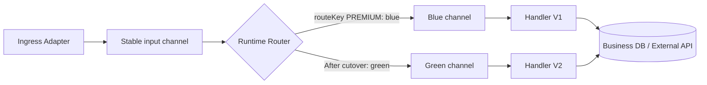
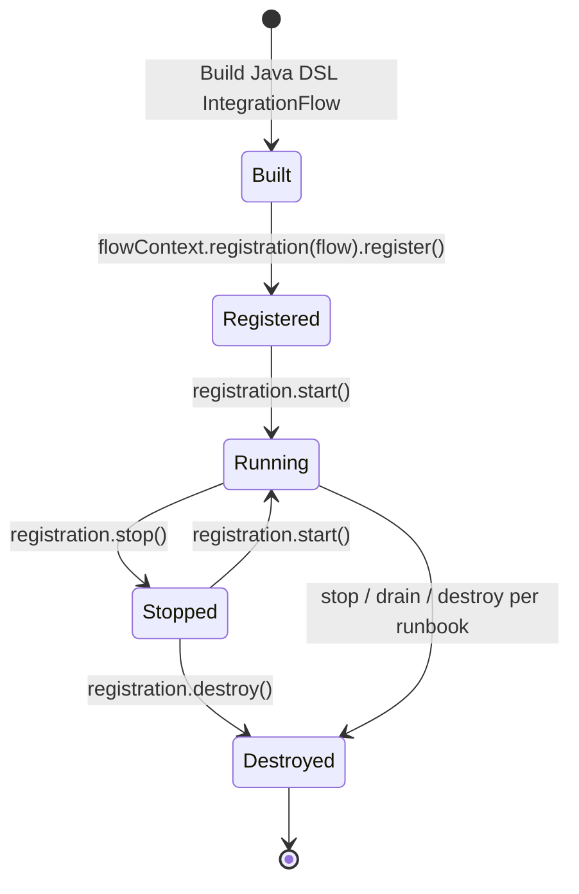
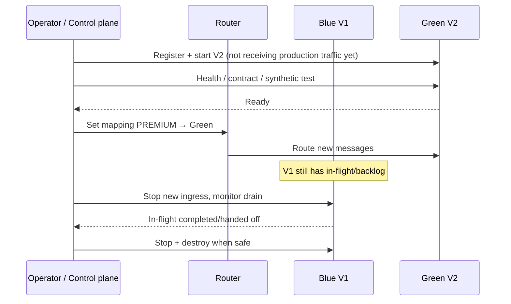

# Changing Routes or Handlers at Runtime in Spring Integration

## 1. When Do You Need to Change a Flow Without Restarting the Application?

An integration system may need to route messages to a different provider when a partner experiences an outage, move a group of customers to a new handler version, create per-tenant pipelines, or update processing rules after toggling a feature flag. This is the requirement of **changing routes or handlers while the application is running** (*dynamic runtime reconfiguration*).

For example, the header `routeKey=PREMIUM` currently directs messages to handler `paymentBlue`; during a canary rollout, the same key is switched to `paymentGreen`. New messages can go through green without restarting the entire JVM. However, messages that already entered blue, are waiting in a queue, are being retried, or are held inside a transaction **do not automatically move** to green. That boundary must be understood before operating a real system.

This lesson belongs to the **Dynamic runtime** chapter of the **SPRING_INTEGRATION_RUNTIME** module, directly connecting to how Spring Integration orchestrates channels, endpoints, consumers, pollers, and executors; how `IntegrationFlow`s are started and stopped; transactions, retries, message stores, error channels, correlation, threading, and runtime performance/status observability.

After this lesson, you will be able to:

1. Choose between **updating router mappings**, **swapping a delegating handler**, and **registering/destroying `IntegrationFlow` versions**.
2. Change routes by key via `HeaderValueRouter` and `AbstractMappingMessageRouter`, ensuring arbitrary headers cannot route to internal channels.
3. Use `IntegrationFlowContext` to register new flows with distinct IDs, start/stop/destroy them, and inspect registration state.
4. Design **blue–green/canary cutovers**, handle in-flight messages, manage rollbacks, and enforce isolation between versions.
5. Test scenarios involving races, retries, transactions, persistent queues, correlation, and route-switching failures.

> **API Scope:** Examples use **Spring Integration 6.5.x**, Java 17+, and Spring Framework 6.x. Runtime reconfiguration operations must be tested against the exact library version and channels/adapters in production.

## 2. Three Runtime Strategies: What Changes, What Stays?

| Strategy | What Changes? | Best Suited When | What Is Not Automatically Guaranteed |
| --- | --- | --- | --- |
| **Dynamic router mapping** | Route key → output channel name. | Shifting one or more traffic segments between existing flows. | Does not register new handlers; in-flight messages do not automatically move. |
| **Swappable/delegating handler** | The handler inside an endpoint switches to a new delegate. | Replacing small processing logic while keeping channels and topology unchanged. | Does not stop running old delegates; transactions/side effects are not migrated. |
| **Dynamic `IntegrationFlow` registration** | Adding, starting, stopping, and destroying an entire flow along with its dependent beans. | Per-tenant flows, config-driven endpoints/adapters, blue–green versioned flows. | Does not automatically copy queues, message groups, metadata, or processing history to the new flow. |

Do not label every case as "hot-reloading Spring beans." Changing a bean reference on one object **does not automatically** update every subscriber, handler, and infrastructure component already registered by Spring Integration. Use the appropriate router/flow management API, or a delegate explicitly designed by your application.

### One Path With Two Versions



The diagram shows the **target selection rule at the moment the router processes a message**. Do not assume changing a router is a system-wide atomic operation: producers, routers, consumers, and stores may run on different threads or pods.

## 3. Dynamic Router: Changing Mappings While the Flow Keeps Running

`HeaderValueRouter` determines a channel key from a header, then maps that key to a channel name. It extends `AbstractMappingMessageRouter` and supports these methods:

| API | Role | Notes |
| --- | --- | --- |
| `setChannelMapping(key, channelName)` | Adds or updates **one** key. | Suitable for simple single-key changes. |
| `removeChannelMapping(key)` | Removes a specific mapping. | If fallback is enabled, the key may be interpreted as a channel name! |
| `setChannelMappings(Map<String,String>)` | Replaces the entire mapping table. | Useful for consistent multi-key cutovers; does not recall already-dispatched messages. |
| `replaceChannelMappings(Properties)` | Variant suited for a control bus taking `Properties`. | Must validate key/value strings and caller authorization. |
| `getChannelMappings()` | Returns a snapshot of managed mappings. | Do not mutate the getter's returned map directly. |
| `setChannelKeyFallback(false)` | Prevents treating unknown keys as channel names. | Especially critical when headers come from untrusted sources. |
| `setDefaultOutputChannelName(name)` | Sends unmapped messages to the specified channel. | Can be used for quarantine/unknown routes; consumers must handle them explicitly. |

According to Spring Integration documentation, routing consists of three steps: computing the **channel identifier**, looking up the mapping to get a **channel name**, and resolving that name to a `MessageChannel`. When a router returns a `MessageChannel` instance directly from the first step, changing the mapping table has no effect on that already-resolved branch.

### 3.1. Java DSL Example Capable of Switching Blue → Green

The following complete example uses `DirectChannel` so that when `send()` returns, the message has already been routed into the output `QueueChannel` (or thrown an exception). With no network I/O and no executor, assertions can run immediately after sending.

```java
import org.springframework.context.annotation.Bean;
import org.springframework.context.annotation.Configuration;
import org.springframework.integration.annotation.EnableIntegration;
import org.springframework.integration.channel.DirectChannel;
import org.springframework.integration.channel.QueueChannel;
import org.springframework.integration.dsl.IntegrationFlow;
import org.springframework.integration.router.HeaderValueRouter;
import org.springframework.messaging.MessageChannel;
import org.springframework.messaging.PollableChannel;

@Configuration
@EnableIntegration
class DynamicRouteConfiguration {

    @Bean
    MessageChannel runtimeRouteInput() {
        return new DirectChannel();
    }

    @Bean
    PollableChannel blueOut() {
        return new QueueChannel();
    }

    @Bean
    PollableChannel greenOut() {
        return new QueueChannel();
    }

    @Bean
    PollableChannel unknownRoutes() {
        return new QueueChannel();
    }

    @Bean
    HeaderValueRouter liveRouter() {
        HeaderValueRouter router = new HeaderValueRouter("routeKey");
        router.setChannelKeyFallback(false);
        router.setDefaultOutputChannelName("unknownRoutes");
        router.setChannelMapping("PREMIUM", "blueOut");
        router.setChannelMapping("STANDARD", "blueOut");
        return router;
    }

    @Bean
    IntegrationFlow liveRoutingFlow(HeaderValueRouter liveRouter) {
        return IntegrationFlow.from("runtimeRouteInput")
                .route(liveRouter)
                .get();
    }
}
```

After the context starts, send messages through the input channel, then update the mapping:

```java
import org.springframework.context.ApplicationContext;
import org.springframework.integration.router.HeaderValueRouter;
import org.springframework.messaging.Message;
import org.springframework.messaging.MessageChannel;
import org.springframework.messaging.PollableChannel;
import org.springframework.messaging.support.MessageBuilder;

void demonstrateRouting(ApplicationContext context) {
    MessageChannel in =
            context.getBean("runtimeRouteInput", MessageChannel.class);
    PollableChannel blue =
            context.getBean("blueOut", PollableChannel.class);
    PollableChannel green =
            context.getBean("greenOut", PollableChannel.class);
    HeaderValueRouter router = context.getBean(HeaderValueRouter.class);

    in.send(MessageBuilder.withPayload("invoice-101")
            .setHeader("routeKey", "PREMIUM")
            .setHeader("correlationId", "order-101")
            .build());
    Message<?> first = blue.receive(0);
    if (first == null || !"invoice-101".equals(first.getPayload())) {
        throw new IllegalStateException("Expected BLUE route");
    }

    router.setChannelMapping("PREMIUM", "greenOut");

    in.send(MessageBuilder.withPayload("invoice-102")
            .setHeader("routeKey", "PREMIUM")
            .setHeader("correlationId", "order-102")
            .build());
    Message<?> second = green.receive(0);
    if (second == null || !"invoice-102".equals(second.getPayload())) {
        throw new IllegalStateException("Expected GREEN route");
    }
}
```

Here, message `invoice-101` was placed into `blueOut` before the change; it **does not move to green** merely because the mapping table changed. Message `invoice-102` arrives afterward and uses the new mapping. Under concurrency, the boundary is the instant each message actually reads the mapping table, **not** necessarily when the producer starts `send()`.

### 3.2. Changing Multiple Routes in One Operation

If you update two mappings with two separate calls, concurrent messages may observe an intermediate state. Spring Integration provides `setChannelMappings(Map<String,String>)` to update the entire table at once:

```java
import java.util.Map;
import org.springframework.integration.router.HeaderValueRouter;

void switchAllRoutes(HeaderValueRouter router) {
    router.setChannelMappings(Map.of(
            "PREMIUM", "greenOut",
            "STANDARD", "blueOut"));
}
```

This operation is consistent **at the mapping-table level within one router/JVM**, not as a distributed transaction across multiple application instances. If each pod has its own router, updating the table on pod A does not update pod B. Furthermore, replacing the map does not roll back a V1 handler's transaction, cancel in-flight messages, or guarantee that two messages sent moments apart hit the same version.

### 3.3. Protecting Routes From Untrusted Input

By default in many `AbstractMappingMessageRouter` implementations, an unmapped key can be used as a **channel name** if `channelKeyFallback` remains enabled. A client sending a header matching an internal channel name could send messages to unintended destinations or even create a loop back into the router input. Always **disable fallback**, allowlist valid keys only, use a controlled default/quarantine channel, and never let clients specify bean/channel names directly.

When routing fails because the target channel does not exist, `resolutionRequired`, the default channel, and fallback settings determine whether an exception is thrown or a redirect occurs. Distinguish an unknown key (input contract violation) from a configured channel that is failing (operational error). Never silently send both to `nullChannel` if the business requires audit or replay.

## 4. Dynamically Creating and Managing `IntegrationFlow`s With `IntegrationFlowContext`

When you need to change an entire chain of endpoints (not just the output channel name), use `IntegrationFlowContext`. This API supports **registering an `IntegrationFlow` after initial bean declaration**, creating dependent beans, and starting or destroying the flow via a registration handle.

A typical workflow:



When registering, you can configure `.id(flowId)`, `.autoStartup(false)`, `.useFlowIdAsPrefix()`, and `.addBean(...)` if the flow requires helper beans not already in the context. The ID **must be unique within the application context**; the same ID can only be reused after the previous registration has been destroyed. Spring Integration 6.5 supports `getRegistrationById(id)`, `getRegistry()`, `messagingTemplateFor(id)`, and `remove(id)` to look up and manage flows from the context.

### 4.1. Java Example: Registering a New Flow Version

The following example is independent of the router in section 3. It creates a dedicated input `DirectChannel` per flow; the output is a `QueueChannel` **pre-declared in the Spring context** so tests can receive results immediately. Do not share the same input `DirectChannel` across both V1 and V2 if you need to identify clearly which version each message enters.

```java
import org.springframework.integration.channel.DirectChannel;
import org.springframework.integration.dsl.IntegrationFlow;
import org.springframework.integration.dsl.context.IntegrationFlowContext;
import org.springframework.integration.dsl.context.IntegrationFlowContext.IntegrationFlowRegistration;
import org.springframework.messaging.MessageChannel;
import org.springframework.messaging.PollableChannel;
import org.springframework.messaging.support.GenericMessage;

final class TenantFlowManager {
    private final IntegrationFlowContext flowContext;
    private final MessageChannel results;

    TenantFlowManager(IntegrationFlowContext flowContext,
                      MessageChannel results) {
        this.flowContext = flowContext;
        this.results = results;
    }

    IntegrationFlowRegistration register(String tenant, String version) {
        // Tenant/version values must be validated and collision-free.
        String flowId = "tenant." + tenant + "." + version;
        DirectChannel input = new DirectChannel();

        IntegrationFlow flow = IntegrationFlow.from(input)
                .<String, String>transform(value -> version + ":" + value)
                .channel(results)
                .get();

        return flowContext.registration(flow)
                .id(flowId)
                .useFlowIdAsPrefix()
                .autoStartup(false)
                .register();
    }

    void send(IntegrationFlowRegistration registration, String value) {
        registration.getInputChannel().send(new GenericMessage<>(value));
    }

    void retire(IntegrationFlowRegistration registration) {
        // Production: new message intake has stopped and draining has completed per policy.
        registration.stop();
        registration.destroy();
    }
}
```

In a Spring application with integration infrastructure enabled and an `IntegrationFlowContext`, use it as follows:

```java
import org.springframework.integration.dsl.context.IntegrationFlowContext.IntegrationFlowRegistration;
import org.springframework.messaging.Message;
import org.springframework.messaging.PollableChannel;

void demo(TenantFlowManager manager, PollableChannel results) {
    IntegrationFlowRegistration v2 = manager.register("tenant7", "v2");
    v2.start(); // autoStartup(false), so it must be started explicitly.
    manager.send(v2, "job-1");

    Message<?> reply = results.receive(0);
    if (reply == null || !"v2:job-1".equals(reply.getPayload())) {
        throw new IllegalStateException("Wrong dynamic flow output");
    }

    manager.retire(v2);
}
```

To create `results`, you can declare `@Bean PollableChannel dynamicResults() { return new QueueChannel(); }` and inject it as `MessageChannel` into the manager and as `PollableChannel` into the test/consumer. The example separates the manager from configuration to illustrate the API; in a real application, register the manager as a `@Bean`/`@Component` and inject with appropriate qualifiers.

**Distinguishing ownership:**

- `IntegrationFlowRegistration.destroy()` destroys the flow and the **dependent beans managed by the registration**. Do not assume it will automatically delete external resources (database rows, broker queues, HTTP callbacks) or delete a shared `@Bean` owned elsewhere in the context.
- `registration.getInputChannel()` and `getMessagingTemplate()` can only be used directly when the flow has an **input channel**. If the flow starts from a `MessageSource`, timer, or adapter without an input channel, `getMessagingTemplate()` may throw an `IllegalStateException`.
- `registration.stop()` is a lifecycle signal, **not an atomic command that drains all in-flight messages**. Workers may still have tasks executing; persistent stores may still hold backlogs.
- Use `getRegistry()` to inspect registrations in the **current JVM**, not the list of flows across all pods.

### 4.2. IDs and Bean Names: Why Version Them?

Assign stable, namespaced, versioned IDs such as `tenant.tenant7.v2`. Giving each version its own ID lets **V1 and V2 coexist simultaneously** for canarying before actively shifting ingress. `useFlowIdAsPrefix()` is helpful when the same DSL template produces multiple flows with identical internal component IDs, preventing bean name collisions among generated components.

Never construct flow IDs from arbitrary client strings without validating length, characters, and authorization. Continuously registering flows from unbounded input increases bean, thread, connection, MBean, and memory footprints, eventually exhausting resources.

## 5. Swapping a Handler Inside an Endpoint Without Rebuilding the Flow

If you want to keep the topology intact while changing the processing algorithm, you can use a **delegating handler** holding an `AtomicReference<MessageHandler>`. This is an **application-implemented pattern**, not an automatic bean-swapping feature of `IntegrationFlowContext`.

Each incoming message captures a snapshot of the current delegate. Calling `replace(...)` is an atomic reference swap within the same JVM; messages that already read the old delegate can still finish on V1.

```java
import java.util.Objects;
import java.util.concurrent.atomic.AtomicReference;
import org.springframework.messaging.Message;
import org.springframework.messaging.MessageHandler;

final class SwitchingHandler implements MessageHandler {
    private final AtomicReference<MessageHandler> current;

    SwitchingHandler(MessageHandler initial) {
        current = new AtomicReference<>(Objects.requireNonNull(initial));
    }

    void replace(MessageHandler next) {
        current.set(Objects.requireNonNull(next));
    }

    @Override
    public void handleMessage(Message<?> message) {
        MessageHandler selected = current.get(); // One snapshot per invocation.
        selected.handleMessage(message);
    }
}
```

Example delegate performing a one-way transformation and sending the result to an output queue. For clarity, it constructs a new message while preserving useful headers:

```java
import org.springframework.messaging.Message;
import org.springframework.messaging.MessageChannel;
import org.springframework.messaging.MessageHandler;
import org.springframework.messaging.support.MessageBuilder;

final class PrefixHandler implements MessageHandler {
    private final String prefix;
    private final MessageChannel output;

    PrefixHandler(String prefix, MessageChannel output) {
        this.prefix = prefix;
        this.output = output;
    }

    @Override
    public void handleMessage(Message<?> incoming) {
        Message<String> outgoing = MessageBuilder
                .withPayload(prefix + incoming.getPayload())
                .copyHeaders(incoming.getHeaders())
                .build();
        output.send(outgoing);
    }
}
```

Wire `SwitchingHandler` as a handler bean in the flow and swap its delegate at runtime:

```java
import org.springframework.beans.factory.annotation.Qualifier;
import org.springframework.context.annotation.Bean;
import org.springframework.context.annotation.Configuration;
import org.springframework.integration.annotation.EnableIntegration;
import org.springframework.integration.channel.QueueChannel;
import org.springframework.integration.dsl.IntegrationFlow;
import org.springframework.messaging.MessageChannel;
import org.springframework.messaging.PollableChannel;

@Configuration
@EnableIntegration
class SwitchingHandlerConfiguration {

    @Bean
    PollableChannel versionedResults() {
        return new QueueChannel();
    }

    @Bean
    SwitchingHandler switchingHandler(
            @Qualifier("versionedResults") MessageChannel output) {
        return new SwitchingHandler(new PrefixHandler("v1:", output));
    }

    @Bean
    IntegrationFlow switchingFlow(SwitchingHandler switchingHandler) {
        return IntegrationFlow.from("switchingInput")
                .handle(switchingHandler)
                .get();
    }
}
```

When switching:

```java
// Executed by a trusted admin/controller in the same JVM.
switchingHandler.replace(new PrefixHandler("v2:", resultChannel));
```

**Trade-offs:** this pattern minimizes bean lifecycle churn, but does not change channel contracts, endpoint counts, advice chains, or transaction boundaries. It affects **only the JVM containing that `switchingHandler`**. If the new handler needs a connection factory, scheduler, database transaction manager, or Spring lifecycle callbacks, simply assigning a new object into an `AtomicReference` is insufficient. In that case, register a versioned flow/handler through a container with full lifecycle management.

**Retries and advice chains:** if a retry advice wraps `SwitchingHandler`, the first attempt might pick V1 while a subsequent attempt picks V2 if an admin swaps the delegate mid-retry. If per-event consistency is required, you must **pin the processing version by message ID/immutable header or per work item**, and test that retries stay on the same version. `AtomicReference` only guarantees a valid reference, not that all attempts of a business event share the same semantics.

## 6. Choosing a Handler-Replacement Strategy by Impact Level

| Change | Recommended Approach | Why |
| --- | --- | --- |
| Shift `PREMIUM` traffic from Blue to Green; both flows are already ready. | `HeaderValueRouter.setChannelMapping` / `setChannelMappings`. | Changes routing decisions without touching handler lifecycles. |
| Swap a stateless, one-way algorithm with no resource lifecycle dependencies. | `SwitchingHandler` with `AtomicReference`. | Simple per-invocation snapshot; easy to roll back the reference. |
| Add per-tenant handlers, advice, channels, or adapters. | `IntegrationFlowContext.registration(...).register()`. | Container manages bean lifecycle and dependent endpoints. |
| Change payload schema, transactions, persistent stores, or correlation/release strategy. | Versioned flows + migration/draining per runbook. | Cannot be done safely by changing mappings or delegates alone. |
| Enable/disable polling sources or adapters on a schedule. | `SmartLifecycle` / registration `start/stop` or a controlled control bus. | Controls only the source without replacing the entire topology. |
| Update across multiple pods with strict consistency SLAs. | Versioned configuration from a control plane + fleet-wide rollout control. | A command on one JVM does not update a cluster atomically. |

**Do not replace a `MessageHandler` bean in `BeanFactory` under the same name and expect running endpoints to pick up the new instance.** Already-initialized endpoints may hold the old reference; bean overriding may also be disabled by Spring. Use container/flow APIs or intentional delegation instead.

## 7. Blue–Green Runtime Cutover: Before, During, and After the Switch

Changing a route from Blue to Green is only a small part of the operational procedure. A real cutover involves **preparing the new version**, **choosing when to shift ingress**, **handling the old version's backlog**, and **evaluating rollback**.



### 7.1. Recommended Runbook

1. **Lock down the change contract:** which route keys change, which business effects change, are input/output schemas compatible, and do transaction managers, message stores, or correlation keys change?
2. **Register V2 with a new ID:** use `IntegrationFlowContext` to build the flow and helper beans. Run health checks and verify connections, converters, serializers, error channels, advice chains, and readiness. Do not route production traffic yet.
3. **Test with synthetic messages:** use test-dedicated keys or an isolated data source; verify observable replies, errors, timeouts, and side effects; never send real transactions just to "test the route."
4. **Define the overlap policy:** are V1 and V2 allowed to process concurrently? If yes, you must have idempotency keys, partitioning/ordering, and compatible schemas. If not, quiesce ingress and drain before switching.
5. **Update the router by configuration generation:** persist `mappingVersion` and the desired configuration; apply `setChannelMappings(...)` consistently to **each router instance**. In multi-node systems, confirm every pod has applied it.
6. **Monitor post-cutover:** track throughput, error rates, active tasks, queue backlog/age, retries, DLQs, correlation, and business outcomes across both V1 and V2.
7. **Drain and retire V1:** stop sending new traffic, wait for pending work to finish or transition to a verified durable handoff; then `stop()` and `destroy()` the V1 registration if dynamically managed.
8. **Conditional rollback:** switch mappings back to Blue only if Blue is still running and **can read the current contract/data**. Side effects already created by Green are not automatically reversed.

### 7.2. What Does the "In-Flight" Boundary Mean?

| Where Is the Message When the Mapping Changes? | What Typically Happens | What to Check |
| --- | --- | --- |
| Not yet at the router | May use the new mapping if the router has already updated. | Producer latency, input channel, and config propagation. |
| Currently evaluating route on a worker | May see either the pre- or post-cutover mapping. | Do not promise a hard boundary under concurrent sends. |
| Already enqueued in Blue `QueueChannel` | Remains in Blue's queue; does not move to Green automatically. | Backlog, persistent store, V1 pollers, and consumers. |
| V1 handler calling HTTP/DB | Continues under V1 logic unless safe cancellation was designed. | Timeouts, transactions, idempotency, and uncertain outcomes. |
| Handler retried after swapping handler delegate | May pick the new delegate unless version is pinned. | Advice ordering, retry state, business event identity. |
| V1 aggregator holding a partial group | Group remains in V1's message group store. | Correlation/release strategy, lock registry, late messages. |
| Request–reply gateway waiting | Reply may return past deadline or over a vanished channel. | Reply channel, deadline, correlation, and late-reply handling. |

**Key principle:** `stop()` halts one or more components via lifecycle; `destroy()` cleans up the registration's beans. None of these APIs automatically convert in-flight requests into an exactly-once handoff to the new flow. If V1's queues/handlers are memory-only, stopping or destroying while a backlog remains can lose work.

### 7.3. Key-Based Canary and Version Pinning

To shift 5% of traffic instead of 100%, you can compute a routing decision that is **stable per business key** (e.g., a normalized hash of `customerId`), then record the version in a header such as `processingVersion=v2`. Avoid independent randomness on every retry when an event must always be processed by the same algorithm.

Example where the application computes the route at ingress and attaches a **trusted backend-determined** header:

```java
import java.util.Objects;
import org.springframework.messaging.Message;
import org.springframework.messaging.support.MessageBuilder;

Message<?> pinVersion(Message<?> original, String customerId) {
    int bucket = Math.floorMod(Objects.requireNonNull(customerId).hashCode(), 100);
    String selected = bucket < 5 ? "GREEN" : "BLUE";

    return MessageBuilder.fromMessage(original)
            .setHeader("routeKey", selected)
            .setHeader("processingVersion", selected.equals("GREEN") ? "v2" : "v1")
            .build();
}
```

If the business key can change between retries, the routing decision can also change. For strict requirements, persist the selected version in a durable inbox/state keyed by `businessEventId` and reapply that decision across all attempts/redeliveries; headers are merely the transport for the decision, not proof of persisted state.

## 8. Transactions, Retries, Message Stores, and Correlation When Switching Routes

### 8.1. Transactions Do Not Automatically Span Threads

A `DirectChannel` can keep execution on the caller's thread and transaction. However, when a router sends messages over an `ExecutorChannel`, `QueueChannel`, or poller, an upstream transaction **does not automatically propagate to downstream threads**. When switching Blue → Green, if the two flows have different transaction boundaries, the same business event can behave differently on commit/rollback.

For example: Blue writes to the application database within one transaction; Green publishes to Kafka/JMS or calls HTTP before the DB commits. Post-cutover outcomes may not be equivalent even for identical payloads. Clarify each side's ack/retry mechanics rather than merely comparing output strings.

### 8.2. Retries Can Multiply Side Effects

If a V1 handler writes to an external service and times out, and the message is then redelivered after the router switches to V2, **both V1 and V2 may execute the same side effect**. Several scenarios:

- A retry advice on the handler repeats the current method; with `SwitchingHandler`, a later attempt may pick the new delegate.
- Broker redelivery creates a new invocation; the router recomputes the mapping against the **new state**.
- A poller transaction rollback returns the message to Blue's persistent queue; the message still belongs to Blue's queue unless explicitly transferred/migrated.
- A recovery callback may send an `ErrorMessage` to another channel and return `null`, which can make upstream treat the invocation as finished.

To stay safe, use **business idempotency keys**, unique constraints/inbox tables, outboxes, or idempotent receivers, plus a reconciliation policy when an external API's outcome is unknown. `correlationId` aids tracing but **does not by itself guarantee** exactly-once business execution.

### 8.3. Stores and State Do Not Automatically Change Versions

| State | What to Ask When Retiring a Flow |
| --- | --- |
| Persistent `QueueChannel` store | Are unpolled messages left, do V1/V2 use different `region/groupId`s, and does a transaction protect `receive`? |
| Aggregator/resequencer `MessageGroupStore` | Are there incomplete partial groups, completed markers, late arrivals, or group timeouts? |
| `MetadataStore` / idempotent receiver | Do V2's key strategy and region recognize events already processed in V1? |
| Delay/retry state | Are messages scheduled to fire after cutover, or does a retry cache hold state tied to the old version? |
| `replyChannel/errorChannel` | Do gateways waiting on the old version still have a valid reply destination? |
| Dynamic endpoint registration | Which beans/threads/connections are owned by the registration and must be destroyed, and which are shared and must be kept? |

**Changing a mapping alone does not migrate store contents.** If Blue and Green share the same JDBC tables with different serializer/schema versions, test backward readers or follow expand–migrate–contract; never let an older version read incompatible new payloads.

## 9. Multi-Instance, Control Bus, and Administrative Authorization

Methods that modify router mappings can be invoked via Java references, JMX, or the **Spring Integration control bus**. Because the control bus accepts expression-based commands capable of invoking methods on managed components, **never expose it directly to untrusted clients**. Only authenticated and authorized administrative applications/services may update routes or flow lifecycles.

### 9.1. Minimal Route-Update API

Administrators can build a dedicated service accepting requests such as:

```json
{
  "changeId": "chg-2026-114",
  "expectedVersion": 17,
  "nextVersion": 18,
  "mappings": {
    "PREMIUM": "greenOut",
    "STANDARD": "blueOut"
  }
}
```

The service must validate keys/channels against an allowlist, verify target channels exist, enforce versioning via compare-and-set on the source-of-truth configuration, record an audit trail, and **only then** apply the routing table across nodes. `setChannelMappings(Map)` has no built-in `expectedVersion` parameter; optimistic locking/versioning must be implemented by the **application/control plane**.

With multiple pods, this illustrates **eventual consistency** orchestration:

1. An admin saves version 18 configuration to a durable store with concurrency control.
2. Each node receives the change event, validates the mappings, and applies version 18.
3. The control plane collects acknowledgments/version status from each node.
4. If any pod remains on version 17, decide whether to continue rollout, roll back, or pause ingress depending on consistency requirements.

Even after every node has applied version 18, that **does not** mean messages that entered earlier followed V2. For a strict cutover boundary, stop ingress, wait for processing to reach a checkpoint, update all nodes together, and then reopen traffic.

### 9.2. Never Treat Administrative Operations as Harmless

- Calling `removeChannelMapping(key)` can send messages to fallback or an unknown route; it does not simply "turn off one rule."
- Mapping back to the router's own input channel can create an infinite loop and stack overflow if unchecked.
- Calling `destroy()` on a registration while tasks remain can eliminate an endpoint needed for replies/errors or leak unfinished work.
- Swapping a stateful handler without synchronization can cause state races; `AtomicReference` only guarantees safe publication of a reference, not state migration from the old object.
- Registering unbounded per-tenant flows can exhaust thread pools, connection pools, or the bean registry.
- These operations must emit **audit logs, actor identity, change IDs, before/after configs, rollback actions**, and alerts when readiness is not met.

## 10. Testing Routes, Handlers, and Runtime Lifecycle

### 10.1. Testing a Router: Only Subsequent Messages Use the New Mapping

The test below uses `DynamicRouteConfiguration` from section 3 and JUnit Jupiter. No sleep is needed because the path to the output `QueueChannel` is completely synchronous over `DirectChannel`.

```java
import java.util.Map;

import org.junit.jupiter.api.Test;
import org.springframework.beans.factory.annotation.Autowired;
import org.springframework.beans.factory.annotation.Qualifier;
import org.springframework.integration.router.HeaderValueRouter;
import org.springframework.messaging.Message;
import org.springframework.messaging.MessageChannel;
import org.springframework.messaging.PollableChannel;
import org.springframework.messaging.support.MessageBuilder;
import org.springframework.test.context.junit.jupiter.SpringJUnitConfig;

import static org.junit.jupiter.api.Assertions.*;

@SpringJUnitConfig(DynamicRouteConfiguration.class)
class LiveRouterTest {
    @Autowired
    @Qualifier("runtimeRouteInput")
    MessageChannel input;

    @Autowired
    @Qualifier("blueOut")
    PollableChannel blue;

    @Autowired
    @Qualifier("greenOut")
    PollableChannel green;

    @Autowired
    @Qualifier("unknownRoutes")
    PollableChannel unknown;

    @Autowired
    HeaderValueRouter router;

    @Test
    void switchTargetsOnlyMessagesRoutedAfterTheUpdate() {
        send("before", "PREMIUM");
        Message<?> first = blue.receive(0);
        assertNotNull(first);
        assertEquals("before", first.getPayload());
        assertNull(green.receive(0));

        router.setChannelMappings(Map.of(
                "PREMIUM", "greenOut",
                "STANDARD", "blueOut"));

        send("after", "PREMIUM");
        Message<?> second = green.receive(0);
        assertNotNull(second);
        assertEquals("after", second.getPayload());
        assertNull(blue.receive(0));
        assertEquals("greenOut",
                router.getChannelMappings().get("PREMIUM"));

        send("unmapped", "NOT_APPROVED");
        Message<?> rejectedRoute = unknown.receive(0);
        assertNotNull(rejectedRoute);
        assertEquals("unmapped", rejectedRoute.getPayload());
    }

    private void send(String payload, String key) {
        assertTrue(input.send(MessageBuilder.withPayload(payload)
                .setHeader("routeKey", key)
                .setHeader("correlationId", "test-" + payload)
                .build()));
    }
}
```

This test proves **route selection, input channel wiring, and output channel selection**. It does not prove downstream handler processing because the outputs in this example are unconsumed queues. Add mock/real consumers if you need to test side effects, retries, transactions, or replies.

### 10.2. Testing Flow Registration and Destruction

With `TenantFlowManager`, assert both **registration presence/absence** and **messages traversing the right flow version**. To verify restarts, use a separate test covering context lifecycle:

```java
import org.springframework.integration.dsl.context.IntegrationFlowContext;
import org.springframework.integration.dsl.context.IntegrationFlowContext.IntegrationFlowRegistration;
import org.springframework.messaging.Message;
import org.springframework.messaging.PollableChannel;

void verifyRegistration(IntegrationFlowContext context,
                        PollableChannel output) {
    TenantFlowManager manager = new TenantFlowManager(context, output);
    IntegrationFlowRegistration reg = manager.register("t1", "v2");

    try {
        String id = reg.getId();
        if (context.getRegistrationById(id) == null) {
            throw new AssertionError("Flow must be registered");
        }
        reg.start();
        manager.send(reg, "hello");
        Message<?> result = output.receive(0);
        if (result == null || !"v2:hello".equals(result.getPayload())) {
            throw new AssertionError("Wrong flow result");
        }
    }
    finally {
        reg.stop();
        reg.destroy();
    }

    if (context.getRegistrationById("tenant.t1.v2") != null) {
        throw new AssertionError("Destroyed flow is still registered");
    }
}
```

A registration with `autoStartup(false)` should not be tested by assuming every send before `start()` throws the exact same exception. Verify endpoint lifecycle state and non-processing per the specific contract; if the input is a `QueueChannel`, sending before `start()` **may simply enqueue the message**.

### 10.3. Testing Delegate Swaps With In-Flight Messages

Suppose V1 blocks on a `CountDownLatch`. The test runs V1 on an executor, waits until V1 has definitely **captured the old delegate**, then calls `switchingHandler.replace(v2)` and submits a second message. Before releasing V1's latch, assert the second message uses V2; after releasing, assert the first message still completes on V1. This demonstrates **atomic reference snapshotting**, not that the whole system prevents two versions from executing concurrently.

Instead of `Thread.sleep(500)`, use `CountDownLatch.await(timeout)`, `Future.get(timeout)`, and shut down the executor in `finally` so tests are deterministic. If only one version may execute at a time, the design needs quiescing/barriers or version pinning, not just a small lock around `current.set(...)`.

### 10.4. Pre-Production Test Matrix

| Scenario | Injected Change/Fault | Required Assertions |
| --- | --- | --- |
| Normal route switch | Blue → Green with no in-flight work. | Messages after the switch go to Green; prior ones stay in Blue. |
| Unknown route key | Client-supplied header not in allowlist. | Cannot access arbitrary channels; message goes to unknown/quarantine. |
| Multi-key switch | Update PREMIUM and STANDARD in one map. | No intermediate mapping table observed within one router under concurrency. |
| In-flight handler swap | V1 blocked while swapping to V2. | V1 message finishes on V1; new message uses V2. |
| Retry across cutover | V1 attempt times out; admin changes route/handler. | Per-event version follows policy; no duplicate side effects. |
| Dynamic flow lifecycle | Register → start → stop → destroy. | Exactly one registration ID; dependent endpoints stopped and cleaned up. |
| Duplicate flow ID | Register two registrations with the same ID. | Fails explicitly; never silently overwrites a live flow. |
| Persistent queue backlog | Blue still holds N messages when switching to Green. | N messages are processed/replayed as planned without disappearing. |
| Restart or rollback | V2 has written data; start V1. | Reads old/new schemas/metadata safely, or rollback is blocked with a clear error. |
| Multi-node config update | Pod A/B temporarily hold different mapping versions. | Drift detected and cutover controlled per consistency criteria. |
| Transaction failure | Green handler throws after DB write. | Rollback/recovery/ack follow policy; messages are not silently lost. |
| Async backpressure | Green executor full or poller slow. | Queue grows boundedly with alerts; `send()` success is not treated as completion. |

## 11. Runtime State, Common Pitfalls, and Diagnostics

When routes change and messages "go to the wrong place," investigate in order:

1. **Trace where the message actually went:** which input channel, which router bean, which endpoint subscriptions are running, and what is the `routeKey` value?
2. **Inspect the mapping table on the handling node:** `getChannelMappings()`, config version, `channelKeyFallback`, default channel, and whether the target channel name exists?
3. **Determine message timing:** did it pass the router before cutover, sit in Blue's queue, or get polled after the change? Distinguish queue backlog from router mapping.
4. **Check registration lifecycle:** does `getRegistrationById(id)` return a registration, is the flow started, does the input channel have a subscriber/poller, or was the registration destroyed prematurely?
5. **Check thread boundaries:** did the message traverse `DirectChannel` or `ExecutorChannel`/`QueueChannel`, do pollers have available threads, does the executor have queued/rejected tasks, and which thread owns the transaction?
6. **Check errors and retries:** did the exception come from routing, handler, serializer, or downstream? Does the error channel have a consumer? Is a recovery callback masking failures?
7. **Check correlation and business effects:** was the same key processed by V1 or V2, and did two attempts write to the same external transaction?
8. **Compare across nodes:** do mapping generations, active flow IDs, bean/channel names, and flags match across pods?

| Symptom | Common Cause | Resolution |
| --- | --- | --- |
| Mapping changed but messages still enter Blue | Messages entered Blue before the change; one pod hasn't updated. | Inspect routing timestamps, queue backlogs, and per-node config generations. |
| Messages routed to an unintended channel | Router has `channelKeyFallback` enabled and trusts client headers. | Disable fallback, enforce allowlist, configure default unknown route, validate inputs. |
| Adding flow fails with duplicate bean name | Duplicate `IntegrationFlowRegistration.id` or hardcoded component names. | Use unique IDs, `useFlowIdAsPrefix()`, and destroy old registrations before reusing IDs. |
| `getMessagingTemplate()` does not work | Flow starts from an adapter/source with no input channel. | Send via the proper ingress; use messaging templates only for channel-started flows. |
| Tasks still run after `stop()` | In-flight/executor tasks or external source not yet halted. | Quiesce source, drain by checkpoint, wait for tasks/acks before destroy. |
| Messages "lost" after destroying a flow | Memory-only queue/state or dynamic registration retired before draining. | Use persistent stores and safe handoffs; never destroy with remaining backlog. |
| Green route times out while Blue succeeds | Green differs in threading, IO timeouts, reply channels, or advice/transactions. | Compare end-to-end contracts, not just routing mappings. |
| Replies hit the wrong version after canary | Routing didn't pin version or old gateway `replyChannel` vanished. | Use stable correlation, per-event routing, and check reply TTL/timeouts. |
| A message executes twice | Retry + redelivery across cutover; non-idempotent side effects. | Use idempotency keys, inbox/outbox, and reconciliation. |
| Latency/CPU spikes after creating thousands of flows | Too many pollers/adapters/connections/bean registrations. | Cap flow counts, share executors, and clean up old registrations. |

**Metrics to monitor:** live registration count, start/stop status, mapping generation, message throughput by route/handler version, queue backlog and oldest age, handler latency, error/retry/recovery rates, executor active/queued/rejected counts, transaction rollbacks, connection pool usage, and in-flight counts per version. Keep `businessEventId` in controlled traces/logs rather than high-cardinality metric labels.

## 12. Exercises and Self-Check Questions

**Exercise 1 — Route hot switch:** run `DynamicRouteConfiguration`, send three `PREMIUM` messages to Blue, then switch the mapping to Green. Send three more messages, compare queue counts, and prove older messages do not "jump" to the new queue.

**Exercise 2 — Atomic mapping and unknown keys:** replace two keys with `setChannelMappings(Map.of(...))`; send `routeKey=INTERNAL_ADMIN`. Verify inputs cannot jump directly to internal beans/channels when fallback is disabled. Remove a mapping and observe `unknownRoutes`.

**Exercise 3 — Flow registration:** create two flows `tenant.t1.v1` and `tenant.t1.v2`, and send messages to each `getInputChannel()`. Inspect `getRegistry()`, `getRegistrationById()`, `autoStartup(false)`, `start()`, `stop()`, and `destroy()`. After destroy, try re-registering the old ID.

**Exercise 4 — Concurrent handler swap:** build `SwitchingHandler` holding a V1 delegate with a latch, and swap to V2 while V1 is executing. Assert each message uses the exact delegate version it snapshotted. Extend it to pin versions across retry attempts.

**Exercise 5 — Canary with business keys:** assign `processingVersion` by hashing `customerId`; replay the same event multiple times and verify the version stays constant. Then raise the canary ratio from 5% to 20% and describe how in-progress events are handled.

**Exercise 6 — Backlog and transactions:** give Blue a persistent `QueueChannel` with a transactional JDBC poller; send 20 messages, switch the route to Green while 10 remain in Blue. Write a drain/retire runbook and verify zero lost business keys plus idempotency on rollback.

**Exercise 7 — Multi-node drift:** simulate two Spring application contexts A and B sharing initial router config, updating only A's mapping. Send messages through both, recording mapping versions and outputs. Design acknowledgments so the control plane knows when the entire fleet is updated.

**Exercise 8 — Flow rollback:** have Green change payload schemas or metadata keys, then attempt to revert to Blue after Green has processed events. Identify when mapping rollback works and when schema migration/roll-forward is required.

**Exercise 9 — Load and leaks:** sequentially register and destroy 100 dynamic flows. Compare bean counts, active threads, executor queues, and MBeans before and after; confirm zero lingering registrations/connections owned by old flows.

**Self-Check Questions:**

1. How does `setChannelMapping()` differ from `setChannelMappings()` when updating multiple routes?
2. Why must you call `setChannelKeyFallback(false)` when `routeKey` comes from an untrusted source?
3. When a router switches to Green, what happens to messages already sitting in Blue's `QueueChannel`?
4. How do `IntegrationFlowRegistration.stop()` and `destroy()` differ?
5. Why can't a flow starting from a `MessageSource` use `getMessagingTemplate()` like a flow starting from an input channel?
6. What does `AtomicReference<MessageHandler>` guarantee—and what does it *not* guarantee—for in-flight messages?
7. Why can a retry attempt after cutover change business semantics?
8. Does updating a router on pod A automatically update pod B? When is a cutover barrier required?
9. If a Green handler succeeds on a DB write but times out on HTTP, where must idempotency be enforced?
10. When destroying a dynamic flow, how do you verify data in a persistent message store is not left behind?

## 13. Official References

- Spring Integration **6.5** — [Dynamic Routers](https://docs.spring.io/spring-integration/reference/6.5/router/dynamic-routers.html): `setChannelMapping`, `setChannelMappings`, fallback, JMX, and control bus.
- Spring Integration **6.5** — [Dynamic and Runtime Integration Flows](https://docs.spring.io/spring-integration/reference/6.5/dsl/java-runtime-flows.html): flow registration, `autoStartup`, ID prefixes, and lifecycle.
- Spring Integration **6.5 API** — [`IntegrationFlowContext`](https://docs.spring.io/spring-integration/docs/6.5.0/api/org/springframework/integration/dsl/context/IntegrationFlowContext.html): registry, registration, and removal.
- Spring Integration **6.5 API** — [`IntegrationFlowRegistration`](https://docs.spring.io/spring-integration/docs/6.5.0/api/org/springframework/integration/dsl/context/IntegrationFlowContext.IntegrationFlowRegistration.html): `start`, `stop`, `destroy`, `getInputChannel`, `getMessagingTemplate`.
- Spring Integration **6.5 API** — [`IntegrationFlowRegistrationBuilder`](https://docs.spring.io/spring-integration/docs/6.5.0/api/org/springframework/integration/dsl/context/IntegrationFlowContext.IntegrationFlowRegistrationBuilder.html): `id`, `useFlowIdAsPrefix`, `autoStartup`, `addBean`.
- Spring Integration **6.5 API** — [`AbstractMappingMessageRouter`](https://docs.spring.io/spring-integration/docs/6.5.0/api/org/springframework/integration/router/AbstractMappingMessageRouter.html): mapping updates and default channel key fallback.
- Spring Integration **6.5** — [Control Bus](https://docs.spring.io/spring-integration/reference/6.5/control-bus.html): controlling runtime-managed components.
- Spring Integration **6.5** — [Transaction Support](https://docs.spring.io/spring-integration/reference/6.5/transactions.html), [Message Store](https://docs.spring.io/spring-integration/reference/6.5/message-store.html): thread boundaries, durable queues, and transaction behavior.

**Conclusion:** changing routes or handlers at runtime is a real and powerful Spring Integration capability, yet **changing configuration does not mean migrating state or canceling in-flight messages**. A solid design requires clear IDs/versions, rollout control, in-flight handling, retries/idempotency, runtime observability, and a tested rollback plan.
