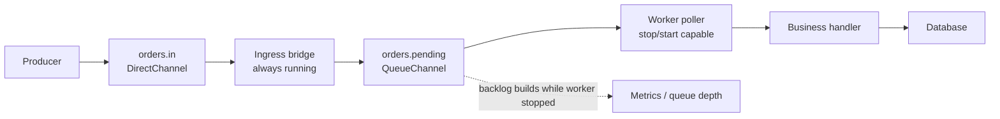
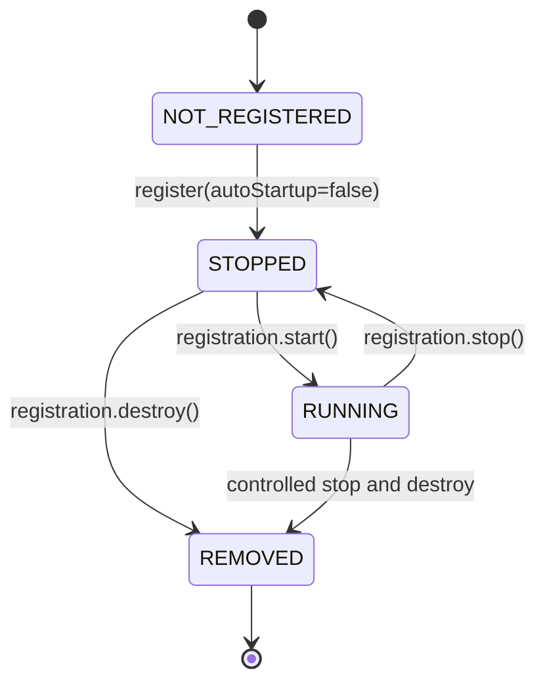
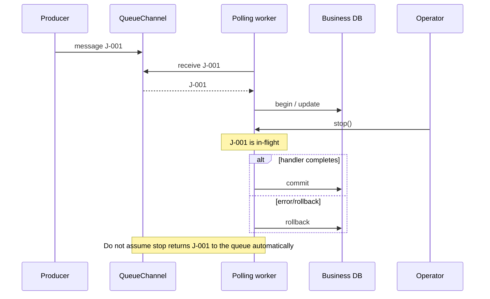

# Starting and Stopping Part of a Flow

## 1. Problem: Pausing One Branch Without Stopping the Entire Application

Spring Integration operates via **channels**, **endpoints**, **consumers**, **pollers**, **executors**, and the `IntegrationFlow`s that connect them. In real-world environments, you do not always want to shut down the entire Spring application context when a single component needs maintenance.

Suppose an order service has three branches:

- Ingress receives requests and puts them into a pending queue.
- Workers pull requests from the queue to invoke business logic or update the database.
- Status checks, logging, and error-handling branches continue running.

When the downstream database undergoes maintenance, operators want to **pause the worker** while keeping ingress and observability running. Once the database is ready, the worker is **started** again to process the waiting backlog. This is the problem of **starting and stopping part of a flow**.

In the **SPRING_INTEGRATION_RUNTIME** module, it is critical to understand how this lifecycle control affects message routing, channel subscribers, pollers and executors, transactions, retries, message stores, error channels, correlation, and runtime state.

> **Core takeaway:** Calling `stop()` on a consumer endpoint does not mean the entire flow or JVM stops, nor does it mean in-flight messages are rolled back. To pause safely, you must identify the exact **message intake point**, **buffers**, **in-flight work**, and **recovery mechanism**.

## 2. What Is "Part of a Flow" in Practice?

An `IntegrationFlow` is a processing pipeline description; at runtime, it may produce multiple components, including message channels and multiple endpoints. Controllability differs by component:

| Target | Common Operation | What Is Controlled |
| --- | --- | --- |
| **Consumer endpoint** | `start()` / `stop()` via `SmartLifecycle` | Whether the endpoint continues receiving/triggering message processing; scope depends on endpoint type. |
| **Polling endpoint** | Stop/start the polling consumer's lifecycle | Scheduling of new message polls from a `PollableChannel` or polling source. |
| **Lifecycle-aware producer/adapter** | `start()` / `stop()` | Whether the adapter continues ingesting from or emitting to external systems. |
| **Dynamic `IntegrationFlow` registration** | `IntegrationFlowRegistration.start()`, `stop()`, `destroy()` | Components managed by **that registration**, not every flow in the application. |
| **`MessageChannel`** | Typically has no "pause entire flow" operation | Transports or holds messages; stopping effects depend on consumers and channel type. |
| **Spring `ApplicationContext`** | Close/start context | Application-wide scope, broader than "part of a flow." |

`start` and `stop` apply to **lifecycle-aware components**. Do not assume every `MessageChannel`, transformer, or standalone handler bean can be stopped individually; many pure processing components only run when invoked by an endpoint.

### Two Ways to Partition Control Scope

1. **Control an endpoint inside a static flow:** use the endpoint's ID and a bean implementing `SmartLifecycle`. This fits when topology is fixed and you only need to pause a single consumer or inbound adapter.
2. **Register independent flows and manage them separately:** use `IntegrationFlowContext` to create an `IntegrationFlowRegistration` for each branch that needs toggling. This fits when flows vary by runtime configuration, tenant, or workload.

Do not confuse **flow beans**, **registrations**, **endpoint beans**, and **channel beans**. They have distinct names, lifecycles, and responsibilities.

## 3. Choosing the Pause Boundary: `DirectChannel` or `QueueChannel`?



Here, **ingress** and **worker** are two separate endpoints on opposite sides of a `QueueChannel`:

- When the worker is **running**, the poller pulls messages from the queue for processing.
- When the worker is **stopped**, the poller stops pulling new messages. Ingress can still enqueue messages **if capacity remains**.
- When the worker **starts again**, the poller resumes pulling waiting messages.

This is a useful design for pausing **consumption**, though it is not an unconditional guarantee:

- An in-memory `QueueChannel` **does not persist across JVM restarts**.
- Queues have bounded capacity; when full, producers may block, time out, or fail to send depending on `send` timeout and channel/adapter behavior.
- A message **already polled before `stop()`** may still be processing; `stop()` does not automatically undo side effects.
- Multiple polling consumers reading the same queue compete for messages. Stopping **one** consumer does not necessarily stop consumption from that queue.

### Comparison by Channel Type

| Channel / Mechanism | When Consumer Stops | What to Check |
| --- | --- | --- |
| `DirectChannel` | If no subscribers remain, new sends may fail with an error like "Dispatcher has no subscribers" | Remaining subscribers, producer response, and error handling. |
| `PublishSubscribeChannel` | Stopped consumer stops receiving new messages; other subscribers may still receive | Policy when zero subscribers remain and delivery requirements. |
| `QueueChannel` | New messages can accumulate for the poller to pick up later | Capacity, send timeout, backlog, persistent store. |
| `ExecutorChannel` | Already-dispatched tasks may be running or queued in the executor | In-flight tasks, pool shutdown, rejections; executor queues are not durable by default. |
| `PriorityChannel` / similar pollable channel | Consumer pauses intake, while dequeue order follows its specific policy | Priority ordering, capacity, and persistence. |

Thus, "turning off a handler" is not uniformly safe across all topologies. Place **buffers or backpressure mechanisms** at the right boundaries before designing pause/resume.

## 4. `SmartLifecycle` and Static Endpoints

Lifecycle-managed endpoints typically implement `SmartLifecycle`, providing capabilities such as:

- `start()`: transitions the endpoint into the active state.
- `stop()`: requests the endpoint to stop per the lifecycle contract.
- `isRunning()`: reflects the component's running flag; **does not prove all messages have finished**.
- `isAutoStartup()` and `getPhase()`: control auto-start and lifecycle ordering when the Spring context starts or stops.

Java DSL example creating a polling endpoint with an easily observable ID:

```java
import org.springframework.context.annotation.Bean;
import org.springframework.context.annotation.Configuration;
import org.springframework.beans.factory.annotation.Qualifier;
import org.springframework.integration.channel.QueueChannel;
import org.springframework.integration.config.EnableIntegration;
import org.springframework.integration.dsl.IntegrationFlow;
import org.springframework.integration.dsl.Pollers;
import org.springframework.messaging.PollableChannel;

@Configuration
@EnableIntegration
class StaticWorkerConfig {

    @Bean("jobs.staticPending")
    PollableChannel pending() {
        return new QueueChannel(100);
    }

    @Bean
    IntegrationFlow staticWorkerFlow(
            @Qualifier("jobs.staticPending") PollableChannel pending) {
        return IntegrationFlow.from(pending,
                endpoint -> endpoint
                    .id("jobs.staticPoller")
                    .poller(Pollers.fixedDelay(500)
                        .maxMessagesPerPoll(1)))
            .handle(String.class, (payload, headers) -> {
                System.out.println("Processed: " + payload);
                return null; // One-way endpoint, produces no reply.
            })
            .get();
    }
}
```

After the application starts, the endpoint can be controlled via its configured ID:

```java
import org.springframework.context.ApplicationContext;
import org.springframework.context.SmartLifecycle;

SmartLifecycle endpoint =
    context.getBean("jobs.staticPoller", SmartLifecycle.class);

endpoint.stop();
System.out.println("running=" + endpoint.isRunning());

endpoint.start();
```

`context` is the running `ApplicationContext`. Calling `getBean("jobs.staticPoller")` requires that ID to actually belong to the **endpoint bean** implementing `SmartLifecycle`. If your framework version or flow definition generates a different name, inspect the runtime endpoint list and use the exact ID; do not look up the flow bean or channel bean and cast it.

> **Warning:** stopping only a polling endpoint allows upstream components to continue accepting messages. If the queue is missing or becomes full, producers may fail or block. Verify the impact across the entire pipeline, not just `isRunning() == false`.

## 5. `IntegrationFlowContext`: Registering a Toggleable Branch

When you need to manage a branch at runtime, `IntegrationFlowContext` provides programmatic flow registration. A registration can have its **own ID**, be started/stopped, and eventually destroyed.



The diagram illustrates the **operational model**. `register` creates and manages the flow's beans; `start`/`stop` control the registration's lifecycle. `destroy` is an unregister/cleanup step, not equivalent to pausing. It does not automatically clear an independent queue's backlog or undo committed side effects.

### When to Use It

- Enabling/disabling a consumer for a job group, tenant, or feature.
- Registering a processing pipeline based on specific runtime configuration.
- Replacing a worker version with a new flow that has its own lifecycle.
- Reducing consumer concurrency when downstream throughput is constrained.
- Pausing one branch for data intervention while keeping monitoring and control branches active.

### Limitations

- Registrations and topologies created by `IntegrationFlowContext` live in **JVM memory**; after a restart, dynamic flows must be **recreated** from a persistent configuration source if they are expected to exist again.
- IDs must be managed explicitly. Registering two flows with the same ID/bean name causes collisions.
- Dynamic changes on one instance **do not automatically propagate to other instances**. If multiple replicas run consumers, all relevant replicas must be coordinated.
- `start()` returning does not by itself prove downstream is connected, queues are drained, or business dependencies are healthy.

## 6. Complete Example: Always-On Ingress, Pausable/Resumable Worker

Suppose we receive a `Job` with `jobId` and `tenantId`. The ingress branch **always** places messages into the queue; the worker branch only polls when started. The example uses an **in-memory queue** to clearly highlight the difference between pause and restart; a later section explains moving to persistence.

### 6.1. Domain and Business Worker

```java
import org.springframework.stereotype.Component;

record Job(String jobId, String tenantId) {}

@Component
class JobWorker {

    void process(Job job) {
        if (job.jobId() == null || job.jobId().isBlank()) {
            throw new IllegalArgumentException("Missing jobId");
        }
        System.out.printf(
            "worker=%s job=%s tenant=%s%n",
            Thread.currentThread().getName(),
            job.jobId(),
            job.tenantId());
        // Demo logs only. Production needs business transactions/idempotency.
    }
}
```

### 6.2. Channels and Static Ingress

```java
import org.springframework.context.annotation.Bean;
import org.springframework.context.annotation.Configuration;
import org.springframework.integration.channel.DirectChannel;
import org.springframework.integration.channel.QueueChannel;
import org.springframework.integration.config.EnableIntegration;
import org.springframework.integration.dsl.IntegrationFlow;
import org.springframework.messaging.MessageChannel;
import org.springframework.messaging.PollableChannel;

@Configuration
@EnableIntegration
class JobChannelsConfig {

    @Bean("jobs.in")
    MessageChannel jobsIn() {
        return new DirectChannel();
    }

    @Bean("jobs.pending")
    PollableChannel jobsPending() {
        return new QueueChannel(100);
    }

    @Bean
    IntegrationFlow jobsIngressFlow() {
        return IntegrationFlow.from("jobs.in")
            .bridge()
            .channel("jobs.pending")
            .get();
    }
}
```

`jobs.in` accepts messages synchronously, while `jobs.pending` serves as the queue between the two halves of the pipeline. Because the bridge endpoint remains active, producers do not depend directly on the worker's subscriber. When the worker stops, ingress keeps working **until the queue fills up or another error occurs**.

`QueueChannel(100)` holds at most 100 pending messages; it does not auto-expand capacity and **does not persist across JVM restarts**.

### 6.3. Managing the Dynamic Worker Flow

```java
import org.springframework.integration.dsl.IntegrationFlow;
import org.springframework.integration.dsl.Pollers;
import org.springframework.integration.dsl.context.IntegrationFlowContext;
import org.springframework.stereotype.Component;

@Component
class JobFlowManager {

    private final IntegrationFlowContext flowContext;
    private final JobWorker worker;

    private IntegrationFlowContext.IntegrationFlowRegistration registration;

    JobFlowManager(IntegrationFlowContext flowContext, JobWorker worker) {
        this.flowContext = flowContext;
        this.worker = worker;
    }

    // Each JVM instance manages a single demo registration.
    public synchronized void install() {
        if (registration != null) {
            throw new IllegalStateException("Worker flow already installed");
        }

        IntegrationFlow workerFlow = IntegrationFlow
            .from("jobs.pending",
                endpoint -> endpoint.poller(
                    Pollers.fixedDelay(500).maxMessagesPerPoll(1)))
            .handle(Job.class, (payload, headers) -> {
                worker.process(payload);
                return null;
            })
            .get();

        registration = flowContext.registration(workerFlow)
            .id("jobs-worker-v1")
            .autoStartup(false)
            .register();
    }

    public synchronized void start() {
        requireInstalled();
        registration.start();
    }

    public synchronized void stop() {
        requireInstalled();
        registration.stop();
    }

    public synchronized void remove() {
        requireInstalled();
        registration.stop();
        registration.destroy();
        registration = null;
    }

    private void requireInstalled() {
        if (registration == null) {
            throw new IllegalStateException("Worker flow not installed");
        }
    }
}
```

The snippet above uses the Java DSL/`IntegrationFlowContext` APIs of modern Spring Integration releases; verify exact API signatures against your project's dependency version. `autoStartup(false)` allows **registering without starting immediately**. `registration.start()` activates the worker; `registration.stop()` stops endpoints managed by this registration; `destroy()` removes the registration altogether.

`synchronized` here only prevents concurrent administrative calls on **one object within the same JVM**. It does not lock a consumer processing messages on a poller thread, does not create a distributed lock, and does not stop another replica from starting its own worker.

### 6.4. Pause/Resume Walkthrough

```java
import org.springframework.context.ApplicationContext;
import org.springframework.messaging.MessageChannel;
import org.springframework.messaging.support.MessageBuilder;

void runDemo(ApplicationContext context, JobFlowManager manager) {
    manager.install(); // Registration exists, worker is not polling yet.

    MessageChannel input = context.getBean(
        "jobs.in", MessageChannel.class);

    input.send(MessageBuilder
        .withPayload(new Job("J-001", "tenant-A"))
        .build(), 500);

    input.send(MessageBuilder
        .withPayload(new Job("J-002", "tenant-A"))
        .build(), 500);

    // Both messages are now waiting in jobs.pending.
    manager.start();

    // Once the poller has picked up and finished the messages, we can pause.
    manager.stop();

    input.send(MessageBuilder
        .withPayload(new Job("J-003", "tenant-A"))
        .build(), 500);

    // J-003 waits in the queue; worker is stopped so it does not poll yet.
    manager.start();

    // After verifying processing completed and wanting to drop the registration:
    // manager.remove();
}
```

This example illustrates control calls, not a test with strict wait conditions. In automated tests, always **wait for proof that J-001/J-002 finished processing** (via a latch/metric or DB state) before calling `stop()`. Calling `stop` immediately after `start` may catch one or both messages unpolled.

Calling `send(message, 500)` specifies a timeout when supported by the channel/adapter; check the boolean return value in real code. `send() == true` only indicates the send step was accepted per the channel's contract, **not that business processing committed**.

## 7. How Do `start`, `stop`, and `destroy` Differ?

| Operation | What Typically Happens | What Must Not Be Assumed |
| --- | --- | --- |
| `registration.start()` | Starts lifecycle endpoints belonging to the registration if not already running | Does not automatically fix database errors, error channels, or corrupted backlogs. |
| `registration.stop()` | Requests those endpoints to stop receiving/triggering work per lifecycle | Does not instantaneously cancel all in-flight processing or roll back transactions. |
| `registration.destroy()` | Removes the registration and beans/components managed by it | Does not mean queues outside the registration or business data are deleted. |
| `SmartLifecycle.stop()` on one endpoint | Stops **that specific endpoint** | Does not stop other endpoints sharing the input channel or running in the same process. |
| Closing `ApplicationContext` | Stops nearly all Spring infrastructure in the context | Does not replace recovery for hard crashes or volatile RAM data. |

In our example, `jobs.in` and `jobs.pending` are static flow/config beans, whereas `jobs-worker-v1` is managed by the dynamic registration. Therefore, calling `destroy()` on the worker **does not** delete the ingress and queue beans.

Conversely, if a dynamic registration **creates its own source, channels, and consumers**, `destroy()` may remove all of those components within its management scope. Never blindly apply conclusions from one topology to every flow.

### Avoiding ID and Bean Collisions

Assign meaningful/versioned IDs like `jobs-worker-v1` rather than random generated IDs when administration is needed. Never call `register` repeatedly with the same ID without checking prior state. When replacing a flow:

1. Stop accepting new work on the branch being replaced.
2. Determine in-flight and backlog state.
3. Stop and then destroy the old registration per policy.
4. Register the new flow with an explicit ID/version.
5. Start it, verify readiness, and resume draining the backlog.

Do not assume changing the ID alone prevents **two consumers** from polling the same queue if the old registration is still running.

## 8. Does Stopping a Consumer Halt In-Flight Work?

**You cannot conclude that from `stop()` alone.** Distinguish these states:

- **Not-yet-received:** message is still sitting in the queue/broker. Stopping the poller prevents new receives.
- **Received/in-flight:** message was already taken by the poller and the handler is running. Depending on implementation, `stop()` may wait, interrupt, or allow completion; verify against your actual version and configuration.
- **Committed/acknowledged:** side effects are finalized or the broker message is acked. `stop()` does not reverse that state.
- **Queued in executor:** task is queued but has not started; semantics depend on the executor, shutdown policy, and endpoint.



If a handler is blocked on a slow HTTP call or waiting for a JDBC lock, `stop()` does not automatically cancel that I/O. You need layered timeouts, draining mechanisms, and shutdown deadlines. If an endpoint uses polling transactions or broker acknowledgments, explicitly define the **receive → process → commit → ack** policy; never infer message state from the method name `stop()`.

## 9. Safe Pause Plan: Quiesce, Drain, Stop, Resume

A practical procedure when downstream requires maintenance:

1. **Enter quiesce mode** for the branch to be stopped: block new work at the source, or keep accepting into a clearly bounded buffer.
2. **Measure backlog and in-flight work:** number of queued messages, active workers, and longest transaction duration.
3. **Wait for bounded drain** if zero in-flight work is required. If waiting is not feasible, define the rollback/redelivery policy.
4. **Stop the endpoint/registration** of the worker branch. Check running status and ensure no new polls occur.
5. **Perform maintenance** while continuously monitoring queue depth, send timeouts, and error flows.
6. **Verify readiness** of the database/broker/target service before starting again.
7. **Start the right branch**, watching backlog drain and error/retry counts. Only reopen full traffic once metrics pass thresholds.

### Can You Keep Enqueuing While the Worker Is Stopped?

Yes, provided you size capacity carefully:

Suppose ingress receives **80 messages/second** and the worker is planned to stay stopped for **120 seconds**; the theoretical backlog grows by roughly `80 × 120 = 9,600` messages, excluding any pre-existing backlog. `QueueChannel(100)` in our example would fill almost immediately. Increasing `maxMessagesPerPoll` or worker count **does nothing while the worker is stopped**; you need a durable buffer with sufficient capacity, ingress throttling, or active backpressure.

With an in-memory queue, even if capacity suffices, a crash while the worker is stopped loses the entire backlog. If message loss is unacceptable, use a durable broker/channel store and verify replay across restarts.

## 10. Transactions, Retries, and `MessageStore` on Resume

### Transaction Boundaries

With synchronous `DirectChannel`, a handler can participate in the producer thread's transaction; with `ExecutorChannel` or a poller, handlers typically run on another thread. When stopping/resuming a poller, the transaction of an **already-received** message depends on the transaction advice or manager on the processing thread.

Verify each piece separately:

- **Business transaction:** does JDBC commit/rollback properly guard the SQL statements?
- **Receive/dequeue:** can taking the message be rolled back, or has the message already left the queue?
- **Acknowledgement:** does the broker source know whether processing succeeded?
- **Error publication:** if a handler fails on a worker thread, how are exceptions routed to the error channel, retries, or DLQ?

Stopping a poller **does not add a transaction** around `receive` if none was configured before.

### Retry Boundaries

If a job fails and retry advice is waiting on backoff, stopping the endpoint can occur between attempts. Do not assume `stop()` cancels active retry callbacks or undoes an already-succeeded attempt. Configure:

- Bounded retry counts and backoff;
- Idempotency keys such as `jobId` at the target database/API;
- Recovery or DLQ handling when retries are exhausted;
- Metrics for in-flight retries and post-resume outcomes.

A message that already committed to the DB and gets redelivered after a stop/crash can execute again. Enforce unique constraints, idempotent updates, or transactional outboxes; **lifecycle `stop()` does not guarantee exactly-once processing**.

### Message Store and Group State

| State | When Stopping an Endpoint While JVM Lives | When JVM Restarts |
| --- | --- | --- |
| In-memory `QueueChannel` | Messages can remain in the queue | Lost unless another persistence mechanism exists. |
| `QueueChannel` with persistent channel message store | Saved/committed messages remain | Depends on storage, receive transactions, and serialization. |
| Aggregator with in-memory `MessageGroupStore` | Groups can remain within the same context | Incomplete groups can be lost. |
| Persistent `MessageGroupStore` | Group state is preserved in the backend | Must recreate endpoints/flows with matching correlation/release policies. |
| `MetadataStore` for checkpoints/idempotency | Markers remain in JVM memory | Needs a shared/persistent implementation to survive restarts. |
| Dynamic flow registration | Registration remains until destroyed or context closes | Must be re-registered from persistent configuration. |

Calling `start()` on an endpoint after a restart is **not enough** if the endpoint itself has not been recreated; durable data and topology/lifecycle are two halves of recovery.

## 11. Error Channels and Observability While Workers Are Stopped

If you stop only the worker while keeping producers running, failures may surface elsewhere:

| Situation | Possible Error/Symptom | What to Check |
| --- | --- | --- |
| Stopped last subscriber on `DirectChannel` | Dispatch error "Dispatcher has no subscribers" | Subscriber count, running endpoints. |
| Stopped poller reading `QueueChannel` | Queue depth rises, zero completions | Poller running status, queue capacity, send timeouts. |
| Queue full | Producers block or fail to send | Send latency, timeouts, failed sends. |
| Stopped error flow while business flows run | `ErrorMessage` unhandled or secondary errors | Error channel, subscriber/error handler lifecycle. |
| Stopped with queued executor tasks | Tasks keep running, get rejected, or fail per shutdown policy | Executor active tasks, queue depth, error logs. |
| Stopped dynamic flow then restarted app | Flow does not exist unless recreated | Dynamic config source and startup registration logic. |

Observe both **control-plane state** (registration/endpoint running, start/stop timestamps, actor) and **data-plane state** (messages accepted, dequeued, processing, committed, failed).

Useful log example:

```text
component=jobs-worker-v1 action=stop requestedAt=10:01:00
component=jobs-worker-v1 state=stopped pending=240 inflight=2
component=jobs-worker-v1 action=start requestedAt=10:03:00
component=jobs-worker-v1 state=running pending=240
component=jobs-worker-v1 completed=200 errors=1 pending=39
```

These numbers are illustrative; `isRunning=false` **does not** prove `inflight=0`. To log `inflight`, the application must track it explicitly. For `PollableChannel`, queue depth may be measurable depending on implementation; for brokers, query backlog/lag directly from the broker rather than inferring it from `MessageChannel`.

## 12. Multiple Instances and Dynamic Flow Changes

A "stop worker" API call sent to **instance A** does not automatically stop the worker on **instance B**. If both poll the same broker or persistent store, B will keep consuming work. Therefore, a system-level pause requires:

1. Distinguishing **instance-local pause** from **global pause**.
2. Dispatching commands across the list of live replicas with per-instance acknowledgment.
3. Preventing newly autoscaled/started instances from starting workers while the system is paused.
4. Storing **desired state** (e.g., `PAUSED`/`RUNNING` with version) in a persistent config source if it must survive restarts.
5. Inspecting effective state and backlog on each instance rather than relying only on desired state.
6. Resolving races between concurrent admin `start`/`stop` commands or between new deployments and reconciliation jobs.

`synchronized` inside `JobFlowManager` only coordinates concurrency inside one JVM. Across multiple instances, use distributed coordination or a proper control plane; do not assume Spring Integration provides a built-in cluster-wide pause command.

### Upgrading Flows Without Losing Messages

When upgrading a worker from `jobs-worker-v1` to `v2`:

- Stop or drain `v1` before `v2` processes **the same work** if business rules prohibit concurrent versions.
- If both read the same `QueueChannel`, the two pollers will **compete** for messages rather than duplicating them.
- If you want traffic-ratio canarying, use explicit routing/filters/channels to split traffic; never "canary" by starting two competing pollers expecting a fixed ratio.
- Keep payload/header contracts, serializers, transactions/acks, and message stores compatible between `v1` and `v2`.
- Define policy for messages already dequeued by `v1` that have not finished when `stop()` is called.
- Before destroying a registration, retain enough configuration to roll back to `v1` without relying on lost JVM state.

## 13. Managing IDs, Phases, and Startup Order

`SmartLifecycle` provides `isAutoStartup()` and `getPhase()`. Spring can use phases to order startup and shutdown across components. However, application-wide lifecycle ordering **does not replace** designing the real runtime dependencies of a dynamic branch.

For example, a worker should only start when:

- Database/migrations are ready;
- Essential error handlers and metric pipelines are running;
- The channel/queue the worker polls exists with the expected schema;
- Dependent components like lock registries or message stores are connected.

At startup, `IntegrationFlowContext.registration(...).autoStartup(false)` keeps the poller from starting before the control plane confirms preconditions. In static flows, configure `autoStartup` and `phase` on the appropriate endpoints via DSL/bean lifecycle.

**ID conventions:** use a clear namespace such as `jobs.consumer.tenantA.v2` that never collides with existing channels or endpoints. Log both the registration ID and endpoint IDs so operators can locate the exact object. One flow can create multiple endpoints: calling `stop` on one specific endpoint differs from calling `stop` on the entire registration.

## 14. Testing Starting and Stopping Part of a Flow

A thorough test observes **messages sent before stop, in-flight at stop, and arriving after stop**.

| Test ID | Action | What to Assert |
| --- | --- | --- |
| S01 | Register worker with `autoStartup(false)` | Endpoint does not poll; messages enter buffer while capacity remains. |
| S02 | Start worker | Waiting messages are processed; backlog shrinks. |
| S03 | Stop worker when queue is empty | Zero new polls/processing after stop settles. |
| S04 | Send message while worker is stopped | Queue accepts message if space remains; business logic does not run yet. |
| S05 | Restart worker | Message from S04 is processed; startup logic causes no duplicate execution. |
| S06 | Stop while handler executes SQL/HTTP | Document exact in-flight outcome, rollback/ack, and timeouts; never guess from running status. |
| S07 | Fill buffer while worker is stopped | Producer receives backpressure/timeout per policy; no silent message loss. |
| S08 | Stop last subscriber on `DirectChannel` | Accurately diagnose message delivery errors. |
| S09 | Destroy registration then try starting old handle | Old registration is no longer valid; re-registration is required. |
| S10 | Restart JVM with in-memory queue | Waiting messages may be lost; do not label it "durable." |
| S11 | Restart JVM with persistent source | Recreate dynamic flow; verify recovery and idempotency. |
| S12 | Two replicas, stop only one | Remaining replica can keep processing; verify command scope. |

### Sample Assertions for the Demo

```text
Given: manager.install(), not yet started
When: send J-001 and J-002 to jobs.in
Then: pending increases by 2; processed = 0

When: manager.start() and wait for J-001, J-002 to finish
Then: processed = 2; pending = 0

When: manager.stop(); send J-003
Then: processed stays 2; pending = 1

When: manager.start() and wait for completion
Then: processed = 3; pending = 0
```

For reliable assertions, use a `CountDownLatch`, thread-safe counters, or committed business data with reasonable timeouts. **Never rely on a single `Thread.sleep(1000)` as conclusive proof** that a poller ran; scheduler timing, CI load, and database latency vary.

## 15. Operations and Troubleshooting Checklist

| Symptom | Possible Cause | Inspection Action |
| --- | --- | --- |
| Processing continues after `stop()` | In-flight messages or another poller/consumer still running | Log thread/endpoint IDs, active tasks, and all consumers. |
| Queue does not drain after `start()` | Poller not started, handler errors, wrong input channel, or unreachable store | Check `isRunning`, poll counts, error channel, queue/store metrics. |
| Producer sends fail after `stop()` | Stopped the last subscriber of a subscribable channel | Inspect topology and subscriber counts; add appropriate buffering. |
| Producers hang while worker is stopped | Queue full, `send` blocking for capacity | Check send timeout, backlog, capacity, and backpressure. |
| Backlog lost after restart | Queue is in-memory | Use durable broker/channel message store and test with SIGKILL. |
| Bean conflicts even after flow destroyed | Duplicate IDs or components outside the registration | Distinguish static beans from dynamic beans; inspect scopes and IDs. |
| Messages processed twice after resume | Redelivery/retry or two active consumers | Audit idempotency keys, acks, transactions, consumer counts. |
| Error channel receives no errors | Error endpoint also stopped or routing misconfigured | Check error handler lifecycle, `errorChannel` header, subscribers. |
| Only one replica stops while system keeps processing | Command applied locally only | Coordinate across all replicas and desired state. |
| `stop()` takes unusually long | Handler waiting on SQL/network/locks, executor shutdown policy | Capture thread dumps, check transaction timeouts, active tasks, lock waits. |
| Flow starts too early on deploy | Wrong startup order/readiness/`autoStartup` | Check dependencies, phases, and dynamic flow registration. |

**Pre-operations checklist:**

1. Know the exact bean/registration being stopped and which channels still have active producers.
2. Define how messages arriving while paused are handled: buffered, rejected, or backpressured.
3. Measure backlog, in-flight counts, processing times, retries, and error rates.
4. Define timeouts, transactions, and ack behavior for messages already received before `stop()`.
5. Have a JVM restart recovery plan; never rely on in-memory queues when durability is required.
6. Ensure admin controls require authentication, authorization, and audit logging.
7. With multiple replicas, distinguish local vs. global pause clearly.
8. Test resume and rollback with message IDs/correlation IDs before running under live load.

## 16. Exercises and Self-Check Questions

**Exercise 1 — Start/stop a static polling endpoint.** Using `StaticWorkerConfig`, look up the `SmartLifecycle` bean by ID `jobs.staticPoller`, call `stop`, send messages to the queue, then `start`. Observe `isRunning()` and the count of processed messages. Explain why the queue still accepts messages while the poller is stopped.

**Exercise 2 — Register a dynamic flow in stopped state.** Using `JobFlowManager`, call `install()`, send J-001 and J-002, wait to verify they remain in the queue, then start and measure backlog drain time. Does speeding up the poller or `maxMessagesPerPoll` change the result?

**Exercise 3 — In-flight during stop.** Make `JobWorker.process` wait on a `CountDownLatch` before finishing, start the poller, send J-003, then stop while the handler is still waiting. Record endpoint status, in-flight count, simulated commit timing, and what happens when the latch releases. Never run this exercise against production data.

**Exercise 4 — Backpressure when queue is full.** Keep the worker stopped and send more than 100 messages to `jobs.in`. Configure an appropriate send timeout, record successful/failed sends and wait durations. Design a clean producer response when the queue has no remaining room.

**Exercise 5 — From RAM to persistence.** Replace `jobs.pending` with a channel backed by a compatible persistent message store or durable broker. Pause, send a backlog, kill the test JVM, restart, and re-register the dynamic worker. Verify messages committed to the store are recovered.

**Exercise 6 — Retries and transactions.** Have the worker update a database and then throw an exception; compare a transaction around the handler vs. around the poller/receive, checking rollbacks and whether messages are redelivered. After resume, use `jobId` to verify no duplicate side effects occur.

**Exercise 7 — Upgrading worker v1 to v2.** Build two worker versions reading the same queue and assess the risk of both pollers running concurrently. Propose a stop/drain/destroy procedure for v1, install/start for v2, and rollback if v2 fails health checks.

**Exercise 8 — Multiple instances.** Run two replicas, each with its own `IntegrationFlowContext`. Stop the worker on replica A and demonstrate B can continue. Design desired-state control and startup reconciliation across all replicas.

### Self-Check Questions

1. How does stopping an `IntegrationFlowRegistration` differ from closing the `ApplicationContext`?
2. Why can `DirectChannel` throw "no subscribers" after its last consumer is stopped?
3. Why does `QueueChannel` enable pausing a worker without guaranteeing against message loss across a crash?
4. Does `stop()` guarantee an active transaction rolls back? What must you observe to know the outcome?
5. Does `SmartLifecycle.isRunning() == false` prove zero messages are in-flight?
6. What is the difference between `registration.stop()` and `registration.destroy()`?
7. Why must dynamic registrations be recreated after a JVM restart?
8. If a queue has 100 slots, ingress runs at 80 messages/sec, and the worker stops for 2 minutes, what happens?
9. Why does stopping one worker not necessarily stop all consumers on the same queue?
10. When combining `ExecutorChannel` and a poller, which tasks may continue running after an operator calls `stop()`?
11. Why is idempotency still needed even with stop/drain and transactions?
12. How do you verify a cluster-wide pause rather than just a single JVM pause?

**Operational principle:** control the right **consumer endpoint or dynamic registration**, keep the **input–buffer–worker** boundary explicit and observable, and only then pause or resume. Evaluate running status, backlog, in-flight work, transactions, acknowledgments, and persistence separately. A `stop()` command is only safe when the system knows **where messages currently reside, who is still processing them, and what will happen on restart or JVM death**.
