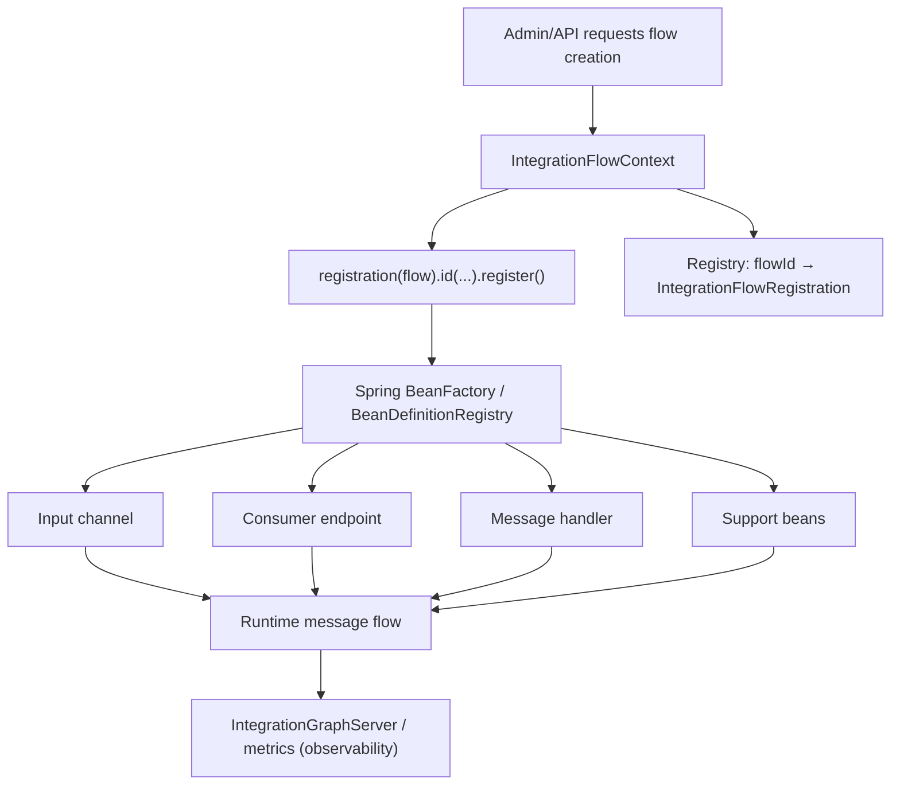
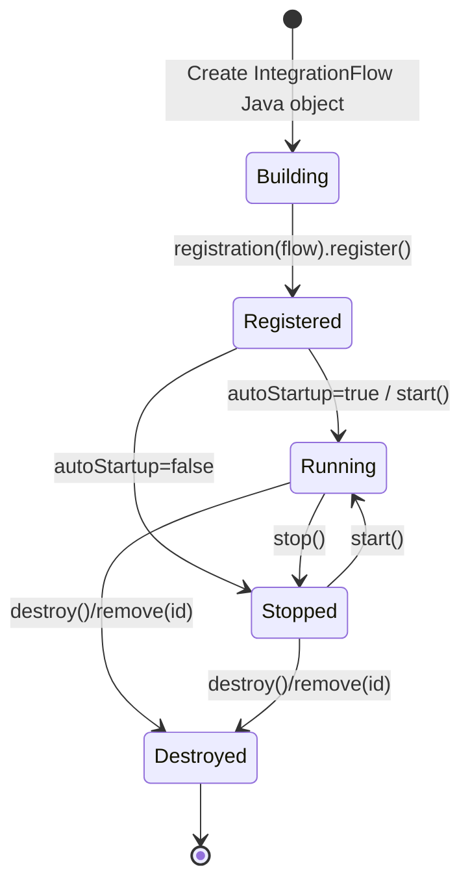
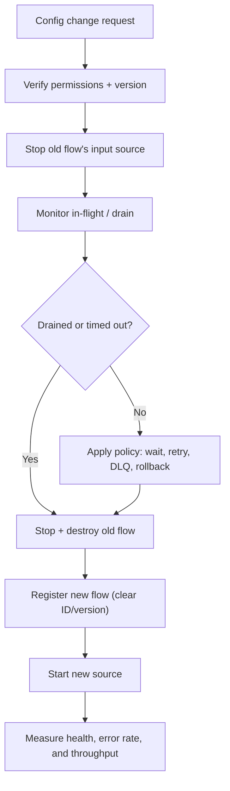
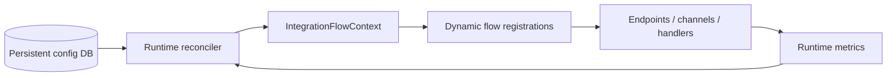

# Integration Component Registry in Spring Integration Runtime

## 1. Why Do We Need a Registry When Flows Are Created at Runtime?

An integration platform initially receives orders from a single source. Later, administrators allow customers to self-connect new data sources: each tenant has its own endpoints, channels, filters, handlers, and retry policies. You cannot restart the application every time a new tenant is onboarded. The system needs to **register, locate, control, and remove** integration components right at runtime.

In **Spring Integration Runtime** (`SPRING_INTEGRATION_RUNTIME`), the primary approach is registering dynamic `IntegrationFlow`s via **`IntegrationFlowContext`**. The framework wires the flow's components into the Spring application context, manages beans and lifecycles, and returns a **registration** for looking up and controlling the flow. This is the topic **"Registry of integration components,"** part of the **Dynamic runtime** chapter.

The registry does not replace channels or endpoints: it is the **management layer for the objects that create channels, endpoints, and handlers**. A flow may contain a `DirectChannel`, a `QueueChannel`, a polling consumer, a handler sending async replies, or a broker adapter. Once registered, those components still obey their inherent threading, transaction, retry, message store, and error-handling rules.

Lesson objectives:

1. Distinguish the `IntegrationFlowContext` registry, the Spring bean registry, and the runtime integration graph.
2. Register an `IntegrationFlow` at runtime using `IntegrationFlowContext.registration(...)`.
3. Understand flow IDs, bean names, prefixes, dependent beans, and how to look up registrations.
4. Control `start()`, `stop()`, `destroy()`, or `remove(flowId)` according to lifecycle semantics.
5. Send messages to a dynamic flow, distinguishing flows with and without an input `MessageChannel`.
6. Design configuration updates and safe flow removal while avoiding races and resource leaks.
7. Diagnose runtime issues: duplicate ID registrations, missing subscribers, still-running pollers, broken reply channels, unclosed connections, and lost state after restarts.

**Version scope:** APIs are presented per the Spring Integration 6.x line; some options such as `setDescription(...)` were added in 6.4. This lesson provides self-contained Java DSL examples and only uses features meaningful at runtime. Always verify APIs against your system's exact dependency version.

## 2. Three "Registry" Layers Not to Confuse

The word *registry* appears across many Spring docs, but each layer does not manage the same set of objects.

| Mechanism | What Does It Hold? | Use Case |
| --- | --- | --- |
| **`BeanFactory` / `BeanDefinitionRegistry`** | Bean definitions and Spring beans in the application context | Framework instantiates/wires channels, endpoints, handlers, connection factories, services. |
| **`IntegrationFlowContext`** | Map of `IntegrationFlowRegistration`s for dynamically registered flows | Registering, looking up by flow ID, controlling lifecycle, and removing dynamic flows. |
| **`IntegrationGraphServer`** | Graph model of integration components in the application | Observing channel–endpoint–handler relationships and runtime state; can integrate metrics. |

A dynamic flow is a **set of interrelated Spring beans**. Calling `register()` causes the framework to perform the required bean registration and initialization, rather than merely putting a Java object into a `Map`. Conversely, `getRegistry()` only shows **registrations managed by `IntegrationFlowContext`**; it is **not** a complete list of all Spring beans or static flows defined with `@Bean`.



### 2.1. Different Identifiers

| Identifier | Example | Meaning |
| --- | --- | --- |
| `flowId` | `tenant-acme-orders` | Key for a dynamic flow registration; must be **unique within the context**. |
| Component/bean name | `tenant-acme-orders.validator` | Bean name of a handler/channel/endpoint in the Spring context, subject to prefix/ID rules. |
| Message ID | UUID generated by `MessageHeaders` | Identifies **one message**, not a flow or tenant. |
| Correlation ID | `orderId = SO-42` | Groups messages belonging to the same business workflow/group. |
| Business tenant ID | `acme` | Domain key used to derive a flow ID; must be normalized and authorized. |

Do not use random values like `MessageHeaders.ID` to construct a `flowId` if the flow must be rebuilt after a restart. A flow ID should derive from a **stable** business/configuration identifier, such as `tenant-acme-orders-v3`.

## 3. The `IntegrationFlowContext` API Contract

The `org.springframework.integration.dsl.context.IntegrationFlowContext` interface is provided by Spring Integration as a bean when the integration infrastructure is enabled. It is the API for **dynamic flow registration**, not a global static registry.

| Method | Effect | Notes |
| --- | --- | --- |
| `registration(IntegrationFlow)` | Returns a builder to configure and register the flow | Not registered until `register()` is called. |
| `getRegistrationById(flowId)` | Returns the `IntegrationFlowRegistration` for a dynamic flow, or `null` if absent | Do not infer that a flow is running merely because a registration exists. |
| `getRegistry()` | Exposes a map of flow ID → registration | For observation; never mutate the map directly to add/remove flows. |
| `messagingTemplateFor(flowId)` | Returns a `MessagingTemplate` with default destination set to the flow's input channel | Flow must start from a `MessageChannel`; does not apply to all sources. |
| `remove(flowId)` | Destroys the dynamic flow and its managed dependent beans, clearing the registry cache | Different from merely stopping a flow; check in-flight work first. |

An `IntegrationFlowContext.IntegrationFlowRegistration` provides:

- `getId()`: the registered flow ID.
- `getIntegrationFlow()`: the corresponding flow object.
- `getInputChannel()`: the input channel if the flow starts with a channel.
- `getMessagingTemplate()`: a convenience template to send to the input channel.
- `start()` and `stop()`: lifecycle controls for the registration.
- `destroy()`: destroys the flow and dependent beans owned by the registration.

**Critical rule:** never equate `stop()` with `destroy()`. `stop()` retains the configuration/registration so it can be `start()`ed again. `destroy()` or `remove(flowId)` cleans up the registration and associated beans; afterwards, you must build/register a new flow if you want to reuse that ID.

## 4. Lifecycle of a Dynamically Registered Integration Component



This is an **explanatory model**; `Registered`, `Running`, and `Stopped` are not enum values on `IntegrationFlowRegistration`. Many endpoints/components expose their own lifecycle interfaces such as `SmartLifecycle`. A registration represents a group of managed components, not a transaction.

### Milestones to Distinguish

1. **Building:** creates the flow definition, handlers, and helper objects; channels/endpoints cannot yet be expected in the application context.
2. **Register:** the framework registers the flow and dependent beans, applying appropriate initialization/lifecycle callbacks. `autoStartup(true)` is the default.
3. **Running:** startable components are started; inbound adapters/pollers can begin receiving messages.
4. **Stop:** asks lifecycle-aware components to stop accepting data per their semantics. Stop **does not by default destroy** channels, stores, or persisted state.
5. **Destroy/remove:** destroys beans owned by the registration and deletes the registry entry. This is a side-effecting administrative action; handle in-flight work beforehand.

**Do not treat `stop()` as a forceful cancellation of all executing tasks.** A handler making a remote API call, a subscribed `Mono`, or a message already handed off to an executor may continue per component contract. To "drain" before replacing a flow, add in-flight tracking and an explicit timeout policy.

## 5. The Flow Registration Builder and Key Options

`IntegrationFlowContext.registration(flow)` returns an `IntegrationFlowRegistrationBuilder`. Common options:

| Builder API | Meaning | Recommendation |
| --- | --- | --- |
| `id(String flowId)` | Assigns a unique ID to the flow within the context | Always specify explicitly; avoid autogenerated IDs that are hard to trace. |
| `autoStartup(boolean)` | Whether to auto-start after `register()`; defaults to `true` | Use `false` when configuration/readiness must be verified before starting. |
| `useFlowIdAsPrefix()` | Prepends `flowId.` to bean/component names with explicit IDs inside the flow | Useful when instantiating multiple flows sharing internal component IDs. |
| `addBean(Object)` | Registers an additional support bean depended on by the flow | Use only for flow-owned beans so shared resources aren't destroyed accidentally. |
| `addBean(String, Object)` | Registers a named support bean | Watch for bean name collisions and ownership when removing the flow. |
| `setDescription(String)` | Human-readable description for the flow (6.4+) | Record purpose/owner using non-sensitive text. |
| `setSource(Object)` | Attaches a configuration source descriptor (5.2+) | Helpful for tracing configuration origins on error. |
| `register()` | Performs registration and returns the registration | Catch errors and clean up resources if registration fails. |

Since Spring Integration 5.0.6, the framework supports auto-prefixing by flow ID; calling `useFlowIdAsPrefix()` is especially helpful when **multiple copies of a flow declare the same explicit component IDs**. This method requires **`id(...)` to be set**. For instance, if two different flows both contain a handler named `"validator"`, prefixing distinguishes their bean names by `flowId` without manually renaming each tenant's handler.

### 5.1. One API Is the Builder, the Other Is the Registration

```java
IntegrationFlow flow = /* flow definition */;

// Not registered yet:
var builder = flowContext.registration(flow)
        .id("tenant-acme-orders")
        .autoStartup(false)
        .useFlowIdAsPrefix();

// From here on, a Spring-managed registration exists:
IntegrationFlowContext.IntegrationFlowRegistration registration =
        builder.register();

registration.start();
```

This snippet illustrates the sequence only; `flow` and `flowContext` must be built/injected in the application. Do not cache the builder as a running flow, and never call `register()` twice for the same flow ID.

## 6. Complete Example: Service Registering and Managing Per-Tenant Flows

Suppose each tenant has its own flow for receiving order-processing commands. The admin API exposes: register → start → submit message → stop → remove. The example below uses **`DirectChannel` and a synchronous handler** to test lifecycle without needing a broker or external connections.

**`TenantFlowManager.java`**

```java
package demo.dynamic;

import org.springframework.integration.dsl.IntegrationFlow;
import org.springframework.integration.dsl.MessageChannels;
import org.springframework.integration.dsl.context.IntegrationFlowContext;
import org.springframework.integration.dsl.context.IntegrationFlowContext.IntegrationFlowRegistration;
import org.springframework.messaging.Message;
import org.springframework.messaging.support.MessageBuilder;
import org.springframework.stereotype.Service;

@Service
public class TenantFlowManager {
    private final IntegrationFlowContext flowContext;
    private final OrderProcessor processor;

    public TenantFlowManager(
            IntegrationFlowContext flowContext, OrderProcessor processor) {
        this.flowContext = flowContext;
        this.processor = processor;
    }

    // synchronized only coordinates calls on this service instance.
    // Multiple JVMs require additional coordination/ownership mechanisms.
    public synchronized String register(String tenantId) {
        String flowId = flowId(tenantId);
        if (flowContext.getRegistrationById(flowId) != null) {
            throw new IllegalStateException("Flow already registered: " + flowId);
        }

        IntegrationFlow flow = IntegrationFlow
                .from(MessageChannels.direct())
                .handle((Message<?> message) -> {
                    OrderCommand command = (OrderCommand) message.getPayload();
                    if (!tenantId.equals(command.tenantId())) {
                        throw new IllegalArgumentException("Tenant mismatch");
                    }
                    processor.process(tenantId, command.orderId());
                })
                .get();

        IntegrationFlowRegistration registration = flowContext.registration(flow)
                .id(flowId)
                .useFlowIdAsPrefix()
                .autoStartup(false)
                .register();

        return registration.getId();
    }

    public void start(String tenantId) {
        requiredRegistration(tenantId).start();
    }

    public void submit(String tenantId, String orderId) {
        IntegrationFlowRegistration registration = requiredRegistration(tenantId);
        Message<OrderCommand> request = MessageBuilder
                .withPayload(new OrderCommand(tenantId, orderId))
                .setHeader("eventId", tenantId + ":" + orderId)
                .build();
        registration.getMessagingTemplate().send(request);
    }

    public void stop(String tenantId) {
        requiredRegistration(tenantId).stop();
    }

    public synchronized void remove(String tenantId) {
        String flowId = flowId(tenantId);
        IntegrationFlowRegistration registration =
                flowContext.getRegistrationById(flowId);
        if (registration != null) {
            registration.stop();
            registration.destroy();
        }
    }

    public boolean exists(String tenantId) {
        return flowContext.getRegistrationById(flowId(tenantId)) != null;
    }

    private IntegrationFlowRegistration requiredRegistration(String tenantId) {
        String id = flowId(tenantId);
        IntegrationFlowRegistration registration =
                flowContext.getRegistrationById(id);
        if (registration == null) {
            throw new IllegalArgumentException("Unknown integration flow: " + id);
        }
        return registration;
    }

    private static String flowId(String tenantId) {
        // Never derive bean names directly from unvalidated input.
        if (tenantId == null || !tenantId.matches("[A-Za-z0-9_-]{1,48}")) {
            throw new IllegalArgumentException("Invalid tenant ID");
        }
        return "tenant-" + tenantId + "-orders";
    }

    public record OrderCommand(String tenantId, String orderId) {}

    public interface OrderProcessor {
        void process(String tenantId, String orderId);
    }
}
```

**`DynamicFlowConfiguration.java`** — creates the application context to run the demo:

```java
package demo.dynamic;

import org.springframework.context.annotation.Bean;
import org.springframework.context.annotation.ComponentScan;
import org.springframework.context.annotation.Configuration;
import org.springframework.integration.config.EnableIntegration;

@Configuration
@EnableIntegration
@ComponentScan(basePackageClasses = TenantFlowManager.class)
public class DynamicFlowConfiguration {
    @Bean
    public TenantFlowManager.OrderProcessor orderProcessor() {
        return (tenantId, orderId) ->
                System.out.println("Processed " + tenantId + "/" + orderId);
    }
}
```

**`Demo.java`**

```java
package demo.dynamic;

import org.springframework.context.annotation.AnnotationConfigApplicationContext;

public class Demo {
    public static void main(String[] args) {
        try (var context = new AnnotationConfigApplicationContext(
                DynamicFlowConfiguration.class)) {
            TenantFlowManager manager = context.getBean(TenantFlowManager.class);

            manager.register("acme");                // Registered, not started
            manager.start("acme");                   // Start consumer lifecycle
            manager.submit("acme", "SO-42");         // One-way message
            manager.stop("acme");                    // Registration still exists
            System.out.println(manager.exists("acme")); // true
            manager.remove("acme");                  // Destroy + remove registry entry
            System.out.println(manager.exists("acme")); // false
        }
    }
}
```

### 6.1. Why Does the Example Use a Direct Input Channel?

`IntegrationFlow.from(MessageChannels.direct())` creates a flow with a registration-managed `MessageChannel` input, allowing `registration.getInputChannel()` or `getMessagingTemplate()` to send messages into it. The handler in this example returns `void` via `MessageHandler`, so this is a **one-way** flow; do not call `sendAndReceive` expecting a non-existent reply.

`DirectChannel` runs the consumer on the sender's thread for synchronous handlers. Thus `submit(...)` can receive handler exceptions directly at the send call. If you switch to an `ExecutorChannel` or put a `QueueChannel`/poller in between, the caller may return before the consumer actually finishes; in that case, you need an explicit error/correlation/ack model.

### 6.2. What Does This Example Intentionally Leave Out?

- `synchronized` only protects `register/remove` methods on **one manager instance**. It does not lock across JVMs, nor does it automatically make interleaved `submit` and `remove` calls on two threads safe.
- `OrderProcessor` is a bean shared across flows; the example does not add it to a dependent bean registration so it won't be accidentally destroyed when deleting one tenant.
- `stop()` does not mean "all work for the tenant is finished"; if the processor is slow or the flow switches to async, draining and in-flight tracking are needed.
- There is no durable store: dynamic flows and unprocessed requests **do not survive a restart**.
- There is no authentication in `submit`: in production, the tenant ID must come from a verified security context, not merely a client-supplied header.

## 7. Looking Up the Registry, Input Channels, and Templates

### 7.1. `getRegistrationById` and `getRegistry`

After registration, you can inspect whether an ID exists:

```java
IntegrationFlowContext.IntegrationFlowRegistration reg =
        flowContext.getRegistrationById("tenant-acme-orders");

if (reg != null) {
    String id = reg.getId();
    IntegrationFlow definition = reg.getIntegrationFlow();
    System.out.println("Registered flow " + id);
}

// Take a snapshot for display/monitoring; never mutate the registry map directly.
java.util.Set<String> ids = java.util.Set.copyOf(
        flowContext.getRegistry().keySet());
System.out.println("Dynamic flow IDs: " + ids);
```

`getRegistrationById` returns `null` when no dynamic flow exists with that ID. `getRegistry()` reflects the registration map, not a live list of running flows; a flow with `autoStartup(false)` still appears in the map.

**Do not execute:** `flowContext.getRegistry().put(id, customRegistration)` or `remove(id)` directly on the map. Those operations bypass bean creation/destruction and can leave the registry out of sync with the application context.

### 7.2. `getInputChannel()` and `getMessagingTemplate()`

When a flow starts with a `MessageChannel`, you can send to it:

```java
import org.springframework.messaging.support.MessageBuilder;

var reg = flowContext.getRegistrationById("tenant-acme-orders");
if (reg == null) {
    throw new IllegalStateException("Flow not registered");
}

reg.getInputChannel().send(
        MessageBuilder.withPayload("ORDER-42").build());

reg.getMessagingTemplate().convertAndSend("ORDER-43");
```

These two sends only illustrate the API; **the payload type must match** what the registered flow's handler expects (in the earlier tenant manager example, the handler expected `OrderCommand`, not `String`).

`flowContext.messagingTemplateFor(flowId)` also retrieves a template with a default destination, even for some statically defined flows. However, when a flow **does not start from a `MessageChannel`**—for example, starting from a scheduled inbound adapter/source—APIs retrieving the input channel or template do not apply and may throw `IllegalStateException`. Do not attempt to "manually send" messages to a polling source merely because you know its flow ID.

### 7.3. Request–Reply via Template

If a flow **has a reply-producing handler** and valid reply routing, `MessagingTemplate` can be used for `sendAndReceive`/`convertSendAndReceive`. Set finite timeouts, handle `null` when no reply arrives, and check error channels separately. A one-way flow will not produce a reply just because the caller chose a request–reply API.

```java
// Illustrates template usage; requires a flow that produces a valid reply.
var template = flowContext.messagingTemplateFor("dynamic-request-reply");
template.setReceiveTimeout(3_000L);
String reply = template.convertSendAndReceive("ping", String.class);
if (reply == null) {
    throw new IllegalStateException("Reply timeout or no reply");
}
```

In a runtime with concurrent correlation/replies, do not rely solely on default timeouts. Verify whether `replyChannel`, gateways, and adapters preserve headers per contract.

## 8. IDs and Bean Names: Name Collisions When Spawning Similar Flows

A common scenario is reusing the same DSL structure for 50 tenants:

```text
Tenant acme:   flowId=tenant-acme-orders   handler id=validator
Tenant beta:   flowId=tenant-beta-orders   handler id=validator
Tenant gamma:  flowId=tenant-gamma-orders  handler id=validator
```

If handlers/channels share explicit IDs, registration can hit a **bean name collision**. `useFlowIdAsPrefix()` distinguishes bean names across flows:

```java
IntegrationFlowContext.IntegrationFlowRegistration first =
        flowContext.registration(buildTenantFlow("acme"))
                .id("tenant-acme-orders")
                .useFlowIdAsPrefix()
                .register();

IntegrationFlowContext.IntegrationFlowRegistration second =
        flowContext.registration(buildTenantFlow("beta"))
                .id("tenant-beta-orders")
                .useFlowIdAsPrefix()
                .register();
```

This assumes `buildTenantFlow(tenantId)` creates a **fresh flow with properly owned endpoint/handler objects** on every call. Never pass the same mutable handler/endpoint instance into two independent registrations expecting the framework to share lifecycle safely.

**Naming rules:**

1. Flow IDs must be unique, stable, and namespaced, e.g., `tenant-acme-import-v2`.
2. Use `useFlowIdAsPrefix()` when reusing component IDs across flows.
3. Never use arbitrary client-provided strings as bean names without validation.
4. Avoid global beans whose names collide with generated beans from another flow.
5. If replacing a flow under the same ID, complete stop/destroy/remove on the old flow **before** registering the new one.

The framework guards against races when autogenerating bean names, but that **does not mean registering the same explicit flow ID from two threads gets merged into one**. ID allocation must still be synchronized at the application level.

## 9. Dependent Beans: The Registry Stores More Than Just the Flow Object

A dynamic flow using a TCP adapter may need its own connection factory, serializer, and deserializer. A flow reading SFTP may need a session factory; a flow using AMQP or JMS may need a connection factory, mappings, error handler, and scheduler. These support objects may require Spring lifecycle, dependency injection, initialization, and cleanup.

`IntegrationFlowRegistrationBuilder.addBean(...)` lets you register **flow-dependent beans** alongside the registration:

```java
// Illustrative: factory and flow created specifically for one tenant.
TenantConnectionFactory factory = new TenantConnectionFactory(config);
IntegrationFlow flow = buildTenantFlow(factory);

var registration = flowContext.registration(flow)
        .id("tenant-acme-tcp")
        .useFlowIdAsPrefix()
        .addBean("tenant-acme-tcp.connectionFactory", factory)
        .register();
```

`TenantConnectionFactory` and `buildTenantFlow(...)` are hypothetical domain types/methods; this snippet illustrates **ownership**, not a complete standard TCP API.

### 9.1. Ownership Rules When Using `addBean`

| Bean Type | Recommended Management |
| --- | --- |
| Connection/session factory created **exclusively for one flow** | Can be managed as a dependent bean; test actual init/stop/destroy behavior. |
| Client/connection pool **shared across multiple flows** | Create in the parent application context; never bind ownership to a single flow's registration. |
| Handler bean already part of the DSL flow | Avoid registering the same object twice with conflicting names or lifecycle handling. |
| Bean with its own threads, timers, or executors | Verify stop/destroy and resource cleanup after removing the flow. |
| Config object holding secrets | Never put raw secrets in the flow ID, description, source metadata, or logs/graph. |

`destroy()` destroys dependent beans **owned by the registration**, but do not interpret that as automatically closing every connection outside the JVM or purging durable data. A resource is only cleaned up properly if the bean and integration adapter implement their lifecycle/destroy contracts properly.

### 9.2. Why Not Call `registerSingleton()` Directly?

Spring's `BeanFactory` lets you register singletons or bean definitions manually, but doing so forces the application to handle initialization, lifecycle, bean naming, dependencies, and cleanup itself. Spring Integration provides `IntegrationFlowContext` to bundle these steps for **a flow and its dependent components**. When creating dynamic `IntegrationFlow`s, prefer this API over rebuilding the registry mechanics manually.

When you need to register a custom bean **that does not belong to a flow**, use the appropriate Spring bean registration API; do not force everything into `IntegrationFlowContext` as a generic service locator.

## 10. Where Does a Dynamic Flow Start: Channel, Poller, or Inbound Adapter?

Not every flow can be driven by a `MessagingTemplate`.

| Flow Entry Point | Example | Impact on Registry/Lifecycle |
| --- | --- | --- |
| Input `MessageChannel` | `DirectChannel` receiving commands from another service | `getInputChannel()` and template can be used to send messages. |
| `PollableChannel` + consumer poller | `QueueChannel` periodically fetching messages | Start/stop controls the polling consumer; the queue/store has its own lifecycle. |
| `MessageSource` with `SourcePollingChannelAdapter` | File, JDBC polling, SFTP inbound polling | Poller receives autonomously; the flow may **not** expose an input channel for callers to send to. |
| Message-driven inbound adapter | JMS, AMQP, TCP listener | Start/stop can affect the listener/connection; acknowledgments depend on the adapter. |
| Reactive inbound source | `Publisher`/`FluxMessageChannel` | Subscription and cancellation affect runtime behavior; does not imply a durable queue. |

### 10.1. When a Component Has a Poller

A dynamic flow initializing a polling source can start scanning right at `register()` if `autoStartup(true)`. If dependent beans lack credentials/permissions or the metadata store is not ready yet, the poller can fail immediately.

For safe provisioning:

1. Build and validate the configuration/source as far as possible.
2. Call `registration(flow).autoStartup(false).register()`.
3. Verify dependent beans, addresses, credentials, and monitoring.
4. Call `registration.start()` only when actually permitted to ingest data.
5. Observe at least one poll cycle or meaningful health signal.

Do not place long-blocking handlers on scheduler threads just because flow registration succeeded. Pollers, `TaskExecutor`s, transaction managers, and connection pools still require dedicated operational configuration.

### 10.2. Channels/References External to the Registration

A flow may subscribe to a **global shared channel** created beforehand by the application. When destroying the flow, the framework cleans up endpoints/dependent beans owned by that flow; **do not assume it deletes the shared channel or other flows' subscribers**.

Therefore, decide explicitly:

- Which channels are **flow-owned**, and which are **owned by the parent application context**.
- Whether an inbound source may be attached to multiple flows simultaneously, and who owns acknowledgments.
- When a flow is removed, whether downstream listeners/subscriptions still hold references to the old handler.
- If a `DirectChannel` has zero subscribers left after removal, `send()` calls can fail; producers need error handling or fallback routing.

## 11. Stopping and Replacing Flows While the System Holds Messages

Replacing a flow is a multi-step workflow, not an assignment `registry[id] = newFlow`. Suppose `tenant-acme-orders-v1` is receiving messages and an admin wants to roll out a `v2` processor.



In systems requiring zero downtime, you can **register `v2` alongside `v1`** under a new flow ID, switch routers/producers to `v2`, wait for `v1` in-flight work to finish, and then destroy `v1`. This avoids a gap between destroy and register, but requires preventing both flows from consuming the same source or processing the same event twice.

### 11.1. Why `stop()` Is Not Enough for Hot Swapping

`stop()` is a lifecycle signal. It does not necessarily:

- Cancel an already-sent remote HTTP request.
- Roll back a committed database transaction.
- Discard messages sitting in a `QueueChannel` or broker.
- Halt a `CompletableFuture`/`Mono` already running on another thread.
- Remove old bean names so a new flow can register under the same ID.

If you merely `stop()` and re-register under the **same ID**, you will hit a duplicate flow ID error. You must `destroy()`/`remove()` before reusing an ID, or use a new versioned ID. Never delete a flow by mutating `getRegistry()` directly.

### 11.2. Draining and Message Safety

Draining strategy depends on topology:

| Topology | What to Observe Before `destroy()` |
| --- | --- |
| Synchronous `DirectChannel` | Active call count; block new requests at the router/API. |
| `ExecutorChannel` | Running threads/tasks, executor queue, completion callbacks. |
| `QueueChannel` or JDBC store | Queue depth, message ownership, transactions, and resume point. |
| Poller | Source ack/checkpoint, active poll cycle, rollback/redelivery. |
| JMS/Kafka inbound | Listener container stop, prefetch/in-flight, offset commit/ack. |
| Reactive pipeline | Active subscriptions, cancellation, durable source, and retries. |

Never claim the registry itself provides **exactly-once** delivery or **automatic full draining**. An in-flight message may finish or fail *after* `stop()` returns, depending on the handler/adapter.

## 12. Runtime State Is Not Persistent Configuration

`IntegrationFlowContext.getRegistry()` lives inside **one JVM's application context**. After a restart, previously registered dynamic flows do not automatically reappear just because an earlier registry instance held their IDs. To persist long-term, maintain a separate **configuration source of truth**:

```text
Database/config service:
  tenant=acme, flowVersion=3, enabled=true, source=sftp-1
  tenant=beta, flowVersion=2, enabled=false, source=jms-5

Application startup:
  read approved configuration
  → build IntegrationFlow object
  → register via IntegrationFlowContext
  → start only enabled flows
```



### 12.1. Distinguish the Types of State

- **Configuration state:** list of tenants, flow versions, source addresses, enabled flags; requires persistence and auditing.
- **Registry state:** `IntegrationFlowRegistration`s inside the running JVM; lost when the context shuts down.
- **Message state:** messages in brokers, `MessageStore`, `MessageGroupStore`, or in-memory queues; each has its own durability.
- **Processing state:** checkpoints, idempotency keys, transaction outcomes, retry attempts; typically stored in a metadata store/DB.
- **Observability state:** metrics/graphs/logs; never a substitute for the source of truth when rebuilding flows.

A flow appearing in the registry does not mean SFTP checkpoints were saved durably, does not prove a broker acked, and says nothing about message ordering after a restart.

### 12.2. Reconciliation on Restart

A starting service can:

1. Read all authorized flow configurations from a trusted database/service.
2. Validate config schema, owner, security policy, and version.
3. Compute a stable `flowId` from tenant + purpose + version.
4. Check `getRegistrationById(flowId)` to avoid duplicate registration within the JVM.
5. Register with `autoStartup(false)` and attach support beans.
6. Start flows matching desired state.
7. Compare **desired state** against actual registry state, alerting on missing or extra flows.

Across multiple JVMs, the reconciler must enforce **ownership/sharding**: just because two nodes can read the same configuration does not mean both should bind the same TCP port or scan the same directory. If active-active is the goal, design transport, locking, idempotency, and partitioning for concurrency; `IntegrationFlowContext` does not perform distributed coordination for you.

## 13. Concurrent Registration and Race Conditions

When a REST API receives two `POST /flows/tenant-acme-orders` requests close together, both may observe that no registration exists yet. If both then call `register()` with an explicit ID, one request can fail with a duplicate bean/flow ID error.

```text
Thread A: getRegistrationById("acme") → null
Thread B: getRegistrationById("acme") → null
Thread A: register("acme") → success
Thread B: register("acme") → duplicate ID / registration failure
```

**Check-then-act** is not atomic. `getRegistry()` is an observational tool, not a transactional compare-and-set for registration.

### 13.1. Recommendations by Scope

| Scope | Approach |
| --- | --- |
| One manager service in one JVM | `synchronized` or a per-flow-ID lock around register/replace/remove; all callers must go through that manager. |
| Multiple services in one JVM | Use a shared coordinator/lock rather than each service creating its own mutex. |
| Multiple active-active JVMs | Use distributed ownership/config versioning/leases compatible with the message source; each JVM still keeps its own registry. |
| Durable state requirements | Source of truth in DB/config service, reconcile actual state; never synchronize by editing the raw registry map. |

Avoid holding a **global lock** across slow network operations: doing so blocks onboarding other tenants. Use per-`flowId` locks with bounded wait times; on failure, clean up partial resources and return a clear error.

### 13.2. Preventing Resource Leaks on Failed Registrations

A registration that fails midway can leave behind resources **created by the application outside Spring**, such as sockets, clients, or scheduled tasks started before registration. You should:

1. Validate configuration before opening expensive connections.
2. Prefer letting Spring's lifecycle manage flow support beans.
3. Avoid enabling pollers/inbound adapters before registration succeeds whenever possible.
4. On failure, look up the ID and clean up **via the official management API** if a registration was formed; clean up any remaining self-created resources with clear ownership.
5. Emit logs/metrics recording `flowId`, tenant, exception, stage, and cleanup outcome.

Never handle registration errors with `catch(Exception ignored)` and report the flow as ready.

## 14. Observing the Registry and Integration Graph

Once dynamic flows are registered, you need to know **which flows exist**, **which endpoints they own**, **where messages travel**, and **which components fail**. Two complementary views exist:

**Registry view:** `IntegrationFlowContext.getRegistry()` exposes registration IDs in the context. Useful for administrative queries: "is tenant acme registered?", "can this flow be stopped?", "how many dynamic flows are active?".

**Runtime graph view:** `IntegrationGraphServer` provides a graph of connected integration components and can include metrics. Useful for diagnostics: "does this channel have subscribers?", "which endpoint hosts this handler?", "did the new flow appear in the runtime model?".

Never use the runtime graph to **register or remove flows**; it is an observability tool, not a replacement for the lifecycle API.

### 14.1. Example Registry Inspection

```java
import java.util.ArrayList;
import java.util.List;
import org.springframework.integration.dsl.context.IntegrationFlowContext;

public final class DynamicFlowInventory {
    private final IntegrationFlowContext flowContext;

    public DynamicFlowInventory(IntegrationFlowContext flowContext) {
        this.flowContext = flowContext;
    }

    public List<String> registeredFlowIds() {
        // Snapshot. Do not retain a reference to mutate the map elsewhere.
        List<String> ids = new ArrayList<>(flowContext.getRegistry().keySet());
        ids.sort(String::compareTo);
        return List.copyOf(ids);
    }
}
```

Exposing all flow IDs on a public endpoint can leak tenant names or internal topology. Admin APIs must check authorization and restrict exposed fields; consider using opaque internal IDs rather than guessable customer names.

### 14.2. Integration Graph and Operational State

`IntegrationGraphServer` is registered as a bean when an application wants access to the integration graph model. It can be paired with management/JMX/Actuator mechanisms (depending on dependencies and configuration) to inspect:

- Input/output channels of endpoints.
- Subscriber counts on supported channels.
- Relationships from sources/pollers to consumers/handlers.
- Components registered into or removed from the application context.
- Message counts, error counts, send durations, and active states if enabled on the respective components.

The graph is derived from the **runtime model**, so after adding or removing a flow it may need to be refreshed/rebuilt depending on the API and how management tools cache results. Never treat a stale graph snapshot as proof that a new bean failed to register.

### 14.3. Essential Operational Metrics

| Signal | Meaning | Alert Condition |
| --- | --- | --- |
| `dynamic_flow_registered_total` | Count of successful registrations | Sudden spike may indicate infinite admin retries. |
| `dynamic_flow_registration_failed_total` | Failed registrations by exception type | Duplicate IDs, bean collisions, or adapter init errors. |
| `dynamic_flows_current` | Current registration count | Growing indefinitely as tenants are deleted suggests a leak. |
| `dynamic_flow_start_stop_total` | Start/stop frequency | High churn can destabilize connections/pollers. |
| `dynamic_flow_destroy_duration` | Time taken to remove and clean up | Increasing duration suggests resources failing to release promptly. |
| `inflight_messages{flowId}` | Messages currently processing | Used to verify drain before destroy. |
| `error_messages{flowId}` | Errors in flow/error channel | Correlate traces with tenant and flow version. |
| `poller_active / scheduler_queue` | Which flows are still polling | Detect orphaned tasks after removal. |
| `connection_active{flowId}` | Adapter connection/listener count | Rising after each replacement signals a resource leak. |

Metric names in this table are **suggested application instrumentation**, not all built directly into Spring Integration. In production, use Micrometer and Spring Integration management suited to your version, avoiding high-cardinality tags containing overly granular IDs.

## 15. Impact of the Registry on Transactions, Retries, and Error Flows

The registry manages **structure and lifecycle**; it does not enforce message transactional correctness. Dynamically registered flows can use transaction managers, message stores, and retry advice just like statically configured flows.

### 15.1. Flow Registration Is Not a Database Transaction

```text
Admin request:
  register IntegrationFlow
    → create beans, subscribe consumers, start adapters
  → return flowId

Message execution (separate):
  poll / receive
    → BEGIN business TX (if configured)
    → handler / DB update
    → COMMIT or ROLLBACK
```

Do not assume **a message's DB rollback** cancels a flow registration. Conversely, when `destroy()` succeeds, the framework does not automatically roll back committed transactions, reset Kafka offsets, delete received files, or purge messages sitting in persistent stores.

### 15.2. Thread Boundaries Still Apply

| Dynamic Flow Component | Behavior | Notes on `start`/`stop`/`remove` |
| --- | --- | --- |
| `DirectChannel` | Consumer typically runs on sender's thread | Exceptions propagate back; stopping the subscriber causes sender failures if no fallback path exists. |
| `ExecutorChannel` | Hands off messages to workers | Stopping the flow does not automatically cancel tasks already submitted to the executor. |
| `QueueChannel` + poller | Periodically pulls messages on a poller thread | Monitor pending queues and receive transactions. |
| Scheduled inbound adapter | Runs dedicated tasks while active | Confirm scheduled tasks halt after stop/destroy. |
| JMS/Kafka inbound container | Broker ack/offset depends on adapter | Stopping can trigger consumer rebalance and redelivery; test explicitly. |
| Reactive source | Subscription/cancellation per reactive runtime | In-flight publishers may need separate cleanup/timeouts. |

### 15.3. Error Channels Must Be Designed Into the Flow

Each dynamic flow may require:

- A shared `errorChannel` carrying `flowId`/`tenantId` headers and authorization filters.
- Or a per-tenant error flow **registered and removed under the same lifecycle** when appropriate.
- A retry policy bound to the right endpoint, avoiding double retries across JVM retries plus broker redeliveries.
- Durable recovery/DLQ storage so messages are not lost when a tenant flow is removed.

`ErrorMessage.getOriginalMessage()` can be `null`, and `MessagingException.getFailedMessage()` is not always populated; do not rely solely on those fields to identify a flow after a message crosses adapters. Attach stable `eventId`, `correlationId`, and flow version per contract.

**Anti-pattern to avoid:** a newly registered adapter whose backing resource isn't ready yet causes the handler to fail repeatedly and retry indefinitely inside the poller. Presence in the registry does not make an adapter healthy. Enforce health gates and appropriate circuit breakers/backoff.

## 16. Security When Exposing Flow Creation via a Runtime API

Allowing dynamic per-tenant flow registration is powerful: the application permits **creating endpoints, opening network connections, and executing processing logic** post-deployment. Poorly designed, it can become an unintended gateway to internal resources.

Core principles:

1. **Authorization checks:** only admins/provisioning workflows may register/start/stop/destroy; tenant users must never destroy another tenant's flow.
2. **Validate configurations:** endpoint types, hosts/ports, filesystem paths, queue/topic names, timeouts, and quotas must follow allowlists; never pass user-supplied arbitrary class names, SpEL expressions, or bean references into builders.
3. **Namespace IDs:** scope flow IDs, bean names, metrics, and error events to the authenticated tenant/purpose/version.
4. **Resource limits:** enforce quotas on flows per tenant, connections, pollers, executor threads, tasks, and message rates.
5. **Secret management:** keep credentials in a secret provider; never place raw secrets into `setDescription`, `setSource`, logs, or API responses.
6. **Audit lifecycle:** record who created, modified, started, stopped, or destroyed a flow, along with config version/hash and outcome.
7. **Reconcile and revoke:** when a tenant is disabled, stop sources, drain, and destroy the right flow while revoking external credentials/network access.

Never treat `flowId` itself as a security token. Knowing an ID is not authorization to call `stop`/`remove`.

## 17. Registry Troubleshooting Matrix

| Symptom | Possible Cause | Inspection Steps |
| --- | --- | --- |
| `register()` reports duplicate ID | Flow ID still in context; concurrent request raced | Check `getRegistrationById`, check–register race, lifecycle replacement. |
| Bean name collision across multiple flows | Duplicate component IDs, missing prefix, or misused shared bean | Check `useFlowIdAsPrefix()`, handler/channel IDs, and bean ownership. |
| `getRegistrationById(id) == null` | Not registered, already destroyed/removed, wrong ID/context | Check source of truth and which JVM instance handled the query. |
| Registry has flow but no messages process | `autoStartup(false)`, endpoint stopped, zero subscribers, source inactive | Check registration lifecycle, channel subscribers, poller/adapter health. |
| `getInputChannel()`/template fails | Flow starts from a source without an input `MessageChannel` | Inspect DSL entry point; do not use templates on polling sources. |
| Sent to channel but no reply arrives | One-way flow, wrong `replyChannel`, gateway timeout | Check output routing and request–reply contract. |
| Side effects occur after flow stopped | In-flight async tasks, executor/broker redelivery, pre-stop external call | Trace processing timeline and draining. |
| Beans still exist after flow removed | Beans are global/shared, not owned by registration; incomplete cleanup | Check ownership, `BeanFactory`, and destroy hooks. |
| Poller runs even though tenant is disabled | Edited config DB only without runtime reconciliation; another source active | Compare desired state against registry and scheduler tasks. |
| Flows lost after restart | Dynamic registry is JVM-local state | Reload persistent configuration and re-register at startup. |
| Same source processed twice across replicas | Both JVMs registered the same listener without ownership/idempotency | Add sharding, broker groups, distributed coordination, and checkpoints. |
| Duplicate output after flow replacement | Old and new versions ran concurrently, source redelivery, partial commit | Enforce cutover/draining, `eventId`, outbox/idempotency. |
| Error during `register()` with no `ErrorMessage` | Bean initialization/registration failure happened outside message flows | Catch exceptions in the admin service; do not rely on global `errorChannel`. |
| Connections/threads grow after each replacement | Dependent beans not destroyed or external resources lack cleanup | Measure resource counts before/after destroy; inspect lifecycle hooks. |
| Runtime graph misses newly added flow | Stale snapshot, unrefreshed graph, endpoints missing metadata | Rebuild/refresh graph and cross-check registry/`BeanFactory`. |
| Metrics lack flow ID after async handler | Headers/correlation dropped across adapter or thread switch | Propagate stable metadata and configure context propagation. |

### 8-Step Investigation Workflow

1. **Look up the flow ID in the source of truth:** tenant, purpose, version, enabled flag.
2. **Look up the registry in the exact JVM:** `getRegistrationById` and `getRegistry()`; record ID and expected lifecycle.
3. **Inspect beans/components:** channels, consumer endpoints, handlers, pollers, connection factories, and subscribers.
4. **Inspect threads/sources:** has the endpoint actually received messages; is the adapter polling/listening or stopped?
5. **Check transactions/errors:** did messages commit/ack, where are retries happening, and which channel receives `ErrorMessage`s?
6. **Check resources:** scheduler tasks, executor queues, sockets, connection pools, message stores, and queue depths.
7. **Check concurrency/replacement:** were there concurrent registration requests, two active flow versions, or two JVMs owning one source?
8. **Recover safely:** drain/stop/remove/re-register or switch routers; monitor errors and duplicates after cutover.

Never delete beans manually from `BeanFactory` without knowing which flow registration owns them. Surgical removal can leave registrations, graphs, and lifecycles in an inconsistent state.

## 18. Testing a Dynamic Registry

A unit test of a method building an `IntegrationFlow` does not prove Spring successfully registered the beans, subscribers, and lifecycles. Write an **integration test with a real `ApplicationContext`**.

### 18.1. Testing Register, Lookup, Stop, and Destroy

```java
package demo.dynamic;

import static org.junit.jupiter.api.Assertions.*;

import org.junit.jupiter.api.Test;
import org.springframework.context.annotation.AnnotationConfigApplicationContext;
import org.springframework.integration.dsl.context.IntegrationFlowContext;

class TenantFlowManagerTest {

    @Test
    void registersThenDestroysDynamicFlow() {
        try (var context = new AnnotationConfigApplicationContext(
                DynamicFlowConfiguration.class)) {
            TenantFlowManager manager =
                    context.getBean(TenantFlowManager.class);
            IntegrationFlowContext flowContext =
                    context.getBean(IntegrationFlowContext.class);

            String id = manager.register("acme");
            assertEquals("tenant-acme-orders", id);
            assertNotNull(flowContext.getRegistrationById(id));

            manager.start("acme");
            manager.submit("acme", "SO-42");

            // Stop does not remove the registration.
            manager.stop("acme");
            assertTrue(manager.exists("acme"));

            manager.remove("acme");
            assertFalse(manager.exists("acme"));
            assertNull(flowContext.getRegistrationById(id));
        }
    }

    @Test
    void rejectsDuplicateId() {
        try (var context = new AnnotationConfigApplicationContext(
                DynamicFlowConfiguration.class)) {
            TenantFlowManager manager =
                    context.getBean(TenantFlowManager.class);
            manager.register("beta");
            assertThrows(IllegalStateException.class,
                    () -> manager.register("beta"));
            manager.remove("beta");
        }
    }
}
```

This test suite relies on `TenantFlowManager` and `DynamicFlowConfiguration` from section 6, assuming JUnit Jupiter and Spring Integration Java DSL in the project. It verifies **registration APIs and basic lifecycle**, not durability, adapter connection shutdown, or in-flight message state.

### 18.2. Required Test Matrix for Real Deployments

| Test Case | What Must Be Verified |
| --- | --- |
| Valid ID registration | Registration created; channels/handlers initialized; can start and send. |
| Duplicate ID | Second request fails cleanly; no hidden flows or bean leaks. |
| `autoStartup(false)` | Flow registered, yet source does not poll/listen before `start()`. |
| `stop()` then `start()` | Registration remains; consumer resumes per lifecycle. |
| `destroy()`/`remove()` | Registry entry vanishes; flow-owned dependent beans are cleaned up. |
| 50 tenants sharing component ID | Zero bean name collisions thanks to prefixes and unique IDs. |
| Adapter/connection creation failure | Admin receives error; resources cleaned up; flow is never falsely reported ready. |
| Stop while processing | In-flight policy honored; no unintended message loss or duplication. |
| Update v1 → v2 | Both versions never consume the same source improperly; event IDs not processed twice. |
| App restart | Reconciler rebuilds enabled flows from config DB; offsets/idempotency intact. |
| Two concurrent admin requests | Only one registration per ID; other receives a clear error. |
| Two JVMs reading same config | Ownership/sharding prevents two nodes from binding the same port or polling the same source against policy. |
| Error in async handler | Error channel and correlation behave properly; do not check only `register()`. |

Never use `Thread.sleep(...)` as proof that "all tasks have stopped." For async endpoints, use latches, bounded awaits, in-flight metrics, and dedicated source/broker observation. When testing multi-JVM setups, use a real shared backend rather than two independent mock registries.

## 19. Hands-on Exercises

### Exercise A — Build a Simple Admin Service

1. Use `IntegrationFlowContext` to build a `register/start/stop/remove/list` service API for dynamic flows backed by a `DirectChannel` input.
2. Send messages into the flow using `registration.getInputChannel()` and `getMessagingTemplate()`.
3. Set `autoStartup(false)`, attempt sending before starting, and observe actual behavior for your version/channel.
4. Stop the flow; prove `getRegistrationById(id)` still returns the registration.
5. Destroy the flow; prove the registry no longer holds the ID and a new instance can register under the same ID.

### Exercise B — Two Identical Flows, Different Namespaces

1. Create two identical DSL `IntegrationFlow`s both setting a handler ID to `"validator"`.
2. Register them with `id("tenant-acme")` and `id("tenant-beta")`, calling `useFlowIdAsPrefix()`.
3. Inspect bean names in the Spring context and verify the generated prefixes.
4. Remove the `acme` flow and confirm `beta` continues working.
5. Try sharing a mutable support bean with improper ownership and explain why destroying one flow can break the remaining tenant.

### Exercise C — Dynamic Poller and Restart

1. Create a polling flow with `autoStartup(false)`; register without starting.
2. Call `start()` and measure polls/second; after `stop()`, verify the source stops ingesting new messages per contract.
3. Persist the flow's desired configuration in a database or dedicated config file for the exercise.
4. Restart the application context, reconcile, and rebuild enabled flows.
5. Add a persistent queue/message store and verify waiting messages survive the restart.

### Exercise D — Coordinated Hot Swap

1. Create `tenant-acme-v1` processing orders with processor version 1.
2. Register `tenant-acme-v2` with the new handler without sending messages to it yet.
3. Switch a router/producer to `v2` using a version-checked operation.
4. Wait for `v1` in-flight work to drain, then stop/destroy `v1`.
5. Inject a failure right at cutover and propose idempotency keys, rollback/retry, DLQ, and config rollback plans.

### Self-Assessment Questions

1. How does `IntegrationFlowContext.getRegistry()` differ from `BeanFactory` and `IntegrationGraphServer`?
2. Why does a dynamic flow disappear after a restart even though `getRegistry()` previously held its ID?
3. How do `registration(flow)` and `register()` differ regarding when beans and lifecycles are created?
4. Does `stop()` remove an ID from the registry? When should you use `destroy()`?
5. Why is `useFlowIdAsPrefix()` useful when instantiating 20 copies of the same DSL?
6. What is the risk of `addBean(...)` if a support bean is shared across multiple tenants?
7. Why doesn't `messagingTemplateFor(flowId)` apply to every flow starting from an inbound source?
8. Are bean registration errors guaranteed to go to the message flow's global `errorChannel`?
9. When a flow with an `ExecutorChannel` is stopped, are already-accepted tasks guaranteed to be canceled?
10. When registering the same flow ID from two threads, why can `getRegistrationById(...)` followed by `register()` race?
11. If two JVMs both run a reconciler, what coordination is needed beyond `IntegrationFlowContext`?
12. The registry helps manage lifecycle, but what actually protects messages from duplicate processing after a cutover?

## 20. Pre-Production Checklist for Using the Registry

1. Choose **stable, unique flow IDs containing no sensitive data**.
2. Separate durable **desired configuration** from the in-JVM registry.
3. Use `IntegrationFlowContext.registration(...)` and act only through the registration API; never mutate cache maps directly.
4. Set `autoStartup(false)` when flows require validation/provisioning steps before ingesting data.
5. Apply namespaces/prefixes to avoid bean ID collisions across similar flows.
6. Define **dependent bean ownership**, lifecycle, and closing of external connections.
7. Distinguish flows **with an input `MessageChannel`** from autonomous polling inbound adapters/sources.
8. Build a **stop → drain → destroy** or versioned cutover workflow, complete with timeouts and recovery.
9. Control register/remove concurrency within a JVM and ownership across multiple replicas.
10. Attach errors, metrics, correlation, and audits to flow ID + version.
11. Use durable stores/idempotency/outboxes per business requirements; the registry does not replace them.
12. Test failure injection, restarts, duplicate flow IDs, and resource cleanup.

## 21. References

- [Spring Integration Reference — Dynamic and Runtime Integration Flows](https://docs.spring.io/spring-integration/reference/6.4/dsl/java-runtime-flows.html)
- [Spring Integration API 6.4.2 — IntegrationFlowContext](https://docs.spring.io/spring-integration/docs/6.4.2/api/org/springframework/integration/dsl/context/IntegrationFlowContext.html)
- [Spring Integration API 6.4.2 — IntegrationFlowRegistration](https://docs.spring.io/spring-integration/docs/6.4.2/api/org/springframework/integration/dsl/context/IntegrationFlowContext.IntegrationFlowRegistration.html)
- [Spring Integration API 6.4.2 — IntegrationFlowRegistrationBuilder](https://docs.spring.io/spring-integration/docs/6.4.2/api/org/springframework/integration/dsl/context/IntegrationFlowContext.IntegrationFlowRegistrationBuilder.html)
- [Spring Integration Reference — Integration Graph](https://docs.spring.io/spring-integration/reference/graph.html)
- [Spring Integration Reference — Java DSL](https://docs.spring.io/spring-integration/reference/dsl.html)
- [Spring Integration Reference — Message Endpoints and Pollers](https://docs.spring.io/spring-integration/reference/endpoint.html)
- [Spring Integration Reference — Message Store](https://docs.spring.io/spring-integration/reference/message-store.html)
- [Spring Integration Reference — Error Handling](https://docs.spring.io/spring-integration/reference/error-handling.html)
