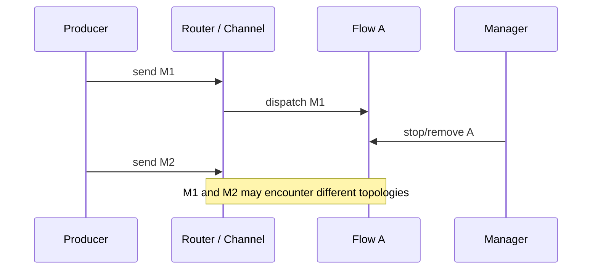
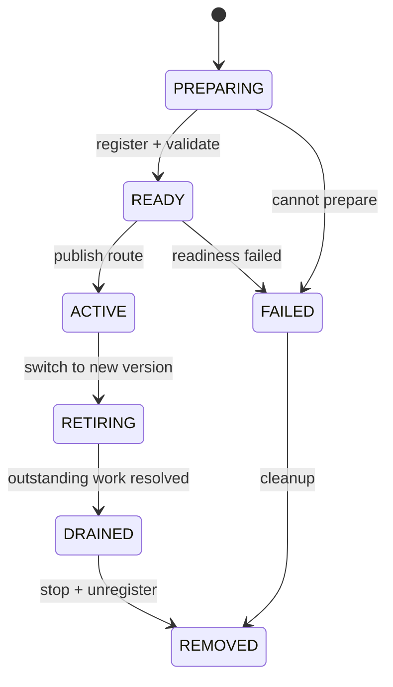
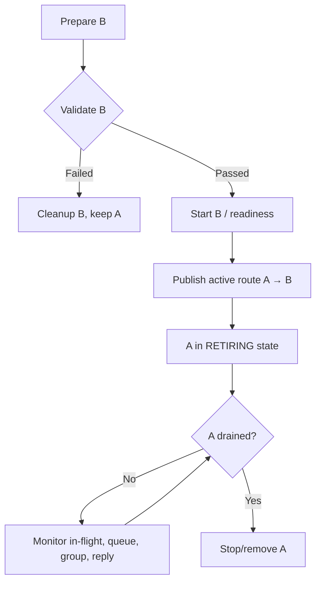
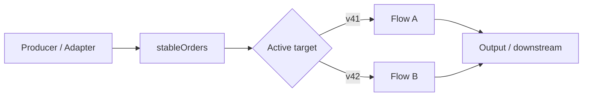
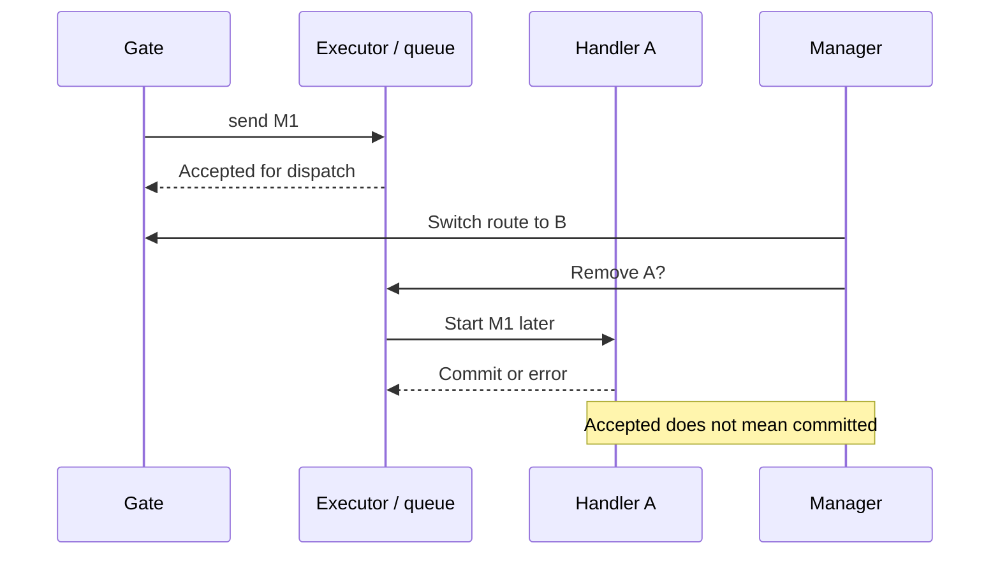
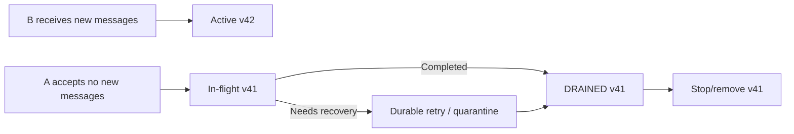
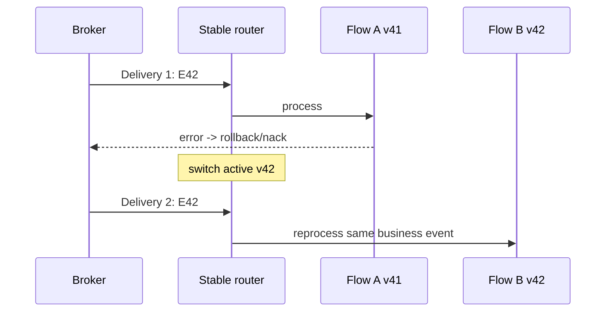
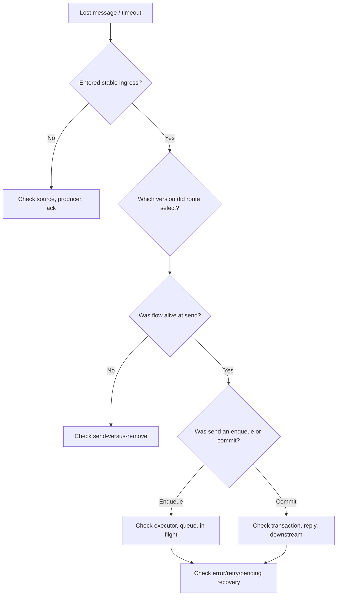

# Avoiding Races When Changing Topology

In **Spring Integration runtime**, the topology is the network of channels, endpoints, routers, handlers, pollers, executors, inbound/outbound adapters, and message stores. Beyond flows declared at application startup, a system can register, start, stop, or remove `IntegrationFlow`s while running. This is the foundation for adding per-tenant flows, updating routing paths, changing data sources, or upgrading handlers without restarting the entire service.

The challenge is that **messages and administrative operations do not execute on the same timeline**. One thread has already grabbed a reference to the old channel while another thread begins removing the flow; a poller may have just dequeued a message as the stop command arrives; an asynchronous callback may still be running when the new version is published. Without a cutover protocol, the result is dropped messages, duplicates, routing errors, or state split across two incompatible versions.

This lesson belongs to the **Dynamic runtime** chapter of the `SPRING_INTEGRATION_RUNTIME` module. Its focus is how to prevent races when changing topology: `IntegrationFlowContext`, dynamic flow lifecycles, staged registration, stable ingress, atomic cutover, quiesce/drain, transactions, retries/redelivery, message stores, correlation, and techniques for diagnosing threading, performance, and runtime state.

## 1. What Is a Race in Topology Changes?

A race condition occurs when outcomes depend on the uncontrolled ordering of concurrent operations. When modifying topology, at least three activities can overlap: **incoming messages**, **in-flight messages**, and **configuration-change commands**.



| Race Window | Scenario | Risk |
| --- | --- | --- |
| **Send vs remove** | Producer selects destination A right before A is removed | Zero subscribers or sending into a stopped endpoint |
| **Start vs source ownership** | Flow B starts its adapter before A stops pulling data | Consumer contention, duplicates, or unintended message splitting |
| **Ack vs async completion** | Source acknowledges after enqueue while async handler is still running | Handler failure no longer has a redelivery path |
| **Retry vs cutover** | Delivery 1 runs on A, redelivery runs on B | Different logic/schemas and inconsistent side effects |
| **Pending group vs cleanup** | Aggregator A holds part 1/3 while B receives part 2/3 | Incomplete groups or corrupted state |
| **Concurrent admin commands** | Two commands both modify from revision 41 | Stale update overwrites newer config |
| **Late callback vs destroy** | Reply/HTTP future for A finishes after removal | Callback errors, lost replies, or stale state updates |

What must be protected is not merely a Java pointer: it is the **contract defining who is still allowed to receive messages, who owns already-accepted work, and when old resources can be released**.

## 2. Defining Dedicated States for Topology

Spring Integration provides component lifecycles, yet applications typically need extra **administrative states** to decide whether routing can switch or a flow can be removed.



| State | Condition That Must Be Verified |
| --- | --- |
| `REGISTERED` | Beans and endpoints have been registered in the context |
| `STARTED` | Lifecycle `start` has been called on the relevant components |
| `READY` | Capable of receiving and processing valid traffic; dependencies are healthy |
| `ACTIVE` | The new-message dispatch point has selected this version |
| `RETIRING` | Accepts no new work; must still finish existing work |
| `DRAINED` | Zero in-flight tasks, backlogs, pending replies/groups, or other obligations needing the old version |
| `REMOVED` | Flow is stopped/unregistered and appropriate resources are freed |

**Registered does not mean Ready; Started does not mean Active; Stopped does not mean Drained.** These are distinct concepts, especially with `ExecutorChannel`, pollers, and ack/redelivery sources.

## 3. `IntegrationFlowContext` and What the API Actually Does

Spring Integration allows registering a dynamic `IntegrationFlow` via `IntegrationFlowContext`. A registered flow has its own ID, endpoints, and lifecycle. Common operations:

- `flowContext.registration(flow)` creates a builder for the registration.
- `id("orders-v42")` sets the unique identifier for the new flow.
- `autoStartup(false)` registers the flow without auto-starting it (when supported by the API version).
- `register()` registers the flow into the context and returns a registration.
- `registration.start()` and `registration.stop()` start/stop owned endpoints.
- `registration.getInputChannel()` retrieves the input channel for flows designed to accept messages that way.
- `flowContext.remove(flowId)` removes a dynamic flow by ID.

```java
// Illustrative fragment assuming IntegrationFlowContext flowContext is injected.
IntegrationFlow flow = f -> f.handle(message ->
        System.out.println("v42: " + message.getPayload()));

var reg = flowContext.registration(flow)
        .id("orders-v42")
        .autoStartup(false)
        .register();

// Prepare/validate steps are outside this fragment.
reg.start();
MessageChannel input = reg.getInputChannel();

// Stop/remove only after the version accepts no more work
// and all in-flight obligations have been resolved.
reg.stop();
flowContext.remove("orders-v42");
```

This is a **lifecycle fragment**, not a complete topology-replacement algorithm. Never place `start()` and `remove()` back-to-back and conclude preceding messages committed. Exact lifecycle methods and semantics must be checked against the Spring Integration version in use.

### 3.1. Stable-Input Flows vs. Self-Owned-Source Flows

**Channel-driven flows** only receive messages when a producer/router sends to their input channel. This type makes it easy to stage version B first and switch traffic afterward.

**Source-driven flows** own a file poller, JMS listener, HTTP adapter, or scheduler. Starting B may cause B to **start pulling messages immediately** even before any router points to B. When upgrading source-driven flows, coordinate source ownership or quiesce the old source rather than blindly applying the channel-driven procedure.

## 4. Why Both Common Naive Replacement Approaches Fail

### 4.1. Removing the Old Flow First

```text
T0  A is active
T1  remove(A)
T2  Producer sends M1 -> no suitable handler remains
T3  register(B)
T4  start(B)
```

The T1–T4 gap causes messages to fail. If the source does not retain messages for retry, work is lost.

### 4.2. Starting the New Source Before Stopping the Old Source

```text
T0  A is reading files/broker
T1  register(B) and start(B)
T2  Both A and B read concurrently
T3  stop(A)
```

With competing broker consumers, messages may be **split** between A and B rather than always duplicated, leaving per-message version handling uncontrolled; with file polling and uncoordinated metadata stores, duplicates can happen. **Never treat starting B as an atomic cutover.**

### 4.3. Lesson

Separate **flow registration** from **granting permission to receive production traffic**. Only a single controlled routing switch should decide which version receives new messages.

## 5. Controlled Replacement Workflow: Prepare → Publish → Drain → Retire

A practical operational plan has seven steps:

1. **Serialize control-plane changes:** every command carries an `operationId`, `expectedRevision`, and desired configuration.
2. **Prepare B:** build flow B with a new registration ID without sending live traffic yet.
3. **Validate B:** verify beans, input/output channels, schemas, dependencies, transaction managers, executors, and retry/error paths.
4. **Start B:** if B is channel-driven, start it before cutover and verify readiness.
5. **Publish route:** switch the stable routing point to B at a protected boundary.
6. **Drain A:** stop admitting new messages to A and wait for A's existing tasks to complete or move to durable recovery.
7. **Retire A:** stop/remove the old registration and clean up resources and state whose obligations have ended.



**A successful cutover does not mean deployment is finished:** A can remain in `RETIRING` until all pending state clears. There is no universal technical reason guaranteeing every flow drains instantaneously.

## 6. Stable Ingress Avoids Forcing Producers to Switch Channels

Keep a long-lived input channel like `stableOrders`; producers do not know whether handler A or B is active. A router/gate picks the input channel of whichever flow is currently published.



Stable ingress limits the blast radius of changes, yet **does not by itself eliminate the send-versus-remove race**. If a router reads reference A and a management thread removes A before `send()`, a producer can still send into a destroyed flow.

### 6.1. A Gate Protecting Route Selection and Synchronous Handoff

The Java snippet below uses `ReentrantReadWriteLock` so a route switch cannot interleave between target selection and a **synchronous `send()` call**. This example is for a one-way path; request–reply applications must preserve gateway reply/timeout contracts.

```java
import java.util.concurrent.locks.ReentrantReadWriteLock;

import org.springframework.context.annotation.Bean;
import org.springframework.context.annotation.Configuration;
import org.springframework.integration.annotation.EnableIntegration;
import org.springframework.integration.annotation.ServiceActivator;
import org.springframework.integration.channel.DirectChannel;
import org.springframework.messaging.Message;
import org.springframework.messaging.MessageChannel;
import org.springframework.messaging.MessageDeliveryException;
import org.springframework.stereotype.Component;

@Configuration
@EnableIntegration
class StableTopologyConfig {
    @Bean
    MessageChannel stableOrders() {
        return new DirectChannel();
    }
}

@Component
class StableIngressGate {
    private final ReentrantReadWriteLock gate =
            new ReentrantReadWriteLock(true);

    private volatile MessageChannel activeTarget;

    @ServiceActivator(inputChannel = "stableOrders")
    public void forward(Message<?> message) {
        var readLock = gate.readLock();
        readLock.lock();
        try {
            MessageChannel target = activeTarget;
            if (target == null || !target.send(message)) {
                throw new MessageDeliveryException(
                        message, "No active flow accepted message");
            }
        }
        finally {
            readLock.unlock();
        }
    }

    // Called from a management thread independent of handlers.
    MessageChannel switchTo(MessageChannel newTarget) {
        if (newTarget == null) {
            throw new IllegalArgumentException("Missing target");
        }
        var writeLock = gate.writeLock();
        writeLock.lock();
        try {
            MessageChannel previous = activeTarget;
            activeTarget = newTarget;
            return previous;
        }
        finally {
            writeLock.unlock();
        }
    }
}
```

A `forward()` call inside the read lock keeps the route stable until `send()` returns. `switchTo()` acquires the write lock to wait for in-progress read-locked sends before publishing the new target.

**Limitations to remember:** if the target is an `ExecutorChannel` or `QueueChannel`, `send()` can return after **enqueuing**, before any business commit. This gate only prevents races during **handoff**; it does not prove all of A's work has finished. You still must drain A before destroying it. Also, never call `switchTo()` from a thread currently holding the read lock; upgrading a read lock to a write lock will deadlock.

### 6.2. Why `AtomicReference` Alone Is Not Enough

```java
// RACE if another thread removes the flow owning target.
MessageChannel target = activeChannel.get();
// Management thread can destroy A right here.
target.send(message);
```

`AtomicReference` makes pointer replacement atomic, but **does not keep alive the object the old pointer referred to**. You can add a gate, reference-counting/leases, or pause ingress before swapping. Which mechanism fits depends on whether message intake is synchronous, async, or durable.

## 7. Registering Version B Then Publishing at One Point

Assign versioned registration IDs rather than reusing an ID while A is still present.

```java
// Illustrative fragment; flowContext and gate are Spring-injected.
IntegrationFlow v42 = f -> f.handle(message ->
        System.out.println("handler v42: " + message.getPayload()));

var newRegistration = flowContext.registration(v42)
        .id("orders-v42")
        .autoStartup(false)
        .register();

// System-specific validation: dependencies, outputs, health.
newRegistration.start();

MessageChannel newInput = newRegistration.getInputChannel();
// Management calls this only when ready:
MessageChannel previousInput = gate.switchTo(newInput);

// Do not remove registration v41 here.
// Monitor v41's in-flight/pending state until drained.
```

An `IntegrationFlow` like this receives messages via the registration's input channel; if the build has special inputs or `getInputChannel()` is invalid, never publish until the ingress design is fixed. A source-driven flow must not be started this way if starting immediately pulls production messages outside the managed path.

**ID rule:** `orders-v41` and `orders-v42` are distinct flows. Explicit endpoint IDs/bean names defined inside the flow must also avoid collisions; do not assume a new registration ID automatically resolves all duplicate bean names.

## 8. Do Not Confuse Handoff Completion With Processing Completion

With `DirectChannel`, synchronous handlers typically run on the caller thread. With `ExecutorChannel` or `QueueChannel`, `send()` may only enqueue and return early. Reactive flows can also return before async I/O finishes.



An operational definition of drained might be:

```text
drained(A) =
    no_new_admissions(A)
    AND sender_handoffs(A) == 0
    AND queued_messages(A) == 0
    AND in_flight_handlers(A) == 0
    AND pending_replies(A) == 0
    AND pending_groups_or_barriers(A) == 0
    AND unresolved_recovery_obligations(A) == 0
```

This contract must be **tailored to each flow**. Not every flow has every piece; a gateway has pending replies, an aggregator has pending groups, a JMS listener has unacked messages, and a scheduled endpoint has upcoming callbacks.

### 8.1. Tracking In-Flight Work Per Version

```java
import java.util.concurrent.atomic.AtomicInteger;

final class InFlightTracker {
    private final AtomicInteger active = new AtomicInteger();

    void begin() {
        active.incrementAndGet();
    }

    void finish() {
        active.decrementAndGet();
    }

    int count() {
        return active.get();
    }
}

// Synchronous scope illustration:
tracker.begin();
try {
    handler.process(message);
}
finally {
    tracker.finish();
}
```

`try/finally` is accurate only when `handler.process()` truly executes **synchronously**. If it returns a `CompletableFuture` or `Mono`, `finish()` must attach to completion/error/cancel callbacks rather than running right after task creation. Conversely, an in-flight counter of zero does not prove the queue is empty.

**Prerequisite:** once `RETIRING` is declared, no producer may increment A's in-flight count anymore. Otherwise, seeing zero at one instant is merely a transient snapshot.

## 9. Quiesce Then Drain Before Removal

**Quiesce:** stop admitting new messages to A. **Drain:** wait for everything A already accepted to finish or move to durable recovery.

1. Publish B and close admission to A across all entry points.
2. Wait for threads that already selected A to finish their handoffs.
3. Monitor queue/backlog and per-version in-flight handlers.
4. Monitor pending replies, aggregator groups, and barrier triggers if present.
5. Enforce a policy-driven deadline: keep A around, migrate state, or write durable recovery records.
6. Upon reaching `DRAINED`, stop/remove A's registration and clean up associated resources.



**Never remove A solely because queue depth is zero:** a handler may have already dequeued a message and still be processing it. A component's `SmartLifecycle.stop()` is not a blanket guarantee that all futures, transactions, or downstream callbacks have finished.

## 10. Coordinating the Whole Cluster: A Local Atomic Switch Is Not Enough

If a service runs three instances, each node has its own router:

```text
Node 1: active route = v42
Node 2: active route = v41
Node 3: active route = v42
```

`switchTo` is atomic inside each JVM, but **does not ensure** all nodes switch at once. To avoid unintended mixed-version behavior, the control plane needs:

- A durable, monotonically increasing **desired revision**.
- An **operationId** to prevent reapplying the same command.
- A rollout mechanism and per-node **applied revision** reporting.
- Readiness verification for the new version and a way to pull failing nodes out of ingress if necessary.
- Schema/message compatibility during the overlap while old and new versions both run.
- Reconciliation when a node restarts mid-rollout.

Distributed locks can serialize config changes, but **do not turn multiple nodes into a single atomic topology transaction**. Nodes still must report status and be orchestrated.

### 10.1. Preventing Stale Control-Plane Updates With Revisions

Two admins both see revision 41. One requests v42, the other requests v43. With an optimistic update:

```sql
UPDATE topology_config
SET revision = 42,
    desired_flow_id = 'orders-v42'
WHERE service_id = 'orders'
  AND revision = 41;
```

Only the command updating exactly one row is considered **accepted**. A command returning zero rows must re-read the revision rather than executing stale config. This SQL is the protocol for recording **desired state**; it has not yet registered/switched flows on each node.

## 11. Readiness: Successful Registration Is Not Enough

Flow B may register yet still fail to process messages properly:

| Check | Why It Matters |
| --- | --- |
| Bean/endpoint registration | Proves the flow was created, not that it works |
| Channel subscribers/outputs | Avoids `DirectChannel` with zero consumers or wrong outputs |
| Connections to DB/broker/API | Detects unavailable dependencies |
| Transaction manager/message store | Detects schema, permission, or propagation mismatches |
| Error/retry/recovery channels | Ensures errors aren't dropped on the new path |
| Handler contract/schema compatibility | Detects older payload versions failing on B |
| Synthetic canary | Exercises the real path without production side effects |
| Lifecycle health/startup errors | Confirms `start()` succeeded across components |

**Readiness must be defined per source type.** A file/JMS-sourced flow can only be readiness-checked without accidentally consuming real messages if the source is isolated or deliberately paused.

## 12. Pollers, Listeners, and Source-Driven Topologies

Suppose a poller calls `receive()` right as a management thread calls `stop()`:

```text
T0  poller enters receive()
T1  manager calls stop()
T2  receive() returns M1
T3  M1 has been handed to handler
T4  stop/callback completes
```

You cannot infer at T1 that no more messages will arrive. With JMS/AMQP brokers, listeners also have prefetch/unacked messages and redelivery policies. With an in-memory `QueueChannel`, a normal dequeue does not automatically roll back when a handler throws an exception. With a transactional JDBC message store, rolling back `receive` allows re-polling if transaction boundaries align.

| Source | Cutover Question |
| --- | --- |
| File adapter + accept-once | Was the file marked accepted before business import committed? |
| JMS/AMQP listener | Which prefetched/unacked messages still belong to A? |
| JDBC-backed queue | Are dequeue transactions/locks still active during stop? |
| HTTP gateway | Which requests are still awaiting a reply from A? |
| Scheduler/cron | Are scheduled ticks or running callbacks still active? |
| Reactive pipeline | Which subscriptions remain active, and does cancellation drop work? |

For source-driven flows, **stopping new intake at the source** and transferring ownership is usually a different strategy from publishing an internal router. Never force every adapter type through the same patch.

## 13. Retries and Redelivery Across Topology Versions

A message may fail on A and be redelivered by the source after routing has switched to B:



If A and B have different logic or schemas, the same business event can hit two sets of rules. Decide on one of:

1. **Version pinning:** messages carry `flowVersion`/`schemaVersion` or key ownership so retries return to A.
2. **Backward compatibility:** B accepts replays of old events and handles them consistently.
3. **State migration:** migrate A's state to B via an explicit protocol.
4. **Idempotency:** the same `eventId` never doubles side effects even when processed twice.

Distinguish **retry advice within one invocation** from **broker redelivery as a new delivery**. `RequestHandlerRetryAdvice` can call the handler multiple times; a recovery callback returning normally can make an adapter consider the work finished. A cutover does not automatically fix those semantics.

## 14. Correlation State: Aggregators, Resequencers, Barriers, and Replies

Suppose aggregator A is waiting on:

```text
group ORDER-42 (v41):
  part 1/3 -> arrived
  part 3/3 -> arrived
  part 2/3 -> missing
```

If `part 2/3` is routed to aggregator B with a separate store/region, both versions hold **incomplete groups** even though the system received all three parts. If B shares the same store with a different release strategy, state corruption can occur.

Three ways to handle this:

| Approach | When Suitable | What Must Be Guaranteed |
| --- | --- | --- |
| Pin groups by version | Old groups must finish with the same processor/strategy | Route subsequent parts and triggers to the right owner |
| Quiesce/drain entire groups | Waiting is feasible or bounded by finite timeouts | Expiry/discard/recovery for incomplete groups |
| Migrate group state | State must move to the new version | Schema compatibility, atomicity, and admission locking during migration |

**Resequencers** also must keep `sequenceNumber`/`sequenceSize` streams consistent; **barriers** must trigger the right correlation keys on the waiting version. Never delete A's message group store or barrier state just because B became active.

For request–reply, A's reply may arrive late after cutover. If A's callback/reply channel or correlation state has already been destroyed, callers can time out or lose results. Pending requests need a clear owner and completion/recovery path.

## 15. Transaction Boundaries Do Not Follow Pointer Swaps

A management thread swapping a route **does not automatically affect** transactions open on consumer threads:

```text
Consumer:
  BEGIN TX-A
  handle M1 on A
  ... DB work still active ...

Manager:
  publish B
  remove A?  (dangerous)

Consumer:
  COMMIT or ROLLBACK TX-A
```

With `ExecutorChannel`, the poller transaction may have already committed once the message was enqueued; the downstream handler runs on another thread and does not automatically join that transaction. Clarify **receive/ack transactions**, **handler transactions**, **error handling**, and **async completion**.

When switching flows across two DB schemas, use compatible strategies such as **expand/contract migrations** so in-flight A handlers can still finish. Dropping a database column the moment B goes active can break A even if the route switch itself was completely atomic.

## 16. Partial Failures and Route Rollback

Changing topology is multi-step, creating multiple failure points:

| Failure | Remaining State | Appropriate Action |
| --- | --- | --- |
| `register(B)` fails | A active, B incomplete | Keep A, clean up B |
| `start(B)` fails | B registered but not ready | Remove B, do not publish |
| Health check fails | B not receiving traffic yet | Keep A and report the root cause |
| Route publish fails | Pointer unclear if code failed mid-way | Re-read active revision before retrying |
| B fails after receiving messages | B may have partially committed | Reconcile business state, consider rolling back the route |
| A cannot drain | A still has groups/replies/in-flight work | Keep A or perform durable recovery |
| `remove(A)` fails | A may be left in a partial state | Record pending cleanup and retry idempotently |

### 16.1. Route Rollback Is Not Business Rollback

Suppose B processed 20 orders before an error was discovered. Switching the route back to A **does not undo** the 20 committed orders. Safe rollback requires backward compatibility, compensation, or recovery/replay. Therefore, topology versions must appear in business outcome logs, not just management logs.

Control-plane rollback also needs `expectedRevision`: if another admin already published C after B, a "revert to A" command must never blindly overwrite C.

## 17. Every Change Command Must Have a Clear Owner

If two admins submit simultaneously:

```text
Change X: expectedRevision=41, desired=v42
Change Y: expectedRevision=41, desired=v43
```

only one command may be accepted at revision 41. The manager needs:

- `operationId` to recognize retries of the same command.
- `expectedRevision` to reject stale updates.
- State logs for `PREPARING/READY/ACTIVE/RETIRING/FAILED`.
- Ownership of registrations and resource cleanup.
- Ability to reconcile desired/applied state after restart.
- A cap on how many flow versions may coexist simultaneously.

Within one JVM, a single-threaded management executor can serialize operations locally; across a cluster, shared revisions/coordination are required. **A lock inside one pod cannot coordinate an entire cluster.**

## 18. Runtime Monitoring and Diagnostics

Measure both the **control plane** (topology change commands) and **data plane** (actual messages):

| Signal | Explanation |
| --- | --- |
| Desired/applied revision per node | Which nodes have not applied the new topology? |
| Register/start/stop/remove outcomes | Which lifecycle step failed? |
| Active/retiring flow IDs | How many versions are currently alive? |
| Route selected count per version | Is new traffic still hitting A after cutover? |
| Sender handoff count | Are any `send()` calls still holding target A? |
| In-flight handler count | How many tasks is A still processing? |
| Queue depth, broker unacked, poller lag | Where is backlog sitting? |
| Pending replies/groups/barriers | What old-state obligations remain? |
| Commit/rollback, retry/redelivery | Are messages retrying or failing? |
| Drain duration, cutover latency | How did the topology change affect SLAs? |

Record `operationId`, `flowId`, revision, instance/thread, and business correlation IDs. Never use dynamic message IDs as high-cardinality metric labels.

### 18.1. Decision Tree When Messages Are Lost After Cutover



If the same event executes twice, investigate **retry advice**, **source redelivery**, **two adapters reading the same source**, **duplicate routing**, and **business idempotency**. A message delivered to a flow is only one stage, not proof of exactly-once business effects.

## 19. Testing Races With Deliberate Execution Scheduling

Races rarely show up in sequential message tests. Use `CountDownLatch` to pin messages right inside the route-switching window.

```java
import java.util.concurrent.CountDownLatch;
import java.util.concurrent.TimeUnit;

// Illustrative test fragment, not a complete test class.
CountDownLatch handlerEntered = new CountDownLatch(1);
CountDownLatch releaseHandler = new CountDownLatch(1);

void handleA(String payload) throws InterruptedException {
    handlerEntered.countDown();
    if (!releaseHandler.await(5, TimeUnit.SECONDS)) {
        throw new IllegalStateException("Timed out waiting in test");
    }
    recordHandledByA(payload);
}

// Test orchestration:
// 1. Producer thread sends M1 into A.
// 2. handlerEntered.await(...) confirms A is processing M1.
// 3. Management thread stages/starts B and switches the route.
// 4. Producer sends M2 -> expected to hit B.
// 5. Assert A is not removed while M1 is still waiting.
// 6. releaseHandler.countDown(), wait for drained, then remove A.
```

`recordHandledByA` is a mock helper provided by the test. With `DirectChannel`, the producer sending M1 blocks inside handler A, so a separate producer thread must be used to test concurrent cutover.

### 19.1. Recommended Test Matrix

| Scenario | Key Assertions |
| --- | --- |
| B fails to start | A stays active; no route lost |
| Continuous sends during switch | Every message has a clear outcome; none silently dropped |
| Read pointer A then remove | Gate/retire protocol blocks sending into a destroyed flow |
| `ExecutorChannel` still has tasks | A is not removed merely because `send` returned |
| Poller mid-`receive` | Stop does not assume completion before receive finishes |
| Redelivery after cutover | Version compatibility and zero duplicate business effects |
| Aggregator holding incomplete group | Group has clear owner/migration/recovery |
| Late reply from A | Caller gets result or audited timeout |
| Two concurrent control-plane updates | Stale revision rejected |
| Node disconnects during update | Applied revision is reconciled |
| JVM crash while B is staged | Restart cleans up or resumes per desired state |
| Cleanup of A fails | Recovery state is not deleted; cleanup retries idempotently |

Do not assert only `isRunning`. Verify business commits/acks, message counts in stores, redelivery counts, and final outcomes for each `eventId`.

## 20. Hands-on Exercises

### Exercise 1 — Changing Topology the Wrong Way

Register A while a producer sends messages continuously. Call `remove(A)` before `register(B)` and measure send errors during the gap. Switch to staged B + stable ingress; compare errors and when messages shift routes.

### Exercise 2 — `AtomicReference` Does Not Pin Flow Lifetime

Place a latch after the sending thread reads pointer A but before `send`. Have the management thread remove A, then let the sender proceed. Observe the failure; fix it with a read/write gate or reference pinning. Explain why async cleanup still requires draining.

### Exercise 3 — Handoff vs. Business Completion

Put A on an `ExecutorChannel` with a slow handler, then switch routes to B. Verify `send()` returned while A still has in-flight tasks. Define drain using queue depth + in-flight count, not queue depth alone.

### Exercise 4 — Cutover Amid Retries/Redelivery

Make E42 fail on A and redeliver from the source after B is active. Log `eventId`, version, retry attempt, and delivery count. Design an inbox/idempotency check so E42 never writes twice to the business DB.

### Exercise 5 — Incomplete Correlation Groups

Aggregator A receives parts 1/3 and 3/3. Switch to B and send part 2/3. Observe the split group; try pinning groups back to A or migrating state. Determine when A can safely be removed.

### Exercise 6 — Two Concurrent Changes

Submit two `expectedRevision=41` requests targeting v42 and v43. Use compare-and-set or SQL optimistic updates; only one succeeds. Ensure cleanup never accidentally removes the newly winning version.

### Exercise 7 — Pollers, Transactions, and Rollbacks

Build a poller receiving from a transactional source whose handler fails while management calls stop. Record thread, receive, rollback/commit, and redelivery behavior. Compare against an in-memory `QueueChannel`.

### Exercise 8 — One Cluster Node Fails to Apply the New Version

Simulate three replicas where one node stays stuck on v41. Propose readiness and ingress routing rules; verify that node never receives incompatible v42 payloads. After restart, reconcile desired vs. applied state.

## 21. Anti-Patterns to Avoid

| Anti-Pattern | Consequence | Fix |
| --- | --- | --- |
| Remove old before registering new | Gap with zero consumers | Prepare/publish/drain/retire |
| Start two adapters reading the same source | Contention or duplicates | Coordinate source ownership |
| Reuse an active flow ID | Bean/endpoint name collisions | Versioned IDs |
| Only swap `AtomicReference` then remove A | Send-versus-remove race | Gate/lease and draining |
| Treat `send()` success as commit | Async tasks still running | Track business completion and acks |
| Treat `stop()` as drained | Callbacks/groups still pending | Quiesce and verify outstanding obligations |
| Delete A's message store right at cutover | Lost group/reply/retry state | Controlled pinning/migration/expiration |
| Omit revisions on admin updates | Stale update overwrites newer one | Expected revision + operation ID |
| Use local locks to sync a cluster | Nodes hold different versions | Shared desired state |
| Roll back a route and assume DB rolled back | Committed side effects remain | Compensation/idempotency |
| Ignore source ack/redelivery | Messages lost or duplicated | Transactions/recovery at proper boundaries |
| Omit version logging on business events | Hard to pinpoint which version failed | Trace flow ID + correlation |
| Force cleanup on timeout without a policy | Lost business obligations | Durable recovery/quarantine |

## 22. Self-Check Knowledge Questions

1. **Why aren't `register(B)` and `remove(A)` naturally one atomic operation?** Because multiple lifecycles, threads, and sources sit outside a single shared transaction.
2. **Does `Started` mean `Ready`?** No; dependencies or output paths may still fail.
3. **What problem does stable ingress solve?** Producers keep one entry point while the router swaps versions at a single control point.
4. **Is `AtomicReference` enough to remove the old flow immediately after switching?** No; threads that already read pointer A can still call `send`.
5. **Why isn't `ExecutorChannel.send()` returning enough to retire A?** Downstream handlers may not have started or committed yet.
6. **How does quiescing differ from draining?** Quiescing stops accepting new work; draining resolves already-accepted work.
7. **Why do we need distinct versioned IDs?** To stage and roll back side by side, avoid collisions, and trace execution.
8. **Does a cutover roll back open transactions on A?** Not automatically.
9. **Can message E42 be redelivered to B even if the first delivery went to A?** Yes, if the source redelivers after the route switch.
10. **Why must aggregators pin or migrate group state?** Otherwise parts sharing a correlation key split across two versions.
11. **Why aren't local locks enough for a cluster?** Each JVM holds its own routing and lifecycle state.
12. **Does rolling back the active route erase side effects already committed by B?** No; reconciliation or compensation is required.
13. **What should happen when B fails to start?** Keep A active, do not publish B, and clean up B.
14. **What is the basic precondition before removing A?** Zero new admissions and all of A's in-flight/pending obligations are complete or moved to durable recovery.

## 23. Version-Aligned References

- [Spring Integration Reference](https://docs.spring.io/spring-integration/reference/): dynamic flow registration, messaging, endpoints, and lifecycle.
- [Spring Integration Java DSL](https://docs.spring.io/spring-integration/reference/dsl.html): creating and registering `IntegrationFlow`s.
- [Spring Integration Transaction Support](https://docs.spring.io/spring-integration/reference/transactions.html): transaction boundaries, pollers, and thread handoffs.

When implementing, verify exact `IntegrationFlowContext`, auto-startup, and lifecycle APIs for your dependency version; flows with custom adapters, channels, or publishers have distinct stop/recovery semantics.

## 24. Summary

**Avoiding races when changing topology means designing a version-transition protocol, not calling `register/remove` rapidly.** A trustworthy workflow separates **prepare, validate, publish route, quiesce, drain, and retire**; protects the window between selecting a destination and sending the message; tracks true in-flight work; preserves old state for retries/redeliveries, request–reply, and correlation; and manages revisions when multiple admins or nodes make concurrent updates.

When investigating failures, lay two timelines side by side: **message selected → accepted/enqueued → handler started → commit/ack → cleanup** and **flow registered → started → published → stopped → removed**. Whichever windows overlap improperly reveals the real race. **Adding locks, increasing timeouts, or checking `isRunning()` cannot substitute for proper boundaries, idempotency, transactions, and durable recovery.**
