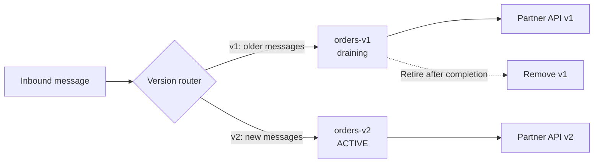
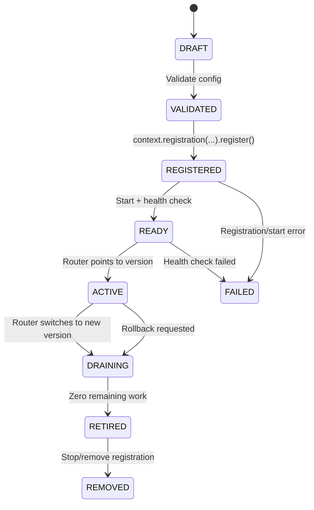
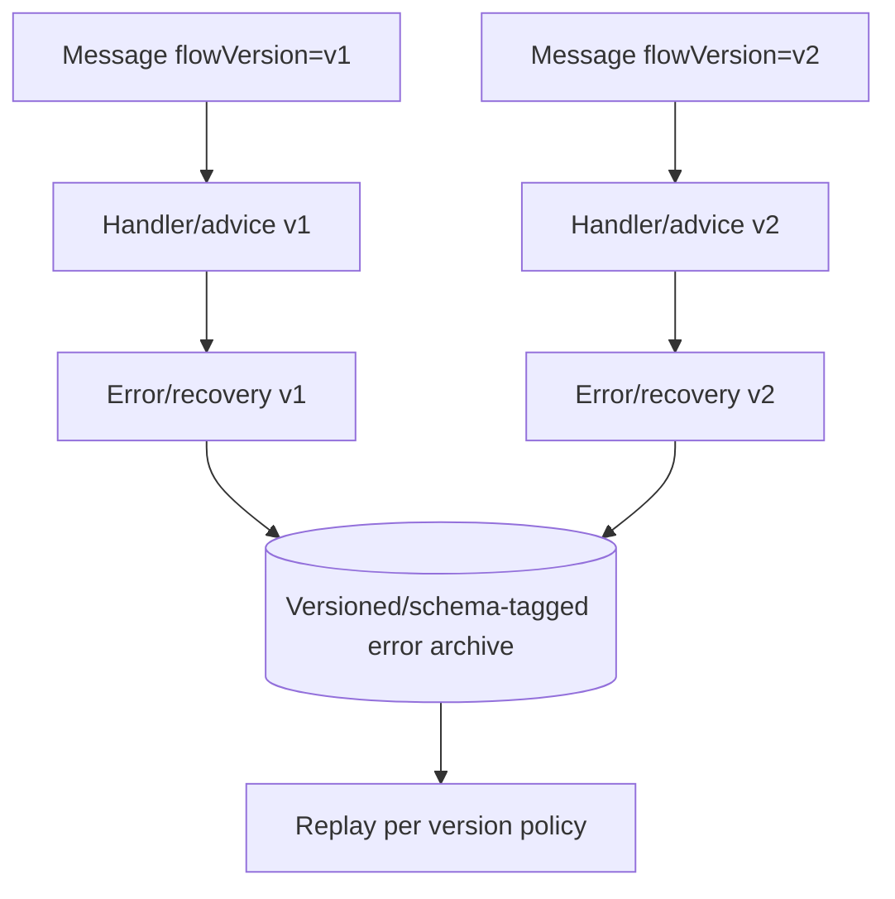

# Versioning Dynamic Flows in Spring Integration

## Learning Objectives

A Spring Integration application can construct `IntegrationFlow`s when the Spring context starts up. However, in multi-tenant systems, each partner has different routing rules; mapping configs, target endpoints, or retry policies may change while the application is running. In these cases, you can **register and manage dynamic flows** without restarting the entire application.

The lesson **Versioning Dynamic Flows** belongs to the **Dynamic runtime** chapter of the **SPRING_INTEGRATION_RUNTIME** module. Its scope covers versioning **flow definitions and runtime version transitions**, not just appending `-v2` to a bean name. We connect registering and removing flows with message channels, consumers, pollers, executors, transactions, retries, message stores, error handling, correlation, threading, performance, and runtime diagnostics while messages are still in flight.

After this lesson, you will be able to:

- Distinguish **flow definition version**, **deployment version**, **runtime registration ID**, and **business/message schema version**.
- Build immutable flow versions, register them with `IntegrationFlowContext`, verify IDs, and start/stop/remove them following the lifecycle.
- Design flow replacements using **register new version → test → switch route → drain → retire old version**.
- Explain why `stop()` and `remove()` do not automatically guarantee zero in-flight messages or committed business transactions.
- Pin messages to flow versions and stable correlation so retries/replays never inadvertently switch to an incompatible flow.
- Establish rollback policies, restart recovery, multi-instance rollouts, and endpoint/consumer leak monitoring.
- Write tests for version transitions while receiving messages, during downstream failures, and across process kills.

## 1. What Problem Does Versioning Dynamic Flows Solve?

Suppose a company integrates orders with a shipping partner. The initial version transforms payloads according to schema A and calls an old endpoint. A partner upgrades to schema B, requiring extra headers and a different target API. If you mutate the live flow serving all requests directly, it is hard to tell which rules apply to messages arriving right around the change. If you remove the old flow too early, queued or executing messages can be dropped mid-flight.

A safer approach is running two versions side by side temporarily:



During the transition window, the old flow stays alive long enough for messages pinned to v1, while new messages go to v2. **Switching routing and destroying a flow are two distinct actions**.

### 1.1. Questions to Answer Before Bumping a Version

1. Which messages must run under the old logic, and which are allowed onto the new logic?
2. Which channels, endpoints, retry advice, and message stores does the new version use? Are there bean name or group key collisions?
3. If a `QueueChannel`, poller, or executor is still processing v1, how do you know draining is complete?
4. Could v1 messages written to a broker/DLQ be replayed a week later?
5. Can schema changes read older data sitting in persistent stores?
6. After a restart, how does the application reconstruct the exact flow versions and active routes?
7. If v2 fails, is rolling back to v1 safe if some v2 side effects have already occurred?

That is the full scope of **versioning**, rather than merely adding a `version=2` field and calling `register()` again.

## 2. Four Versions and Identifiers Not to Confuse

| Concept | Example | Purpose | Should It Be Immutable? |
| --- | --- | --- | --- |
| **Definition version** | `order-flow@2.1.0` | Describes topology, routing, transformers, handlers, policies | Yes; logic changes emit a new version/revision |
| **Runtime registration ID** | `tenant-a.order.v2-r7` | Identifies a registered flow inside one JVM's `IntegrationFlowContext` | Must be unique within the context while present |
| **Active route/alias** | `tenant-a.order.active -> v2-r7` | Points to the version accepting new messages | Mutable under controlled transitions |
| **Message/schema version** | `schemaVersion=2` | How a created or stored payload/header is interpreted | Follows data contracts; not necessarily equal to flow version |
| **Application deployment version** | `service-build-2026.11` | Running build/container artifact | Independent of individual flow versions |
| **Business workflow run ID** | `order-42/run-3` | Distinguishes business processing runs | Stable within one workflow run |

For example, pod A and pod B may run the same build, yet pod A has registered `order.v2` while pod B still has `order.v1`. Thus, **identical deployment versions do not guarantee identical active dynamic flows**.

One flow version can handle multiple schemas via converters; conversely, a schema v2 message could traverse flow v1 if you intentionally maintain backward compatibility. Never assume `flowVersion` and `schemaVersion` are always identical.

### 2.1. Immutable IDs and Mutable Aliases

There are two naming patterns:

```text
Avoid reusing the same ID for changing definitions:
  order.flow -> definition A
  remove(order.flow)
  order.flow -> definition B

Prefer immutable IDs plus a route pointer:
  order.flow.v1-r3  -> definition A
  order.flow.v2-r1  -> definition B
  order.active      -> order.flow.v2-r1
```

The first approach makes it hard for logs, metrics, and error records to tell which code processed a message, and the gap between remove and register leaves a window with no consumer. With **versioned flow IDs**, v1 and v2 can coexist to support draining or rollback.

Include a **revision** or config digest when logic version stays the same while parameters change, avoiding reusing an ID for materially different definitions. A status document might store:

```json
{
  "logicalFlow": "tenant-a.order",
  "definitionVersion": "2.1.0",
  "revision": 7,
  "registrationId": "tenant-a.order.v2-r7",
  "configDigest": "sha256:example-digest",
  "status": "ACTIVE",
  "schemaVersionsAccepted": [1, 2]
}
```

This JSON is an **application-designed registry schema**, not a record generated by Spring Integration. In practice, the digest should be computed over a canonical configuration containing everything needed to rebuild the same flow; `example-digest` is illustrative only.

## 3. Practical Lifecycle of a Dynamic Flow

With the Spring Integration Java DSL, `IntegrationFlowContext` lets you register flows after the application context is running. A registration is managed by Spring via the API; it can own endpoints, subscribers, and dependent beans.



The states `DRAFT/VALIDATED/READY/ACTIVE/DRAINING/RETIRED` in the diagram represent an **application state machine you should persist yourself**, not a built-in `enum` on `IntegrationFlowContext`. The framework provides registration management operations; **deciding which version receives new messages and whether it can be retired is orchestration's responsibility**.

### 3.1. What `register`, `start`, `stop`, and `remove` Mean

| Operation | What It Does at Runtime | What It Does Not Guarantee |
| --- | --- | --- |
| `registration(flow).id(id).register()` | Registers flow components under an ID in the context | Does not persist definitions to a DB for restart recovery |
| `autoStartup(false)` | Registers without starting automatically per builder option | Does not mean the flow is READY or has serving subscribers |
| `registration.start()` | Starts managed lifecycle components | Does not prove downstream is healthy or business transactions committed |
| `registration.stop()` | Stops registration lifecycle components per their contracts | Does not abort in-flight I/O or drain external queues |
| `flowContext.remove(registrationId)` | Unregisters the managed registration by ID | Does not delete broker backlogs, message stores, metadata, or business history |

**Key point:** a flow should only receive traffic once it is registered, started, wired with needed endpoints/subscribers, and passing health checks. A flow just `register()`ed with `autoStartup(false)` must never be treated as ACTIVE.

### 3.2. Which Resources May Mutate After Registration?

Once a flow version is published, treat its **topology and policies as immutable**. Do not mutate handlers, transformers, or a `RetryTemplate` shared with v1 while v1 is still running just to turn it into v2. Sharing mutable singletons causes the old flow's behavior to change unexpectedly.

Read-only dependencies or shared connection pools may make sense, but every component holding **version-scoped mutable state** (retry/circuit-breaker advice, aggregators, schedulers/pollers, channel queues, idempotent receivers, correlation registries) must have its scope carefully verified.

## 4. Java Example: Registering Two Independent Dynamic Flows

A Spring Integration 6.x example using `IntegrationFlowContext` to register a flow after startup. Each version gets its own **dedicated input channel**, a unique registration ID, and a version-bound handler.

```java
import org.springframework.integration.channel.DirectChannel;
import org.springframework.integration.dsl.IntegrationFlow;
import org.springframework.integration.dsl.context.IntegrationFlowContext;
import org.springframework.messaging.Message;
import org.springframework.messaging.MessageHandler;
import org.springframework.stereotype.Component;

@Component
public class DynamicOrderFlows {

    private final IntegrationFlowContext flowContext;
    private final VersionedOrderHandler orderHandler;

    public DynamicOrderFlows(
            IntegrationFlowContext flowContext,
            VersionedOrderHandler orderHandler) {
        this.flowContext = flowContext;
        this.orderHandler = orderHandler;
    }

    public String registerVersion(String registrationId, String version) {
        // Check ID explicitly to avoid overwriting a running flow.
        if (flowContext.getRegistrationById(registrationId) != null) {
            throw new IllegalStateException("Flow already exists: "
                    + registrationId);
        }

        DirectChannel versionInput = new DirectChannel();

        MessageHandler handler = message ->
                orderHandler.process(version, message);

        IntegrationFlow definition = IntegrationFlow
                .from(versionInput)
                .handle(handler)
                .get();

        // Register without auto-starting so readiness can be checked first.
        var registration = flowContext.registration(definition)
                .id(registrationId)
                .autoStartup(false)
                .register();

        return registration.getId();
    }

    public void startVersion(String registrationId) {
        var registration = flowContext.getRegistrationById(registrationId);
        if (registration == null) {
            throw new IllegalArgumentException(
                    "Unknown flow: " + registrationId);
        }
        registration.start();
    }

    public void retireVersion(String registrationId) {
        var registration = flowContext.getRegistrationById(registrationId);
        if (registration == null) {
            return;
        }

        // Invoke only after orchestration verifies draining is complete.
        registration.stop();
        flowContext.remove(registrationId);
    }

    public interface VersionedOrderHandler {
        void process(String version, Message<?> message);
    }
}
```

This snippet focuses on **lifecycle APIs**, not a complete rollout system. It requires Spring Integration and Spring context dependencies, plus a real `VersionedOrderHandler` bean. Since the code uses `var`, use a Java version compatible with Spring Integration 6.x.

Key points to remember:

1. `registrationId` should include logical name, version, and revision (e.g., `tenant-a.order.v2-r7`); never use `order.active` as the registration's own ID.
2. A fresh `DirectChannel` gives each flow version its own entry point. Never share one input channel when targeting **only one** version; `DirectChannel` does not broadcast, and two subscribers on it become competing consumers.
3. `autoStartup(false)` allows registering before starting; route new messages into the flow only after `startVersion()` and readiness checks pass.
4. `retireVersion()` **does not verify on its own** that the version has zero in-flight work; drain enforcement belongs in the external management layer.
5. Checking the ID before `register()` produces a clear error, but is insufficient against two concurrent threads registering the same ID; use serialization/locking in the coordinator and catch duplicate registration exceptions.

### 4.1. Getting the Input Channel From a Registration

At runtime, callers can obtain a registration's input channel when the flow is configured with an appropriate input:

```java
var registration =
        flowContext.getRegistrationById("tenant-a.order.v2-r7");

if (registration == null || registration.getInputChannel() == null) {
    throw new IllegalStateException("Flow input is unavailable");
}

Message<?> message = MessageBuilder
        .withPayload("ORDER_CREATED")
        .setHeader("businessKey", "tenant-a:ORD-42")
        .build();
boolean accepted = registration.getInputChannel().send(message);
if (!accepted) {
    throw new IllegalStateException("Message was not accepted");
}
```

This illustrates code inside a routing layer with access to `flowContext`. **Do not let producers query or hardcode registration IDs directly**: centralizing routing makes cutover and rollback safe and observable.

`send()` returning `true` does not always prove a business transaction committed. With the `DirectChannel` in this example, the handler runs synchronously; if you later switch to an `ExecutorChannel` or add a queue, completion semantics change.

## 5. Keeping the Active Route Outside Flow Versions

To swap versions without a service gap, maintain a **stable routing layer** external to dynamic flows. It holds mappings like:

```text
tenant-a.order.active = tenant-a.order.v2-r7
tenant-b.order.active = tenant-b.order.v1-r4
```

If a new request arrives without `flowVersion`, the router assigns the active route's version. If a replayed message already carries a valid version header, the router must decide whether to honor the old version, perform a controlled migration, or send to an error/recovery queue; **never blindly force replays onto the new flow**.

### 5.1. Single-JVM Alias Router Illustration

```java
import java.util.concurrent.atomic.AtomicReference;

import org.springframework.integration.dsl.context.IntegrationFlowContext;
import org.springframework.messaging.Message;
import org.springframework.messaging.MessageChannel;
import org.springframework.messaging.support.MessageBuilder;

final class LocalVersionRouter {
    private final IntegrationFlowContext context;
    private final AtomicReference<String> activeRegistration =
            new AtomicReference<>();

    LocalVersionRouter(IntegrationFlowContext context) {
        this.context = context;
    }

    void setActive(String registrationId) {
        if (context.getRegistrationById(registrationId) == null) {
            throw new IllegalArgumentException("Unknown version");
        }
        activeRegistration.set(registrationId);
    }

    void routeNew(Message<?> input) {
        String chosen = activeRegistration.get();
        if (chosen == null) {
            throw new IllegalStateException("No active version");
        }

        var registration = context.getRegistrationById(chosen);
        if (registration == null) {
            throw new IllegalStateException("Version was removed: " + chosen);
        }

        MessageChannel channel = registration.getInputChannel();
        if (channel == null) {
            throw new IllegalStateException("No input channel: " + chosen);
        }

        Message<?> routed = MessageBuilder.fromMessage(input)
                .setHeader("flowVersion", chosen)
                .build();

        if (!channel.send(routed)) {
            throw new IllegalStateException("Message rejected by " + chosen);
        }
    }
}
```

This is a **minimal single-JVM illustration**, not a multi-instance production router:

- `AtomicReference.set()` swaps the alias atomically inside one JVM, but **does not** create a distributed transaction across nodes.
- Thread A may read v1's ID right before Thread B swaps the alias to v2. Thus **v1 must stay alive long enough** for requests that already picked v1; removing immediately causes a race. Use reference counting, a quiescence protocol, or an appropriate grace window.
- `getRegistrationById()` returning non-null does not guarantee the flow is actually READY; orchestration needs separate status and health checks.
- `flowVersion` is stamped at the **routing decision point** to support retries, replays, and tracing. If an incoming message already carries a version from prior processing, do not use `routeNew()` to silently overwrite it.
- Channels can throw instead of returning `false`. Callers need error/transaction/ack policies matching the source contract, not just boolean checks.

### 5.2. Policy for Already-Versioned Messages

A common rule:

```text
Brand-new message:
  version missing -> pick active -> stamp flowVersion -> durable handoff/route

In-flight or replayed message:
  flowVersion present -> preserve chosen version
  if version already retired -> controlled migration or error/recovery,
                                never arbitrarily switch to the new active
```

Pinning the version lets messages retry without changing transformers or schemas mid-flight. If an older version has a security flaw or partner deprecation, you may force migration of old messages, but only with proper validation, schema conversion, and rollback plans.

## 6. Cutover Workflow: Register → Warm Up → Switch → Drain → Remove

```mermaid
sequenceDiagram
    participant O as Orchestrator
    participant C as IntegrationFlowContext
    participant R as Stable Router
    participant V1 as Flow v1
    participant V2 as Flow v2
    O->>C: Register v2 (autoStartup=false)
    O->>C: Start v2
    O->>V2: Health/contract check
    V2-->>O: READY
    O->>R: Switch ACTIVE alias v1 -> v2
    Note over R,V1: New messages route to v2; v1 still has in-flight
    R->>V2: New order message
    O->>V1: Monitor in-flight/backlog
    V1-->>O: Drained / retry policy resolved
    O->>C: Stop + remove v1
```

### Step 1 — Build and Validate the New Version's Config

The definition must specify topology, supported message types, target endpoints, timeouts, retry/backoff, error channels, transaction boundaries, claim-checks/message stores, and resource quotas. Verify:

- No duplicate `registrationId`, channel names, or unique bean names.
- Handlers/transformers match payload types and header contracts.
- Untrusted config sources cannot inject arbitrary SpEL expressions, class loading, or outbound URLs.
- Thread pools and pollers have sufficient capacity while v1 and v2 run concurrently.
- Dependencies are healthy and v2 can handle older schemas during overlap if needed.

### Step 2 — Register Without Accepting New Traffic

Use `autoStartup(false)` and an immutable ID. After registering, **do not switch routing immediately**. If registration fails midway, keep the v1 alias and clean up the partial registration per actual outcome; never register v2 again under another ID and leak beans.

### Step 3 — Start and Run Health/Contract Checks

Start v2, verify endpoints subscribed to the right channels, confirm v2-specific pollers/adapters are properly configured, and run checks via a **dedicated path** without causing real side effects. If the flow includes self-driven inbound adapters, distinguish "starting to warm up" from "starting to consume the source": phased component startup or keeping the stable source outside versioned flows may be required.

### Step 4 — Switch the Active Alias

Only after v2 is READY should you switch the alias. Record the switch as an event containing version, operator, config digest, timestamp, and expected previous value. With multiple orchestrators, use compare-and-swap or coordination locks so two rollouts cannot overwrite each other.

### Step 5 — Drain v1

Allow v1 to keep processing **work already assigned to v1**, while routing zero new requests to v1. Wait for v1's in-flight messages, backlogs, transactions, retries, and pending groups to resolve within a published deadline. Never rely solely on "`send()` returned" or "zero CPU activity" to declare draining done.

### Step 6 — Stop and Remove

Once zero work remains for v1, stop and remove the registration by exact ID. Confirm v1's endpoints, subscribers, pollers, threads, scheduled tasks, resources, and metrics are no longer active. Removing a registration **is not a command to delete** message stores, DLQs, checkpoints, audits, or old schemas: cleaning those up is a separate retention/migration workflow.

## 7. What Is Draining and Why Is It Harder Than Stopping?

"Draining" means **halting new work admission into a version while letting already-admitted work finish or transition into a durable, recoverable state**.

| Endpoint Type | Work That May Remain After Halting New Routing | How to Prove Drain |
| --- | --- | --- |
| Synchronous `DirectChannel` | Handler running on sender thread; sender already chose v1 right before `send()` | Active invocation count, routing leases/grace window, transaction outcomes |
| `ExecutorChannel` | Tasks queued in executor or actively running | Active tasks, per-version queue depth, handler outcomes |
| `QueueChannel` / persistent queue | Messages awaiting poller/consumer | Queue depth, claim state, pending/retry backlog |
| Polling consumer | Active poll or source redeliveries | Poller state, in-progress batch, source acks |
| Inbound message-driven adapter | In-flight deliveries, broker redeliveries | Consumer state, ack/nack, delivery counts, retry queues |
| Aggregator | Incomplete message groups | Pending groups by correlation/version, timeouts, releases |
| Request/reply gateway | Callers still awaiting replies or timeouts | Pending requests, reply/error outcomes |

### 7.1. Recording In-Flight Work at the Right Scope

Track invocation starts and completions at endpoints/handlers tagged by `flowVersion`. For reactive/asynchronous processing, decrement in-flight counts when **actual completion occurs**, not when `subscribe()` is called or `send()` returns.

Suggested metrics:

```text
flow.inflight{version="v1"} = 12
flow.queue.depth{version="v1"} = 33
flow.group.pending{version="v1"} = 5
flow.error.deferred{version="v1"} = 7
flow.gateway.pending{version="v1"} = 0
```

These are **suggested metric names**, not default Spring Integration metrics. Avoid using per-message `correlationId`s as metric labels due to high cardinality.

Even when `inflight=0`, check queues, retry queues, message groups, and brokers for waiting messages. In asynchronous flows, draining is complete only when **all related work sources** are empty or safely handed off.

### 7.2. Rules When Draining Exceeds the Deadline

If a request is still stuck after 15 minutes:

1. Never blindly remove v1 merely because the deadline expired.
2. Identify whether a handler is blocked on I/O, a transaction is hung, or a group is missing parts.
3. Choose **wait**, **controlled cancel**, **requeue/durable snapshot**, **migrate to v2**, or **quarantine** per business policy.
4. Ensure message data, schema, and old version metadata are saved before transitioning.
5. Log why the operator chose forced retirement; measure affected messages and verify idempotency.

If a handler already called an external API successfully before timing out on the response, canceling does not roll back the external side effect. Any subsequent retry or migration requires a stable idempotency key.

## 8. Version Pinning, Correlation, and Group IDs

To prevent a message from changing behavior across retries, error flows, and replays, attach:

```text
headers:
  businessKey:    "tenant-a:ORD-42"
  correlationId:  "order-42/run-3"
  flowVersion:    "tenant-a.order.v2-r7"
  schemaVersion:  2
  attempt:        1
```

- `businessKey` identifies business entities/idempotency.
- `correlationId` links messages belonging to the same workflow.
- `flowVersion` identifies the selected processing definition.
- `schemaVersion` describes how to parse payload and headers.
- `attempt` is retry/observability metadata, not a new workflow identifier.

A new `MessageHeaders.ID` can be generated after transformers or redeliveries; therefore, never treat the per-message-instance UUID as a long-lived version-pinning key.

### 8.1. Preventing v1/v2 From Mis-Sharing Groups

In aggregators, group keys can be computed via correlation expressions. If v1 and v2 both use `groupId="ORD-42"` inside the same persistent `MessageGroupStore`, messages from both versions can land in the same group, causing incorrect releases or deserialization failures.

Two valid policies depending on contract:

**Separate groups by version:**

```text
groupId = tenantId + ":" + flowVersion + ":" + workflowRunId

tenant-a:v1:run-3 -> v1's message group
tenant-a:v2:run-3 -> v2's message group
```

**Intentional group sharing:** only when v1 and v2 share identical schemas, correlation, and release contracts, have concurrency/replay tests, and have one clear owner responsible for release. Never share merely to reduce table count.

**Note:** a workflow's `correlationId` can stay stable across versions in error records, while the **internal group ID** adds a version namespace to prevent collisions. You do not have to overwrite `correlationId` to serve as the group key: aggregators can compute group keys via expressions or strategies.

### 8.2. Late-Arriving Older Messages

If a broker redelivers a message stamped `flowVersion=v1` after v1 has been removed, the router must not silently send it to v2 just because the active alias changed. Options:

- Keep v1 alive through the committed redelivery/replay window.
- Maintain a v1-compatible adapter/transformer in a dedicated recovery flow.
- Migrate payloads to schema v2 via a versioned, audited, tested conversion plan.
- Quarantine/DLQ if the old version is banned or cannot run safely.

Whichever option you choose, retain the business key and proof of **whether the message was already processed** to avoid duplicating side effects.

## 9. Retries, Transactions, and Error Flows During Version Changes

A flow version typically embeds or references advice such as retry, transaction, and circuit breaker. If v2 changes `maxAttempts`, `backoff`, or recovery policies, two adjacent messages can yield different outcomes—which is why version pinning matters.



### 9.1. Do Not Mutate Shared Mutable Advice

Suppose both flows reference a singleton `RequestHandlerRetryAdvice` and code updates the retry template when releasing v2. Then v1's policy shifts silently even though its ID still says `v1`. For true immutability, either isolate stateful advice per version or use dependencies with immutable, version-independent contracts.

Other considerations:

- **`TransactionInterceptor`:** commit/rollback boundaries for v1 and v2 must be explicit. Stopping/removing a flow does not turn a committed transaction into a rollback.
- **`ErrorMessage`:** in synchronous flows, exceptions may propagate to callers; in executors/pollers, error handlers route to error channels. Version-aware `errorChannel` setup preserves context.
- **`RecoveryCallback`:** swallowing exceptions and returning normally can cause sources to treat the attempt as succeeded/acked per config. Never let this rule shift silently between versions.
- **`Circuit breaker`:** v1's state/thresholds do not reflect v2's health; sharing one breaker can leave v2 OPEN right at startup due to v1's errors.

### 9.2. Crashing Mid-Cutover

```text
T0: v1 ACTIVE
T1: v2 REGISTERED + READY
T2: ACTIVE alias -> v2
T3: process crash
T4: application restart
```

If the active alias lived only in an `AtomicReference`, it disappears on restart. Persist **desired state** durably, such as a record:

```json
{
  "logicalFlow": "tenant-a.order",
  "activeRegistrationId": "tenant-a.order.v2-r7",
  "generation": 12,
  "updatedBy": "deployment-controller",
  "status": "ACTIVE"
}
```

After restart, the orchestrator must **reconstruct v2's definition** from versioned configuration, register/start it, verify READY, and only then apply the active route. You cannot generally recover a Java-lambda `IntegrationFlow` by deserializing it from a database. Store **reconstructible configuration** (DSL factory, artifact version, manifest, allowlisted components) alongside routing state separately.

## 10. Multiple JVMs/Pods: Active Versions Do Not Auto-Sync

`IntegrationFlowContext` manages registrations in the current application context. Pod A does not automatically know when Pod B `register()`s, `start()`s, or `remove()`s a flow. In multi-instance deployments:

```text
Shared desired-state registry:
  tenant-a.order.active = v2, generation = 12
                    |
            +-------+-------+
            |               |
         Pod A             Pod B
        v2 READY           v1 ACTIVE (not synced yet)
            |               |
        route v2           route v1
```

Consistent cutover requires orchestration:

1. Persist **desired version/generation** in a durable store.
2. Have each node register/start v2 and report READY.
3. Switch the global route only when readiness policy is met (e.g., all tenant-serving nodes or target group report READY).
4. Sync the alias/generation to nodes; reject or defer pinned-version messages if a node lacks that version yet.
5. Track each node draining v1 and removing its registration per procedure.
6. Handle disconnected nodes, restarts mid-rollout, and out-of-order update notifications.

Never treat the `AtomicReference` in section 5 as a distributed lock. If two operators run rollouts concurrently, enforce compare-and-swap on `generation`, change ownership, and audit logs. If one node still only has v1, load balancers/ingress must know which versions it can serve.

### 10.1. One Active Alias Does Not Replace Rollout Traffic Policies

In larger systems, cutovers may use canarying:

```text
90% new messages -> v1
10% new messages -> v2
after healthy metrics -> 50/50 -> 100% v2
```

When canarying, **determinism** matters: a message assigned v2 on initial delivery should stay on v2 during retries/redeliveries rather than re-rolling randomly. Hash a stable `businessKey` to pick a bucket and persist `flowVersion` on the durable message.

If two versions emit incompatible side effects, do not randomly canary individual messages inside the same workflow. Pin the entire workflow to one version right at ingress.

## 11. Persistent Stores, Restarts, and Version Compatibility

Dynamic registrations are runtime state. Stores persist **data processed by flows**, but typically do not persist **flow definitions**:

| Component | Can Survive Restart When Durably Configured | Not Automatically Restored |
| --- | --- | --- |
| `MessageStore` | Written and committed messages by UUID | Java beans/handlers/flows to read and reprocess them |
| `MessageGroupStore` | Pending groups and committed partial messages | Old correlation/release strategy code unless rebuilt by app |
| `MetadataStore` | Cursors, accept-once markers, dedupe keys | Which poller/adapter and logic version should use the keys |
| Durable broker/queue | Unacked deliveries or scheduled redeliveries per adapter | Routing decision if headers/registry are lost |
| Config/definition registry | Manifest versions, digests, desired aliases, rollout state | In-flight threads and transactions from the old JVM |
| Business DB | Committed records, unique business keys | Automatic handler re-execution without a worker/source |

### 11.1. Version Storage Keys Carefully

Examples:

```text
Message group ID: tenant-a:v2:order-42/run-3
Metadata key:    si:order:v2:tenant-a:poller:checkpoint
Error record:    flowVersion=tenant-a.order.v2-r7
Payload schema:  order-event/v2
```

However, **not every key should change prefixes by version**. Changing a source checkpoint from `si:order:v1:lastCursor` to `si:order:v2:lastCursor` without migrating the value can make v2's poller re-read the entire source or skip data. Idempotency trails may also need to stay **stable across versions** to prevent duplicate processing.

Separate two kinds of state:

- **Flow-definition-scoped state:** internal aggregation groups, caches, counters, handler-specific progress; typically needs version namespacing.
- **Business/source-continuity state:** source offsets, idempotency ledgers, workflow status; typically needs cross-version continuity and planned migration.

The rule is not "prepend `v2` to every key," but rather **identify the owner and lifecycle of each kind of state**.

### 11.2. Payload Upcasting and Migration

If v1 uses `OrderEventV1` while v2 only understands `OrderEventV2`, v1 messages in a `MessageStore` or DLQ may fail deserialization/validation post-deploy. Options:

1. Keep v1-compatible decoders/handlers during the retention window.
2. Convert v1 → v2 payloads with a versioned, tested, audited upcaster.
3. Preserve the original immutable message and store the transformed copy alongside it so evidence is not lost.
4. If safe conversion is impossible, quarantine rather than blindly replaying into v2.

Migration tests must cover **headers and correlation**, not just JSON payloads. A message losing `flowVersion` or `correlationId` can land in the wrong group or endpoint.

## 12. Security and Resource Limits for Dynamic Definitions

Allowing dynamic flow creation brings flexibility, while expanding the attack surface and misconfiguration risk. External requests must never inject arbitrary Java class names, SpEL expressions, outbound URLs, bean references, or scripts into flows.

Essential controls:

- **Allowlist** endpoint types, transformers, adapters, protocols, and destinations.
- **Validate** message types/schemas, topology, timeouts, error channels, transactions, and retry policies.
- **Enforce RBAC/auditing** on create, activate, rollback, and delete operations.
- **Enforce quotas** on flows, endpoints, scheduled tasks, thread pools, connections, and message backlogs per tenant.
- **Separate secrets** from manifests; retrieve credentials from a secret store with scoped permissions.
- **Dry-run/contract test** before activation and constrain health check side effects.
- **Cap concurrent live versions** to prevent hundreds of forgotten registrations.

"Successfully registered" does not prove a version is safe. Verify it creates no infinite routing loops, leaks no cross-tenant data, and triggers no retry storms when downstream fails.

## 13. Observing Lifecycle and Monitoring Resource Leaks

In long-lived dynamic-flow systems, common failures include unremoved old registrations, lingering subscribers/pollers, or active aliases pointing to stopped versions. Measure by logical flow, definition version, registration ID, and instance:

| Signal | Meaning |
| --- | --- |
| `dynamic.flow.registered` | Count of existing registrations |
| `dynamic.flow.active` | Version actually selected by routers for new messages |
| `dynamic.flow.ready` | Flow started and passed readiness checks |
| `dynamic.flow.inflight` | Truly incomplete invocations |
| `dynamic.flow.queue.depth` | Messages waiting ahead of or inside a version |
| `dynamic.flow.group.pending` | Unreleased aggregator groups |
| `dynamic.flow.error.rate` | Execution errors, exhausted retries, and recoveries |
| `dynamic.flow.latency` | End-to-end processing latency by version |
| `dynamic.flow.cutover.generation` | Detects nodes out of sync with desired state |
| `dynamic.flow.retire.age` | Version stuck in DRAINING too long |
| `dynamic.flow.resource.count` | Subscribers, scheduler tasks, active threads, beans, and connections |
| `dynamic.flow.rollback.count` | Rollback frequency |

These metric names are **suggested instrumentation**, not all provided out of the box by Spring Integration. With many tenants/versions, keep cardinality bounded: label metrics by **flow type and aggregated version**, never by individual message IDs or correlation IDs; use structured logs/tracing for granular details.

### 13.1. Logging a Cutover

```text
event=DYNAMIC_FLOW_REGISTER logicalFlow=tenant-a.order
  registrationId=tenant-a.order.v2-r7 configDigest=sha256:... outcome=SUCCESS

event=DYNAMIC_FLOW_READY logicalFlow=tenant-a.order
  registrationId=tenant-a.order.v2-r7 instance=pod-a outcome=PASS

event=DYNAMIC_FLOW_ACTIVATE logicalFlow=tenant-a.order
  oldVersion=tenant-a.order.v1-r3 newVersion=tenant-a.order.v2-r7
  generation=12 operator=deploy-controller

event=DYNAMIC_FLOW_RETIRE logicalFlow=tenant-a.order
  registrationId=tenant-a.order.v1-r3 inflight=0 pendingGroups=0 outcome=REMOVED
```

Logs must reflect verified states, not merely the intent to call an API. If `remove()` failed, never log `outcome=REMOVED`. In multi-instance deployments, include instance ID and the node's desired/observed state.

## 14. Troubleshooting Matrix for Common Scenarios

| Symptom | Likely Cause | First Check |
| --- | --- | --- |
| Registering v2 fails with duplicate ID | Reused registration ID or concurrent rollout | `getRegistrationById()`, registry, generation |
| New messages still hit v1 | Alias not updated on that node; producer hardcoded old channel | Router logs, node readiness, active route |
| One message runs on two versions | Accidental fan-out, unpinned replay, source redelivery | `flowVersion` header, idempotency, broker delivery count |
| `send()` fails right after cutover | v2 not started / missing subscriber / channel removed | Registration state, `getInputChannel()`, readiness |
| Removing v1 loses work | Removed before draining queues/in-flight/groups | Queue depth, pending groups, ack/transactions |
| JVM memory grows after repeated updates | Old registrations/handlers/pollers/subscribers not cleaned up | Bean lifecycles, listeners, executors, scheduler tasks |
| Active alias lost after restart | Alias lived only in `AtomicReference` | Desired state registry, bootstrap sequence |
| Some pods pick v1, others v2 | Missing rollout coordination/generation | Per-instance version, registry watch/refresh |
| Aggregator mixes v1 and v2 messages | Group ID lacks version namespace or release contract changed | Correlation strategy, group store, payload schemas |
| Checkpoint resets after upgrading to v2 | Metadata prefix changed without migration | Old/new metadata keys, source cursor |
| Retrying old message cannot find flow | v1 retired while error archive still holds v1 version | Version retention/migration/replay policy |
| Rolled back to v1 but payload unreadable | v2 wrote a newer schema or altered side effects | Schema compatibility, idempotent migration |
| v2's circuit breaker opens immediately | Shared stateful advice with v1 | Advice instance ownership, failure counters |
| Router selects an already-deleted ID | Race between atomic pointer and removal | Grace period, routing lease/refcount, drain protocol |
| Gateway timeouts during cutover | Handler not ready, retry/backoff, or queue backlog | Gateway timeout, endpoint health, latency |
| Metadata remains while flow is inactive | Store holds data, does not recreate Java registrations | Startup registry replay, flow lifecycle |

### 14.1. Step-by-Step Incident Investigation Sequence

1. Grab the `businessKey` and `correlationId` of the failing message.
2. Identify the **`flowVersion` stamped at ingress** and which version actually received it.
3. Cross-check `registrationId`, definition digest, active alias, and `generation` on every node.
4. Check timestamps of v2 register/start/READY vs. when the alias switched.
5. Inspect in-flight messages, queue/poller backlogs, pending groups, and error archives for v1/v2.
6. Check transactions/acks/retries: which version produced side effects?
7. Verify schemas/headers and store namespaces before deciding to roll back, migrate, or replay.
8. Finalize the outcome and write a postmortem: affected versions, message count, and duplicate handling.

## 15. Rollback Strategy and Its Limitations

Rollback typically means **switching the active alias back to an earlier version** after confirming that version is still running and compatible. It **does not automatically undo** side effects or data already created by v2.

A safe rollback must answer:

- Can v1 read the current schemas and headers already emitted by v2?
- Did v2 alter DB schemas or API contracts incompatibly?
- Are messages tagged with v2 waiting in queues or retry groups?
- Should v2 stay alive to drain v2 messages while new messages revert to v1?
- If v2 already sent writes to external systems, could v1 repeat them? Is the idempotency ledger synchronized?
- If the rollback was triggered by a critical bug, should v2 messages be quarantined instead of continuing on v2?

Suggested workflow:

```text
v2 is ACTIVE
    -> assess incident and compatibility
    -> ensure v1 is READY
    -> switch active alias back to v1 (with generation/audit)
    -> transition v2 to DRAINING or QUARANTINED
    -> handle v2-tagged backlog separately
    -> remove v2 only after zero work remains or safe handoff
```

**Do not use** rollback as a way to "replay every message from scratch" without knowing business outcomes. If an external API already processed a write before a client timed out, replaying can double-write even after reverting to v1.

## 16. Test Matrix for Versioning Dynamic Flows

| Scenario | Test Action | What Must Be Verified |
| --- | --- | --- |
| Register v1 | Register, start, send message | Correct registration ID; v1 handler invoked |
| Register v2 in parallel | Add new version while v1 is ACTIVE | v1 continues serving normally; zero bean/channel collisions |
| Duplicate ID registration | Re-register the same ID | Never silently overwrites; explicit error observed |
| Unstarted v2 | Put v2 in registry with `autoStartup(false)` | Router never sends new traffic to a non-READY version |
| Cutover | Start v2, pass READY check, swap alias | New messages pick v2; v1-pinned messages stay on v1 |
| Routing race | Thread reads v1 right before alias swaps | v1 is not removed before old requests enter |
| Executor draining | v1 has queued and running tasks | Not retired merely because `inflight=0` while queue has items |
| Aggregator draining | v1 holds incomplete groups | Retention/timeout/migration policy enforced |
| Retry/redelivery | v1 message fails, redelivered after cutover | Version policy honored; idempotency preserved |
| Rollback | v2 fails; alias reverts to v1 | v1 READY; v2 messages handled per plan |
| Process crash | Kill right after alias updates | Bootstrap restores desired version and registers/starts before ingress |
| Multi-pod skew | One pod lags registering v2 | Router/rollout avoids sending to non-READY node |
| Schema migration | v1 message in store, app upgraded to v2 | Decoder/upcaster works or safe quarantine triggers |
| Remove version | Retire drained flow | Zero subscriber/scheduler/resource leaks; archive obeys retention |
| Error archive | v1 errors, then v1 is retired | Version/schema still inspectable; controlled replay works |
| Concurrency | Two operators activate simultaneously | CAS/generation/audit ensures one consistent decision |

### 16.1. Testing With a Version-Recording Fake Handler

Use a fake handler bean recording versions and message IDs:

```java
import java.util.List;
import java.util.concurrent.CopyOnWriteArrayList;

import org.springframework.messaging.Message;

final class RecordingOrderHandler
        implements DynamicOrderFlows.VersionedOrderHandler {

    record Invocation(String version, Object businessKey, Object messageId) {}

    final List<Invocation> events = new CopyOnWriteArrayList<>();

    @Override
    public void process(String version, Message<?> message) {
        events.add(new Invocation(
                version,
                message.getHeaders().get("businessKey"),
                message.getHeaders().getId()));
    }
}
```

Register `tenant-a.order.v1-r1` and `tenant-a.order.v2-r1`, start both, set the alias to v1, and send three messages. Switch the alias to v2 and send three more. Verify the first 3 invocations hit v1, the next 3 hit v2, and no message ran on both. Then add a long-running v1 message to simulate draining: the router switches to v2, yet **v1 is not removed until that invocation completes**.

`CopyOnWriteArrayList` is only suitable for demos/tests with low write volume; never use it for in-flight tracking or durable production auditing.

### 16.2. Testing Real Restarts

1. Persist v1/v2 manifests, active alias, and generation into a durable registry.
2. Register both, switch active to v2, and write several v1/v2 messages into a durable source.
3. Kill the app after the source delivers a message but before the handler completes.
4. Boot a new instance and bootstrap required versions from manifests.
5. Verify ingress stays closed until corresponding flows are READY.
6. Let the broker/source redeliver and verify `flowVersion` headers remain intact.
7. Verify side effects commit once per business key; unrecoverable errors land in the version-tagged error archive.
8. Verify zero zombie registrations remain after cleanup and old checkpoints/message groups were not accidentally deleted.

## 17. Hands-on Exercises

### Exercise A — Version Is an Immutable ID, Alias Is Mutable

Build a registry table with two definitions `order.v1`, `order.v2`, and one active alias. Register both flows with independent `DirectChannel`s. Switch the alias without immediately removing v1.

**Expected outcome:** v1/v2 definitions and IDs do not change; only the alias pointer moves. Zero new messages pick v1 after cutover, except requests that already selected v1 prior to the switch.

### Exercise B — Lifecycle and Duplicate Registration

Have the orchestrator register v2 with `autoStartup(false)`. Test sending before start, after start, and after stop. Register twice with the same ID and verify the error; stop/remove and inspect remaining registration counts.

**Expected outcome:** distinguish REGISTERED from READY/ACTIVE; duplicate flow IDs never overwrite; remove is blocked while pending work remains.

### Exercise C — Draining Over `ExecutorChannel`

Replace `DirectChannel` with a bounded-worker executor, have v1's handler sleep briefly while v2 is READY. Switch the alias and measure active tasks and queue depth. Try retiring v1 early and observe the impact.

**Expected outcome:** `send()` returning does not prove handlers finished; you must measure per-version in-flight counts and queue backlogs before removal.

### Exercise D — Aggregator, Correlation, and Group Versioning

Create a three-part workflow: `PAYMENT`, `INVENTORY`, `SHIPPING`. Have v1 and v2 share a persistent group store with different schemas. Try `groupId=orderId` first, then switch to `tenantId:flowVersion:workflowRunId`.

**Expected outcome:** unversioned group IDs can corrupt data or stall releases; internal state needs namespacing while business keys/idempotency can span versions.

### Exercise E — Retries/Redelivery After Cutover

Send a message tagged `flowVersion=v1`, make the handler fail into an error archive. Switch active to v2, then replay v1 from the archive. Test both while v1 is still registered and after v1 is retired.

**Expected outcome:** old messages do not silently switch to v2. Once v1 is retired, you need an audited replay/migration/quarantine decision with idempotent side effects.

### Exercise F — Rollback Does Not Undo Side Effects

Have v2 write an order successfully to a fake DB but time out before responding. Switch the alias back to v1 and let the source redeliver the same business key. Test duplicates without a unique constraint vs. with an idempotency key.

**Expected outcome:** rollback only changes where new messages route; it does not roll back committed DB/API calls. Business idempotency is a separate safeguard.

### Exercise G — Restoring the Registry After Restart

Persist v1/v2 manifests and the active alias in a durable backend. Restart the Spring context and rebuild flows from the registry rather than trying to deserialize a Java-lambda `IntegrationFlow`. Open ingress only after the active flow is READY; check generation and consistency across two instances.

**Expected outcome:** runtime registrations must be recreated after restarts, while message stores, metadata, error records, and version pinning remain preserved per contract.

## 18. Self-Check Questions

1. How do flow version, registration ID, and message schema version differ?
2. Why shouldn't you register definition v2 by removing and reusing v1's exact ID while the system is serving traffic?
3. What does `IntegrationFlowContext.registration(...).id(...).register()` do, and what does it not persist automatically?
4. How does `autoStartup(false)` contribute to safe rollouts?
5. Why should you separate the **active alias** from immutable registration IDs?
6. When an `AtomicReference` swaps to v2, what race can a thread that just read the v1 alias encounter?
7. Why aren't `stop()` and `remove()` enough to conclude all v1 messages have finished processing?
8. In a flow with an `ExecutorChannel` or poller, what backlogs must be checked before retirement?
9. How should a message's `flowVersion` be preserved across retries and redeliveries?
10. When v1 and v2 share one `MessageGroupStore`, what is the risk of using only `orderId` as the group key?
11. Why shouldn't checkpoint/dedupe metadata prefixes automatically change per version in every case?
12. Does rolling back from v2 to v1 undo API calls already executed by v2?
13. Does `IntegrationFlowContext` on pod A automatically sync registrations with pod B?
14. When v2 is ACTIVE and the app restarts, what information is needed to restore the exact active route?
15. When a v1 message sits in a DLQ for a week and is replayed, should it be forced onto v2 just because v2 is active?
16. What bugs can arise from sharing one mutable retry/circuit-breaker advice between v1 and v2?
17. Why isn't `inflight=0` alone enough to declare DRAINING complete?
18. What must you test to prove flow v2 neither drops nor duplicates messages during cutover?
19. How must tenant-submitted dynamic flow definitions be validated and resource-bounded?
20. What telemetry helps investigate "pod A runs v2 while pod B still runs v1"?

**Remember:** **versioning dynamic flows** takes more than appending a version number to a flow name. Register **immutable definitions under distinct IDs**, keep **active routes separate**, shift traffic only when the new version is READY, and **drain completely** before removing the old version. Preserve version pinning, correlation, persistence, transactions, retry/error flows, and idempotency across cutovers, rollbacks, and restarts; across multiple nodes, use a **desired-state registry and version orchestration** for a genuinely consistent runtime.
