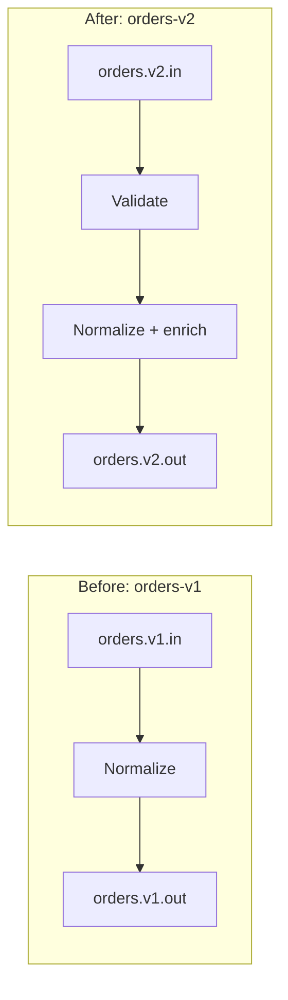
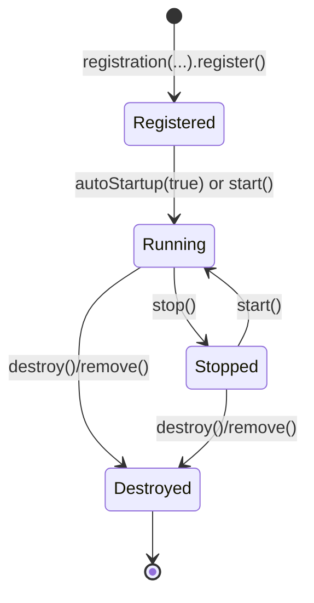
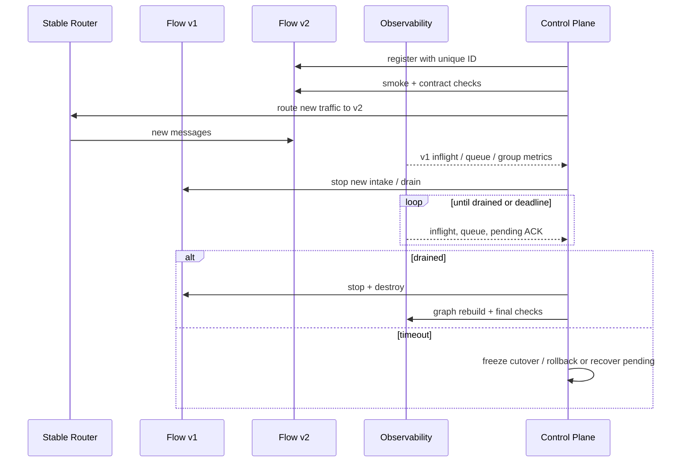
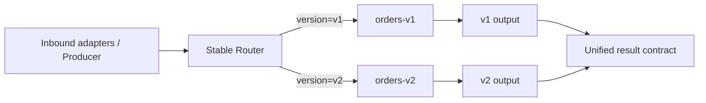
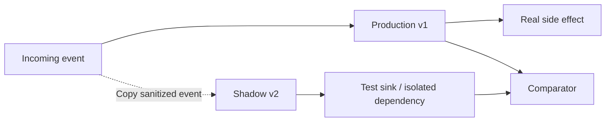

# Testing Topology Before and After Changes in Spring Integration Dynamic Runtime

## 1. Why Must We Test Topology When Changing Flows at Runtime?

In a Spring Integration system, a message traverses a **channel → endpoint → handler → channel** chain; depending on the flow, it may also include inbound adapters, polling consumers, executors, routers, splitters, aggregators, retry advice, transactions, and message stores. When registering, stopping, or removing an `IntegrationFlow` while the application is running, we do not merely change code—we change the **live wiring graph** and the lifecycle of those components.

For example, suppose a payment service runs flow v1 and needs to switch to v2 to add a validation step. The new code might pass when testing a single message in isolation yet still cause production failures because:

- A router still points to a channel belonging to a `destroy()`ed flow.
- A `DirectChannel` still has two subscribers, causing messages to dispatch to an unintended handler.
- Flow v1's poller is still pulling messages from the queue after v2 has started.
- Endpoint v2 was created with `autoStartup=false`, so it has no active consumer.
- During the transition, messages are mid-transaction/retry/aggregation while components are removed.
- Both flows share the same `MessageGroupStore` or correlation key, mixing old and new groups.
- Metrics display a stale graph because `IntegrationGraphServer` was never `rebuild()`ed.

Therefore, **testing topology before and after changes** is not merely asserting that a flow bean exists. You must verify the **component graph**, **message routes**, **lifecycle states**, **end-to-end behavior**, and **in-flight work status**.

This lesson belongs to the **Dynamic runtime** chapter of the **`SPRING_INTEGRATION_RUNTIME`** module, connecting message orchestration across channels, endpoints, consumers, pollers, and executors; `IntegrationFlow` lifecycle management; transactions; retries; message stores; error handling; correlation; threading; and runtime performance.

**After this lesson, you will be able to:**

1. Describe topology across two layers: **graph structure** and **operational behavior**.
2. Capture a pre-change baseline/snapshot and clearly define permitted differences.
3. Use `IntegrationFlowContext`, `IntegrationFlowRegistration`, and `IntegrationGraphServer` to register, observe, stop, and remove dynamic flows.
4. Write JUnit integration tests comparing v1/v2, asserting isolated inputs/outputs, and cleaning up resources after tests.
5. Test routers, error channels, executors/pollers, retries, transactions, correlation, and in-flight processing.
6. Build a rollout/rollback plan with deployment gates, canary/shadow strategies, and runtime observability.

**Reference versions:** Spring Integration **6.x** (6.5 API), Spring Framework 6.x, Java 17+, JUnit 5. Dedicated testing utilities live in `spring-integration-test`; verify your project's dependencies/BOM before applying examples to a real repository.

## 2. What Is Topology, and Which Layers Must Be Tested?

### 2.1. Logical Topology, Runtime Graph, and Operational State

A diagram showing "input → transformer → handler → output" omits many components that Spring Integration creates at runtime.

| Layer | Description | Test Question |
|---|---|---|
| **Logical topology** | Business steps and expected branching paths | Does a type-A message reach branch A? |
| **Physical Spring Integration topology** | `MessageChannel`s, endpoints, handlers, adapters, and links | Are any consumers, channels, or links missing or duplicated? |
| **Lifecycle** | `start()`, `stop()`, `destroy()`, auto-startup | Which endpoints are actually running? |
| **State/data plane** | `QueueChannel`s, message groups, retry state, transactions, message stores | Does unprocessed data remain valid after the change? |
| **Concurrency** | Thread pools, pollers, subscriptions, lock registries | Are two versions consuming the same source simultaneously? |
| **Error/reply plane** | `errorChannel`, `replyChannel`, discard/recovery channels | Do errors and replies still reach the right destination? |
| **Observability** | Integration graph, message history, Micrometer, and logs | Do the graph and metrics reflect the real topology? |

A test asserting only `ApplicationContext.containsBean("orders-v2")` proves merely that a bean exists; it **does not prove** v2 started, its input has a subscriber, or messages process properly.

### 2.2. Example v1 → v2 Change

Suppose v1 normalizes order codes, and v2 adds a validation step before forwarding to another system:



This illustrates **two parallel flows with independent inputs**, well suited for testing or blue-green deployments. In production, you typically place a **stable router** in front to select v1 or v2 rather than requiring producers to know versioned input names.

### 2.3. Distinguishing Intended Changes From Regressions

| Aspect | Baseline v1 | Expected v2 | Typical Regression |
|---|---|---|---|
| Inbound path | `orders.v1.in` | `orders.v2.in` | Producers still send to a removed input |
| Handler | Normalize | Validate → normalize | Validation is skipped |
| Output path | `orders.v1.out` | `orders.v2.out` | Replies route to the old channel |
| Consumer | One active consumer | One active v2 consumer at cutover | Both v1 and v2 subscribe to a competing source |
| Correlation | `tenant/order/run` | Preserved convention or planned migration | Reusing old keys mixes groups |
| Errors | Route validation errors to defined error path | Errors are observable and recoverable | Errors are logged and silently dropped |
| Data state | Queues/groups still processing | Drained/migrated/replayed under control | Removing flow drops state |
| Timeout/SLO | Matches baseline | Within agreed thresholds | Backlog grows because poller never started |

Before writing tests, write down the **change contract**: what is allowed to change, and what must remain invariant.

## 3. Background on Dynamic Flow Management APIs

### 3.1. `IntegrationFlowContext`

`IntegrationFlowContext` is the API for managing `IntegrationFlow`s registered **programmatically at runtime**, rather than declaring beans solely during context startup.

```java
import org.springframework.integration.dsl.IntegrationFlow;
import org.springframework.integration.dsl.context.IntegrationFlowContext;
import org.springframework.integration.dsl.context.IntegrationFlowContext.IntegrationFlowRegistration;

IntegrationFlow flow = buildFlow();

IntegrationFlowRegistration registration = flowContext
        .registration(flow)
        .id("orders-v2")
        .useFlowIdAsPrefix()
        .autoStartup(true)
        .register();
```

`buildFlow()` is an application-provided factory method; `flowContext` is the Spring-injected `IntegrationFlowContext` bean.

Key methods to remember:

| API | Purpose | Notes |
|---|---|---|
| `flowContext.registration(flow)` | Starts configuring a dynamic flow registration | Not registered yet |
| `.id("orders-v2")` | Assigns the flow ID | Must be unique in the application context |
| `.useFlowIdAsPrefix()` | Prefixes bean names generated by the flow with the flow ID | Useful when multiple versions share internal component IDs |
| `.autoStartup(false)` | Registers without auto-starting | Use when checks are needed before activation |
| `.register()` | Registers the flow and dependent beans, returning a registration | Auto-starts unless `false` is set |
| `getRegistrationById(id)` | Looks up a registered dynamic flow | May return `null` |
| `getRegistry()` | Inspects dynamic flow registrations | Not the entire Spring graph |
| `messagingTemplateFor(id)` | Gets a template sending to the flow's input channel | Valid only when the flow starts with a `MessageChannel` |
| `remove(id)` | Destroys the flow and dependent beans | Requires a draining plan before calling |

Creating an `IntegrationFlowRegistration` can create multiple framework-managed beans, including endpoints, channels, and dependent handlers. `remove()`/`destroy()` remove components scoped to that registration; they do not automatically delete external shared beans or data in remote brokers/databases.

### 3.2. `IntegrationFlowRegistration` and Lifecycle

```java
String id = registration.getId();
registration.getInputChannel();   // Flow must start with a MessageChannel
registration.getMessagingTemplate();

registration.stop();              // Stop flow
registration.start();             // Restart while registration still exists
registration.destroy();           // Unregister and destroy dependent beans
```

Important distinctions:

- **`stop()`** is a lifecycle state transition; the flow remains registered and can be `start()`ed again.
- **`destroy()`** removes the flow from the context; never assume calling `start()` on a destroyed registration works.
- **`remove(id)`** on `IntegrationFlowContext` is an alternative way to destroy a flow by ID.
- **The same ID cannot be registered again while the old registration still exists.** Destroy first, or use versioned IDs for parallel deployments.
- **Successful registration does not prove end-to-end processing works.** Run synthetic messages and assert outcomes.

If a registration starts with an inbound adapter/`MessageProducer` rather than a `MessageChannel`, `getInputChannel()`/`getMessagingTemplate()` are not appropriate direct test entry points. Trigger the source via a test fixture or substitute a mock source; avoid forcing messages into an endpoint without an input channel.

### 3.3. Using Flow ID as a Prefix to Avoid Bean Name Collisions

When v1 and v2 coexist, generated bean names or endpoint IDs can collide. Common pattern:

```java
flowContext.registration(buildFlow(configV1))
        .id("orders-v1")
        .useFlowIdAsPrefix()
        .register();

flowContext.registration(buildFlow(configV2))
        .id("orders-v2")
        .useFlowIdAsPrefix()
        .register();
```

`useFlowIdAsPrefix()` does not isolate two flows from **the same external source/queue**, nor does it namespace correlation keys for persistent message groups. It solves **bean naming** in the context. Preventing cross-consumption and state collisions is a separate responsibility.

## 4. Capturing Topology From `IntegrationGraphServer`

### 4.1. Runtime Graph

Spring Integration provides `org.springframework.integration.graph.IntegrationGraphServer` to construct a graph model of `IntegrationNode`s and `LinkNode`s. Key usage:

```java
import org.springframework.integration.graph.Graph;
import org.springframework.integration.graph.IntegrationGraphServer;

IntegrationGraphServer graphServer = ...;

Graph before = graphServer.rebuild(); // Capture live structure
Collection<?> nodes = before.getNodes();
Collection<?> links = before.getLinks();
```

Nodes represent channels, endpoints, gateways/adapters, etc.; each `LinkNode` shows connections between nodes via `getFrom()`, `getTo()`, and `getType()`. The graph gives an **observable structural model**, not complete data on threads or transactions.

Two important APIs:

- `getGraph()`: returns the **cached graph**; stats may update dynamically, but structure can reflect an older snapshot.
- `rebuild()`: **reconstructs the structure and updates the cache**; call after adding or removing components.

**Rule:** when comparing topology before and after registering or removing a flow, call `rebuild()` at both points; never rely on a stale `getGraph()` to conclude a new flow is missing.

### 4.2. Building a Diffable Snapshot

`Graph` identifies nodes using internal numeric IDs. Those IDs can shift across rebuilds; **do not compare raw JSON graph strings or rely on `nodeId` as a business key**.

You can construct a *canonical* representation using component names, node types, and edges with IDs resolved to names:

```java
import java.util.Map;
import java.util.Set;
import java.util.function.Function;
import java.util.stream.Collectors;

import org.springframework.integration.graph.Graph;
import org.springframework.integration.graph.IntegrationNode;
import org.springframework.integration.graph.LinkNode;

record TopologySnapshot(
        Set<String> nodes,
        Set<String> links) {}

static TopologySnapshot snapshot(Graph graph) {
    Map<Integer, IntegrationNode> byId =
            graph.getNodes().stream()
                    .collect(Collectors.toMap(
                            IntegrationNode::getNodeId,
                            Function.identity()));

    Set<String> nodes = graph.getNodes().stream()
            .map(n -> n.getName() + "|" + n.getComponentType())
            .collect(Collectors.toSet());

    Set<String> links = graph.getLinks().stream()
            .map(link -> {
                IntegrationNode from = byId.get(link.getFrom());
                IntegrationNode to = byId.get(link.getTo());

                if (from == null || to == null) {
                    throw new IllegalStateException(
                            "Graph contains unresolved link");
                }

                return from.getName() + " -> " + to.getName()
                        + " [" + link.getType() + "]";
            })
            .collect(Collectors.toSet());

    return new TopologySnapshot(nodes, links);
}
```

This is a **test helper pattern**, not a built-in Spring Integration API named `TopologySnapshot`. Every bean/endpoint name should be stable, meaningful, and free of sensitive data.

When names are autogenerated (`channel#0`, indexed endpoints), snapshots can differ solely due to bean creation order even though business logic didn't change. For critical components, **assign explicit IDs** or compare normalized business paths rather than "snapshotting everything and asserting byte-by-byte."

### 4.3. Diffing Node/Link Sets Without Losing Context

```java
TopologySnapshot baseline = snapshot(before);
TopologySnapshot candidate = snapshot(after);

Set<String> removed = new java.util.HashSet<>(baseline.links());
removed.removeAll(candidate.links());

Set<String> added = new java.util.HashSet<>(candidate.links());
added.removeAll(baseline.links());

System.out.println("Removed links: " + removed);
System.out.println("Added links: " + added);
```

While v1 and v2 coexist during a canary, **added nodes/links are expected**; when retiring v1, removed v1 nodes/links are expected. Tests should assert against an **approved diff**, not assume "topology must stay identical" across an intentional change.

### 4.4. Do Not Expose the Runtime Graph Publicly

The graph model can reveal channel names, adapters, endpoints, internal system types, and flow names. If exposed via `IntegrationGraphController`/HTTP management endpoints, protect it with authentication, authorization, and proper network/CORS controls. For CI tests, call `IntegrationGraphServer` directly rather than opening management endpoints publicly.

## 5. Establishing a Baseline and Contract Before Changing

### 5.1. Baselines Must Include Dynamic Runtime Data

Before making changes, record **four groups of evidence**:

1. **Structure:** set of flow registrations, graph nodes/links, channel/endpoint/handler IDs.
2. **Behavior:** test messages traversing happy paths, error paths, correlation/replies, timeouts, retries, and discards.
3. **State:** `isRunning()` on essential endpoints, active consumers, poller schedules, executor queues, message groups, pending ACKs.
4. **Health:** throughput, p95/p99 latency, queue depth/oldest age, errors, retry rates, thread counts, and memory.

When metrics vary over time (graph stats, message counts, thread IDs), compare against **thresholds or invariants**, not exact equality with a snapshot from another moment.

### 5.2. Golden Topology: What Must Remain Invariant

Example contract:

```yaml
topologyContract:
  flowFamily: orders
  change: v1-to-v2
  required:
    - input-to-handler-route
    - output-to-reply-path
    - error-and-recovery-route
    - correlation-headers-preserved
    - no-double-consume-on-shared-source
  mayChange:
    - add-validation-step
    - add-v2-endpoints
  afterCutover:
    - no-new-messages-to-v1
    - v1-inflight-count-zero-before-destroy
    - v2-synthetic-message-passes
  rollback:
    - old-flow-can-be-restarted-if-not-destroyed
    - durable-message-state-recoverable
```

This is an **illustrative contract template in the lesson**, not an official Spring Integration schema. CI can read contracts via application management code/config, while STEP 4 only needs interpretation and testing rather than creating contract files outside the two assigned files.

### 5.3. Clear Pass/Fail Gates

| Gate | Example Pass | Example Fail |
|---|---|---|
| **G1 – Structural** | Expected v2 links appear; zero links to destroyed endpoints remain | Graph still routes through v1 post-cutover |
| **G2 – Lifecycle** | v2 active, v1 stopped as planned | v2 registered but never started |
| **G3 – Contract** | Payload/headers/reply/error semantics hold as specified | Replies route to wrong channel |
| **G4 – State** | Queues/groups/ACKs/in-flight drained or migrated | Uncommitted messages lost when source removed |
| **G5 – Performance** | Throughput and p99 meet SLA | Executor saturation or rising poller lag |
| **G6 – Rollback** | Routing can revert to v1 or state can recover | Old beans destroyed and state unrecoverable |
| **G7 – Cleanup** | Zero orphaned beans/subscriptions/schedulers | Repeated stop/start causes duplicate processing |

## 6. Java Example: Registering Two Flow Versions With Independent Inputs

### 6.1. Minimal Fixture

A safe test setup gives **each version its own `DirectChannel` and its own reply `QueueChannel`** so outputs never mix or get stolen by another subscriber.

```java
import java.util.Locale;
import java.util.function.UnaryOperator;

import org.springframework.integration.channel.DirectChannel;
import org.springframework.integration.channel.QueueChannel;
import org.springframework.integration.dsl.IntegrationFlow;

public final class VersionedOrderFlows {

    private VersionedOrderFlows() {}

    static IntegrationFlow build(
            UnaryOperator<String> normalize,
            QueueChannel resultQueue) {

        DirectChannel input = new DirectChannel();

        return IntegrationFlow.from(input)
                .<String, String>transform(normalize::apply)
                .channel(resultQueue)
                .get();
    }

    static UnaryOperator<String> v1() {
        return value -> "v1:" + value.trim();
    }

    static UnaryOperator<String> v2() {
        return value -> "v2:"
                + value.trim().toUpperCase(Locale.ROOT);
    }
}
```

This is a **topology test example**, performing no outbound HTTP or database writes. Using `DirectChannel` runs `transform` synchronously on send; using `QueueChannel` lets tests read outputs with `receive(timeout)`.

The key point is **never sharing a single `DirectChannel` between v1 and v2** in this isolated test. If you want to test canarying through a stable router, add an explicit router with clear routing rules rather than relying on multiple `DirectChannel` subscribers to split traffic 50/50.

### 6.2. Registering, Sending Messages, and Removing Flows

```java
import org.springframework.integration.channel.QueueChannel;
import org.springframework.integration.dsl.IntegrationFlow;
import org.springframework.integration.dsl.context.IntegrationFlowContext;
import org.springframework.integration.dsl.context.IntegrationFlowContext.IntegrationFlowRegistration;
import org.springframework.messaging.Message;
import org.springframework.messaging.support.GenericMessage;

IntegrationFlowContext flowContext = ...;

QueueChannel v1Replies = new QueueChannel();

IntegrationFlow v1Flow =
        VersionedOrderFlows.build(
                VersionedOrderFlows.v1(), v1Replies);

IntegrationFlowRegistration v1 = flowContext
        .registration(v1Flow)
        .id("orders-v1")
        .useFlowIdAsPrefix()
        .register();

// getInputChannel() is valid because the flow starts with a DirectChannel.
v1.getInputChannel().send(new GenericMessage<>("  ord-42 "));

Message<?> oldReply = v1Replies.receive(1_000);
if (oldReply == null) {
    throw new IllegalStateException("No reply from v1");
}
System.out.println(oldReply.getPayload()); // v1:ord-42

QueueChannel v2Replies = new QueueChannel();
IntegrationFlowRegistration v2 = flowContext
        .registration(VersionedOrderFlows.build(
                VersionedOrderFlows.v2(), v2Replies))
        .id("orders-v2")
        .useFlowIdAsPrefix()
        .register();

v2.getInputChannel().send(new GenericMessage<>("  ord-42 "));
Message<?> newReply = v2Replies.receive(1_000);
System.out.println(newReply.getPayload()); // v2:ORD-42

// Stop/destroy v1 only after verifying drain and zero active callers.
v1.stop();
v1.destroy();

// Destroy v2 at the end of a fixture/test.
v2.destroy();
```

**Example assumptions:**

- `flowContext` is injected inside a context annotated with `@EnableIntegration`.
- Both flows auto-start upon registration (the registration builder default).
- There are no async tasks or in-flight messages in this snippet; `stop()`/`destroy()` run after replies arrive.
- Passing a `QueueChannel` object into the DSL lets tests read replies directly. In production with brokers/stores, resource ownership and cleanup differ.
- Strings `"v1:..."` and `"v2:..."` let tests observe versions, and are **not real data contracts**; in production changes, use feature flags or version metadata that doesn't leak into payloads unnecessarily.

### 6.3. Why Not Replace a Flow Under the Same ID Immediately?

`IntegrationFlowRegistrationBuilder.id(String)` requires a unique ID within the context; the old registration must be destroyed before reusing the ID. In running production:

```text
orders-flow (v1) -> destroy -> register orders-flow (v2)
```

creates a **gap in traffic intake**, risking sends with no subscribers or missing endpoints if the replacement fails.

A safer approach is typically:

```text
orders-router (stable ID)
   ├── orders-v1 (currently serving)
   └── orders-v2 (newly registered, awaiting verification)
       └── switch routing/canary when ready
```

Ensure routing passes through a **well-defined entry point** and never double-consumes from the same inbound source during cutover.

## 7. JUnit Integration Tests: Asserting Before and After State

### 7.1. Real-Context Fixture Without External Adapters

The test below uses JUnit 5 + Spring Test, registering **real** flows via `IntegrationFlowContext` and sending messages to their input channels without mocking handlers. This is the first test tier proving v1/v2 transitions preserve routing contracts and cleanup.

```java
import static org.junit.jupiter.api.Assertions.*;

import java.util.ArrayList;
import java.util.List;
import java.util.function.UnaryOperator;

import org.junit.jupiter.api.AfterEach;
import org.junit.jupiter.api.Test;
import org.springframework.beans.factory.annotation.Autowired;
import org.springframework.context.annotation.Configuration;
import org.springframework.integration.channel.QueueChannel;
import org.springframework.integration.config.EnableIntegration;
import org.springframework.integration.dsl.context.IntegrationFlowContext;
import org.springframework.integration.dsl.context.IntegrationFlowContext.IntegrationFlowRegistration;
import org.springframework.messaging.Message;
import org.springframework.messaging.support.GenericMessage;
import org.springframework.test.context.junit.jupiter.SpringJUnitConfig;

@SpringJUnitConfig(classes = DynamicTopologyTest.Config.class)
class DynamicTopologyTest {

    @Configuration
    @EnableIntegration
    static class Config { }

    @Autowired
    IntegrationFlowContext flowContext;

    private final List<String> registrations = new ArrayList<>();

    private IntegrationFlowRegistration register(
            String flowId,
            UnaryOperator<String> version,
            QueueChannel output) {

        IntegrationFlowRegistration registration = flowContext
                .registration(VersionedOrderFlows.build(version, output))
                .id(flowId)
                .useFlowIdAsPrefix()
                .register();

        registrations.add(flowId);
        return registration;
    }

    private static String exchange(
            IntegrationFlowRegistration registration,
            QueueChannel output,
            String payload) {

        assertTrue(registration.getInputChannel()
                .send(new GenericMessage<>(payload)));

        Message<?> response = output.receive(1_000);
        assertNotNull(response, "Missing reply from " + registration.getId());

        return response.getPayload().toString();
    }

    @Test
    void topologyBeforeAndAfterChange() {
        QueueChannel oldOutput = new QueueChannel();
        IntegrationFlowRegistration v1 = register(
                "orders-v1", VersionedOrderFlows.v1(), oldOutput);

        // Baseline: v1 exists and processes per the old contract.
        assertNotNull(flowContext.getRegistrationById("orders-v1"));
        assertEquals("v1:ord-42",
                exchange(v1, oldOutput, "  ord-42  "));

        QueueChannel newOutput = new QueueChannel();
        IntegrationFlowRegistration v2 = register(
                "orders-v2", VersionedOrderFlows.v2(), newOutput);

        // During canary, both flows coexist.
        assertNotNull(flowContext.getRegistrationById("orders-v1"));
        assertNotNull(flowContext.getRegistrationById("orders-v2"));

        assertEquals("v2:ORD-42",
                exchange(v2, newOutput, "  ord-42  "));
        assertEquals("v1:ord-99",
                exchange(v1, oldOutput, " ord-99 "));

        // Outputs never cross between the two isolated inputs.
        assertNull(oldOutput.receive(0));
        assertNull(newOutput.receive(0));

        // Simulate completed drain at cutover: stop and remove v1.
        v1.stop();
        flowContext.remove("orders-v1");
        assertNull(flowContext.getRegistrationById("orders-v1"));

        // v2 remains alive and processes normally.
        assertEquals("v2:ORD-100",
                exchange(v2, newOutput, " ord-100 "));
    }

    @AfterEach
    void cleanup() {
        for (String id : registrations) {
            IntegrationFlowRegistration r =
                    flowContext.getRegistrationById(id);
            if (r != null) {
                r.destroy();
            }
        }
        registrations.clear();
    }
}
```

This template uses `VersionedOrderFlows` defined in section 6. It tests **behavior** and **registry state**, without needing a graph server. With a graph server present, you can add independent node/link comparisons.

**Notable details:**

- `@AfterEach` cleans up dynamic flows even when an assertion fails, preventing subsequent tests from colliding on the same flow ID.
- Each flow has its own output; the test does not assume ordering between versions when running concurrently.
- `assertNull(output.receive(0))` only checks the queue at one instant—**not strong proof against message loss under concurrency**. Under load, track end-to-end message IDs, in-flight counts, and eventual completion semantics.
- This test does not prove transactional durability or broker ACKs because no broker/database is involved; test those with dedicated integration fixtures.

### 7.2. Testing a Flow Registered Without Auto-Start

A common deployment bug: beans exist, yet endpoints are idle because `autoStartup(false)`.

```java
QueueChannel output = new QueueChannel();

IntegrationFlowRegistration candidate = flowContext
        .registration(VersionedOrderFlows.build(
                VersionedOrderFlows.v2(), output))
        .id("orders-candidate")
        .useFlowIdAsPrefix()
        .autoStartup(false)
        .register();

assertNotNull(flowContext.getRegistrationById("orders-candidate"));

// Asserting mere existence is NOT enough.
// Call start() before running the message exchange:
candidate.start();

candidate.getInputChannel().send(new GenericMessage<>(" x "));
assertEquals("v2:X", output.receive(1_000).getPayload());

candidate.destroy();
```

This snippet illustrates lifecycle control. Depending on the endpoint and channel, sending into an unstarted flow may throw a "no subscribers" error or leave the message unprocessed; never write tests assuming one universal exception type across all sources.

**Additional test needed:** registering the same ID a second time before destruction must be rejected; after `destroy()`, the ID can be reused if no dependent bean collisions remain. Never run that check on a production flow holding in-flight messages.

## 8. Assertions for Graph Nodes and Links

### 8.1. Snapshots Before, After Registration, and After Removal

If the `ApplicationContext` has `IntegrationGraphServer` registered, tests can verify **structural changes**:

```java
import org.springframework.integration.graph.Graph;
import org.springframework.integration.graph.IntegrationGraphServer;

IntegrationGraphServer graphServer = ...;

Graph baseline = graphServer.rebuild();

// Register candidate flow via IntegrationFlowContext.

Graph withCandidate = graphServer.rebuild();
TopologySnapshot afterRegister = snapshot(withCandidate);

// After stopping and destroying the old flow.
Graph afterRemoval = graphServer.rebuild();
TopologySnapshot afterCutover = snapshot(afterRemoval);
```

`snapshot()` is the test helper from section 4. `IntegrationGraphServer` may be provided by Spring Integration's management infrastructure; when absent, configure it explicitly and verify its lifecycle in your test context rather than assuming every app includes it.

### 8.2. Compare Only the Subgraph Under Test

The graph may contain unrelated infrastructure nodes—error channels, null channels, management endpoints, Micrometer observations, or other gateways. Comparing the entire graph creates false positives.

A practical strategy:

1. Assign a unique flow ID (e.g., `orders-v2`) and enable `useFlowIdAsPrefix()`.
2. Give explicit `id`s to endpoints with stable roles (validator, transformer, outbound adapter).
3. Build an allowlist of nodes/links belonging to the tested flow family.
4. From the graph, translate `nodeId` into `getName()` and `getComponentType()`.
5. Compare against expected **edge sets**, ignoring collection ordering.
6. Assert only on nodes/edges that carry contract significance.

Example prefix assertion:

```java
Graph g = graphServer.rebuild();

boolean foundCandidateNodes = g.getNodes().stream()
        .map(node -> node.getName())
        .anyMatch(name -> name.contains("orders-v2"));

assertTrue(foundCandidateNodes, "Candidate nodes missing from graph");
```

With autogenerated names or manually instantiated channels, actual graph names may differ from examples; inspect the graph once and assign **stable names/IDs** before writing production assertions. Never rely on a broad `contains("v2")` if unrelated beans share that substring.

### 8.3. Structural Tests Do Not Replace End-to-End Behavior Tests

A graph can show a link from router to endpoint while the router always returns the wrong key, or the endpoint isn't started. A `MessageHandlerNode` existing does not prove the outbound API works. Therefore, **you need all of:**

- Structural assertions: nodes/links/registrations.
- Behavioral assertions: sending messages and verifying outputs.
- Error semantics assertions: validation failures, retries, discards, and recovery.
- Lifecycle assertions: stop/start/destroy.
- State assertions: queues/groups/ACKs/in-flight work.

This is a matrix, not mutually exclusive alternatives.

## 9. Testing Message Contracts, Headers, and Routing

### 9.1. Which Payloads and Headers Must Be Preserved?

If v2 adds a transformer, "the payload looks right" is not enough. Verify:

| Field | Why Test It |
|---|---|
| `MessageHeaders.ID` | Message ID can change across transforms; never use it as the sole business ID |
| `correlationId` | Splitters/aggregators and reply paths need exact correlation |
| `sequenceNumber` / `sequenceSize` | Preserves grouping during splits/resequencing |
| `replyChannel` | Gateways must reply to the right caller without crossing v1/v2 |
| `errorChannel` | Errors follow the right error path |
| `tenantId`, `orderId`, `processingRunId` | Multi-tenancy and retries never mix state |
| `contentType` / custom schema version | Downstream deserializes and routes properly |
| Tracing headers | Support end-to-end tracing without acting as business identity |

Not every header must remain unchanged. For instance, a transform may create a new message with a new ID, and a gateway may use a different temporary reply channel. Tests should assert **business and protocol invariants**, not blanket equality of all headers.

### 9.2. Routing Must Cover Both Positive and Negative Branches

For routers keyed by `tenantId`, `eventType`, or feature flags, test:

- Keys supported by v1/v2.
- Invalid, `null`, or missing header keys.
- Tenants not permitted on v2.
- Routing to default/discard channels if configured.
- Errors on the v2 route never falling back into v1's error handler by mistake.
- Missing or stopped dynamic endpoints: rejection/timeout behavior must be explicit.

Example case table:

| Input | Expected Route | Expected Outcome |
|---|---|---|
| `eventType=PAYMENT`, canary=false | v1 | V1 response contract |
| `eventType=PAYMENT`, canary=true | v2 | V2 response contract |
| `eventType=UNKNOWN` | reject/default | Audited error or discard |
| Missing `tenantId` | must never fall into an arbitrary default tenant | Validation failure |
| `processingRunId` already used in flow v1 | Keep existing run ownership | Never mixed into v2 groups |

If splitting traffic by hash/percentage, tests should not assert an exact 5% on a tiny random sample. Use **deterministic assignment** by `tenantId`/business key and assert exact target selection; measure percentage distribution in longer load tests.

### 9.3. Contract Testing With Producer–Consumer Fixtures

Test a message pipeline like this:

```text
Input
  ├── Valid payload -> transformer -> outbound mock -> reply channel
  ├── Invalid payload -> error channel / discard channel
  ├── Transient failure -> retry advice -> recovery
  └── Duplicate business event -> idempotency / expected dedupe
```

For outbound HTTP/JMS/AMQP, use a wire mock or appropriate Testcontainer to assert **actual external call counts**; counting only in-app handler invocations misses retries or adapter-level redeliveries.

### 9.4. `MockIntegrationContext` and `@SpringIntegrationTest`

`spring-integration-test` provides `@SpringIntegrationTest` and `MockIntegrationContext` to substitute message sources/handlers inside a test context.

```java
@SpringJUnitConfig
@SpringIntegrationTest(noAutoStartup = {"realInbound*", "*Source*"})
class ContractTest {
    @Autowired
    MockIntegrationContext mockContext;
}
```

Useful when you need to:

- Prevent real inbound adapters from connecting to external APIs/brokers in tests.
- Replace a `MessageSource` with controlled test data.
- Replace a `MessageHandler` with a mock/`MockMessageHandler` to record messages.
- Restore components after each test via `mockContext.resetBeans()`.

**Watch out:** `substituteMessageHandlerFor()` takes the **consumer endpoint bean name**, not arbitrarily an inner `MessageHandler` name. With prefixed dynamic registrations, endpoint names may differ; inspect the graph/bean registry and assign stable IDs before mocking. Never mock the entire pipeline and claim you verified the real topology: always keep smoke tests exercising full real endpoints.

## 10. Lifecycle Testing: `start`, `stop`, `destroy`, and Orphan Components

### 10.1. States to Observe



Note: this diagram is a **logical test model**. With `autoStartup(false)`, a flow may start in Registered/Stopped; exact endpoint states depend on the component. `Registration` does not necessarily expose a single unified `isRunning()` across all internals.

Check in sequence:

1. Registration exists after `register()`.
2. Input channel is usable if the flow starts from a channel.
3. Endpoints process a smoke message after `start()`.
4. After `stop()`, new-message intake halts per contract.
5. After `destroy()`/`remove()`, the registration is gone and no dependent beans are orphaned.
6. Graph `rebuild()` confirms related nodes/links were removed.
7. Starting/registering a new version creates no duplicate consumers or bean name collisions.

### 10.2. `stop()` Does Not Automatically Drain Queues

Stopping a `PollingConsumer` can leave unpolled messages in a `QueueChannel`; with an in-memory `SimpleMessageStore`, data can vanish on process restart. With `JdbcChannelMessageStore` or a durable broker, messages survive for later processing depending on transactions and ACKs.

Therefore, **stop → backlog remains → restart → process all cleanly** must be tested against the real store/adapter type. Never wipe queues or reset memory stores just to make a graph look clean when production still holds unprocessed messages.

### 10.3. `destroy()` Differs From `stop()`

`IntegrationFlowRegistration.destroy()` and `IntegrationFlowContext.remove(id)` **remove** the flow and registration-managed dependent beans. However, do not assume they clean up:

- Shared connections or singletons outside the registration.
- Persisted records in database message stores.
- Remote broker queues/consumer groups.
- Committed business side effects and transactions.
- `Runnable`s/callbacks submitted manually to an executor outside the flow.
- Subscriptions created manually via `subscribe()` with no owner/lifecycle.

Test for resource leaks via active thread metrics, scheduler tasks, connection counts, subscriptions, cached lock registries, and dependent beans. When a dynamic flow creates external resources, you can register dependent beans via builder `addBean(...)` for container management, but ownership must be crystal clear so shared beans are never destroyed.

### 10.4. Multi-Cycle Change Testing

A soak test can run:

```text
register(v1) -> start -> smoke -> stop -> destroy
register(v2) -> start -> smoke -> stop -> destroy
register(v1) -> start -> smoke -> stop -> destroy
... repeat 30-100 cycles in staging/test
```

Observe:

- Flow-owned bean counts do not grow unboundedly.
- Active threads/connections/subscriptions after cleanup do not climb.
- Flow IDs can be reused after destruction when appropriate.
- No old handlers receive messages once v2 is active.
- Zero duplicate bean registration errors or lingering background scheduler tasks.

This is an **ownership/lifecycle soak test**, not a performance benchmark; run under controlled conditions and capture heap/thread dumps if a leak appears.

## 11. In-Flight Messages: The Biggest Challenge During Cutover

### 11.1. Registering a New Flow Does Not Cancel Old Work

If v1 already called an external API and then v2 is registered and routers switch, v1 may still be:

- Waiting on an HTTP response.
- Waiting for a poller to continue draining a `QueueChannel`.
- Mid-transaction/commit.
- Retrying via `RequestHandlerRetryAdvice`.
- Holding an unreleased `MessageGroup` in an aggregator.
- Waiting on a `LockRegistry` or an `ExecutorChannel` worker.

You cannot call `remove(v1)` and assume that work vanished. You need an explicit **draining protocol**.

### 11.2. Testable Drain Workflow

A general approach:



**Drain conditions** should combine multiple signals, such as `inflight=0`, queue backlog=0, zero pending ACKs, zero active group work, and zero in-flight external calls. For flows legitimately holding messages long-term (aggregators/batches), retention/ownership transfer/expiry must follow business SLAs.

### 11.3. Why `inflight=0` Is Not Necessarily Safe

An application counter may decrement before a message is ACKed/committed, or miss work spun off onto another executor. Cross-check:

- `QueueChannel.getQueueSize()` / message store group sizes.
- Broker lag / unacked messages.
- Pending transaction status or retry tasks.
- Gateways awaiting replies and scheduled timeouts.
- Active handler calls / HTTP clients.
- MessageStore cleanup / group completions, including late arrivals.

If data cannot drain quickly, choose **blue-green coexistence with versioned message state** or **quarantine/replay** instead of abrupt destruction.

## 12. Transactions, Retries, and Correlation When Topology Changes

### 12.1. Transaction Boundaries May Have Shifted

V1:

```text
QueueChannel -> @Transactional handler -> commit -> reply
```

V2:

```text
QueueChannel -> ExecutorChannel -> @Transactional handler -> reply
```

Even though they look similar, `ExecutorChannel` switches execution threads; an upstream thread-bound transaction **does not cross the async boundary**. After the change, ACKs/rollbacks no longer necessarily behave like v1.

Tests must deliberately inject exceptions **after a side effect** and inspect:

1. Which transaction was opened?
2. Did the database commit or roll back?
3. Was the message redelivered?
4. On which thread did retries run?
5. Which channel received replies or errors?
6. If the caller timed out and retried, did duplicate side effects occur?

Never judge transactionality solely by whether the graph contains an `ExecutorChannel` node.

### 12.2. Retry Advice Placement and Side Effects

When v2 moves `RequestHandlerRetryAdvice` from the handler to the poller or changes advice ordering, the **scope of re-execution** changes. Poller-level retries may re-run the entire synchronous chain triggered by the poller; handler-level retries scope only to the handler. This impacts HTTP call counts, DB write counts, and transaction durations.

Minimum test set:

| Scenario | Expected Contract |
|---|---|
| Transient timeout on attempt 1, succeeds on attempt 2 | Exact attempts/backoff and single business outcome |
| Non-retryable error | Routes to recovery/error channel without infinite loops |
| Retries exhausted | Emits `ErrorMessage`/DLQ or errors per contract |
| Caller times out mid-retry | Never assume remote side effects rolled back |
| Retry after cutover | v1 run messages never drift into v2 state improperly |

### 12.3. Message Groups and Correlation Namespaces

Two aggregator versions sharing a `MessageGroupStore` and correlation key `orderId` can cause mixed groups. When changing topology, decide:

- Do v1 groups finish on v1?
- Is v2 allowed to read incomplete groups created by v1?
- Do keys include tenant, workflow, **`processingRunId`**, and flow version/stage?
- Is v2's release strategy compatible with v1's group metadata/sequences?
- Can completed tombstones/expiry/reapers discard v2 messages or mix old messages into new groups?

**Safe default rule:** never let two flow versions mutate shared group state without an explicit migration/ownership protocol. With persisted stores, migrations must test schemas, locks, transactions, and rollbacks.

### 12.4. `LockRegistry` During Multi-Version Rollouts

If both v1 and v2 modify the same resource, both flows must share **identical lock-key conventions** and compatible coordination. Two independent `DefaultLockRegistry` instances across two JVMs do not coordinate even with identical keys. With persistent shared stores, use a distributed lock registry and idempotent design.

Concurrency tests should fire two requests with the same business key into v1 and v2 simultaneously and assert version/business consistency post-commit. A mutex/lock only serializes operations—it does not fix bad correlation keys or eliminate duplicate messages.

## 13. Concurrent Load, Backpressure, and Ordering Tests

### 13.1. Being Correct for One Message Is Not Enough

A graph with all endpoints wired can still break under 1,000 concurrent messages. Scenarios to test:

- `DirectChannel`: handlers run on the sender thread, risking blocking callers when downstream slows down.
- `ExecutorChannel`: shifts execution contexts, task queues, and worker counts; downstream may process **out of arrival order**.
- `QueueChannel`: producers may enqueue faster than pollers drain, filling queues or spiking latency.
- Poller tuning (`fixedDelay`, `fixedRate`, `maxMessagesPerPoll`): alters throughput, batching, and transaction scope.
- `FluxMessageChannel` or reactive adapters: verify publisher/subscriber lifecycles, backpressure, cancellation, and cleanup.
- Load-balancing routers: coexisting versions can duplicate requests if shadow branches produce side effects.

**Testing is not just about TPS**, but also correctness per message ID and business key.

### 13.2. Invariants When Testing With N Messages

Suppose a test sends N logical messages, with some intentionally failing:

| Invariant | Meaning |
|---|---|
| `accepted + rejected = N` | Every input's path is accounted for |
| `completed + recovered + pending = accepted` | Zero messages "vanish" from observability (define mutually exclusive states) |
| Zero duplicate side effects per valid business ID | Retries/redeliveries never double-charge |
| Zero v1 outputs after v1 is verified drained and destroyed | Zero lingering old workers/subscribers |
| Zero orphaned flow instances after N restart cycles | Lifecycle cleanup is sound |
| Queue age and group age within SLA | Flow stays sustainable under sustained load |

Do not write a blanket assertion that **every input produces exactly one output** if the system legitimately filters, discards, aggregates, or splits. Classify outputs per the **actual contract**.

### 13.3. Concurrency Testing With `CountDownLatch`

To reproduce cutover races reliably, use `CountDownLatch` or `CyclicBarrier` to hold a handler mid-execution rather than relying on `Thread.sleep()` and luck.

Scenario:

```text
T1: v1 handler received message A, waiting on latch inside critical section
T2: admin registers v2, smoke test passes
T3: router switches message B to v2
T4: call stop(v1), but DO NOT destroy because A is in-flight
T5: release latch, A finishes commit/reply
T6: v1 in-flight = 0, v1 queue = 0
T7: destroy(v1), rebuild graph
T8: verify outputs A and B followed proper routing with zero duplicates
```

A useful test records **event ordering** and business IDs, for example:

```java
CountDownLatch enteredV1 = new CountDownLatch(1);
CountDownLatch mayFinishV1 = new CountDownLatch(1);

// Inside v1 mock handler:
enteredV1.countDown();
if (!mayFinishV1.await(3, TimeUnit.SECONDS)) {
    throw new IllegalStateException("Timed out waiting for cutover test");
}
```

This is a **test-handler snippet**, not a complete production integration flow. Use bounded waits in tests so CI never hangs indefinitely on failure.

### 13.4. Before/After Performance Testing Under Equivalent Conditions

A meaningful benchmark keeps constant:

- Payload distribution, header sizes, and key cardinality.
- Ingress rate, concurrent requests, and partition/consumer counts.
- Databases, caches, remote mocks, and network latency.
- JVM heap, CPU/memory limits, GC, and thread pools.
- Transaction/retry policies, polling intervals, and resource pools.

Example thresholds:

```text
Baseline: 400 msg/s, p99 end-to-end 450 ms, error 0.1%
Candidate: >= 380 msg/s, p99 <= 550 ms, error <= 0.2%
Queue oldest age <= 10 s over a 10-minute window
Zero message groups exceeding SLA
```

These are **illustrative thresholds**; tailor to real SLAs. Never compare p99 across two runs with wildly different load and blame v2's extra node for slowing down.

## 14. Deployment Strategies: Blue-Green, Canary, and Shadow

### 14.1. Blue-Green With a Stable Router

Put a stable routing layer at the entry point. Old and new flows have separate channels and flow IDs:



Pros:

- You can register/smoke-test v2 **before** shifting routes.
- If v2 fails, new traffic can revert to v1 (if v1 is still live and compatible).
- You can measure in-flight message counts separately per flow version.

Risk: if output schemas, transaction semantics, or persisted state are incompatible, flipping the router back will not automatically restore business state. **Topology rollback differs from data rollback.**

### 14.2. Controlled Canary

For example, route only an internal group of tenants to v2:

```text
tenantId ∈ allowlist -> orders-v2
otherwise           -> orders-v1
```

**Never** attach two service activators to the same `DirectChannel` expecting it to split traffic by business rules. `DirectChannel` has its own dispatcher and load-balancing/failover semantics; canarying requires a **testable router**.

Tests should fix the routing set and assert:

- Allowlisted tenants always pick v2.
- Non-allowlisted tenants always hit v1.
- Each logical request has **one** primary route executing side effects.
- v2 errors follow v2's dedicated error/recovery path while honoring contracts.
- Traffic shifting never moves a live `processingRunId` across two aggregator versions without migration.

### 14.3. Shadow Traffic: Easy to Cause Duplicate Side Effects

In shadow mode, v2 receives a copy of messages to compare output with v1 without committing real business effects—or inside an explicit sandbox.



**Never** send the same message twice to live payment/outbound handlers and call it a safe "shadow test." Replace outbound adapters with sandboxes, fake clients, discard/test sinks, or verified dry-run modes. Also test that exceptions in the shadow branch never impact the primary output.

### 14.4. Non-Negotiable Cutover Rules

Before switching the router:

1. Candidate v2 is registered/started and passes smoke tests.
2. Graph `rebuild()` shows the expected v2 nodes/links.
3. Headers, schemas, and error/reply semantics are verified.
4. Inbound sources do not unexpectedly double-consume.
5. Observability distinguishes metrics and logs by flow version.
6. Route rollback remains viable within a defined window.

After switching the router, wait for v1 to drain before calling `destroy()`. If v2 exhibits errors, **halt canary expansion**, then decide between reverting the route or handling state based on severity.

## 15. Rollback: Restoring Topology Does Not Guarantee Restoring State

### 15.1. Three Types of Rollback to Distinguish

| Level | Action | Limitation |
|---|---|---|
| **Routing rollback** | Direct new traffic back to v1 | Does not undo messages already processed by v2 |
| **Flow lifecycle rollback** | `stop(v2)`, `start(v1)` or re-register v1 | Does not automatically restore destroyed dependent beans or state |
| **Data/business recovery** | Reconcile DB, replay messages, requeue, or compensate | Requires idempotency, transactions, audits, and SLAs |

If v1 was already `destroy()`ed, calling `start()` on the old handle is not a valid rollback. You must build and register a new flow with collision-free IDs and compatible data. If schema/state migrations already ran, the old flow may no longer be able to read the new state.

### 15.2. Deployment and Recovery Runbook

**Before the change:**

- Record v1's config/hash and verify access to version artifacts.
- Capture baseline graph, endpoint states, lag, group metrics, and active subscriptions.
- Identify business IDs/message cohorts currently in flight.
- Prepare deterministic canary routing and the rollback switch.

**During the change:**

- Register v2 with a distinct ID; verify graph/contracts.
- Start only adapters not bound to live production sources or guarded by source controls.
- Verify synthetic messages and error handling; open a small canary.
- Monitor throughput, latency, rejects/retries, external calls, group age, and cross-version state.

**After the change:**

- Shift 100% traffic once all gates pass.
- Wait for v1 to drain; confirm ACKs/transactions and group ownership.
- Stop v1 and watch for late messages.
- Destroy v1 once eligible and rebuild the graph; clean up owned resources per contract.

**If rollback is needed:**

- Stop sending **new traffic** to v2; do not abruptly delete in-flight v2 work.
- Assess business/data compatibility before routing back to v1.
- Drain/quarantine/replay pending messages per versioned run IDs.
- Verify actual side-effect counts and resolve duplicates or missing records.
- Re-verify the graph and metrics post-rollback, preserving incident evidence.

### 15.3. How Long Should You Keep the Old Flow?

There is no fixed duration. It depends on:

- Maximum request lifetime + total retry backoff.
- Long-running batch/group timeouts/expiries.
- Broker redelivery delays or DLQ replay windows.
- Transaction/ACK deadlines.
- Whether v1 can read records written by v2 post-migration.
- Operational feasibility of running two versions safely in parallel.

An aggregator flow holding message groups for 24 hours cannot be torn down after 10 seconds just because p99 handler latency is 200 ms. Conversely, a stateless synchronous transformer can drain almost immediately once input stops.

## 16. Observing Before/After Topology via Metrics and Logs

### 16.1. Graph Structure Must Be Paired With Runtime Data

Attach **`flowVersion`**, **`endpoint`**, and **`outcome`** tags to business metrics and logs (while bounding cardinality). Metrics to compare:

| Metric | Before Change | During Canary | After Cutover |
|---|---|---|---|
| Registration IDs | v1 | v1 + v2 | v2 |
| Active inbound consumers | v1 | Per configured routes and ownership | v2 |
| Graph node/link diff | Baseline | Includes v2 nodes/links | Zero unauthorized v1 nodes remain |
| Message throughput | Reference | Per version | v2 meets target |
| Error/discard/recovery counts | Reference | Compare rates by volume | No anomalies |
| Queue depth / oldest message age | Reference | No unbounded growth | Returns to steady state |
| Retry attempts / 429s | Reference | No multiplied external calls | Within policy |
| Group count / group age | Reference | By version ownership | Zero stranded v1 groups |
| Gateway reply timeouts | Reference | No abnormal spikes | Within SLA |
| Executor active/queued | Reference | No saturation | Within bounds |
| Connection/subscription counts | Reference | May rise during coexistence | Drops after destroy |
| Heap after GC | Reference | May rise with dual flows | Zero leaks from old resources |

`IntegrationGraphServer.getGraph()` can return live stats/metrics on the cached graph, yet **structural topology** only updates when calling `rebuild()`. Updating dashboard stats alone does not prove new nodes appeared.

### 16.2. Logs Should Carry Correlation and Version

Structured log example:

```text
event=flow_registered
flowId=orders-v2
changeId=deploy-2026-11-22
autoStartup=false

event=route_decision
flowId=orders-v2
traceId=trace-63af
businessId=order-42
processingRunId=run-09
route=canary

event=flow_drained
flowId=orders-v1
inflight=0
queueDepth=0
unacked=0

event=flow_destroyed
flowId=orders-v1
changeId=deploy-2026-11-22
graphRebuilt=true
```

This is a **suggested logging format**, not output generated automatically by Spring Integration. Never put raw payloads, auth tokens, or PII into metric labels or log lines. Mask or hash `businessId`/`processingRunId` when policy requires.

### 16.3. Detecting Route Drift

Some drift is visible only through metrics:

- Graph switched to v2 yet v1 handlers still receive new messages: routers/producers hold stale references.
- Graph shows v2 yet active consumer count = 0: flow never started or source stopped.
- Queue age climbs while throughput looks steady: messages stuck in one specific partition/group.
- Error-channel throughput drops unexpectedly: errors swallowed inside async tasks instead of recovering.
- External call counts double: shadow/canary is creating duplicate side effects.
- Bean counts or scheduler tasks climb over register/remove cycles: resource leak.

Configure **invariant-based alerts** such as "flow v1 must receive zero inputs after t_cutover + drain" rather than alerting solely on CPU/heap.

## 17. Hands-on Exercises

### Exercise 1 — Baseline and Graph Diff

Configure an `IntegrationGraphServer` in a test context, call `rebuild()` to capture v1's graph, register v2, call `rebuild()` again, and compare normalized `IntegrationNode`/`LinkNode`s. Identify new nodes, new links, and unrelated infrastructure components.

**Question:** why shouldn't you compare `nodeId` directly across two rebuilds?

### Exercise 2 — Testing Unstarted v2

Register flow v2 with `autoStartup(false)`; confirm the registration exists without assuming an active consumer exists. After `start()`, send a test message. After `stop()`, test again per endpoint semantics and describe the expected failure path.

### Exercise 3 — Flow ID Collision

Register two flows with the same `id("orders")` without destroying the first. Observe the registration error. Switch to versioned IDs plus `useFlowIdAsPrefix()`, verifying both coexist without colliding on generated bean names.

### Exercise 4 — Wrong Router Mapping

Create a router with a canary route, intentionally pointing key `v2` to `orders-v1.in`. Write a test sending a synthetic message with the canary header, observe the wrong-version output, and fix the mapping. Also test null/default/discard/error keys.

### Exercise 5 — In-Flight Draining With a Latch

Hold a message inside v1's handler with a latch, register v2, switch routes, and send a new message to v2. Prove v1 must not be destroyed while undrained. Release the latch and verify both business results arrive on the right versions with zero duplicates.

### Exercise 6 — Poller and `QueueChannel`

Build a bounded `QueueChannel` with a v1 polling consumer and feed messages faster than it drains. Stop the consumer and observe backlog; restart and verify draining per policy. Repeat with a persistent store/transaction and a process restart in a test environment.

### Exercise 7 — Cross-Version Aggregator Correlation

Set up a shared test `MessageGroupStore` and two aggregators both using `orderId` as the key. Reproduce the collision, then fix it with `stage/tenant/run/version` namespacing and a migration policy. Test late arrivals after a v1 group completes.

### Exercise 8 — Comparing Timeouts, Retries, and Transactions

Switch v2 from `DirectChannel` to `ExecutorChannel`. Inject an error after a simulated DB write; record threads, rollbacks, retry attempts, error paths, and reply latencies before and after. Confirm transactions do not automatically follow thread hops.

### Exercise 9 — Side-Effect-Free Shadow Flow

Mirror inputs to v2 while replacing outbound HTTP/DB with a test sink. Compare normalized outputs from v1 and v2; prove production side effects occur only once per business ID. Test that shadow failures never disrupt the main flow.

### Exercise 10 — 100-Cycle Lifecycle Loop

Register/start/smoke/stop/destroy the same flow reusing its ID across many cycles. Measure active subscriptions, thread counts, dependent beans, open resource counts, and post-GC heap. Hunt down orphan sources if counts fail to return to baseline.

## 18. Deployment Checklist and References

### 18.1. Pre- and Post-Change Testing Checklist

- **Baseline captured:** graph, registration IDs, routes, lifecycle states, and runtime metrics.
- **Expected diff defined:** approved node/link changes rather than blind snapshot matching.
- **Stable flow IDs/versions:** `useFlowIdAsPrefix()` enabled when multiple instances exist.
- **End-to-end tests:** payloads, headers, replies, errors, discards, and retries.
- **Negative-path tests:** missing subscribers, bad routes, invalid messages, timeouts, and unavailable dependencies.
- **Transaction/recovery tests:** ACKs, rollbacks, state durability, and idempotency verified.
- **Concurrency tests:** ordering, duplicate effects, locking/correlation, poller/executor transitions.
- **Lifecycle tests:** `start/stop/destroy` and repeated register/remove cycles.
- **Drain plan:** clear queue/group/ACK/in-flight criteria verified before `destroy()`.
- **Canary/rollback readiness:** stable router, side-effect-free shadow mode, data compatibility verified.
- **Observability:** graph `rebuild()` after changes, per-version metrics, drift alerts.
- **Cleanup:** zero orphaned dependent beans, connections, schedulers, or subscriptions.

**Conclusion:** in a **Dynamic runtime**, an `IntegrationFlow` change is safe only when **the new topology structure is valid, the runtime processes messages accurately, and old state is retired or transitioned under control**. `IntegrationFlowContext` manages flow lifecycles and `IntegrationGraphServer` reveals structure, yet testing message contracts, transactions, retries, message stores, and concurrency is what proves the change safe end-to-end.

### 18.2. Official References

- [Spring Integration 6.5 – Dynamic and Runtime Integration Flows](https://docs.spring.io/spring-integration/reference/6.5/dsl/java-runtime-flows.html): dynamic flow registration, `useFlowIdAsPrefix()`, `destroy()`, and dependent beans.
- [IntegrationFlowContext – Spring Integration 6.5 API](https://docs.spring.io/spring-integration/docs/6.5.0/api/org/springframework/integration/dsl/context/IntegrationFlowContext.html): `registration()`, `getRegistry()`, `getRegistrationById()`, `remove()`.
- [IntegrationFlowRegistration – Spring Integration 6.5 API](https://docs.spring.io/spring-integration/docs/6.5.0/api/org/springframework/integration/dsl/context/IntegrationFlowContext.IntegrationFlowRegistration.html): `start()`, `stop()`, `destroy()`, `getInputChannel()`, `getMessagingTemplate()`.
- [IntegrationFlowRegistrationBuilder – Spring Integration 6.5 API](https://docs.spring.io/spring-integration/docs/6.5.0/api/org/springframework/integration/dsl/context/IntegrationFlowContext.IntegrationFlowRegistrationBuilder.html): `id()`, `autoStartup()`, `useFlowIdAsPrefix()`, and `register()`.
- [Spring Integration – Integration Graph](https://docs.spring.io/spring-integration/reference/graph.html): graph model, nodes, links, and managing the graph via server/controller.
- [IntegrationGraphServer – Spring Integration 6.5 API](https://docs.spring.io/spring-integration/docs/6.5.0/api/org/springframework/integration/graph/IntegrationGraphServer.html): `getGraph()` (cached) and `rebuild()` (fresh structure).
- [Graph, IntegrationNode, LinkNode – Spring Integration 6.5 API](https://docs.spring.io/spring-integration/docs/6.5.0/api/org/springframework/integration/graph/Graph.html): `getNodes()`, `getLinks()`, component names/IDs, and links.
- [Spring Integration – Testing Support](https://docs.spring.io/spring-integration/reference/testing.html): `@SpringIntegrationTest`, `MockIntegrationContext`, substitution, and resetting test components.
- [Spring Integration – Message Channels](https://docs.spring.io/spring-integration/reference/channel.html): `DirectChannel`, `ExecutorChannel`, `QueueChannel`, and threading/dispatch semantics.
- [Spring Integration – Message Store](https://docs.spring.io/spring-integration/reference/message-store.html): store implementations, queue/group durability, and cleanup.
- [Spring Integration – Aggregator](https://docs.spring.io/spring-integration/reference/aggregator.html): correlation, release, group timeouts, and late arrivals.
- [Spring Integration – Error Handling](https://docs.spring.io/spring-integration/reference/error-handling.html): `errorChannel`, `ErrorMessage`, and sync/async errors.
