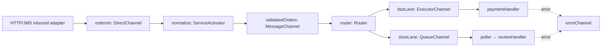
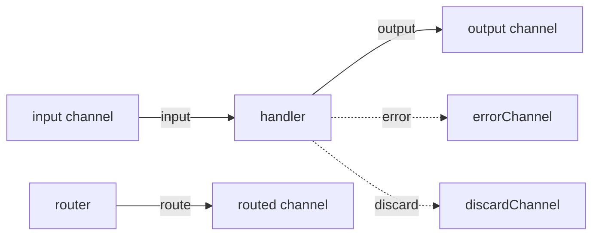
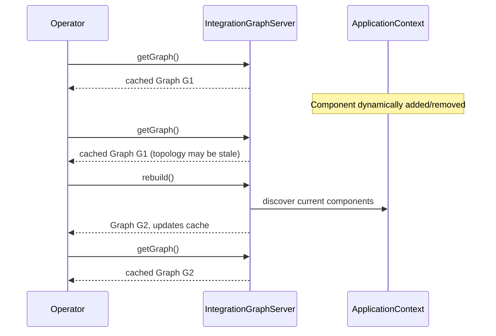
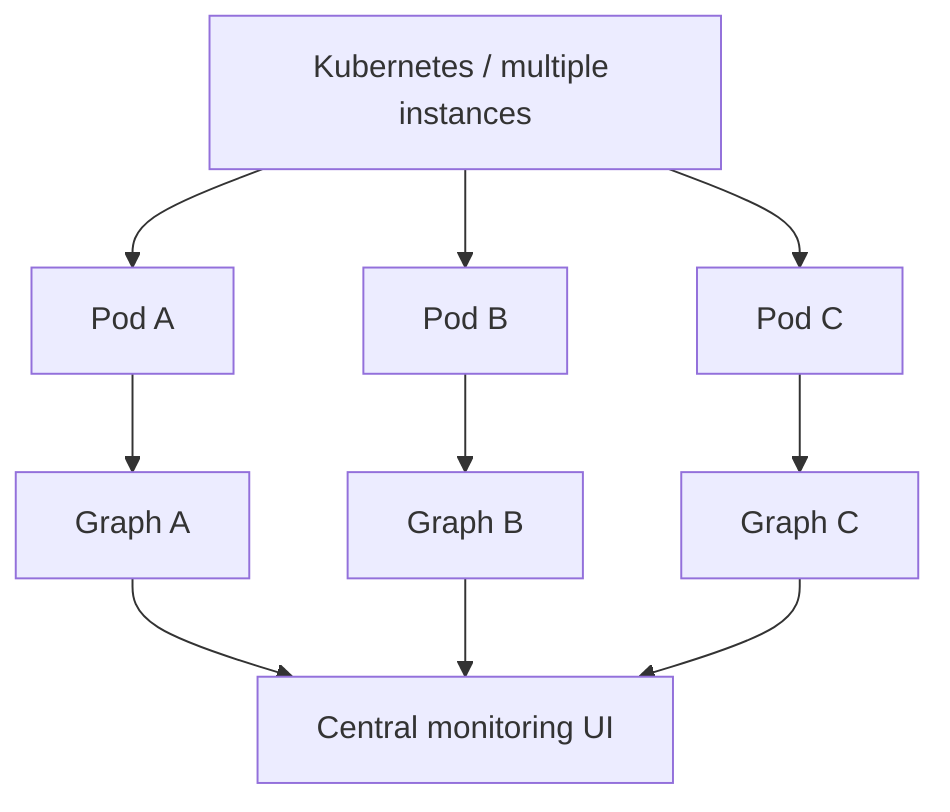

# IntegrationGraphServer and Runtime Graphs in Spring Integration

## Objectives and Context

In **SPRING_INTEGRATION_RUNTIME**, an application can contain dozens or hundreds of `MessageChannel`s, consumer endpoints, inbound adapters, routers, service activators, pollers, executors, and handlers. Flows may be configured using Java DSL, annotations, XML, or dynamic registration. When the application is running, reading source code alone does not guarantee knowing **which components actually exist in the ApplicationContext** and how they are wired together.

The **Control and Management** chapter introduces **`IntegrationGraphServer`**, the Spring Integration component that builds a **runtime model graph**. The graph presents nodes representing integration components and links expressing channel/endpoint relationships. It can be retrieved directly from Java or from the Spring Boot Actuator endpoint `/actuator/integrationgraph`.

> **Principle:** The Integration Graph is a **refreshable topology map**, not a message trace, transaction log, cluster-wide distributed topology, or an automated flow start/stop controller.

After this lesson, you will be able to:

- Explain `IntegrationGraphServer`, `Graph`, `IntegrationNode`, and `LinkNode`, including `contentDescriptor`, `nodes`, and `links`.
- Read `input`, `output`, `error`, `discard`, and `route` edge types to trace wiring.
- Register and query an `IntegrationGraphServer` in Java within an ApplicationContext.
- Distinguish `getGraph()` from `rebuild()`, especially when using dynamic `IntegrationFlowContext`.
- Enable, query, and secure Spring Boot Actuator `integrationgraph`; understand GET/POST.
- Add operational metadata via `setAdditionalPropertiesCallback(...)` without exposing sensitive data.
- Combine topology with `SmartLifecycle`, Micrometer/Observation, logs, traces, and thread dumps for diagnostics.
- Write tests to detect missing channels, endpoints, or links without relying on unstable `nodeId` values across builds.

Examples focus on Spring Integration **6.5.x**, Spring Framework 6.x, Java 17+, and Spring Boot 3.5.x where Actuator is used. For newer generations, API names or data structures may change, so check the Javadoc for your exact project version.

## 1. Why Do We Need a Runtime Graph?

Consider an order processing flow:



When an incident occurs—"messages arrived at `ordersIn` but never reached the payment handler"—we want to know:

1. Is `ordersIn` registered as a bean/channel?
2. Which consumer is connected to it? Is there one subscriber or multiple?
3. Which handlers have a configured output channel, error channel, or discard channel?
4. Which route names does the router currently know about?
5. Was a component dynamically registered or removed while the management map wasn't updated?
6. Is the endpoint running, are worker threads/queues backed up, or does it only exist in configuration?

`IntegrationGraphServer` helps answer **questions 1–5 at the wiring-model level**, while question 6 typically requires additional data from `SmartLifecycle`, metrics, logs, and other management sources. The graph **does not measure** backlogs of every `QueueChannel`, does not guarantee all dynamic destinations exist, and does not prove a message traversed a link.

### Operational Value of the Graph

| Need | How the Graph Helps | Additional Tools Needed |
|---|---|---|
| Understand registered topology | Lists channels, endpoints, and links between them | Flow configuration, dependencies/versions |
| Find disconnected flow segments | Compare inputs/outputs and missing links | Startup logs, condition evaluation |
| Audit error paths | Inspect `error` or `discard` links when known to the framework | `ErrorMessage`, error handlers, DLQ |
| Inspect dynamic flows | `rebuild()` after register/remove to update structure | `IntegrationFlowContext` and registration IDs |
| Analyze started/stopped endpoints | Can attach `SmartLifecycle` properties to nodes | Live `isRunning()` checks |
| Understand performance | Identify where to place metrics/tracing | Micrometer, Observation, thread dumps, queue depth |
| Track change/regression | Save topology snapshots and compare by component name/type | Integration tests and deployment metadata |

## 2. What Is IntegrationGraphServer?

The core class in Spring Integration 6.5:

```java
org.springframework.integration.graph.IntegrationGraphServer
```

Introduced in Spring Integration 4.3, this component is aware of the `ApplicationContext` and collects Spring Integration components to construct a `Graph`. It implements `ApplicationContextAware` and listens for `ContextRefreshedEvent`.

Key APIs:

```java
IntegrationGraphServer server = ...;

Graph current = server.getGraph();
Graph refreshed = server.rebuild();

server.setApplicationName("order-runtime");
server.setAdditionalPropertiesCallback(namedComponent -> ...);
```

API model:

| API | Responsibility | Key Notes |
|---|---|---|
| `new IntegrationGraphServer()` | Creates the graph builder server | Must be registered as a **bean** in the Spring context |
| `getGraph()` | Returns the **cached graph** | Topology may be stale if structure changed; some runtime node data is dynamic |
| `rebuild()` | Rescans the component model, builds and caches a new graph | Call when adding/removing components or after topology changes |
| `setApplicationName(...)` | Sets the application name in `contentDescriptor.name` | Falls back to `spring.application.name` if unset |
| `setAdditionalPropertiesCallback(...)` | Adds node properties from `NamedComponent` | Avoid expensive computation and sensitive data |
| `onApplicationEvent(ContextRefreshedEvent)` | Initializes/updates per Spring context lifecycle | Do not invoke directly to control flows |

`IntegrationGraphServer` is **not an HTTP server**; it builds an object model inside Spring. Exposing it over HTTP requires a management layer such as Spring Boot Actuator.

Some older documentation references the package `org.springframework.integration.support.management.graph`. With **Spring Integration 6.5**, import the public API under `org.springframework.integration.graph`, matching the current Javadoc for this line.

## 3. Structure of a Graph

Spring Integration 6.5 defines `org.springframework.integration.graph.Graph` as a class with these getters:

```java
Map<String, Object> descriptor = graph.getContentDescriptor();
Collection<IntegrationNode> nodes = graph.getNodes();
Collection<LinkNode> links = graph.getLinks();
```

The graph is serialized to JSON for UI dashboards or Actuator. Three top-level fields:

```json
{
  "contentDescriptor": {
    "provider": "spring-integration",
    "providerFormatVersion": 1.2
  },
  "nodes": [
    {
      "nodeId": 2,
      "name": "errorChannel",
      "componentType": "publish-subscribe-channel",
      "properties": {}
    },
    {
      "nodeId": 3,
      "name": "errorLogger",
      "componentType": "logging-channel-adapter",
      "input": "errorChannel",
      "properties": {}
    }
  ],
  "links": [
    { "from": 2, "to": 3, "type": "input" }
  ]
}
```

This is a **minimal example response**: actual JSON may include `providerVersion`, `integrationPatternCategory`, `integrationPatternType`, `observed`, and other fields depending on component/version. It may also include `nullChannel` or default Spring Integration beans.

### 3.1. contentDescriptor — Origin and Version

`contentDescriptor` describes the model/application:

- `provider` is typically `spring-integration`.
- `providerVersion` indicates the Spring Integration version providing the graph.
- `providerFormatVersion` helps clients understand the payload structure.
- `name` can come from `setApplicationName(...)` or `spring.application.name`.

Graphs from two deployments with identical component names but different provider/runtime versions may differ. Dashboards should record the version and avoid hardcoding layouts to a single sample payload.

### 3.2. nodes — Components

`IntegrationNode` in 6.5 has these typical properties:

| Field | Meaning | How to Use |
|---|---|---|
| `nodeId` | Auto-incremented numeric ID used to connect links **within the current graph** | Join from `links.from/to`; do not use as a stable business ID |
| `name` | Component/bean/endpoint name in the model | Match against configuration, logs, metrics |
| `componentType` | Component kind such as channel/handler/adapter | Build UI filters/groups |
| `integrationPatternType` | Enterprise Integration Pattern type (if applicable) | Distinguish gateway, router, aggregator, etc. |
| `integrationPatternCategory` | EIP category, e.g., messaging channel/endpoint | Categorize display |
| `input`/`output` | Channel name attached to the endpoint, if any | Read connection direction |
| `properties` | Component metadata and custom properties | Diagnose config, lifecycle |
| `observed` | Whether the component has framework observation instrumentation | Hints at trace/metrics capability, not a health flag |

**Never use `nodeId` as a persistent foreign key** in long-lived dashboard tables. Across `rebuild()`, component changes, restarts, or discovery order changes, node IDs can shift. Comparing topologies across deployments should rely on full names, component types, flow namespaces, and application-controlled stable identifiers.

Not every node has `input`, `output`, or the same set of properties. For example, a channel normally has no `inputChannel`; a poller may be represented through an endpoint/source adapter rather than looking identical to a service activator node.

### 3.3. links — Relationships Between Nodes

`LinkNode` is a directed relationship consisting of `from`, `to`, and `type`.

```java
int from = link.getFrom();
int to = link.getTo();
LinkNode.Type type = link.getType();
```

Important link types in a Spring Integration graph:

| Type | Link Direction | Example |
|---|---|---|
| `input` | Channel → consumer endpoint/handler | `ordersIn` → `normalizeHandler` |
| `output` | Handler/producer → output/reply channel | `normalizeHandler` → `validatedOrders` |
| `error` | Component with error-channel → error channel | Poller/adapter → `errorChannel` |
| `discard` | Discarding handler → discard channel | Filter → `rejectedOrders` |
| `route` | Router → routed target channel | HeaderValueRouter → `priorityLane` |

A router may select destinations based on runtime data; the graph only displays routes it can describe, such as configured mappings or tracked dynamic routes. Per documentation, routers typically retain up to about 100 dynamic routes for modeling, adjustable via `dynamicChannelLimit` when appropriate.



**Do not infer from an `output` link that every message always traverses it.** Routers/filters, exceptions, timeouts, release strategies, and dynamic channel selection can all cause messages to take another path or emit no output.

### 3.4. The Graph Is Not Processing History

`IntegrationGraphServer` shows the runtime **structure** and some metadata; it does not record "message #123 passed through handler A at 12:03" or individual retry attempts. To know where messages actually traveled, use logs/traces, Micrometer Observation, selectively enabled message history, and broker/store data.

## 4. Java Example: Creating IntegrationGraphServer and Reading the Graph in the JVM

The example below creates two `DirectChannel`s, two service activators, and an `IntegrationGraphServer` bean. Only Spring Integration Core with compatible Spring dependencies is needed; Spring Boot Actuator is not yet required.

```java
import java.util.Collection;
import java.util.HashMap;
import java.util.Map;

import org.springframework.context.SmartLifecycle;
import org.springframework.context.annotation.AnnotationConfigApplicationContext;
import org.springframework.context.annotation.Bean;
import org.springframework.context.annotation.Configuration;
import org.springframework.integration.annotation.ServiceActivator;
import org.springframework.integration.channel.DirectChannel;
import org.springframework.integration.config.EnableIntegration;
import org.springframework.integration.graph.Graph;
import org.springframework.integration.graph.IntegrationGraphServer;
import org.springframework.integration.graph.IntegrationNode;
import org.springframework.integration.graph.LinkNode;
import org.springframework.messaging.MessageChannel;

@Configuration
@EnableIntegration
public class RuntimeGraphExample {

    @Bean
    public MessageChannel ordersIn() {
        return new DirectChannel();
    }

    @Bean
    public MessageChannel ordersValidated() {
        return new DirectChannel();
    }

    @Bean
    public OrderHandlers orderHandlers() {
        return new OrderHandlers();
    }

    @Bean
    public IntegrationGraphServer integrationGraphServer() {
        IntegrationGraphServer server = new IntegrationGraphServer();
        server.setApplicationName("spring-integration-runtime-demo");

        server.setAdditionalPropertiesCallback(component -> {
            if (component instanceof SmartLifecycle lifecycle) {
                Map<String, Object> values = new HashMap<>();
                values.put("autoStartup", lifecycle.isAutoStartup());
                values.put("running", lifecycle.isRunning());
                return values;
            }
            return null;
        });
        return server;
    }

    public static class OrderHandlers {

        @ServiceActivator(
                inputChannel = "ordersIn",
                outputChannel = "ordersValidated")
        public String normalize(String order) {
            return order.trim();
        }

        @ServiceActivator(inputChannel = "ordersValidated")
        public void audit(String order) {
            System.out.println("Processed: " + order);
        }
    }

    public static void main(String[] args) {
        try (var context = new AnnotationConfigApplicationContext(
                RuntimeGraphExample.class)) {

            IntegrationGraphServer graphServer =
                    context.getBean(IntegrationGraphServer.class);

            Graph graph = graphServer.getGraph();

            System.out.println("DESCRIPTOR:");
            System.out.println(graph.getContentDescriptor());

            System.out.println("NODES:");
            for (IntegrationNode node : graph.getNodes()) {
                System.out.printf(
                        "id=%d name=%s type=%s properties=%s%n",
                        node.getNodeId(),
                        node.getName(),
                        node.getComponentType(),
                        node.getProperties());
            }

            System.out.println("LINKS:");
            for (LinkNode link : graph.getLinks()) {
                System.out.printf(
                        "%d -%s-> %d%n",
                        link.getFrom(),
                        link.getType(),
                        link.getTo());
            }

            // Send a real message through the channel to cross-check the flow:
            context.getBean("ordersIn", MessageChannel.class)
                    .send(org.springframework.messaging.support
                            .MessageBuilder.withPayload(" ORDER-001 ").build());
        }
    }
}
```

**Expected result:** the graph contains the `ordersIn` and `ordersValidated` channels along with the service activator endpoints registered by Spring Integration. Default nodes such as `errorChannel`/`nullChannel` will also appear; do not assert an exact node count as a constant unless the entire context is fixed.

The `setAdditionalPropertiesCallback` example only adds metadata for `NamedComponent` instances that actually implement `SmartLifecycle`; many nodes will not have the `running` and `autoStartup` fields. The callback does not turn the graph into a lifecycle management system, and values captured during graph construction may require `rebuild()` to reflect subsequent changes.

### Why Not Use `Graph.toString()` as JSON?

`Graph` is a Java object. `toString()` is not a JSON serialization contract and may simply return class name/identity. For JSON, let Spring Boot Actuator/Jackson serialize the object model or call `ObjectMapper.writeValueAsString(graph)` if the project already has a compatible Jackson dependency.

Example with Jackson:

```java
ObjectMapper mapper = new ObjectMapper();
String json = mapper.writerWithDefaultPrettyPrinter()
                    .writeValueAsString(graph);
System.out.println(json);
```

This snippet requires importing `com.fasterxml.jackson.databind.ObjectMapper` and the `jackson-databind` dependency. When creating a custom REST endpoint, do not return raw bean data or callbacks containing non-serializable objects; apply an explicit policy filtering exposed properties.

## 5. Cached Graph: `getGraph()` vs. `rebuild()`

This is the most important operational distinction.



### `getGraph()`

- Returns the cached graph model.
- Suitable for repeated queries when topology has not changed.
- Per Javadoc, even though the graph is cached, **some runtime data such as stats is dynamic**.
- That does not mean every custom property added via your callback is automatically recomputed on every read.
- Should not be used as a "full context scan" on every HTTP GET.

### `rebuild()`

- Reconstructs nodes/links based on the integration components the server discovers at that moment.
- Updates the cache and returns the new graph.
- Necessary when **adding or removing** components/flows dynamically.
- May change `nodeId` values and node ordering, so clients must join links using the new graph snapshot.
- Is a management operation; it does not start/stop endpoints, clear messages, or "fix" a misconfigured route.

### Two Kinds of Changes to Distinguish

| Change | Needs Topology Rebuild? | Reason |
|---|---|---|
| Register a new `IntegrationFlow` | Yes | New nodes/links appear |
| Unregister a flow | Yes | Old nodes/links must disappear |
| Replace an endpoint/component bean in context | Yes | Component model changed |
| `stop()`/`start()` an existing endpoint | May need rebuild to refresh custom lifecycle properties | Topology remains unchanged |
| A message was just processed | Usually no | The graph is not a per-message trace |
| Queue backlog grows | Graph is not a primary queue-depth source | Use dedicated metrics/queue introspection |
| Router discovers a new dynamic destination | May need rebuild to update known routes | Runtime mapping/caching depends on the router |
| Micrometer counter increments | Do not treat rebuild as the main way to get metrics | Use `MeterRegistry`/Actuator metrics |

**Avoid calling `rebuild()` on every dashboard request** just to see fresh message counts. In large applications with dynamic components, repeatedly rescanning the full model increases CPU and latency. Rebuild on structural change events or operator-triggered refresh requests at a controlled rate.

## 6. Dynamic IntegrationFlow: Updating the Graph After Register and Destroy

Spring Integration Java DSL provides `IntegrationFlowContext` for registering flows at runtime. This is the classic scenario where a cached graph becomes stale.

```java
import org.springframework.integration.dsl.IntegrationFlow;
import org.springframework.integration.dsl.IntegrationFlowContext;
import org.springframework.integration.graph.Graph;
import org.springframework.integration.graph.IntegrationGraphServer;

// Inside a Spring-managed service with both beans injected:
IntegrationFlow dynamicFlow = IntegrationFlow.from("runtimeOrdersIn")
        .handle(message -> System.out.println(
                "Dynamic: " + message.getPayload()))
        .get();

IntegrationFlowContext.IntegrationFlowRegistration registration =
        integrationFlowContext
                .registration(dynamicFlow)
                .id("runtime-orders-v1")
                .register();

// Rebuild the model after registration completes:
Graph afterRegister = integrationGraphServer.rebuild();

// Can stop/start the flow without deleting topology:
registration.stop();
registration.start();

// When the flow is no longer needed:
registration.destroy();

// Refresh the graph to remove deleted nodes/links:
Graph afterDestroy = integrationGraphServer.rebuild();
```

**This is a snippet for use inside a method**, assuming `integrationFlowContext` and `integrationGraphServer` are injected beans. The flow must use valid channel/handler names without colliding with existing bean IDs. Do not re-register `runtime-orders-v1` before destroying the old registration.

Key takeaways:

- `registration.stop()` stops eligible endpoints without destroying beans/flows; nodes may still exist.
- `registration.start()` reactivates the flow per the lifecycle contract.
- `registration.destroy()` removes the flow bean and dependent beans managed by the registration.
- `rebuild()` reflects topology changes. It does **not** invoke `stop/start/destroy` on your behalf.
- Do not rely solely on `afterRegister.getNodes().size() > before.getNodes().size()` as a guarantee for every flow type; check **expected node names/links** and the new topology snapshot.
- If messages sit in a `QueueChannel` or a handler is currently executing, `destroy`/`stop` must be coordinated with drain/quiesce, source acks, and the message store. The graph cannot decide where those messages should go.

### Should You Rebuild During Business Request Processing?

No. Registering/destroying flows is typically a **control plane** activity. Rebuilds belong in a secured management layer to avoid racing with deployment/configuration changes and must not run per message in the data plane.

With multiple replicas/pods, each `ApplicationContext` has its own graph. Registering a flow in pod A does not mean pod B has changed; inspect each instance individually unless your control plane actively coordinates them.

## 7. Spring Boot Actuator `/actuator/integrationgraph`

When Spring Boot Actuator is present alongside `spring-integration-core`, the `integrationgraph` endpoint exposes the application's graph to management clients.

### Dependencies and Configuration

With Spring Boot, use the appropriate integration starter/dependencies and:

```text
spring-boot-starter-actuator
spring-integration-core
```

Depending on your stack, `spring-integration-core` may already be brought in via `spring-boot-starter-integration`. Use the Spring Boot BOM to manage versions rather than mixing major versions arbitrarily.

Selective HTTP exposure configuration:

```yaml
spring:
  application:
    name: spring-integration-runtime-demo

management:
  endpoints:
    web:
      exposure:
        include: "health,info,integrationgraph"
  endpoint:
    integrationgraph:
      access: read-only
```

`management.endpoint.integrationgraph.access=read-only` configures access rights for Boot releases supporting the `access` property (such as Boot 3.5). It **blocks write operations**, so do not use it if you need HTTP POST rebuilds. On older Boot versions, check the corresponding `enabled`/`exposure` properties and security capabilities rather than copying property names blindly.

**By default**, Spring Boot typically exposes only `health` over HTTP, not all Actuator endpoints. Only add `integrationgraph` to exposure when operationally needed.

### GET — Retrieve the Graph

```bash
curl -i http://localhost:8080/actuator/integrationgraph
```

Expect HTTP 200 and JSON containing `contentDescriptor`, `nodes`, and `links` if the endpoint exists, is exposed, and the caller is authorized. If you receive 404/403/401, check Boot/Actuator dependencies, exposure, security, and management base path/port; do not immediately assume the graph is empty.

### POST — Rebuild the Graph

When the endpoint permits the corresponding management operation:

```bash
curl -i -X POST http://localhost:8080/actuator/integrationgraph
```

Per the Actuator API, a successful POST returns **HTTP 204 No Content**. Do not expect a JSON body from POST; issue a subsequent GET to fetch the updated snapshot. With `access: read-only`, POST is disallowed. To allow POST, explicitly configure appropriate write/unrestricted access and protect it with authentication/authorization.

**Do not confuse POST rebuild with reloading the entire application**, restarting consumers, or replaying messages. It only requests rebuilding the graph model.

### Management Port and Base Path

If using:

```yaml
management:
  server:
    port: 9090
  endpoints:
    web:
      base-path: /actuator
```

the endpoint may be served at `http://localhost:9090/actuator/integrationgraph` depending on the environment. In production, place the management interface on an internal network / secure bind address with authentication, never exposed directly to the internet.

## 8. Securing the Graph and Control Plane Permissions

The graph can reveal:

- Queue/topic names, endpoints/gateways, or connection paths to external systems.
- Component names, routing structures, error/discard policies, and expression metadata.
- Custom properties intentionally added by developers.
- Hints about business models, flow IDs, and potential attack points.

**Never include API keys, passwords, access tokens, raw payloads, or PII** in `setAdditionalPropertiesCallback`, graph logs, or HTTP responses. Do not serialize arbitrary Spring bean objects into `properties`; doing so can leak internals or cause JSON serialization failures.

### Separate Permissions for GET and POST

- **GET:** may be granted to authenticated operators/monitoring services, depending on topology sensitivity.
- **POST:** reserve for admins authorized to refresh snapshots (even though it doesn't directly control flows). Audit who calls it and when.
- If the system only needs read-only topology inspection, keep the endpoint read-only and handle rebuilds through internal deployment processes.
- Avoid exposing all Actuator endpoints simultaneously via `include: "*"` on a public management port.
- When using a custom `SecurityFilterChain`, verify Spring Security policies for Actuator: do not assume Boot automatically protects all endpoints if custom security configuration overrides defaults.

### Example Authorization Model

```text
Role MONITOR:
    GET /actuator/integrationgraph  -> allowed
    POST /actuator/integrationgraph -> denied

Role INTEGRATION_ADMIN:
    GET /actuator/integrationgraph  -> allowed
    POST /actuator/integrationgraph -> allowed per policy

Anonymous:
    No access to internal topology
```

This is a suggested policy, not a specific Spring Security configuration. In a real system, apply Boot-version-compatible `EndpointRequest`/security matchers, authentication, network boundaries, and audit logging.

## 9. Adding Lifecycle Metadata to Nodes

The graph primarily represents topology. To see whether an endpoint is currently running, you can use `setAdditionalPropertiesCallback(...)` to attach `SmartLifecycle` properties:

```java
server.setAdditionalPropertiesCallback(component -> {
    if (component instanceof SmartLifecycle lifecycle) {
        return Map.of(
                "running", lifecycle.isRunning(),
                "autoStartup", lifecycle.isAutoStartup(),
                "phase", lifecycle.getPhase());
    }
    return null;
});
```

`SmartLifecycle` belongs to `org.springframework.context.SmartLifecycle`. This snippet uses `Map.of(...)` (Java 9+) and only adds properties for components that actually implement this interface.

**Do not confuse `observed=true` with `running=true`.**

- `observed` indicates framework observation instrumentation when that metadata is present.
- `running` is read from `SmartLifecycle` by the callback at the time it runs.
- `autoStartup` is the auto-start policy, not the current live state.
- `phase` hints at lifecycle ordering, not worker count or poll count.
- A consumer with `isRunning()==true` may still not process messages if its channel is empty, its executor is out of threads, or downstream is blocked.
- A plain handler bean might not implement `SmartLifecycle`, even though the endpoint wrapping that handler does have a lifecycle.

### Cached Custom Properties Can Be Stale

The callback runs when nodes are built. If an endpoint calls `stop()` afterward, the cached graph object may still show `"running": true` from the previous rebuild. When verifying live state, query the actual `SmartLifecycle.isRunning()` bean and use the graph solely as a topology reference.

If a dashboard relies on callback properties to show fresh state, you can rebuild on lifecycle events or refresh at a bounded rate; do not treat the graph as a primary health probe.

### The Graph Is Not a Start/Stop Controller

To actually start/stop components:

- Use `SmartLifecycle` on the managed endpoint/channel component.
- For dynamic flows, use `IntegrationFlowContext.IntegrationFlowRegistration.start()/stop()/destroy()`.
- For protected message-based control, use a Control Bus or an authenticated/authorized management API.

`IntegrationGraphServer.rebuild()` **does not** restart pollers, reset transactions, or delete data in a message store.

## 10. Graph vs. Metrics and Observability

Spring Integration provides Micrometer/Observation to monitor message processing and performance. The graph provides a map of **where metrics attach** and the relationships between components.

| Tool | Primary Question | Example Data |
|---|---|---|
| Integration Graph | Which component connects to which? | `nodes`, `links`, `componentType` |
| Micrometer metrics | How are rates/errors/latencies changing? | Counters, timers, queue depth if instrumented |
| Observation/Tracing | Which spans did a specific request/message traverse? | Trace/span ID, duration, outcome |
| Message history | Which components did a message pass through (if enabled)? | Named endpoints along the message journey |
| Thread dump | Which worker is waiting on locks, I/O, or scheduler? | Thread states, stack frames |
| Message store/broker metrics | How much unprocessed data remains? | Queue depth, oldest message age |
| `SmartLifecycle` | Is a specific endpoint running? | `isRunning()`, `autoStartup`, phase |

### Note on Metrics Versions

Some older graph examples show `sendTimers`, `receiveCounters`, or `stats`. Spring Integration 5.2 deprecated legacy metrics in favor of Micrometer, and legacy metrics were removed in 5.4. Therefore, **do not build 6.5 monitoring expecting `sendTimers` or `stats` in the graph JSON**.

`observed` / EIP metadata fields may appear, but they do not replace pulling metrics directly from `MeterRegistry` or Actuator `/actuator/metrics`/Prometheus. To enable observation/management, check `@EnableIntegrationManagement` and Spring Boot Observability configuration for your exact version.

### Combining Signals When Debugging

Example—queue backlog is rising:

1. Graph shows that `billingQueue` connects to which `billingPoller`/handler.
2. `SmartLifecycle` shows whether the poller is running.
3. Queue-store metrics show backlog, oldest age, and rates.
4. Thread dump shows whether the poller is blocked in HTTP or on a `ReentrantLock`.
5. Error flow reveals exceptions or retry exhaustion.
6. Trace/correlation IDs locate the specific message.

If the graph shows a valid link yet the queue isn't draining, the cause likely lies in executor starvation, poller scheduling, transactions, retries, the message store, or consumer threads—not an "outdated" graph.

## 11. The Graph and Different Channel/Endpoint Types

### DirectChannel

`DirectChannel` typically invokes the subscriber on the sender thread. The graph reveals the link from channel to consumer endpoint, but it does not show how long messages hold the caller thread, transaction boundaries, or blocking handlers.

### QueueChannel + Poller

`QueueChannel` buffers messages for a poller to pull later. The graph shows the channel and consumer/poller endpoint, but cannot prove data is persisted. An unbacked `QueueChannel` can lose messages on restart even though its graph looks identical to a JDBC-backed store flow.

### ExecutorChannel

`ExecutorChannel` dispatches work to a `TaskExecutor`. The graph shows the channel, but does not expose executor queue capacity, active thread counts, or rejection policies without extra instrumentation/metadata.

### Gateway

`@MessagingGateway` can produce **multiple method nodes** by signature. A single gateway interface does not necessarily map to a single node, especially when overloaded. Tests should not assert "one gateway bean = one graph node".

### Router and Filter

Routers have `route` links to known channels; Filters may have a `discard` link. The absence of a `discard` link is not proof that messages are never discarded: default settings, dynamic routing, runtime headers, or handler logic can affect behavior.

### Aggregator/Resequencer

The graph identifies the endpoint and its input/output channels, but does not directly expose individual `MessageGroup`s, correlation keys, how many parts a release strategy is waiting on, or orphaned groups. Inspect `MessageGroupStore`, group timeouts, reapers, late-arrival policies, and transaction state.

### ErrorChannel

`errorChannel` typically appears by default with a logging subscriber. Seeing a graph link to `errorLogger` does not mean every synchronous `DirectChannel` failure is published to `errorChannel`. Synchronous/asynchronous error handling, recovery callbacks, and error handlers determine the actual error path.

## 12. Limitations of the Graph Across Multiple JVMs

`IntegrationGraphServer` operates within a **specific ApplicationContext**. In multi-replica deployments:



You need to check:

- Are all pods running the same version/configuration?
- Does Pod A have a dynamic flow that Pod B does not?
- Are endpoints toggled via per-instance feature flags?
- Is one pod starting/stopping or recently restarted?
- Do components share names while using differently configured message stores or transaction managers?
- Does the collector tag instance/namespace/pod, snapshot timestamp, and version?

**Do not merge graphs from multiple instances by `nodeId`**: IDs are assigned per graph. Use managed component names and deployment identities to namespace dashboards.

The graph reflects only the **local JVM/ApplicationContext**; it is not a full Kafka/JMS/HTTP network diagram and does not automatically discover remote consumers in other processes.

## 13. Testing the Graph Without Relying on `nodeId`

An integration test can require that `ordersIn` and `ordersValidated` exist, links are valid, and updates appear after dynamic flow changes.

```java
import static org.assertj.core.api.Assertions.assertThat;

import java.util.Set;
import java.util.stream.Collectors;

import org.junit.jupiter.api.Test;
import org.springframework.beans.factory.annotation.Autowired;
import org.springframework.boot.test.context.SpringBootTest;
import org.springframework.integration.graph.Graph;
import org.springframework.integration.graph.IntegrationGraphServer;

@SpringBootTest
class RuntimeGraphTest {

    @Autowired
    IntegrationGraphServer graphServer;

    @Test
    void channelsAndLinksAreRegistered() {
        Graph graph = graphServer.rebuild();

        Set<String> names = graph.getNodes().stream()
                .map(node -> node.getName())
                .collect(Collectors.toSet());

        assertThat(names).contains("ordersIn", "ordersValidated");

        Set<Integer> nodeIds = graph.getNodes().stream()
                .map(node -> node.getNodeId())
                .collect(Collectors.toSet());

        assertThat(graph.getLinks()).allSatisfy(link -> {
            assertThat(nodeIds).contains(link.getFrom());
            assertThat(nodeIds).contains(link.getTo());
        });
    }
}
```

This example requires `spring-boot-starter-test` and a context containing the `IntegrationGraphServer` bean and demo flow. This is a basic structural test; add link assertions between exact names when you want to verify wiring rather than only checking "every link points to an existing node".

### Testing Links by Name Instead of Fixed `nodeId`

```java
Map<Integer, String> nameById = graph.getNodes().stream()
        .collect(java.util.stream.Collectors.toMap(
                n -> n.getNodeId(),
                n -> n.getName()));

boolean hasInputLink = graph.getLinks().stream().anyMatch(link ->
        link.getType().name().equalsIgnoreCase("input")
        && "ordersIn".equals(nameById.get(link.getFrom())));

assertThat(hasInputLink).isTrue();
```

This is a continuation of a test method that already has the `graph` variable. When verifying the exact target consumer endpoint, also match `nameById.get(link.getTo())` against an explicit endpoint name you declared; do not guess auto-generated endpoint names without verifying the framework naming rules.

### Testing Dynamic Registration

1. Capture the initial graph and list of component names.
2. Register a dynamic `IntegrationFlow` with a new ID/key.
3. Call `rebuild()` and verify new nodes/links appear.
4. Call `registration.stop()` and verify topology remains.
5. Call `registration.destroy()`, then `rebuild()`, and verify the new flow's nodes disappear.
6. Never assert identical `nodeId` values before/after; only compare the semantics you need to protect.

### Testing Actuator

In a Spring Boot environment with Actuator:

- Exposed and authorized GET endpoint → HTTP 200 with `nodes` and `links`.
- POST when write access is permitted → HTTP 204; follow with a new GET to read the snapshot.
- POST in read-only mode must be rejected; the exact status depends on routing/security/version.
- An unauthorized caller must not be able to read sensitive topology.
- Do not expect every new message to create a graph node; this is not an event store.

## 14. Diagnosing Incorrect, Empty, or Stale Graphs

| Symptom | Possible Cause | What to Check |
|---|---|---|
| `NoSuchBeanDefinitionException` for `IntegrationGraphServer` | Bean not registered or missing auto-config | `@Bean`, Spring Integration/Actuator dependencies |
| HTTP 404 at `/actuator/integrationgraph` | Endpoint not exposed, different base path/port, or endpoint unavailable | Actuator dependency, `management.endpoints.web.exposure.include`, access settings |
| HTTP 401/403 | Security policy blocks caller | Authentication/authorization for the management interface |
| Graph contains only `errorChannel`/`nullChannel` | Flows not registered, wrong context, or components not Spring-managed | Actual `ApplicationContext`, `@EnableIntegration`, bean registration |
| Dynamic flow runs in app but missing from graph | Cached topology not rebuilt | Call `rebuild()` after registration completes |
| Destroyed flow still appears in graph | Cache not refreshed or bean not deleted | Registration lifecycle, `destroy()`, `rebuild()` |
| `running=true` even after operator stopped endpoint | Custom lifecycle properties captured during earlier build | Rebuild or query live `SmartLifecycle` |
| Missing dynamic route node/link | Route not yet discovered / exceeded limit | Router mappings and `dynamicChannelLimit` |
| Missing `sendTimers`/`stats` in JSON | Running a version where legacy metrics were removed | Use Micrometer/Observation instead of legacy fields |
| Graph has links but messages don't reach handler | Stopped endpoint, stuck worker, empty/full queue, routing/discard | Lifecycle, metrics, thread dumps, error flow |
| Graph serialization error | Custom properties contain non-serializable objects / circular refs | Return only primitives/strings/simple collections |
| Dashboard connects wrong nodes after restart | Persisted `nodeId` from an older graph | Join links within the current snapshot using stable names |
| Reading another instance's topology | Load balancer hit an arbitrary pod | Attach instance identity and collect per pod |
| Frequent rebuilds cause slowness | Scanning/serializing graph too often | Cache, debounce structural changes, rate-limit |

### Recommended Diagnostic Workflow

1. Identify the exact process, pod, Spring `ApplicationContext`, `spring.application.name`, and version.
2. Fetch `Graph` programmatically or via Actuator GET, storing the snapshot with timestamp and instance ID.
3. Inspect `contentDescriptor` to confirm provider/runtime version.
4. Use `nodes.name`/`componentType` to locate the expected channels and handlers.
5. Join `links.from`/`to` with `nodeId` **within the same snapshot** and read `type` to trace paths.
6. If topology recently changed, invoke `rebuild()` once under appropriate admin authorization.
7. If topology is correct while business processing still fails, move to `SmartLifecycle`, metrics, errors, queues, and tracing.
8. When dynamic flows change, audit registration ID, actor, and success/failure.
9. Compare graphs across pods/deployments using stable names/types, never `nodeId`.
10. When seeing unexpected extra nodes, check component auto-registration/naming and default endpoints before assuming a leak.

## 15. Hands-On Exercises

### Exercise 1 — Mapping a Flow

Using `RuntimeGraphExample`:

1. Start the context and call `getGraph()`.
2. Locate nodes `ordersIn`, `ordersValidated`, the service activators, and `errorChannel`.
3. Print `getLinks()`, mapping `from`/`to` to node names.
4. Draw a Mermaid diagram based on the actual output.
5. Send a message, compare processing logs with the topology, and explain why the graph **does not add a new node** per message.

**Outcome:** understand the difference between runtime topology and message history.

### Exercise 2 — Simulating a Dynamic Flow

1. Register a flow via `IntegrationFlowContext`.
2. Read `getGraph()` before rebuilding: it may still hold the old cache.
3. Call `rebuild()` and verify new nodes/links.
4. `stop()` the flow and confirm the graph can still retain the topology.
5. `destroy()` the flow, then rebuild, confirming the topology is removed.
6. Check whether stopping/destroying left messages stranded in any queue.

### Exercise 3 — Lifecycle Properties

1. Add a callback for `SmartLifecycle.isRunning()` and `isAutoStartup()`.
2. Fetch the graph at startup and record properties.
3. Stop a lifecycle-managed endpoint.
4. Re-read the cached graph and compare with live bean state.
5. Rebuild and explain the difference.
6. Build a dashboard view clearly annotated with "last graph rebuild time".

### Exercise 4 — Actuator Security

1. Expose only `health,info,integrationgraph`.
2. Verify an unauthenticated caller cannot view the graph when policy requires auth.
3. Set the endpoint to read-only and verify POST is blocked.
4. In an admin-only test environment, permit POST, verify HTTP 204, then GET.
5. Verify a separate management port/base path from the app port and check audit trail.
6. Test a fake secret in a custom property, then fix the callback so no secrets are exposed.

### Exercise 5 — Combining with Observability

1. Trigger an HTTP timeout in an outbound handler after an `ExecutorChannel`.
2. Use the graph to identify the involved channel and handler.
3. Check executor `isRunning()`/metrics, queue depth, and error messages.
4. Take a thread dump to distinguish retry sleep backlog from thread starvation.
5. Use business correlation IDs and tracing to locate affected messages.
6. Explain why `Graph.rebuild()` neither fixes a deadlock nor recovers lost messages.

## 16. Implementation Checklist

- [ ] `IntegrationGraphServer` bean or Actuator auto-configuration matching your Spring Integration version.
- [ ] Correct package `org.springframework.integration.graph` for Spring Integration 6.5.
- [ ] Read `Graph.getNodes()/getLinks()/getContentDescriptor()`; do not assume `Graph` is a JSON string.
- [ ] Join `LinkNode.from/to` by `nodeId` **within the same graph snapshot**.
- [ ] Do not persist `nodeId` as a component ID across deployments/restarts.
- [ ] Interpret `input/output/error/discard/route` with exact semantics.
- [ ] Do not treat the graph as a message trace or sole metrics source.
- [ ] Call `rebuild()` after registering/removing dynamic flows.
- [ ] Do not rebuild endlessly when topology has not changed.
- [ ] Distinguish cached graph properties from live `SmartLifecycle` state.
- [ ] Keep custom properties simple, cheap to compute, and free of secrets/sensitive payloads.
- [ ] Expose Actuator `integrationgraph` only when needed, with authn/authz and network boundaries.
- [ ] Separate permissions for read-only GET and POST rebuild per Boot version/security capabilities.
- [ ] In clusters, collect graphs from each instance tagged with instance identity.
- [ ] Pair with Micrometer, Observation, logs, thread dumps, message store, and broker metrics.
- [ ] Test stable names/links instead of hardcoding total node counts or node IDs.
- [ ] Use flow registration/Control Bus/lifecycle APIs for start/stop, never `rebuild()` for control.

## References

- [Spring Integration 6.5 — Integration Graph](https://docs.spring.io/spring-integration/reference/6.5/graph.html): topology model, `nodes`, `links`, link types, and callbacks.
- [Spring Integration 6.5 Javadoc — IntegrationGraphServer](https://docs.spring.io/spring-integration/docs/6.5.0/api/org/springframework/integration/graph/IntegrationGraphServer.html): `getGraph()`, `rebuild()`, `setApplicationName()`, and `setAdditionalPropertiesCallback()`.
- [Spring Integration 6.5 Javadoc — Graph](https://docs.spring.io/spring-integration/docs/6.5.0/api/org/springframework/integration/graph/Graph.html): `getNodes()`, `getLinks()`, `getContentDescriptor()`.
- [Spring Integration 6.5 Javadoc — IntegrationNode](https://docs.spring.io/spring-integration/docs/6.5.0/api/org/springframework/integration/graph/IntegrationNode.html): node metadata, `isObserved()`.
- [Spring Integration 6.5 Javadoc — LinkNode](https://docs.spring.io/spring-integration/docs/6.5.0/api/org/springframework/integration/graph/LinkNode.html): `getFrom()`, `getTo()`, `getType()`.
- [Spring Integration 6.5 Javadoc — IntegrationFlowContext](https://docs.spring.io/spring-integration/docs/6.5.0/api/org/springframework/integration/dsl/context/IntegrationFlowContext.html): dynamic flow registration.
- [Spring Integration 6.5 Javadoc — IntegrationFlowRegistration](https://docs.spring.io/spring-integration/docs/6.5.0/api/org/springframework/integration/dsl/context/IntegrationFlowContext.IntegrationFlowRegistration.html): `start/stop/destroy`.
- [Spring Boot Actuator API — Integration Graph](https://docs.spring.io/spring-boot/3.4/api/rest/actuator/integrationgraph.html): GET graph and POST rebuild.
- [Spring Boot 3.5 — Actuator Endpoints](https://docs.spring.io/spring-boot/3.5/reference/actuator/endpoints.html): exposure, endpoint access, and security.
- [Spring Integration Reference — Metrics and Management](https://docs.spring.io/spring-integration/reference/metrics.html): Micrometer/Observation and management.

**Remember:** `IntegrationGraphServer` provides **a runtime Spring Integration topology model**, consisting of `Graph.contentDescriptor`, `nodes`, and `links`. `getGraph()` retrieves the cached graph and `rebuild()` refreshes the topology after changes; Spring Boot Actuator can expose it via `GET/POST /actuator/integrationgraph`. Secure the endpoint, compare using stable node names, and combine the graph with lifecycle/metrics/tracing when diagnosing real message flows.
