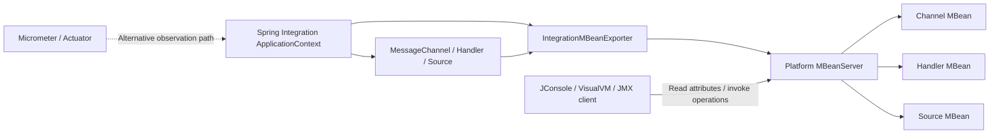
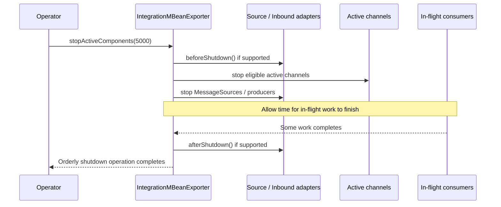

# IntegrationMBeanExporter and JMX in Spring Integration

## 1. Why Control and Observe Message Flows at Runtime?

In the **Control and Management** chapter of the `SPRING_INTEGRATION_RUNTIME` module, Spring Integration coordinates messages through **channels, endpoints, consumers, pollers, and executors**; applications also need to manage `IntegrationFlow` lifecycles, transactions, retries, message stores, errors, and correlation. A flow may pass tests yet run into incidents after hours of operation: growing queues, slow handlers, a stopped polling endpoint, or a shutdown cutting off active work.

**JMX (Java Management Extensions)** lets a Java process expose management objects called **MBeans**. Tools such as JConsole, VisualVM, or an authorized JMX client can read attributes and invoke operations on MBeans. In Spring Integration, `IntegrationMBeanExporter` bridges **message channels, message handlers, and message sources** into MBeans for observation and administration.

Running scenario throughout this lesson: a service receives orders into `ordersQueue`, and a poller periodically invokes `ordersProcessor`. When orders arrive faster than they are processed, operators want to check:

- Have the channel and handler been registered, and what are their JMX names?
- How many messages are currently queued; are send/receive counts or error counts increasing?
- Which endpoints are active; can operations be tuned or stopped in a controlled manner?
- Before deploying a new release, is there a way to request an **orderly shutdown** to minimize interrupting in-flight messages?
- Should JMX be exposed over the network, and which operations risk impacting production?

**JMX is not a message broker, message store, or transaction manager.** It exposes a **runtime process management surface**. Reading an MBean does not recover lost messages; invoking an operation to stop an endpoint does not guarantee data has been committed or safely acknowledged.

### Lesson Objectives

After this lesson, you will be able to:

1. Distinguish `IntegrationMBeanExporter`, `MBeanServer`, `ObjectName`, MBeans, `@EnableIntegrationMBeanExport`, and JMX adapters.
2. Configure a Spring Integration application to export channels/handlers/sources to JMX.
3. Locate MBeans via JConsole or `MBeanServer.queryNames(...)` without relying on ambiguous auto-generated names.
4. Read metrics/attributes and operations **appropriate to the component type and version**.
5. Understand `stopActiveComponents(long)`, MBean registration/unregistration lifecycles, and shutdown boundaries.
6. Design JMX access security, multi-instance monitoring, and coordination with Micrometer/Actuator.
7. Diagnose missing MBeans, `ObjectName` collisions, missing metrics, or shutdowns that do not drain queues.

## 2. JMX Architecture: Who Registers and Who Queries?

A Spring Integration system can use an MBeanServer **within the same JVM**, while allowing clients to observe it over a secured JMX connection:



| Component | Nature | Role |
|---|---|---|
| `IntegrationMBeanExporter` | Spring Integration exporter, class `org.springframework.integration.monitor.IntegrationMBeanExporter` | Registers MBeans for eligible components and provides management operations/statistics. |
| `MBeanServer` | JMX registry in the JVM, typically the platform MBeanServer | Identifies `ObjectName`s, supplies metadata, reads attributes, invokes operations. |
| `ObjectName` | Name with `domain` and key/property pairs, e.g., `example.integration:type=MessageChannel,name=ordersQueue` | How clients locate the exact MBean, not a message channel address. |
| `@EnableIntegrationMBeanExport` | Spring Integration annotation | Enables the default exporter in the ApplicationContext, with domain, server, and component-filtering options. |
| Standard Spring Framework `MBeanExporter` | General-purpose MBean exporter for `@ManagedResource` beans | Not identical to Spring Integration's specialized exporter; avoid `ObjectName` collisions. |
| JMX client | JConsole, VisualVM, or `MBeanServerConnection` API client | Reads attributes and executes operations when authorized. |
| Micrometer/Actuator | Independent metrics/observation and management endpoints | Complements dashboards, time-series, and alerting; not equivalent to Spring Integration MBean export. |

`IntegrationMBeanExporter` **is itself manageable** but **does not automatically register itself as an MBean**; by default it focuses on exporting channel/handler/source components. If you need to invoke **exporter** operations (such as `stopActiveComponents`) **via JMX**, ensure the exporter itself is exported separately, for instance via Spring Framework's MBean exporter, while managing duplicate registrations. If calling **directly in Java** on the exporter bean, exposing the exporter itself via JMX is unnecessary.

### Two Access Paths to Distinguish

**Data path**: adapter receives message → channel → poller/consumer → handler → output channel, retries, transactions.

**Management path**: JMX client → MBeanServer → MBean attribute/operation. This path is **not** a normal Spring Integration message flow and can trigger operations affecting runtime behavior, such as stopping an intake source. Therefore, JMX must be authorized and audited like an admin API.

## 3. Enabling `IntegrationMBeanExporter` with Annotations

Spring Integration 7.1.x documentation describes `@EnableIntegrationMBeanExport` in the package:

```java
import org.springframework.integration.jmx.config.EnableIntegrationMBeanExport;
```

This annotation creates the default exporter with **bean name `integrationMbeanExporter`**. Example configuration:

```java
import org.springframework.context.annotation.Configuration;
import org.springframework.integration.config.EnableIntegration;
import org.springframework.integration.jmx.config.EnableIntegrationMBeanExport;

@Configuration
@EnableIntegration
@EnableIntegrationMBeanExport(
        defaultDomain = "example.integration",
        managedComponents = {"!ordersSecret*", "orders*"})
public class IntegrationJmxConfig {
}
```

This example selects a **dedicated domain** so the service's MBeans do not mix with other applications. `managedComponents` filters by exported **component name**, not arbitrary payload expressions. Patterns are evaluated in order; **the first matching pattern determines** inclusion or exclusion:

- `"!ordersSecret*"` excludes components starting with `ordersSecret`.
- `"orders*"` includes components starting with `orders`.
- Reversing this to `{"orders*", "!ordersSecret*"}` causes the broader pattern first to render the later exclusion rule **ineffective**.

Do not expose all MBeans to production without knowing what each name represents. `managedComponents` narrows the observation/management surface, but it is **not a JMX user authentication or authorization mechanism**.

### 3.1. Required Dependencies

In current Spring Integration releases, JMX support lives in the `spring-integration-jmx` artifact. For example, in Gradle, let your project's dependency management/BOM resolve compatible versions:

```groovy
dependencies {
    implementation "org.springframework.boot:spring-boot-starter-integration"
    implementation "org.springframework.integration:spring-integration-jmx"
}
```

Or without Spring Boot, add `spring-integration-core`, `spring-integration-jmx`, and the required Spring/JMX libraries from the same compatible version line.

**Do not mix versions arbitrarily.** Configuration snippets from 6.x docs may still work in 7.x, yet API signatures, MBean attributes, or metric policies have evolved. Check documentation for the **exact version** you deploy; this lesson explains core behaviors using examples compatible with modern Spring Integration stacks.

### 3.2. Selecting an `MBeanServer`

If `server` is omitted, the annotation uses the default platform MBeanServer. When an application defines a dedicated MBeanServer bean:

```java
import javax.management.MBeanServer;
import java.lang.management.ManagementFactory;
import org.springframework.context.annotation.Bean;
import org.springframework.context.annotation.Configuration;
import org.springframework.integration.jmx.config.EnableIntegrationMBeanExport;

@Configuration
@EnableIntegrationMBeanExport(
        server = "integrationServer",
        defaultDomain = "example.integration")
public class CustomJmxServerConfig {

    @Bean("integrationServer")
    public MBeanServer integrationServer() {
        return ManagementFactory.getPlatformMBeanServer();
    }
}
```

This is an **alternative** to `IntegrationJmxConfig` above—do not register both `@EnableIntegrationMBeanExport` configurations in the same ApplicationContext. Some projects already have an `MBeanServer` bean created by Spring Boot or another configuration; reuse it instead of creating a duplicate.

## 4. Java / Spring Boot Example: Observing a `QueueChannel` and Service Activator

The small example below illustrates **one input queue and one polling consumer**; Spring Integration runs within the same JVM with no broker or database required. Place each public class in its own `.java` file under package `example.integration`, Java 17+.

### 4.1. Application, Channel, and Sample Data

```java
package example.integration;

import org.springframework.boot.ApplicationRunner;
import org.springframework.boot.SpringApplication;
import org.springframework.boot.autoconfigure.SpringBootApplication;
import org.springframework.context.annotation.Bean;
import org.springframework.integration.channel.QueueChannel;
import org.springframework.integration.config.EnableIntegration;
import org.springframework.integration.jmx.config.EnableIntegrationMBeanExport;
import org.springframework.messaging.support.MessageBuilder;

@SpringBootApplication
@EnableIntegration
@EnableIntegrationMBeanExport(
        defaultDomain = "example.integration",
        managedComponents = {"orders*"})
public class OrdersJmxApplication {

    @Bean("ordersQueue")
    public QueueChannel ordersQueue() {
        return new QueueChannel(10);
    }

    @Bean
    public ApplicationRunner initialMessages(QueueChannel ordersQueue) {
        return args -> {
            ordersQueue.send(
                    MessageBuilder.withPayload("ORD-100").build());
            ordersQueue.send(
                    MessageBuilder.withPayload("ORD-101").build());
            ordersQueue.send(
                    MessageBuilder.withPayload("ORD-102").build());
        };
    }

    public static void main(String[] args) {
        SpringApplication.run(OrdersJmxApplication.class, args);
    }
}
```

`QueueChannel(10)` caps the **number of queued messages**, not payload bytes. A returning `send()` call indicates acceptance according to the channel contract; it does not prove the handler succeeded or a business transaction committed.

### 4.2. Poller-Driven Message Handler

```java
package example.integration;

import org.springframework.integration.annotation.MessageEndpoint;
import org.springframework.integration.annotation.Poller;
import org.springframework.integration.annotation.ServiceActivator;

@MessageEndpoint("ordersProcessor")
public class OrdersProcessor {

    @ServiceActivator(
            inputChannel = "ordersQueue",
            poller = @Poller(fixedDelay = "500", maxMessagesPerPoll = "1"))
    public void process(String orderId) {
        System.out.printf("Processed order %s by %s%n",
                orderId, Thread.currentThread().getName());
    }
}
```

Spring Integration creates a polling consumer for `ordersQueue`. Each poll pulls a message when available and invokes the method. At runtime, MBeans matching `managedComponents = {"orders*"}` may be registered for the channel and corresponding endpoints/handlers.

**Do not assume the exporter generates a single MBean name directly from the Java class name.** Handlers may be named by endpoint ID, input channel, or a framework-generated internal name. In practice, **query the actual ObjectNames** in the `MBeanServer`; never hardcode unverified handler names.

### 4.3. Verifying with JConsole

In a developer environment:

1. Run the application and launch `jconsole` (included with JDK distributions that bundle JConsole).
2. Select the **local Java process** for `OrdersJmxApplication`; no network-exposed remote JMX is needed for this exercise.
3. Open the **MBeans** tab and locate domain `example.integration`.
4. Select the MBean with `type=MessageChannel` and `name=ordersQueue`, and inspect the Attributes/Operations tabs.
5. Send more messages and observe changes in send/receive counts or queue count if provided by your version's MBean.
6. Pause the consumer/poller in a controlled test variant and watch the backlog grow; then resume it to observe drain rate.

Exact JMX attributes/operations depend on channel type, MBean interface, framework version, and management configuration. **Never pick an operation and invoke it in production just to see if it works.**

### 4.4. Reading MBeans Inside the Same JVM with Java

The snippet below must run from a Spring-managed bean in the **same process** as the application; if executed as a separate Java program, `ManagementFactory.getPlatformMBeanServer()` returns the MBeanServer of **that separate process**, not the monitored application's MBeanServer.

```java
package example.integration;

import java.lang.management.ManagementFactory;
import java.util.Set;
import javax.management.MBeanAttributeInfo;
import javax.management.MBeanInfo;
import javax.management.MBeanServer;
import javax.management.ObjectName;

public final class JmxInspector {

    private JmxInspector() {}

    public static void dumpLocalIntegrationMBeans() throws Exception {
        MBeanServer server = ManagementFactory.getPlatformMBeanServer();

        Set<ObjectName> names = server.queryNames(
                new ObjectName("example.integration:*"), null);

        for (ObjectName name : names) {
            System.out.println("MBean: " + name.getCanonicalName());
            MBeanInfo info = server.getMBeanInfo(name);

            for (MBeanAttributeInfo attribute : info.getAttributes()) {
                System.out.printf("  %s (%s), readable=%s%n",
                        attribute.getName(),
                        attribute.getType(),
                        attribute.isReadable());
            }
        }
    }
}
```

`dumpLocalIntegrationMBeans()` only lists attribute **metadata**, avoiding blindly invoking getters/operations that might be expensive or mutate state. You can call it from an `ApplicationRunner` once startup completes, or from a protected internal diagnostic tool.

To read an attribute value, obtain the **exact attribute name from `MBeanInfo`** and call `server.getAttribute(objectName, attributeName)` with appropriate authorization. Do not assume every MBean exposes `QueueSize`, `SendCount`, or `Duration`: attribute names and MBean types vary across channels, sources, handlers, and versions.

## 5. JMX `ObjectName`: Identification, Filtering, and Collisions

A JMX `ObjectName` has the structure `domain:key=value,...`. In our example the domain is `example.integration`; if unconfigured, Spring Integration typically uses the default domain `org.springframework.integration` per the reference guide.

| Component | Common `ObjectName` Pattern | Key Notes |
|---|---|---|
| `MessageChannel` | `example.integration:type=MessageChannel,name=ordersQueue` | Derived from the bean/channel name resolved by the exporter. |
| `MessageSource` | `example.integration:type=MessageSource,name=...,bean=...` | May include additional endpoint/source names. |
| `MessageHandler` | `example.integration:type=MessageHandler,name=...,bean=...` or per naming strategy | Verify actual names and properties via `queryNames`; docs/implementations vary. |
| Separately exported exporter | `ObjectName` assigned by Spring Framework exporter | **Not auto-exported** merely because the Integration exporter is running. |

`bean` property values describe where the name originated, such as `endpoint`, `anonymous`, `internal`, or another fallback. An endpoint lacking an explicit ID often receives an unreadable generated name; assign meaningful IDs/bean names to components you need to manage.

**Do not rely rigidly on name tables to build URLs or automation:** custom `ObjectNamingStrategy`, static properties appended to `ObjectName`s, quoted characters (Spring Integration quotes names that are not valid identifiers), and version differences can change exact names. A safer query:

```java
ObjectName pattern = new ObjectName("example.integration:type=MessageChannel,*");
Set<ObjectName> channels = server.queryNames(pattern, null);
```

`server` and imports like `javax.management.ObjectName` match the earlier example; this fragment runs in the same scope with `MBeanServer server`. `queryNames` does not replace access authorization or selecting the right JVM.

### 5.1. `ObjectName` Collisions Across Multiple Contexts

When two `ApplicationContext`s in the **same JVM** both export `ordersQueue` under the same domain/type/name, the `MBeanServer` receives duplicate registration requests. `RegistrationPolicy.FAIL_ON_EXISTING` is the annotation default; registration errors can fail startup.

Ways to resolve this:

- Assign distinct domains and namespaces per context, or distinct bean names.
- Use `objectNameStaticProperties` or `ObjectNamingStrategy` per exporter configuration to add stable identifiers.
- Export only components actually needed for management via `managedComponents`.
- Investigate why two contexts register the same MBean rather than blindly choosing replace/ignore to mask conflicts.

Avoid putting `requestId`, `customerId`, or any high-cardinality value into `ObjectName`s; otherwise, large, rapidly churning MBean counts bloat JMX management, slow queries, and increase data exposure risks.

### 5.2. Registration and Unregistration Lifecycle

`IntegrationMBeanExporter` **no longer implements `SmartLifecycle`** to manage registration via `start()/stop()`. MBeans are registered when the `ApplicationContext` initializes and unregistered when the context is destroyed. Therefore:

- **Stopping a poller/endpoint** does not make its MBean disappear.
- **Restarting the JVM/context** resets metrics held only in memory.
- **Dynamic `IntegrationFlow`s** have their own lifecycle; verify component creation/destruction and MBean registration in your exact version rather than assuming every post-startup flow is exported identically to static beans.
- **Do not call `exporter.stop()`** as a normal JMX registration/unregistration operation since the exporter does not expose that `SmartLifecycle` contract.

## 6. Attributes, Statistics, and Operations: How to Read Them Properly

The exporter exposes channels/handlers/sources along with management properties. Per the Javadoc, methods include:

```java
// Called directly on the exporter bean inside the ApplicationContext:
IntegrationMBeanExporter exporter =
        context.getBean("integrationMbeanExporter",
                IntegrationMBeanExporter.class);

int channels = exporter.getChannelCount();
int handlers = exporter.getHandlerCount();
int sources = exporter.getSourceCount();
int queuedMessages = exporter.getQueuedMessageCount();

String[] channelNames = exporter.getChannelNames();
String[] handlerNames = exporter.getHandlerNames();
String[] sourceNames = exporter.getSourceNames();
```

Imports:

```java
import org.springframework.integration.monitor.IntegrationMBeanExporter;
// context is the application-provided ApplicationContext.
```

**Distinguish direct Java calls from JMX access.** The Java calls above execute inside the `ApplicationContext`. To view **the exporter's own attributes** in JConsole, ensure it is separately exported via Spring Framework's exporter or equivalent MBean configuration. In Section 4's example, the goal is inspecting channel and handler MBeans; the exporter itself need not appear under the domain.

### 6.1. Signals to Observe

| Component Type | Useful Signals | What Cannot Be Concluded |
|---|---|---|
| `MessageChannel` | Send/receive counts, send/receive errors, rates; queue channels may show queued count | A successful `send()` does not mean downstream business work committed. |
| `MessageHandler` | Execution count, errors, duration/rates depending on interface and config | Handler completion does not guarantee broker ack or external HTTP success. |
| `MessageSource` | Poll/receive counts and messages returned when instrumented | Zero polled messages does not guarantee the external source has no data. |
| Aggregate exporter | Registered channel/handler/source counts, exporter-tracked queued messages | Does not include backlogs in Kafka, RabbitMQ, remote brokers, or external databases. |
| Endpoint/poller lifecycle | Start/stop state when supported by the MBean | A "running" endpoint does not guarantee subscribers exist, source connectivity, or forward progress. |

Exact attributes depend on the MBean implementation. Always distinguish **monotonic counters since JVM start** from **average rates** and **current gauges**. Reading a single count without timestamps or a measurement window is insufficient to diagnose saturation.

### 6.2. Estimating Backlog and Drain Time

Let:

- `B`: backlog at measurement time (messages).
- `μ`: handler completion rate (messages/second).
- `λ`: continued source arrival rate (messages/second).

Once intake is stopped and processing rate is relatively steady:

\[
T_{\text{drain}}\approx\frac{B}{\mu}
\]

If the source continues producing and `μ > λ`:

\[
T_{\text{drain}}\approx\frac{B}{\mu-\lambda}
\]

This is an **estimate**; retries, message sizes, poison messages, concurrency, transactions, restarts, and source spikes can cause reality to diverge sharply. In-JVM MBean queue size also does not represent backlogs residing in external brokers.

**Pair your observations:** queue count/age, handler throughput, error rate, consumer thread/executor saturation, and broker connection state. JMX fits live point-in-time inspection, while time-series metrics are better suited for windowed alerting.

## 7. Orderly Shutdown via `IntegrationMBeanExporter`

A key operation is:

```java
public void stopActiveComponents(long howLong)
```

The `howLong` parameter is **milliseconds** allotted for waiting on in-flight messages to finish under the orderly shutdown algorithm; it does not mean "always sleep for exactly `howLong`". General flow in Spring Integration:



The documentation describes `beforeShutdown()` and `afterShutdown()` hooks for `OrderlyShutdownCapable`. JMS/AMQP/TCP/HTTP adapters may have adapter-specific behavior when halting new intake. Some pollers **remain running** during the drain window to process remaining queued messages; do not assume all pollers are stopped immediately up front.

### 7.1. Calling Directly from Java

In an authorized operational component with access to `ApplicationContext context`:

```java
import org.springframework.integration.monitor.IntegrationMBeanExporter;

IntegrationMBeanExporter exporter =
        context.getBean("integrationMbeanExporter",
                IntegrationMBeanExporter.class);

// Example intended only for testing / approved runbooks.
// Never invoke automatically on arbitrary incoming business requests.
exporter.stopActiveComponents(5_000L);
```

### 7.2. Calling via JMX

To invoke this operation from JConsole, **the exporter itself must be registered as an MBean**. Documentation distinguishes two exporters:

- `IntegrationMBeanExporter` registers MBeans for integration components.
- Spring Framework `MBeanExporter` (e.g., `<context:mbean-export/>` or `@EnableMBeanExport` where appropriate) can register the exporter bean via its `@ManagedResource` annotations.

When using both, thoroughly test for **MBean/`ObjectName` collisions** on `@ManagedResource` components. Never turn on two broad auto-exporters while ignoring component selection and registration rules. If remote/JConsole administration isn't required, **invoking the exporter bean internally** reduces attack surface.

### 7.3. Orderly Does Not Mean Exactly-Once

Even when the orderly shutdown operation returns normally:

- Workers calling external APIs may not have stopped, or external side effects may have already committed.
- Unprocessed messages may need to return via a durable queue/broker; an in-memory queue is **not durable** across process exit.
- Pollers/consumers using asynchronous executors may have handed-off work outside the shutdown algorithm's tracking scope.
- Broker ack and JDBC commit can occur at different instants. Crashing after commit but before ack still causes redelivery.
- `stopActiveComponents` is **not** `System.exit()`; it does not shut down the JVM or deploy a new build.

Safe deployments require **readiness draining**, blocking new traffic, waiting for measured in-flight work with timeouts, stopping components per policy, and then letting orchestration terminate the JVM. Recovery paths must use idempotency keys and replay support.

## 8. `IntegrationMBeanExporter` vs. JMX Channel Adapters

The `spring-integration-jmx` module also provides **JMX channel adapters**. These allow **message flows to interact with MBeans of other systems**, rather than just exporting Spring Integration's own MBeans.

| JMX Component | Data Flow Direction | Use Case |
|---|---|---|
| `IntegrationMBeanExporter` | Integration component → `MBeanServer` | Observe/manage Spring Integration runtime. |
| Notification-listening inbound channel adapter | JMX notification → Spring Integration message | React when an MBean emits a notification. |
| Notification-publishing outbound adapter | Spring Integration message → JMX notification | Emit notifications to the JMX management ecosystem. |
| Attribute-polling inbound adapter | MBean attribute → scheduled message | Poll attributes from a third-party MBean. |
| Operation-invoking outbound adapter | Message → invoke MBean operation (no reply) | One-way flow commands; use only when authorized. |
| Operation-invoking outbound gateway | Message → invoke operation → reply message | Retrieve results of an MBean operation. |

XML example **illustrating a JMX adapter only**, not a replacement for `@EnableIntegrationMBeanExport`:

```xml
<int-jmx:attribute-polling-channel-adapter
        channel="jmxAttributesIn"
        mbean-server="mbeanServer"
        object-name="java.lang:type=Memory"
        attribute-name="HeapMemoryUsage">
    <int:poller fixed-rate="5000"/>
</int-jmx:attribute-polling-channel-adapter>
```

This fragment requires declaring the `int-jmx`/`int` namespaces, a `jmxAttributesIn` channel, and an `mbeanServer` bean pointing to the target `MBeanServer`; use exact adapter syntax for your version when integrating. The polling adapter **creates messages from an MBean attribute**; by itself it does not make Spring Integration handlers appear in the MBeans tab.

Sensitive management actions such as invoking a "stop" operation from a message via an outbound adapter require a **protected control channel**, authenticated/authorized senders, and auditing. Never let untrusted payloads dictate MBean names, operations, and parameters.

## 9. How Do JMX, Micrometer, Actuator, and Integration Graph Differ?

In modern Spring Integration, **Micrometer/Observation** is the primary path for time-series metrics and distributed tracing in most systems. JMX suits in-JVM MBean inspection or controlled management operations.

| Tool / Mechanism | Primary Goal | Strengths | Limitations |
|---|---|---|---|
| JMX + `IntegrationMBeanExporter` | Inspect/control components inside the JVM | Runtime-close attributes and operations; familiar JConsole/VisualVM | Data is per-instance; remote JMX is security-sensitive; requires verifying MBean registration. |
| Micrometer `MeterRegistry` | Counters/timers/gauges as metrics | Multi-instance time-series aggregation, dashboards, alerting | Does not replace start/stop admin operations; metrics require tags and configuration. |
| Micrometer `ObservationRegistry` | Observation/tracing | Correlates latency and traces across flows when properly instrumented | May add overhead and requires trace context propagation. |
| Spring Boot Actuator | Health, metrics, authorized management endpoints | HTTP/JMX integration, configurable exposure/authorization | Actuator endpoints are **not** the Spring Integration MBean exporter; configured separately. |
| Spring Integration Graph | Visualize flow topology/structure | Shows which channels connect to which handlers for diagnostics | Does not prove throughput, transactions, or message completion. |

An application can use **both JMX and Micrometer**. `@EnableIntegrationMBeanExport` does not imply all metrics/tracing are enabled; `@EnableIntegrationManagement` and `MeterRegistry`/`ObservationRegistry` play distinct roles depending on version.

Example metric names described in Spring Integration docs: `spring.integration.send` and `spring.integration.receive` with component/result tags, or Observation metrics such as `spring.integration.handler`. Select metric names **matching your actual version and registry**, rather than converting JMX attribute names into Prometheus metrics without verification.

With Spring Boot Actuator, `management.endpoints.jmx.exposure.include` controls **Actuator endpoints exposed over JMX**; it does not replace `@EnableIntegrationMBeanExport` for channels/handlers. Do not assume "enabling Actuator JMX" exports all Spring Integration components under the same `ObjectName`s.

## 10. Security and Multi-JVM Management

JMX lets clients **read runtime state** and potentially **invoke operations that mutate system behavior**. Treat it as an admin API surface requiring hardening.

### 10.1. Local JMX First, Remote JMX Only with Caution

- In learning and development environments, prefer JConsole **attaching to the local JVM**.
- In production, if remote JMX is strictly required, expose it only on a restricted management network; configure **authentication, TLS or an appropriate secure transport**, firewalls, and identity controls.
- Never enable remote JMX with **authentication disabled or SSL disabled** on a network-accessible interface. Avoid "convenient debug" configs that open public ports.
- Never export MBeans containing secrets, tokens, credentials, or payloads with personal data. Audit sensitive operations and restrict invocation rights.
- JMX access is not automatically protected by Spring Security HTTP rules. Secure the **JMX transport path** separately.

### 10.2. Multiple Replicas in a Cluster

Each JVM has its **own `MBeanServer`**. Two pods both exporting `example.integration:type=MessageChannel,name=ordersQueue` in **two separate JVMs** do not cause an `ObjectName` collision, because each pod has its own registry. However, a client must know **which pod** it is connected to.

When aggregating metrics:

- Tag `instance/pod` metadata in your monitoring backend; **never multiply MBean counts by per-message IDs**.
- Queue length on pod A does not equal queue length on pod B; check total Kafka/JDBC/broker backlog at the shared source.
- During rolling restarts, counters on a new pod reset. Dashboards must distinguish process uptime from instance churn.
- Using JMX to stop an endpoint on pod A **does not automatically stop** the corresponding endpoint on pod B. Cluster management requires explicit orchestration and authorization.

### 10.3. JMX Is Not an Auto-Pilot for Every Error

Never set an unbounded rule like "queue is large → immediately call `stopActiveComponents()`". Queues can grow due to temporary traffic spikes, poison messages, slow downstreams, DB outages, or controlled retries. Before mutating state, inspect **queue age, error rate, throughput, transaction backlog, in-flight count, and inbound sources**.

A sound runbook follows: **triage incident → verify component and replica → assess blast radius → execute authorized operation → verify outcome and rollback/recovery**.

## 11. Diagnosing Common JMX Issues

| Symptom | Possible Cause | What to Check |
|---|---|---|
| Domain `example.integration` not visible | Missing `spring-integration-jmx`, annotation/exporter not loaded, wrong JVM/`MBeanServer` | Check dependencies, `integrationMbeanExporter` bean, `queryNames` in the same JVM. |
| MBeans exist but expected channel is missing | Excluded by `managedComponents`, unexpected component name, dynamically created after startup | Inspect actual bean names/endpoint IDs and `ObjectName`s. |
| Handler exported under an obscure name | Endpoint lacks explicit name/ID, fallback from input channel/handler name | Set explicit IDs, query with wildcards, check the `bean` property. |
| Shutdown operation missing on exporter | Exporter does not auto-export itself | Export the exporter carefully via standard MBean exporter or call the Java bean directly. |
| Startup error `InstanceAlreadyExistsException` or duplicate `ObjectName` | Multiple contexts/exporters registering identical names in one `MBeanServer` | Check domains, object naming strategies, registration policies, and duplicate exporter configs. |
| Queue count stays 0 while broker has many messages | MBean measures local channel only; backlog sits outside the JVM | Check broker metrics, adapters, and actual channels; never rely on one gauge as sole truth. |
| JMX metrics differ from Prometheus dashboard | Different instrumentation, scope, or counter reset on restart | Distinguish JMX attributes, Micrometer meters, and Observations; verify versions. |
| Poller still running yet no messages processed | Empty source, blocked threads, filter dropping messages, disconnected store/broker | Check poller logs, executor/DB state, and source metrics. |
| Stop operation finished yet work remains incomplete | Async handoffs, external I/O, in-flight exceeded timeout, out-of-scope acks | Cross-check shutdown timeline, broker acks, transactions, and recovery. |
| Remote JConsole fails to connect | RMI/JMX port, firewall, auth/TLS, network, or wrong JVM | Check secure JMX server configuration and network policy; never disable security to bypass errors. |
| Bean appears twice or disappears unexpectedly | Both Spring standard exporter and Integration exporter manage the bean | Audit `@EnableMBeanExport`, `@EnableIntegrationMBeanExport`, and scopes/filters. |

**Recommended investigation sequence:**

1. Identify the exact JVM/instance and `ApplicationContext`.
2. Verify `spring-integration-jmx` is present and the `integrationMbeanExporter` bean exists.
3. Run controlled `queryNames("*:*")` to view domains, then filter `example.integration:*`; do not assume handler names.
4. Read `MBeanInfo` before reading attributes or invoking operations.
5. Compare MBean state against **channel logs, pollers, executors, error channels, transactions, and message stores** to find root causes.
6. Whenever executing an operational change, log operator, timestamp, JVM, `ObjectName`, arguments, outcome, and verification steps.

## 12. Operational Scenario Practice

Use the `OrdersJmxApplication` example on a developer workstation. Never run stop/shutdown operations in production without authorization and an approved runbook.

1. **Verify export:** run the app, attach local JConsole, locate `example.integration` and channel `ordersQueue`. Compare with `MBeanServer.queryNames` output.
2. **Verify handler naming:** locate the MBean corresponding to `ordersProcessor` or its input channel. Record its actual name, MBean type, and readable attributes.
3. **Backlog:** modify the handler in test to process slowly; send multiple messages without exceeding capacity 10. Measure queue size, drain time, and execution count.
4. **Handler error:** throw an exception for a sample order; observe what increments on the channel/handler MBean and how poller error handling behaves. Do not mistake an exception for "message acknowledged".
5. **Pattern filtering:** test `managedComponents = {"!ordersSecret*", "orders*"}` with a test bean named `ordersSecretQueue`. Confirm the excluded bean is not registered.
6. **Context collision:** spin up two `ApplicationContext`s with the same exporter/domain/name in a single test JVM; observe the default `RegistrationPolicy` and fix using distinct namespaces/domains.
7. **Metrics comparison:** add a Micrometer `MeterRegistry`, compare channel send/receive metrics with JMX attributes, and explain why names and scopes differ.
8. **Orderly shutdown:** in a test, retrieve the exporter bean and call `stopActiveComponents(5_000L)` while messages remain queued; observe which messages finish, what remains in the local queue, and whether replay is needed.
9. **Two-instance:** launch two separate app processes with identical domain/ObjectName; connect to each JVM and demonstrate that JMX state is **per JVM**.
10. **Security review:** identify who has access to local/remote JMX and sensitive operations; draft an auth/TLS/network checklist and never use unauthenticated open-port configs.

Result recording table:

| Inspected Component | Details to Record |
|---|---|
| JVM/instance | PID, context ID, uptime, Spring Integration version |
| MBean identity | Domain, `ObjectName`, component type, and bean name |
| Metrics | Exact attribute names, timestamps, values before/after sending messages |
| Thread/poller | Polling interval, thread names, consumer status |
| Failure path | Exception/error channel, retries, and transaction outcome |
| Shutdown | Timeout, in-flight count, remaining queued messages, commit/ack status |
| Security | Local/remote mode, user permissions, audited operations |

## 13. Safe JMX Operations Checklist

- Enable `IntegrationMBeanExporter` only when management/observation is needed; specify **MBeanServer** and domain explicitly per application.
- Use `@EnableIntegrationMBeanExport` or the equivalent XML configuration, avoiding duplicate configs creating exporters together.
- Restrict `managedComponents` to components actually needing management; place **deny patterns before allow patterns** when excluding.
- Read `ObjectName` and `MBeanInfo` from the live registry; assign clear endpoint/bean IDs and never assume all MBeans share identical attributes.
- Distinguish Spring Integration's exporter from Spring Framework's `MBeanExporter`, JMX adapters, Micrometer, Actuator, and Integration Graph.
- Cross-check JMX metrics with **queues/backlogs, errors, transactions, retries, threads, and persistent stores**; local MBeans do not describe broker clusters.
- Before calling `stopActiveComponents`, know the millisecond timeout, sources to halt, in-flight work, and recovery paths. **Orderly shutdown does not guarantee exactly-once.**
- Never open remote JMX without authentication and encryption; restrict management networks, audit state-changing operations, and never export secrets or sensitive payloads.
- Test restarts, multiple JVMs, duplicate `ObjectName`s, and shutdown timeouts in test environments before taking runbooks to production.

### Official References

- [Spring Integration Reference — JMX Support](https://docs.spring.io/spring-integration/reference/jmx.html): `IntegrationMBeanExporter`, MBean `ObjectName`s, pattern filtering, JMX inbound/outbound adapters.
- [Spring Integration API — IntegrationMBeanExporter](https://docs.spring.io/spring-integration/api/org/springframework/integration/monitor/IntegrationMBeanExporter.html): `getChannelCount`, `getHandlerNames`, `getQueuedMessageCount`, `stopActiveComponents`, and exporter lifecycle.
- [Spring Integration API — EnableIntegrationMBeanExport](https://docs.spring.io/spring-integration/api/org/springframework/integration/jmx/config/EnableIntegrationMBeanExport.html): domain, server, `managedComponents`, registration policy.
- [Spring Integration Reference — Orderly Shutdown](https://docs.spring.io/spring-integration/reference/shutdown.html): adapter/channel/source shutdown order and waiting on in-flight messages.
- [Spring Integration Reference — Metrics and Management](https://docs.spring.io/spring-integration/reference/metrics.html): Micrometer `MeterRegistry`, `ObservationRegistry`, and channel/handler/source metrics.
- [Spring Boot Reference — Actuator Endpoints](https://docs.spring.io/spring-boot/reference/actuator/endpoints.html): endpoint restrictions and security over HTTP/JMX.
- [Spring Framework Reference — JMX](https://docs.spring.io/spring-framework/reference/integration/jmx.html): `MBeanExporter`, `@ManagedResource`, `ObjectName`, and Spring Framework JMX architecture.
