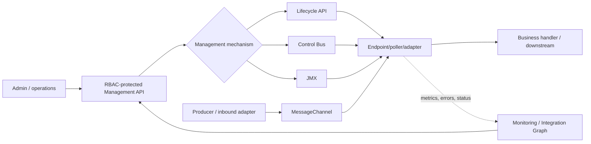
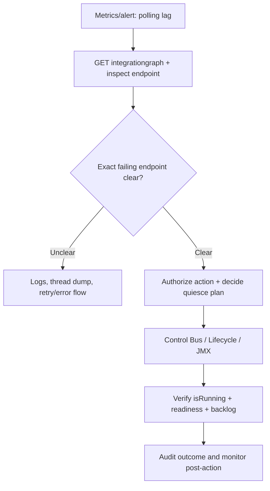
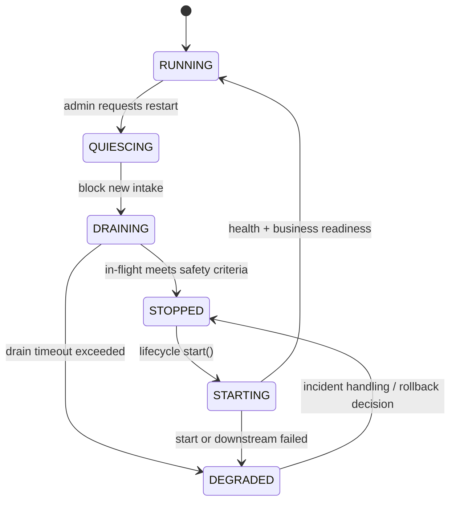

# Start, Stop, and Restart via Management Interfaces in Spring Integration

## 1. Why Control a Running Message Flow?

A Spring Integration application can contain dozens of inbound adapters, pollers, consumers, gateways, and message processing flows. Not every incident requires restarting the entire JVM. For example:

- A partner takes its API down for 15 minutes: pause **one inbound adapter** so useless retries do not pile up.
- A file poller is reading bad data: stop just that poller, adjust configuration, and reopen it.
- A queue has accumulated a backlog that needs processing after downstream recovers: start the consumer at the right moment.
- A tenant is locked or a connector must rotate credentials: stop the relevant endpoint without impacting other tenants.
- Operations wants to diagnose why messages are stuck: inspect lifecycle state, runtime graph, metrics, threads, and error flows before taking control actions.

In the **Control and Management** chapter of the **SPRING_INTEGRATION_RUNTIME** module, "management interface" encompasses the mechanisms for controlling **components in a live Spring ApplicationContext**, such as:

1. Calling `Lifecycle`/`SmartLifecycle` APIs directly on endpoint beans.
2. Sending commands to the **Spring Integration Control Bus** over a message channel.
3. Using **JMX** or a configured/secured REST Control Bus Controller.
4. Controlling dynamic `IntegrationFlow`s via `IntegrationFlowContext`.
5. Using Spring Boot Actuator and Integration Graph to **observe**, then invoking the appropriate interface to act.

**Start/stop does not mean processing is finished or data is recovered.** At runtime, channels, endpoints, consumers, pollers, executors, transactions, retries, message stores, and correlation all shape the outcome of a management command.

> **Principle:** Only operate on **components with a lifecycle**, use the **exact bean ID**, and distinguish three concepts: restarting an endpoint inside the JVM; recreating a dynamic flow; restarting the entire process/application. These three actions do not share the same scope or recovery guarantees.

## 2. Control Plane and Data Plane Must Be Separated

The **data plane** transports and processes business messages. The **control plane** handles management requests such as starting, stopping, pausing, inspecting, or restarting a component.



Never let ordinary business APIs publish arbitrary command strings to the Control Bus. A message carrying `ordersAdapter.stop` can halt order intake; that is a **system operations privilege**, not a normal business event.

Boundaries that must be protected:

- **Authentication and authorization:** only authorized operational actors may control permitted endpoints.
- **Allowlisted actions and targets:** never accept arbitrary bean names or method names directly from the internet.
- **Auditing:** who requested it, why, on which instance, what changed, and whether it succeeded.
- **Concurrency:** two concurrent start/stop requests on the same component can race.
- **Readiness:** command acceptance does not prove an adapter has reconnected to a broker or is ready to process.

## 3. Which Objects Actually Have a Lifecycle?

In Spring Framework, `Lifecycle` defines:

```java
public interface Lifecycle {
    void start();
    void stop();
    boolean isRunning();
}
```

`SmartLifecycle` extends this contract, adding `isAutoStartup()`, `getPhase()`, and a stop callback for coordinated start/stop inside the ApplicationContext.

In Spring Integration, many consumer endpoints and inbound adapters implement these lifecycle contracts; **not every `MessageChannel` or `MessageHandler` is an object you can call `start()` on**.

| Component | Where Is Lifecycle Usually Managed? | Effect When Stopped |
| --- | --- | --- |
| `EventDrivenConsumer` after `DirectChannel` | Endpoint bean (not the channel) | Unsubscribes handler; sending to a channel with no subscribers may fail |
| `PollingConsumer` after `QueueChannel` | Polling endpoint bean | Stops polling; queue may retain messages if backed by a store |
| `SourcePollingChannelAdapter` | Inbound polling endpoint | Halts scheduled polling from the source |
| JMS/AMQP/TCP inbound adapter | Appropriate adapter/listener container/connection factory | Stops new intake per transport semantics; verify in-flight work |
| Dynamic `IntegrationFlowRegistration` | Registration managed by `IntegrationFlowContext` | Starts/stops components owned by that registration |
| `ThreadPoolTaskExecutor` | Executor bean, separate management contract | Not the same as stopping intake; submitted/queued tasks may still run |
| `MessageStore` / `MetadataStore` | Storage service | Not an endpoint to pause; data persists independently of worker lifecycle |
| `IntegrationGraphServer` | Monitoring infrastructure | Supplies runtime topology, does not replace consumer control |

### Lifecycle State Differs from Business State

`isRunning() == true` only indicates the endpoint is running per its lifecycle contract. It does **not** assert that:

- Any messages arrived recently.
- Downstream connections are healthy.
- Queues have no backlog.
- Handlers return valid results.
- Transactions committed successfully.
- Pending retries, DLQs, or correlation groups are being processed.

Conversely, `isRunning() == false` does not mean all messages have finished processing. A worker dispatched over an `ExecutorChannel` or a third-party API call may still be running.

## 4. Endpoint Identification: Know the Exact Name Before Sending Commands

A common operational mistake is intending to stop a **consumer endpoint** but invoking methods on the channel bean or handler bean instead.

Spring Integration often registers multiple beans around a single endpoint:

```text
ordersIn                → input MessageChannel
ordersConsumer          → endpoint (EventDrivenConsumer)
ordersConsumer.handler  → MessageHandler
managementCommands      → Control Bus input channel
controlBusFlow/...      → Control Bus service endpoint
```

These are **example names**. Actual names depend on XML, annotation, or Java DSL declarations. In XML `<int:service-activator id="ordersConsumer" ...>`, the endpoint ID is normally `ordersConsumer`. With `@Bean` annotations, use `@EndpointId` for explicit identification.

### Example Declaring an Endpoint with a Stable ID

```java
import org.springframework.context.annotation.Bean;
import org.springframework.context.annotation.Configuration;
import org.springframework.integration.annotation.EndpointId;
import org.springframework.integration.annotation.ServiceActivator;
import org.springframework.integration.channel.DirectChannel;
import org.springframework.integration.config.EnableIntegration;
import org.springframework.messaging.MessageChannel;
import org.springframework.messaging.MessageHandler;

@Configuration
@EnableIntegration
public class ManagedOrdersConfiguration {

    @Bean("ordersIn")
    public MessageChannel ordersIn() {
        return new DirectChannel();
    }

    @Bean("ordersConsumer.handler")
    @EndpointId("ordersConsumer")
    @ServiceActivator(inputChannel = "ordersIn")
    public MessageHandler ordersHandler() {
        return message ->
                System.out.println("Processing " + message.getPayload());
    }
}
```

In this configuration, `ordersConsumer` is the endpoint explicitly named via `@EndpointId`, while `ordersConsumer.handler` is the handler bean. This is a one-way demo flow without retry advice or a persistent queue.

**When using another version or DSL:** look up the actual beans in the `ApplicationContext`, Integration Graph, startup logs, or via bean inspection. Never infer a consumer name solely from a Java method name if the framework generates bean IDs under different rules.

## 5. Approach 1: Calling `SmartLifecycle` Directly in Java

This is the shortest path when management code runs inside the same application and already knows the endpoint bean.

```java
import org.springframework.context.ApplicationContext;
import org.springframework.context.SmartLifecycle;

public final class EndpointOperations {

    private final ApplicationContext context;

    public EndpointOperations(ApplicationContext context) {
        this.context = context;
    }

    public boolean stopOrders() {
        SmartLifecycle endpoint =
                context.getBean("ordersConsumer", SmartLifecycle.class);
        endpoint.stop();
        return !endpoint.isRunning();
    }

    public boolean startOrders() {
        SmartLifecycle endpoint =
                context.getBean("ordersConsumer", SmartLifecycle.class);
        endpoint.start();
        return endpoint.isRunning();
    }

    public boolean restartOrders() {
        // "restart" here is an APPLICATION-DEFINED PROCEDURE.
        SmartLifecycle endpoint =
                context.getBean("ordersConsumer", SmartLifecycle.class);
        endpoint.stop();
        if (endpoint.isRunning()) {
            return false;
        }
        endpoint.start();
        return endpoint.isRunning();
    }
}
```

This code illustrates **stop → check → start**; there is no built-in `Lifecycle.restart()`. Invoke it from a **protected management service**, and serialize operations per endpoint ID if concurrent management requests can arrive.

Two caveats:

1. `isRunning()` reflects lifecycle state; it does **not** prove external resources are ready. After starting a JMS/TCP adapter, run additional health/connectivity checks.
2. `stop()` does not automatically wait for work dispatched to other threads to finish. For a safe restart, enforce a **quiesce/drain** policy first—especially for payments, email dispatch, or transactional flows.

### Why Not Call `ordersIn.start()`?

`DirectChannel` is the message transport mechanism; the consumer endpoint holds the handler subscription. Once the endpoint stops, the channel bean still exists. Sending to a `DirectChannel` with zero subscribers can throw a dispatch exception; there is no guarantee the channel buffers messages until restart.

## 6. Approach 2: Control Bus — Controlling via Messages

The **Control Bus** is an Enterprise Integration Pattern using a dedicated messaging path to instruct the framework to execute permitted management operations. This capability is native to Spring Integration.

### 6.1. Configuring the Control Bus with Java DSL

```java
import org.springframework.context.annotation.Bean;
import org.springframework.context.annotation.Configuration;
import org.springframework.integration.dsl.IntegrationFlow;

@Configuration
public class ControlBusConfiguration {

    @Bean
    public IntegrationFlow controlBusFlow() {
        return IntegrationFlow.from("managementCommands")
                .controlBus()
                .get();
    }
}
```

This creates a `managementCommands` channel as the management entry point. Depending on setup, you can alternatively use `@ServiceActivator` with `ControlBusFactoryBean` or XML:

```xml
<int:control-bus input-channel="managementCommands"/>
```

Declare only **one** Control Bus mechanism where needed; avoid accidentally registering two management consumers on the same channel and issuing duplicate commands.

### 6.2. Command Syntax in Current Versions

**Spring Integration 6.4+ and 7.x** use command strings of the form:

```text
beanName.methodName
```

Example:

```java
import org.springframework.messaging.MessageChannel;
import org.springframework.messaging.support.MessageBuilder;

MessageChannel management =
        applicationContext.getBean(
                "managementCommands", MessageChannel.class);

// Stop the endpoint named ordersConsumer.
management.send(MessageBuilder
        .withPayload("ordersConsumer.stop")
        .build());

// Start the endpoint again.
management.send(MessageBuilder
        .withPayload("ordersConsumer.start")
        .build());
```

`Lifecycle` methods such as `start` and `stop` are permitted in the Control Bus command registry. For methods taking parameters, pass the argument list in the `IntegrationMessageHeaderAccessor.CONTROL_BUS_ARGUMENTS` header—**do not embed arbitrary arguments into an expression string**.

```java
import java.util.List;
import org.springframework.integration.IntegrationMessageHeaderAccessor;
import org.springframework.messaging.support.MessageBuilder;

// Separate example: bean threadPool must expose a Control Bus-permitted method.
management.send(MessageBuilder
        .withPayload("threadPool.setMaxPoolSize")
        .setHeader(
                IntegrationMessageHeaderAccessor.CONTROL_BUS_ARGUMENTS,
                List.of(12))
        .build());
```

Modern Control Bus uses `ControlBusCommandRegistry` to resolve valid beans/methods, supporting management methods annotated with `@ManagedAttribute`, `@ManagedOperation`, `Lifecycle`/`Pausable` contracts, and certain executor/scheduler settings. Eager command loading can be enabled via `@EnableIntegrationManagement(loadControlBusCommands = "true")` when appropriate.

**Important version difference:** Older docs (prior to the command registry) used SpEL strings like `@ordersConsumer.stop()`. **Do not use legacy SpEL syntax in 6.4+/7.x applications.** When upgrading versions, update command-sending clients and tests accordingly. Current reference docs explain the new command syntax.

### 6.3. Control Bus Also Needs Error Handling

If a bean name does not exist, a method is disallowed, argument headers have wrong types, or the method throws an exception, the management command can fail. With a synchronous `DirectChannel`, exceptions normally propagate to the sender; across an async boundary, inspect the `ErrorMessage`/`errorChannel` path instead of trusting `send() == true`.

Even when `ordersConsumer.start` returns normally, verify `isRunning()` and adapter readiness. Issuing `ordersConsumer.stop` on an already-stopped target should be designed **idempotently at the management API layer**, auditing "already stopped" rather than treating it as a fatal error.

## 7. Control Bus: Request/Reply and Management Outcomes

The Control Bus is a service-activating endpoint, so it can return a reply when the managed method returns a value. However, `start()`/`stop()` return `void`; never design an HTTP client expecting a reply payload confirming "backlog drained" just because the command was dispatched.

Distinguish three stages:

```text
1. Command accepted
   Message was accepted onto the management channel.

2. Operation executed
   Managed start/stop method ran or threw an error.

3. Desired state verified
   Endpoint state, connectivity, and in-flight data
   were verified per operational policy.
```

For production management APIs, return an **operation ID** and status progression `REQUESTED → APPLIED/FAILED → VERIFIED` for complex changes, write audit logs, and prevent duplicate execution from HTTP retries.

Using an internal command bus is an implementation choice; a management API can equally call `SmartLifecycle` directly. You are not forced to push every operation through messaging if doing so adds complexity or obscures control failures.

## 8. Approach 3: REST Control Bus Controller (Spring Integration 6.4+)

Starting in Spring Integration 6.4, the HTTP module provides `@EnableControlBusController` to expose a **Control Bus Controller** at the default path `/control-bus` when web infrastructure is present.

This interface is **distinct from Spring Boot Actuator**. Per the reference docs:

| Request | Purpose |
| --- | --- |
| `GET /control-bus` | List beans and invokable managed commands |
| `POST /control-bus/{beanName.methodName}` | Execute a managed command |
| POST body | May supply a list of arguments and types when the method takes parameters |

Example parameterless commands (run only in environments where the controller is enabled and secured):

```bash
# Actual path depends on reverse proxy and context path.
curl -X POST \
  http://localhost:8080/control-bus/ordersConsumer.stop

curl -X POST \
  http://localhost:8080/control-bus/ordersConsumer.start
```

Example parameterized method payload per reference format:

```json
[
  {
    "value": "12",
    "parameterType": "int"
  }
]
```

This body accompanies a command whose method accepts an `int`, not parameterless `start`/`stop` calls.

**Never expose `/control-bus` publicly.** It is a control plane that alters application behavior. Enforce authentication, RBAC, network isolation, auditing, rate limiting, and command allowlisting. Expose it only on internal admin paths, never allowing clients to construct arbitrary bean/method paths. The controller **is not automatically exposed** merely by having `spring-boot-starter-actuator` or `@EnableIntegration`.

## 9. Approach 4: JMX and `IntegrationMBeanExporter`

When systems use JMX/JConsole/VisualVM or enterprise management tooling, Spring Integration supports exporting manageable components via `IntegrationMBeanExporter`. Configure it with `@EnableIntegrationMBeanExport` or XML `<int-jmx:mbean-export .../>` once the JMX module and an appropriate `MBeanServer` are available.

Java-oriented example:

```java
import org.springframework.context.annotation.Configuration;
import org.springframework.integration.config.EnableIntegration;
import org.springframework.integration.jmx.config.EnableIntegrationMBeanExport;

@Configuration
@EnableIntegration
@EnableIntegrationMBeanExport
public class IntegrationJmxManagementConfig {
}
```

Depending on version/configuration, the exporter only exports managed bean/operation categories; **do not assume every endpoint has the same MBean name or exposes stop/start in JMX**. Check actual `ObjectName`s, managed operations, and permissions. `IntegrationMBeanExporter` itself can be exposed alongside other management beans via appropriate Spring JMX configuration.

JMX is useful for:

- Inspecting channel, message handler, and message source attributes/counters.
- Invoking exposed managed operations.
- Monitoring components or driving operational scripts in JMX-capable infrastructure.
- Executing an **orderly shutdown** via the exporter's managed operation when needed.

However, remote JMX requires secure configuration (TLS, authentication, network ACLs, no exposed JMX/RMI ports). Never open JMX to the internet just to get a "Restart consumer" button.

### Does JMX Mean the Same Thing as Control Bus?

They share similar management goals but use different access paths. Control Bus executes commands through a message channel; JMX invokes managed operations on MBeans. Both still require verifying **control authorization, post-operation state, and in-flight work**. Exposing commands on both paths does not prevent races between two independent operators.

## 10. Approach 5: Spring Boot Actuator and Integration Graph — Observation, Not a Restart Button

With Spring Boot Actuator and `spring-integration-core`, the **`integrationgraph`** endpoint exposes a runtime diagram of nodes, links, input/output/error channels, and component metadata.

```bash
# When the management endpoint is exposed and the caller is authorized:
curl http://localhost:8080/actuator/integrationgraph
```

To allow HTTP observation in a matching Spring Boot configuration:

```properties
management.endpoints.web.exposure.include=health,info,integrationgraph
```

**Distinguish clearly:**

- `GET /actuator/integrationgraph`: reads the graph.
- `POST /actuator/integrationgraph`: **rebuilds/refreshes the graph** to reflect current topology. **Does not restart flows or the application.**
- `GET /control-bus` and `POST /control-bus/{command}`: Spring Integration HTTP REST management (when `@EnableControlBusController` is enabled), **separate from Actuator `integrationgraph`**.

The graph shows which input channel feeds an endpoint and which handler follows. With `IntegrationGraphServer.setAdditionalPropertiesCallback(...)`, you can attach `SmartLifecycle` `isRunning()`/`isAutoStartup()` properties to nodes. Even so, the graph is **not automatically a transactionally consistent snapshot** of every in-flight message, scheduled task, or transaction.

### Observe-Then-Act Pattern



Actuator gives **observability**; state-mutating operations belong in a **policy-governed management API** instead of mistaking `POST integrationgraph` for a restart.

## 11. Start, Stop, and Restart Have Different Scopes

There is no universal `restart()` across all endpoints. When operations says "restart", pinpoint the exact target:

| Request | Action | Replaces Beans? | Restarts JVM? |
| --- | --- | --- | --- |
| Resume a stopped endpoint | `endpoint.start()` | No | No |
| Pause an endpoint | `endpoint.stop()` or supported pause API | No | No |
| In-place endpoint restart | `stop()` → verify → `start()` | No | No |
| Change dynamic connector config | Stop/drain, destroy registration, register new version | Possibly | No |
| Restart application/container | Terminate process and create new `ApplicationContext` | Yes | Yes |
| Restart entire multi-instance service | Orchestrated rolling restart per deployment | Yes | Yes on selected processes |

**Stop/start does not arbitrarily reload all bean configuration.** To change URLs, secrets, or mappers on a bean that lacks live reconfiguration, you usually must build a new bean/flow; calling `stop(); start();` alone may retain the old configuration.

### `SmartLifecycle` Phase

`SmartLifecycle.getPhase()` helps Spring order component startup and shutdown during context lifecycle transitions: generally **lower phases start earlier and stop later than higher phases**. However, calling `stop()` directly on a single endpoint does not automatically "stop all related beans in phase order".

In systems with inbound adapters and downstream sinks, establish an explicit shutdown strategy so sources stop accepting new work first, handlers have time to finish, and recovery/commit resources do not close prematurely.

## 12. What Happens When Stopping Each Endpoint Type?

This is what determines message-loss risk.

| Flow / Stop Point | Typical Behavior | Risk | Required Action |
| --- | --- | --- | --- |
| `DirectChannel → EventDrivenConsumer` | Consumer unsubscribes on stop | Producers sending to a subscriberless channel fail | Pause producers or add a durable boundary |
| `QueueChannel → PollingConsumer` | Poller stops pulling messages | In-memory queues lose data on JVM restart or destroy | Use a persistent store/broker when needed |
| `SourcePollingChannelAdapter` | Poll schedule halts | New files/feeds remain at source, yet checkpoints must remain accurate | Verify accept-once markers and next poll |
| `ExecutorChannel → handler` | Endpoint stops accepting via subscription | Already-submitted tasks may remain in executor queue/workers | Drain and measure in-flight tasks, not just `isRunning` |
| JMS/AMQP/Kafka inbound | Listener/container stops per adapter | Ack/commit/redelivery/partition assignment shifts | Test exact transport behavior |
| `FluxMessageChannel` / reactive endpoint | Subscription may be cancelled/stopped | Demand and in-memory signals drop; cold sources may replay | Distinguish cancellation, replay, and durability |
| Aggregator/resequencer | Correlating handler stops accepting | Incomplete groups, timeouts, and reapers follow store policy | Persistent `MessageGroupStore`, expiry/release policy |
| Error/recovery consumer | Errors lose their processing sink | Error publishing fails, DLQ is not written | Keep recovery sinks alive until work finishes |

`QueueChannel` is **not durable by default**: an in-RAM queue holds messages only for the lifetime of the JVM. If a management API lets operators stop a poller for hours while producers keep sending, enforce capacity bounds, backlog alerts, retention, and safe restart procedures.

## 13. Controlled Quiesce, Drain, and Restart

In production, immediately calling "stop then start" can cause duplicates or lost side effects. A solid runbook uses explicit phases:



This is a **recommended application state machine**, not a built-in Spring Integration enum. The framework provides lifecycle operations; the application and operations team define what "safe to stop" means.

Recommended workflow for an endpoint with critical side effects:

1. **Identify target:** endpoint ID, flow version, source, and shared components.
2. **Lock management action:** prevent one actor from starting while another is draining.
3. **Quiesce intake:** stop new messages from entering the target scope.
4. **Wait on in-flight with timeout:** track workers, transactions, executor queues, and pending acks.
5. **Handle timeouts:** choose rollback/requeue, DLQ, or staying in service per policy; never promise "stop always waits until finished".
6. **Stop the right endpoint/resource:** avoid inadvertently destroying a shared connection factory.
7. **Start/recreate when ready:** verify datasource, broker, secrets, consumer subscriptions, and schemas.
8. **Verify business outcome:** backlog shrinks, retry/error rates stay normal, no duplicate processing.
9. **Audit:** actor, reason, operation ID, before/after state, remaining in-flight count.

If an operator only wants to **pause a poller** briefly, `stop()` is sometimes sufficient. For code upgrades or config changes, follow the full drain/migration workflow.

## 14. Orderly Shutdown: Stopping All Application Processing

Spring Integration provides the managed operation `IntegrationMBeanExporter.stopActiveComponents(Long timeout)` for **orderly shutdown of active components**, with `timeout` in milliseconds. This **differs** from calling `stop()` on a single endpoint.

Per the documentation, the sequence typically includes:

1. Calling `beforeShutdown()` on `OrderlyShutdownCapable` beans.
2. Stopping necessary active channels, such as broker-backed channels.
3. Stopping `MessageSource`s.
4. Stopping remaining inbound `MessageProducer`s.
5. Waiting the remaining timeout for in-flight messages to complete.
6. Calling `afterShutdown()` for final cleanup, such as closing sockets.

```text
stopActiveComponents(timeout)
  → prevent/limit NEW inbound
  → allow SOME in-flight processing to finish
  → clean up integration resources
```

This is a coordinated shutdown of **Integration infrastructure**; it is **not a mechanism to restart the entire JVM** and does not guarantee all work finishes if the timeout expires. Nor should you assume you can restart merely by calling a symmetric `startActiveComponents()` method without verifying whether such a method exists in your version.

**Scope note:** `stopActiveComponents` has wide impact; never use it as a substitute for "pause one consumer for tenant A". When preparing container shutdown or deployment, pair it with readiness/ingress draining and orchestration policies.

## 15. Dynamic `IntegrationFlow`: Managing Registrations vs. Static Endpoints

When flows are registered at runtime via `IntegrationFlowContext`, manage their lifecycle via `IntegrationFlowRegistration`:

```java
import org.springframework.integration.dsl.context.IntegrationFlowContext;
import org.springframework.integration.dsl.context.IntegrationFlowContext.IntegrationFlowRegistration;

public final class DynamicFlowOperations {

    private final IntegrationFlowContext context;

    public DynamicFlowOperations(IntegrationFlowContext context) {
        this.context = context;
    }

    public boolean restartFlow(String flowId) {
        IntegrationFlowRegistration registration =
                context.getRegistrationById(flowId);

        if (registration == null) {
            return false; // No dynamic flow with this ID in this JVM.
        }

        registration.stop();
        registration.start();
        return true; // Confirms lifecycle methods were invoked.
    }

    public void removeFlow(String flowId) {
        context.remove(flowId); // Destroys/removes the dynamic registration.
    }
}
```

- `stop/start` retains the registration and beans in the context.
- `remove`/`destroy` removes the flow and dependent beans managed by the registration.
- `getRegistrationById` is an API for **dynamic registrations**; it is not a lookup tool for statically defined endpoints.
- On JVM restart, prior dynamic registrations **do not automatically persist**. Store desired configurations in a database/repository and recreate flows on startup.

**Do not use `destroy` as a "lightweight restart".** Destroying cleans up owned beans and wipes in-memory backlogs. If a connector needs configuration changes, quiesce/drain and re-register a new version in a controlled way rather than only calling stop/start.

## 16. Persistence, Transactions, and Restart: Which Guarantees Hold?

Management interfaces only change lifecycle state; **they do not alter message storage/commit contracts**.

### Three Critical Boundaries

```text
Producer → durable handoff → consumer → business side effect
                |                |             |
           enqueue commit    dequeue/ack   external outcome
```

A crash or stop at different instants produces different outcomes.

| Moment | What Can Happen | Protective Design |
| --- | --- | --- |
| Before committing message to persistent store | Message is not yet durably accepted | Producer retry/confirm and request ID |
| After enqueue commit, before poll | Message waits across stop/restart | Persistent `JdbcChannelMessageStore` or broker |
| Poller received message, transaction uncommitted | Rollback may permit redelivery | Proper transaction boundaries and idempotent consumer |
| External API succeeded, source ack uncommitted | Message redelivered, side effect may repeat | Idempotency keys and reconciliation |
| Retry advice backing off when endpoint stops/crashes | Retry thread/timer may not be persisted | Durable retry jobs / source redelivery where needed |
| Aggregator holds 2/3 parts, app restarts | Group lost if stored only in memory | Persistent `MessageGroupStore` |
| Error handler logged, DLQ write failed | No failed message retained for replay | Confirm recovery only after durable sink write |
| Dynamic registration destroyed | Java flow/beans removed | Desired-state repository to rebuild |

When using `RequestHandlerRetryAdvice`, a recovery callback may emit an `ErrorMessage` and return normally. The poller transaction may **commit** because the outer boundary never saw the original exception. Never treat "stop/start succeeded" as a guarantee that failed business messages will automatically retry.

### Correlation Across Restarts

Preserve `correlationId`, business command IDs, and idempotency keys across redeliveries/replays. Framework message IDs can change when messages are recreated. For aggregators, keep correlation strategies, group stores, serializers, and group expiry policies consistent across deployed versions.

## 17. Two Concurrent Management Commands: Control Plane Races

Suppose admin A sends `ordersConsumer.stop` and admin B sends `ordersConsumer.start` almost simultaneously. There is no deterministic business order if requests cross different threads or instances.

```text
T1 Admin A: requests STOP
T2 Admin B: requests START
T3 Endpoint: executes start()
T4 Endpoint: executes stop()
T5 UI displays "restarted" while endpoint is actually STOPPED
```

For reliable management, applications can use:

- **Desired state:** `ACTIVE` / `PAUSED` / `REMOVED` persisted with a `version`.
- **Per-endpoint serialization:** only one mutating command per endpoint executes at a time.
- **Optimistic locking/CAS:** apply updates only when the client supplies the current config version.
- **Reconciliation:** compare desired state with actual runtime state and converge per policy.
- **Idempotent commands:** stopping an already-stopped endpoint returns "already stopped" rather than failing arbitrarily.
- **Operation auditing:** every request gets an operation ID and final state verification.

Across multiple app instances, in-JVM locks are insufficient for global ownership. Explicitly specify whether a command targets **one instance** or **the entire cluster**, and whether a listener may run concurrently across nodes.

Never let a UI POST run `stop → start` sequentially on *one* instance and report the whole system restarted while other instances keep serving traffic.

## 18. Securing Control Interfaces

The Control Bus is especially sensitive because payloads can specify methods on managed beans. Even though the 6.4+ command registry restricts valid methods, it is **not** a user-role authorization mechanism.

A management API layer should:

1. Authenticate actors (admins/service accounts) and enforce RBAC per environment/tenant.
2. Look up an allowlist of **logical endpoint ID → bean ID** instead of accepting raw method paths from users.
3. Permit only vetted operations such as `pause`, `resume`, `restartOne`.
4. Check preconditions: target exists, config version matches, storage/downstream ready.
5. Audit successes/failures and alert on sensitive commands.
6. Protect HTTP/JMX/control channels with network isolation, TLS, and throttling.
7. Separate read-only monitoring from mutating operations; avoid exposing `/control-bus` to the internet.
8. Never log management payloads containing secrets or personal data to public logs.

**Never wire a public inbound HTTP gateway directly to `managementCommands`** turning user bodies into commands; attackers could halt flows or alter executor settings.

## 19. Observability for Start, Stop, and Restart

A management action is not finished merely because a log says "Stop requested". Measure three metric groups:

### 19.1. Lifecycle

- Count of `start/stop/restart` commands requested, applied, rejected, and failed.
- Time from request to target `isRunning` state.
- Count of endpoints in `RUNNING`/`STOPPED` by type.
- Drain duration and remaining in-flight count at timeout.
- History of desired vs. actual state and config version.

### 19.2. Message Flow

- Ingress rate, handler success/failure/retry rates.
- Queue backlog, oldest message age, poller lag.
- Executor active threads, task queue depth, rejected tasks.
- Correlation group size/age and unreleasable groups.
- Error channel publishing failures, DLQ size, recovery success/failure.

### 19.3. External Readiness

- Broker listener/connection state, consumer lag, DB pool, transaction commits.
- Downstream latency, HTTP/TCP connection health, rate limits.
- Duplicate business command rate after resume/restart.

Exact metric names vary by Micrometer/Spring Integration version and application instrumentation. Never put high-cardinality `orderId`/`correlationId` values in metric tags; keep them in logs, traces, and audits for incident investigation.

## 20. Quick Troubleshooting Table

| Symptom | Possible Cause | How to Verify |
| --- | --- | --- |
| Control Bus reports command not found | Wrong bean ID, wrong method, wrong version syntax | Inspect `ControlBusCommandRegistry`/`GET /control-bus` |
| `@bean.stop()` payload fails to run | Using modern command registry syntax rather than legacy SpEL | Use `bean.stop` on 6.4+/7.x |
| Stop sent yet handler keeps logging | Tasks already dispatched/running on workers | Measure in-flight, thread dump, executor queue |
| Messages sent to `DirectChannel` fail after stop | Endpoint unsubscribed, zero subscribers | Check `isRunning` and channel dispatch type |
| No messages received after start | Source connection failed, no producer, poller unready | Adapter logs, broker/DB connectivity, input rate |
| Queue grows after stop | Producers keep sending while poller is stopped | Check backlog, capacity/persistence |
| Dynamic flow disappears after JVM restart | `IntegrationFlowContext` registry is not persistent | Rebuild from desired configuration |
| `POST /actuator/integrationgraph` does not restart | Only refreshes the runtime graph | Use Lifecycle/Control Bus/JMX as appropriate |
| Recovery makes messages "disappear" | Advice absorbed exception and transaction committed | Inspect retry callback, durable DLQ sink |
| Restart produces duplicate side effects | Message redelivery after crash or late ack | Idempotency keys, transactions/offsets |
| UI says running yet adapter is unhealthy | `isRunning` is only a lifecycle flag | Run external connection readiness checks |
| JMX exporter shows component without stop method | MBean type/managed operations differ from endpoint lifecycle | Check MBean `ObjectName` and target bean ID |

Good diagnostics always capture **before/after** endpoint state, command timelines, and business message outcomes. Never treat `send() == true` or a 2xx HTTP response as sole proof that a flow drained or finished processing.

## 21. Runtime Management Hands-On Labs

### Lab A: Direct `SmartLifecycle` Operations

1. Run `ManagedOrdersConfiguration` from Section 4.
2. Retrieve the `ordersConsumer` bean as `SmartLifecycle`.
3. Send `ORDER-1` while running; confirm the handler is invoked.
4. Call `stop()`, read `isRunning()`, attempt sending to `DirectChannel`, and observe the dispatch error with no subscribers.
5. Call `start()` and send `ORDER-2`; confirm the handler works again.
6. Explain why the failed message sent while stopped **does not automatically appear** after starting.

**Expected result:** lifecycle changes state, and `DirectChannel` has no hidden replay mechanism.

### Lab B: Controlling via Control Bus

1. Add `ControlBusConfiguration` with `managementCommands`.
2. Send `ordersConsumer.stop` over the management channel.
3. Verify `isRunning() == false` and check handler logs.
4. Send `ordersConsumer.start` and verify the endpoint processes again.
5. Test a command with a wrong bean name to observe the error path.
6. Test legacy SpEL syntax on a 6.4+/7.x project to observe the difference, **in the lab only**.

**Expected result:** Control Bus executes valid registry-managed operations; command strings are not arbitrary scripts.

### Lab C: Actuator Graph vs. Control Bus Controller

1. Enable Actuator `integrationgraph` with secured config.
2. Call `GET /actuator/integrationgraph` and note channel/endpoint nodes.
3. Call `POST /actuator/integrationgraph` and verify the graph refreshes without stopping/starting endpoints.
4. If using Spring Integration HTTP 6.4+ and `@EnableControlBusController`, enable REST management on a test network; call `GET /control-bus` to inspect allowed commands.
5. POST a control command on a test endpoint and verify audit logs and `isRunning`.
6. Disable/restrict mutating endpoints before exposing to external networks.

**Expected result:** clear boundary between observation and mutating management.

### Lab D: Queues, Pollers, and Persistence

1. Create a `QueueChannel` and a `PollingConsumer` with an explicit endpoint ID.
2. Start, send messages with business IDs, and observe poller processing.
3. Stop the poller, keep enqueuing, and measure backlog.
4. Restart the poller and verify the backlog drains.
5. Restart the entire application while backlog is pending: in-memory queues can lose data; committed `JdbcChannelMessageStore` queues can recover.
6. Make the handler throw errors and inspect transaction rollback/retry/error flows per config.

**Expected result:** pausing a consumer does not make a queue persistent; restarting the process tests different guarantees than stopping/starting an endpoint.

### Lab E: In-Flight Work, Retries, and Draining

1. Make a handler sleep 5 seconds on an `ExecutorChannel` and send several messages.
2. While active tasks are running, call `stop()` on the endpoint.
3. Observe whether workers keep running or stop depending on endpoint/executor type; record in-flight counts.
4. Repeat using quiesce + timed drain before stopping.
5. Simulate a crash after side effect but before ack; verify idempotency on restart.
6. Measure retry exhaustion and DLQ sinks—never treat log-only recovery as complete.

**Expected result:** lifecycle never replaces transaction, acknowledgement, or idempotency guarantees.

### Lab F: Two Admins Competing on One Endpoint

1. Send `ordersConsumer.stop` and `ordersConsumer.start` nearly simultaneously.
2. Record the timeline and final state.
3. Add a per-endpoint lock / desired-state version in the management service.
4. Submit two requests with differing versions and verify the stale-version request is cleanly rejected.
5. Across multiple JVMs, verify instance targeting or cluster ownership rules.
6. Audit actor, reason, operation ID, before/after state, and verification outcome.

**Expected result:** concurrent control commands do not leave UI and runtime state out of sync.

## 22. Production Checklist

- **Exact target:** identify the lifecycle-bearing endpoint/adapter bean, not the channel or handler bean.
- **Correct version:** Control Bus 6.4+/7.x uses `beanName.methodName`; upgrade legacy SpEL examples.
- **Right interface:** `SmartLifecycle`/Control Bus/REST Controller/JMX for mutations; Actuator `integrationgraph` for monitoring/refresh.
- **Access control:** RBAC, allowlists, network isolation, auditing, and avoiding public exposure of control endpoints.
- **Lifecycle semantics:** `autoStartup`, `phase`, `isRunning`, and readiness are properly understood.
- **Quiesce/drain:** clear ownership for halting intake, awaiting in-flight work, and handling timeouts.
- **Durability:** pending messages, retries, DLQs, correlation groups, and idempotency have appropriate durable stores/sources.
- **Transactions:** ack/commit/rollback behavior is verified across endpoint stops, crashes, and recovery.
- **Dynamic flows:** stop/start preserves registration; destroy/remove may tear down owned resources; JVM restart requires rebuilding from desired state.
- **Cluster scope:** commands explicitly target one instance or the whole cluster; concurrent operators cannot race start/stop.
- **Observability:** track before/after state, health, backlog, latency, threads, errors, and business outcomes.
- **Testing:** exercise stop/start, process restarts, in-flight work, recovery failures, multi-instance, and security.

## 23. Conclusion

Spring Integration offers **multiple management interfaces** for controlling components at runtime: `Lifecycle`/`SmartLifecycle` on endpoint beans, **Control Bus** with managed command messages, **JMX** for exported components, and `IntegrationFlowRegistration` for dynamically registered flows. Spring Boot Actuator `integrationgraph` supports topology observation and graph refresh—it is **not a flow restart command**.

A reliable "restart" must define its exact scope, execute `stop → verify/drain → start → verify readiness` as needed, and protect uncommitted work through transactions, persistence, retry/recovery, and idempotency. In multi-threaded, multi-instance systems, a management command is a **system-state mutation** that requires security, serialization, and auditing just like a critical business operation.

## References

- [Spring Integration Reference — Control Bus (current)](https://docs.spring.io/spring-integration/reference/control-bus.html)
- [Spring Integration Reference — Control Bus Controller (HTTP, 6.4+)](https://docs.spring.io/spring-integration/reference/http/control-bus-controller.html)
- [Spring Integration Reference — JMX Support and MBean Exporter](https://docs.spring.io/spring-integration/reference/jmx.html)
- [Spring Integration Reference — Orderly Shutdown](https://docs.spring.io/spring-integration/reference/shutdown.html)
- [Spring Integration Reference — Integration Graph](https://docs.spring.io/spring-integration/reference/graph.html)
- [Spring Boot Reference — Actuator Endpoints](https://docs.spring.io/spring-boot/reference/actuator/endpoints.html)
- [Spring Boot Actuator API — integrationgraph](https://docs.spring.io/spring-boot/api/rest/actuator/integrationgraph.html)
- [Spring Integration Reference — Dynamic and Runtime Flows](https://docs.spring.io/spring-integration/reference/dsl/java-runtime-flows.html)
- [Spring Integration Reference — Endpoint Lifecycle](https://docs.spring.io/spring-integration/reference/overview.html)
