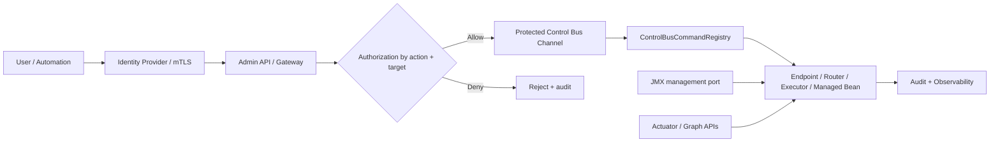
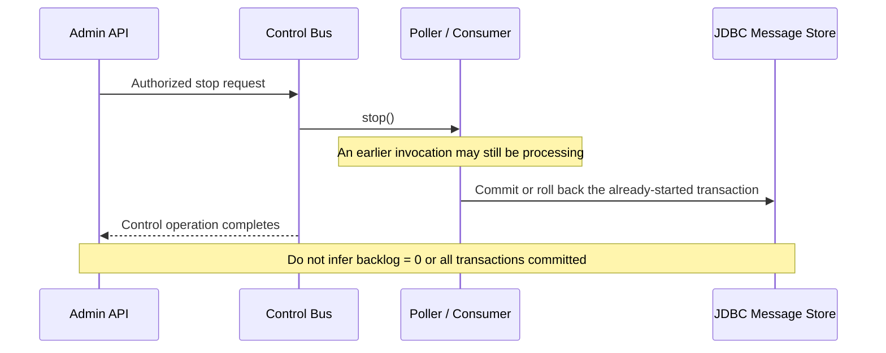

# Access Control for Control Operations in Spring Integration Runtime

## 1. Why Are Control Operations a Special Security Surface?

A business message normally asks the application to **process data**. A **control operation** asks the application to **change how it operates**: stop or start an endpoint, change router mappings, resize a thread pool, pause a poller, modify monitoring settings, or invoke a bean's management method. If a management command is sent by an unauthorized actor, the blast radius can span many messages and resources.

For example: a service processes payment commands from `paymentInput`. An authorized operator needs to pause the poller during an incident. If a regular caller can also send `paymentPoller.stop` to the Control Bus, the system can stop accepting messages even though that caller has no authority to operate the service. If the caller can also change `ThreadPoolTaskExecutor.setMaxPoolSize` or router mappings, consequences include worker starvation, lost throughput, misrouted traffic, and unintended retries/recoveries.

The topic **"Access Control for Control Operations"**, part of the **Control and Management** chapter in the **SPRING_INTEGRATION_RUNTIME** module, explains how to authenticate, authorize, and audit runtime control actions. It ties into how Spring Integration coordinates messages through channels, endpoints, consumers, pollers, and executors; manages `IntegrationFlow` lifecycles, transactions, retries, message stores, errors, and correlation.

Learning objectives:

1. Identify all entry paths to a control operation: **Control Bus channel**, REST controller, JMX, Actuator, internal services, and automation.
2. Distinguish **a method eligible to be invoked by the Control Bus** from **a caller authorized to invoke that method**.
3. Configure `AuthorizationChannelInterceptor` using `spring-security-messaging`; test authorized and denied callers.
4. Secure REST and JMX independently, without confusing Actuator security rules with the Control Bus controller.
5. Design least-privilege permissions by action/target/environment, handle `SecurityContext` across thread boundaries, and audit executed commands.
6. Explain the consequences on transactions, retries, backlogs, correlation, and message stores once a management operation is accepted.

> **Version scope:** Illustrated APIs target **Spring Integration 6.5.x**, Spring Framework 6.x, Spring Security 6.x, and Java 17+. HTTP configuration examples use Spring Security `SecurityFilterChain` style, not the removed `WebSecurityConfigurerAdapter`.

## 2. What Does Control Bus 6.5 Actually Execute?

In Spring Integration, the **Control Bus** implements the Enterprise Integration Pattern allowing **control messages** to be sent to a dedicated channel. The Control Bus endpoint looks up a managed bean and method, invokes it, and handles results/errors via messaging mechanics.

In **Spring Integration 6.5**, the payload syntax is a simple command name:

```text
beanName.methodName
```

If the method accepts parameters, values must be placed in the `IntegrationMessageHeaderAccessor.CONTROL_BUS_ARGUMENTS` header as a list. Beans/methods are resolved via `ControlBusCommandRegistry`. Eligible methods include:

- Methods annotated with `@ManagedOperation` or `@ManagedAttribute`;
- Certain methods from `Lifecycle` and `Pausable`;
- Supported configuration methods on certain `TaskExecutor` and `TaskScheduler` implementations.

**Being eligible in the command registry does not mean the sender is authorized.** `ControlBusCommandRegistry` selects valid commands at the framework layer; **authentication and authorization** remain the responsibility of the application and ingress security layers.

### 2.1. Do Not Copy Legacy SpEL Examples from Older Versions

Spring Integration 6.2 and earlier documentation described the Control Bus evaluating **Spring Expression Language** expressions such as `@bean.method()`. In **6.5**, the legacy SpEL-based Control Bus was replaced with a **registry-only** mechanism using `beanName.methodName` commands. Therefore:

- Do not use arbitrary payloads like `@someBean.start()` as standard 6.5 command examples.
- Do not assume arbitrary expression evaluation or arbitrary bean access from payloads in Control Bus 6.5.
- **Even so, do not treat a public Control Bus as safe**: exposed methods can still alter service state, and permission to send messages remains a critical security boundary.

Example command with arguments:

```java
import java.util.List;
import org.springframework.integration.IntegrationMessageHeaderAccessor;
import org.springframework.messaging.Message;
import org.springframework.messaging.support.MessageBuilder;

Message<String> command = MessageBuilder
        .withPayload("myTaskExecutor.setMaxPoolSize")
        .setHeader(IntegrationMessageHeaderAccessor.CONTROL_BUS_ARGUMENTS,
                List.of(12))
        .build();
// Send only from an authenticated and authorized control plane.
```

This is a **syntax** example, not a recommendation to expose thread-pool resizing externally. Depending on the managed `TaskExecutor`, the method may be an eligible command; verify your application version's **actual command registry list** before granting access.

### 2.2. What the Control Bus Does Not Guarantee Automatically

| Property | Provided Automatically by Control Bus? | What You Must Do |
| --- | --- | --- |
| Executes only valid registry methods | Yes, per 6.5 eligibility rules. | Restrict management-annotated methods; audit the registry. |
| Only ADMIN can send commands | **No**, if the input channel is unprotected. | Channel authorization, transport security, and application policies. |
| Per-method/per-target permission checks | Not a built-in Control Bus RBAC rule. | Build an allowlist/command gateway with granular authorization. |
| Start/stop is transactional with all in-flight messages | No. | Drain runbooks, checkpoints, and lifecycle tests. |
| Command executes uniformly across all nodes | No; operates on the local `ApplicationContext` by default. | Control plane, per-node generation/ack, eventual consistency. |
| Immutable audit of who changed what | Not automatically compliance-complete. | Separate audit store from business logs: identity, action, target, outcome. |

## 3. Classifying All Entry Paths to Control Operations

It is not only the `controlBus` channel. An application can inadvertently expose the same control capabilities across multiple interfaces.



The diagram separates a **controlled management path** from side doors like JMX and Actuator/graph APIs. Those side paths also require dedicated authentication, authorization, and network restrictions; securing the Admin API will not protect you if remote JMX or an inbound adapter can invoke operations directly.

| Access Path | Capability | Boundaries to Lock Down |
| --- | --- | --- |
| **Control Bus input channel** | `bean.method` messages invoke management methods. | Who can call `send()`? Are channel interceptors or external adapters attached? |
| **Control Bus HTTP Controller** | `GET /control-bus` lists commands; `POST /control-bus/{bean.method}` executes. | HTTP routes, authn/authz, TLS, CSRF when using sessions/cookies, network. |
| **JMX / MBeans** | Read managed attributes, invoke managed operations. | Remote JMX/RMI/TLS/auth, object-name/role restrictions, localhost/private network. |
| **Spring Boot Actuator** | Health, metrics, integration graph, logging, and certain config-mutating endpoints. | Endpoint exposure, matchers, separate roles, never expose `*` to the internet. |
| **Integration Graph Controller** | `GET /integration` and `GET /integration/refresh` when enabled. | Exposes sensitive topology/metrics; refresh can be costly; configure Spring Web Security. |
| **Internal Java service / admin tool** | Directly calls `start()`, `stop()`, `setChannelMapping()`, `IntegrationFlowContext.remove()`. | Application-service authorization, bean injection control, automation permissions. |
| **Broker/JMS/HTTP inbound adapter** | Could turn external data into control messages. | Wire only from trusted sources; authenticate origin and validate payload/headers. |

A management command is a **control-plane action**, not an ordinary business command. Separate transport paths, namespaces, credentials, and audits for these two message classes.

## 4. Protection Principles: Deny-by-Default, Least Privilege, Separation of Duties

### 4.1. Grant Permissions Based on Actual Actions

A practical RBAC matrix might start as follows; role names are **application suggestions**, not built-in Spring Integration roles:

| Operation | `FLOW_VIEWER` | `FLOW_OPERATOR` | `FLOW_ADMIN` | Additional Conditions |
| --- | :---: | :---: | :---: | --- |
| Read sanitized flow state/metrics | Yes | Yes | Yes | Scoped by tenant/service; rate-limited. |
| View command inventory and topology | Conditional | Yes | Yes | Do not leak sensitive topology/credentials. |
| Pause/resume permitted pollers | No | Yes | Yes | Only endpoints/tenants in scope; audited. |
| Start/stop critical inbound adapters | No | Conditional | Yes | Change ticket, maintenance window, backlog check. |
| Change router mappings | No | Conditional | Yes | Destination allowlist, `expectedVersion`, and rollback. |
| Change thread-pool limits | No | No by default | Yes | Min/max bounds, host capacity check. |
| Register/destroy dynamic `IntegrationFlow`s | No | No by default | Yes | Quotas, ID namespaces, drain/replay, approval. |
| Disable logging/error reporting or purge message store | No | No | Strictly restricted | Separate approver; backup/rollback. |

**Least privilege:** someone who only needs to view backlog should not be able to send commands. Someone permitted to pause one endpoint should not be able to shut down the app, alter another tenant's router, or disable security logging.

**Deny-by-default:** deny unless an explicit policy allows it. Never automatically permit every method in `ControlBusCommandRegistry` merely because it carries `@ManagedOperation`.

**Two-person rule:** for actions that can delete state, interrupt service, or alter payment routing, require independent approval or a change-control workflow rather than letting one automation token do everything.

### 4.2. Authorization Must Evaluate Both Target and Input Data

Checking only `hasRole("FLOW_OPERATOR")` for **all commands** is a bare minimum—insufficient when an operator may only control tenant A. The real authorization decision can be expressed as:

```text
ALLOW iff
  authenticated(actor)
  AND action in allowedActions(actor.roles)
  AND target.tenant in actor.tenantScopes
  AND target is allowlistedFor(action)
  AND arguments satisfy policy
  AND request.version == currentConfigVersion
  AND maintenanceWindowOrApprovalSatisfiedIfRequired
```

Never take tenant IDs, principals, or roles from **unverified client-supplied headers**. Headers can be spoofed or copied across bridges. Trusted identity must be established from an authenticated security context/transport before mapping it to a control request.

### 4.3. Defense in Depth

1. **Network:** bind management ports only internally or on private networks; firewalls, mTLS between workloads, never expose Control Bus/JMX to the internet.
2. **Authentication:** OIDC/OAuth2 tokens or appropriate service identities with short TTLs; separate operational accounts from business accounts.
3. **Authorization:** HTTP endpoints + channels + command-specific allowlists; each layer blocks bypasses of another path.
4. **Validation:** restrict commands, parameter types, min/max values, targets, and prevent routing to unauthorized channels.
5. **Audit/monitoring:** log who/what/where/when/outcome, alert on anomalous changes, detect config drift across nodes.
6. **Operational safety:** readiness, draining, rollback, and backpressure before lifecycle-altering commands.

The core distinction: **authentication** answers "who is the caller?", **authorization** answers "may this caller perform this action on this target?", and **validation** answers "are the operation's arguments valid and safe?". None of the three replaces the other two.

## 5. Protecting the Control Bus Input Channel with Spring Security Messaging

Starting in **Spring Integration 6.3**, the standalone `spring-integration-security` module was removed in favor of APIs in **`spring-security-messaging`**. With Spring Integration 6.5, the standard approach is adding `org.springframework.security.messaging.access.intercept.AuthorizationChannelInterceptor` to the channel requiring protection, paired with `AuthorityAuthorizationManager` to enforce which roles may send messages.

### 5.1. Fairly Complete Java Configuration

The example below defines a **dedicated channel** for the Control Bus and a *simulated* management bean with `pauseIntake()` and `resumeIntake()`. It demonstrates the authorization boundary and **does not automatically stop a production poller**.

```java
import java.util.concurrent.atomic.AtomicBoolean;

import org.springframework.context.annotation.Bean;
import org.springframework.context.annotation.Configuration;
import org.springframework.integration.annotation.EnableIntegration;
import org.springframework.integration.channel.DirectChannel;
import org.springframework.integration.dsl.IntegrationFlow;
import org.springframework.jmx.export.annotation.ManagedAttribute;
import org.springframework.jmx.export.annotation.ManagedOperation;
import org.springframework.jmx.export.annotation.ManagedResource;
import org.springframework.security.authorization.AuthorityAuthorizationManager;
import org.springframework.security.messaging.access.intercept.AuthorizationChannelInterceptor;

@Configuration
@EnableIntegration
class SecuredControlBusConfiguration {

    @Bean("securedControlCommands")
    DirectChannel securedControlCommands() {
        DirectChannel channel = new DirectChannel();
        channel.addInterceptor(new AuthorizationChannelInterceptor(
                AuthorityAuthorizationManager.hasRole("FLOW_OPERATOR")));
        return channel;
    }

    @Bean
    IntegrationFlow securedControlBusFlow() {
        return IntegrationFlow.from("securedControlCommands")
                .controlBus()
                .get();
    }

    @Bean("intakeControl")
    IntakeControl intakeControl() {
        return new IntakeControl();
    }

    @ManagedResource(
            objectName = "example.integration:type=FlowControl,name=Intake")
    static class IntakeControl {
        private final AtomicBoolean paused = new AtomicBoolean();

        @ManagedOperation(description = "Mark intake as paused")
        public void pauseIntake() {
            paused.set(true);
        }

        @ManagedOperation(description = "Mark intake as resumed")
        public void resumeIntake() {
            paused.set(false);
        }

        @ManagedAttribute(description = "Current simulated pause flag")
        public boolean isPaused() {
            return paused.get();
        }
    }
}
```

**Layer-by-layer analysis:**

1. `DirectChannel` runs handlers synchronously on the sending thread. When the operator has a valid `SecurityContext`, `AuthorizationChannelInterceptor` checks the role before Control Bus dispatch.
2. `AuthorityAuthorizationManager.hasRole("FLOW_OPERATOR")` expects the principal to hold authority **`ROLE_FLOW_OPERATOR`**. Roles are not read from self-declared sender headers.
3. `.controlBus()` uses the 6.5 `ControlBusCommandRegistry` mechanism to resolve `beanName.methodName` payloads. It **does not grant permissions itself**.
4. Bean `intakeControl` has `@ManagedOperation` methods, making them eligible commands. `@ManagedResource`/`@ManagedAttribute` can also export the bean over JMX if the JMX exporter is enabled; protect the **JMX path independently**.
5. The `AtomicBoolean` only models a simulated flag for learning. A real pause operation must control the actual inbound endpoint/poller per its lifecycle contract and include a backlog runbook.

### 5.2. Sending Commands from an Authenticated Caller

For an authenticated caller with the required role, code in a **trusted internal application component** can send:

```java
import org.springframework.beans.factory.annotation.Qualifier;
import org.springframework.messaging.MessageChannel;
import org.springframework.messaging.support.MessageBuilder;

final class IntakeOperator {
    private final MessageChannel commands;

    IntakeOperator(@Qualifier("securedControlCommands")
                   MessageChannel commands) {
        this.commands = commands;
    }

    void pause() {
        commands.send(MessageBuilder
                .withPayload("intakeControl.pauseIntake")
                .build());
    }

    void resume() {
        commands.send(MessageBuilder
                .withPayload("intakeControl.resumeIntake")
                .build());
    }
}
```

This assumes the calling controller/service was already **authenticated** by Spring Security and `SecurityContextHolder` holds the principal on the **sending thread**. When invoked from a job/timer lacking an `Authentication`, use a properly configured service identity instead of granting "anonymous admin" rights. Never inject a fake `ROLE_FLOW_OPERATOR` to bypass policies in production.

### 5.3. Using a Global Interceptor Across Multiple Channels

If an application has multiple control channels, `@GlobalChannelInterceptor(patterns = "securedControl*")` can apply an `AuthorizationChannelInterceptor` to all channels matching the pattern. However:

- Patterns must cover **every** command-receiving path, not just the channels developers remember to name accordingly.
- Any `MessageChannel` not matching the pattern is not protected automatically.
- Another flow forwarding messages into the Control Bus via an unguarded channel can bypass the design.
- Do not accidentally apply admin roles to business channels; separating management and business channels keeps policies clean.

**Channel authorization is a second layer, not a substitute for ingress authorization.** For example, a public `@RestController` calling `intakeControl.pauseIntake()` directly **bypasses the channel interceptor** completely. Protect every direct invocation path with matching method/application authorization.

## 6. Authorizing Individual Control Operations, Not Just the Whole Channel

An `AuthorizationChannelInterceptor` checking `hasRole("FLOW_OPERATOR")` allows sending **any eligible Control Bus command** through that channel. In single-operator trusted environments that may suffice. When you need roles like "can pause endpoint X" and "cannot resize thread pools", you need **finer-grained policy**.

### 6.1. Prefer an Allowlisted Management Gateway

Rather than exposing an endpoint accepting arbitrary `beanName.methodName` strings, expose a finite API such as:

```text
POST /internal/flow-ops/intake/pause
POST /internal/flow-ops/intake/resume
GET  /internal/flow-ops/intake/status
```

The controller authenticates, authorizes the action and target, checks the config version, and writes an audit log; **only then** does it map the valid action to a fixed command like `intakeControl.pauseIntake`. Callers **never** supply bean names, method names, or `CONTROL_BUS_ARGUMENTS`.

Minimal allowlist mapping class:

```java
import java.util.Map;
import org.springframework.messaging.MessageChannel;
import org.springframework.messaging.support.MessageBuilder;

final class AllowlistedControlGateway {
    private static final Map<String, String> COMMANDS = Map.of(
            "PAUSE_INTAKE", "intakeControl.pauseIntake",
            "RESUME_INTAKE", "intakeControl.resumeIntake");

    private final MessageChannel securedChannel;

    AllowlistedControlGateway(MessageChannel securedChannel) {
        this.securedChannel = securedChannel;
    }

    void execute(String action) {
        String command = COMMANDS.get(action);
        if (command == null) {
            throw new IllegalArgumentException("Unsupported control action");
        }
        // Authentication/authorization for action + target is enforced
        // at the application service/controller before reaching this method.
        securedChannel.send(MessageBuilder.withPayload(command).build());
    }
}
```

This class is a **mapping component**, not a full policy engine: for distinct permissions between PAUSE and RESUME or per tenant, enforce `@PreAuthorize`/`AuthorizationManager` or service checks before calling `execute(...)`. If another module obtains a reference to `securedChannel` and sends commands directly, the interceptor still only checks the coarse channel role, so govern internal wiring and module access too.

### 6.2. Separating Observation Rights from Mutation Rights

Do not lump all administrative powers into a single `ADMIN` role:

- **Read-only operations:** reading `isRunning`, metrics, flow graph. Provide dedicated APIs, sanitize sensitive fields, and rate-limit.
- **Reversible operations:** pausing/resuming pollers, toggling flags, switching allowlisted mappings. Require versioning, auditing, and post-command state verification.
- **High-impact operations:** destroying flows, purging stores, large concurrency changes, disabling logging or error handling. Require narrower scopes, approvals, and tested rollback/replay.

Two operations named `stop` targeting different beans can carry vastly different risks. Authorization should consider **bean type**, **bean ID**, **tenant/flow**, **environment**, **arguments**, and **expected impact**.

### 6.3. Validating Control Arguments

For `setMaxPoolSize(int)`, checking type `int` alone is insufficient. Values of `0`, negative numbers, huge integers, or values below active concurrency can destabilize the system. Validate bounds against SLAs and host capacity; for routers, only permit targets in an allowlist and prevent self-loops. Record an expected config generation so two operators do not overwrite each other's changes.

Commands with side effects need **idempotency/change IDs** in the control plane. HTTP retries after timeouts can invoke an operation twice; `pause()` is typically more idempotent than `increasePoolSizeBy(1)`. For config updates, use compare-and-set/version checks to detect retries and conflicts.

## 7. Control Bus REST Controller, Actuator, and Integration Graph

### 7.1. `@EnableControlBusController` Is Not an Actuator Endpoint

Starting in Spring Integration 6.4, the HTTP module supports `@EnableControlBusController` to register a REST controller at `/control-bus`:

- `GET /control-bus` returns the list of beans and invokable commands, including parameter types.
- `POST /control-bus/{beanName.methodName}` executes a command; the body may contain arguments and types.

This controller can **mutate runtime state**. It is **not** under `/actuator/**`, so a rule securing Actuator does not automatically secure `/control-bus/**`. The GET inventory also reveals topology and management capabilities; restrict read access too.

**Architectural preference:** if your application does not genuinely need a generic Control Bus API, **do not enable** `@EnableControlBusController`. Use a small Admin API with an explicit allowlist. If you do enable the controller, lock down HTTP security before opening network access.

### 7.2. Spring Security 6 Example: Locking Down HTTP Routes

The example below illustrates a security filter chain **specifically for `/control-bus`**. It assumes the application already has proper authentication; `httpBasic` is used only to keep the demo/lab flow concise. Production should prefer an identity provider/OAuth2/mTLS, TLS, and a private management network.

```java
import org.springframework.context.annotation.Bean;
import org.springframework.context.annotation.Configuration;
import org.springframework.core.annotation.Order;
import org.springframework.http.HttpMethod;
import org.springframework.security.config.Customizer;
import org.springframework.security.config.annotation.web.builders.HttpSecurity;
import org.springframework.security.web.SecurityFilterChain;

@Configuration
class ControlHttpSecurityConfiguration {

    @Bean
    @Order(1)
    SecurityFilterChain controlBusSecurity(HttpSecurity http) throws Exception {
        return http.securityMatcher("/control-bus", "/control-bus/**")
                .authorizeHttpRequests(auth -> auth
                        .requestMatchers(HttpMethod.GET, "/control-bus")
                            .hasAnyRole("FLOW_VIEWER", "FLOW_OPERATOR")
                        .requestMatchers(HttpMethod.POST, "/control-bus/**")
                            .hasRole("FLOW_OPERATOR")
                        .anyRequest().denyAll())
                .httpBasic(Customizer.withDefaults())
                .build();
    }
}
```

**Additional items to configure in a real application:**

1. Once you define a custom `SecurityFilterChain`, Spring Boot may stop applying its default Actuator security rules. Declare **another chain** for remaining routes and explicitly secure Actuator.
2. In cookie/session-based apps, handle CSRF properly: state-mutating POST requests normally require a CSRF token. A 403 caused by a missing CSRF token in a test **does not mean** role authorization was tested. Never disable CSRF globally just to make commands pass.
3. With HTTP Basic or bearer tokens, always transmit over TLS. This snippet configures no users/passwords; wire a real `AuthenticationProvider` or login system.
4. Keep the controller role (`FLOW_OPERATOR`) consistent with the channel role. A POST permitted by HTTP whose sending thread lacks `ROLE_FLOW_OPERATOR` will still be rejected at the channel—this is defense in depth.
5. Restrict GET only to users who need to know available commands; in strict environments, replace the GET command list with a sanitized inventory API.

### 7.3. Actuator and Graph Controller Are Separate Surfaces

Spring Boot Actuator has its own endpoint exposure and security configuration. Expose only necessary endpoints over HTTP; `management.endpoints.web.exposure.include=*` is **dangerous** without matching policy and network isolation. Depending on Boot version, use `EndpointRequest` to secure Actuator endpoints. When defining custom security chains, do not rely on assumptions that older auto-security defaults remain active.

Spring Integration also offers `IntegrationGraphController` (when enabled) with `GET /integration` and `GET /integration/refresh` by default. It can expose channel/endpoint/adapter names and topology. Even though mostly read/refresh, protect it via Spring Security and restrict CORS. Never equate GET graph with GET Control Bus command inventory; they serve different purposes.

### 7.4. Response Patterns and Interpreting Errors

| Outcome | Typical Interpretation | What to Check |
| --- | --- | --- |
| HTTP 401 | Missing or invalid authentication identity. | Identity token/session, TLS, and auth provider. |
| HTTP 403 | Authenticated but unauthorized, **or** missing CSRF token. | Authorization rules, HTTP method, CSRF, and security context. |
| HTTP 404/405 | Route or method not exposed as expected. | `@EnableControlBusController`, HTTP path, GET/POST method. |
| Control Bus command not found | Method ineligible, wrong bean name, or absent from registry. | `ControlBusCommandRegistry`, annotations, lifecycle, and bean name. |
| Command returns success yet state differs from expectation | Operation is async, only toggled a flag, or component hasn't drained. | Verify target state, in-flight tasks, and timeouts. |

Never build operational logic solely on 2xx HTTP codes while ignoring response/error details and actual endpoint state.

## 8. JMX and Direct Bean Call Paths Must Also Be Protected

A method annotated with `@ManagedOperation` or `@ManagedAttribute` can be an eligible Control Bus command **and** be exposed as an MBean by the JMX exporter when JMX is configured. Securing `securedControlCommands` **does not prevent** clients from invoking that method over JMX or through a direct controller/service call. Therefore, govern all paths:

- **JMX remote access:** enable only when needed; bind to a management network, enforce authentication, encrypt transport, restrict MBeans/operations, use firewalls, and audit access. If unused, do not expose remote JMX.
- **JMX export:** audit the list of exported `ObjectName`s and methods. Overly broad `@ManagedOperation` annotations can unintentionally expose risky operations across transports.
- **Monitoring accounts:** prefer read-only access to metrics/attributes rather than granting `start`/`stop`/`shutdown` by default.
- **Internal code paths:** enforce method security or application-service authorization at direct call sites; `@PreAuthorize` takes effect only when method security is enabled and calls pass through a proxy.
- **Automation:** use dedicated service identities with narrow scopes; never copy super-admin privileges to every batch job or health checker.

One way to shrink the attack surface is avoiding exporting raw beans with risky methods, exposing instead a **small management façade** declaring only required operations. Keep in mind, however, that other framework beans retain their own lifecycle/management methods; a façade does not replace auditing the full JMX/Control Bus registry.

## 9. `SecurityContext` Across `DirectChannel`, `ExecutorChannel`, and Pollers

Spring Security typically stores `Authentication` in a `SecurityContextHolder` bound to the **current thread**. This directly affects Spring Integration whenever messages hop threads.

| Path | Is Caller Context Present at Handler? | How to Protect |
| --- | --- | --- |
| `DirectChannel` → Control Bus | Usually yes, since dispatch is synchronous on the same thread. | Channel authorization, method/service policy, clean up context after request. |
| `ExecutorChannel` → handler | **No by default**; tasks run on a different worker thread. | Safe propagation, authorization at execution site, verify cleanup. |
| `QueueChannel` → polling consumer | **No by default**; messages may wait long or survive restarts. | Protect ingress + verify/establish trusted identity at consumption; never trust raw headers. |
| `PublishSubscribeChannel` with executor | Subscribers may run on multiple threads. | Propagate security context per subscriber, avoid leaking across tasks. |
| JMS/AMQP/Kafka redelivery | Redelivery may run in another process/thread, even after restart. | Authenticate at the new boundary or verify persisted identity/authorization per policy. |

Spring Integration 6.5 recommends `spring-security-messaging` APIs, including `SecurityContextPropagationChannelInterceptor`, when transferring context across threads. The interceptor captures context on send and restores it when the consumer runs, while **clearing `ThreadLocal` afterward**. Thorough cleanup is crucial when thread pools reuse workers: leaving an admin principal behind from a prior message lets the next message run under the wrong identity.

**Do not just add propagation and stop there:** if a message carries an `Authentication` header set arbitrarily by a client, trusting that header for authorization enables identity spoofing. Obtain `Authentication` only from verified ingress, and never turn deserialized headers into proof of a valid caller. For persistent queues surviving restarts, serializing raw `SecurityContext` objects is not a durable identity strategy; use a **trusted service identity**, signed claims with expiry/audience, or re-authorization at the control boundary.

### 9.1. Why Keep the Control Bus on a Dedicated Synchronous Path?

For commands authorized to alter runtime state, a dedicated synchronous path helps:

- Check permissions **before** the command executes, within the authenticated caller's context.
- Return success or exception within the same invocation; easy to tie into audits and change IDs.
- Avoid queueing management commands in a `QueueChannel` without TTL, only to execute hours later after the sender's privileges were revoked.
- Reduce retry/redelivery complexity for config-mutating commands.

This is a design choice, not a hard Spring Integration limitation. Some architectures require durable control queues; in those cases, enforce **expiry, execution-time authorization, idempotency keys, version fencing, and pending/approved/completed states** to block replay of stale commands.

### 9.2. When the Principal Is Lost in an Async Handler

Suppose an HTTP endpoint authenticates an operator and sends a message to an `ExecutorChannel`. An input-channel interceptor may allow the send because the caller holds the role; yet when the worker executes `@PreAuthorize` on the target bean, `SecurityContextHolder` on the worker may be empty. The method fails even for an authorized operator.

**Do not fix this by removing permission checks on the handler.** Instead, place `SecurityContextPropagationChannelInterceptor` at the exact thread boundary or use a Spring Security–aware propagating executor, and verify context cleanup afterward. For persistent `QueueChannel`s surviving restarts, design verifiable command identities rather than relying on transient thread contexts.

## 10. Testing Authorization with a Simulated Management Handler

The test below uses the exact configuration from Section 5. It creates a mock `Authentication` within **test scope**, sends commands through the **real channel**, and verifies that denied actions do not mutate state. Constructing `Authentication` in tests is valid for simulating principals; **never do this in production to self-grant privileges**.

```java
import java.util.List;

import org.junit.jupiter.api.AfterEach;
import org.junit.jupiter.api.Test;
import org.springframework.beans.factory.annotation.Autowired;
import org.springframework.beans.factory.annotation.Qualifier;
import org.springframework.messaging.MessageChannel;
import org.springframework.messaging.support.GenericMessage;
import org.springframework.security.authentication.UsernamePasswordAuthenticationToken;
import org.springframework.security.core.authority.SimpleGrantedAuthority;
import org.springframework.security.core.context.SecurityContextHolder;
import org.springframework.test.annotation.DirtiesContext;
import org.springframework.test.context.junit.jupiter.SpringJUnitConfig;

import static org.junit.jupiter.api.Assertions.*;

@SpringJUnitConfig(SecuredControlBusConfiguration.class)
@DirtiesContext(classMode = DirtiesContext.ClassMode.AFTER_EACH_TEST_METHOD)
class ControlBusAuthorizationTest {

    @Autowired
    @Qualifier("securedControlCommands")
    MessageChannel commands;

    @Autowired
    SecuredControlBusConfiguration.IntakeControl intake;

    @AfterEach
    void clearSecurityContext() {
        SecurityContextHolder.clearContext();
    }

    @Test
    void operatorCanExecuteAllowedManagedOperation() {
        authenticateAs("FLOW_OPERATOR");

        assertTrue(commands.send(
                new GenericMessage<>("intakeControl.pauseIntake")));

        assertTrue(intake.isPaused());

        assertTrue(commands.send(
                new GenericMessage<>("intakeControl.resumeIntake")));
        assertFalse(intake.isPaused());
    }

    @Test
    void viewerCannotMutateRuntimeState() {
        authenticateAs("FLOW_VIEWER");

        assertThrows(RuntimeException.class,
                () -> commands.send(
                        new GenericMessage<>("intakeControl.pauseIntake")));

        assertFalse(intake.isPaused());
    }

    @Test
    void unauthenticatedCallerCannotMutateRuntimeState() {
        SecurityContextHolder.clearContext();

        assertThrows(RuntimeException.class,
                () -> commands.send(
                        new GenericMessage<>("intakeControl.pauseIntake")));

        assertFalse(intake.isPaused());
    }

    private static void authenticateAs(String role) {
        var auth = new UsernamePasswordAuthenticationToken(
                "operator-in-test",
                "unused-credential",
                List.of(new SimpleGrantedAuthority("ROLE_" + role)));
        SecurityContextHolder.getContext().setAuthentication(auth);
    }
}
```

With `DirectChannel`, calls in this example run synchronously. Tests should not assert only the outermost exception type, since the framework may wrap `AccessDeniedException` or auth errors inside `MessagingException`; **asserting that state did not change** is the more important invariant. In deeper test suites, inspect the cause chain to confirm an authorization failure rather than "bean not found" or "ineligible method".

### 10.1. Authorization Test Suites Must Cover Both HTTP and Internal Paths

Do not write a single `MockMvc` test and assume the channel is secure. Both kinds of tests are needed:

1. **Security MVC tests:** send HTTP GET/POST to `/control-bus` or Admin APIs with no token, viewer role, operator role, missing/present CSRF; verify 401/403/2xx match policy.
2. **Message channel integration tests:** send directly into `securedControlCommands` with corresponding security contexts; verify unauthorized senders never reach beans. If any other channel/adapter feeds the bus, test those bypass paths as well.

Example test condition matrix:

| Sender | Command | Expected HTTP/Channel Result | Invariant to Assert |
| --- | --- | --- | --- |
| Anonymous | Pause | Rejected. | No state change; security audit recorded. |
| Viewer | GET command list (if allowed by policy) | Read-only. | Cannot send commands. |
| Viewer | POST `pauseIntake` | Rejected. | Intake keeps running. |
| Operator | POST `pauseIntake` | Allowed with TLS, authn, and full policy. | Single change event; state flips to paused. |
| Operator | Attempt off-allowlist command | Rejected at application gateway. | No other method invoked. |
| Operator for tenant A | Stop tenant B endpoint | Rejected despite valid role. | Tenant B lifecycle unchanged. |
| Operator with expired token | Pause | Rejected. | Stale `Authentication` never reused. |
| Admin | Route to non-allowlisted channel | Rejected by input validation. | Existing mapping intact. |
| Authenticated HTTP client missing CSRF in cookie/session flow | POST state change | Typically 403 when CSRF is enabled. | Zero mutation. |

### 10.2. Testing Async Propagation and Cleanup

Set up a test flow with an `ExecutorChannel` or `QueueChannel` and `SecurityContextPropagationChannelInterceptor` on the right channel, then:

1. Send message A with an operator identity; record the principal inside the consumer and verify it matches the operator.
2. Send unauthorized message B on the **same reused worker thread**; verify the operation does not run under A's principal.
3. After every completion/exception, verify `SecurityContextHolder` is cleared on the worker and holds no prior principal.
4. Test cancellation, timeouts, handler exceptions, and multiple concurrent consumers.

Do not use `Thread.sleep(1000)` hoping a worker finishes. Use `CountDownLatch`, `Future.get(timeout)`, or a timeout-bounded test utility; release latches and shut down executors in `finally`.

### 10.3. Multi-Node Tests: Right Role, Wrong Node

An admin API on node A only changes mappings on A. If node B keeps serving the same tenant, the system suffers **config drift** despite an authorized operator. Tests should spin up two Spring contexts/nodes and verify whether commands are node-scoped or cluster-scoped. For fleet-wide changes, the control plane must verify `desiredVersion` and `appliedVersion` on each node before reporting rollout completion.

## 11. Control Permissions Intersect with Transactions, Retries, and Runtime Lifecycle

Authorization is a gate **before permitting** an action. Once permitted, the operation can still create business risk if runtime messages or transactions are still in flight.

### 11.1. Start/Stop Does Not Mean Drained

A `someEndpoint.stop` command stops an endpoint per `Lifecycle`, yet does not prove all messages are done:

- `DirectChannel` may have threads still executing calls started by producers before stop.
- `ExecutorChannel` may still have submitted tasks; stopping a producer does not cancel executor tasks.
- A poller may be mid-receive inside a transaction; know when commit/rollback completes.
- `QueueChannel` and persistent `MessageStore` may still hold backlog after stop; never destroy stores/flows or rename group IDs without a handling plan.
- An aggregator may hold incomplete message groups; switching routes/flows can strand older groups.
- A gateway awaiting a reply may time out if an endpoint stops; late replies need correlation and error handling.

Thus, "pause inbound adapter" can be the first step to quiesce, whereas "destroy dynamic `IntegrationFlow`" normally requires **drain checkpoints, state inventory, and a rollback plan**. An admin role does not replace operational safety preconditions.

### 11.2. Transaction Boundaries of Control Commands vs. Business Messages

Control operations normally run on the management path's thread/transaction and **do not join business message transactions on other threads**. For example:



Changing a router mapping does not migrate messages already sitting in old queues. Changing a `TaskExecutor` limit does not instantaneously clear backlog. After every change, **verify** endpoint state, active threads, message queue depth, error channels, and business operation outcomes.

### 11.3. Retrying Control Operations Differs from Retrying Business Messages

Suppose an admin HTTP POST switches routing from V1 → V2, yet the response times out after the command executed. The client retries the same POST. If the operation is "set mapping to V2", the effect can be idempotent. If the operation is "toggle mapping", invoking it twice flips the system **back to V1**. Therefore:

- Prefer **set desired state** operations (`setPaused(true)`) over toggles (`flipPaused()`).
- Attach `changeId` and `expectedVersion`; persist change results in a control-plane store before ACKing.
- Set command timeouts, recognizing a timeout does not prove the command failed to execute.
- Never blindly retry "stop/start/destroy/purge" infinitely just because HTTP returned 5xx.
- Distinguish **command accepted**, **command executed**, **desired state observed**, and **fleet converged** in responses and audits.

### 11.4. Recovery and Auditing When Commands Fail

Management commands can fail due to missing permissions, invalid beans/methods, stopping components, connection errors, busy transactions, or version conflicts. Classify failures:

| Error Class | Retry? | Operational Response |
| --- | --- | --- |
| Unauthorized/forbidden | **Never** auto-retry with a higher-privilege account. | Return 401/403 accordingly, audit, and alert if anomalous. |
| Unknown command/target | No. | Return validation error; inspect allowlist/config. |
| Stale `expectedVersion` | Do not overwrite blindly. | Require state reload and conflict review. |
| Temporarily busy endpoint | Conditional. | Bounded wait/backoff, only if idempotent and verified. |
| Timeout with unknown outcome | Do not assume failure. | Query live state, check `changeId`, then decide retry. |
| Partial multi-node rollout | Coordinated. | Track applied nodes; roll back or roll forward per policy. |

When a command throws an exception, never silently convert it to "success" just to suppress alerts. Error/recovery channels for the control plane must be secured and properly consumed; do not let operational failures land in the business DLQ stripped of identity and change ID.

## 12. Audit Trail: Proving Who Changed What

Control operation audits must be detailed enough for an on-call engineer to explain **why** a flow stopped, a router changed, and backlog grew. A log line saying "endpoint stopped" is useless without knowing the actor, authority, target, and command origin.

### 12.1. A Minimal Audit Event

Example event/log schema defined by the **management application** (not auto-generated by a framework class):

```json
{
  "changeId": "chg-2026-114",
  "timestamp": "2026-11-22T02:00:00Z",
  "actor": "svc-flow-operator",
  "actorType": "SERVICE",
  "action": "PAUSE_INTAKE",
  "target": "paymentsPoller",
  "tenantScope": "tenant-7",
  "service": "SPRING_INTEGRATION_RUNTIME",
  "node": "integration-worker-2",
  "expectedConfigVersion": 17,
  "appliedConfigVersion": 18,
  "authorization": "ALLOWED",
  "execution": "COMPLETED",
  "before": "RUNNING",
  "after": "STOPPED",
  "requestId": "req-a9f0"
}
```

Useful fields include:

| Group | Recommended Fields | Purpose |
| --- | --- | --- |
| Identity | Authenticated subject, service identity, roles/scopes, issuer | Identify the truly authenticated actor. |
| Command | Action/bean/target, **redacted** arguments, expected version | Reconstruct the exact action without leaking secrets. |
| Context | Service, node, environment, tenant, change ticket, request ID | Correlate one change across multiple nodes. |
| Decision | Allowed/denied, denial reason | Separate policy denials from runtime errors. |
| Execution | Accepted/executed/failed, duration, exception category | Never confuse "HTTP accepted" with "component state changed". |
| Verification | Before/after state, config generation, in-flight/backlog snapshot | Catch partial cutovers or unexpected state. |

**What to avoid:** logging passwords/bearer tokens, raw payloads containing PII, full exception stacks containing secrets, or letting callers fill in `actor` via unverified headers. Protect audit logs from tampering/deletion, restrict read access separately, and retain per compliance policy. If the audit sink fails, high-risk operations should consider **failing closed** or writing to a durable audit queue per compliance requirements—never delete resources while losing all evidence.

### 12.2. Correlation and Tracing

A single command can fan out into multiple changes:

```text
changeId=chg-114
  ├─ Admin API: ALLOWED PAUSE paymentsPoller
  ├─ Node A: stop requested → stopped
  ├─ Node B: stop requested → failed (timeout)
  └─ Control plane: PARTIALLY_APPLIED, requires reconciliation
```

Propagate `changeId`/`requestId` across HTTP → application service → message headers/tracing → command invocation → status verification. Do not reuse a **business message's** `correlationId` in place of a management change ID; the two event types have different lifecycles. In metrics, tag by **action/category/service/node** rather than unique `changeId` to avoid high cardinality.

## 13. Security Checklist and Runbook Before Opening Management Access

### 13.1. Concise Threat Model

| Risk | Entry Vector | Impact | Mitigation |
| --- | --- | --- | --- |
| Anonymous sends stop | HTTP/JMS adapter wired straight to Control Bus | Halts message processing, breaks SLAs | Authn + RBAC + protected channel + private network. |
| Operator routes to off-allowlist channel | Overly flexible payload/arguments | Bypasses control flows, corrupts routing | Fixed-action gateway, target allowlist, pre-apply mapping checks. |
| Viewer reads command inventory | Public `GET /control-bus` | Exposes bean structure and sensitive operations | Protect GET, limit exposure, audit. |
| JMX bypasses channel authorization | MBean exporter or remote RMI | Invokes `@ManagedOperation` directly | Lock down remote JMX, dedicated accounts, restrict methods. |
| Admin principal leaks across threads | Executor reuses `ThreadLocal` | Subsequent messages run under wrong identity | Security context propagation/cleanup and tests. |
| Stale admin command replayed | Persistent control queue without TTL | Stops flow after maintenance window expired | Expiry, `changeId`, `expectedVersion`, re-authorize at execution. |
| Competing control updates | Two admins edit mapping/concurrency concurrently | Lost updates, config drift | Config generation, CAS, audit, and per-node ACKs. |
| Broad Actuator exposure | `management.endpoints.web.exposure.include=*` | Leaks or mutates runtime properties | Expose only needed endpoints, Spring Security, firewall. |
| Bypass via direct bean call | Internal controller calls method directly | Skips channel policy | Method/application authorization on every code path. |
| DoS via continuous register/destroy | Public dynamic flow API | Exhausts beans, threads, DB connections | Quotas, rate limits, approvals, lifecycle cleanup. |

### 13.2. Before Executing a High-Impact Operation

1. **Identity:** actor is authenticated; token is unexpired with the right audience/service.
2. **Authorization:** check action, target, tenant scope, and environment—not just a generic `ROLE_ADMIN`.
3. **Preconditions:** verify endpoint exists, current config version, readiness, quotas, and maintenance window.
4. **State inspection:** active threads/transactions, `QueueChannel` backlog, incomplete message groups, pending retries/recoveries, gateway correlations.
5. **Deduplication:** include `changeId`, expected config generation, idempotent desired-state command, and retry double-apply guards.
6. **Audit:** record request/approval before execution; record outcome and before/after state afterward.
7. **Execution:** use control plane/secured channel with bounded timeouts; never leave commands queued indefinitely.
8. **Verification:** confirm actual state per node and business outcome; on partial failure, orchestrate rollback/roll-forward.

### 13.3. If Control-Plane Abuse Is Suspected

As soon as an unknown actor or unapproved command is detected:

- Isolate untrusted management ingress (HTTP, broker, JMX, tokens) **without deleting audit logs**.
- Revoke affected credentials or scopes; verify no other APIs/adapters bypass controls.
- Diff command registries, active `IntegrationFlow`s, router mappings, executor limits, and poller states across nodes against approved configuration.
- Inspect message backlogs and in-flight transactions for lost or duplicated messages; protect message stores and metadata stores before recovery actions.
- Execute desired-state recovery runbooks instead of blind "toggling"; reapply changes with a new change ID and an approved operator.
- Close the incident with an audit timeline, root cause, and regression tests.

## 14. Practice Exercises

**Exercise 1 — Wiring channel authorization:** run `SecuredControlBusConfiguration`. Simulate operator and viewer in tests, proving viewer cannot flip `intakeControl.isPaused()` from false to true while operator can.

**Exercise 2 — Bypass test:** write a test calling `intakeControl.pauseIntake()` directly to see that channel interceptors do not block direct method calls. Design a service with `@PreAuthorize`/role checks guarding direct Java invocation, then re-test permissions.

**Exercise 3 — REST access:** enable `@EnableControlBusController` **only in an internal test environment**, configure Section 7's security chain, and use `MockMvc` to test anonymous/viewer/operator with GET/POST and CSRF. Verify that a 403 from missing CSRF differs from a 403 from missing roles.

**Exercise 4 — Allowlist:** extend `AllowlistedControlGateway` to permit `RESUME_INTAKE` for tenant A but not tenant B. Test inputs with arbitrary command strings, nonexistent targets, and out-of-range arguments; all must be rejected before the Control Bus runs.

**Exercise 5 — JMX exposure:** list all managed methods exported when JMX is enabled in tests. Prove channel protection does not equal JMX protection; draft a policy separating read-only monitoring from state-mutating operators.

**Exercise 6 — `SecurityContext` threading:** route commands through an `ExecutorChannel` using a reusable worker thread and `SecurityContextPropagationChannelInterceptor`. Assert the right identity inside the handler and zero identity leakage on the next task.

**Exercise 7 — Control-plane concurrency:** two operators simultaneously request changing a router mapping from version 17. Only one update succeeds via `expectedVersion`/CAS; the other must reload config or receive a conflict. Verify audits for both decisions.

**Exercise 8 — Stopping with backlog:** create a `QueueChannel` holding 20 messages and a transactional poller. Issue an authorized pause/stop command, observe in-flight/backlog, then resume. Prove stopping does not delete messages or implicitly commit incomplete work.

**Exercise 9 — Recovery after timeout:** send `setPaused(true)` while simulating a lost HTTP response after handler execution. The client retries with the same `changeId`; the application must return the actual state without creating two change events or "toggling" back.

**Exercise 10 — Multi-node:** run two application contexts A and B with mapping V1; apply a command only to A. Design a control plane recording desired version and ACKs from both nodes, distinguishing `PARTIALLY_APPLIED` from `COMPLETED`.

### Self-Check Questions

1. Does a method annotated with `@ManagedOperation` mean any caller is authorized to execute it?
2. How does Control Bus syntax in Spring Integration **6.5** differ from legacy SpEL syntax?
3. Which call paths does `AuthorizationChannelInterceptor` protect, and which does it not protect?
4. Why is securing `/actuator/**` alone insufficient if `@EnableControlBusController` is enabled?
5. Why should even GET access to the command inventory be evaluated?
6. When `ExecutorChannel` switches threads, why can the security context be lost, and what is the `ThreadLocal` leak risk?
7. Why does a successful `stop()` send not prove the queue has drained and transactions committed?
8. Why is `setPaused(true)` safer to retry than `togglePaused()`?
9. What can happen if you update a router on one pod and forget the other pods?
10. What minimum fields does an audit event need to trace who changed a mapping and the post-change outcome?

## 15. Official References

- Spring Integration **6.5** — [Control Bus](https://docs.spring.io/spring-integration/reference/6.5/control-bus.html): `beanName.methodName` commands, `CONTROL_BUS_ARGUMENTS`, `ControlBusCommandRegistry`, and supported managed methods.
- Spring Integration **6.5** — [Control Bus Controller](https://docs.spring.io/spring-integration/reference/6.5/http/control-bus-controller.html): `@EnableControlBusController`, GET command inventory, and HTTP POST invocation.
- Spring Integration **6.5** — [Security in Spring Integration](https://docs.spring.io/spring-integration/reference/6.5/security.html): `AuthorizationChannelInterceptor`, `AuthorityAuthorizationManager`, and `SecurityContextPropagationChannelInterceptor`.
- Spring Integration **6.5** — [Integration Graph Controller](https://docs.spring.io/spring-integration/reference/6.5/integration-graph-controller.html): GET graph/refresh and securing REST endpoints.
- Spring Integration **6.5** — [JMX Support](https://docs.spring.io/spring-integration/reference/6.5/jmx.html): JMX adapters and managed resources.
- Spring Integration **6.5** — [Transaction Support](https://docs.spring.io/spring-integration/reference/6.5/transactions.html), [Message Store](https://docs.spring.io/spring-integration/reference/6.5/message-store.html), [Dynamic Integration Flows](https://docs.spring.io/spring-integration/reference/6.5/dsl/java-runtime-flows.html): lifecycle and persisted-state implications of runtime changes.
- Spring Boot **3.5** — [Actuator Endpoints: Exposure and Security](https://docs.spring.io/spring-boot/3.5/reference/actuator/endpoints.html): endpoint exposure, custom security filter chains, `EndpointRequest`, and CSRF.
- Spring Security **6.x** — [Method Security](https://docs.spring.io/spring-security/reference/servlet/authorization/method-security.html): controlling direct Java invocation paths alongside HTTP/channels.

**Conclusion:** access control for control operations must be enforced at **every entry path**, not merely via framework command eligibility. Reliable control requires simultaneously having a valid identity, role/scope on the target, validated arguments, traceable audits, and runtime post-verification—because even an authorized command can leave message flows inconsistent if operated without a runbook.
