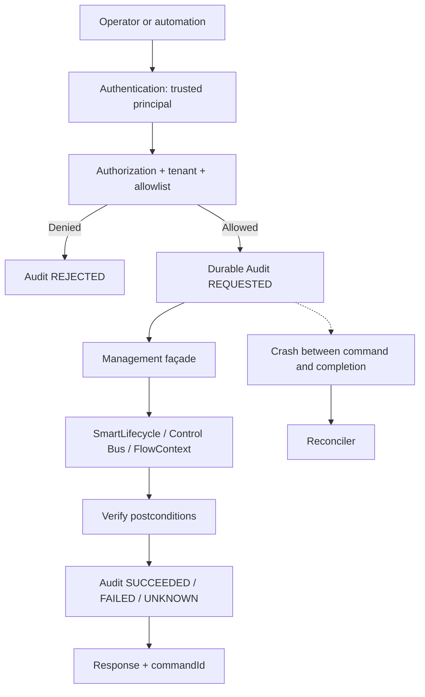

# Auditing Management Operations in Spring Integration Runtime

## 1. What Problem Does Management Operation Auditing Solve?

In a running Spring Integration system, operators or automation can **start/stop endpoints**, pause pollers, alter executor configurations, enable debug logging, dynamically register or destroy `IntegrationFlow`s, trigger orderly shutdowns, or replay messages from a DLQ. These operations alter message flows, transactions, retries, correlation, and runtime state without necessarily involving a new deployment.

If an investigator only checks a dashboard and sees `ordersInbound` is stopped, they still do not know **who** stopped it, **why**, **through which path**, whether the change was **approved**, **when** it occurred, whether in-flight messages finished processing, or whether that command failed or raced with another command.

The **Auditing Management Operations** lesson belongs to the **Control and Management** chapter of the `SPRING_INTEGRATION_RUNTIME` module. Its goal is to design verifiable audit logs for changes made while Spring Integration orchestrates channels, endpoints, consumers, pollers, and executors—while understanding interactions with dynamic flows, lifecycle, message stores, transactions, retries, errors, and threading.

**After this lesson, you will be able to:**

1. Distinguish management auditing from message history, application logs, metrics, and the integration graph.
2. Identify every surface capable of mutating runtime state: Control Bus, JMX, REST, Actuator, lifecycle APIs, `IntegrationFlowContext`.
3. Design an audit schema covering actor, action, target, request, before/after state, authorization, outcome, timestamp, and instance.
4. Restrict the Control Bus per the Spring Integration 6.5 model and place a management façade with allowlist + authorization in front of it.
5. Persist audits reliably across transactions, crash windows, retries, races, stop/drain, and multiple replicas.
6. Test successful, rejected, failed, timed-out changes, audit outages, and reconciliation.

> **Reference version:** Spring Integration 6.5, Spring Framework 6.x, Spring Boot 3.x, and Java 17. Pay close attention to the Control Bus 6.5 change: the older mechanism evaluating arbitrary SpEL expressions is no longer supported; commands are resolved via `ControlBusCommandRegistry`.

## 2. How Does Auditing Differ from Logging and Monitoring?

An **audit** is an evidentiary record of a *management request*, an *authorization decision*, and an *observable outcome*. It is not merely a `logger.info("Stopped!")` line or the latest status cell in a table.

Example of a valid audit event:

```text
commandId     = 9dc1... (UUID)
eventId       = 71aa... (unique UUID for the event)
actorId       = operator-24 (from identity provider)
action        = STOP_ENDPOINT
targetAlias   = orders-poller
actualBean    = ordersInbound
environment   = production
instanceId    = worker-03
tenantId      = tenant-a
reasonCode    = INCIDENT-PAUSE
requestId     = req-120
occurredAt    = 2026-11-22T02:00:00Z
phase         = SUCCEEDED
beforeRunning = true
afterRunning  = false
```

A single command typically produces **multiple events**:

```text
REQUESTED -> AUTHORIZED -> ACCEPTED -> SUCCEEDED
     |
     +------> REJECTED (not executed)
     |
     +------> FAILED (exception / postcondition unmet)
     |
     +------> UNKNOWN (timeout, crash, unclear outcome)
```

You need not use every phase, but you must keep them clearly distinct:

| Phase / Outcome | Actual Meaning | Must Not Be Interpreted As |
|---|---|---|
| `REQUESTED` | Request received with identity and target | Does not mean the endpoint has stopped |
| `REJECTED` | Disallowed by policy/input/permission | No authorized runtime impact occurred |
| `ACCEPTED` | Command placed in queue/runner | Does not mean the operation completed |
| `SUCCEEDED` | Command finished and postcondition observed | Does not guarantee all in-flight messages committed |
| `FAILED` | Command threw an error or target state not reached | Does not guarantee all side effects rolled back |
| `UNKNOWN` | Outcome uncertain due to crash/timeout/lost completion | Does not automatically permit non-idempotent retries |
| `RECONCILED` | Reconciled afterward using corroborating evidence | Does not erase earlier `UNKNOWN`/`REQUESTED` records |

For async operations, HTTP `202 Accepted` should only mean the command was accepted; callers can poll status using `commandId`. Even if a caller merely timed out, the command **may have already taken effect**.

## 3. Management Surfaces and Bypass Risks

| Surface | Common Operations | Control & Audit Points |
|---|---|---|
| **Control Bus** | `beanName.start`, `beanName.stop`, executor tuning | Authenticate message sender, allowlist commands/beans, record outcome |
| **ControlBusController** | HTTP `/control-bus` GET/POST | Secure REST, audit principal, method, and arguments |
| **JMX / MBean** | Invoke managed operations, orderly shutdown | Secure remote JMX, log verified identity |
| **Actuator / custom REST** | Pause/resume flows, adjust poller settings | Authorize by role + target/tenant, audit from HTTP ingress |
| **Direct API** | `SmartLifecycle.start()/stop()` | Allow calls only through an audited management layer |
| **IntegrationFlowContext** | `register/start/stop/destroy` dynamic flows | Flow ID, revision, tenant, registry state before/after |
| **Automation / scripts** | Bulk pause, DLQ replay, maintenance | Service identity, ticket/approval, parent/child commands |
| **Admin UI** | Enable/Disable buttons | UI is not the final gate; backend APIs must enforce permissions |

**Critical risk:** you might audit every command passing through the admin REST API while forgetting an exposed JMX port or Control Bus channel. A technically valid change can then happen **outside auditing and outside authorization policies**. Inventory every state-mutating path, then funnel or restrict them via a management façade or equivalent controls.

## 4. Control Bus in Spring Integration 6.5

### 4.1. 6.5 Does Not Run Arbitrary SpEL in Payloads

Spring Integration 6.5 documentation specifies that the Control Bus uses `ControlBusCommandRegistry`. The command payload is a string:

```text
beanName.methodName
```

The registry determines which methods can be invoked. Eligible methods include methods marked with `@ManagedOperation`/`@ManagedAttribute`, Spring `Lifecycle`/`Pausable` interfaces, and supported `TaskExecutor`/`TaskScheduler` configuration methods.

If a method takes arguments, pass them via the `IntegrationMessageHeaderAccessor.CONTROL_BUS_ARGUMENTS` header:

```java
import java.util.List;

import org.springframework.integration.IntegrationMessageHeaderAccessor;
import org.springframework.messaging.Message;
import org.springframework.messaging.support.MessageBuilder;

Message<String> command = MessageBuilder
        .withPayload("myTaskExecutor.setMaxPoolSize")
        .setHeader(
                IntegrationMessageHeaderAccessor.CONTROL_BUS_ARGUMENTS,
                List.of(12))
        .build();
```

Do not copy Spring Integration 6.3 Control Bus examples that pass free-form SpEL payloads and expect them to run on 6.5. In 6.5, `controlBusOnRegistry()` in the DSL is deprecated; use `controlBus()`.

### 4.2. Creating a Control Bus with Java DSL

```java
import org.springframework.context.annotation.Bean;
import org.springframework.context.annotation.Configuration;
import org.springframework.integration.dsl.IntegrationFlow;

@Configuration
class ControlBusConfiguration {
    @Bean
    IntegrationFlow controlBusFlow() {
        return IntegrationFlow.from("admin.control.requests")
                .controlBus()
                .get();
    }
}
```

In a secured system, an administrative service can send messages such as:

```java
import org.springframework.messaging.MessageChannel;
import org.springframework.messaging.support.MessageBuilder;

// adminControlRequests: injected internal channel.
adminControlRequests.send(
        MessageBuilder.withPayload("ordersInbound.stop").build());
```

**Note:** the command registry limits eligible methods; it does **not** enforce authorization by actor/tenant/environment and does **not** persist durable audits. Never allow external clients to send messages directly to an admin channel without authentication, authorization, and auditing.

### 4.3. `ControlBusController` and Access Control

Since Spring Integration 6.4, `@EnableControlBusController` in the HTTP module provides:

- `GET /control-bus` to list invokable commands.
- `POST /control-bus/{beanName.methodName}` to execute them.
- Argument body may contain `value` and `parameterType`.

Enable this controller only when genuinely needed, and enforce TLS, Spring Security, a private management network, rate limiting, and auditing. Even listing commands can reveal internal topology and bean names. REST paths may vary if the application sets a context path or sits behind a reverse proxy.

### 4.4. Paths That Can Bypass the Management Façade

If a method carries `@ManagedOperation` and is exposed through both JMX and the Control Bus, securing a custom REST API **does not** secure JMX. Audit all management surfaces and disable or restrict any path that cannot supply a trusted actor and complete auditing.

## 5. Can `MessageHistory`, Metrics, and `IntegrationGraph` Replace Auditing?

Spring Integration offers several runtime observability tools:

| Tool | Primary Data | What It Cannot Satisfy |
|---|---|---|
| `@EnableMessageHistory` | Components a business message traversed | Not durable proof of who stopped an endpoint or whether it was approved |
| Micrometer / `@EnableIntegrationManagement` | Counts, latencies, and errors for channels/handlers/sources | Aggregated data; lacks command IDs and actors |
| `IntegrationGraphServer` | Topology snapshot, component relationships, and runtime info | Does not record history of who altered topology |
| Application logs | Processing logs, exceptions, and timestamps | Can rotate, miss actors, be altered, or lack full decisions |
| JMX | Interface to read/invoke managed operations | A control surface, not a default audit ledger |
| Dedicated audit store | History of actor → command → target → outcome | Must itself enforce durability, immutability, retention, and read access control |

Example enabling `MessageHistory`:

```java
import org.springframework.context.annotation.Configuration;
import org.springframework.integration.config.EnableIntegration;
import org.springframework.integration.config.EnableMessageHistory;

@Configuration
@EnableIntegration
@EnableMessageHistory
class MessageHistoryConfiguration {
}
```

`MessageHistory` tracks a message's journey in the `history` header. It is very helpful for investigating business messages impacted *after* a poller stops, yet it contains no actor, approval, or outcome for the stop command. To audit management actions, write dedicated events at the management boundary.

**Furthermore:** `SmartLifecycle.isRunning() == false` only proves endpoint state at the instant observed. It does not guarantee active transactions committed/acked or that all replies were sent. To confirm **drained**, track in-flight tasks, pollers/executors, backlogs, and message source completion.

## 6. Choosing Fields for Audit Events

| Field | Reason |
|---|---|
| `eventId` | Unique ID per audit event, append-only |
| `commandId` | Correlates multiple events from one request; supports idempotency |
| `occurredAt` | UTC timestamp when recorded by the server |
| `actorId`, `actorType` | Authenticated user, service account, or automation |
| `action` | `START_ENDPOINT`, `STOP_ENDPOINT`, `DESTROY_FLOW`, `UPDATE_POOL_SIZE`, `REPLAY_DLQ`, ... |
| `targetType`, `targetAlias` | Controlled resource, avoiding letting clients pick arbitrary bean names |
| `beanName` / `flowId` | Actual internal bean/flow affected |
| `instanceId`, `environment`, `cluster` | Distinguish stopping one pod from stopping the entire cluster |
| `tenantId` | Scopes tenant namespace/permissions |
| `reasonCode`, `ticketId`, `approvalRef` | Justification / approval / change management |
| `requestId`, `traceId` | Correlates related HTTP/logs/messages |
| `beforeState`, `afterState` | Observed state before/after |
| `phase`, `errorCode`, `attemptNo` | Outcome, error classification, and retry attempt |
| `desiredRevision`, `appliedRevision` | Dynamic flow configuration / version history |

Never store passwords, tokens, cookies, raw messages with sensitive data, or full URLs containing credentials in audits. In multi-tenant setups, restrict who can query audit logs and enforce retention policies.

### Two Timeline Examples

```text
2026-11-22T02:01:01Z REQUESTED command=C-9 actor=ops-1
    action=STOP_ENDPOINT target=ordersInbound before=RUNNING
2026-11-22T02:01:01Z SUCCEEDED command=C-9 actor=ops-1
    action=STOP_ENDPOINT target=ordersInbound after=STOPPED
```

```text
2026-11-22T02:05:00Z REQUESTED command=C-10 action=START_ENDPOINT
2026-11-22T02:05:01Z FAILED command=C-10 errorCode=CONNECTION_FAILED
    before=STOPPED after=UNKNOWN
```

Keep both events separate; never overwrite `REQUESTED` in place with `SUCCEEDED` and lose the historical milestone.

## 7. Security and Audit Persistence Architecture



**Recommended workflow:**

1. Authenticate the principal at ingress (OAuth2/OIDC, mTLS, or equivalent).
2. Authorize action, target, environment, tenant scope, and approval/ticket where needed.
3. Map **public alias → fixed bean name in an allowlist**.
4. Durably write `REQUESTED` before sensitive actions; if the audit store fails, fail closed per policy.
5. Execute the command through a controlled API.
6. Read postcondition state and determine `SUCCEEDED`/`FAILED`/`UNKNOWN`.
7. Record completion; return a meaningful command ID and phase.
8. Reconcile commands missing terminal events after crashes rather than assuming they failed.

For queued commands, you can record `ACCEPTED` and return HTTP 202 before a worker executes. A command is considered finished only once the worker records appropriate evidence.

## 8. Example: Persisting Durable Audits with JDBC

Example using Spring Boot, Spring Security, and Spring JDBC. Sample SQL targets H2/PostgreSQL; in production manage schemas with Flyway/Liquibase and verify dialects and privileges.

### 8.1. Dependencies and Schema

```groovy
dependencies {
    implementation 'org.springframework.boot:spring-boot-starter-integration'
    implementation 'org.springframework.boot:spring-boot-starter-jdbc'
    implementation 'org.springframework.boot:spring-boot-starter-security'
    implementation 'org.springframework.boot:spring-boot-starter-aop'
    testImplementation 'org.springframework.boot:spring-boot-starter-test'
    testImplementation 'org.springframework.security:spring-security-test'
    testRuntimeOnly 'com.h2database:h2'
}
```

```sql
CREATE TABLE integration_admin_audit (
    event_id VARCHAR(36) PRIMARY KEY,
    command_id VARCHAR(36) NOT NULL,
    phase VARCHAR(24) NOT NULL,
    occurred_at TIMESTAMP NOT NULL,
    actor_id VARCHAR(128) NOT NULL,
    action_name VARCHAR(64) NOT NULL,
    target_alias VARCHAR(128) NOT NULL,
    instance_id VARCHAR(128) NOT NULL,
    tenant_id VARCHAR(128),
    reason_code VARCHAR(128),
    request_id VARCHAR(128),
    before_running BOOLEAN,
    after_running BOOLEAN,
    error_code VARCHAR(160)
);

CREATE INDEX idx_admin_audit_command
    ON integration_admin_audit(command_id, occurred_at);
```

Multiple rows can share the same `command_id` (`REQUESTED`, `SUCCEEDED`, etc.). Do not place a unique constraint on `command_id` alone. To prevent replay, use a separate **command ledger/idempotency** table; audit events and command ledgers serve distinct purposes.

### 8.2. DTO and JDBC Writer

```java
import java.time.Instant;
import java.util.UUID;

public record AdminAuditEntry(
        UUID eventId,
        UUID commandId,
        String phase,
        Instant occurredAt,
        String actorId,
        String actionName,
        String targetAlias,
        String instanceId,
        String tenantId,
        String reasonCode,
        String requestId,
        Boolean beforeRunning,
        Boolean afterRunning,
        String errorCode
) {
}
```

```java
import org.springframework.jdbc.core.JdbcTemplate;
import org.springframework.stereotype.Service;
import org.springframework.transaction.annotation.Propagation;
import org.springframework.transaction.annotation.Transactional;

@Service
public class AdminAuditWriter {

    private final JdbcTemplate jdbc;

    public AdminAuditWriter(JdbcTemplate jdbc) {
        this.jdbc = jdbc;
    }

    @Transactional(propagation = Propagation.REQUIRES_NEW)
    public void append(AdminAuditEntry e) {
        jdbc.update("""
            INSERT INTO integration_admin_audit (
                event_id, command_id, phase, occurred_at, actor_id,
                action_name, target_alias, instance_id, tenant_id,
                reason_code, request_id, before_running,
                after_running, error_code
            ) VALUES (?, ?, ?, ?, ?, ?, ?, ?, ?, ?, ?, ?, ?, ?)
            """,
            e.eventId().toString(), e.commandId().toString(),
            e.phase(), java.sql.Timestamp.from(e.occurredAt()),
            e.actorId(), e.actionName(), e.targetAlias(),
            e.instanceId(), e.tenantId(), e.reasonCode(), e.requestId(),
            e.beforeRunning(), e.afterRunning(), e.errorCode());
    }
}
```

**Why `REQUIRES_NEW` on a separate bean?** If the main operation throws an exception or a business transaction rolls back, `REQUESTED`/`FAILED` events still commit independently. Invoke the writer through the Spring proxy; self-invocation via `this.append()` bypasses transaction advice.

If the audit DB fails **before the operation**, the command should fail closed per policy. If the operation already ran and writing `SUCCEEDED` fails, you cannot roll back stopping/starting a JVM component; recovery is handled via transactions and reconciliation below.

In production, restrict the writer's DB account toward append-only (no `UPDATE`/`DELETE` grants for the application user), protect backups/replication, and consider signing/hash chains or WORM storage for high tamper-resistance. A SQL `INSERT` alone does not make data immutable against a database administrator.

## 9. Example Management Façade: Allowlist, Authentication, and Lifecycle Auditing

In production, never let clients freely supply `beanName.methodName` to invoke arbitrary commands. A management façade should accept a **stable published alias**, verify permissions, and invoke only the allowlisted endpoint.

The example below assumes a Spring Integration endpoint bean named `ordersInbound` implementing `SmartLifecycle`. When using DSL or annotations, assign explicit endpoint names and verify actual bean names in the Spring context. A `SmartLifecycle` may wrap a poller/consumer; `isRunning()` does not equate to remote dependency health.

### 9.1. Command and Result

```java
import java.util.UUID;

public enum AdminAction {
    START, STOP
}

public record EndpointAdminCommand(
        UUID commandId,
        AdminAction action,
        String targetAlias,
        String reasonCode,
        String requestId,
        String tenantId
) {
}

public record EndpointAdminResult(
        UUID commandId,
        String targetAlias,
        boolean running
) {
}
```

`commandId` correlates events. Client-supplied `tenantId` **is not sufficient** for authorization—it must be verified against the tenant scope of the security principal. This example keeps tenant policy in a separate security layer to focus on auditing.

### 9.2. Service Executing Operations and Auditing

```java
import java.time.Instant;
import java.util.Map;
import java.util.UUID;

import org.springframework.beans.factory.BeanFactory;
import org.springframework.context.SmartLifecycle;
import org.springframework.security.access.prepost.PreAuthorize;
import org.springframework.security.core.Authentication;
import org.springframework.security.core.context.SecurityContextHolder;
import org.springframework.stereotype.Service;

@Service
public class AuditedEndpointAdministration {

    // External alias -> allowlisted internal bean name.
    private static final Map<String, String> TARGETS = Map.of(
            "orders-poller", "ordersInbound");

    private final BeanFactory beans;
    private final AdminAuditWriter audit;

    public AuditedEndpointAdministration(
            BeanFactory beans, AdminAuditWriter audit) {
        this.beans = beans;
        this.audit = audit;
    }

    @PreAuthorize("hasAuthority('INTEGRATION_ADMIN')")
    public EndpointAdminResult apply(EndpointAdminCommand command) {
        if (command == null || command.commandId() == null
                || command.action() == null || command.targetAlias() == null) {
            throw new IllegalArgumentException("Invalid admin command");
        }

        // Identity taken from SecurityContext authenticated at ingress.
        Authentication auth = SecurityContextHolder
                .getContext().getAuthentication();
        String actor = auth.getName();

        String beanName = TARGETS.get(command.targetAlias());
        if (beanName == null) {
            audit.append(event(command, actor, "REJECTED",
                    null, null, "TARGET_NOT_ALLOWED"));
            throw new IllegalArgumentException("Target is not allowed");
        }

        // If REQUESTED cannot commit, DO NOT call endpoint.start/stop.
        audit.append(event(command, actor, "REQUESTED",
                null, null, null));

        Boolean before = null;
        Boolean after = null;
        try {
            SmartLifecycle endpoint =
                    beans.getBean(beanName, SmartLifecycle.class);

            before = endpoint.isRunning();
            if (command.action() == AdminAction.START) {
                endpoint.start();
            }
            else {
                endpoint.stop();
            }
            after = endpoint.isRunning();

            boolean expected = command.action() == AdminAction.START;
            if (after != expected) {
                throw new IllegalStateException(
                        "Endpoint did not reach desired lifecycle state");
            }
        }
        catch (RuntimeException failure) {
            try {
                audit.append(event(command, actor, "FAILED",
                        before, after,
                        failure.getClass().getSimpleName()));
            }
            catch (RuntimeException auditFailure) {
                failure.addSuppressed(auditFailure);
            }
            throw failure;
        }

        // Intentionally OUTSIDE try/catch: failure writing SUCCEEDED must not
        // falsely mark an already-executed command as FAILED.
        audit.append(event(command, actor, "SUCCEEDED",
                before, after, null));

        return new EndpointAdminResult(
                command.commandId(), command.targetAlias(), after);
    }

    private AdminAuditEntry event(EndpointAdminCommand c,
                                  String actor, String phase,
                                  Boolean before, Boolean after,
                                  String errorCode) {
        return new AdminAuditEntry(
                UUID.randomUUID(),
                c.commandId(),
                phase,
                Instant.now(),
                actor,
                c.action().name(),
                c.targetAlias(),
                "worker-01", // In practice: read from instanceId/config.
                c.tenantId(),
                c.reasonCode(),
                c.requestId(),
                before,
                after,
                errorCode);
    }
}
```

**Important points before using this:**

- `@PreAuthorize` only enforces when Spring Security method security is enabled and calls go through the Spring proxy. Instantiating `new AuditedEndpointAdministration(...)` directly in unit tests skips authorization checks.
- Method security rejects **before the method body executes**; audit denied attempts in a Spring Security authorization failure handler/filter or API ingress rather than expecting `apply()` to log them.
- Actor comes from `SecurityContextHolder`, **not from the request body**. With async executors/tasks, the security context is not propagated unless configured; pass verified identity in a command envelope with clear provenance.
- Allowlisting prevents invoking arbitrary Spring beans. Tenant policies, production approvals, and scopes must be enforced beyond the `INTEGRATION_ADMIN` authority alone.
- `REQUESTED` is written **before** invoking lifecycle. `SUCCEEDED` is written after re-reading `isRunning()`; `FAILED` is written if invocation throws or the postcondition is unmet.
- Failing to write `SUCCEEDED` after a successful stop **does not restart the endpoint**. An orphaned `REQUESTED` audit remains and must be picked up by the reconciler.
- This example omits a distributed command ledger/target lock; real production management needs them to handle concurrent commands and HTTP retries.
- This example targets **one endpoint in one JVM**. Never report "entire cluster stopped" just because a local `SmartLifecycle` returned.

### 9.3. Enabling Method Security

```java
import org.springframework.context.annotation.Configuration;
import org.springframework.security.config.annotation.method.configuration.EnableMethodSecurity;

@Configuration
@EnableMethodSecurity
class AdminMethodSecurityConfig {
}
```

A production system also needs HTTP/JMX/Control Bus access controls: proper OIDC/OAuth2/mTLS login, tenant/resource authorization, TLS, rate limits, network isolation, and CSRF when using browser sessions. **Never** expose `/control-bus` to the internet expecting the façade's method-level authorization to protect commands arriving via another path.

## 10. Auditing `IntegrationFlowContext` and Tenant Operations

For dynamic runtimes, management operations may include:

- `REGISTER_FLOW`: `flowContext.registration(flow).id(flowId).register()`.
- `START_FLOW` / `STOP_FLOW`: `IntegrationFlowRegistration.start()/stop()`.
- `DESTROY_FLOW`: `registration.destroy()` or `flowContext.remove(flowId)`.
- `RECONFIGURE_FLOW`: switching revisions/pollers/destinations/credential references, blue/green swaps.

In audits, also capture `tenantId`, `flowId`, desired/applied revision, old/new destinations (secrets redacted), source owner, and registry state.

| Operation | Evidence to Record | Risks to Watch |
|---|---|---|
| Register | ID absent beforehand, registration present afterward | Bean collisions, endpoint startup failures |
| Start | `STOPPED` before, `STARTED` after, health checks | Remote adapter unready despite `isRunning=true` |
| Stop | No new intake, in-flight draining | Gateway timeouts, incomplete acks/transactions |
| Destroy | Registry no longer holds flow, dependent beans released | Accidental removal of shared resources, durable queue backlog remaining |
| Reconfigure | Revision and routing move from v1 to v2 | Both flows polling the same source |
| Replay DLQ | Target queue/message IDs, dry-run flag, processing evidence | Duplicate replays, non-idempotent side effects |

### Bulk Operations

If an operator asks to stop 100 flows and only 96 succeed, audits must include a **parent command ID** and child events per target. The parent outcome is `PARTIALLY_SUCCEEDED`; never record `STOP_ALL SUCCEEDED` when 4 flows failed to reach the goal.

### Multiple Replicas

`IntegrationFlowContext.getRegistry()` and `SmartLifecycle` are local to a single application context. Stopping on pod A does not stop pod B. Every audit event must record `instanceId` and scope (`ONE_INSTANCE`/`ALL_INSTANCES`); for cluster-wide commands, a coordinator must collect per-node outcomes and reconcile hanging commands.

## 11. Transactions, Audit Durability, and Crash Windows

### 11.1. Why Should Audits Not Roll Back with Business Transactions?

A handler may throw an exception causing a transaction to roll back. If the audit record is inside that same transaction, **the record of the failed attempt disappears too**. That is why the example uses `AdminAuditWriter` with `REQUIRES_NEW` on a separate bean.

| Setup | Effect and Risk |
|---|---|
| Audit inside business transaction | Business rollback can erase evidence of failed attempts |
| Audit with `REQUIRES_NEW` | `REQUESTED`/`FAILED` commit even if business rolls back; requires proper pool and transaction manager |
| Audit via RAM `QueueChannel` | JVM crash after command before persistence → lost audit |
| Audit via persistent outbox | Can publish/ship to SIEM with retries; consumers and delivery must be idempotent |
| Direct audit call to external service | Must decide fail-closed vs. fail-open if audit dependency is down |

**Fail-closed before the command:** if policy requires mandatory auditing and `REQUESTED` cannot be written, do not execute the mutation. **After the command:** if writing the completion event fails, the operation may already be in effect and there is no shared transaction to roll back Spring lifecycle. Alert and reconcile rather than writing a false `FAILED`.

### 11.2. Crash Windows

```text
t0: INSERT audit REQUESTED, commit
t1: endpoint.stop()
t2: endpoint is STOPPED
t3: JVM crashes before INSERT audit SUCCEEDED
t4: restart; audit only shows REQUESTED
```

Do not infer `STOP FAILED` or blindly rerun destructive commands. A reconciler finds overdue commands lacking terminal events, checks the desired-state catalog and post-restart runtime state, and appends `UNKNOWN`/`RECONCILED`. With dynamic flows, the registry is recreated on restart, so the mere absence of a flow afterward does not prove an earlier command succeeded.

### 11.3. Retries and Idempotency

Callers may retry a command after an HTTP timeout. Persist a stable `commandId` across retries, using a **command ledger** with a unique key to prevent duplicate execution where disallowed. Audit events record each attempt separately. If status is `UNKNOWN`, inspect live state before deciding whether to retry.

`MessageHeaders.ID` does not replace a business `commandId`, as each resend can generate a new message ID. `STOP` commands are relatively idempotent, whereas `DESTROY_FLOW`/`REPLAY_DLQ`/`CHANGE_CONFIG` require explicit idempotency contracts.

## 12. Concurrent Start/Stop and Desired Consistency

Scenario:

```text
Operator A: STOP ordersInbound
Operator B: START ordersInbound
Both requests arrive nearly simultaneously.
```

Without per-target serialization, the two calls can interleave; logs may show both `SUCCEEDED`, yet the final state fails to match the expected operator order.

Mitigations:

1. **Per-target lock/command queue** within a JVM to serialize start–stop.
2. Store `desiredRevision` in a catalog and use optimistic concurrency when admins update revisions.
3. Log actor, `commandId`, expected/observed state, revision, and sequence.
4. Across multiple pods, use a coordinator/lease/distributed lock if two nodes control a shared source; in-JVM locks do not protect a cluster.
5. Set deadlines on operations; never hold locks indefinitely while an endpoint/adapter blocks on I/O.
6. Enforce policy preconditions: e.g., `STOP` only when `RUNNING`; if already `STOPPED`, explicitly record `NO_OP` or idempotent `SUCCEEDED`.

**Distinction:** endpoint start/stop and business message commit/ack are separate states. Stopping prevents new intake, not completion of already-running async workers. When `DRAINED` must be guaranteed, track in-flight tasks, broker acks, transactions, and queue backlogs.

## 13. Security and Traceability

### Access Control Must Combine Action + Target

A user with a test admin role must not be able to destroy a production flow for another tenant. Policies should inspect role, tenant scope, target resource, environment, approval/ticket, change window, and blast radius.

For high-risk actions (destroying persistent flows, bulk replays, rotating connection credentials), consider two-person approval workflows, bulk target caps, dry-run modes, and mandatory `reasonCode`/tickets.

### Bypass Paths That Must Be Audited

1. Custom HTTP admin APIs.
2. `/control-bus` HTTP controller and Control Bus input channel if enabled.
3. JMX remote operations and exporters.
4. Configuration-mutating Actuator endpoints.
5. Code directly calling `SmartLifecycle` or `IntegrationFlowContext`.
6. Scheduled automation, scripts, and CLIs.

If a path cannot provide a trusted actor and durable auditing, restrict or disable it in production. The command registry only knows which methods are callable; it does not solve per-tenant or purpose-based authorization.

### Recording Rejected Attempts

`@PreAuthorize` can reject before the body of `apply()` runs. Record `REJECTED` in the security filter / authorization failure handler (or authenticated API layer), not solely inside the service method. Never log tokens, JWTs, or raw hostile payloads; protect audit storage from flood-induced exhaustion using rate limits and alerts.

## 14. Post-Incident Querying and Observability

### 14.1. Reading the Event Chain for a Command

```sql
SELECT command_id, phase, occurred_at, actor_id, action_name,
       target_alias, instance_id, before_running,
       after_running, error_code
FROM integration_admin_audit
WHERE command_id = ?
ORDER BY occurred_at, event_id;
```

### 14.2. Finding `REQUESTED` Commands Missing a Terminal Outcome

```sql
SELECT r.command_id, MIN(r.occurred_at) AS first_requested_at
FROM integration_admin_audit r
WHERE r.phase = 'REQUESTED'
  AND NOT EXISTS (
      SELECT 1
      FROM integration_admin_audit t
      WHERE t.command_id = r.command_id
        AND t.phase IN ('SUCCEEDED', 'FAILED', 'UNKNOWN')
  )
GROUP BY r.command_id;
```

Reconciliation jobs require age thresholds and access to runtime state. Never automatically mark every long-running command `FAILED`; it may still be executing or may have succeeded right before a process crash.

### 14.3. Metrics and Correlation

| Suggested Metric | Meaning |
|---|---|
| `admin.commands.requested` | Frequency of runtime changes |
| `admin.commands.rejected` | Denied attempts and policy violations |
| `admin.commands.failed` | Execution failures by target |
| `admin.commands.unknown` | Commands needing reconciliation |
| `admin.audit.write.failures` | Risk level of missing audit evidence |
| `admin.command.latency` | Latency of start/stop/reconfigure |
| `admin.state.drift` | Desired vs. actual state divergence |
| `admin.recovery.actions` | Replays, rollbacks/compensations after incidents |

These metrics are **application instrumentation suggestions**, not built-in Spring Integration metric names. Combine metrics, message history, integration graph, `errorChannel`, transaction logs, and the audit ledger using shared trace/command IDs for root-cause analysis.

## 15. Testing Management Auditing

### 15.1. Test Matrix

| Test | Condition | What to Assert |
|---|---|---|
| Valid `STOP` | Authorized admin, endpoint running | `REQUESTED` then `SUCCEEDED`, `before=true`/`after=false` |
| Valid `START` | Endpoint stopped | `REQUESTED` then `SUCCEEDED`, `before=false`/`after=true` |
| AuthZ denied | User lacks authority | Endpoint not called; `REJECTED` logged at security layer |
| Off-allowlist target | Unmanaged alias | `REJECTED`, no arbitrary bean called |
| `stop()` throws exception | Failing endpoint | `REQUESTED`, `FAILED`, and `errorCode` |
| Postcondition unmet | `isRunning()` unchanged | `SUCCEEDED` not written |
| Audit `REQUESTED` fails | JDBC unavailable | `start`/`stop` never invoked |
| Audit `SUCCEEDED` fails | Endpoint changed state then writer failed | `REQUESTED` exists; reconciled to `UNKNOWN` |
| JVM crash mid-command | `REQUESTED` committed, completion unwritten | No fake success written; reconciled after restart |
| Two concurrent admin commands | `START`/`STOP` on same target | Ordering/lock/desired revision respected |
| Duplicate `commandId` | HTTP retry | No duplicate action outside contract; attempts linked in audit |
| Dynamic flow destroy | Existing flow ID | Registration removed; durable backlog policy honored |
| Multi-pod bulk stop | One node fails | Per-child outcomes, parent `PARTIALLY_SUCCEEDED` |
| Denial / secret in payload | Untrusted input | No tokens/passwords or sensitive raw payloads logged |

### 15.2. Unit Testing Façade Behavior

Service logic can be tested with Mockito; note this **does not test the Spring Method Security proxy**, so write separate authorization integration tests.

```java
import static org.junit.jupiter.api.Assertions.*;
import static org.mockito.Mockito.*;

import java.util.List;
import java.util.UUID;

import org.junit.jupiter.api.Test;
import org.mockito.ArgumentCaptor;
import org.springframework.beans.factory.BeanFactory;
import org.springframework.context.SmartLifecycle;
import org.springframework.security.authentication.UsernamePasswordAuthenticationToken;
import org.springframework.security.core.authority.SimpleGrantedAuthority;
import org.springframework.security.core.context.SecurityContextHolder;

class AuditedEndpointAdministrationTest {

    @Test
    void stopProducesRequestedAndSucceededEvents() {
        BeanFactory factory = mock(BeanFactory.class);
        SmartLifecycle endpoint = mock(SmartLifecycle.class);
        AdminAuditWriter audit = mock(AdminAuditWriter.class);

        when(factory.getBean("ordersInbound", SmartLifecycle.class))
                .thenReturn(endpoint);
        when(endpoint.isRunning()).thenReturn(true, false);

        SecurityContextHolder.getContext().setAuthentication(
                new UsernamePasswordAuthenticationToken(
                        "ops-1", "N/A",
                        List.of(new SimpleGrantedAuthority(
                                "INTEGRATION_ADMIN"))));

        try {
            var manager = new AuditedEndpointAdministration(
                    factory, audit);
            var command = new EndpointAdminCommand(
                    UUID.randomUUID(), AdminAction.STOP,
                    "orders-poller", "INCIDENT", "REQ-1", "tenant-a");

            EndpointAdminResult result = manager.apply(command);

            assertFalse(result.running());
            verify(endpoint).stop();

            var captor = ArgumentCaptor.forClass(
                    AdminAuditEntry.class);
            verify(audit, times(2)).append(captor.capture());

            var events = captor.getAllValues();
            assertEquals("REQUESTED", events.get(0).phase());
            assertEquals("SUCCEEDED", events.get(1).phase());
            assertEquals(command.commandId(),
                    events.get(1).commandId());
            assertEquals(Boolean.TRUE,
                    events.get(1).beforeRunning());
            assertEquals(Boolean.FALSE,
                    events.get(1).afterRunning());
        }
        finally {
            SecurityContextHolder.clearContext();
        }
    }
}
```

When using `@PreAuthorize`, integration tests must invoke through the Spring proxy with `@EnableMethodSecurity` and `@WithMockUser`/unauthorized users. Use a real H2/PostgreSQL test DB to prove audit `INSERT`s commit; mocks only verify calls and ordering, not database durability.

### 15.3. Worthwhile Failure Injections

- Make `AdminAuditWriter.append(REQUESTED)` throw: assert `endpoint.stop()` was **not called**.
- Make `endpoint.stop()` throw: assert `FAILED` with the exception type; never write `SUCCEEDED`.
- Make `AdminAuditWriter.append(SUCCEEDED)` throw: endpoint may already be stopped; never write a false `FAILED`.
- Have an admin request denied by the Spring Security proxy: audit the rejection at the security layer; endpoint never runs.
- Kill the process right after `REQUESTED`: restart and run the reconciler.
- Send concurrent `STOP`/`START` commands: assert serialization/expected revision, not merely that one command succeeded.
- Test dynamic flow register/destroy and assert zero resource leaks and zero tenant ID mix-ups.
- For pollers, assert stop halts new polls; test in-flight acks/transactions separately.

## 16. Runbook for Unexpected Runtime State Changes

**Scenario:** Since 10:05, messages stopped flowing and the dashboard shows `ordersInbound` is stopped.

1. Verify the exact endpoint bean/instance and live lifecycle state; inspect flows, pollers, executors, and brokers.
2. Query the audit log by target and time window; extract actor, command ID, phase, reason, and before/after states.
3. Check `REJECTED` events and any JMX/Control Bus/automation paths that might have bypassed controls.
4. If `STOP SUCCEEDED` exists: verify ticket/approval and confirm the command targeted the intended node/tenant.
5. If only `REQUESTED` exists: cross-check crashes/deploys, desired state, and executing tasks; resolve `UNKNOWN`.
6. If no audit exists: investigate `autoStartup`, process shutdowns, direct bean calls, JVM failures, and missing audit coverage; do not jump to assuming an operator intentionally stopped it.
7. Resume only after confirming downstream DB/broker health and backlog capacity; issue a **new `START` command with its own audit**.
8. Monitor throughput, `errorChannel`, queue age, retries, DLQs, and transactions to confirm true recovery.
9. Document postmortem findings and add tests for any uncovered audit paths.

## 17. Production Deployment Checklist

1. **Inventory all management surfaces**: REST, Control Bus, JMX, Actuator, scripts, dynamic flow managers.
2. **Block bypasses** with a management façade or equivalent interceptor/auditing across every path.
3. **Derive actor from authenticated identity**, never trusting client-supplied body/header fields.
4. **Authorize by action, target, tenant, and environment**, requiring approvals for high-risk actions.
5. **Allowlist commands/beans**, disallowing legacy arbitrary SpEL execution.
6. **Persist `REQUESTED` before sensitive actions**; fail closed if the audit writer fails.
7. **Record `SUCCEEDED` only after postconditions**, distinguishing `ACCEPTED` and `UNKNOWN`.
8. **Store `commandId`, `instanceId`, revision, before/after state, UTC timestamp, `reasonCode`**, and actor.
9. **Enforce an append-only audit store with `UPDATE`/`DELETE` restrictions**, backups, retention, and tamper detection.
10. **Serialize start/stop per target** and use an idempotency/command ledger for retries.
11. **Define drain/transaction/ack handling** on stop/destroy so lifecycle state is never confused with business completion.
12. **Reconcile after crashes/restarts**, especially across multi-node/multi-tenant flows.
13. **Test denials, audit outages, operation failures, retries, concurrency, and restarts**.
14. **Monitor audit completeness and state drift**, resolving `REQUESTED` records lacking terminal events.
15. **Never replace audits with logs, metrics, message history, or graphs**; use them together as complementary signals.

## 18. Self-Check Questions

**1.** Does Spring Integration 6.5 still let the Control Bus run arbitrary SpEL expressions in payloads?  
**Answer:** No. The Control Bus uses `ControlBusCommandRegistry` and `beanName.methodName` commands; arguments go in the `CONTROL_BUS_ARGUMENTS` header.

**2.** Is enabling `@EnableMessageHistory` sufficient to audit who stopped an endpoint?  
**Answer:** No. Message history tracks a business message's path across components; it does not durably record actor, approval, or management command outcomes.

**3.** Does `isRunning()==false` after stop prove all messages have committed/acked?  
**Answer:** No. It is only lifecycle state at the moment observed; inspect in-flight workers, transactions, broker acks, and backlogs.

**4.** Writing `SUCCEEDED` to the DB failed, yet the endpoint already stopped. Should it be marked `FAILED`?  
**Answer:** Never write a false `FAILED` for an operation that may have succeeded. Keep `REQUESTED`, alert, and reconcile to `UNKNOWN`/`RECONCILED` based on evidence.

**5.** Why shouldn't HTTP clients send arbitrary `beanName.methodName` strings to the Control Bus?  
**Answer:** It can cross authorized resources/tenant boundaries; registry eligibility does not replace authorization by principal, target, and environment.

**6.** `@PreAuthorize` rejects before the service body runs; where should `REJECTED` be recorded?  
**Answer:** In the authorization failure handler/filter or authenticated API ingress with trusted identity; the service body is never invoked.

**7.** Does stopping an endpoint on pod A automatically stop pod B?  
**Answer:** No. Lifecycle and `IntegrationFlowContext` are JVM-local; use a cluster coordinator and per-instance auditing.

**8.** What is the risk of auditing inside the business transaction when business work rolls back?  
**Answer:** The record of the attempted command can roll back as well, erasing evidence of the failure.

**9.** For a bulk stop of 100 flows where 96 succeed and 4 fail, can you record `STOP_ALL SUCCEEDED`?  
**Answer:** No. Record per-flow outcomes, link parent/child commands, and summarize as `PARTIALLY_SUCCEEDED`.

**10.** A caller times out after a destroy command; should it immediately retry the same action?  
**Answer:** Not blindly. Use command IDs, ledgers, and actual-state reconciliation; the action may have already taken effect.

## 19. Official References

1. [Spring Integration 6.5 — Control Bus](https://docs.spring.io/spring-integration/reference/6.5/control-bus.html): command registry, method eligibility, argument header, and DSL.
2. [Spring Integration 6.5 — Control Bus Controller](https://docs.spring.io/spring-integration/reference/6.5/http/control-bus-controller.html): REST GET/POST and security recommendations.
3. [Spring Integration 6.5 — Message History](https://docs.spring.io/spring-integration/reference/6.5/message-history.html): `@EnableMessageHistory` and component history.
4. [Spring Integration 6.5 — JMX Support](https://docs.spring.io/spring-integration/reference/6.5/jmx.html): managed operations and MBean exporter.
5. [Spring Integration 6.5 — Integration Graph](https://docs.spring.io/spring-integration/reference/6.5/graph.html): runtime graph/snapshot.
6. [Spring Integration 6.5 — Metrics and Management](https://docs.spring.io/spring-integration/reference/6.5/metrics.html): metrics and integration management.
7. [Spring Integration 6.5 — Dynamic and Runtime Integration Flows](https://docs.spring.io/spring-integration/reference/6.5/dsl/java-runtime-flows.html): `IntegrationFlowContext` and lifecycle.
8. [Spring Integration 6.5 — Transaction Support](https://docs.spring.io/spring-integration/reference/6.5/transactions.html): transaction boundaries, pollers, and channels.
9. [Spring Integration 6.5 API — ControlBusCommandRegistry](https://docs.spring.io/spring-integration/docs/6.5.0/api/org/springframework/integration/support/management/ControlBusCommandRegistry.html): command registry API.
10. [Spring Framework — Declarative Transaction Management](https://docs.spring.io/spring-framework/reference/data-access/transaction/declarative.html): transaction proxies and propagation.
11. [Spring Security — Method Security](https://docs.spring.io/spring-security/reference/servlet/authorization/method-security.html): method authorization such as `@PreAuthorize`.
