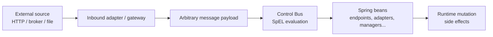
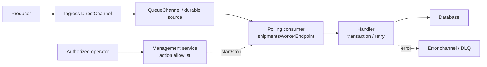
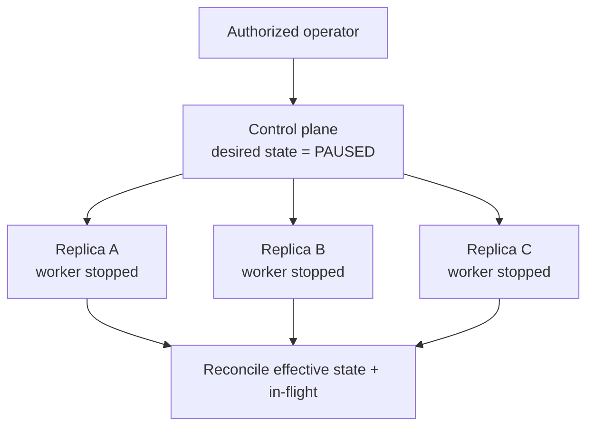

# Do Not Expose an Uncontrolled Control Bus

## 1. The Problem: A Single Management Command Can Alter the Entire Runtime

In Spring Integration, an application can comprise many `IntegrationFlow`s, channels, consumer endpoints, pollers, executors, retry advice, error channels, and adapters connected to databases or brokers. **Starting**, **stopping**, changing state, or triggering a component at runtime is a legitimate operational need. However, a channel receiving management commands is fundamentally different from a channel receiving business messages.

Imagine a service receiving shipping requests. During a maintenance window, an operator wants to pause the `shipmentsWorkerEndpoint` poller to avoid calling the database. If a public HTTP API lets callers submit an arbitrary `@shipmentsWorkerEndpoint.stop()` payload into the Spring Integration **Control Bus**, an unauthorized user could halt order processing. Worse, when content is evaluated as an expression, it could target **other beans and methods** reachable from the evaluation context—not merely the start/stop actions developers intended.

This is a lesson in the **Control and Management** chapter of the **SPRING_INTEGRATION_RUNTIME** module. The focus is protecting the **control plane** when operating message flows: trust boundaries, lifecycle control, authorization, auditing, error handling, multi-instance consistency, and tests verifying protections work.

> **Top rule:** never turn user-supplied payloads, HTTP requests, Kafka/RabbitMQ messages, or unauthenticated headers into expressions sent directly to a Control Bus. The entry point for management commands must be a **security boundary**, not merely a channel with an obscure name.

## 2. What Is the Control Bus in Spring Integration?

A **Control Bus** is an endpoint dedicated to receiving messages representing **management commands**. In classic usage, the payload is interpreted as a **Spring Expression Language (SpEL)** expression to access or manipulate Spring beans—such as invoking lifecycle methods on an endpoint with a matching bean name.

Illustrative control expressions:

```text
@shipmentsWorkerEndpoint.stop()
@shipmentsWorkerEndpoint.start()
@shipmentsWorkerEndpoint.isRunning()
```

The expressions above are **not business JSON**. They mean *execute an action or read state on a bean inside the application context* when evaluated by the Control Bus. You must use the exact endpoint bean name created by Spring Integration; the `IntegrationFlow` bean, channel bean, and endpoint bean can have different names.

In Java DSL, concise wiring for an internal Control Bus looks like:

```java
import org.springframework.context.annotation.Bean;
import org.springframework.context.annotation.Configuration;
import org.springframework.integration.channel.DirectChannel;
import org.springframework.integration.dsl.IntegrationFlow;
import org.springframework.messaging.MessageChannel;

@Configuration
class InternalControlBusConfig {

    @Bean("internal.control.requests")
    MessageChannel controlRequests() {
        return new DirectChannel();
    }

    @Bean
    IntegrationFlow internalControlBusFlow() {
        return IntegrationFlow.from("internal.control.requests")
            .controlBus()
            .get();
    }
}
```

**Crucial point:** `DirectChannel` and a bean name starting with `internal` **do not create authentication**. The code above only wires an internal channel and endpoint. Any component in the application holding a reference to that channel and able to call `send` can try pushing messages into it. If an untrusted inbound adapter gets wired to this channel, the security boundary is breached.

Because the Control Bus can evaluate expressions, treat it as **a privileged control surface**. Never assume all methods/beans are restricted by a built-in allowlist; effective access depends on framework configuration and the evaluation context.

## 3. Why Is "Exposing the Control Bus" a Security Risk?

There are three distinct boundaries that teams sometimes accidentally merge into one:

1. **Data plane:** business messages such as orders, files, and payments permitted from external sources into defined processing flows.
2. **Control plane:** only authorized management commands may change the state of endpoints, pollers, or integration flows.
3. **Runtime internals:** Spring beans, transaction managers, connection factories, message stores, executors, and other infrastructure managed by the application context.

If a message from the data plane passes straight into the Control Bus, externally controlled data turns into **management expressions** targeting runtime internals.



**Possible consequences** depending on reachable beans and context:

- Stopping critical consumers or inbound adapters, causing backlogs to spike or messages to fail when channels lose subscribers.
- Starting an endpoint meant to stay stopped for maintenance, sending data into an unready system.
- Invoking bean methods outside the intended management operations; exact impact depends on methods reachable by the expression engine.
- Reading or manipulating sensitive runtime state if relevant beans or methods can be referenced.
- Causing **denial of service** by rapidly issuing start/stop commands or miscontrolling flows.

Not every configuration leads to the same severity, and one should not claim every payload executes OS commands. What must be prevented is **allowing untrusted data to be evaluated with the Control Bus's bean-manipulation capabilities**.

### A Topology to Avoid

```text
HTTP POST /admin/control
    -> Http inbound gateway
    -> payload = request body
    -> DirectChannel
    -> Control Bus
```

Even if the path is `/internal`, the URL is hidden, a simple header secret is checked, or an "obscure" broker topic is used, this design remains vulnerable to abuse. You need **authentication, authorization, command restrictions, and channel isolation**.

## 4. Threat Model: Who Can Send Commands and Where Do They Flow?

Sound design starts by inventorying data flows, not by picking channel names.

| Source / Actor | Trust Level | Recommended Rule |
| --- | --- | --- |
| Internet clients, end users | Untrusted | No direct path to the Control Bus or control beans. |
| Internal API from another service | Conditionally trusted | Authenticate service identity, authorize per action; still validate input. |
| Business Kafka/RabbitMQ topics | Not a management channel | Never route payloads to the Control Bus, even if the producer is internal. |
| Operator with authenticated session | May hold specific privileges | Permit only required tasks, with auditing and scope limits. |
| Scheduler / reconciliation jobs | Application components | Call APIs with fixed actions; never build expressions from untrusted config. |
| Third-party plugins / modules | Potentially restricted | Do not grant management channel references or broad bean access unnecessarily. |
| Emergency operations team | High privilege by process | Require break-glass controls, auditing, change control, and state rollback. |

Mandatory questions to answer:

- Which endpoints **may** be started/stopped? Are any tied to payments, data deletion, or reprocessing?
- Does a command apply to **one instance**, one tenant, one cluster, or the whole application?
- Who may issue `STATUS`, who may `PAUSE`, who may `RESUME`, and who may alter topology?
- Are users allowed to pass free-form **bean names** or **SpEL expressions**?
- Is there any way a producer-supplied header like `role=admin` could be treated as real authority?
- How are management commands logged, tagged with request IDs, and reconciled against effective state?
- When the app restarts, must a "paused" state be restored?

**Design takeaway:** translate untrusted inputs into a **typed, authenticated, allowlisted command structure**, then invoke the exact pre-coded action.

## 5. Preferred Approach: Skip the Control Bus for Simple Commands

When you only need to start/stop specific consumers, the safest and easiest-to-audit approach is usually **not creating a Control Bus at all**. Instead, write a management service using `SmartLifecycle` with a **fixed list of endpoints** and **explicitly named methods**.

### 5.1. Creating a Polling Endpoint with a Stable ID

Suppose you have a work queue and a polling endpoint that needs pausing:

```java
import java.time.Duration;

import org.springframework.context.annotation.Bean;
import org.springframework.context.annotation.Configuration;
import org.springframework.integration.channel.QueueChannel;
import org.springframework.integration.config.EnableIntegration;
import org.springframework.integration.dsl.IntegrationFlow;
import org.springframework.integration.dsl.Pollers;
import org.springframework.messaging.PollableChannel;

@Configuration
@EnableIntegration
class ShipmentFlowConfig {

    @Bean("shipments.pending")
    PollableChannel pendingShipments() {
        return new QueueChannel(100);
    }

    @Bean
    IntegrationFlow shipmentWorkerFlow() {
        return IntegrationFlow.from("shipments.pending",
                endpoint -> endpoint
                    .id("shipmentsWorkerEndpoint")
                    .poller(Pollers.fixedDelay(Duration.ofSeconds(1))
                        .maxMessagesPerPoll(1)))
            .handle(String.class, (payload, headers) -> {
                // Demo: business processing; production must use appropriate transactions.
                System.out.println("Process shipment " + payload);
                return null;
            })
            .get();
    }
}
```

The bean `shipmentsWorkerEndpoint` is a **consumer endpoint** with a lifecycle. In this demo model, an in-memory `QueueChannel` holds waiting messages when the poller stops **within the same JVM**, though messages are lost if the JVM dies without a durable source or persistent message store.

### 5.2. Service Exposing Only Permitted Actions

```java
import org.springframework.context.ApplicationContext;
import org.springframework.context.SmartLifecycle;
import org.springframework.security.access.prepost.PreAuthorize;
import org.springframework.stereotype.Service;

@Service
public class ShipmentAdminService {

    private final ApplicationContext context;

    public ShipmentAdminService(ApplicationContext context) {
        this.context = context;
    }

    // Bean name is a hardcoded constant, NEVER taken from a request.
    private SmartLifecycle worker() {
        return context.getBean(
            "shipmentsWorkerEndpoint", SmartLifecycle.class);
    }

    @PreAuthorize("hasAuthority('integration:manage:shipments')")
    public boolean pause() {
        SmartLifecycle target = worker();
        target.stop();
        return !target.isRunning();
    }

    @PreAuthorize("hasAuthority('integration:manage:shipments')")
    public boolean resume() {
        SmartLifecycle target = worker();
        target.start();
        return target.isRunning();
    }

    @PreAuthorize("hasAuthority('integration:read:shipments')")
    public boolean isRunning() {
        return worker().isRunning();
    }
}
```

Applications using Spring Security must enable **method security** (such as `@EnableMethodSecurity`) and configure real authentication on the management path. `@PreAuthorize` only takes effect when methods are invoked **through a Spring proxy** enforcing method security; self-invocation inside the same bean or instantiating objects with `new` bypasses AOP. Do not treat this snippet as a complete security configuration.

Because **the bean name is hardcoded** and the action set is fixed to `pause`/`resume`/`isRunning`, a client cannot alter a request string to invoke arbitrary methods on arbitrary Spring beans.

### 5.3. An HTTP Management Endpoint Still Needs Protection

If a REST API is needed, never expose a route like `POST /control?expression=...`. Expose only fixed-action routes, such as:

```java
import org.springframework.http.ResponseEntity;
import org.springframework.web.bind.annotation.PostMapping;
import org.springframework.web.bind.annotation.RequestMapping;
import org.springframework.web.bind.annotation.RestController;

@RestController
@RequestMapping("/internal/ops/shipments")
class ShipmentAdminController {

    private final ShipmentAdminService admin;

    ShipmentAdminController(ShipmentAdminService admin) {
        this.admin = admin;
    }

    @PostMapping("/pause")
    ResponseEntity<Void> pause() {
        admin.pause();
        return ResponseEntity.noContent().build();
    }

    @PostMapping("/resume")
    ResponseEntity<Void> resume() {
        admin.resume();
        return ResponseEntity.noContent().build();
    }
}
```

Such a controller **remains an attack surface** and is not safe merely because its URL starts with `/internal`. Production additionally requires:

- Configured authentication, such as operator identity via SSO/OIDC or machine identity via an organization-approved mechanism.
- Authorization scoped to **the exact action and resource**, not a blanket `ADMIN` label.
- TLS transport, network/ingress restrictions, and CSRF protection depending on the authentication model.
- Rate limiting, auditing, request IDs, confirmation for dangerous operations, and clear error handling.
- Rejecting any client-supplied bean names, class names, expressions, or method names.
- Checking impacts on in-flight messages and backlogs before declaring `pause` a business success.

**Important:** `ResponseEntity.noContent()` only means the service returned normally from the admin request; `isRunning() == false` does not prove all tasks have drained, databases have rolled back, or brokers have completed acknowledgements.

## 6. If You Must Use a Control Bus: Dispatch Fixed Commands Only from Trusted Code

Some systems already integrate a Control Bus to manage multiple endpoints. You can keep that mechanism, provided **no free-form input ever enters a SpEL expression**.

### 6.1. Allowlist via Enum and Static Mapping

Assume Section 2's Control Bus exists, and only one polling endpoint may be controlled:

```java
import org.springframework.beans.factory.annotation.Qualifier;
import org.springframework.integration.channel.DirectChannel;
import org.springframework.messaging.MessageChannel;
import org.springframework.messaging.support.GenericMessage;
import org.springframework.stereotype.Service;

enum ShipmentControlAction {
    PAUSE, RESUME, STATUS
}

@Service
class TrustedControlDispatcher {

    private final MessageChannel internalControlBus;

    TrustedControlDispatcher(
            @Qualifier("internal.control.requests")
            MessageChannel internalControlBus) {
        this.internalControlBus = internalControlBus;
    }

    void dispatch(ShipmentControlAction action) {
        // Expressions are code constants, never concatenated from external input.
        String expression = switch (action) {
            case PAUSE  -> "@shipmentsWorkerEndpoint.stop()";
            case RESUME -> "@shipmentsWorkerEndpoint.start()";
            case STATUS -> "@shipmentsWorkerEndpoint.isRunning()";
        };

        boolean accepted =
            internalControlBus.send(new GenericMessage<>(expression));

        if (!accepted) {
            throw new IllegalStateException("Control command not accepted");
        }
    }
}
```

**This snippet is intentionally not a public API**: `dispatch` only performs a fixed mapping. The **ingress security layer** must still authenticate identity, authorize the action and endpoint, audit, and rate-limit before calling `dispatch`. If separating `integration:read` for `STATUS` from `integration:manage` for `PAUSE`/`RESUME`, enforce that check before sending to the Control Bus.

Note that `send() == true` only indicates channel acceptance; `STATUS` additionally needs a proper reply/result path to return the real state—never treat `true` from `send()` as "worker is running". When an API needs status, calling `SmartLifecycle.isRunning()` via a management service as in Section 5 is usually simpler.

### 6.2. What You Must Never Do

```java
// UNSAFE: command received from HTTP/broker treated as SpEL.
String expression = request.getParameter("command");
internalControlBus.send(new GenericMessage<>(expression));

// UNSAFE: client data determines the bean/method in the expression.
String beanName = request.getParameter("bean");
String expression2 = "@" + beanName + ".stop()";
internalControlBus.send(new GenericMessage<>(expression2));
```

Even though the second example appends a fixed `".stop()"`, it still lets the user pick the target bean. It can stop unauthorized components or trigger unexpected behavior via syntax/parsing tricks. Use an **allowlist of resource IDs and actions** with separate constant expressions per allowed combination—or better yet, call the lifecycle API directly.

### 6.3. Restricting Access to the Internal Path

- Never wire HTTP inbound gateways, broker inbound adapters, WebSockets, TCP servers, or file ingestion directly to the Control Bus channel.
- Never forward arbitrary headers like `controlCommand`/`spel` from business messages.
- Never grant broad `ApplicationContext` access or control-channel references to untrusted modules unnecessarily.
- Centralize command dispatch in a trusted service; inventory every `MessageChannel.send` and route that can reach that channel.
- Separate operator security policies from business logic; never let business events decide start/stop from payloads.
- If expression-based administration is unnecessary, **remove the Control Bus endpoint** rather than trying to protect it with "secret" bean names.

## 7. Distinguishing "Not Exposed" from "Authenticated"

Hiding the Control Bus from public networks is necessary, but not sufficient:

| Control | What It Helps With | What It Does Not Solve |
| --- | --- | --- |
| No HTTP/broker routes to Control Bus | Greatly reduces direct access surface | An internal flow might still accidentally route untrusted data into it. |
| Dedicated management port | Separates network and ingress policies | Does not create per-command authorization. |
| Firewall or service mesh policies | Restricts connection origins | Does not ensure safe payloads or operator authority on a specific branch. |
| Authentication | Identifies who sent the request | Authenticated users may still lack permission for the action/resource. |
| Per-action and per-resource authorization | Prevents out-of-scope operations | Does not fix expression injection if arbitrary expressions are still accepted. |
| Command and target-bean allowlists | Narrows operational scope | Does not replace identity verification and auditing. |
| Auditing, rate limits, and approvals | Detects/throttles abuse | Does not roll back in-flight messages after an erroneous stop command. |

**Never trust self-asserted headers:** a message sent with `role=ADMIN`, `userId=operator`, or `authorized=true` is still untrusted data unless established in a security context via trusted authentication. Never treat client-supplied headers as proof of authorization.

**Never trust a source merely because it is "internal":** internal broker topics, CI jobs, sibling microservices, or task schedulers can be misconfigured or compromised. Management commands still require explicit identity and task-level policy.

## 8. Lifecycle Control Requires Knowing Where Messages Are

Even when a command is valid and authorized, operating without understanding topology can still lose messages or cause outages.



### Effect of `stop` on Each Component Type

| Stopped Component | Possible Effect | What to Verify |
| --- | --- | --- |
| Polling endpoint reading `QueueChannel` | Stops polling new messages once cleanly stopped | Backlog, in-flight work, queue capacity. |
| Last subscriber on `DirectChannel` | New messages fail delivery due to zero subscribers | Producer error handling and other consumers. |
| HTTP/Kafka/RabbitMQ inbound adapter | Stops pulling new messages per adapter lifecycle | Ack, offsets, partition rebalancing, source durability. |
| Executor-based consumer | In-flight/queued executor tasks follow executor semantics | Active threads, queued tasks, rejections, shutdown policy. |
| Error handler | Business flow errors may go unhandled | `ErrorMessage`, error channel subscribers, and DLQ. |
| Dynamic `IntegrationFlowRegistration` | Endpoints owned by the registration start/stop within its scope | Does not stop static flows or other replicas. |

**`SmartLifecycle.stop()` is not a transaction rollback.** A handler may have already dequeued a message and begun JDBC work; if an operator stops the poller, that handler may still finish or fail under its own boundary. Track the `receive → process → commit → acknowledge` boundary; never spam stop/restart commands hoping to "reset" a failing transaction.

### The Error Channel Is Also Part of the Control Plane

A management command may stop a handler that was the last subscriber on a `DirectChannel`. As producers keep sending, dispatch failures arise; on `ExecutorChannel` or poller flows, errors may convert into `ErrorMessage`s depending on configuration. If the error handler itself gets stopped, secondary failures can mask the root cause. Keep critical error endpoints out of casual worker stop lists.

## 9. Managing Dynamic Flows: Registrations Differ from Beans and Endpoints

Spring Integration supports `IntegrationFlowContext` and `IntegrationFlowRegistration` for registering or tearing down flows at runtime. A registration supports `start()`, `stop()`, and `destroy()`, each with different blast radii.

| API | Scope | Risk If Uncontrolled |
| --- | --- | --- |
| `SmartLifecycle.stop()` on an endpoint | Exact referenced endpoint | Mistyping a bean name stops an unintended branch. |
| `IntegrationFlowRegistration.stop()` | Lifecycle components owned by the registration | May halt an entire dynamic flow with multiple endpoints at once. |
| `IntegrationFlowRegistration.start()` | Starts an existing registration | May restart a flow under maintenance or spawn duplicate consumers. |
| `IntegrationFlowRegistration.destroy()` | Removes the registration and its owned components | Not instantly reversible like pause; requires re-registration. |
| Closing Spring `ApplicationContext` | Entire application context | Inappropriate for a "pause one worker" request. |

When providing a dynamic-flow management API, never let clients pass arbitrary bean IDs or registration names to `destroy()`. Maintain an **allowlist of permitted flow IDs**, separate `pause` rights from `remove` rights, and require stronger approvals for destructive commands.

**Note on restarts:** dynamic registrations in a JVM do not automatically persist across crashes. To preserve `PAUSED` across restarts, use a persistent config source to restore **desired state** and recreate flows; never assume dynamically registered bean IDs exist after every deployment.

## 10. Multiple Instances: One Stop Command May Stop Only One Replica

Suppose three instances run pollers reading a shared broker. An operator sends `pause()` to instance A. That **does not stop B or C**. If a UI checks only A's `isRunning=false` and displays "fully paused", that is wrong.



A safer workflow:

1. An administrator submits an authenticated request specifying **resource and scope** (e.g., `shipments` worker in staging).
2. The control plane verifies permissions and persists **desired state** with version, operator identity, reason, and change TTL where appropriate.
3. Each instance reconciles desired state into effective lifecycle state.
4. An aggregator tracks how many instances applied it, remaining active workers, in-flight counts, and backlogs.
5. The UI reports `PENDING`/`PARTIAL`/`APPLIED`/`FAILED` based on evidence—never claiming `APPLIED` immediately upon send.
6. Any newly started instance reads desired state before enabling consumers.

**Never equate desired state with effective state.** An instance disconnected from the control plane may keep running under older state; define fail-open vs. fail-closed policies per business risk.

### Races Between Management Commands

Two operators might send `pause` and `resume` concurrently. Calling bare `start`/`stop` without versioning or ordering lets a delayed older command flip the state back. Use a proper control-plane store, versioning / compare-and-set, and reconciliation to determine the final state.

Never use `Thread.sleep` or channel renaming as a management synchronization mechanism. Lifecycle operations have delayed effects and interact with schedulers and workers.

## 11. Auditing, Correlation, and Operational Evidence

Every management command must answer: **who** acted, **what** they did, **on which resource**, **why**, **when**, and **with what actual effect**.

A minimal audit record should include:

| Field | Example | Purpose |
| --- | --- | --- |
| `commandId` | `cmd-2026-019` | Idempotency and auditing of the command itself. |
| `actorId` and `authMethod` | `ops-42 / OIDC` | Authenticated identity source; never from arbitrary headers. |
| `action` | `PAUSE` | Allowlisted action. |
| `resourceId` | `shipments-worker` | Allowed logical resource. |
| `scope` | `staging / instance-A` | Blast radius scope. |
| `reason` / change ticket | `maintenance-331` | Justification, approval, and rollback reference. |
| `requestedAt` / `completedAt` | UTC timestamps | Correlate with errors and backlogs. |
| `priorState` / `desiredState` / `effectiveState` | `RUNNING / PAUSED / PAUSED` | Distinguish intent from outcome. |
| `result` / `errorCode` | `APPLIED` or `PARTIAL` | Track failures. |

`commandId` is the correlation key for the **management command**, whereas `MessageHeaders.ID` or `correlationId` on business messages belongs to the **data plane**. You may cross-link them in logs for diagnostics, but never use a client-supplied correlation header as proof of authorization.

**Never log** access tokens, passwords, full dangerous expressions sent from untrusted sources, or sensitive business payloads in audits. For rejected requests, log error codes, origin, intended action, and a safe identifier for investigation.

### Idempotency of Management Commands

`pause` or `resume` may appear nearly idempotent in final state, yet requests **do not always take effect instantaneously**. If a client times out and retries, use `commandId` and versioning to avoid overlapping management workflows—especially when actions involve draining, approvals, or deploying new flows.

## 12. Rate Limiting, Circuit Breakers, and Dangerous Mutations

Even an authenticated management API can overload a system if it allows hundreds of rapid `start/stop` calls:

- Pollers repeatedly cancel and reschedule, disrupting cadence and growing backlogs.
- Inbound adapters repeatedly reconnect/rebalance, causing latency and log storms.
- Rapidly creating and destroying dynamic registrations triggers ID collisions, uncleaned lifecycle objects, or stranded in-flight tasks.
- Retry/error paths face extra load as producers send to stopped subscribers.

Establish safeguards:

1. **Rate limit** by actor, resource, and action—not only by IP.
2. **Serialize or version** commands targeting the same resource; prevent stop/resume races.
3. **Cooldowns** on frequent lifecycle transitions.
4. **Approvals / break-glass** for broad or potentially data-losing operations.
5. **Timeouts** on management workflows, reporting `PENDING` if effective state is unverified.
6. **Safety guards**: forbid stopping the sole error handler, monitoring consumer, or control-plane dependency without a dedicated plan.
7. **Recovery plans**: record prior state, resume steps, backlog handling, and change rollback.

These are **additional guardrails**; none replace allowlists and authorization.

## 13. Relation to Actuator, JMX, and Other Admin Endpoints

Spring Boot Actuator, JMX, or operational dashboards can expose other management/monitoring capabilities. **They are not the Control Bus**, yet all must be evaluated as control-plane surfaces.

- If using Actuator over HTTP, expose only needed endpoints, and configure authentication/authorization, management ports/networks, and TLS. Never assume hiding one Actuator endpoint secures the Control Bus.
- If using JMX, restrict connectors and permissions per environment; never assume local-JVM management is always safe in every deployment.
- If building custom REST admin APIs, use predefined endpoint/action routes and service-layer authorization instead of a generic SpEL-accepting endpoint.
- If using consoles or internal CLIs, verify worker connectivity, service account permissions, and auditing just like HTTP.

**Key distinction:** closing an HTTP port does not stop a **broker inbound adapter** from sending messages to the Control Bus; disabling a broker route does not stop internal code holding a control-channel reference from sending expressions. Govern **all channel entry paths** and permissions to invoke management beans.

## 14. Security Testing of the Control Path

You cannot declare a system secure just because you created a `PAUSE/RESUME` enum in code. Test end-to-end from **real entry paths** to runtime endpoints.

| Test ID | Scenario | Expected Outcome |
| --- | --- | --- |
| S01 | Unauthenticated user calls management API | Request rejected; endpoint state unchanged. |
| S02 | Read-only user calls `PAUSE` | Rejected; audited, zero lifecycle mutation. |
| S03 | Operator with permission pauses target worker | Worker stops; effective state verified. |
| S04 | Operator targets resource not in allowlist | Rejected before `ApplicationContext.getBean` or expression creation. |
| S05 | Payload contains SpEL syntax or another bean name | Treated as invalid input; never evaluated. |
| S06 | Business broker message carries `controlCommand` header | No route to Control Bus; lifecycle unchanged. |
| S07 | 100 rapid pause/resume commands sent | Rate limit/versioning/cooldown enforces control; state remains reconcilable. |
| S08 | Stop worker mid-message processing | In-flight/transaction/ack observed; never assumed auto-rolled back. |
| S09 | Worker stopped while ingress continues queuing | Backlog grows up to capacity; proper backpressure, zero silent loss. |
| S10 | Two replicas; control only A | B continues running; UI distinguishes local vs. global scope. |
| S11 | Cluster paused and replica C starts up | New instance reconciles `PAUSED` before processing. |
| S12 | Valid command but endpoint bean missing | Clear error returned, `FAILED` audited, no arbitrary fallback bean tried. |
| S13 | Control Bus exists internally; HTTP/broker inbound disconnected | No untrusted data path reaches control channel. |
| S14 | Restart after pause | Desired state persisted and reapplied per policy. |

### Asserting `ShipmentAdminService` Behavior

An achievable test:

```java
// Inside a Spring integration test with method security and test identity configured.
ShipmentAdminService admin =
    context.getBean(ShipmentAdminService.class);

SmartLifecycle target =
    context.getBean("shipmentsWorkerEndpoint", SmartLifecycle.class);

// With appropriate permissions:
admin.pause();
assert !target.isRunning();

admin.resume();
assert target.isRunning();
```

This snippet only verifies **lifecycle behavior** once authorized. To test **authentication/authorization**, call through the protected ingress using unauthenticated, read-only, and management identities, asserting `403`/`401` per your HTTP policy. Never rely on a direct service-bean test as sole proof that HTTP routes are secure.

### Negative Topology Testing

Inventory all inbound gateways/adapters and routes, then prove:

- No `HTTP payload → controlBus()` path exists.
- No `broker message/header → expression builder → controlBus()` path exists.
- No component accepts arbitrary `beanName`/`methodName` for SpEL invocation.
- Only reviewed services hold references to internal control channels; any new internal producer triggers re-testing.
- Read-only actions do not share the same privileges as state-mutating actions.

## 15. Diagnosing Operational and Security Incidents

| Symptom | Hypothesis to Test | Action |
| --- | --- | --- |
| Endpoint stops unexpectedly without clear cause | Unaudited control path, deploy/config change, or consumer failure | Compare lifecycle logs, audits, command sources, and endpoint exceptions. |
| Business message changes consumer state | Payload/header routed into Control Bus | Cut off unsafe route, find trusted source, add allowlists/authorization. |
| After pause, producer hits "no subscribers" error | Stopped sole subscriber on `DirectChannel` | Adjust topology, buffering, or backpressure mechanism. |
| Worker reported stopped yet keeps processing | In-flight tasks or another consumer still running | Measure active threads, all endpoint IDs, and replica count. |
| UI shows "paused" yet one replica still receives messages | Only paused local instance or control plane failed to reconcile | Inspect desired vs. effective state on every instance. |
| Rapid start/stop commands inflate backlog | Missing rate limit or version race | Add serialization/cooldowns; monitor pollers/backlog. |
| Admin calls `STATUS` and reads `send()==true` as result | Confused dispatch acceptance with evaluation reply | Read `SmartLifecycle.isRunning()` or wire an explicit reply channel. |
| Management errors vanish | Missing audit, error path, or correlation key | Attach `commandId`; capture exceptions and outcome states. |
| Starting worker causes duplicate processing | Broker redelivery, retries, or two active consumers | Verify idempotency, transactions, acks, and consumer count. |
| Restart re-enables a worker meant to stay paused | Desired state unpersisted or not reconciled at startup | Persist desired state and apply policy before starting consumers. |
| Operator holds overly broad permissions | Only checked "logged in", allowed arbitrary bean/action | Scope permissions per resource/action and shrink command set. |
| Audit contains tokens or sensitive payloads | Logged raw request bodies | Mask/redact, restrict audit access, enforce retention. |

### Checklist When Control Bus Abuse Is Suspected

1. Identify every channel/flow capable of feeding the Control Bus and which commands were accepted.
2. Inspect endpoint state change history, error rates, backlogs, and consumer counts per instance.
3. Collect audits, identities, request IDs, and control logs without logging or exposing sensitive payloads.
4. Isolate untrusted command sources and disable unsafe routes via controlled changes; avoid blindly stopping error consumers.
5. Assess side effects that already occurred: halted messages, redeliveries, retries, open transactions, DB/broker state.
6. Restore desired state and restart proper endpoints once dependencies are ready.
7. Add negative tests and code-review every `Control Bus`, `MessageChannel.send`, and `ApplicationContext.getBean` on management paths.
8. Verify remediation with unauthenticated, unauthorized, and authorized test cases.

## 16. Practice Exercises and Self-Check

**Exercise 1 — Management without a Control Bus.** Run `ShipmentFlowConfig` and `ShipmentAdminService`. Pause the polling endpoint, send several messages to `shipments.pending`, then resume. Observe backlog, poller threads, and how messages received before stop can still finish.

**Exercise 2 — Action-scoped authorization.** Create three test identities: unauthenticated, `integration:read:shipments` only, and `integration:manage:shipments`. Test `pause`, `resume`, and `isRunning` through the real management path, not just direct method calls in unit tests.

**Exercise 3 — Eliminating expression input.** Build a request DTO containing only `action` (enum) and `resourceId` (enum/allowlist). Try sending an unknown action string, another bean name, or a SpEL expression; confirm rejection before invoking the management service.

**Exercise 4 — Inventorying Control Bus entry points.** In a test app with `internal.control.requests`, diagram every producer and adapter. Remove all routes from business data ingress. Keep one internal dispatcher with constant expressions and prove normal producers cannot control endpoints.

**Exercise 5 — Stopping in the wrong place.** Stop the sole subscriber on a `DirectChannel` in test and send a message. Observe the dispatch error and compare against buffering with a `QueueChannel` and stopped polling consumer. Propose an appropriate operational topology.

**Exercise 6 — Cluster-wide pause.** Run two replicas. When calling the service only on replica A, verify B still consumes. Design desired-state persistence and reconciliation before launching replica C; surface `PARTIAL` in the UI if any replica has not confirmed.

**Exercise 7 — Race between two operators.** Send `PAUSE` and `RESUME` close together with two command IDs. Design versioning/CAS for desired state, rate limits, and audits. Verify a delayed older command cannot flip a newer-version state.

**Exercise 8 — Failure while stopping mid-flight.** Run a message through a JDBC transaction inside a polling worker, send stop, and inspect in-flight work, commit/rollback, and acknowledgements. Never treat `isRunning=false` as proof a transaction stopped.

**Exercise 9 — Security review.** List at least five layers beyond `@PreAuthorize` that must be secured (authentication source, ingress/network, allowlists, auditing, rate limits, multi-instance scope, CSRF, or lifecycle safety). Design a policy letting an operator manage one staging worker without touching production workers.

### Self-Check Questions

1. Why do messages sent to a Control Bus differ from normal business messages?
2. What is the risk of turning an HTTP request payload directly into SpEL?
3. Why is naming a channel `internal` or placing an endpoint on an internal network insufficient for security?
4. How can `SmartLifecycle` avoid needing a Control Bus when you only want to pause/resume an endpoint?
5. What conditions does `@PreAuthorize` require to take effect? Why can self-invocation be a problem?
6. Why shouldn't you accept a free-form `beanName` and concatenate `@beanName.stop()`?
7. Do client-sent `MessageHeaders.CORRELATION_ID` or `role=ADMIN` headers prove management authority?
8. Does `send()==true` when sending `STATUS` prove the worker is running?
9. Does stopping a polling consumer guarantee in-flight transactions roll back and queues never lose messages?
10. Why isn't pausing replica A equivalent to pausing the entire cluster?
11. Which fields must be recorded to audit a management command?
12. What is the difference between `desired state` and `effective state` when a replica loses connectivity?
13. How do `stop()` and `destroy()` differ on a dynamic `IntegrationFlowRegistration`?
14. Why shouldn't even an authenticated operator be allowed to execute arbitrary SpEL expressions?
15. If Control Bus abuse is suspected, what must you check before resuming all flows?

**Operational principle:** treat the Control Bus as a **privileged management command execution surface**. Never expose it to external sources or route untrusted data into expressions. Prefer management APIs with **allowlisted actions and resources**, authentication, authorization, auditing, and rate limiting. Whenever altering lifecycle state, understand **channels, backlogs, in-flight work, transactions, retries, acknowledgements, error handling, and multi-instance scope** to protect both security and message-flow correctness.
