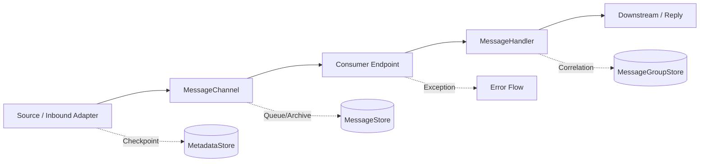
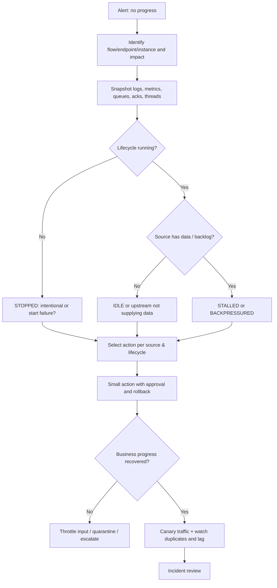
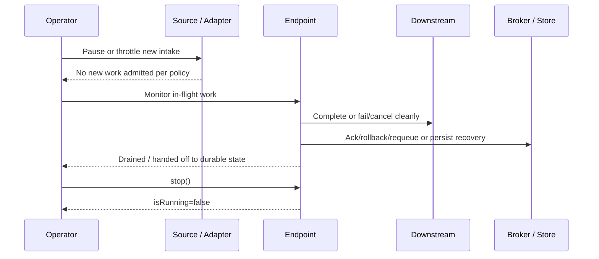

# Runbook for Hung or Stopped Endpoints in Spring Integration

## Learning Objectives

An `IntegrationFlow` may be started successfully by Spring yet stop processing additional messages; conversely, an endpoint may sit in `STOPPED` state while upstream sources keep emitting data. In such situations, an unprepared restart can lose in-flight messages, reset checkpoints, duplicate transactions, or cascade failures downstream. Operators need an **evidence-based runbook with clear decisions and verification criteria**, not a "restart and hope" button.

The **Runbook for Hung or Stopped Endpoints** lesson belongs to the **Control and Management** chapter of the **SPRING_INTEGRATION_RUNTIME** module. We examine execution across channels, endpoints, consumers, pollers, and executors alongside `IntegrationFlow` lifecycles, transactions, retries, message stores, error flows, correlation, and performance to resolve runtime incidents safely.

After this lesson, you will be able to:

- Distinguish **STOPPED**, **IDLE**, **STALLED/HUNG**, **BACKPRESSURED**, **FAILING_FAST**, and **intentionally PAUSED** endpoints.
- Locate the exact endpoint ID and instance; inspect `Lifecycle`/`SmartLifecycle` without mistaking the running flag for business health.
- Collect logs, metrics, thread dumps, queue depth/age, retries, checkpoints, transactions, and correlations in a low-risk order.
- Choose targeted remediation for event-driven consumers, polling consumers, inbound adapters, executors, aggregators, and dynamic flows.
- Perform controlled start/stop via `Lifecycle` or `IntegrationFlowContext`; understand the scope and risks of Control Bus/JMX.
- Protect messages across stops and restarts, avoiding bad acknowledgements or duplicate replays.
- Define exit criteria, stop conditions, rollbacks, and rehearse runbooks using deliberate tests.

> **Rule:** `isRunning() == true` does not prove messages are being processed; `stop()` does not automatically roll back side effects, `start()` does not automatically replay data, and a JVM restart does not guarantee exactly-once processing.

## 1. Identify Symptoms Before Touching the Runtime

Spring Integration endpoints may be event-driven consumers, polling consumers, inbound adapters, gateways, or dynamically registered components. Each kind has distinct lifecycle and threading mechanics.

| Symptom | Observation | Preliminary Diagnosis | What to Rule Out |
| --- | --- | --- | --- |
| **STOPPED** | `isRunning=false` | Endpoint not started / stopped / failed to start | Maintenance, `autoStartup=false`, intentional rollout |
| **IDLE** | Running, input = 0, queue empty | No data to process | Is the source expected to emit on a schedule? |
| **STALLED / HUNG** | Running; in-flight > 0 yet progress halted | Handler blocked on I/O, lock, deadlock, stuck poller | Is a task simply backing off or waiting per policy? |
| **BACKPRESSURED** | Running, backlog and queue age growing | Consumer slower than producer, executor full | Downstream quotas, DB pool, thread starvation |
| **FAILING FAST** | Handler rarely completes, errors spiking | Breaker `OPEN`, validation/rejection failures | Are messages actually reaching the endpoint? |
| **PAUSED** | Source stopped sending per operational decision | Possibly an active protective control | Who paused it? Until when? |
| **PARTIALLY FAILED** | One branch emits output, another does not | Routing, correlation, aggregator, or error path | Is output going to a different channel? |

`isRunning` reflects the lifecycle of an object implementing `Lifecycle`; it does not automatically reflect broker connection health, consumer progress, or business commits.

### 1.1. Isolate Along the Message Path



At every boundary, distinguish **message received**, **message handed off**, **handler started**, **handler completed**, and **business committed**. Rising received counts do not guarantee rising output successes when sources are retrying or queues are backing up.

### 1.2. Three Guiding Questions

1. Are new messages actually arriving from the source? Check source backlog, poll schedules, inbound adapters, and ingress logs.
2. Are messages reaching the endpoint/handler? Check channels, subscribers, executor queues, and handler-started counters.
3. After the handler, is the **business outcome** confirmed? Check transactions, DB business keys, acks, retries, and error archives.

These three answers point to the right fix. If the source is empty, growing thread pools accomplishes nothing; if an HTTP client is hung, restarting a poller usually just shoves more messages into the waiting queue.

## 2. Opening the Incident: Impact, Ownership, and Safety Guardrails

The first priority is preventing the situation from worsening during investigation.

### 2.1. Sample Incident Record

```text
incidentId: INC-2026-042
environment: production
service: SPRING_INTEGRATION_RUNTIME
logicalFlow: orders-processing
flowVersion: order-flow-v2
endpointId: ordersHandlerEndpoint
instance: pod-a
symptom: RUNNING_BUT_NO_PROGRESS
firstDetectedAt: 2026-11-22T02:00:00Z
lastBusinessSuccessAt: ...
inputRate: ...
outputRate: ...
queueDepth: ...
oldestMessageAge: ...
inflight: ...
errorRate: ...
sourceAckPolicy: ...
sampleBusinessKey: tenant-a:ORD-42
sampleCorrelationId: corr-42
owner: ...
approvedChange: ...
```

This template is defined by the application/organization, not auto-generated by Spring Integration. Avoid recording payloads with sensitive data, tokens, passwords, or full headers unnecessarily.

### 2.2. Guardrails Before Taking Action

- Verify the **exact endpoint ID, process/pod, flow version, tenant**, and change/incident owner.
- Capture a pre-intervention snapshot: logs, metric window, queue depth/age, source ack status, retry/DLQ state, and thread dumps when warranted.
- Confirm a **durable source** or appropriate message store/broker exists; an `ExecutorChannel` with a RAM queue is not durable across restarts.
- Identify side effects that may have completed before acknowledgement was recorded; require business idempotency keys.
- Never wipe `MessageStore`, `MetadataStore`, group stores, DLQs, checkpoints, or lock records just to "try resetting".
- Never raise retry counts or concurrency indefinitely while downstream is failing.
- Never expose a Control Bus accepting SpEL from external users; management actions require allowlists, authentication, authorization, and auditing.

### 2.3. Severity Levels

| Illustrative Level | Signals | Action |
| --- | --- | --- |
| SEV-1 | Risk of lost/duplicated money or orders, backlog past limits, multiple flows halted | Incident commander, protect source, coordinate source/sink owners |
| SEV-2 | One critical flow stuck, backlog growing within manageable bounds | On-call executes runbook with deadline/escalation |
| SEV-3 | Endpoint rarely receives traffic, currently idle, or failures covered by contractual fallback | Scheduled investigation; avoid unnecessary intervention |
| Planned | Endpoint stopped for maintenance/change request | Verify schedule; do not start before maintenance ends |

Exact thresholds must come from your system's SLOs/RTO/RPO; this table does not replace organizational criteria.

## 3. Quick Decision Flow at Alert Time



**Do not** repeatedly loop `stop/start/restart` when state fails to improve. Seeing the same symptom a second time with no new facts is a signal to change investigative direction or escalate.

## 4. Collecting Evidence: Logs, Metrics, Graph, and Thread Dumps

### 4.1. Signals to Inspect in the Same Time Window

| Area | Observable Data | Question |
| --- | --- | --- |
| Lifecycle | `isRunning`, `autoStartup`, startup errors | Did the endpoint actually start? |
| Inbound adapter | received/sec, source lag, last poll | Is the source emitting messages? |
| Channel | queue depth, oldest age, send failures | Where are messages piling up? |
| Consumer | handler started/completed/failed | Is the handler making progress? |
| Executor | active threads, pool size, queued/rejected tasks | Are workers saturated? |
| Poller | last scheduled run, poll duration, receive timeout | Is the poll schedule still firing? |
| Transaction | lock waits, rollbacks, commit duration | Is there DB lock or pool exhaustion? |
| Downstream | timeouts, 5xx, p95/p99 request latency | Is an external dependency slow? |
| Retry / breaker | attempts, backoff, `OPEN` rejections | Is there a retry storm or fail-fast? |
| Error flow | `ErrorMessage`, durable archive, DLQ | Are errors saved and routed properly? |
| Correlation | group ID, pending group age | Which branch is missing or keyed wrong? |
| Persistence | checkpoints, message/group store state | Would a restart lose data? |

Metric names are **instrumentation suggestions**, not guaranteed out of the box in every Spring Integration version. High-cardinality message IDs and correlation IDs belong in controlled logs/traces, never as metric labels.

### 4.2. State-Inspection Surfaces When Configured

Applications may expose Spring Boot Actuator, JMX, Micrometer, Spring Integration graphs, or loggers. Exact management endpoints depend on version, dependencies, exposure config, and access controls. Example read-only commands against an internal management listener:

```bash
curl -fsS http://localhost:8080/actuator/health

# Only when integrationgraph is enabled and exposed:
curl -fsS http://localhost:8080/actuator/integrationgraph

# In Kubernetes with granted permissions:
kubectl -n <namespace> get pods -l app=<application>
kubectl -n <namespace> logs deploy/<deployment> --since=15m
```

These commands are runbook examples, **not executed commands**. Never turn on public Actuator/JMX just to investigate. `integrationgraph` alone also does not prove endpoints are healthy; the graph primarily shows structure and supported management metadata.

### 4.3. Thread Dumps When Suspect `HUNG`

When `in-flight > 0` for several minutes with zero completions, or active executor threads stay pinned at max, capture thread dumps once authorized:

```bash
jcmd <pid> Thread.print
```

When necessary, capture spaced snapshots per incident procedure to see whether threads stay frozen on the same stack frames or advance. Inside containers target the exact JVM, and avoid posting dumps containing sensitive data to unauthorized channels.

| Stack / Thread State | Possibility | How to Cross-Check |
| --- | --- | --- |
| `BLOCKED` on monitor | Lock contention / deadlock | Lock owner, lock chains, deadlock detector |
| `WAITING` | May be normal waiting on queue/condition | Is there actually queued work for it? |
| `TIMED_WAITING` | Backoff, poll delay, or timeout | Does wait time match configuration? |
| Waiting for JDBC connection | Pool exhausted or transaction holding connection | Pool active/idle/wait, slow queries |
| Waiting on HTTP socket read | Slow downstream, missing or huge read timeout | Downstream latency, client timeouts |
| High CPU in retry loop | Hot retry or tight logic loop | Exception taxonomy, backoff, rates |
| Poller thread holding lock | Batch/poll stalled | Trigger, receive timeout, source transaction |

A `WAITING` thread is not automatically a bug. Cross-check against data sources, deadlines, throughput, and call stacks across multiple instants.

## 5. `STOPPED` Branch: Finding the Exact Lifecycle Endpoint

### 5.1. Diagnostic Checklist

1. Check whether the endpoint was intentionally stopped for maintenance, a change request, blue-green rollout, or circuit isolation.
2. Check `autoStartup=false`, `SmartLifecycle.phase`, bean dependencies, and startup errors.
3. Trace where stop came from: operator, Control Bus, JMX, application code, or dynamic flow controller.
4. Identify the exact **endpoint bean**, not mistaking the handler or channel.
5. Read source/queue state and redelivery behavior before reopening.
6. If startup failed due to broker credentials, DB connections, or invalid config, fix root cause before retrying.
7. Start endpoints/instances one by one per approval, then verify business progress.

### 5.2. Assigning Clear Endpoint IDs in Java DSL

```java
import org.springframework.context.annotation.Bean;
import org.springframework.integration.dsl.IntegrationFlow;
import org.springframework.messaging.MessageHandler;

@Bean
IntegrationFlow ordersFlow(MessageHandler orderHandler) {
    return IntegrationFlow.from("orders.input")
            .handle(orderHandler,
                    endpoint -> endpoint.id("ordersHandlerEndpoint"))
            .get();
}
```

This example assumes a configured `MessageHandler`. Setting an explicit ID helps operators locate the exact endpoint instead of guessing generated names. In operations, still verify the actual bean ID and type in the application context; a single handler can be referenced by multiple endpoints.

### 5.3. Controlled Management via `Lifecycle`/`SmartLifecycle`

```java
import org.springframework.context.ApplicationContext;
import org.springframework.context.Lifecycle;

final class EndpointRunbookOperator {
    private final ApplicationContext context;

    EndpointRunbookOperator(ApplicationContext context) {
        this.context = context;
    }

    boolean isRunning() {
        Lifecycle endpoint = context.getBean(
                "ordersHandlerEndpoint", Lifecycle.class);
        return endpoint.isRunning();
    }

    void resumeAfterApproval() {
        Lifecycle endpoint = context.getBean(
                "ordersHandlerEndpoint", Lifecycle.class);
        if (!endpoint.isRunning()) {
            endpoint.start();
        }
    }

    void stopAfterApproval() {
        Lifecycle endpoint = context.getBean(
                "ordersHandlerEndpoint", Lifecycle.class);
        if (endpoint.isRunning()) {
            endpoint.stop();
        }
    }
}
```

This is an **internal API illustration**, not a REST controller to expose externally. `start()` only instructs the lifecycle component to start; it does not verify downstream health or business commits. Likewise, `stop()` does not guarantee in-flight I/O is cancelled and rolled back; that depends on the endpoint, adapter, and client.

### 5.4. Dynamic `IntegrationFlow`s Have Their Own Registration IDs

If a flow was registered via `IntegrationFlowContext`, manage the exact registration:

```java
import org.springframework.integration.dsl.context.IntegrationFlowContext;

void resumeDynamicFlow(
        IntegrationFlowContext flowContext,
        String registrationId) {

    var registration = flowContext.getRegistrationById(registrationId);
    if (registration == null) {
        throw new IllegalArgumentException(
                "Unknown flow registration: " + registrationId);
    }

    // Only after authorization and readiness checks pass.
    registration.start();
}
```

If a registration was already `remove()`d, `start()` will not recreate the old definition. Rebuild it from the appropriate manifest/code version. A registration on pod A does not exist on pod B, so inspect observed state on every instance.

## 6. `RUNNING` With Zero Progress Branch

### 6.1. Rate-Based Triage Matrix

| Source Input | Queue Depth | Handler Started | Handler Completed | Assessment |
| --- | --- | --- | --- | --- |
| 0 | 0 | 0 | 0 | `IDLE` or upstream anomaly |
| >0 | Growing | 0 / very low | 0 | Consumer, poller, subscriber, or executor not pulling tasks |
| >0 | Growing | Growing | Flat | Handler/downstream/transaction blocked |
| >0 | Flat | Growing | Errors growing | Fast failure, retries, validation, or breaker `OPEN` |
| Parts arriving | Pending groups growing | Yes | Zero releases | Missing correlation/sequence or unmet release strategy |
| One pod only | Uneven | Uneven | Uneven | Local pool/state/config or deployment skew |

Never compare cumulative output counts since yesterday against input rates from the last 5 minutes; compare within the same time window to avoid misdiagnosis.

### 6.2. Handler Blocked on HTTP or Database

```text
orders.input -> DirectChannel -> ordersHandlerEndpoint
  -> HTTP inventory service
      connection established
      read timeout too long or missing
  -> reply never arrives
```

Symptoms: `isRunning=true`, handler invocations rise or remain in-flight, completions stay flat; thread dump shows socket reads or DB waits. Prioritize inspecting dependencies, timeouts, pools, backpressure, and protecting ingress. Stopping the endpoint will not undo an HTTP request already sent.

### 6.3. `ExecutorChannel` Resource Exhaustion

With `ExecutorChannel`, `send()` can return before the handler runs. If the worker pool is full or its queue hits capacity, rejections and backlogs occur. Check:

- Have active threads reached `maxPoolSize`?
- Is the task queue growing, how old are tasks, and is it RAM-only?
- Are handlers waiting on DB pools, HTTP, or semaphores?
- Does the rejection policy throw to the producer, run caller-runs inline, or drop messages per contract?
- Is the source acking prior to completion?

**Do not** increase pool sizes unboundedly when downstream is already overloaded. Throttling ingress/prefetch, isolating blocking calls, or adding durable handoffs per contract is usually safer.

### 6.4. Poller `RUNNING` Yet Making No Useful Progress

For `PollingConsumer` or `SourcePollingChannelAdapter`, check trigger schedules, scheduler threads, `maxMessagesPerPoll`, receive timeouts, transactions/locks, and last successful poll. A poller may invoke the source steadily yet get 0 messages because `MetadataStore`, persistent file filters, or cursors already marked older data processed.

Never wipe all checkpoints to "force the poller to reread": remaining older records at the source will be reprocessed and create duplicates. To replay, snapshot state, identify business keys, and use an idempotent recovery procedure.

## 7. Errors, Retries, and Breakers Can Make an Endpoint Look Hung

An endpoint continuously receiving messages with zero business successes may be caught in a **retry storm** or failing fast under an `OPEN` circuit breaker.

```text
Inbound message
   -> Handler + RetryAdvice (attempt 1, 2, 3)
   -> CircuitBreakerAdvice (may reject if OPEN)
   -> Error handler / Recovery
   -> Ack, rollback, or DLQ per source
```

### 7.1. Distinguishing Error Paths

- On a synchronous `DirectChannel`, exceptions usually propagate back to the caller. No `ErrorMessage` is created automatically unless an error publisher is wired.
- Across `ExecutorChannel` or poller boundaries, async error handlers can route exceptions to an error channel.
- With broker adapters, ack/nack/redelivery depends on container, source, and transaction settings.
- A recovery callback that catches an error and returns normally may signal upstream that handling succeeded and trigger an ack; persist a durable error record if deferring processing.

### 7.2. Multi-Layer Retries Multiply Attempts

Suppose there are 4 internal retries per delivery and 5 broker redeliveries. One business message can generate up to 20 downstream calls if all attempts fail. Manual operator replays multiply calls further. Track these separately:

```text
retryAttempt     = attempts within one invocation
deliveryCount    = broker delivery count
replayCount      = manual operator replays
businessOutcome  = commit outcome at destination system
```

Never raise `maxAttempts` while an external API is broadly timing out; fix transient vs. permanent exception classification, backoff, and idempotency. An `OPEN` circuit breaker may be protecting the dependency as designed—repeatedly resetting the breaker adds load without fixing root cause.

### 7.3. Correlation and Error Archives

An investigation record should retain `MessageHeaders.ID`, `correlationId`, `businessKey`, endpoint ID, flow version, timestamp, retry/delivery counts, and cause. Framework message IDs can change after transforms/replays; a stable business key confirms whether an order actually committed.

If an aggregator holds an incomplete group, check `MessageGroupStore`, correlation strategy, and release strategy. Do not restart the aggregator solely because output is missing: one branch may have failed and landed in the DLQ.

## 8. How Do Stores Affect Restarts?

| Where State Lives | Example | JVM Restart | Risk If Handled Wrong |
| --- | --- | --- | --- |
| Executing thread | In-flight HTTP/DB call | JVM state lost; external side effects may persist | Duplicate replay before verifying commit |
| In-RAM executor queue | Tasks not yet picked by workers | Potentially lost | Killing pod after source already acked |
| `SimpleMessageStore` | Messages by UUID | Lost (in-memory) | No payload left for recovery |
| Persistent `MessageStore` | Committed messages | Recoverable with compatible backend/serializer | Deleting pending messages prematurely |
| `MessageGroupStore` | Aggregator pending parts | Preserved with proper persistent store | Deleting partial groups without recovery |
| `MetadataStore` | Checkpoints, dedupe markers | Implementation-dependent | Resetting cursors/file filters causes re-reads |
| Durable broker / DLQ | Unacked deliveries | Follows broker contract | Bulk nack/ack/delete triggers storms |
| Business DB | Committed orders | Normally preserved if transaction succeeded | Technical recovery creates duplicate side effects |

Persistence **does not automatically create a replay scheduler**. Messages sitting in a DB do not prove a consumer will automatically reread them; a poller/worker or configured component is needed. Producer-thread transactions normally do not propagate to executor threads; HTTP calls do not roll back alongside JDBC transactions.

### 8.1. When to Consider Restarting the Whole Pod

Only after ruling out smaller interventions or confirming process corruption, and verifying:

1. Sources support durable redelivery, or message loss is contractually acceptable.
2. In-flight side effects are guarded by idempotency/compensation.
3. Checkpoint and message/group store recovery mechanics are understood.
4. Rollback plans, concurrent restart caps, and canary monitoring are ready.
5. Dynamic flows and subscriptions are recreated from desired configuration after restart.

A pod turning `HEALTHY` is **not enough** to close an incident; confirm business progress and backlog drainage.

## 9. Control Bus, JMX, and Management Surfaces

Spring Integration provides endpoint control via `Lifecycle`, Control Bus, or JMX when configured. These surfaces strongly affect runtime state; restrict them to authorized internal channels.

### 9.1. Control Bus Expression Examples

In an app with Control Bus enabled and an endpoint bean with the exact ID, expressions may look like:

```text
@ordersHandlerEndpoint.isRunning()
@ordersHandlerEndpoint.stop()
@ordersHandlerEndpoint.start()
```

These are **illustrative expressions**, not executed commands. Actual behavior depends on bean name, evaluation context, and Control Bus configuration in your version. Never let untrusted users submit arbitrary expressions: SpEL can reach beans/methods outside intended scope.

### 9.2. A Command Requires Before/After Verification

```text
BEFORE:
  endpoint = ordersHandlerEndpoint
  instance = pod-a
  changeApproved = CHG-42
  isRunning = false
  source = durable orders queue
  backlog = 240
  downstreamHealth = PASS

ACTION:
  start allowlisted endpoint on pod-a

AFTER:
  isRunning = true
  subscriber or poller active
  handler.completed increasing
  business commits increasing
  oldestQueueAge decreasing
  errors/duplicates not spiking abnormally
```

If `isRunning=true` yet business commits stay flat despite incoming messages, the start action has not met its goal. Keep investigating; never mark "resolved" merely because the management API returned success.

### 9.3. Multiple Replicas Do Not Share One Automatic Lifecycle

JMX, Control Bus, and `IntegrationFlowContext` normally control only the context/process receiving the command. Starting pod A does not start pod B. For canary or rolling restarts, track each instance and where load balancers route traffic. Avoid stopping/starting all consumers simultaneously if your broker is prone to rebalance and redelivery storms.

## 10. Root-Cause Remediation Playbooks

### 10.1. `STOPPED` After Maintenance

**Preconditions:** evidence of intentional stop, maintenance finished, sources/sinks ready.

1. Confirm healthy dependencies, exact endpoint ID, and version.
2. Check source backlog, ack policy, and schema compatibility.
3. Start **one** endpoint/instance per approval.
4. Send a safe canary or observe real traffic.
5. Measure business commits, error rates, and queue age; then expand rollout per plan.

**Do not:** start all pods while a partner or downstream remains in maintenance.

### 10.2. `RUNNING`, Handler Stuck on Downstream

**Preconditions:** input/in-flight present, completions flat, threads/latency indicate I/O.

1. Throttle or pause new intake; prevent RAM queues from overflowing.
2. Save thread dumps and latency/pool metrics.
3. Coordinate with the downstream owner; inspect client timeouts, connections, and DB locks.
4. Apply deadlines, circuit breakers, backoff/bulkheads per change policy.
5. Let in-flight finish or cancel cleanly; never assume cancellation undoes side effects.
6. Upon recovery, reopen intake gradually and verify business idempotency.

### 10.3. Executor Queue Full

**Preconditions:** active threads at max, queued/rejected counts rising, latency degraded.

1. Compare worker capacity against downstream limits.
2. Reduce ingress/prefetch or switch to an explicit durable queue.
3. Hunt for blocking calls, deadlocks, or semaphore bottlenecks.
4. Tune pool size/capacity **within bounds**, canary, and watch queue age.
5. Escalate if throughput does not scale with resources; avoid unbounded buffers.

### 10.4. Poller Making No Progress

**Preconditions:** source has data yet last poll / processed offset does not advance.

1. Check `isRunning`, triggers, schedulers, `maxMessagesPerPoll`, and receive timeouts.
2. Check source availability, locks/transactions, checkpoints, and persistent filters.
3. If checkpoints are wrong, snapshot first and plan idempotent replay; never bulk-wipe metadata.
4. Resume the poller or fix root cause; confirm the right records/files begin processing.

### 10.5. Aggregator Waiting on Incomplete Groups

**Preconditions:** pending group age rising, zero aggregate output.

1. Extract the **actual** group key from the correlation strategy.
2. Inspect message parts, sequences, duplicates, and group sizes.
3. Search error archives/DLQs or unconsumed channels for the missing branch.
4. Supply missing parts, apply timeouts, partial release, or quarantine per business contract.
5. Never force-release or delete groups before evaluating downstream impact.

### 10.6. Dynamic Flow Removed Prematurely

**Preconditions:** messages still pinned to v1 while v1 registration is gone and v2 cannot accept them validly.

1. Inspect version registries, instances, and active routes.
2. Stop routing v1-pinned messages into the missing flow.
3. Recreate v1 from versioned definitions or execute a safe upcast/migration plan.
4. Ensure v1/v2 consumers start cleanly without creating duplicate subscribers on a `DirectChannel`.
5. Drain old messages, retries/groups, and error archives before retiring.

## 11. Intentional Stop: Quiesce → Drain → Stop

When downstream fails severely or maintenance is needed, stopping an endpoint protects the system. However, verify who owns the source and messages.



**Quiesce** blocks new work at the right boundary; **drain** resolves already-accepted work or hands it off to a durable source with a clear owner; only then call `stop()`. Do not confuse stopping an endpoint with pausing an inbound adapter: a source may keep accepting messages even after a downstream handler stops.

### 11.1. Drain Criteria by Workload Type

| Component | State That Must Finish or Be Handed Off |
| --- | --- |
| `DirectChannel` handler | Active invocation and transaction outcome |
| `ExecutorChannel` | Active tasks, executor queue, and rejections |
| `QueueChannel` / broker | Queue depth, lag, in-flight deliveries |
| Poller | Active batch, last poll, and cursor/ack |
| Gateway | Requests awaiting replies, timeouts |
| Aggregator | Pending groups, timeouts, release/late arrivals |
| Retry | Delayed attempts, retry queues, DLQ/error archives |
| Reactive bridge | Subscriptions and in-flight `Mono`/futures |
| Dynamic flow | Versioned registration, older pinned messages |

`inflight=0` does not prove a flow is drained if 10,000 messages remain in a queue. You may intentionally stop while messages stay **in a durable queue owned by another consumer**, provided that handoff condition is explicitly documented.

### 11.2. Handling Drain Deadline Exceeded

If a transaction remains stuck past the expected window:

- Determine whether it is actively executing, awaiting backoff, or already caused side effects without acking.
- Choose extending the wait, controlled cancellation, durable requeue, or quarantine per business policy.
- Never assume thread interruption/process kill rolls back remote HTTP/DB work.
- Save correlation/business keys and inspection results before replaying.
- Escalate when safe verification is impossible.

## 12. Exit Criteria: What Counts as True Recovery?

A start or restart is complete only when the system processes steadily within SLO—not merely when the management API returns.

- [ ] Target endpoint ID/version/instance reached expected state with no restart loop.
- [ ] Source/consumer/poller operates per contract, verified via canary messages or live traffic.
- [ ] `handler.started`, `handler.completed`, and **business commits** are advancing.
- [ ] Timeouts, retries, breaker rejections, and error rates are normal.
- [ ] Queue depth and **oldest message age** are shrinking or within acceptable thresholds.
- [ ] Thread pools, DB connections, and transaction durations are healthy.
- [ ] Acks/cursors/metadata stay consistent with business state.
- [ ] Failed messages have durable retry/error records or were handled per policy.
- [ ] Zero duplicate business effects from redelivery/replay.
- [ ] Aggregator groups show no new stalls from correlation mismatches.
- [ ] Audit logs record operator action, approval, before/after metrics, and recovery timestamp.

For low-traffic flows, "no input yet" may prevent immediate end-to-end verification. Report **READY pending sufficient traffic to verify throughput**, or run a synthetic canary with zero real side effects.

## 13. Rollback, Stop Conditions, and Escalation

When remediation widens an incident, halt immediately. Signals requiring rollback/escalation:

- Increasing duplicate orders, payments, or inventory reservations after replay.
- Backlogs nearing RAM/disk limits or message age exceeding safety thresholds.
- Multiple pods in restart loops, broker rebalance storms, or connection pool exhaustion.
- Downstream keeps timing out despite concurrency increases.
- Error archives/DLQs failing to persist while sources keep acking.
- Message store deserialization errors, or correlation/group keys altered by a new deploy.
- Active routes/versions diverging across pods with owners unable to verify state.
- Uncertainty over whether an in-flight operation committed.

In these cases, throttle or pause new intake, preserve durable state, log every action, roll back to a compatible safe configuration if possible, and notify authorized owners. **Never** purge queues, wipe cursors, or replay all messages blindly.

## 14. Runbook Testing and Rehearsal Matrix

A runbook is trustworthy only when rehearsed in an environment with simulated sources, message idempotency, and sufficient observability.

| Scenario | Fault Injected | Expected Evidence | Action |
| --- | --- | --- | --- |
| Intentional stop | `Lifecycle.stop()` | `isRunning=false`, source behavior logged | Start after approval, verify progress |
| Empty input | Source emits nothing | Last poll advances, queue empty | Confirm `IDLE`, do not restart |
| HTTP blocking | Mock client hangs indefinitely | In-flight rises, threads in socket wait | Timeouts/bulkheads and protect ingress |
| Executor full | Small pool, fast producer | Queue age/rejections rise | Throttle input, bounded capacity tuning |
| Poller starved | Scheduler monopolized by another task | Last poll frozen, thread dump shows blocker | Restore scheduler / fix root cause |
| Bad checkpoint | Metadata marked too early | Records remain at source yet filter skips | Replay with snapshot/idempotency |
| Breaker `OPEN` | Downstream always fails | Fast rejections, downstream calls drop | Monitor recovery/backoff, no blind resets |
| Retry storm | Unbounded multi-layer retries | Attempts spike, output success low | Fix retry classification/backoff |
| Aggregator missing part | Send 2 of 3 messages | Pending group does not release | Locate missing branch/correlation |
| Broken error archive | Recovery write rejected | Error save fails, ack risk | Restore durable error path before resume |
| Crash after business commit | Kill before ack | Source redelivers, business record already exists | Rely on idempotency, zero duplicate writes |
| Dynamic flow removed | Remove v1 before drain | v1 messages find no flow | Restore version or migrate |
| Multi-pod skew | Stop only pod A | A stopped, B running | Per-instance audit/rollout |

### 14.1. Example `Lifecycle` Test in a Spring Test Context

```java
import org.junit.jupiter.api.Test;
import org.springframework.beans.factory.annotation.Autowired;
import org.springframework.context.ApplicationContext;
import org.springframework.context.Lifecycle;

import static org.junit.jupiter.api.Assertions.*;

class EndpointLifecycleTest {

    @Autowired
    ApplicationContext applicationContext;

    @Test
    void stopThenStartKnownEndpoint() {
        Lifecycle endpoint = applicationContext.getBean(
                "ordersHandlerEndpoint", Lifecycle.class);

        boolean initiallyRunning = endpoint.isRunning();

        try {
            endpoint.stop();
            assertFalse(endpoint.isRunning());

            endpoint.start();
            assertTrue(endpoint.isRunning());
        }
        finally {
            if (initiallyRunning && !endpoint.isRunning()) {
                endpoint.start();
            }
            if (!initiallyRunning && endpoint.isRunning()) {
                endpoint.stop();
            }
        }
    }
}
```

This assumes the test runs in a Spring Test context containing the endpoint with that exact ID; add context annotations like `@SpringBootTest` or `@SpringJUnitConfig` and JUnit dependencies. It only verifies lifecycle, **not** end-to-end business success. Never run this stop/start test against production.

### 14.2. Avoiding False Alerts During Zero-Traffic Periods

If a flow only runs end-of-day, zero output all morning may be normal. Reference alert logic:

```text
ExpectedWork =
  (newInput > 0)
  OR (queueDepth > 0)
  OR (inflight > 0)
  OR (pendingGroups > 0)

PotentialStall =
  ExpectedWork
  AND (noBusinessProgressBeyondSLO)
```

Thresholds must account for poll intervals, backoffs, batch latencies, and maintenance windows. When `ExpectedWork=false`, corroborate with signals confirming the source was expected to produce data before declaring an incident.

## 15. Hands-On Exercises

### Exercise A — `STOPPED` vs. `RUNNING`

Create an `IntegrationFlow` with endpoint ID `ordersHandlerEndpoint`, a `DirectChannel`, and a mock handler. Check `isRunning()`, call `stop()` in a Spring test context, observe send behavior, and then call `start()`.

**Expected outcome:** understand lifecycle state, channel behavior, and real business conditions; never assume messages are buffered when zero subscribers exist.

### Exercise B — `RUNNING` With a Blocked Handler

Test a non-responding mock HTTP client separately with `DirectChannel` and `ExecutorChannel`. Record send latency, thread names, in-flight count, queue depth, and handler completions.

**Expected outcome:** observe where blocking occurs and apply timeouts/backpressure instead of raising retries or restarting blindly.

### Exercise C — Distinguishing an Idle Poller from a Stalled Poller

Set up one truly empty source and one source with data whose scheduler worker is starved. Observe last poll, poll duration, source backlog, and output.

**Expected outcome:** build alerting rules that do not page falsely when a flow is legitimately idle.

### Exercise D — Retries, DLQ, and Acks

Have a handler throw both transient and validation errors. Configure bounded retries, a mock error archive, and broker redelivery. Log attempt, delivery, business key, and commit state.

**Expected outcome:** distinguish per-invocation retries from redeliveries, and prove error-archive failures can cause bad acks if recovery swallows exceptions.

### Exercise E — Aggregator and Mismatched Correlation

Have a splitter emit three parts while one branch alters the correlation type/key; inspect group size, actual group ID, and release strategy.

**Expected outcome:** fix the missing branch properly instead of restarting the aggregator or forcing release.

### Exercise F — Restart After Business Commit

Create a mock DB with a unique key on order ID; kill the worker after the side effect but before ack. Let the source redeliver and verify only one business record is created.

**Expected outcome:** redelivery still occurs, yet idempotency prevents duplicate side effects.

### Exercise G — Dynamic Flow v1/v2

Create v1/v2 via `IntegrationFlowContext` and switch active routing to v2 while v1 still has pending tasks. Test removing prematurely, then add a drain protocol checking queues, in-flight work, and error archives.

**Expected outcome:** `remove()` does not migrate work automatically; version pinning and durable recovery must be engineered.

### Exercise H — End-to-End Incident Drill

Simulate 500 input msg/s, 0 output, executor active=max, rising queue age, and downstream timeouts. On-call captures snapshots, throttles input, diagnoses the dependency, reopens a canary, and measures duplicates/errors.

**Expected outcome:** close the incident only after business progress climbs, backlogs return within bounds, and every failed message has a clear recovery owner.

## 16. Self-Check Questions

1. Why is `isRunning() == true` insufficient to conclude an endpoint is healthy?
2. Which signals distinguish `STOPPED`, `IDLE`, `STALLED`, `BACKPRESSURED`, and `FAILING_FAST`?
3. How do `DirectChannel.send()` and `ExecutorChannel.send()` differ when a handler blocks?
4. Before calling `start()` on a `STOPPED` endpoint, what must be verified?
5. Does `Lifecycle.stop()` automatically roll back transactions or cancel all in-flight HTTP requests?
6. When should you capture a thread dump, and why is `WAITING` not always an error?
7. If a poller produces zero output, how do you distinguish an empty source from a stalled scheduler?
8. Does an `OPEN` circuit breaker equal a `STOPPED` endpoint lifecycle?
9. Why might `DirectChannel` failures never appear in the error channel?
10. How can a recovery callback that catches exceptions and returns normally cause a bad ack?
11. What risks do `SimpleMessageStore` and in-RAM executor queues carry across pod restarts?
12. Why is deleting metadata checkpoints to force a poller to reread dangerous?
13. Does an aggregator with an incomplete pending group recover on its own after a restart?
14. Why is `inflight=0` insufficient to declare a flow drained?
15. Once a dynamic registration has been removed, what is needed to recreate the exact version?
16. Why does the Control Bus require authentication, authorization, and an allowlist?
17. Starting an endpoint succeeds yet business commits remain 0: is the incident over?
18. After a restart, what key prevents duplicate side effects?
19. Which metrics show an endpoint is legitimately idle rather than stalled?
20. How should a runbook define stop conditions and escalation so an incident does not widen?

**Remember:** A runbook for hung or stopped endpoints must start from **observing the message path and business state**, not clicking restart. Distinguish endpoint type, threading, transactions, retry/error paths, persistence, and correlation; invoke `Lifecycle`, Control Bus, or `IntegrationFlowContext` only once ownership, sources, and consequences are clear. After remediation, verify using **business commits, queue lag, error rates, and idempotency**, not merely the `RUNNING` flag.
