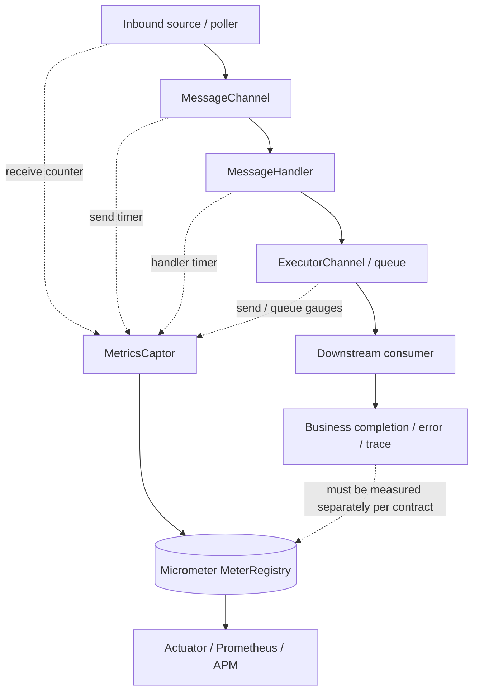
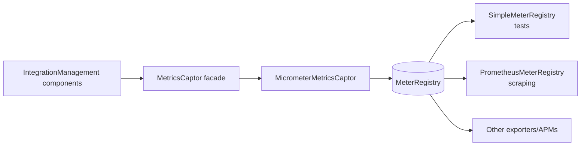
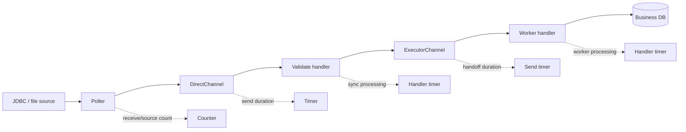

# MetricsCaptor and metric collection in Spring Integration Runtime

## 1. The problem: the flow is still running, so where is performance degrading?

A system receives order messages through an inbound adapter, sends them into a `DirectChannel`, calls an inventory-check handler, and then hands them off to an `ExecutorChannel` for further processing. When latency rises, simply knowing "the application is alive" is not enough. You need to know **how many messages are sent and received**, **which handler is slow**, **which queue is backing up**, **where errors occur**, and whether a successful `send()` call truly means the business operation completed.

In **SPRING_INTEGRATION_RUNTIME**, observability connects directly to how Spring Integration orchestrates `IntegrationFlow`, channels, endpoints, consumers, pollers, executors, retries, transactions, message stores, and correlation. One key group of APIs is `MetricsCaptor` and its implementation `MicrometerMetricsCaptor`: they provide a facade to create and collect **counters**, **timers**, and **gauges** from integration components.

**Objectives after this lesson:**

1. Understand how `MetricsCaptor`, `MicrometerMetricsCaptor`, `MeterRegistry`, and `IntegrationManagement` work together.
2. Distinguish counters, timers, gauges, samples, and timer measurements from business SLIs.
3. Know the meters Spring Integration publishes for channels, handlers, message sources, and `QueueChannel`.
4. Configure and test Micrometer metrics with Java and `SimpleMeterRegistry`.
5. Distinguish the `MetricsCaptor` branch from **Micrometer Observation** (Spring Integration 6.x) to avoid misreading metric names.
6. Diagnose threading, retries, error handling, transactions, queue backlogs, cardinality, meter lifecycle, and dynamic flows.

The examples focus on the Spring Integration 6.4.x API. APIs, metric names, and instrumentation mechanisms can change across versions, so choose a documentation version matching your actual dependencies.

## 2. Observability map of a message flow



**Three distinct operational questions:**

| Question | Appropriate signal | What cannot be concluded yet |
| --- | --- | --- |
| How many times did channel `send()` execute? | Timer `spring.integration.send` with tag `type=channel` | Does not mean downstream async work has finished. |
| How many messages did the source emit? | Counter `spring.integration.receive` with tag `type=source` | Does not mean broker ack/DB commit succeeded. |
| Is the queue backing up? | `QueueChannel` size gauge and remaining capacity | Does not tell enough about message age, poison messages, or consumer lag on another broker. |
| Is the handler slow or failing? | Handler timer `spring.integration.send` with `type=handler` and result/exception | Does not automatically measure asynchronous continuations after the method returns. |
| Did the customer receive the result on time? | Business SLI from ingress to **completion/ack/reply** | Cannot be replaced by channel send duration alone. |

Metrics, logs, and traces complement each other but serve distinct purposes. Metrics provide trends and alerts; traces show the path of a single request; logs explain specific events. Do not put `traceId` or `messageId` as tags on every meter just because the system needs correlation.

## 3. What is `MetricsCaptor`?

The `org.springframework.integration.support.management.metrics.MetricsCaptor` interface is a **metrics measurement facade** introduced by Spring Integration in 5.0.4. It does not itself decide whether results are exported to Prometheus or an APM system; that belongs to the implementation/backend.

Key methods on the 6.4.x API:

| Method | Returns | Used to |
| --- | --- | --- |
| `counterBuilder(String name)` | `MetricsCaptor.CounterBuilder` | Create a meter that counts events. |
| `timerBuilder(String name)` | `MetricsCaptor.TimerBuilder` | Create a meter that measures duration and count. |
| `gaugeBuilder(String name, Object obj, ToDoubleFunction<Object> f)` | `MetricsCaptor.GaugeBuilder` | Sample a current value from a source object. |
| `start()` | `SampleFacade` | Start timing an operation. |
| `removeMeter(MeterFacade facade)` | `MeterFacade` or `null` | Remove a created meter if supported by the implementation. |

```java
// Conceptual API contract, interface names belong to Spring Integration:
MetricsCaptor captor;

CounterFacade counter = captor.counterBuilder("demo.events")
        .tag("kind", "accepted")
        .description("Number of accepted events")
        .build();

TimerFacade timer = captor.timerBuilder("demo.step.duration")
        .tag("step", "transform")
        .description("Time spent transforming one message")
        .build();

SampleFacade sample = captor.start();
try {
    // Work being measured.
} finally {
    sample.stop(timer);
}
counter.increment();
```

This is an illustrative API example, assuming imports, variables, and integration setup are already in place. Section 7 provides a more complete Java class.

### 3.1. Related facades

| Interface | Meaning |
| --- | --- |
| `CounterFacade` | Has `increment()` to increment the counter by unit. |
| `TimerFacade` | Has `record(long duration, TimeUnit unit)` to record a duration. |
| `GaugeFacade` | Represents a gauge reflecting the value of an observed object. |
| `SampleFacade` | Has `stop(TimerFacade)`; forwards the timing sample to the right timer. |
| `MeterFacade` | Base interface, providing the `remove()` operation. |

Builders for counters/timers provide `tag(key, value)`, `description(text)`, and `build()`. Gauge builders also provide tag/description/build. Do not record duration data directly with `counter.increment()` and treat it as a latency histogram.

## 4. `MicrometerMetricsCaptor` connects to `MeterRegistry`

The `org.springframework.integration.support.management.micrometer.MicrometerMetricsCaptor` implementation translates facade calls into Micrometer meters. Its constructor takes an `io.micrometer.core.instrument.MeterRegistry`:

```java
import io.micrometer.core.instrument.MeterRegistry;
import org.springframework.integration.support.management.metrics.MetricsCaptor;
import org.springframework.integration.support.management.micrometer.MicrometerMetricsCaptor;

public class CaptorFactory {
    public static MetricsCaptor create(MeterRegistry registry) {
        return new MicrometerMetricsCaptor(registry);
    }
}
```

`MeterRegistry` manages meter identities, tags, measurements, and data export via a registry backend. A Spring Boot application can use auto-configuration for the Micrometer registry and expose metrics via Actuator; in unit tests, `SimpleMeterRegistry` keeps metrics in memory so you can assert against them.



**This connection does not require calling `MetricsCaptor` manually in every handler.** With Spring Integration and Micrometer properly configured, components supporting `IntegrationManagement` automatically create meters for their operations. Manual measurement via the facade is only needed for a **custom business step** or a standalone component requiring additional meters.

### 4.1. What role does `IntegrationManagement` play?

The `IntegrationManagement` interface allows the framework to inject `MetricsCaptor` or `ObservationRegistry` into supported components. Classes such as `AbstractMessageChannel`, `AbstractMessageHandler`, and `AbstractMessageSource` implement the corresponding measurement mechanisms.

`IntegrationManagement.registerMetricsCaptor(captor)` is part of the contract. Not every bean implementing `MessageHandler` automatically gets a timer: **the framework explicitly states that the primary scope applies to components extending the Abstract... classes**. A custom POJO or lambda handler may need to be wrapped by a standard handler or instrumented separately.

**Configuration differences:** adding a `MeterRegistry` to the Spring context activates the corresponding Micrometer support in applications where Spring Integration management is configured. In Java configuration, declare `@EnableIntegrationManagement` explicitly when actively managing instrumentation; in Spring Boot, inspect the actual auto-configuration rather than creating duplicate registries or management infrastructure.

## 5. Three basic meter types and how to read them

### 5.1. Counter: how many times an event occurred

A counter only increases. Within a JVM, when the application restarts, the counter typically resets. Dashboards should compute **rate/increase over a time window** rather than looking at cumulative counts spanning multiple deployments.

Examples: the number of messages a `MessageSource` successfully received in the last minute, or retry failures after exhausting attempts. For queue backlogs, a counter cannot replace a gauge because a counter cannot decrease when messages are consumed.

### 5.2. Timer: duration together with count

A Micrometer `Timer` records `count` and `totalTime`; depending on configuration/backend, it may also provide `max`, histograms, or percentiles. A channel send timer measures **the duration of the `send()` call**, which is not always equal to end-to-end processing latency.

Example:

```text
DirectChannel.send() -> subscriber runs synchronously for 30 ms
  the channel send timer can reflect that duration.

ExecutorChannel.send() -> handing off to the executor takes only 1 ms
  the channel send timer ≈ handoff time,
  the 400 ms worker processing is measured at a different consumer boundary.
```

A `Timer` is not a `LongTaskTimer`. For very long in-flight tasks, to know **how many tasks are currently running** and their elapsed running time, you need a long-task timer or a dedicated gauge.

### 5.3. Gauge: state at sampling time

A gauge describes a state that can go up or down: queue size, remaining capacity, number of in-flight messages, component counts. A gauge typically reflects the value at the moment the registry is read, not a history of changes. A very brief spike may not appear if the scrape interval is long.

For objects observed by a gauge, you must manage lifecycle/references: some Micrometer gauges hold a weak reference to the object; if the object is not kept alive long enough, the gauge may report invalid values or stop updating.

### 5.4. Tags are part of a meter's identity

Example meter:

```text
name      = spring.integration.send
type      = channel
name tag  = ordersIn
result    = success
exception = none
```

In Micrometer, the same **metric name** with different tag sets represents distinct time series. Do not assess error statistics by looking solely at a `result=success` series and assuming there are no errors. The `result` and `exception` labels must be understood relative to the **instrumentation point**; downstream async errors typically do not appear on an already-succeeded channel send.

## 6. Meters automatically provided by Spring Integration (`MetricsCaptor` branch)

When Micrometer metrics are properly enabled, Spring Integration creates meters as supported components begin to be used. The following names and tags are documented in the Spring Integration Reference:

| Component / measurement | Meter name | Type | Common tags |
| --- | --- | --- | --- |
| `MessageChannel.send(...)` | `spring.integration.send` | Timer | `type=channel`, `name=<componentName>`, `result=success/failure`, `exception=none/<class>` |
| `MessageHandler` (framework handler) | `spring.integration.send` | Timer | `type=handler`, `name=<componentName>`, `result=success/failure`, `exception=none/<class>` |
| `PollableChannel.receive(...)` | `spring.integration.receive` | Counter | `type=channel`, `name=<componentName>`, `result`, `exception` |
| `MessageSource` | `spring.integration.receive` | Counter | `type=source`, `name=<componentName>`, usually `result=success`, `exception=none` |
| Total channels | `spring.integration.channels` | Gauge | Number of `MessageChannel`s in the application. |
| Total handlers | `spring.integration.handlers` | Gauge | Number of `MessageHandler`s in the application. |
| Total sources | `spring.integration.sources` | Gauge | Number of `MessageSource`s in the application. |
| `QueueChannel` current items | `spring.integration.channel.queue.size` | Gauge | `type=channel`, `name=<componentName>` |
| `QueueChannel` remaining capacity | `spring.integration.channel.queue.remaining.capacity` | Gauge | `type=channel`, `name=<componentName>` |

**Do not confuse metric name with label name:** in the table, `spring.integration.send` is the metric name, whereas `name=ordersIn` is a **tag** identifying the component. The same metric name can contain both channel series and handler series; always filter by `type`.

### 6.1. `result=failure` can have `exception=none`

With `MessageChannel.send()`, the call can **return `false` without throwing an exception**. The framework can still mark a failure with `exception=none`. When writing alerts, do not count only exception tags other than `none`, as doing so can miss rejected sends.

Conversely, `result=success` on `ExecutorChannel.send()` may only mean **the task was handed off**, not that the downstream business transaction committed.

### 6.2. Receive counter is not a broker ack

`spring.integration.receive` for `PollableChannel`/`MessageSource` measures receives from the respective component. It does not by itself know whether a JMS message was acknowledged, a Kafka offset was committed, or an event was written to a business table. With a poller transaction, receiving successfully and committing successfully are two separate milestones.

If a message is rolled back and then redelivered, the receive count can increase multiple times for the same business event. This is not necessarily a metric bug; it reflects receive attempts, not the number of **unique completed events**.

### 6.3. Queue gauges reflect backlog *at that channel*

An in-memory `QueueChannel` can expose `size` and `remaining.capacity`. When two queues are chained together, do not sum queue sizes to deduce the exact number of unique pending events; an event may exist across multiple stages or be redelivered.

With `DirectChannel`, there is no equivalent internal queue size. With a broker or `JdbcChannelMessageStore`, use additional metrics suited to the backend and channel type; do not assume every channel has a remaining-capacity gauge.

## 7. Runnable example: instrumenting `DirectChannel` and a handler

The example below uses a `SimpleMeterRegistry` for testing, creating a channel and handler managed by Spring Integration. It does not require a Prometheus server.

**`IntegrationMetricsConfiguration.java`**

```java
package demo.metrics;

import io.micrometer.core.instrument.simple.SimpleMeterRegistry;
import org.springframework.context.annotation.Bean;
import org.springframework.context.annotation.Configuration;
import org.springframework.integration.annotation.ServiceActivator;
import org.springframework.integration.channel.DirectChannel;
import org.springframework.integration.config.EnableIntegration;
import org.springframework.integration.config.EnableIntegrationManagement;
import org.springframework.integration.handler.AbstractMessageHandler;
import org.springframework.messaging.Message;
import org.springframework.messaging.MessageChannel;
import org.springframework.messaging.MessageHandler;

@Configuration
@EnableIntegration
@EnableIntegrationManagement
public class IntegrationMetricsConfiguration {

    @Bean
    public SimpleMeterRegistry meterRegistry() {
        return new SimpleMeterRegistry();
    }

    @Bean("ordersIn")
    public MessageChannel ordersIn() {
        return new DirectChannel();
    }

    @Bean
    @ServiceActivator(inputChannel = "ordersIn")
    public MessageHandler orderHandler() {
        // AbstractMessageHandler supports IntegrationManagement.
        return new AbstractMessageHandler() {
            @Override
            protected void handleMessageInternal(Message<?> message) {
                String orderId = (String) message.getPayload();
                if (orderId.isBlank()) {
                    throw new IllegalArgumentException("Missing order ID");
                }
                System.out.println("Processing order " + orderId);
            }
        };
    }
}
```

**`RunMetricsDemo.java`**

```java
package demo.metrics;

import io.micrometer.core.instrument.Timer;
import io.micrometer.core.instrument.simple.SimpleMeterRegistry;
import org.springframework.context.annotation.AnnotationConfigApplicationContext;
import org.springframework.messaging.MessageChannel;
import org.springframework.messaging.support.MessageBuilder;

public class RunMetricsDemo {
    public static void main(String[] args) {
        try (var context = new AnnotationConfigApplicationContext(
                IntegrationMetricsConfiguration.class)) {

            MessageChannel input = context.getBean(
                    "ordersIn", MessageChannel.class);
            SimpleMeterRegistry meters = context.getBean(SimpleMeterRegistry.class);

            input.send(MessageBuilder.withPayload("SO-42").build());

            Timer sendSuccess = meters.find("spring.integration.send")
                    .tags("type", "channel",
                          "name", "ordersIn",
                          "result", "success")
                    .timer();

            if (sendSuccess == null) {
                throw new IllegalStateException("No channel send timer");
            }
            System.out.println("send count=" + sendSuccess.count());
            System.out.println("totalTimeMs=" +
                    sendSuccess.totalTime(java.util.concurrent.TimeUnit.MILLISECONDS));
        }
    }
}
```

**Explanation:**

1. `@EnableIntegration` creates the Spring Integration infrastructure; `@EnableIntegrationManagement` enables management configuration for supported components.
2. `SimpleMeterRegistry` is a real `MeterRegistry`, allowing instrumented components to record meters in memory.
3. `DirectChannel` has bean name `ordersIn`; Spring can record metrics for its send operation.
4. `AbstractMessageHandler` also supports instrumentation; `orderHandler` executes synchronously, so exceptions can propagate back to `send(...)`.
5. Channel and handler meters share **the same name** `spring.integration.send` but differ by `type`.
6. Meters are typically created when a component is first used; querying too early, before `send()`, may return `null`.

If this test does not find the timer, check first: whether a `MeterRegistry` is actually in the context, whether management is enabled, whether the component supports `IntegrationManagement`, whether an `ObservationRegistry` was injected instead of the captor branch, and whether a `MeterFilter` is excluding the meter.

### 7.1. Checking `failure`

In the demo, sending payload `""` causes the handler to throw `IllegalArgumentException`. With `DirectChannel`, the caller can receive the exception synchronously:

```java
try {
    input.send(MessageBuilder.withPayload("").build());
} catch (Exception ex) {
    System.out.println("Failed as expected: " + ex.getClass().getSimpleName());
}

Timer failures = meters.find("spring.integration.send")
        .tags("type", "channel",
              "name", "ordersIn",
              "result", "failure")
        .timer();

System.out.println("failure timer present=" + (failures != null));
```

This snippet is placed inside a method after the `input` and `meters` variables from the previous example exist; the specific wrapper exception/exception tags depend on the call path and handler. In practice, a separate `type=handler` failure meter may also appear; do not sum both together and call that the **deduplicated** count of failed business requests.

## 8. Using `MetricsCaptor` directly for application work

You should not duplicate a meter that already exists for the whole `MessageHandler`. However, there are **sub-steps** not measured separately by the framework, such as signature verification duration or cache miss lookup counts. In these cases, you can use the facade directly.

**`BusinessStepMetrics.java`**

```java
package demo.metrics;

import io.micrometer.core.instrument.MeterRegistry;
import org.springframework.integration.support.management.metrics.CounterFacade;
import org.springframework.integration.support.management.metrics.MetricsCaptor;
import org.springframework.integration.support.management.metrics.SampleFacade;
import org.springframework.integration.support.management.metrics.TimerFacade;
import org.springframework.integration.support.management.micrometer.MicrometerMetricsCaptor;

public final class BusinessStepMetrics {

    private final MetricsCaptor captor;
    private final TimerFacade validationTimer;
    private final CounterFacade validationFailures;

    public BusinessStepMetrics(MeterRegistry meterRegistry) {
        this.captor = new MicrometerMetricsCaptor(meterRegistry);
        this.validationTimer = captor
                .timerBuilder("app.orders.validation.duration")
                .description("Time to validate an order")
                .tag("step", "validation")
                .build();
        this.validationFailures = captor
                .counterBuilder("app.orders.validation.failures")
                .description("Validation failures")
                .tag("reason", "invalid_input")
                .build();
    }

    public void validate(String orderId) {
        SampleFacade sample = captor.start();
        try {
            if (orderId == null || orderId.isBlank()) {
                validationFailures.increment();
                throw new IllegalArgumentException("Missing order ID");
            }
        } finally {
            sample.stop(validationTimer);
        }
    }
}
```

This is a standalone class that can be instantiated via `new BusinessStepMetrics(registry)` or declared as a Spring bean. `timerBuilder(...).build()` and `counterBuilder(...).build()` should be created **once and reused**, not rebuilt on every message with a tag varying by `orderId`.

`finally` ensures validation duration is recorded even when an exception is thrown. Depending on the SLI, you can separate success/failure timers using a **bounded-cardinality tag** rather than aggregating them into a single series. For async operations, do not measure with `start()/stop()` around **a method that merely constructs a `Mono`**; measure until the actual completion signal.

### 8.1. Why not use `MeterRegistry` directly for everything?

Micrometer has direct APIs such as `Counter.builder(...)` and `Timer.builder(...)`, which are well-suited for application metrics. `MetricsCaptor` exists so Spring Integration has **a facade decoupled from direct vendor instrument APIs**, and to allow customizing how the framework creates meters.

In business code, choosing to use Micrometer directly is also reasonable; the important thing is **not to create two meters with the same meaning under different names and accidentally sum them**, and not to lose flow labels/ownership.

### 8.2. Example gauge for the number of in-flight tasks

```java
import java.util.concurrent.atomic.AtomicInteger;
import org.springframework.integration.support.management.metrics.GaugeFacade;

AtomicInteger inFlight = new AtomicInteger();
GaugeFacade gauge = captor
        .gaugeBuilder(
                "app.orders.inflight",
                inFlight,
                value -> ((AtomicInteger) value).get())
        .description("Currently running order operations")
        .tag("stage", "validation")
        .build();

inFlight.incrementAndGet();
try {
    // Process the request during the window the gauge should track.
} finally {
    inFlight.decrementAndGet();
}
```

The snippet above is a fragment using `captor` from an existing class. `AtomicInteger` must live long enough; the gauge holds/reads the object according to the meter backend's semantics and does not store every historical value. With async callbacks, decrementing must run upon **completion/cancellation/error**, not simply as soon as the method returns a publisher.

## 9. Two measurement paths in Spring Integration 6.x: MetricsCaptor and Observation

Since Spring Integration **6.0**, the framework also supports **Micrometer Observation**, an abstraction that can produce **both metrics and traces** through registered `ObservationHandler`s. This is **not** another name for `MetricsCaptor`.

### 9.1. Comparison table

| Comparison point | `MetricsCaptor` / Micrometer metrics | `ObservationRegistry` / Micrometer Observation |
| --- | --- | --- |
| Abstraction | `MetricsCaptor` → counter/timer/gauge facade | `Observation` lifecycle → handlers create metrics/spans |
| Activation | Configure Micrometer `MeterRegistry` and integration management | Provide `ObservationRegistry`, enable management + select components via `observationPatterns` |
| Typical metric names | `spring.integration.send`, `spring.integration.receive` | `spring.integration.handler`, `spring.integration.producer`, `spring.integration.gateway` |
| Tags | `type`, `name`, `result`, `exception` | Low-cardinality key values such as `spring.integration.name`, `spring.integration.type`, convention outcome |
| Tracing | Does not automatically generate spans just from having a Captor | Can generate spans if a matching tracing handler is registered |
| Cost | Meters, tags, serialization/export | Metrics/spans and context propagation; must monitor sampling/cardinality |

When an `IntegrationManagement` component is injected with an **`ObservationRegistry`**, its `registerMetricsCaptor(...)` API is **ignored**. Meters in this mode are created by the appropriate `ObservationHandler`, **no longer collected simultaneously and independently** via `MetricsCaptor`. This matters during upgrades: a dashboard querying only `spring.integration.send` may see no data from a component that has been switched to observation.

**Default note:** the presence of an `ObservationRegistry` does not mean all components are instrumented with Observation. Spring Integration uses `@EnableIntegrationManagement(observationPatterns = "...")`; by default the pattern is empty, so no component is unconditionally selected. You can set `"*"` to select all integration-management components, or select via patterns to limit scope.

### 9.2. Example Observation configuration for a small application

This is an **alternative** to the MetricsCaptor demo in Section 7, not a configuration meant to run alongside it in the same example:

```java
import io.micrometer.core.instrument.MeterRegistry;
import io.micrometer.core.instrument.observation.DefaultMeterObservationHandler;
import io.micrometer.observation.ObservationRegistry;
import org.springframework.context.annotation.Bean;
import org.springframework.context.annotation.Configuration;
import org.springframework.integration.config.EnableIntegration;
import org.springframework.integration.config.EnableIntegrationManagement;

@Configuration
@EnableIntegration
@EnableIntegrationManagement(observationPatterns = "*")
public class ObservationConfiguration {

    @Bean
    public ObservationRegistry observationRegistry(MeterRegistry meterRegistry) {
        ObservationRegistry observations = ObservationRegistry.create();
        observations.observationConfig().observationHandler(
                new DefaultMeterObservationHandler(meterRegistry));
        return observations;
    }
}
```

The example assumes a `MeterRegistry` is already provided (from Spring Boot, a Prometheus registry, or `SimpleMeterRegistry`). `DefaultMeterObservationHandler` is the adapter that produces Micrometer meters from Observations; for distributed traces, you also need an appropriate tracing handler/propagator and exporter.

Do not enable `observationPatterns = "*"` on a system with tens of thousands of dynamic components without evaluating overhead, series counts, and export capacity. You can instrument only critical components according to naming/pattern contracts.

### 9.3. Meter names in the Observation branch

| Observed component | Typical observation/meter name | Interpretation |
| --- | --- | --- |
| Inbound messaging gateway | `spring.integration.gateway` | Request–reply timer; often includes `spring.integration.gateway.active` if an appropriate long-task timer is configured. |
| Message handler | `spring.integration.handler` | Execution duration of the handler observation. |
| Channel producer/send | `spring.integration.producer` | Producer operation duration and tracing context. |
| `SourcePollingChannelAdapter` | Observation supported from **6.5** | Does not apply by default to all 6.4 releases. |

For the Observation branch, low-cardinality keys begin with the `spring.integration.` prefix, such as `spring.integration.name` or `spring.integration.type`. Gateways also include outcome by convention. The labels on the actual exported metric depend on `ObservationConvention`, `ObservationHandler`, and the exporter; inspect the actual registry when building dashboards.

**Avoid misconception:** `spring.integration.handler` is not an alias for `spring.integration.send{type="handler"}`. They are generated by two different instrumentation mechanisms; do not sum them together to count requests.

## 10. Controlling meters with `MeterFilter`

Automatic metrics are useful, but some high-traffic or dynamically created channels do not need all series. Micrometer lets you use a `MeterFilter` to decide which meters are registered.

The Spring Integration Reference example illustrates disabling meters specifically for a channel named `noMeters`:

```java
import io.micrometer.core.instrument.MeterRegistry;
import io.micrometer.core.instrument.config.MeterFilter;
import org.springframework.context.annotation.Bean;
import org.springframework.context.annotation.Configuration;
import org.springframework.integration.channel.QueueChannel;

@Configuration
public class MeterFilterConfiguration {

    @Bean
    public QueueChannel noMeters() {
        return new QueueChannel(10);
    }

    @Bean
    public MeterFilter muteNoMetersChannel() {
        return MeterFilter.deny(id ->
                "channel".equals(id.getTag("type")) &&
                "noMeters".equals(id.getTag("name")));
    }
}
```

In Spring Boot, registering a `MeterFilter` as a bean can be auto-applied to managed registries. In a plain Spring application without auto-configuration, you need to call `registry.config().meterFilter(muteNoMetersChannel)` **before the relevant meters are created**. Do not merely declare a `MeterFilter` bean and assume every `MeterRegistry` in every context has picked it up.

**Scope:** Filtering on `type=channel` and `name=noMeters` in the example targets legacy meters. For the Observation branch, metric names and tags have a different structure, so you must write a matching filter. Do not copy the filter as-is and claim all observations are turned off.

### 10.1. Customizing `MicrometerMetricsCaptor`

Spring Integration allows subclassing `MicrometerMetricsCaptor` to customize the names/tags of framework-created meters. Special cases can override builder methods or `build()` methods in the appropriate builder. However, every change to metric names/tag schemas should be treated as an **observability contract change**: dashboards, alerts, and historical queries can break.

If you only need to add a business counter, creating a dedicated meter is usually simpler than subclassing the entire captor. If the goal is tracing and unified conventions, consider using the Observation API instead of trying to stuff trace context into legacy meter tags.

## 11. Exposing metrics via Spring Boot Actuator or other backends

`SimpleMeterRegistry` is suitable for unit tests or demos, not long-term time-series storage. In production, Micrometer connects to a backend such as Prometheus, Datadog, Graphite, an OTLP metrics collector, or your organization's system.

With **Spring Boot Actuator** and Prometheus, the typical workflow is:

1. Include appropriate Spring Integration and Micrometer/Actuator dependencies.
2. Add `micrometer-registry-prometheus` to runtime dependencies.
3. Configure Actuator to expose the `prometheus` endpoint.
4. Run the flow so meters are created upon use.
5. Have Prometheus scrape the endpoint and attach alerts/dashboards using the actual metric names/tags.

Example Spring Boot configuration:

```yaml
management:
  endpoints:
    web:
      exposure:
        include: "health,info,metrics,prometheus"
  metrics:
    tags:
      application: "orders-integration"
```

This is a **sample application configuration**, not a file to edit in this lesson. Your Spring Boot version, dependencies, actuator security, management port, and actual metrics export setup may differ. Do not expose `/actuator/prometheus` to the public Internet without protecting it using appropriate network/security policies.

### 11.1. Prometheus metric names may be normalized

Micrometer uses dot-separated names, such as `spring.integration.send`. Prometheus typically exposes timers in base unit seconds with expanded names like `spring_integration_send_seconds_count` and `spring_integration_send_seconds_sum`. **Inspect the actual endpoint**: the registry version and naming conventions can alter the final names.

Illustrative query examples, assuming the matching series exist:

```promql
# Successful channel sends per second over 5 minutes
sum(rate(spring_integration_send_seconds_count{
  type="channel", result="success"
}[5m]))

# Average send latency (seconds) of a specific handler
sum(rate(spring_integration_send_seconds_sum{
  type="handler", name="orderHandler"
}[5m]))
/
sum(rate(spring_integration_send_seconds_count{
  type="handler", name="orderHandler"
}[5m]))
```

Do not infer p95/p99 percentiles from the `sum/count` ratio; that expression yields only **mean latency**. For percentiles, configure histogram/percentile distribution in Micrometer/backend and use `histogram_quantile` over appropriate buckets. Do not treat the `max` at a single scrape as p99.

### 11.2. What metrics cannot replace

A working exporter does not mean the business logic is behaving correctly. For example:

- `send` metric succeeds, but the downstream worker fails and emits an `ErrorMessage` afterward.
- `receive` increases, but the poller's transaction rolls back and the source redelivers.
- Queue gauge is near 0, yet an `ExecutorChannel` has handed off 10,000 tasks into another executor queue.
- Handler timer is fast, yet a cold `Mono` has not been subscribed or is waiting on I/O on a reactive scheduler.
- Gateway receives a reply, yet downstream business logic needs to complete compensation.

Therefore, production needs **completion outcomes**, **business event IDs**, and **end-to-end latency** in the proper business unit, rather than using channel-level meters alone as SLAs.

## 12. Channel, poller, and executor: how far does a metric measure?



### 12.1. `DirectChannel`: send duration may include the handler

`DirectChannel` invokes its subscriber synchronously on the sender thread. When sending on the channel into the handler takes 40 ms and the handler throws an exception, the channel send timer can reflect that duration and report failure. However, if the handler merely returns an unprocessed `Mono`, the timer may only measure **the time to construct the publisher**, without reflecting processing completed later.

### 12.2. `ExecutorChannel`: handoff timer is not background processing

`ExecutorChannel` hands off the message to an executor. The `send()` call can succeed once the task is accepted; the downstream handler runs on another thread. Thus:

- `type=channel` send success only proves the send boundary **was accepted** according to the channel's semantics.
- A later failure in the worker does not retroactively flip the earlier send series to failure.
- Worker latency must be instrumented at the worker's handler/completion boundary.
- Executor queue depth, active threads, and rejected tasks may require **Micrometer executor bindings or dedicated metrics**, rather than appearing automatically from the channel timer.

If a task is rejected immediately at handoff, a failure/exception can be seen on the sender. If the task is accepted and fails later, the error typically goes through async error handling and cannot retroactively alter an already-recorded meter.

### 12.3. `QueueChannel` and poller create two separate legs

`QueueChannel.send()` measures enqueueing. `QueueChannel.receive()` measures dequeueing. Between the two points there can be a long **queue wait time** that neither individual send nor receive measurement captures.

To measure queue wait:

1. Attach a safe timestamp on enqueue (or separate metadata).
2. On dequeue, measure `dequeueTime − enqueueTime`.
3. Distinguish queue wait from handler processing and transaction commit.
4. Do not use clocks from two unsynchronized nodes to measure precise latency if timestamps originate from different machines.

A poller's `receiveTimeout` can also cause the thread to wait for messages; endpoint or source timers, depending on implementation, may include or exclude that wait period. When investigating a poller, combine `poll trigger interval`, `receive duration`, `handler duration`, and backlog rather than inferring performance from a single meter.

### 12.4. Not every handler necessarily has a native timer

Do not infer from "there is a `MessageHandler` bean" that a meter will always appear. Components extending `AbstractMessageHandler` and managed by the integration infrastructure support instrumentation; a custom implementation directly implementing only the `MessageHandler` interface may lack native measurement.

If the system uses other Spring Integration adapters or endpoint types, inspect `IntegrationManagement`, bean lifecycle, and actual metrics. A missing meter may be due to **component type** rather than a Prometheus issue.

## 13. Transactions, rollbacks, and how to interpret outcomes

A poller's transaction may begin before `receive()`, yet `receive()`, DB updates, and broker acknowledgements may belong to different resources/transaction managers. Metrics at channels/handlers cannot automatically infer the final commit.

```text
Poller:
  receive message         -> receive counter +1
  send to DirectChannel   -> channel timer count +1
  handler updates DB      -> handler timer success
  COMMIT DB               -> exception / rollback-only
  broker/source redelivery may happen later
```

In a commit-failure case, the handler timer may still record success because the error occurred **after the handler returned**. This is not a timer bug; it measures a different boundary. To determine successful business processing, instrument:

- `transaction completion` or the commit status of the business operation.
- Ack/offset commit from the source adapter.
- The processed business/event ID record within the transaction.
- Post-commit/rollback error flows, if any.

**Do not count every `spring.integration.send{result="success"}` as a completed order.**

### 13.1. Reading metrics when a transaction is retried

Suppose an order requires two attempts:

```text
Attempt 1: handler called -> transient DB error -> rollback
Attempt 2: handler called -> success -> commit
Result: 1 business event, 2 handler invocations
```

Handler invocation metrics are accurate with count = 2; business success should = 1. To compute retry rate, you need a separate **attempt count** metric broken down by retryable failure category. If the broker also redelivers, there can be even more deliveries for the same event ID.

## 14. Retry, recovery, and ErrorMessage

In Spring Integration, `RequestHandlerRetryAdvice` can re-invoke the handler it wraps. Each attempt may be measured at a handler layer, but whether the framework timer sits **outside** or **inside** the retry advice depends on the specific advice/endpoint configuration. Therefore, do not assert that every timer always counts each attempt without verifying via tests.

| Mechanism | What to count/measure | Interpretation risk |
| --- | --- | --- |
| In-JVM retry | Attempts, exhausted retries, backoff duration | One business event has multiple handler invocations. |
| Broker redelivery | Delivery attempts, lag, DLQ | Not all attempts pass through the same JVM. |
| Recovery callback | Success/recovery outcome, rethrow vs swallow | A successful recoverer does not prove the source rolled back. |
| ErrorMessage flow | Errors by endpoint, exception family | A single error may be published/forwarded across multiple stages. |
| Transaction rollback | Rollback count, commit failure | Handler timer success does not rule out an outer-boundary rollback. |
| Remote API timeout | Timeout count and request state | A timeout does not prove side effects did not occur remotely. |

### 14.1. Clearly define the quantities to alert on

Suppose a system has:

```text
100 business event IDs
120 source receives (20 redeliveries)
145 handler attempts (25 additional retries)
99 commits, 1 dead-letter
```

Here, reporting merely "145 messages processed" is ambiguous. Name them explicitly:

- `source_delivery_total` — receive attempts, including redeliveries.
- `handler_attempt_total` — handler invocation attempts.
- `business_completion_total` — unique events reaching business completion.
- `business_failure_total` — unique events that ultimately failed to complete.
- `recovery_dead_letter_total` — events sent to the DLQ.

These are **suggested application metric names**, not framework-generated names. Unique business event counts must come from valid event IDs/DB state; a plain counter by itself does not deduplicate events.

### 14.2. Do not use payloads/exception messages as tags

A tag like `exception=IllegalArgumentException` has bounded values within common Java exception classes. A tag containing `exception.getMessage()` can vary with every input, blowing up series counts and inadvertently leaking PII. Record detailed exception messages only in authorized logs, with redaction and sampling as needed.

## 15. Correlation and tracing: where should metadata be placed?

Spring messages typically carry `MessageHeaders.ID`, `CORRELATION_ID`, `REPLY_CHANNEL`, `ERROR_CHANNEL`, and business headers such as `eventId`. These are very useful for connecting logs/traces across channels and endpoints, but **unsuitable as per-message metric tags**.

| Data | Where should it go? | Reason |
| --- | --- | --- |
| `component=ordersValidator` | Metric tag | Low cardinality, stable across many messages. |
| `result=success/failure` | Metric tag | Few values, useful for alerting. |
| `exception=DeadlockException` | Categorizing metric tag | Number of categories must be controlled; avoid messages/payloads. |
| `traceId`, `spanId` | Distributed trace/log context | Changes per request; metric tags would explode cardinality. |
| `eventId=E-123` | Log/trace or DB state | May be unique per message. |
| `tenantId` | Usually log/trace; metric only if cardinality is bounded and permitted | Many tenants or sensitive names inflate series and leak data. |
| `orderId`, customer email | Do not use as metric tag | High cardinality and personal data. |

### 15.1. ThreadLocal/MDC can be lost across executors

`DirectChannel` normally runs on the same thread; `ExecutorChannel`/Reactor schedulers run on different threads. `MDC`/`ThreadLocal` do not automatically cross every async boundary. Spring Integration Observation together with tracing infrastructure can support propagation when properly configured; otherwise, use context propagation or pass metadata explicitly in messages.

Do not claim "having Micrometer metrics means tracing works automatically". `MicrometerMetricsCaptor` creates metrics, whereas tracing requires `ObservationRegistry`, tracing handlers, propagators, and an appropriate backend exporter.

### 15.2. Places where correlation is easily lost

`HttpInboundGateway`, JMS/Kafka header mappers, custom transformers, or a dynamic flow rebuilding a `Message<?>` can drop or alter headers. When an error occurs, `ErrorMessage.getOriginalMessage()` and `MessagingException.getFailedMessage()` may not be the same message instance or may be `null`. To correlate incidents, preserve a stable `eventId` and flow/component ID in logs/traces, with source validation and security.

## 16. Dynamic IntegrationFlow and meter lifecycle

`IntegrationFlowContext` allows creating and destroying flows dynamically at runtime. Each flow can create channels/handlers with distinct names; if the system creates thousands of flows and each flow has multiple metric tag series, **the number of series in the registry/backend** can grow even under low traffic.

```text
tenant-001.importFlow -> channel send success/failure timers
tenant-001.validator  -> handler success/failure timers
tenant-002.importFlow -> similar series, different component name
...
tenant-10000.*        -> tens of thousands of meter identities
```

### 16.1. Managing lifecycle

1. When registering a flow: instrument components via the version-appropriate management configuration.
2. When starting a flow: meters may be created lazily when components process messages.
3. When stopping: meters do not necessarily disappear; registrations remain.
4. When destroying/removing: the framework/implementation has cleanup mechanisms, but you **must verify** actual meter lifecycle, especially with custom metrics.
5. For meters created directly by the application, manage ownership and cleanup if you do not want the registry retaining metadata/tags for deleted flows.

`MetricsCaptor.removeMeter(meterFacade)` and `MeterFacade.remove()` provide APIs to remove meter facades. With the direct Micrometer API there is also `MeterRegistry.remove(...)`. However, do not delete a meter **that is shared** across multiple flows. Multiple identical meter names/tags can reference the same meter; deleting the wrong one can wipe out statistics for another component.

### 16.2. Why not attach unbounded `flowId` to every meter?

An application with 50,000 flow IDs and 4 outcomes/metric names can produce hundreds of thousands of series when combined with `exception`, `type`, and other tags. Registry memory, scrape payloads, Prometheus cardinality, and remote storage costs escalate sharply.

Prefer:

- Bounded tags such as `flowType=orders` or `integrationDomain=warehouse`.
- Tagging flow ID only for critical flows under an approved series budget.
- Using logs/tracing/registry APIs to look up the exact flow ID of an incident.
- Intentional `MeterFilter`s, naming conventions, and lifecycle cleanup.
- Alerts on `meter count`/`series cardinality` and tests when onboarding many tenants.

Do not rely solely on `IntegrationGraphServer` to obtain metrics: the graph shows topology, while `MeterRegistry` stores time-series measurements. Both sources should be linked via stable component names, not substituted for one another.

## 17. Designing useful SLIs and dashboards for operators

If a dashboard only shows "total messages sent" and CPU, it can miss a system that is **receiving fast but completing slowly**. For each critical flow, separate four signal groups:

| Group | Signals | Purpose |
| --- | --- | --- |
| **Traffic** | Source receive rate, ingress delivery rate, business event count | Know whether the source is producing data. |
| **Latency** | Handler timer, channel send duration, queue wait, end-to-end completion latency | Distinguish slowness in threads, queues, external APIs, or commits. |
| **Errors** | Send failures, handler failures, retries, timeouts, DLQ, commit failures | Identify emerging errors and business impact. |
| **Saturation** | Queue size/capacity, executor active/queued, pool connection usage, in-flight publishers | Know whether the system is approaching resource limits. |

### 17.1. Example: computing a proper success SLI

A practical business SLI:

```text
Successful order completion ratio =
  number of unique order/event IDs committed with outcome SUCCESS
  ----------------------------------------------------------------
  total number of valid unique order/event IDs received in the window
```

Do not use the `spring.integration.send` count as the numerator if the flow has async workers, retries, or rollbacks. You can update a business counter **after the business commit or guarded by an idempotent completion state**; if instrumentation runs post-commit and crashes before incrementing, the counter can still undercount, so high-accuracy SLIs may need to be derived from committed DB/domain events rather than an in-memory counter alone.

### 17.2. Example: computing a proper latency SLI

For a flow `HTTP gateway → DirectChannel → ExecutorChannel → DB`:

```text
Ingress timestamp
  → channel send (2 ms)
  → executor queue wait (150 ms)
  → handler processing (80 ms)
  → DB commit (20 ms)
  → reply delivery (10 ms)

End-to-end ≈ 262 ms (illustrative numbers)
```

The `spring.integration.send{type=channel}` timer at the executor boundary may show only the initial ~2 ms. To enforce an SLO like `p95 < 500ms`, measure from ingress to final outcome; do not combine stage timers by adding the p95 of each stage, because the percentile of a sum does not equal the sum of percentiles.

### 17.3. Impact-prioritized alerts

A good operations dashboard should include:

1. **Error budget / completion success ratio** by flow type.
2. **p95/p99 end-to-end latency** against SLOs.
3. **Queue backlog + age of oldest message**; a large queue draining fast differs from a small stuck queue.
4. **Retries/attempts per business event** to detect retry storms.
5. **DLQ/poison message** and **transaction rollback** rates.
6. **Executor/DB/broker saturation** when throughput drops.
7. **Flow lifecycle**: start/stop, missing subscriber, source stopped, scheduler failures.

Additional indicators beyond Spring Integration's native meters are supplied by the application or backend. Do not assume the framework automatically provides the age of the oldest message for every queue.

## 18. Troubleshooting: metrics present but misinterpreted, or missing altogether

| Symptom | Possible cause | How to check |
| --- | --- | --- |
| No `spring.integration.send` | Missing `MeterRegistry`/management, component not yet used, `MeterFilter` deny, Observation active | Check registry bean, instrumentation mode, component class, and perform an actual send. |
| `spring.integration.handler` present but no `spring.integration.send{type=handler}` | Component uses `ObservationRegistry` instead of MetricsCaptor | Check `observationPatterns` and ObservationHandlers. |
| Channel has a timer but custom handler does not | Handler only implements `MessageHandler`, not an instrumented Abstract base class | Use a standard handler or add custom metrics in custom code. |
| Source receive count rises but no business result | Retry/rollback, async failure, filter/transformer discard, missing reply | Trace the end-to-end ID and inspect the error flow. |
| `result=success` still accompanies incidents | Success applies to `send()`, not worker/commit/broker ack | Identify the measurement boundary and observe downstream completion. |
| Timer count increases but latency is tiny | Measuring handoff or `Mono` creation time | Measure async completion and queue wait. |
| `spring.integration.channel.queue.size` always 0 | Different channel type, fast polling, long scrape interval | Verify queue type, sampling, and broker/executor backlog. |
| Handler fails yet result tag stays success | Exception caught/recovered or failure occurred outside the timer | Check retry/recovery, onErrorResume, and transaction commit. |
| Prometheus shows no p95 | Histograms/percentiles not enabled, wrong metric suffix/query | Verify distribution configuration and actual scraped data. |
| One handler is double-counted on dashboard | Query sums both `type=channel` and `type=handler` | Filter by the proper `type` and standardize what one operation means. |
| Series count grows after deployments | New dynamic flow/component names, old meters not cleaned up | Check meter identities, flow lifecycle, GC, and filters. |
| Memory usage grows with tenant count | Cardinality too high, labels contain tenant/orderId | Audit tag schema and remove high-cardinality labels. |
| Slow metrics or exporter errors | Slow backend scrape, large queues/buffers, high cardinality | Monitor exporter, registry, and metrics pipeline. |
| Runtime graph shows flow but no meters | Component has not processed messages, instrumentation disabled, graph is structural topology | Check lifecycle/actual sends, MeterRegistry, and component type. |
| Metrics still show removed flow | Meter registry has not removed custom meters or backend retains historical series | Distinguish active registry from backend retention. |

### 18.1. Ordered investigation workflow

1. **Verify the telemetry source:** `MetricsCaptor` branch or `ObservationRegistry`? Which `MeterRegistry` is active?
2. **Verify component names:** `ordersIn`, `orderHandler`, or a generated dynamic flow name?
3. **Send a test message:** ensure the component is actually invoked; test both success and failure.
4. **List meter identities:** inspect `name`, `type`, `result`, `exception`, counts, and tags using `SimpleMeterRegistry` or Actuator.
5. **Map threads/flows:** identify synchronous segments versus `ExecutorChannel`/poller/`Mono` continuations.
6. **Check errors + transactions:** did the handler throw, was the error recovered, and when does commit/ack occur?
7. **Check exporter + filters:** is the meter present in the local registry but missing in Prometheus?
8. **Check performance/cardinality:** meter count, scrape cost, dynamic flow count, tag values, and queue saturation.

### 18.2. Dumping meter identities in tests

```java
import io.micrometer.core.instrument.Meter;
import io.micrometer.core.instrument.MeterRegistry;

public static void printMeterIds(MeterRegistry registry) {
    for (Meter meter : registry.getMeters()) {
        System.out.println(
                "name=" + meter.getId().getName() +
                " tags=" + meter.getId().getTags() +
                " type=" + meter.getId().getType());
    }
}
```

This is a diagnostic utility for **controlled testing/investigation**; do not continuously print all meters in production. Meter tags may contain component/tenant identities; filter data appropriately when logging.

## 19. Testing with `SimpleMeterRegistry`

You do not need to wait for Prometheus to verify whether timers are recorded correctly. You can test inside an application context with an in-memory registry:

```java
package demo.metrics;

import static org.junit.jupiter.api.Assertions.*;

import io.micrometer.core.instrument.Timer;
import io.micrometer.core.instrument.simple.SimpleMeterRegistry;
import org.junit.jupiter.api.Test;
import org.springframework.context.annotation.AnnotationConfigApplicationContext;
import org.springframework.messaging.MessageChannel;
import org.springframework.messaging.support.MessageBuilder;

class IntegrationMetricsTest {

    @Test
    void sendingMessageRecordsChannelTimer() {
        try (var context = new AnnotationConfigApplicationContext(
                IntegrationMetricsConfiguration.class)) {

            MessageChannel input = context.getBean(
                    "ordersIn", MessageChannel.class);
            SimpleMeterRegistry registry =
                    context.getBean(SimpleMeterRegistry.class);

            assertTrue(input.send(
                    MessageBuilder.withPayload("SO-42").build()));

            Timer timer = registry.find("spring.integration.send")
                    .tags("type", "channel",
                          "name", "ordersIn",
                          "result", "success")
                    .timer();

            assertNotNull(timer);
            assertEquals(1L, timer.count());
            assertTrue(timer.totalTime(
                    java.util.concurrent.TimeUnit.NANOSECONDS) >= 0);
        }
    }
}
```

The test above assumes the same configuration from Section 7 and JUnit Jupiter. The `spring.integration.send` series name applies to the **`MetricsCaptor` branch**; if you add an `ObservationRegistry` with matching observation patterns, update the test to use the Observation branch's metric names and labels.

### 19.1. Testing both invocation counts and asynchronous latency

A thorough integration test suite should cover:

| Case | Expectation |
| --- | --- |
| Send 1 message to synchronous `DirectChannel` successfully | Channel send timer increments by 1; handler executes. |
| Send message causing handler to throw an exception | Failure meter appears at the boundary; caller observes exception synchronously. |
| Switch to `ExecutorChannel` | Sender returns before worker; measure worker completion separately. |
| Poller with `QueueChannel` | Receive counter increments on poll; queue size decreases after dequeue. |
| Retry 2 attempts | Distinguish invocation count from unique business event count. |
| Transaction commit failure after handler | Business failure metric reflects rollback, not confused with handler success. |
| Async `Mono.error` after method return | Error flow + completion metrics are accurate; do not rely on sender timer. |
| Add/remove dynamic flows | Metric cardinality/cleanup matches lifecycle. |
| Enable `ObservationRegistry` | Meters follow `spring.integration.handler/producer/gateway` conventions for matching patterns. |
| `MeterFilter` blocks a component | Target series is denied while other series continue to be recorded. |

For async tests, use a latch/await with a bounded timeout and verify the actual completion signal; do not use `Thread.sleep(...)` to "guess" that the handler has finished. For histogram/percentile tests, verify export and distribution configuration separately because `SimpleMeterRegistry` cannot fully replicate Prometheus backend behavior.

## 20. Hands-on exercises

### Exercise A — Observing default meters

1. Create a `DirectChannel` and an `AbstractMessageHandler` as in Section 7.
2. Send three valid messages and one message that makes the handler throw an error.
3. List meter IDs from `SimpleMeterRegistry`; find `spring.integration.send` and distinguish `type=channel` from `type=handler`.
4. Compute the success/failure ratio of **send attempts** and explain why it is not yet the business success ratio.
5. Use a `MeterFilter` to deny only the specific channel without denying handler metrics.

### Exercise B — Queue backlog and polling

1. Replace one branch with `QueueChannel(20)` and configure a poller processing one message per poll.
2. Pause the consumer, send 10 messages, and read the `queue.size` and `remaining.capacity` gauges if supported by the channel type.
3. Start the poller, measure the receive count and time to drain the queue.
4. Trigger errors in the handler and enable retry/rollback; compare source receive count against committed unique events.
5. Propose an `oldestMessageAge` metric for cases where queue size is small yet a message is stuck for a long time.

### Exercise C — Async handoff

1. Measure a `DirectChannel` leading to a synchronous handler taking roughly 200 ms.
2. Switch to an `ExecutorChannel` with a worker taking 200 ms; compare the send timer with completion latency.
3. Add an in-flight meter and executor queue depth; observe saturation as producer rate increases.
4. Attach a stable `eventId` to messages to correlate logs, but **do not use eventId as a meter tag**.

### Exercise D — MetricsCaptor versus Observation

1. Run the `SimpleMeterRegistry` + `@EnableIntegrationManagement` configuration and verify legacy meters.
2. Create a separate configuration with `ObservationRegistry`, `DefaultMeterObservationHandler`, and `observationPatterns="*"`.
3. Re-run the same flow and compare metric names, tags, and available series.
4. Write dashboards/queries for each mode; do not add the two metric names together as if they were two independent measurements of the same business event.
5. Try restricting observation patterns by component name.

### Self-assessment questions

1. Which problem does `MetricsCaptor` solve, and which problem does `MeterRegistry` solve?
2. How does `SampleFacade.stop(TimerFacade)` differ from `CounterFacade.increment()`?
3. Why can `spring.integration.send` represent both a channel and a handler?
4. When can `result=failure` with `exception=none` occur on a channel?
5. Why does `ExecutorChannel.send()` success not prove the worker has completed?
6. How does the `QueueChannel` size gauge differ from the receive counter?
7. Why is `MessageSource` receive count not equivalent to unique business events?
8. When `ObservationRegistry` is injected, why can legacy `MetricsCaptor` be ignored?
9. What does `observationPatterns="*"` mean? What is the default state when no patterns are configured?
10. Is the time a method takes to construct a `Mono` equal to end-to-end reactive latency?
11. Why should `traceId` and `orderId` not be used as Prometheus metric labels?
12. After removing thousands of dynamic flows, what should you check regarding meter lifecycle and registry memory?
13. Why is the total success channel timer count not used directly as the numerator of an order completion SLI?
14. How does a p95 histogram differ from average latency?

## 21. Pre-production checklist for metrics

1. Choose **one clear instrumentation strategy** per component: `MetricsCaptor` or Observation; understand its metric names.
2. Ensure `MeterRegistry`, exporter, and management configuration match your Spring Integration/Boot version.
3. Instrument channels, handlers, sources, and business completion accurately; avoid double-counting.
4. Add metrics for **async completion** beyond send/handoff timers when workflows are asynchronous.
5. Measure **queue backlog/age**, executor saturation, and downstream pool saturation.
6. Track retry attempts, source redeliveries, transaction commits/rollbacks, and DLQ separately.
7. Keep metric tags **low cardinality**; keep traceId/eventId/orderId in logs/traces.
8. Configure `MeterFilter`/distributions intentionally and test backend naming conventions.
9. Measure and bound **series cardinality** when using `IntegrationFlowContext` for dynamic flow registration.
10. Do not expose metrics endpoints or logs containing sensitive data to unauthorized parties.
11. Write integration tests for success, failure, async, rollback, and observation switching.
12. Design alerts around business SLOs, not merely `send()` counts or application `UP` status.

## 22. References

- [Spring Integration Reference — Metrics and Management](https://docs.spring.io/spring-integration/reference/metrics.html)
- [Spring Integration API 6.4.2 — MetricsCaptor](https://docs.spring.io/spring-integration/docs/6.4.2/api/org/springframework/integration/support/management/metrics/MetricsCaptor.html)
- [Spring Integration API 6.4.2 — MicrometerMetricsCaptor](https://docs.spring.io/spring-integration/docs/6.4.2/api/org/springframework/integration/support/management/micrometer/MicrometerMetricsCaptor.html)
- [Spring Integration API 6.4.2 — CounterFacade](https://docs.spring.io/spring-integration/docs/6.4.2/api/org/springframework/integration/support/management/metrics/CounterFacade.html)
- [Spring Integration API 6.4.2 — TimerFacade](https://docs.spring.io/spring-integration/docs/6.4.2/api/org/springframework/integration/support/management/metrics/TimerFacade.html)
- [Spring Integration API 6.4.2 — SampleFacade](https://docs.spring.io/spring-integration/docs/6.4.2/api/org/springframework/integration/support/management/metrics/SampleFacade.html)
- [Spring Integration API 6.5 — EnableIntegrationManagement](https://docs.spring.io/spring-integration/docs/6.5.0/api/org/springframework/integration/config/EnableIntegrationManagement.html)
- [Micrometer Reference — Meter concepts](https://docs.micrometer.io/micrometer/reference/concepts/meters.html)
- [Micrometer Reference — Observation Components](https://docs.micrometer.io/micrometer/reference/observation/components.html)
- [Spring Integration Reference — Error Handling](https://docs.spring.io/spring-integration/reference/error-handling.html)
- [Spring Integration Reference — Reactive Streams Support](https://docs.spring.io/spring-integration/reference/reactive-streams.html)
