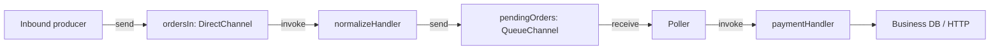
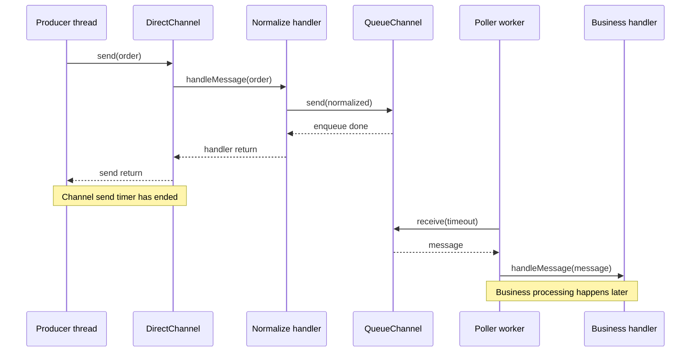
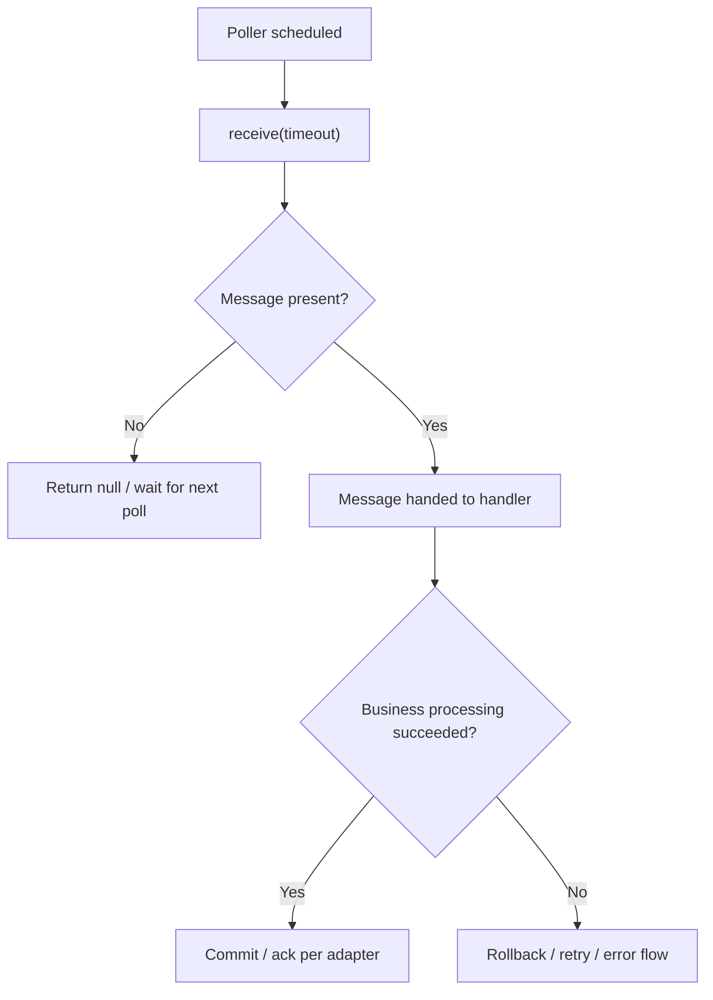

# Channel send, receive, and handler metrics in Spring Integration

## Objectives and context

In the **SPRING_INTEGRATION_RUNTIME** module, a message can be sent through a `DirectChannel`, placed into a `QueueChannel`, fetched by a poller, processed in a `ServiceActivator`, handed off to an `ExecutorChannel`, and forwarded to external systems. These components have **different runtime boundaries**: sending to a channel successfully does not necessarily mean the handler finished; fetching a message from a queue does not mean the business transaction committed.

The **Observability** chapter needs clear, separate measurements to diagnose those boundaries accurately. This lesson focuses directly on **channel send, receive, and handler metrics** in Spring Integration.

> **Principle:** When reading a metric, you must know *which component recorded it, when the operation ends, what the unit of measurement is, which tag distinguishes component types, and whether processing is synchronous*. Do not use a channel counter to infer how many business transactions completed.

After this lesson, you will be able to:

- Distinguish `channel send`, `pollable channel receive`, `message source receive`, and `handler invocation`.
- Understand the two instrumentation mechanisms in Spring Integration 6.5: **direct Micrometer meters** and **Micrometer Observation** (which can emit both metrics and traces).
- Recall the exact meter names and types: `spring.integration.send`, `spring.integration.receive`, `spring.integration.producer`, `spring.integration.handler`, along with queue gauges.
- Read the `name`, `type`, `result`, and `exception` tags; in Observation mode, use the low-cardinality keys prefixed with `spring.integration.`.
- Use `MeterRegistry` to inspect meters, Spring Boot Actuator to query them, and Prometheus/Grafana to chart throughput, latency, and error rates.
- Interpret differences across `DirectChannel`, `ExecutorChannel`, `QueueChannel`, pollers, retry advice, transactions, and asynchronous error flows.
- Write tests that verify meter names/types and measurement counts after real operations.
- Diagnose stalled channels, slow handlers, excessive retries, queue backlogs, missing metrics, and high-cardinality series.

This material targets **Spring Integration 6.5.x**, Java 17+, Micrometer, and Spring Boot 3.5.x for Actuator examples. Some Prometheus-exported names/formats depend on registry versions and exporter configuration; always verify against live runtime output.

## 1. Visualizing the path and where meters are placed

Consider an order ingestion and normalization flow:



Here there are at least four distinct operations worth observing:

1. `ordersIn.send(message)` — measures **sending into the channel**. With `DirectChannel`, this usually runs the consumer synchronously, so it may take nearly as long as the entire downstream chain.
2. `normalizeHandler.handleMessage(message)` — measures **handler duration**; not necessarily the full request latency.
3. `pendingOrders.send(message)` — measures **enqueueing** into the channel, which can return before business processing happens.
4. `pendingOrders.receive(timeout)` — measures **message receive/fetch events** on a pollable channel. This is a receive counter, not a queue-wait Timer.
5. `paymentHandler` — may run later on a **poller thread**, in a separate transaction and lifecycle.



**Do not directly add per-component timers to compute end-to-end latency.** A handler's execution window may be nested inside `DirectChannel.send()`'s timer, causing double-counting (*inclusive durations*). To measure a request/message across multiple legs, use tracing, a correlation ID, or a dedicated business timer with explicit start/end milestones.

## 2. Two metrics modes you must distinguish

Since Spring Integration 5.0.3, a `MeterRegistry` in the ApplicationContext can enable traditional Micrometer meter collection. Since **Spring Integration 6.0**, the framework also supports **Micrometer Observation**, which can emit metrics and spans through `ObservationHandler`s. The 6.5 documentation covers both mechanisms.

| Feature | Direct Micrometer meters | Micrometer Observation |
|---|---|---|
| Primary prerequisite | `MeterRegistry` + managed integration components | `ObservationRegistry`, `@EnableIntegrationManagement` with matching `observationPatterns`, meter handlers |
| Channel send | Timer `spring.integration.send`, tag `type=channel` | Timer `spring.integration.producer` |
| Handler | Timer `spring.integration.send`, tag `type=handler` | Timer `spring.integration.handler` |
| Pollable channel receive | Counter `spring.integration.receive`, tag `type=channel` | No corresponding `spring.integration.receive` meter listed in the *Observation conventions* set |
| Message source receive | Counter `spring.integration.receive`, tag `type=source` | Some inbound endpoints have handler observations; `SourcePollingChannelAdapter` added in 6.5 |
| Gateway | Observation gateway names are not used in this direct meter table | `spring.integration.gateway` and `.active` |
| Active operations | Per direct meter API | Long task timers `spring.integration.producer.active`, `spring.integration.handler.active`, `spring.integration.gateway.active` |
| Tags | `type`, `name`, `result`, `exception` | `spring.integration.name`, `spring.integration.type`, plus `spring.integration.outcome` by convention |
| Tracing | Metrics do not automatically generate trace spans | Observation can wire into matching tracing bridges/handlers |

**Critical note:** When components run in Observation mode, the documentation states that meters are no longer collected **independently** through the direct meters path; they are delegated to registered `ObservationHandler`s. Therefore, do not configure dashboards expecting both `spring.integration.send{type="handler"}` **and** `spring.integration.handler` to exist simultaneously for the same component.

When updating monitoring after enabling Observation, migrate panels/queries intentionally rather than simply "adding the two series", which causes double-counting.

### Strategy for choosing a mode

- **Existing Micrometer apps:** if direct meters work well and distributed traces are not yet needed, understand `send/receive` semantics and keep naming consistent.
- **Spring Boot apps with Observation/Tracing:** prefer the official Observation model, tracking `producer/handler/gateway` names and tag conventions.
- **Migrating dashboards:** inspect live `/actuator/metrics` or `MeterRegistry.getMeters()` to confirm which mode is active, then update alerts and recording rules.
- **When queue receive rate is needed:** even when using Observation for handlers/channels, verify what receive counters exist; you may need to instrument the message store/poller directly or add a business counter with a clear contract.

## 3. Direct Micrometer: what are the meter names?

### 3.1. `spring.integration.send` — channel send Timer

Per Spring Integration 6.5, the Timer for `send()` operations on a channel has:

| Attribute | Value |
|---|---|
| `name` | `spring.integration.send` |
| Meter type | `Timer` |
| `type` | `channel` |
| `name` tag | Integration component name, e.g. `ordersIn` |
| `result` | `success` or `failure` |
| `exception` | `none` or the simple exception class name |
| Meaning | Execution duration of the channel send operation |

A `send()` returning `false` can produce `result=failure, exception=none`; this is **not** data failed via an exception, but rather the channel declining to accept the message per its `send` contract.

A Timer in Micrometer provides at least:

- `count`: number of recorded operations for **that specific tag set**.
- `totalTime`/`sum`: total duration across those operations.
- `max`: peak value per measurement window/implementation, not necessarily the all-time max since startup in every registry.
- Percentiles/histograms if matching distribution statistics are configured.

**A Timer is not a single Counter:** the same metric name with different `type`, `name`, `result`, or `exception` tags forms separate time series.

### 3.2. `spring.integration.receive` — channel receive Counter

Per the docs:

| Attribute | Value |
|---|---|
| `name` | `spring.integration.receive` |
| Meter type | `Counter` |
| `type` | `channel` |
| `name` tag | Pollable channel name, e.g. `pendingOrders` |
| `result` | `success` or `failure` |
| `exception` | `none` or exception type |
| Meaning | Records message receive operations on a **pollable message channel** |

`DirectChannel` does not expose `receive()` per the `PollableChannel` API, so do not expect a receive counter on it like `QueueChannel`.

A `receive(timeout)` call may **return no message**, or it may fail with an exception. When analyzing `result`, verify the actual channel implementation and return behavior; do not assume every `failure` means lost business data. The receive counter does not directly show **queue wait time** or **handler processing time**.

### 3.3. `spring.integration.send` — handler Timer

Handlers also have a Timer named `spring.integration.send` in the **direct meter path**, using `type=handler`:

```text
spring.integration.send
  type=handler
  name=normalizeHandler
  result=success | failure
  exception=none | ExceptionType
```

It measures an invocation of an `AbstractMessageHandler`; it does not mean the message has committed to a business DB, been acknowledged at a broker, or finished async work spawned after the handler returns.

**Common pitfall:** the handler metric name in the direct path is **not** `spring.integration.handler`. The name `spring.integration.handler` belongs to the **Micrometer Observation path**.

### 3.4. `spring.integration.receive` — source Counter

Some `AbstractMessageSource` implementations expose a receive Counter:

```text
spring.integration.receive
  type=source
  name=<source component>
  result=success
  exception=none
```

This reflects `MessageSource` activity and does not automatically equal the number of messages delivered to handlers or committed in business logic. A poller might receive a message and send it to a channel, only for a downstream handler to fail. Retries/rollbacks/redeliveries can increase invocation counts for a single business event.

### 3.5. Count gauges and queue gauges

Spring Integration 6.5 also documents:

| Meter | Type | Meaning |
|---|---|---|
| `spring.integration.channels` | Gauge | Number of `MessageChannel`s in the application |
| `spring.integration.handlers` | Gauge | Number of `MessageHandler`s |
| `spring.integration.sources` | Gauge | Number of `MessageSource`s |
| `spring.integration.channel.queue.size` | Gauge | Current item count in a gauge-supported `QueueChannel` |
| `spring.integration.channel.queue.remaining.capacity` | Gauge | Remaining queue capacity |

Queue gauges were added in 5.1.13; they typically carry tags `type=channel` and `name=<channelName>`.

**A Gauge is a point-in-time snapshot**, not the count of messages processed over an interval. A queue size of 0 does not prove there are no messages in an **in-flight handler**, in an external broker, in another JDBC store, or already polled by a consumer but not yet committed.

The `channels/handlers/sources` counts reflect ApplicationContext structure, not throughput. These structural gauges should also not be used to determine whether a consumer endpoint is running when `SmartLifecycle` or dynamic flows are involved.

## 4. Interpreting "channel send" by channel type

A measurement only makes sense when you know the channel type and processing boundary.

| Channel | Where is `send()` measured? | What can be inferred? | What cannot be inferred? |
|---|---|---|---|
| `DirectChannel` | Invokes consumer synchronously on the sending thread | Send latency may reflect the synchronous handler too | Does not independently measure backlog or downstream async time |
| Synchronous `PublishSubscribeChannel` | Dispatches to subscribers per configuration | One send may span multiple subscribers | Does not mean only a single business effect occurred |
| `ExecutorChannel` | Submits/dispatches task to executor | Scheduling latency, task acceptance | How long the worker handler takes afterward |
| `QueueChannel` | Places message into queue | Fast/slow enqueue, full capacity, timeout/false | Queue wait time or committed DB processing |
| `FluxMessageChannel` | Interfaces with reactive pipeline | Send ability within channel API | Downstream async Reactor subscription/completion guarantee |
| Remote/broker-backed channel | Behavior depends on adapter/implementation | Send duration per adapter contract | Whether remote consumer processed/acked business work |

`DirectChannel` is an easy place for operators to misdiagnose: `spring.integration.send{type="channel"}` taking 500 ms can happen because a **downstream handler makes a 500 ms REST call**, not because the channel itself has a 500 ms queue.

With `ExecutorChannel`, the channel timer only covers handing off the task per contract; a 1 ms channel timer can accompany a 2-second slow handler on the worker. For business latency, observe handlers, queue wait, or create a dedicated end-to-end timer.

### Timeline example

```text
DirectChannel:
send start ───────── handler 300 ms ──────── send return
              handler timer may be included in send timer

QueueChannel:
send start ─ 2 ms ─ return
                   [queue wait 800 ms]
                                 receive → handler 100 ms → ack/commit
```

Because durations can be **nested** or **disjoint**, never take `sendTime + handlerTime` to compute a single request's latency without knowing the exact boundaries.

## 5. Interpreting the receive Counter and pollers

`receive` is an operation on a `PollableChannel` or `MessageSource`, whereas **polling** is a loop/schedule driven by an endpoint. Many polls may find no message; depending on the component, timeout, and configuration, they do not necessarily record `result` identically.



Specifically:

- `receive Counter` does not automatically measure the **poller delay** between ticks.
- `receive success` does not mean **business success** or broker acknowledgement.
- If a message is redelivered, receiving it twice increments the counter twice.
- With `QueueChannel` and transactions/persistent stores, removal/commit timing depends on transaction advice.
- With `SourcePollingChannelAdapter`, final outcomes of source, channel send, and handler may occur at different times and on different threads.
- When you need **empty poll rate** or `receive()` wait duration, add custom Timers/Counters around the adapter/poller; do not assume `spring.integration.receive` is a queue latency metric.

### Choosing metrics for queue bottlenecks

| Question | Appropriate metric |
|---|---|
| Is the queue backing up? | `spring.integration.channel.queue.size` + oldest message age |
| Are queue sends failing? | `spring.integration.send{type=channel, name=... , result=failure}` |
| Is the consumer dequeuing? | `spring.integration.receive{type=channel, name=...}` |
| Is the handler running and how slow is it? | Handler timer or Observation `spring.integration.handler` |
| Is the poller running on schedule? | Poller/scheduler metrics, logs, and lifecycle |
| Are messages committing to the business DB? | Custom business success metric or DB/audit counters |
| Is broker lag shrinking? | Broker/consumer-group metrics, not just local QueueChannel |

## 6. Example A: Direct Micrometer meters in a Spring Context

The following self-contained example uses a `SimpleMeterRegistry` `MeterRegistry`, a `DirectChannel`, a `QueueChannel`, and a `ServiceActivator`. Neither an `ObservationRegistry` nor `observationPatterns` is configured in this demo, making **traditional** meters easy to inspect.

```java
import java.util.Locale;

import io.micrometer.core.instrument.MeterRegistry;
import io.micrometer.core.instrument.simple.SimpleMeterRegistry;

import org.springframework.context.annotation.AnnotationConfigApplicationContext;
import org.springframework.context.annotation.Bean;
import org.springframework.context.annotation.Configuration;
import org.springframework.integration.annotation.ServiceActivator;
import org.springframework.integration.channel.DirectChannel;
import org.springframework.integration.channel.QueueChannel;
import org.springframework.integration.config.EnableIntegration;
import org.springframework.integration.config.EnableIntegrationManagement;
import org.springframework.messaging.Message;
import org.springframework.messaging.MessageChannel;
import org.springframework.messaging.support.GenericMessage;

@Configuration
@EnableIntegration
@EnableIntegrationManagement
public class ChannelHandlerMetricsDemo {

    @Bean
    public MeterRegistry meterRegistry() {
        return new SimpleMeterRegistry();
    }

    @Bean
    public MessageChannel ordersIn() {
        return new DirectChannel();
    }

    @Bean
    public QueueChannel pendingOrders() {
        return new QueueChannel(16);
    }

    @Bean
    public NormalizeHandler normalizeHandler() {
        return new NormalizeHandler();
    }

    public static class NormalizeHandler {

        @ServiceActivator(
                inputChannel = "ordersIn",
                outputChannel = "pendingOrders")
        public String normalize(String orderId) {
            return orderId.trim().toUpperCase(Locale.ROOT);
        }
    }

    public static void main(String[] args) {
        try (var context = new AnnotationConfigApplicationContext(
                ChannelHandlerMetricsDemo.class)) {

            MessageChannel input =
                    context.getBean("ordersIn", MessageChannel.class);
            QueueChannel queue =
                    context.getBean("pendingOrders", QueueChannel.class);
            MeterRegistry registry =
                    context.getBean(MeterRegistry.class);

            boolean accepted =
                    input.send(new GenericMessage<>(" ord-101 "));
            Message<?> received = queue.receive(1_000L);

            System.out.println("accepted=" + accepted);
            System.out.println("received=" +
                    (received == null ? "<none>" : received.getPayload()));

            // Print all meter series with recorded data, including tag sets.
            registry.getMeters().stream()
                    .filter(meter ->
                            meter.getId().getName()
                                    .startsWith("spring.integration."))
                    .forEach(meter ->
                            System.out.println(meter.getId()));

            // Check the Timer type, not just the metric name.
            registry.find("spring.integration.send")
                    .tag("type", "channel")
                    .tag("name", "ordersIn")
                    .timers()
                    .forEach(timer ->
                            System.out.println(
                                    "ordersIn send count=" + timer.count()));

            registry.find("spring.integration.send")
                    .tag("type", "handler")
                    .timers()
                    .forEach(timer ->
                            System.out.println(
                                    "handler count=" + timer.count()));

            registry.find("spring.integration.receive")
                    .tag("type", "channel")
                    .tag("name", "pendingOrders")
                    .counters()
                    .forEach(counter ->
                            System.out.println(
                                    "pendingOrders receive=" + counter.count()));
        }
    }
}
```

#### Expectations and limitations

- `ordersIn.send` normally returns `true` because the Service Activator subscriber processes the message cleanly.
- The handler returns `"ORD-101"` and sends it to `pendingOrders`; `receive` retrieves that message.
- One or more `spring.integration.send` Timers have `type=channel`, and the handler's Timer has `type=handler` when components are properly instrumented.
- The `spring.integration.receive` Counter on `pendingOrders` records receives per implementation semantics.
- `MeterRegistry.Search.timers()/counters()` can return multiple time series due to differing `result/exception` tags; print `getId()` before assuming all belong to one operation variant.
- Meters are registered **on first use**. Initializing beans without sending/receiving messages may not create the corresponding series yet.

**Requirements to run:** Compatible versions of Spring Framework, Spring Integration, `micrometer-core`, and Java 17+. This is a standalone Java example without Spring Boot Actuator. `SimpleMeterRegistry` stores meters in-process for tests/demos and does not export metrics to Prometheus automatically.

### Querying properly in code

```java
var channelTimers = registry.find("spring.integration.send")
        .tags("type", "channel", "name", "ordersIn")
        .timers();

var handlerTimers = registry.find("spring.integration.send")
        .tag("type", "handler")
        .timers();

var receiveCounters = registry.find("spring.integration.receive")
        .tags("type", "channel", "name", "pendingOrders")
        .counters();

double successfulChannelSends = channelTimers.stream()
        .filter(t -> "success".equals(t.getId().getTag("result")))
        .mapToLong(io.micrometer.core.instrument.Timer::count)
        .sum();
```

This snippet assumes the `registry` variable from the example above. Handler `name` tags may be generated by endpoint naming; when you need stable dashboards, assign meaningful endpoint IDs rather than hardcoding auto-generated names.

**Do not claim `Timer.count()` equals the number of distinct orders.** One event can traverse multiple channels/handlers and be retried/redelivered; all of those are measured runtime operations.

## 7. Example B: Micrometer Observation on Spring Integration 6.5

Since 6.0, Spring Integration includes Observation support for `IntegrationManagement` components. Per the 6.5 docs, you need an `ObservationRegistry` in the ApplicationContext and `@EnableIntegrationManagement` with matching `observationPatterns`; by default, components are not all instrumented with Observation merely because a registry is present.

### Enabling Observation selectively

```java
import org.springframework.boot.autoconfigure.SpringBootApplication;
import org.springframework.boot.SpringApplication;
import org.springframework.integration.config.EnableIntegration;
import org.springframework.integration.config.EnableIntegrationManagement;

@SpringBootApplication
@EnableIntegration
@EnableIntegrationManagement(observationPatterns = "*")
public class ObservedIntegrationApplication {

    public static void main(String[] args) {
        SpringApplication.run(ObservedIntegrationApplication.class, args);
    }
}
```

This example assumes a Spring Boot project with `spring-boot-starter-integration`, `spring-boot-starter-actuator`, and registered Spring Integration flow beans/handlers. Auto-configuration and `ObservationHandler`s depend on Boot/Micrometer setup; **if Observation lacks a meter handler**, having an ObservationRegistry alone is not enough to see timers emitted.

`observationPatterns = "*"` instruments broadly for illustration. For large applications, choose patterns by component names to avoid excessive spans/timers; consult the Javadoc of `EnableIntegrationManagement.observationPatterns()` for your exact version.

### Observation meter names

| Observation type | Timer | Long task timer | Default low-cardinality tags |
|---|---|---|---|
| Producer/channel send | `spring.integration.producer` | `spring.integration.producer.active` | `spring.integration.name`, `spring.integration.type=producer` |
| Handler/consumer | `spring.integration.handler` | `spring.integration.handler.active` | `spring.integration.name`, `spring.integration.type=handler` |
| Inbound gateway | `spring.integration.gateway` | `spring.integration.gateway.active` | `spring.integration.name`, `spring.integration.type=gateway`, `spring.integration.outcome` |
 
The Observation path also applies to inbound `MessageProducerSupport`, `MessagingGatewaySupport`, `AbstractMessageChannel.send`, `AbstractMessageHandler`, and starting in Spring Integration 6.5, `SourcePollingChannelAdapter` in the handler observations group. The producer name is used for channels because `send()` is treated as a producer action in tracing semantics.

`*.active` is a **long task timer**: it shows currently active operations, unlike the `count` timer of completed executions. Some keys/values determined only after the observation starts will not appear completely on active series.

**Important:** `spring.integration.handler` in Observation mode **differs from** `spring.integration.send{type=handler}` in direct mode. When switching modes, update queries/dashboards and note that tag names change from `name/type` to `spring.integration.*`-prefixed keys.

### Note on Observation and channel receive

The official Observation metrics catalog lists `producer`, `handler`, and `gateway`; **there is no corresponding `spring.integration.receive` Observation meter for pollable channel `receive()` listed in that conventions catalog**. When you need actual poll/dequeue rates, inspect the active meters directly or add instrumentation at the appropriate channel/source/poller. Do not assume "receive is already measured" just because `spring.integration.producer` is present.

## 8. Spring Boot Actuator: inspecting runtime metrics

For Spring Boot, typical dependencies include:

```text
spring-boot-starter-integration
spring-boot-starter-actuator
micrometer-registry-prometheus    # when /actuator/prometheus is needed
```

Specific dependency versions may be managed by the Spring Boot BOM. Do not mix two incompatible Micrometer versions.

### Reference Actuator configuration

```yaml
spring:
  application:
    name: orders-runtime

management:
  endpoints:
    web:
      exposure:
        include: "health,info,metrics,prometheus"
  endpoint:
    health:
      show-details: when_authorized
```

`/actuator/metrics` and `/actuator/prometheus` are available only when exposed, the exporter dependency is present, permissions allow access, and the management port/base path are properly configured.

**Do not expose all management endpoints to the public internet.** Use authentication, network segmentation, TLS, and sensitive-data policies for metrics. Metric tags can reveal system, consumer, or route names even without carrying payloads.

### Query commands in both modes

Direct Micrometer:

```bash
curl -s http://localhost:8080/actuator/metrics/spring.integration.send
curl -s "http://localhost:8080/actuator/metrics/spring.integration.send?tag=type:channel"
curl -s "http://localhost:8080/actuator/metrics/spring.integration.send?tag=type:handler"
curl -s "http://localhost:8080/actuator/metrics/spring.integration.receive?tag=type:channel"
curl -s http://localhost:8080/actuator/metrics/spring.integration.channel.queue.size
```

Micrometer Observation:

```bash
curl -s http://localhost:8080/actuator/metrics/spring.integration.producer
curl -s http://localhost:8080/actuator/metrics/spring.integration.handler
curl -s http://localhost:8080/actuator/metrics/spring.integration.gateway
curl -s http://localhost:8080/actuator/metrics/spring.integration.handler.active
```

If the response is 404 or the metric name is absent, check the **instrumentation mode**, whether any message has actually flowed, whether filters/`observationPatterns` excluded it, and whether the registry exporter is configured. Do not just tweak the URL until "some number shows up".

#### How to read the Actuator response

A meter endpoint may return a payload like:

```json
{
  "name": "spring.integration.send",
  "measurements": [
    { "statistic": "COUNT", "value": 25.0 },
    { "statistic": "TOTAL_TIME", "value": 1.27 },
    { "statistic": "MAX", "value": 0.09 }
  ],
  "availableTags": [
    { "tag": "type", "values": ["channel", "handler"] },
    { "tag": "result", "values": ["success", "failure"] }
  ]
}
```

This is **illustrative JSON showing Actuator structure**, not live data or a guarantee that every registry exports `MAX`. When querying without filters, measurements may **aggregate across multiple tag combinations**. To separate channels from handlers, pass `?tag=type:channel` or filter through `MeterRegistry`.

### Prometheus exposition is a separate mapping layer

Micrometer converts dotted names into Prometheus-compatible names. For example, in a system with direct timers:

```text
spring.integration.send (Timer)
  → spring_integration_send_seconds_count
  → spring_integration_send_seconds_sum
  → may include spring_integration_send_seconds_max

spring.integration.receive (Counter)
  → spring_integration_receive_total
```

In Observation mode, `spring.integration.handler` typically maps to series such as `spring_integration_handler_seconds_count` and `spring_integration_handler_seconds_sum`. **Do not hardcode exporter naming across all registries**: inspect the raw output of `GET /actuator/prometheus`, labels, and actual suffixes before writing PromQL.

## 9. Throughput, latency, and error rate formulas

### 9.1. Send/receive throughput

For direct meters and standard Prometheus naming:

```promql
# Channel sends per second, grouped by channel name:
sum by (name) (
  rate(spring_integration_send_seconds_count{type="channel",result="success"}[5m])
)

# Failed channel sends per second:
sum by (name) (
  rate(spring_integration_send_seconds_count{type="channel",result="failure"}[5m])
)

# Receive operations per second on pollable channels:
sum by (name, result) (
  rate(spring_integration_receive_total{type="channel"}[5m])
)
```

Note that `send_seconds_count` on a Timer does **not** mean each message took one second. The `_count` suffix is the observation count, while `_seconds_sum` is the total duration.

**Do not mechanically subtract send rate − receive rate to infer queue backlog.** A message can pass through multiple channels, be multicast, filtered, routed, retried, redelivered, or sent into a queue while consumers are mid-processing. For a specific queue, compare **sends and receives of the same channel**, then reconcile with queue gauges and in-flight state; even then, account for ack semantics and counter resets.

### 9.2. Average send or handler duration

For a Timer:

```text
Average latency = rate(Timer totalTime) / rate(Timer count)
```

PromQL for direct channel send latency (typically in seconds):

```promql
sum by (name) (
  rate(spring_integration_send_seconds_sum{type="channel",result="success"}[5m])
)
/
sum by (name) (
  rate(spring_integration_send_seconds_count{type="channel",result="success"}[5m])
)
```

If `rate(count)=0`, the expression is undefined; dashboards should handle no-traffic/NaN gracefully. With `DirectChannel`, the value can **include downstream synchronous handlers**, not just channel traversal overhead.

### 9.3. Handler error ratio

```promql
sum by (name) (
  rate(spring_integration_send_seconds_count{type="handler",result="failure"}[5m])
)
/
clamp_min(
  sum by (name) (
    rate(spring_integration_send_seconds_count{type="handler"}[5m])
  ), 0.000001
)
```

This ratio reflects **exceptions/failures observed by the instrumented handler**, not necessarily business failures. If a recovery callback turns an error into a "handled" result, the outer metric may be recorded as success. If a timeout/exception occurs in an async step **after the handler returns**, the handler timer may have already finished before that error.

With Observation, verify the actual `spring.integration.outcome` conventions/tags: default docs for `handler` only guarantee `spring.integration.name` and `spring.integration.type`. Do not assume `result=failure` always exists as in direct meters.

### 9.4. Observation handler throughput/latency

When the exporter maps dotted keys to `spring_integration_name`:

```promql
# Completed handler observations per second:
sum by (spring_integration_name) (
  rate(spring_integration_handler_seconds_count[5m])
)

# Average handler duration:
sum by (spring_integration_name) (
  rate(spring_integration_handler_seconds_sum[5m])
)
/
sum by (spring_integration_name) (
  rate(spring_integration_handler_seconds_count[5m])
)
```

These queries are **templates**; verify actual label names, add namespace/application/instance filters, and avoid aggregating across all instances when debugging a single pod.

### 9.5. Percentiles p95/p99

A default Timer does not necessarily publish histogram buckets for computing percentiles in Prometheus. Configure distribution statistics for the appropriate meters. If `spring_integration_handler_seconds_bucket` actually exists:

```promql
histogram_quantile(
  0.95,
  sum by (le, spring_integration_name) (
    rate(spring_integration_handler_seconds_bucket[5m])
  )
)
```

Without `_bucket`, the query cannot synthesize p95. Never treat MAX as p95. Enabling histograms for too many components and labels significantly increases cardinality/memory/export size. Pick the most critical handlers or use controlled SLO buckets.

## 10. Tags/cardinality: observing enough without exploding series

Tags separate metrics by component, but a registry stores a time series for **every combination of tags**.

### Relatively safe cardinality

| Tag | Example | Reason |
|---|---|---|
| `name` / `spring.integration.name` | `ordersIn`, `paymentHandler` | Bounded number of components, unless unbounded dynamic flows are created |
| `type` / `spring.integration.type` | `channel`, `handler`, `producer` | Small set of values |
| `result` | `success`, `failure` | Small set of values |
| `exception` | `TimeoutException`, `none` | Usually smaller than event IDs, though monitor if many custom types exist |
| `application`, `region` | `orders-service`, `ap-southeast` | Useful for dashboards/clusters when values are controlled |

### Avoid using as tags

- Per-message `messageId`, `correlationId`, or business `orderId`.
- Customer emails, phone numbers, PII, access tokens, or raw payloads.
- A URL containing an order ID or an unbounded `tenantId`.
- Each retry attempt ID or arbitrary exception messages.
- Newly generated dynamic flow IDs per request without cleanup.

For example: 100 handlers × 2 outcomes × 5 exception types × 2,000 tenants can generate **2 million combinations** even before pod/region/histogram bucket labels. That creates high memory pressure, slower scrapes, and storage costs.

**Practice:** Put detailed IDs in protected logs/traces; keep metrics to component names, error types, and bounded-value outcomes.

### Blocking a meter with MeterFilter

In the direct metrics path, Spring Integration docs use `MeterFilter` to deny by name and tags:

```java
import io.micrometer.core.instrument.MeterRegistry;
import io.micrometer.core.instrument.config.MeterFilter;

@Bean
public MeterFilter dropNoisyChannelMeters() {
    return MeterFilter.deny(id ->
            "spring.integration.send".equals(id.getName())
            && "channel".equals(id.getTag("type"))
            && "noisyInternalChannel".equals(id.getTag("name")));
}
```

In Spring Boot, a `MeterFilter` bean is automatically applied to configured MeterRegistries. In a plain Spring context, you can register it directly:

```java
registry.config().meterFilter(
        MeterFilter.deny(id ->
                "channel".equals(id.getTag("type"))
                && "noisyInternalChannel".equals(id.getTag("name"))));
```

**Register filters before meters are created.** Filtering applies at meter registration; do not expect late filter registration to safely remove already-created series. In Observation mode, names/tags differ; do not copy direct-mode filters without verifying.

## 11. How retries, transactions, and error flows alter metrics from expectations

### 11.1. RetryAdvice can multiply handler attempts

`RequestHandlerRetryAdvice` may invoke a handler multiple times before a message succeeds:

```text
Input business event EV-42
    ├─ handler attempt 1 → TimeoutException
    ├─ retry backoff
    ├─ handler attempt 2 → TimeoutException
    └─ handler attempt 3 → success
```

Measurements can record **handler/endpoint invocations** rather than a single unique business event. Exact counts depend on where the advice sits relative to the instrumented handler and enclosing operation. To track retry counts, add a **separate** retry-attempt metric with low-cardinality cause tags or use Spring Retry events/listeners.

If a handler timer wraps the entire retry advice, duration may include backoff sleep. If a timer sits inside the advice, you get multiple durations corresponding to individual attempts. Never guess ordering solely from meter names; diagram the **advice chain** and verify in an integration test.

### 11.2. Recovery callbacks can turn failures into "success"

`ErrorMessageSendingRecoverer` or a recovery callback after exhausted attempts can convert an error into an `ErrorMessage` and return normally. When the outer handler no longer throws an exception, outer-layer metrics may record `success`, even though the business transaction **has not completed**.

You need at least two measurements:

- **Technical outcome:** did send/handler return normally or throw?
- **Business outcome:** was the order/payment processed, scheduled for retry, sent to DLQ, or flagged for manual review?

Never use a channel's `result=success` alone to report payment success rates.

### 11.3. Transaction rollbacks are not fully visible in send metrics

A handler can return before an enclosing transaction commits; a failure at commit time causes an operation already counted as success in one component to actually roll back. Or a channel send can succeed and the broker redelivers because ack did not complete.

For business-critical flows, also measure:

- Counts/success/failure when the business transaction actually commits.
- DB rollback, lock-wait, and connection-pool metrics.
- Event ID/inbox/outbox processing states (via aggregated metrics, not ID tags).
- Ack/nack/redelivery and DLQ metrics from the broker/source.

### 11.4. Error channel is a separate flow

When an exception is published to `errorChannel`, you may see:

```text
Main flow handler failure
   → errorChannel.send(ErrorMessage)
   → errorHandler handles recovery
```

`errorChannel` and `errorHandler` have **their own metrics**. Do not sum main-handler failures and error-handler successes as total business events. One failure can produce one or more messages for recovery processing. If the error channel is async, successful publishing does not guarantee recovery completed.

## 12. Threading: which latency is measured on DirectChannel, ExecutorChannel, and pollers?

| Component | When timer stops | Commonly missed work |
|---|---|---|
| `DirectChannel.send` | After completing synchronous dispatch | Async work triggered by the handler after returning |
| `ExecutorChannel.send` | When task is accepted/handed off per channel implementation | Worker execution, queue wait, subsequent retries |
| `QueueChannel.send` | When message is enqueued or fails/times out | Consumer wait time, post-receive processing |
| `QueueChannel.receive` | Counter at receive operation | Processing duration or transaction commit |
| `ServiceActivator` | When the instrumented handler invocation ends | Late-completing side effects/async tasks |
| `SourcePollingChannelAdapter` | Depends on receive/poll/Observation scope | Offset/ack, downstream commit, empty polls |
| `ReactiveMessageHandler` | Depends on endpoint subscription/completion semantics | Unsubscribed `Mono` or fire-and-forget inner subscriptions |

### Example of a system that looks fast yet is congested

Suppose:

- `ordersQueue.send` takes 0.5 ms each.
- Input rate is 200 messages/s.
- A poller processes 50 messages/s.
- `ordersQueue.size` rises continuously.

Low channel send latency is **not** proof that the system is fast. Here, **the producer is faster than the consumer**. At steady rates, the queue grows by ~150 messages/s until it hits capacity and timeouts/false/failures begin.

To resolve this, inspect poller concurrency, executor thread pools, transaction locks, remote latencies, retry backoffs, handler success rates, and broker/store capacity—not `send` which is already under 1 ms.

## 13. Combining metrics with tracing, message history, and Integration Graph

Metrics answer "how many, how fast or slow". Other questions require other tools:

| Observability source | Primary question |
|---|---|
| Micrometer metrics | Throughput, failure ratio, duration, queue size |
| Micrometer Observation/Tracing | Which spans did a request/message pass through, and where was time spent? |
| `IntegrationGraphServer` | Which channels/endpoints/links are registered at runtime? |
| Message history | Which components handled a message when history is enabled? |
| Structured logs | Event ID/correlation ID and specific root causes |
| Thread dumps | Are workers waiting on locks, backoff sleeps, DB/HTTP I/O, or deadlocks? |
| Broker/JDBC store | Lag, in-flight items, message age, redeliveries, transaction state |
| Spring `SmartLifecycle` | Is an endpoint/poller running or stopped? |

`IntegrationGraphServer` builds topology; it does not mean every channel is measured. `observed` in graph metadata reflects framework instrumentation status, not the success/failure of a business event.

### Observation propagation across channels

With Observation and a tracing bridge, Spring Integration can inject trace headers in the channel sender context and restore them via the receiver context at the consumer. This is crucial when a `MessageChannel` is persistent/distributed or switches threads. For a continuous trace, **both the producer channel and the consumer** must be instrumented in scope; enabling only one side can break the parent-child relationship.

Do not copy `MDC` by storing a `ThreadLocal` on a worker thread and reusing it across messages. In reactive/async flows, context propagation must rely on standard instrumentation, message headers, and proper scoping/cleanup.

### From graph to metrics panels

An effective workflow:

1. Extract the list of named channels/handlers from the graph.
2. Confirm channel types (`DirectChannel`, `QueueChannel`, `ExecutorChannel`).
3. Query meters by `name` + `type` for direct mode, or `spring.integration.name/type` for Observation.
4. If a channel shows output without handler completion, inspect worker queues, consumer lifecycle, and error flows.
5. Include trace/correlation IDs in logs to locate specific messages.
6. Verify error/retry/transaction outcomes at the business level rather than stopping at `send returned true`.

## 14. Practical dashboard and SLOs

A dashboard for `ordersIn → normalizeHandler → pendingOrders → paymentHandler` can include:

| Panel | Source | Purpose |
|---|---|---|
| Ingress sends/s | `ordersIn` send Timer count | Inbound load volume |
| Channel failure rate | `ordersIn` send `result=failure` | Send failures |
| Handler p95 duration | Handler Timer/Observation + histogram | Endpoint processing time |
| Queue size + remaining capacity | `pendingOrders` queue gauges | Backlog / capacity pressure |
| Queue receive/s | `pendingOrders` receive Counter or poller metric | Dequeue rate |
| Business completion/s | Custom business counter | Actual processed orders |
| Retries/s | Custom retry/recovery metric | Downstream instability |
| DLQ/outbox oldest age | Broker/store metrics | Work stuck beyond SLA |
| JVM CPU/GC + DB pool | Spring Boot/System/DB metrics | Resource constraints |

### Example alert conditions

- Queue size grows continuously for 10 minutes **and** handler completion rate is below ingress rate.
- Handler P95 latency exceeds SLO for 5 minutes while traffic is high enough to be meaningful.
- Channel send failure rate exceeds 1% with a minimum attempt floor to avoid noisy alerts.
- Oldest outbox event exceeds its business processing deadline.
- Zero source receives when upstream is expected to send data and the endpoint still reports `isRunning=true`.

These thresholds are **illustrative examples for alert design**, not fixed recommendations for every product.

### A capacity calculation

Input = 100 messages/s, consumer processes = 80 messages/s over 60 seconds:

```text
Queue growth ≈ (100 − 80) × 60 = 1,200 messages
```

If queue capacity = 1,000, this simple model predicts the queue hits capacity in under a minute without backpressure or flow control. In reality, bursts, retries, batching, in-flight messages, transaction rollbacks, and concurrency also apply.

**Do not use cumulative time-series metrics directly** to compare rates; compute windowed `rate`/`increase`, account for process restarts, and filter series consistently by application/instance.

## 15. Testing meters in Spring Integration

An integration test should verify that **a real operation** produces the meters, not merely that a `MeterRegistry` bean exists.

### Testing direct Micrometer meters

```java
import static org.assertj.core.api.Assertions.assertThat;

import io.micrometer.core.instrument.MeterRegistry;
import org.junit.jupiter.api.Test;
import org.springframework.beans.factory.annotation.Autowired;
import org.springframework.messaging.MessageChannel;
import org.springframework.messaging.support.GenericMessage;
import org.springframework.integration.channel.QueueChannel;
import org.springframework.test.context.junit.jupiter.SpringJUnitConfig;

@SpringJUnitConfig(ChannelHandlerMetricsDemo.class)
class IntegrationMetricsTest {

    @Autowired
    MessageChannel ordersIn;

    @Autowired
    QueueChannel pendingOrders;

    @Autowired
    MeterRegistry registry;

    @Test
    void sendReceiveAndHandlerMetersAreRecorded() {
        assertThat(ordersIn.send(new GenericMessage<>(" ord-201 ")))
                .isTrue();

        var message = pendingOrders.receive(1_000L);
        assertThat(message).isNotNull();
        assertThat(message.getPayload()).isEqualTo("ORD-201");

        var channelTimers = registry.find("spring.integration.send")
                .tags("type", "channel", "name", "ordersIn")
                .timers();

        var handlerTimers = registry.find("spring.integration.send")
                .tag("type", "handler")
                .timers();

        var receiveCounters = registry.find("spring.integration.receive")
                .tags("type", "channel", "name", "pendingOrders")
                .counters();

        assertThat(channelTimers).anyMatch(timer -> timer.count() >= 1);
        assertThat(handlerTimers).anyMatch(timer -> timer.count() >= 1);
        assertThat(receiveCounters).anyMatch(c -> c.count() >= 1);
    }
}
```

The example requires `spring-test`/JUnit 5/AssertJ and the `ChannelHandlerMetricsDemo` source from Section 6. If the instrumentation config or mode differs, adjust expected meter names; do not force both direct and Observation metrics to appear at the same time.

**Test reliability:** avoid asserting exact timer `totalTime` down to nanoseconds/milliseconds because CI scheduling and JIT differ. Assert that counts increment, tags are accurate, and series are not missing; leave latency benchmarks/SLOs for dedicated environments.

### Testing receive failures/timeouts

1. Use an empty `QueueChannel` and call `receive(timeout)` with a small timeout.
2. Observe the actual result tags and Counter behavior for your implementation/version.
3. Send a message and receive it.
4. Compare `result=success` and `result=failure`; **do not assume** a null receive is counted identically to a thrown exception.
5. Fill a bounded-capacity queue, call `send(message, timeout)` per contract, and observe failure results without exceptions when the API returns false.

### Testing handler exceptions and retries

1. Create a handler that throws a controlled exception.
2. Send through `DirectChannel` and catch the exception in the test.
3. Verify `spring.integration.send{type=handler,result=failure}` when direct mode is instrumented.
4. Add `RequestHandlerRetryAdvice` and inspect how many times the real handler is invoked and what the measurement scope covers.
5. Add a recovery callback and compare outer success metrics against a **business failure counter**.
6. Repeat through `ExecutorChannel` to confirm failures route to an async error flow instead of being caught directly by the caller.

### Testing Observation separately

In a context with `ObservationRegistry` and `@EnableIntegrationManagement(observationPatterns="*")`:

- Send messages through a named channel and handler.
- Inspect `spring.integration.producer` and `spring.integration.handler` via the registry/Actuator when a meter ObservationHandler is present.
- Verify low-cardinality keys `spring.integration.name` and `spring.integration.type`.
- If a tracing bridge/exporter is present, confirm spans link properly from producer → consumer.
- Do not assert `spring.integration.receive` as a mandatory Observation convention unless separate receive instrumentation exists.

## 16. Debugging workflow when metrics do not match expectations

| Symptom | Common causes | Resolution |
|---|---|---|
| No `spring.integration.send` | Observation mode active, no messages sent yet, missing MeterRegistry, or filtered out | Check mode, beans, tags, and triggered events |
| No `spring.integration.handler` | Direct meters active, handler not instrumented, missing ObservationRegistry/handler | Check `@EnableIntegrationManagement`/`observationPatterns` |
| Send count exceeds business completions | Multiple hops, retries, redeliveries, or uncommitted business work | Separate technical vs business counters |
| Handler timer is low yet requests are slow | Async workers, queue wait, or remote calls outside the observed timer | Inspect queue metrics, E2E traces, executor metrics |
| `DirectChannel.send` is slow | Slow synchronous downstream handler, transaction, or remote call | Thread dumps, handler spans, DB/HTTP timers |
| Queue sends are fast yet backlog grows | Consumer/poller cannot keep up | Check receive rate, handler p95, active threads |
| Receive counter rises yet business fails | Receiving a message differs from committing/acking | Check business outcomes, transactions, error flow |
| Send `result=failure, exception=none` | Channel `send` returned false instead of throwing | Check timeout, capacity, subscribers |
| Handler failures stay flat despite business errors | Recovery swallows exceptions; async failures or custom error status returns | Inspect error channel, retry metrics, business counters |
| Prometheus query returns empty | Different exporter names/labels, histograms disabled, series not yet created | Inspect raw `/actuator/prometheus` |
| Metrics have excessive time series | High-cardinality tags, dynamic IDs, or histograms on every component | Reduce tags, add MeterFilters, standardize naming |
| Metrics drop after restart | Registry/Prometheus cumulative counter resets, changing application identity | Use rate/increase, instance labels, and scrape health |
| `/actuator/metrics` returns 404 | Endpoint not exposed or Actuator missing | Check dependencies, security, management base path |
| Timer max drops unexpectedly | Backend/registry uses a sliding time window | Use histograms/percentiles; do not treat MAX as lifetime peak |
| System slows down under broad instrumentation | High tracing/observation/exporter overhead | Scope `observationPatterns`, sample traces, measure overhead |

### 5-step triage checklist

1. **Verify the component:** channel type, bean/endpoint name, threading model, whether `MessageHandler` is instrumented.
2. **Verify the mode:** direct meters or Observation; list meters and tags after at least one real message.
3. **Verify the measurement:** is the operation send, receive, handler, or source; timer/counter/gauge?
4. **Verify outcomes:** do error flows, retries, acks, transaction commits, and business successes align with technical metrics?
5. **Verify the exporter:** Actuator metrics, Prometheus naming, labels, histogram/distribution config, and access permissions.

## 17. Production checklist

- [ ] Choose clearly between direct Micrometer meters and Observation, with a dashboard migration plan.
- [ ] Remember `spring.integration.send` is a **Timer** for both channels and handlers in direct mode; distinguish via the `type` tag.
- [ ] Remember `spring.integration.receive` is a **Counter** for pollable channels/message sources in direct mode, not a latency Timer.
- [ ] Know that QueueChannel exposes `queue.size` and `queue.remaining.capacity` gauges when instrumented/supported.
- [ ] With Observation, use `spring.integration.producer` and `spring.integration.handler` alongside low-cardinality `spring.integration.*` keys.
- [ ] Do not assume `spring.integration.receive` exists as an Observation convention for every pollable channel.
- [ ] Configure `MeterRegistry`/`ObservationRegistry` and `@EnableIntegrationManagement`/`observationPatterns` consistently with the chosen mode.
- [ ] Send a real traffic sample before verifying metric existence; meters may register lazily.
- [ ] Separate channel send latency from handler latency and E2E latency; avoid summing inclusive durations.
- [ ] For async channels, measure queue wait/in-flight work and worker completion separately.
- [ ] For pollers, monitor receives, empty polls, source delays, and lifecycle as needed.
- [ ] Include business outcome metrics alongside technical results, especially when recovery or rollbacks occur.
- [ ] Observe retries/redeliveries separately; do not treat Timer count as unique event count.
- [ ] Never place orderId/messageId/correlationId/PII/raw payloads into metric tags.
- [ ] Enable histograms/percentiles only on key meters with sensible capacity policies.
- [ ] Secure Actuator endpoints and Prometheus scraping; manage exporter overhead.
- [ ] Base PromQL queries on label names verified from raw exporter output.
- [ ] Combine metrics with `IntegrationGraphServer`, tracing, logs, thread dumps, and broker/DB store metrics.
- [ ] Test send success/failure, receive behavior, handler exceptions, retry recovery, queue backlogs, and Observation mode.

## References

- [Spring Integration 6.5 — Metrics and Management](https://docs.spring.io/spring-integration/reference/6.5/metrics.html): direct Micrometer meter names/tags, queue gauges, Observation API, conventions, and observation propagation.
- [Spring Integration Reference — Message Channels](https://docs.spring.io/spring-integration/reference/6.5/channel.html): synchronous/asynchronous behavior, `DirectChannel`, `QueueChannel`, and `ExecutorChannel`.
- [Spring Integration Reference — Polling Consumer](https://docs.spring.io/spring-integration/reference/6.5/endpoint.html): pollers, consumer endpoints, and schedulers.
- [Spring Integration Reference — Message Handler Advice](https://docs.spring.io/spring-integration/reference/6.5/handler-advice.html): retry/error recovery and handler boundaries.
- [Spring Integration Reference — Error Handling](https://docs.spring.io/spring-integration/reference/6.5/error-handling.html): synchronous/async failures and `errorChannel`.
- [Spring Integration Reference — Integration Graph](https://docs.spring.io/spring-integration/reference/6.5/graph.html): runtime topology and component names.
- [Micrometer — Timers](https://docs.micrometer.io/micrometer/reference/concepts/timers.html): `count`, `totalTime`, `max`, and distribution statistics.
- [Micrometer — Counters](https://docs.micrometer.io/micrometer/reference/concepts/counters.html): Counters and rates.
- [Micrometer — Meter Filters](https://docs.micrometer.io/micrometer/reference/concepts/meter-filters.html): filtering and cardinality limits.
- [Spring Boot 3.5 — Actuator Metrics](https://docs.spring.io/spring-boot/3.5/reference/actuator/metrics.html): `MeterRegistry`, Actuator `metrics`, and Prometheus.
- [Prometheus — Query Functions](https://prometheus.io/docs/prometheus/latest/querying/functions/): `rate`, `increase`, `histogram_quantile`.

**Remember:** In Spring Integration, `channel.send()`, `pollableChannel.receive()`, and `handler invocation` are **three distinct measurements**. With direct Micrometer meters, `spring.integration.send` uses `type=channel` or `type=handler`, while `spring.integration.receive` is a Counter; with Observation, track `spring.integration.producer` and `spring.integration.handler`. Read metrics against the proper thread/transaction/async boundaries and combine queue gauges with business success metrics so you never mistake **"sent"** for **"completed"**.
