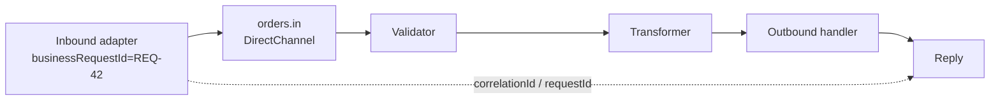
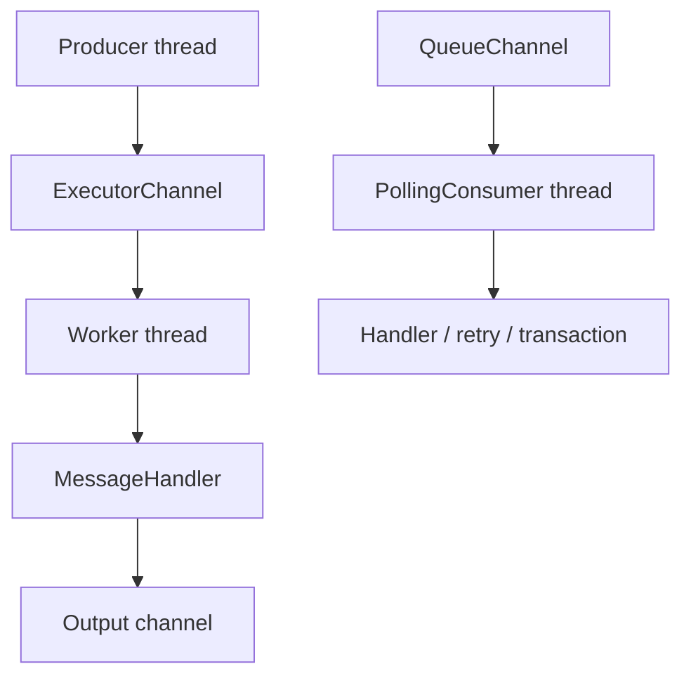
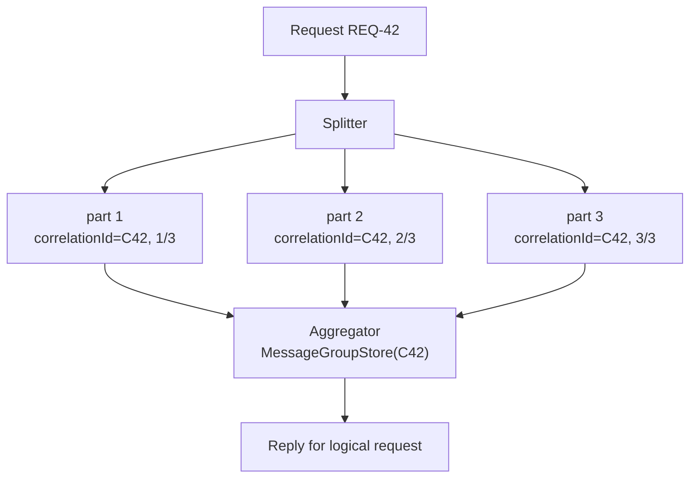
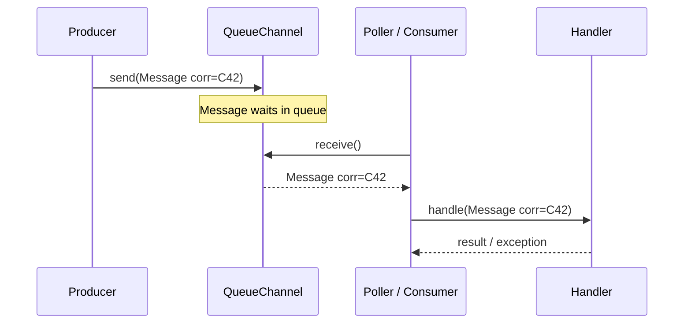
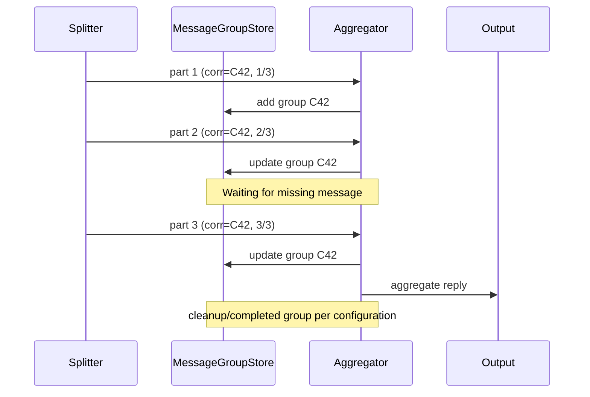

# Tracing messages via correlation ID in Spring Integration Runtime

## 1. Why do you need a correlation ID when observing message flows?

A message entering Spring Integration can pass through multiple `MessageChannel`s, consumer endpoints, transformers, routers, splitters, aggregators, outbound gateways, and error handlers. Some legs run synchronously on the same thread; others switch to an `ExecutorChannel`, poller, broker, or reactive subscriber. When a flow fails or latency spikes, the crucial question is not just "which handler threw an error?", but also:

- Which **business request** did the incoming message belong to?
- How are messages produced by a split related to one another?
- Which attempt do retries and redeliveries belong to, and did they already produce side effects?
- Which endpoints, channels, and instances did the message pass through?
- Did the gateway reply return to the right waiting request?
- Did a collision occur between two correlation groups, or was a header lost at an async boundary?
- Is the latency inside a poller, queue, executor, external API, or a message group waiting to release?

A **Correlation ID** links logically related messages, especially across split–aggregate stages. Combined with **structured logging**, **MessageHistory**, **Micrometer Observation**, distributed tracing, and business identifiers, it becomes a practical tool for investigating message journeys in production.

This lesson **Tracing messages via correlation ID**, in the **Observability** chapter of the **`SPRING_INTEGRATION_RUNTIME`** module, focuses on how Spring Integration actually orchestrates messages across channels, endpoints, consumers, pollers, and executors; while tracking `IntegrationFlow` lifecycle, transactions, retries, message stores, errors, correlation, threading, performance, and runtime state.

**After this lesson, you will be able to:**

1. Distinguish `correlationId`, `MessageHeaders.ID`, business request ID, trace ID, and span ID.
2. Attach and propagate correlation keys properly across handlers, splitters, aggregators, and gateways.
3. Produce logs with correlation IDs using SLF4J MDC without leaking context across threads.
4. Use `@EnableMessageHistory` to inspect which components a message passed through.
5. Understand how to configure Micrometer Observation/tracing in Spring Integration 6.x.
6. Trace errors across `ErrorMessage`, retries, redeliveries, queues, transactions, and persistent `MessageStore`s.
7. Write integration tests verifying headers survive across stages and apply a diagnostic workflow.

**Reference versions:** Spring Integration **6.5.x**, Java 17+, Spring Framework 6.x; Micrometer/SLF4J managed by your project dependencies. Examples can be adapted for Spring Boot or plain Java configuration. Note that 7.x introduces changes; do not assume newer APIs exist in 6.x.

## 2. Five types of IDs that must not be equated

### 2.1. Quick distinction table

| Identifier | Source/mechanism | Scope and purpose | Does it change on its own? |
|---|---|---|---|
| **Message ID** (`MessageHeaders.ID`) | `MessageHeaders`, typically a UUID | Identifies a single message instance | May change when creating another message |
| **Correlation ID** (`IntegrationMessageHeaderAccessor.CORRELATION_ID`) | Splitter/upstream/custom `CorrelationStrategy` | Groups multiple related messages | Stable within the same group; may be reassigned in nested flows |
| **Business request ID** (custom `businessRequestId`) | API gateway/workflow coordinator | Tracks an end-to-end business request | Usually fixed for one logical request |
| **Trace ID** | Distributed tracing (Micrometer/OTel/Brave) | One distributed trace spanning multiple spans | Usually preserved across spans in the same trace |
| **Span ID** | Tracing instrumenter | Identifies a specific operation/span | Changes between spans |

**Key takeaway:** `CORRELATION_ID` in Spring Integration is a header for correlation and grouping. It **does not automatically become a W3C trace ID**, nor does it automatically create spans or get collected by a tracing backend without instrumentation.

In a flow with a splitter:

```text
HTTP request: businessRequestId = REQ-42
Trace context: traceId = 4f... (from Micrometer/OTel)

Input Message M0: messageId = UUID-0

Splitter creates three messages:
  M1: messageId = UUID-1, correlationId = GROUP-42, seq=1/3
  M2: messageId = UUID-2, correlationId = GROUP-42, seq=2/3
  M3: messageId = UUID-3, correlationId = GROUP-42, seq=3/3

Aggregator uses correlationId = GROUP-42 to group them.
Span IDs of operations can differ within the same trace.
```

The diagram illustrates the difference between **message instance**, **logical group**, and **distributed trace**. Default `CORRELATION_ID` is not always equal to the caller-supplied business request ID; a splitter can derive a correlation ID from the source message per framework rules.

### 2.2. Spring Integration header API

Since Spring Integration 4.x, Spring Integration-specific header constants live in:

```java
import org.springframework.integration.IntegrationMessageHeaderAccessor;

String correlationHeader =
        IntegrationMessageHeaderAccessor.CORRELATION_ID;
String sequenceNumberHeader =
        IntegrationMessageHeaderAccessor.SEQUENCE_NUMBER;
String sequenceSizeHeader =
        IntegrationMessageHeaderAccessor.SEQUENCE_SIZE;
```

Reading the correlation ID:

```java
import org.springframework.integration.IntegrationMessageHeaderAccessor;
import org.springframework.messaging.Message;

Object correlationId =
        message.getHeaders().get(
                IntegrationMessageHeaderAccessor.CORRELATION_ID);

if (correlationId == null) {
    throw new IllegalArgumentException(
            "Missing correlationId for this flow");
}
```

The type of `CORRELATION_ID` is **`Object`**; never assume it is always a `String` or UUID. Depending on the producer, it could be a UUID, String, or composite key with proper `equals/hashCode`. You can format it as a string when logging; when storing or grouping, preserve the semantics of the **original value** rather than replacing it with `String.valueOf` without checking types and encoding.

### 2.3. Correlation versus causation

- **Correlation:** "Which group/processing run do these messages belong to?"
- **Causation:** "Which message **caused** this message?"

For example, an order generates three commands to inventory and payment. All three share `correlationId`, yet have different parent/causation IDs. If you need to build an exact causal graph, add a custom `causationId` or span links/context; a correlation ID is only a **grouping key**, not proof of parent–child relationships or execution order.

## 3. How does Correlation ID travel through a message flow?

### 3.1. Synchronous flow



On a `DirectChannel`, handlers normally run on the producer's thread. If every step preserves the headers, logs can be stitched together by correlation key. However, sharing a thread in a simple example is **not a requirement** of correlation: headers must live on the **message** so they remain traceable when switching threads.

### 3.2. Switching threads via executor or poller



After switching threads:

- `MessageHeaders` still carries values preserved across the message/transport.
- SLF4J `MDC` is thread-scoped context; **it does not automatically follow every message**.
- Tracing contexts backed by `ThreadLocal` also need propagation across async boundaries or restoration from the message carrier.
- Pollers/executors can reorder messages arriving at handlers.
- Log **messageId + correlationId + component + thread/instance** so you know which message ran where.

### 3.3. Splitter and aggregator

`AbstractMessageSplitter` attaches the headers:

- `CORRELATION_ID`
- `SEQUENCE_NUMBER`
- `SEQUENCE_SIZE`

These headers are used by aggregators/resequencers for correlation and release. Splitters handle sequence semantics by default, whereas `PublishSubscribeChannel` and recipient list routers **do not automatically add sequence headers** unless `applySequence` is enabled where needed.



`AggregatingMessageHandler` groups by `CORRELATION_ID` by default via `HeaderAttributeCorrelationStrategy`. Once the group satisfies the release strategy, it emits an output message.

**Do not treat correlation ID as a "system-wide unique tracing key".** Two tenants could have order number `42`, or the same order could be reprocessed twice. If a custom strategy groups solely by `orderId`, messages can be merged incorrectly. A safe key typically includes `tenantId + businessKey + processingRunId + stage`, or an opaque run ID unique within the `MessageGroupStore` scope.

### 3.4. Correlation headers in nested splitters/aggregators

Spring Integration supports nested sequence details. When an aggregator completes, `AbstractCorrelatingMessageHandler` can execute `MessageBuilder.popSequenceDetails()` to restore the outer sequence context, depending on output type and `popSequence` configuration.

This means **the correlation header observed downstream may not match the inner nested group's key**, yet still behave correctly under nesting semantics. To track requests end-to-end, include a stable **`businessRequestId`**, separate from the active group's correlation ID.

## 4. Observability toolkit: correlation logs, MessageHistory, metrics, tracing

### 4.1. Four data sources for four questions

| Mechanism | Best answers | Limitations |
|---|---|---|
| **Structured logs + correlationId** | "Which logs belong to this request/group, at which service/endpoint?" | Trail breaks if logs are missing or headers are dropped |
| **MessageHistory** | "Which named components did the message pass through?" | Does not replace span timing; adds header overhead |
| **Micrometer metrics** | "Which endpoint/channel is slow, failing, or has a full queue?" | Should not be tagged per correlation ID |
| **Distributed traces** | "How long did each operation take, parent-child spans, cross-service flow?" | Requires propagation/tracer/exporter; subject to sampling |

You can pair these with **IntegrationGraphServer** to see the topology a message **could** traverse; however, the graph does not prove which nodes a specific message **actually** traversed. During investigations, use the graph for possible paths and MessageHistory/logs/traces for actual execution paths.

### 4.2. Correlation logs and distributed traces complement each other

```text
Flow: orders.in -> validate -> executor -> outbound HTTP -> reply

Structured log:
  correlationId=group-42 businessRequestId=req-42 handler=validate
  correlationId=group-42 businessRequestId=req-42 handler=outbound

Distributed trace:
  traceId=TRACE-9
    span=receive-order
       span=validate
       span=send-http
       span=remote-service-consume

MessageHistory (for one message if retained):
  [{name=orders.in, type=channel, ...},
   {name=validate, type=service-activator, ...}]
```

This is an **illustrative example**; span names, component types, and MessageHistory entries depend on real configuration. The correlation key may be `group-42`, while trace ID is a different value. Do not equate timestamps in MessageHistory with full span timings.

## 5. Java example: attaching correlation IDs, logging, and preserving across handlers

The example below uses **`@ServiceActivator`, `DirectChannel`, and `QueueChannel`** to observe a synchronous message and verify its reply. It also enables `@EnableMessageHistory` to record the journey through named components.

### 5.1. Spring Integration configuration

```java
import org.springframework.context.annotation.Bean;
import org.springframework.context.annotation.Configuration;
import org.springframework.integration.channel.DirectChannel;
import org.springframework.integration.channel.QueueChannel;
import org.springframework.integration.config.EnableIntegration;
import org.springframework.integration.config.EnableMessageHistory;
import org.springframework.messaging.MessageChannel;
import org.springframework.messaging.PollableChannel;

@Configuration
@EnableIntegration
@EnableMessageHistory
public class TraceFlowConfig {

    @Bean("trace.input")
    MessageChannel input() {
        return new DirectChannel();
    }

    @Bean("trace.output")
    PollableChannel output() {
        return new QueueChannel();
    }

    @Bean
    TraceOrderHandler traceOrderHandler() {
        return new TraceOrderHandler();
    }
}
```

`@EnableMessageHistory` enables history tracking for named components per configuration. To reduce overhead in production, you can track only a targeted list/pattern of components instead of every endpoint.

### 5.2. Handler logging the correlation ID

```java
import org.slf4j.Logger;
import org.slf4j.LoggerFactory;
import org.slf4j.MDC;
import org.springframework.integration.IntegrationMessageHeaderAccessor;
import org.springframework.integration.annotation.ServiceActivator;
import org.springframework.integration.history.MessageHistory;
import org.springframework.messaging.Message;
import org.springframework.messaging.support.MessageBuilder;

public class TraceOrderHandler {

    private static final Logger log =
            LoggerFactory.getLogger(TraceOrderHandler.class);

    @ServiceActivator(
            inputChannel = "trace.input",
            outputChannel = "trace.output")
    public Message<String> handle(Message<String> request) {
        Object raw = request.getHeaders().get(
                IntegrationMessageHeaderAccessor.CORRELATION_ID);
        if (raw == null) {
            throw new IllegalArgumentException("Missing correlationId");
        }

        String correlationId = raw.toString();
        Object businessRequestId =
                request.getHeaders().get("businessRequestId");

        // MDC is ThreadLocal: keep only within the handler scope.
        try (MDC.MDCCloseable ignored =
                     MDC.putCloseable("correlationId", correlationId)) {

            log.info("event=order_received correlationId={} "
                            + "businessRequestId={} messageId={}",
                    correlationId,
                    businessRequestId,
                    request.getHeaders().getId());

            MessageHistory history = MessageHistory.read(request);
            if (history != null) {
                log.debug("messageHistory={}", history);
            }

            // Explicitly preserve identity headers needed for the output.
            return MessageBuilder
                    .withPayload("processed:" + request.getPayload())
                    .setHeader(
                            IntegrationMessageHeaderAccessor.CORRELATION_ID,
                            raw)
                    .setHeader("businessRequestId", businessRequestId)
                    .build();
        }
    }
}
```

**Why is the code written this way?**

- `raw` is read from the official header instead of regenerating a key from the payload.
- `businessRequestId` is a stable business header to tie the whole request together when splitters alter group correlation IDs.
- `MessageHistory.read(request)` shows tracked components **up to the moment the handler received the message**; it cannot include downstream endpoints that have not yet executed.
- `MDC.putCloseable()` automatically restores/clears the key in the current scope. Never let a previous request's correlation ID linger on a reused executor thread.
- The reply message **explicitly preserves** correlationId/businessRequestId rather than relying on whether a POJO return value gets headers copied by the framework.

**Limitation:** the example uses a fixed `outputChannel`, so it does not dynamically forward `replyChannel` from the request. With dynamic gateway/reply-channel routing, verify propagation of `replyChannel`/`errorChannel` and request–reply correctness; never blindly copy arbitrary object headers across persistence boundaries.

### 5.3. Sending and receiving a message for self-verification

```java
import org.springframework.context.annotation.AnnotationConfigApplicationContext;
import org.springframework.integration.IntegrationMessageHeaderAccessor;
import org.springframework.messaging.Message;
import org.springframework.messaging.MessageChannel;
import org.springframework.messaging.PollableChannel;
import org.springframework.messaging.support.MessageBuilder;

public class TraceFlowDemo {

    public static void main(String[] args) {
        try (var context =
                new AnnotationConfigApplicationContext(
                        TraceFlowConfig.class)) {

            MessageChannel input =
                    context.getBean("trace.input", MessageChannel.class);
            PollableChannel output =
                    context.getBean("trace.output", PollableChannel.class);

            Message<String> request = MessageBuilder
                    .withPayload("ORD-42")
                    .setHeader(
                            IntegrationMessageHeaderAccessor.CORRELATION_ID,
                            "payment-run-9")
                    .setHeader("businessRequestId", "REQ-42")
                    .build();

            if (!input.send(request)) {
                throw new IllegalStateException("Input send rejected");
            }

            Message<?> reply = output.receive(1_000);
            if (reply == null) {
                throw new IllegalStateException("No reply");
            }

            System.out.println(reply.getPayload());
            // processed:ORD-42

            System.out.println(reply.getHeaders().get(
                    IntegrationMessageHeaderAccessor.CORRELATION_ID));
            // payment-run-9
        }
    }
}
```

You can inspect the handler log, original message ID, and correlation key on the reply. Here `DirectChannel` runs synchronously; switching to `ExecutorChannel` or a poller changes timing/threading, **and must not drop the propagated identity headers**.

### 5.4. How to detect a header lost between steps

Wrap an intermediate step with a read-only logger:

```java
static void logIdentity(Message<?> message) {
    Object corr = message.getHeaders().get(
            IntegrationMessageHeaderAccessor.CORRELATION_ID);
    Object requestId = message.getHeaders().get("businessRequestId");

    System.out.printf(
            "msgId=%s corr=%s requestId=%s%n",
            message.getHeaders().getId(), corr, requestId);
}
```

Call this at entry/exit of key endpoints and compare **preserved header values**—do not insist that `MessageHeaders.ID` stay identical. Transformers, splitters, aggregators, or gateways can create new messages.

## 6. MessageHistory: seeing which components a message passed through

### 6.1. Enabling MessageHistory

In Java configuration:

```java
import org.springframework.context.annotation.Configuration;
import org.springframework.integration.config.EnableIntegration;
import org.springframework.integration.config.EnableMessageHistory;

@Configuration
@EnableIntegration
@EnableMessageHistory
class IntegrationHistoryConfig {}
```

XML equivalent (within a Spring Integration configuration declaring the proper namespace):

```xml
<int:message-history/>
```

Spring Integration attaches the `MessageHistory.HEADER_NAME` header (header key `history`) and updates it as the message passes through tracked components.

Per Spring Integration 6.5 docs, **named (ID'd)** components are tracked by default. To restrict:

```java
@Configuration
@EnableIntegration
@EnableMessageHistory({"orders*", "*Gateway", "paymentHandler"})
class TargetedHistoryConfig {}
```

Declare **only one** `@EnableMessageHistory` or `<message-history/>` source in the same ApplicationContext; avoid multiple competing configurers.

### 6.2. Reading MessageHistory

```java
import java.util.Properties;
import org.springframework.integration.history.MessageHistory;
import org.springframework.messaging.Message;

static void printHistory(Message<?> message) {
    MessageHistory history = MessageHistory.read(message);
    if (history == null) {
        System.out.println("No message history enabled or available");
        return;
    }

    for (Properties entry : history) {
        System.out.println("name=" + entry.getProperty("name")
                + ", type=" + entry.getProperty("type")
                + ", timestamp=" + entry.getProperty("timestamp"));
    }
}
```

Typical entries record component name, type, and timestamp; they **do not** include business request IDs unless you record them in separate headers/logs. `MessageHistory` reflects the message's history at the **observation point**; when a new message is created or crosses an external serializer that drops headers, history can be lost.

### 6.3. Note for version 6.3+: append-only and branch copying

Since Spring Integration **6.3**, `MessageHistory` is updated in **append-only** mode to avoid copying the message each time history is recorded, significantly reducing overhead.

When a message is sent to multiple consumers or branches of `PublishSubscribeChannel`, routers, `WireTap`, or splitters, the framework clones history so branches do not overwrite the same container. In custom code that **manually creates multiple child messages outside framework mechanisms**, use `AbstractIntegrationMessageBuilder.cloneMessageHistoryIfAny()` where appropriate.

**Important:** do not retain a reference to a `MessageHistory` and assume it is an immutable snapshot in all scenarios. When auditing/comparing, capture a snapshot at the moment of observation. Never edit history contents manually to "fix the path"; it is diagnostic data.

### 6.4. Does MessageHistory replace distributed tracing?

No. Message history tells you which named components were traversed **while the header remained intact**. It does not build parent-child spans, propagate `traceparent` over HTTP/JMS/Kafka, measure total cross-service latency, or export data to Jaeger/Tempo/Zipkin.

Use them together:

- `MessageHistory` for tracking **Spring Integration component hops**.
- `correlationId` + logs for **filtering a group/request**.
- Distributed tracing for **timing and causal context across processes**.
- `IntegrationGraphServer` for **possible topology**, as opposed to the actual runtime path in MessageHistory.

## 7. MDC: preserving and clearing correlation IDs safely

### 7.1. MDC is thread context, not message data

SLF4J MDC is useful for stamping the same key onto every log line during an execution block:

```java
try (MDC.MDCCloseable ignored =
             MDC.putCloseable("correlationId", correlationId)) {
    log.info("start processing");
    processBusiness();
    log.info("end processing");
}
```

With a matching log layout/backend, logs can include `correlationId` via `%X{correlationId}` or JSON structured fields. However, MDC is stored per **thread**. `ExecutorChannel`, `ThreadPoolTaskExecutor`, pollers, and reactive schedulers can run on different threads.

An example bug:

```text
worker-1 processes request A:
   MDC.correlationId = A
   handler throws exception, forgets to clear

worker-1 is reused to process request B:
   initial handler log carries correlationId=A
   → logs of two requests get mixed even though B's headers are right
```

Fix this with `try/finally` or `MDC.putCloseable()`, **always restoring the previous state**. Never call `MDC.put()` and forget `remove()`.

### 7.2. Rehydrating from headers after switching threads

Upon entering every handler running on an executor/poller, read `correlationId` from **`Message<?>`** and set MDC for that scope:

```java
static void withCorrelation(
        Message<?> message, Runnable work) {

    Object value = message.getHeaders().get(
            IntegrationMessageHeaderAccessor.CORRELATION_ID);

    String correlation = value == null ? "unknown" : value.toString();

    try (MDC.MDCCloseable ignored =
                 MDC.putCloseable("correlationId", correlation)) {
        work.run();
    }
}
```

In production code, if correlation ID is mandatory, **fail fast** rather than falling back to `"unknown"`. A logging fallback value **must never be reused as an aggregator group ID**, as that would cause correlation collisions.

Do not blindly copy the entire MDC from the request thread onto worker threads if it contains sensitive data or stale keys. Explicitly define allowed keys and clean up afterward.

### 7.3. Reactor context and tracing context

Reactive pipelines can switch threads repeatedly without a one-to-one mapping between threads and logical requests. Reactor uses **Context** for per-subscription data; Micrometer Context Propagation and tracing bridges can link tracing/MDC according to configured conventions.

However, a custom handler calling an independent `subscribe()`, an unmanaged callback executor, or a transformer dropping object headers can still break context. When analyzing, separate:

- **Business/correlation headers:** data traveling with `Message`.
- **Reactor Context:** per-subscription context.
- **MDC/ThreadLocal:** current-thread context.
- **Tracing context:** span/trace context managed by the instrumenter, requiring carrier propagation.

Merely logging the same `correlationId` does not mean spans are properly linked in a trace tree.

## 8. Tracing across QueueChannel, pollers, executors, and reactive runtime

### 8.1. QueueChannel does not automatically create traces

`QueueChannel` holds messages until a polling consumer retrieves them. `correlationId` travels inside `MessageHeaders` while queued, yet the real journey includes **wait time** that handler execution timers alone do not capture.



When analyzing a slow request, record separately:

- `enqueue timestamp`: when the message was accepted into the queue.
- `dequeue timestamp`: when the poller actually fetched it.
- `handler start/end`: business processing duration.
- `retry/backoff duration`: wait time between attempts.
- `reply timestamp`: when the gateway/caller received the result.

Example:

```text
correlationId=C42
queued_at=10:00:00.000
dequeued_at=10:00:04.500
handler_started=10:00:04.501
handler_ended=10:00:04.580
reply_at=10:00:04.590

Queue wait ≈ 4.5 s
Business handler ≈ 79 ms
End-to-end ≈ 4.59 s
```

If you only look at handler latency, the system appears fast while users wait nearly five seconds. Monitor `QueueChannel` size/remaining capacity, poller frequency, `maxMessagesPerPoll`, concurrency, and oldest message age.

### 8.2. Measuring queue wait with a dedicated header

An `enqueueTime` header can help measure wait duration if producer and consumer agree on the time source:

```java
import org.springframework.messaging.Message;
import org.springframework.messaging.support.MessageBuilder;

Message<String> queuedMessage = MessageBuilder
        .withPayload("ORD-42")
        .setHeader("enqueueEpochMillis", System.currentTimeMillis())
        .setHeader(
                IntegrationMessageHeaderAccessor.CORRELATION_ID,
                "batch-42")
        .build();
```

At the consumer:

```java
Object timestamp = message.getHeaders().get("enqueueEpochMillis");
if (timestamp instanceof Number number) {
    long waitMillis = System.currentTimeMillis() - number.longValue();
    // For observation only; may experience clock skew across JVMs.
    queueWaitTimer.record(Math.max(0L, waitMillis),
            java.util.concurrent.TimeUnit.MILLISECONDS);
}
```

`queueWaitTimer` is an application-registered `io.micrometer.core.instrument.Timer`; this snippet illustrates a custom metric, not a metric automatically created by Spring Integration under that name.

Within the same JVM, `System.nanoTime()` is usually suited for intervals; across multiple processes, wall-clock timestamps and time synchronization (NTP/chrony) are needed, accepting clock skew tolerances. Never subtract two `nanoTime()` readings from **two different JVMs**.

### 8.3. ExecutorChannel and broken MDC

`ExecutorChannel` hands off messages to worker threads; correlation headers remain on `Message<?>` if preserved, but the producer thread's MDC may not transfer.

When logging inside an executor, set MDC **at handler entry** or use tested task decoration/context propagation. Do not rely on a `ThreadLocal` set in an HTTP controller still being present inside async handlers, scheduled tasks, polling consumers, or reactive callbacks.

If using a `TaskDecorator` to copy context, you must:

1. Capture a snapshot from the submitting thread at dispatch time.
2. Restore the snapshot on the worker thread for the task's scope.
3. **Restore/clear the prior context** in `finally`.
4. Avoid leaking `replyChannel` or sensitive fields into MDC.
5. Test thread reuse and task submission across differing source contexts.

For messages arriving from a broker into a fresh poller, **there is no old producer ThreadLocal to copy**; extract identity from the carrier message.

### 8.4. Tracing inside ReactiveMessageHandler

In Reactor, thread hops across `publishOn`/`subscribeOn` and `flatMap` can make MDC-based logging erratic without context propagation configured.

Keep `businessRequestId` and `correlationId` on the message; use Reactor Context or properly configured Micrometer Context Propagation/Observation for trace context. Any standalone async callback spawned outside the chain (such as a nested `subscribe()`) must be reviewed because it may fall outside the parent flow's trace/lifecycle.

When downstream calls `cancel()`, some inner operations may still complete side effects. The trace may end upstream even though the business operation did not roll back. Therefore always tie traces to **`businessRequestId`** for reconciliation.

## 9. Crossing service and transport boundaries: what is the carrier?

### 9.1. Within a JVM and across JVMs

Within the same JVM, `MessageHeaders` lives on the message object. Across HTTP, AMQP, Kafka, JMS, Redis, a JDBC message store, or a serialization layer, headers must be **mapped into a format supported by the transport**.

| Boundary | How to preserve correlation | Where it easily drops |
|---|---|---|
| `DirectChannel` / `ExecutorChannel` | Header on `Message<?>` | Custom transformer building a new message without headers |
| In-RAM `QueueChannel` | Message object retains headers | Restarts lose in-memory queue state |
| Persistent `MessageStore` | Serializer/store persists compatible headers | Non-serializable header objects; version migrations |
| HTTP gateway/client | Custom HTTP header or body metadata | Header mapper not allowlisting/routing headers |
| Kafka/AMQP/JMS | Transport message headers / adapter correlation field | Adapter mapping, conversion, header types |
| Reactive/WebFlux | Message + Reactor/trace context | Nested subscribe, custom schedulers, missing propagator |
| Non-Spring external service | Agreed protocol header | Receiver unaware of custom `correlationId` |

**Do not assume every Spring Integration adapter forwards all Java object headers to the transport.** Check `HeaderMapper`/`MessageConverter`, serialization, security, and the receiving side.

### 9.2. Using W3C trace context for distributed spans

For distributed tracing, the W3C Trace Context standard typically uses:

```http
traceparent: 00-<32-hex-trace-id>-<16-hex-parent-span-id>-01
tracestate: <vendor-state-if-any>
```

This is **descriptive syntax**, not a literal HTTP header value to paste. In applications, never construct `traceparent` manually from `CORRELATION_ID`. Use Micrometer/OpenTelemetry Tracing/Propagators to inject/extract trace context, as trace IDs/span IDs have specific formatting, sampling, and parent–child semantics.

You can maintain separate business headers, such as:

```http
X-Business-Request-Id: REQ-42
X-Processing-Run-Id: RUN-9
```

When using headers like these, the receiver must validate length, allowed characters, control characters, trust boundaries, and security policies. Never let untrusted clients arbitrarily set internal correlation group keys without tenant/authorization checks.

### 9.3. Practical naming strategy

A clean contract:

- `businessRequestId`: assigned at gateway/workflow coordinator, stable across services.
- `processingRunId`: assigned at the start of a logical run, preserved across retries/redeliveries of **the same run**.
- `correlationId`: group key used by splitter/aggregator at the current stage.
- `causationId`: ID of parent event/message if building a causal graph.
- `traceparent`: managed by the distributed tracer.

If a request passes through nested splitters/aggregators, `correlationId` may vary by level; `businessRequestId` still filters all events for the same request.

### 9.4. Data lineage when one message spawns multiple child messages

Example:

```text
REQ-42
  └── M0 messageId=uuid0
      ├── M1 messageId=uuid1, correlationId=C42, seq=1/3
      ├── M2 messageId=uuid2, correlationId=C42, seq=2/3
      └── M3 messageId=uuid3, correlationId=C42, seq=3/3
          └── aggregator reply messageId=uuid4
```

If you log only the correlation ID, you know messages belong to the same group, but not necessarily which message was the parent. Also log `messageId`, `causationId`, `sequenceNumber`, and `processingRunId` at topology-changing steps according to audit needs.

Do not use `MessageHeaders.ID` as a business idempotency key for an event that can be reconstructed as a new message with a different ID on retry/replay.

## 10. ErrorMessage, retries, and recovery: preserving correlation on failure

### 10.1. An error may carry the original message inside

When a handler fails, Spring Integration can pass `MessagingException` and `failedMessage` into the error path, or construct an `ErrorMessage`. In async/polling flows, `ErrorMessage` may be routed via the `errorChannel` header or the global error channel depending on the endpoint. On a synchronous `DirectChannel`, exceptions typically propagate back to the calling thread rather than producing an `ErrorMessage` in every case.

Pattern for reading correlation ID from `ErrorMessage`:

```java
import org.springframework.integration.IntegrationMessageHeaderAccessor;
import org.springframework.integration.annotation.ServiceActivator;
import org.springframework.messaging.Message;
import org.springframework.messaging.MessagingException;
import org.springframework.messaging.support.ErrorMessage;

public class TraceErrorHandler {

    @ServiceActivator(inputChannel = "trace.errors")
    public void observe(ErrorMessage errorMessage) {
        Throwable problem = errorMessage.getPayload();

        Message<?> failed = null;
        if (problem instanceof MessagingException messagingFailure) {
            failed = messagingFailure.getFailedMessage();
        }
        if (failed == null) {
            failed = errorMessage.getOriginalMessage();
        }

        Object correlationId = failed == null ? null
                : failed.getHeaders().get(
                        IntegrationMessageHeaderAccessor.CORRELATION_ID);

        Object businessRequestId = failed == null ? null
                : failed.getHeaders().get("businessRequestId");

        System.err.printf(
                "error=%s corr=%s request=%s%n",
                problem.getClass().getSimpleName(),
                correlationId, businessRequestId);
    }
}
```

This is an example service activator **registered in the context and wired to `trace.errors`**; it is not the default error handler for every flow. The actual error path must be wired for the specific endpoint/advice in use. A deeply nested `MessagingException` cause chain may require walking deeper causes to find the relevant failed message; never assume `getOriginalMessage()` is always non-null.

### 10.2. ErrorMessage has its own ID

An `ErrorMessage` is itself a `Message<Throwable>`, usually carrying its own error-envelope ID different from the original failed message. Logging only `errorMessage.getHeaders().getId()` can sever the link to the business request.

**Prefer extracting correlation IDs from the failed/original message**, and log the error-envelope ID alongside it to trace error handling. Useful fields:

```text
event=message_failed
businessRequestId=REQ-42
correlationId=RUN-9
failedMessageId=uuid-original
errorMessageId=uuid-error-envelope
endpoint=partnerOutbound
exception=TimeoutException
attempt=2
```

This is a **recommended log schema**, not verbatim framework output.

### 10.3. Retry attempts do not necessarily create new messages

`RequestHandlerRetryAdvice` may re-invoke the same handler with the same message across attempts. Depending on how retries/redeliveries happen, you may see:

- The same `MessageHeaders.ID` and correlation ID across attempts.
- A new message with a different ID yet the same business event ID after broker redelivery/reconstruction.
- An `ErrorMessage` carrying a new exception stack/cause chain.
- Multiple outbound HTTP calls corresponding to one logical request.

Therefore, log the **attempt number** explicitly, e.g., from `RetryContext` or `IntegrationMessageHeaderAccessor.DELIVERY_ATTEMPT` when supported by the adapter. **Never assume the deliveryAttempt header always exists or that broker delivery attempts equal retry advice attempts.**

### 10.4. Exhausted retries and recovery

`RequestHandlerRetryAdvice` can use `ErrorMessageSendingRecoverer` to emit an `ErrorMessage` once retries are exhausted. Verify that the recovery channel has a consumer, logs/metrics, and a clear disposition policy.

A chain looks like:

```text
Input M0 (corr=C42)
  -> handler attempt 1: failure
  -> handler attempt 2: failure
  -> recovery: ErrorMessage(cause + context of M0)
  -> trace.errors / DLQ / reconciliation
```

**Correlation ID helps group attempt logs**, yet does not guarantee the remote operation produced no side effects. If an HTTP timeout happens after the server committed, a retry can invoke it again and cause duplicates. Always use business idempotency keys and reconciliation.

### 10.5. Gateway timeouts and late replies

A `@MessagingGateway` waits for a reply up to `replyTimeout`. If downstream stages in a `QueueChannel`, executor, or aggregator take too long, the caller can time out before processing finishes.

To debug:

1. Log `businessRequestId` and `correlationId` on the **gateway request**.
2. Log enqueue/dequeue timestamps, handler start/end, and reply dispatch.
3. Distinguish caller timeouts from downstream handler exceptions.
4. Check whether the reply channel is still valid/alive after timeout.
5. Check business side effects; never blindly replay solely because the caller missed the reply.

**A message still running after a gateway timeout** can produce a late result. Correlation ID helps link that result to the timed-out caller, but cannot guarantee the caller is still able to receive it.

## 11. Correlation in Aggregator and MessageGroupStore

### 11.1. Tracing a group differs from tracing single messages

An aggregator holds multiple messages under a group ID—typically `CORRELATION_ID`—and releases output only when the release strategy determines conditions are met.



If a group waits too long, logs sharing a correlation ID are **not enough** to explain why it is stuck. Add group metrics:

- `MessageGroupStore.getMessageGroupCount()`, group counts.
- `messageGroupSize(groupId)`, how many parts have arrived.
- Group creation/last-modified timestamps and group age.
- Expected `SEQUENCE_SIZE`, received `SEQUENCE_NUMBER`s.
- `ReleaseStrategy` outcomes, group timeouts/expiries, and discard counts.
- Lock wait/hold time when using a `LockRegistry` with multiple workers.

With `SimpleMessageStore`, groups live on the heap; with `JdbcMessageStore` or other backends, state is persistent and requires visibility into transactions, serialization, locks, and expiry.

### 11.2. Correlation key collisions: worse than missing logs

Two tenants sharing `orderId="42"` when an aggregator groups solely by `orderId` will cause parts from two unrelated requests to merge into the same `MessageGroup`.

A composite key can be modeled as:

```java
record GroupKey(
        String stage,
        String tenantId,
        String orderId,
        String processingRunId) {}
```

When used as a persistent store key, evaluate Java object types, serializers, and version compatibility. Alternatively, have upstream generate a **unique opaque group ID** and maintain a mapping to business metadata.

Rules:

- **Same logical group → same key.**
- **Two independent logical groups within the same store scope → distinct keys.**
- Do not generate a fresh UUID on **each part** if they are meant to aggregate into one group.
- Never use a constant `"unknown"` or tenant-only fallback as a group key.
- Do not accidentally reuse a `correlationId` from a nested split level in another aggregator without accounting for sequence scope.

### 11.3. Completed groups and late messages

`expireGroupsUponCompletion` and the group reaper govern how late-arriving messages are handled:

- Keeping completed group metadata helps identify/discard late arrivals, yet makes reusing the same key for a new run dangerous.
- Deleting the group on completion lets the old key start a new group, yet a late message from the old run can mix into the new group.
- Timeouts/expiry do not guarantee all messages succeeded; depending on configuration, they may emit partial results or discard them.

During investigations, log `processingRunId` and group lifecycle events, not just the correlation key. A stable business request ID links logs across old and new groups, while a **generation/run ID** is needed to distinguish them.

### 11.4. Can traces survive a restart?

A persistent message store can preserve serialized `MessageHeaders`, whereas old log MDC/ThreadLocal values and in-memory active span contexts **do not survive a restart**.

If message headers still contain business/correlation IDs, you can link logs before and after a restart. To bridge distributed tracing spans across durable queues, verify propagation/extraction from serialized messages and span lifecycle policies. Never assume `traceparent` or full `MessageHistory` was safely persisted across serializer/backend changes.

## 12. Micrometer Observation and distributed tracing

### 12.1. Spring Integration 6.x supports Observation

Since Spring Integration **6.0**, the framework integrates Micrometer Observation to emit metrics and tracing via suitable `ObservationHandler`s.

Per the 6.5 reference, `IntegrationManagement` observation is activated when:

1. The ApplicationContext has an `ObservationRegistry` bean.
2. `@EnableIntegrationManagement` is configured.
3. `observationPatterns` selects components to instrument (default selects none).

Java configuration example:

```java
import io.micrometer.observation.ObservationRegistry;
import org.springframework.context.annotation.Bean;
import org.springframework.context.annotation.Configuration;
import org.springframework.integration.config.EnableIntegration;
import org.springframework.integration.config.EnableIntegrationManagement;

@Configuration
@EnableIntegration
@EnableIntegrationManagement(observationPatterns = "*")
public class TraceObservationConfig {

    @Bean
    ObservationRegistry observationRegistry() {
        return ObservationRegistry.create();
    }
}
```

**Important warning:** a bare `ObservationRegistry.create()` bean **is not enough** to export spans or metrics to Jaeger/Tempo/Zipkin/Prometheus. You must register `ObservationHandler`s, tracing bridges/exporters, a `MeterRegistry`, and operational configuration. In Spring Boot with Actuator/Micrometer Tracing auto-configuration, prefer using the Boot-configured beans rather than defining a duplicate `ObservationRegistry` that drops observation handlers.

### 12.2. Which components are instrumented?

Spring Integration 6.5 docs describe observation on key components:

| Component | Operation/span type | Meaning |
|---|---|---|
| Inbound `MessageProducerSupport` | Consumer-style observation | Receives messages from external sources |
| Inbound `MessagingGatewaySupport` | Server-style observation | Request/reply entrypoint |
| `AbstractMessageChannel.send()` | Producer-style observation | Sends messages, capable of injecting trace headers |
| `AbstractMessageHandler` | Consumer-style observation | Handler processing messages |
| `SourcePollingChannelAdapter` from 6.5 | Consumer-style observation | Inbound polling path |

Default observation metric names include `spring.integration.gateway`, `spring.integration.handler`, and `spring.integration.producer`; active metrics carry the `.active` suffix. Exact backend metrics depend on naming conventions, Observation handlers, and the export system.

Do not conclude "tracing is enabled" just because `spring.integration.*` timers appear. Tracing also requires **span recording/export, sampling, and context propagation**; metrics and spans are distinct telemetry layers.

### 12.3. Differences from legacy Micrometer meters

Spring Integration also provides `MeterRegistry` integration with meter names like `spring.integration.send`, `spring.integration.receive`, and queue gauges (`spring.integration.channel.queue.size`, `spring.integration.channel.queue.remaining.capacity`), depending on component/version.

When **Observation** is enabled for components, meter collection can flow through observation handlers instead of being recorded independently on the legacy path. Therefore, do not hastily sum both sets of timers for total requests: doing so can double-count or mix two different instrumentation mechanisms for the same operation.

### 12.4. Distributed tracing should not rely on correlation ID as trace ID

Suppose aggregator group `C42` has 3 parts processed across three worker threads, then calls 2 downstream services. Simply sharing `correlationId=C42` in logs **does not automatically create parent-child spans**.

A proper distributed trace requires:

- Creating/extracting trace context at ingress.
- Creating appropriate spans at channels/handlers/clients.
- Injecting/extracting trace headers across HTTP/Kafka/AMQP/JMS per instrumenter/transport.
- Configured sampling/exporters and a tracing backend.
- Preserving context relationships across executor/poller/reactive boundaries.
- Log correlation to `traceId`, `spanId`, and `businessRequestId` where needed.

Using a business correlation ID as a **log field/span attribute** can be helpful, but never turn it into a **high-cardinality metric label**. If you search traces by business ID, consider indexing/retention policies, data classification, and tracing backend access controls.

## 13. Safe metrics, dashboards, and logging

### 13.1. Recommended per-stage indicators

| Indicator | Question answered | Recommended data type |
|---|---|---|
| Requests accepted/rejected | How much upstream traffic was accepted? | Counter with component/outcome tags |
| Channel send/receive latency | Which dispatch stage is slow? | Timer per channel |
| Queue depth/oldest age | How long are messages waiting? | Gauge, histogram |
| Handler latency p50/p95/p99 | Where is business logic slow? | Timer per handler |
| Retry attempts/recoveries | How often is a logical request retried? | Counter by policy/outcome |
| Gateway reply timeouts | At which stage did callers time out? | Counter per gateway |
| In-flight handler tasks | How many messages is the executor processing? | Gauge/long task timer |
| Message group size/age | Is the aggregator holding groups too long? | Gauge/timer/sampled diagnostics |
| ErrorMessage throughput | Are errors entering recovery? | Counter by error type |
| Trace sampling/export failures | Are traces being dropped? | Telemetry pipeline metrics |
| Missing/mismatched correlation header | At which endpoint are headers dropped? | Counter per endpoint, no raw ID tags |

**Do not use `correlationId` as a Prometheus/Micrometer time-series tag.** If every request has a distinct ID, series counts scale with traffic, inflating memory, storage, and query costs.

For logs and spans, you may include correlation IDs as high-cardinality attributes provided sampling, retention, redaction, and access controls are tuned. Never log tokens, credentials, payment data, or raw payloads just for debugging.

### 13.2. Structured log convention

A suggested log format:

```text
time=2026-11-22T09:00:00+07:00
service=orders-runtime
flowVersion=v2
event=message_handled
component=orders.validate
instance=pod-3
thread=pool-4-thread-2
businessRequestId=REQ-42
correlationId=RUN-9
messageId=uuid-91
traceId=4a1b...
spanId=0f2c...
outcome=success
durationMs=43
```

This is a **suggested schema**, not automatic Spring Integration output. You can:

- Use MDC to print `businessRequestId`/`correlationId` inside a handler.
- Use Micrometer Tracing to print `traceId`/`spanId` in the log pattern.
- Record ISO 8601 timestamps with timezone.
- Choose stable `flowVersion`/component names for querying across dynamic deployments.

### 13.3. Trace budgets and retention

Do not log payloads or full headers for every message under high load because:

- It risks exposing PII/secrets.
- It increases GC, I/O, and log backend costs.
- `MessageHistory` adds header overhead.
- Exporting 100% of spans can blow budgets.
- Unvalidated correlation IDs can introduce malicious input (log injection/cardinality).

Use controlled sampling, concise audit events, restricted sensitive fields, and appropriate retention. For specific incidents, **temporarily increase** tracing/logging on targeted endpoints per policy, then dial it back down afterward.

### 13.4. Observing IntegrationFlow start/stop operations

In systems that dynamically register/destroy `IntegrationFlow`s, log:

```text
event=flow_registered flowId=payment-v2
event=flow_started flowId=payment-v2
event=flow_draining flowId=payment-v1
event=flow_destroyed flowId=payment-v1
```

Do not assume a single correlation ID contains full history when a flow is torn down mid-flight. Correlate:

- `IntegrationGraphServer.rebuild()` to inspect current structure.
- Logs/metrics by `flowId` and `flowVersion`.
- Pending messages and state of `QueueChannel` and `MessageStore`.
- Traces/logs for `businessRequestId`/`processingRunId`.
- Timestamps of router cutovers, consumer stop/start, and executor shutdowns.

## 14. Testing correlation ID propagation across stages

### 14.1. JUnit 5: preserving correlation on replies

Use `@SpringJUnitConfig`, `spring-test`, and JUnit Jupiter to run the flow in `TraceFlowConfig` from Section 5. The test below exercises real endpoints in a Spring context without calling external APIs.

```java
import static org.junit.jupiter.api.Assertions.*;

import org.junit.jupiter.api.Test;
import org.springframework.beans.factory.annotation.Autowired;
import org.springframework.beans.factory.annotation.Qualifier;
import org.springframework.integration.IntegrationMessageHeaderAccessor;
import org.springframework.messaging.Message;
import org.springframework.messaging.MessageChannel;
import org.springframework.messaging.PollableChannel;
import org.springframework.messaging.support.MessageBuilder;
import org.springframework.test.context.junit.jupiter.SpringJUnitConfig;

@SpringJUnitConfig(classes = TraceFlowConfig.class)
class TraceFlowTest {

    @Autowired
    @Qualifier("trace.input")
    MessageChannel input;

    @Autowired
    @Qualifier("trace.output")
    PollableChannel output;

    @Test
    void preservesCorrelationAcrossHandler() {
        Message<String> request = MessageBuilder
                .withPayload("ORD-101")
                .setHeader(
                        IntegrationMessageHeaderAccessor.CORRELATION_ID,
                        "payment-run-101")
                .setHeader("businessRequestId", "REQ-101")
                .build();

        assertTrue(input.send(request));

        Message<?> reply = output.receive(1_000);
        assertNotNull(reply);
        assertEquals("processed:ORD-101", reply.getPayload());
        assertEquals("payment-run-101",
                reply.getHeaders().get(
                        IntegrationMessageHeaderAccessor.CORRELATION_ID));
        assertEquals("REQ-101",
                reply.getHeaders().get("businessRequestId"));
    }

    @Test
    void rejectsMissingCorrelationBeforeBusinessProcessing() {
        Message<String> invalid =
                MessageBuilder.withPayload("ORD-INVALID").build();

        // DirectChannel is synchronous; Spring may wrap the handler's error.
        assertThrows(RuntimeException.class, () -> input.send(invalid));
    }
}
```

These two tests verify the **example flow's contract**: inputs require a correlation header, and the handler preserves headers when building a reply. In a real flow where a splitter generates `CORRELATION_ID`, validate the header **after the splitter or before the aggregator** rather than enforcing it on every ingress.

Tests running in parallel may share a `QueueChannel` in a cached ApplicationContext; drain queues or isolate contexts so leftover messages from one test do not leak into another.

### 14.2. Testing MessageHistory with stable component names

Read history at the diagnostic endpoint:

```java
import org.springframework.integration.history.MessageHistory;
import org.springframework.messaging.Message;

static boolean passedThrough(
        Message<?> message, String componentName) {

    MessageHistory history = MessageHistory.read(message);
    if (history == null) {
        return false;
    }

    return history.stream().anyMatch(entry ->
            componentName.equals(entry.getProperty("name")));
}
```

Explicitly named components keep tests decoupled from autogenerated bean IDs. A good test asserts "passed through validator" and "did not enter reject branch", rather than asserting exact entry counts/history lengths when infrastructure nodes exist.

Since Spring Integration 6.3, history is append-only; if you keep a live reference to compare before/after snapshots, copy entries at observation time. In custom multi-branch flows, test `MessageHistory` cloning so branches do not overwrite each other's history.

### 14.3. Testing MDC cleanup after execution and thread reuse

`MDC` typically relies on ThreadLocal. You can write a unit test independent of Spring Integration to verify handlers do not leak correlation IDs into subsequent tasks:

```java
import static org.junit.jupiter.api.Assertions.*;

import java.util.concurrent.*;
import org.junit.jupiter.api.Test;
import org.slf4j.MDC;

class CorrelationMdcTest {

    @Test
    void restoresMdcOnReusedWorker() throws Exception {
        ExecutorService executor = Executors.newSingleThreadExecutor();

        try {
            Future<String> first = executor.submit(() -> {
                try (MDC.MDCCloseable ignored =
                             MDC.putCloseable("correlationId", "REQ-1")) {
                    assertEquals("REQ-1", MDC.get("correlationId"));
                }
                return MDC.get("correlationId");
            });

            assertNull(first.get(2, TimeUnit.SECONDS));

            Future<String> next =
                    executor.submit(() -> MDC.get("correlationId"));
            assertNull(next.get(2, TimeUnit.SECONDS));
        }
        finally {
            executor.shutdownNow();
        }
    }
}
```

This test proves cleanup, **not** that MDC propagates automatically across `ExecutorChannel`. Add an integration test verifying the consumer reads correlation from message headers and sets MDC for its scope.

### 14.4. Testing splitters, aggregators, and key collisions

| Scenario | Input | Expectation |
|---|---|---|
| One run, three parts | `RUN-1`, seq 1/3, 2/3, 3/3 | One group, one result |
| Two tenants sharing `orderId` | A/42 and B/42 | Two independent groups |
| Same order, two `processingRunId`s | run-1, run-2 | Two groups |
| Out-of-order parts | 3, 1, 2 | Still releases accurately when complete |
| Missing one part | 1, 3 of three | Waits/expires per policy |
| Duplicate redelivery | Part 2 twice | No duplicate side effects |
| Late arrival after completion | Old part arrives late | Does not mix into new run |
| Nested splitter | Outer/inner groups | Correlation scope preserved per level |
| Header dropped mid-flow | Transformer drops `CORRELATION_ID` | Test fails at exact stage |
| Wrong correlation type after serialization | String vs UUID/object | No misgrouping or silent errors |

In aggregator tests, inspect **MessageGroupStore state and actual replies**, not just correlation ID logs. A group mixing two tenants can release without throwing an exception; tests must assert the identity of every item in the output.

### 14.5. Testing errors and recovery

Create a handler that intentionally fails:

1. With `DirectChannel`, verify the exception propagates to the producer.
2. With `ExecutorChannel` or a poller, configure a test error channel and receive the `ErrorMessage`.
3. Extract `failedMessage`/`originalMessage` and assert `businessRequestId`/`correlationId` are still present.
4. Add `RequestHandlerRetryAdvice`, verify actual attempt counts and preserved business IDs.
5. After retries exhaust, confirm the recovery channel receives the error and correlates back to the original message.
6. Verify redelivered broker messages may carry a **new message ID** while preserving the stable business event ID.

Do not write tests assuming every error automatically publishes to the global `errorChannel`. Semantics depend on channel, consumer endpoint, and advice configuration.

## 15. Diagnosing lost correlation IDs or broken traces

### 15.1. Symptom table

| Symptom | Common causes | How to verify |
|---|---|---|
| Logs for one request show two correlation IDs | Nested split, header enrichment, or overwritten ID | Inspect sequence scope and transformers |
| `CORRELATION_ID` disappears after a handler | Created a new `Message` without copying headers | Diff headers before/after handler |
| All errors log `correlationId=unknown` | Missing identity header plus shared fallback | Validate at ingress/grouping |
| Request B logs carry A's ID | Forgot to clear MDC in thread pool | Test worker thread reuse |
| `MessageHistory` is empty | Annotation not enabled, pattern mismatch, header dropped | Check `@EnableMessageHistory` and IDs |
| History mixes paths from two branches | Custom branching did not clone history | Inspect child message construction |
| Spans break after executor | Missing tracing context propagation | Check executor decoration/instrumentation |
| `spring.integration.*` metrics exist but no traces | Missing tracing bridge, handler, or exporter | Inspect ObservationRegistry handlers |
| Correlation exists yet trace cannot be found | Correlation ID is not trace ID | Check traceId/spanId separately and sampling |
| Group contains messages from two tenants | Correlation key collision | Check tenant/run/stage in group key |
| Aggregator waits forever | Missing part, wrong key, or release strategy | Check group size/age and sequence headers |
| Gateway times out while downstream succeeds | Queue wait, backoff, late reply | Reconstruct end-to-end timeline |
| `ErrorMessage` lacks custom header on envelope | Inspected only outer error headers | Read failed/original message |
| Broker consumer drops request ID | Header mapper/serialization omitted field | Compare ingress/egress transport headers |
| Trace shows multiple root spans for one request | `traceparent` not injected/extracted properly | Check client/adapter propagators |
| Metrics cardinality explodes | Raw correlation ID used as metric tag | Check MeterFilter, conventions, and retention |
| Logs disappear after cutover | Flow v1/v2 route changed, missing version tag | `IntegrationGraphServer.rebuild()`, lifecycle |
| Handler p99 is low yet request p99 is high | Queue/async wait time is unmeasured | Measure enqueue/dequeue/poller/backoff |

### 15.2. Runbook: request timed out with no reply

Suppose a user reports `businessRequestId=REQ-42` timed out.

1. **Start with the business request ID** at ingress; do not assume the current group's `CORRELATION_ID` equals it.
2. Retrieve the original message ID, timestamp, channel name, flowVersion, and pod/instance.
3. Search logs by business ID to find child messages; if `causationId` exists, build the parent–child graph.
4. Check correlation keys at each stage: did a splitter or nested aggregator alter IDs per semantics?
5. Use `MessageHistory` to see components **actually traversed**; use `IntegrationGraphServer` to see **possible routes**.
6. Measure queue wait, poller lag, executor queue, and handler duration. Never assume "no logs" means unprocessed if MDC was dropped.
7. Check retry attempts and outbound API statuses, especially HTTP timeouts/429s and late responses.
8. On `ErrorMessage`, inspect failed/original messages for correlation.
9. On aggregators, inspect group ID/size, releases, expiries, late arrivals, lock contention, and potential key collisions.
10. Distinguish gateway reply timeout from business state: the caller may time out even though DB/external APIs committed.
11. Before replaying, check idempotency keys and reconcile side effects.
12. Assemble the timeline, final state, and remediation actions, preserving evidence per security policy.

Simulated timeline example:

```text
09:00:00.000  ingress   msg=M0 corr=RUN-9 request=REQ-42
09:00:00.010  enqueue   msg=M1 corr=RUN-9
09:00:02.000  gateway   caller replyTimeout
09:00:02.900  dequeue   msg=M1 corr=RUN-9
09:00:02.910  outbound  attempt=1 timeout
09:00:03.200  outbound  attempt=2 success
09:00:03.220  reply     msg=M2 corr=RUN-9; caller no longer waiting

Conclusion: queue wait + retries exceeded gateway deadline,
not that the handler never ran.
```

This is **illustrative data**, not a real incident. When merging logs across JVMs, require timezone-aware timestamps, allow for NTP/clock skew, and distinguish event time from logging backend ingest time.

## 16. Hands-on exercises

### Exercise 1 — Comparing identity headers

Starting from `TraceFlowDemo`, log `MessageHeaders.ID`, `CORRELATION_ID`, and `businessRequestId` at input/output. Explain why message IDs can change while business request IDs should remain stable.

### Exercise 2 — MessageHistory before/after enabling tracking

Enable `@EnableMessageHistory`, route a message through three named endpoints, and print the `Properties` entries. Switch to `@EnableMessageHistory({"trace*", "*Gateway"})`, observe how many components are recorded, and measure overhead under load.

### Exercise 3 — Transformer dropping correlation

Add a transformer returning a new `Message<?>` that copies only the payload. Write a regression test to detect the missing `CORRELATION_ID`, then fix the transformer. Repeat for `businessRequestId` and `errorChannel` per flow contract.

### Exercise 4 — Executor and MDC

Switch one stage to an `ExecutorChannel` with a single worker. Deliberately omit MDC cleanup and send two messages with distinct IDs; reproduce contaminated logs. Use `MDC.putCloseable()` or `finally` to fix it and test thread reuse.

### Exercise 5 — Multi-tenant Splitter/Aggregator

Create two logical runs sharing the same `orderId` across different tenants. Use an order-ID-only correlation strategy to reproduce a collision, then switch to a composite key/opaque group ID. Verify group size, release, and late arrivals.

### Exercise 6 — Persistent store and restarts

Send messages into a `QueueChannel` or aggregator backed by a persistent store, restart the process, and verify headers still serialize/deserialize cleanly. Verify that MDC and in-memory spans do not survive restarts without propagation/recovery.

### Exercise 7 — ErrorMessage and retry attempts

Trigger an exception in a handler with retry advice and recovery enabled. Extract correlation from `failedMessage`/`originalMessage` and reconcile original message ID, error-envelope ID, attempt count, and actual downstream calls.

### Exercise 8 — Enabling distributed tracing

Configure `ObservationRegistry`, `@EnableIntegrationManagement(observationPatterns="*")`, a Micrometer Tracing bridge, and an exporter in a test environment. Inspect `traceparent` across HTTP or a broker and cross-reference `traceId`/`spanId` with correlation IDs in logs.

### Exercise 9 — Measuring queue latency

Create a bounded `QueueChannel` whose producer outpaces the poller, and measure enqueue/dequeue times, handler duration, and gateway timeouts. Demonstrate how handler p99 can stay low while end-to-end p99 is very high.

### Exercise 10 — Investigating an incident

Prepare synthetic logs from two pods involving retries, an error channel, and a gateway timeout. Reconstruct the timeline of `REQ-42` via `businessRequestId`, group via `correlationId`, and trace `messageId`s. Pinpoint the first stage where a header went missing or changed incorrectly.

## 17. Production checklist

1. **Never equate** message ID, correlation ID, business request ID, and distributed trace ID.
2. **Define ID generation policies:** assign stable request/run IDs at coordinators; scope group keys accurately.
3. **Propagate headers intentionally** across transformers, routers, async hops, persistent stores, and transport mappers.
4. **Scope MDC to the thread**, restoring/clearing in `finally`; test reused worker threads.
5. **Enable MessageHistory selectively** with stable component names; understand 6.3+ append-only and branch-copy behavior.
6. **Instrument Observation properly** with registries, patterns, tracing handlers/exporters, and sampling.
7. **Use W3C Trace Context** to propagate spans across processes; never fabricate `traceparent` from correlation IDs.
8. **Log correlation on error paths** from failed/original messages, not just the outer error envelope.
9. **Measure end-to-end:** queue wait, poller lag, executor tasks, handlers, retries/backoffs, and reply timeouts.
10. **Monitor MessageGroupStore:** group size/age, releases/expiries, late arrivals, and key collisions.
11. **Protect sensitive data:** never dump raw payloads/headers, and mask IDs when required.
12. **Avoid high-cardinality metric tags** per request/correlation ID.
13. **Test realistic scenarios:** success, failure, retry, restart, async, nested splits, multi-tenancy, and cross-transport tracing.
14. **Reconcile business state on caller timeouts**; never blindly replay just because a reply was missed.
15. **Log flowVersion/lifecycle** when dynamically altering `IntegrationFlow`s; never treat a stale cached graph as live topology.

**Conclusion:** `CORRELATION_ID` links messages within a group or processing run, yet **is not a distributed trace**. Reliable observability in Spring Integration Runtime requires combining correlation/business IDs, `MessageHistory`, Micrometer metrics/spans, and visibility into queues, retries, transactions, message stores, and gateways.

## 18. Official references

- [Spring Integration 6.5 — Message History](https://docs.spring.io/spring-integration/reference/6.5/message-history.html): `@EnableMessageHistory`, tracked components, append-only from 6.3, branch copying.
- [Spring Integration 6.5 — Metrics and Management](https://docs.spring.io/spring-integration/reference/6.5/metrics.html): Micrometer meters, `@EnableIntegrationManagement`, `observationPatterns`, and tracing.
- [IntegrationMessageHeaderAccessor — Spring Integration 6.5 Javadoc](https://docs.spring.io/spring-integration/docs/6.5.x/api/org/springframework/integration/IntegrationMessageHeaderAccessor.html): `CORRELATION_ID`, `SEQUENCE_NUMBER`, `SEQUENCE_SIZE`, and `DELIVERY_ATTEMPT`.
- [MessageHistory — Spring Integration 6.5 Javadoc](https://docs.spring.io/spring-integration/docs/6.5.x/api/org/springframework/integration/history/MessageHistory.html): `HEADER_NAME` and `read()`.
- [Spring Integration 6.5 — Splitter](https://docs.spring.io/spring-integration/reference/6.5/splitter.html): correlation/sequence headers after splitting.
- [Spring Integration 6.5 — Aggregator](https://docs.spring.io/spring-integration/reference/6.5/aggregator.html): `CorrelationStrategy`, `ReleaseStrategy`, `MessageGroupStore`, and late arrivals.
- [Spring Integration 6.5 — Message Store](https://docs.spring.io/spring-integration/reference/6.5/message-store.html): queue/group persistence and serialization.
- [Spring Integration 6.5 — Error Handling](https://docs.spring.io/spring-integration/reference/6.5/error-handling.html): `MessagingException`, `ErrorMessage`, error channels.
- [Spring Integration 6.5 — Message](https://docs.spring.io/spring-integration/reference/6.5/message.html): `MessageHeaders` and message ID generation.
- [Spring Integration 6.5 — Message Channels](https://docs.spring.io/spring-integration/reference/6.5/channel.html): `DirectChannel`, `ExecutorChannel`, `QueueChannel`, and threading.
- [Spring Framework — Observability Support](https://docs.spring.io/spring-framework/reference/integration/observability.html): `ObservationRegistry`, metrics/traces, low/high cardinality.
- [Micrometer Tracing Documentation](https://docs.micrometer.io/tracing/reference/): tracing bridges, propagation, and exporters.
- [W3C Trace Context](https://www.w3.org/TR/trace-context/): `traceparent`, `tracestate`, and propagation across services.
