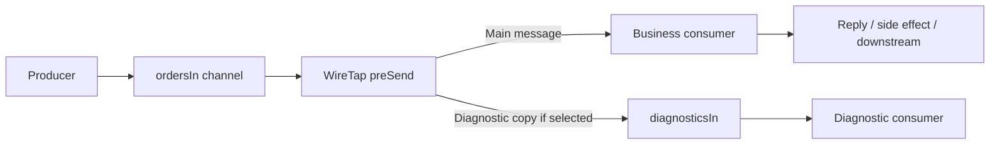
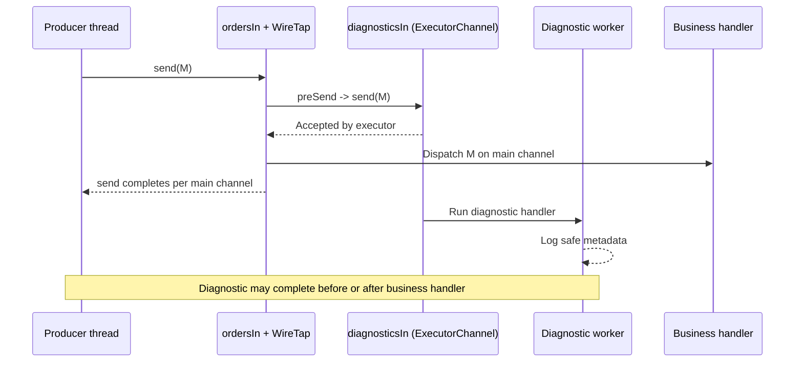
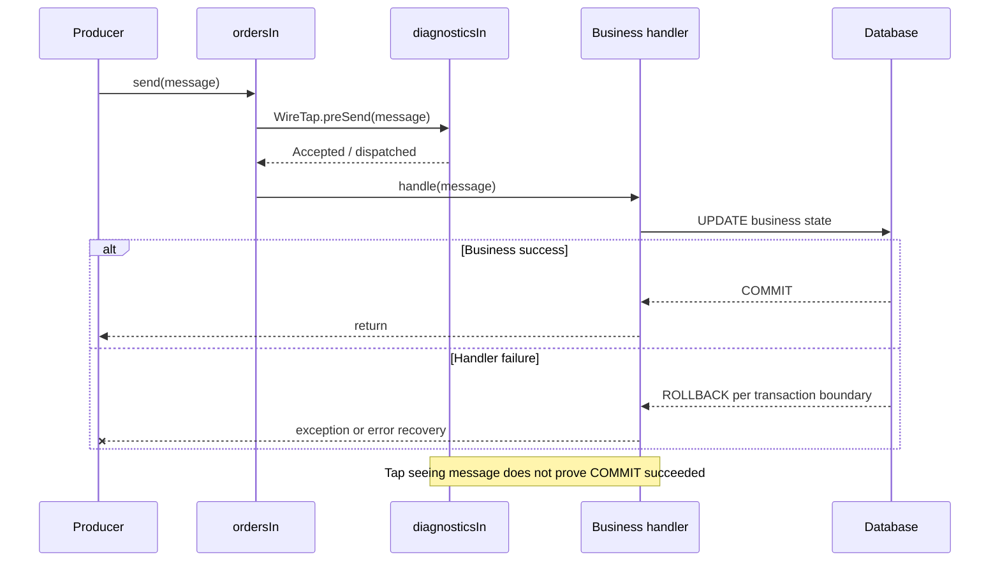

# Wire tap for controlled diagnostics in Spring Integration

## 1. The problem: observing messages without disrupting the business flow

In the `SPRING_INTEGRATION_RUNTIME` module, messages are orchestrated across channels, endpoints, consumers, pollers, and executors. A system may need to analyze transactions, retries, errors, correlation, or post-restart behavior without turning every business handler into a logging site. **Wire Tap** is an Enterprise Integration Pattern that **creates an observation branch** at a channel: the message continues to the business consumer, while a copy of the message is sent to a secondary channel for diagnostics.

For example, orders flow from `ordersIn` into `OrderHandler`. When a customer reports latency, operations wants to trace a few specific `traceId`s, observing flow progression and timings without printing full personal information or dumping every payload to logs.

The naive solution is enabling `DEBUG` for all messages in production. That risks data leaks, higher CPU/I/O, prolonged transactions, and log volume explosions. Instead, a **controlled wire tap** requires clear guardrails:

- **Narrow scope:** select the exact channel to observe, rather than tapping the entire application context.
- **Selection criteria:** forward only messages approved by tenant/trace/correlation, or sample at a bounded rate.
- **Minimal data:** log safe metadata, never accidentally invoking `toString()` on payloads/headers containing PII, tokens, or secrets.
- **Bounded resources:** the diagnostic branch uses a controlled executor/queue without creating an unbounded buffer.
- **Clear lifecycle and failure impact:** understand when a tap blocks the main flow, when the diagnostic consumer runs on another thread, and how to turn the tap off.
- **Measurability:** track events selected, forwarded, rejected, failed, latency, and overhead.

After this lesson, you should be able to explain that `WireTap` is a `ChannelInterceptor`, configure it via Java/XML/DSL, test across thread boundaries accurately, and operate it so diagnostics **never become a new incident themselves**.

## 2. Where does WireTap sit in the channel lifecycle?

Spring Integration implements wire tap with `org.springframework.integration.channel.interceptor.WireTap`. This class is a `ChannelInterceptor`: when a message is sent to an intercepted channel, `preSend(...)` evaluates the `MessageSelector` (if present) and attempts to send the message to a **secondary channel**. The primary message still proceeds through the original channel using that channel's dispatch mechanism.



The diagram focuses on the **two logical branches**. In actual call order, `WireTap.preSend` executes **before** the original channel dispatches the message to its consumer; the secondary branch may finish earlier, later, or fail independently depending on channel types and threading.

### What WireTap does and does not do

| Observation | Accurate behavior to understand |
|---|---|
| Attached tap to `ordersIn` | The interceptor sees the message when sent to that channel, before dispatch on the main channel. |
| `MessageSelector` configured | Only messages accepted by the selector are forwarded to the diagnostic channel. |
| Tap without a selector | By default, every message passing the interception point can be selected. |
| Secondary consumer reads message | It receives the message for observation; the main flow is not rerouted "through" the diagnostic consumer. |
| Tap creates a "copy" | Not a deep clone of the payload; the payload and referenced objects may be shared. Never mutate objects from the diagnostic branch. |
| Tap is running | Means the interceptor can act on subsequent sends, not that sources are stopped or messages are durably persisted. |
| Tap is stopped | No new messages are selected at the tap point; tasks already enqueued/running in the secondary branch may still finish afterward. |

**Note on measurement target:** tapping a mid-flow channel records messages **reaching that channel**, not every message entering the application, nor the number of committed business operations. If a filter/router precedes the tap, dropped messages will not appear. If the tap sits at the start of the flow, a message seen by the tap may still fail in a downstream handler.

### Message ID, correlation ID, and trace ID

- `MessageHeaders.ID` identifies a single message instance; crossing a transformer/enricher or adapter can produce a new instance with a new ID.
- `correlationId` and `sequenceNumber` have special meaning for splitters/aggregators/resequencers; they are not automatically an end-to-end trace ID.
- `traceId` links logs/traces according to observability conventions. You can use Micrometer Tracing or an application-managed header.
- Business event IDs must remain stable across retries/redeliveries if you need to analyze one business operation across multiple message instances.

Therefore, diagnostic logs should record a **safe business event ID or trace ID**, channel/endpoint, timestamp, outcome, and thread; never rely on a message UUID to decide whether two executions are duplicates.

## 3. Wire tap is not automatically asynchronous

A common misconception is "a tap is just logging, so it surely runs in the background". In reality, `WireTap` invokes `send` to the **secondary channel** inside `preSend`. It is the **diagnostic channel type** that determines which thread dispatches to the consumer.

| Diagnostic target | When sending to the tap | Potential impact on the main flow |
|---|---|---|
| `DirectChannel` | Secondary subscriber runs synchronously inside the producer's `send` call | Slow logging/JSON serialization/HTTP calls increase latency; exceptions from the secondary consumer can propagate back to the main send. |
| `ExecutorChannel` | Hands work off to a `TaskExecutor` so workers run later | Reduces secondary handler time on the main thread, yet **task submission can still fail/reject** if the pool or queue is full. |
| `QueueChannel` | Enqueues into a queue for a polling consumer later | Can block/time out when full; in-RAM queues are not durable across restarts without a persistent store. |
| `PublishSubscribeChannel` without executor | Sends synchronously to multiple secondary subscribers | A slow or failing subscriber can impact the send call. |
| Broker/storage-backed channel | Depends on adapter and transaction/ack | Adds I/O, risk of send errors or duplicate messages; does not automatically detach from transactions. |



**Never claim "taps are always fail-open".** Errors occurring while `WireTap` resolves the channel or calls `send` to the secondary branch can surface in `preSend` and disrupt the main send. Even with `ExecutorChannel`, executor task rejections under overload can still happen directly on the sending thread.

When diagnostics must genuinely never fail business operations, design **best-effort interception** explicitly: define which exceptions may be swallowed, count errors, enforce bounded buffers or non-blocking handoffs, and test under overload. Conversely, if auditing is **mandatory** for compliance, the policy may be **fail-closed**, persisting audits durably via an appropriate transaction/outbox. Never use one configuration for both goals.

## 4. Controlled observation model

Before writing code, start from an **operational decision** rather than "log everything":

| Question | Example decision |
|---|---|
| Where to tap? | Only `ordersIn` before the order confirmation handler. |
| Why tap? | Distinguish slowness in dispatch, queueing, or business handlers. |
| Which messages to select? | Operator-approved trace IDs, specific test messages, or a 1% sample. |
| Who can enable it? | Authenticated, audited internal control-plane; application-assigned control headers, never trusting client input. |
| What data to record? | Event type, opaque trace ID, message ID, channel, thread, timestamp, duration; never payloads. |
| How long to retain? | Short diagnostic window, with retention, quotas, and access controls. |
| When the collector fails? | For best-effort diagnostics: count dropped/rejected and alert; for mandatory audit: use outbox/transaction. |
| When to turn off? | Once the incident window closes; expose a metric confirming tap enabled/disabled state. |

### Filtering layer ≠ sanitization layer

`MessageSelector` only decides **whether to forward the whole message to the tap channel**. It does not mask or strip sensitive fields from the message. Even if the diagnostic consumer logs only `traceId`, the full message still entered the diagnostic channel and could sit in queues/executors, heap dumps, or secondary error logs.

If your organization **forbids sensitive payloads from entering the diagnostic subsystem**, a selector alone is **insufficient**. You must construct a **sanitized message** containing allowlisted metadata before the trust boundary, using a custom interceptor or controlled internal transformer/producer. Do not push raw payloads into a diagnostic queue hoping the logger will eliminate all exposure.

## 5. Java example: selective tap on DirectChannel, separate thread for observation

Example running in a Spring application with `spring-integration-core`, Spring Context, and SLF4J; uses Java 17+ for `record`. Place the `public class`/`record` definitions below in **separate Java files** under package `example.integration`.

Topology:

```text
Producer ----> ordersIn (DirectChannel) ------> OrderEndpoints.process()
                  |
                  +-- ordersWireTap (selector)
                         |
                         v
                 diagnosticsIn (ExecutorChannel)
                         |
                         v
                 OrderEndpoints.diagnose()
```

Assuming the payload is a demo DTO containing no personal data. With real business payloads, always apply the data policies in Section 4.

### 5.1. Configuring channels, bounded executor, and WireTap

```java
package example.integration;

import org.springframework.beans.factory.annotation.Qualifier;
import org.springframework.context.annotation.Bean;
import org.springframework.context.annotation.ComponentScan;
import org.springframework.context.annotation.Configuration;
import org.springframework.integration.channel.DirectChannel;
import org.springframework.integration.channel.ExecutorChannel;
import org.springframework.integration.channel.interceptor.WireTap;
import org.springframework.integration.config.EnableIntegration;
import org.springframework.integration.core.MessageSelector;
import org.springframework.messaging.MessageChannel;
import org.springframework.scheduling.concurrent.ThreadPoolTaskExecutor;

@Configuration
@EnableIntegration
@ComponentScan(basePackageClasses = OrderEndpoints.class)
public class ControlledWireTapConfig {

    @Bean("diagnosticExecutor")
    public ThreadPoolTaskExecutor diagnosticExecutor() {
        ThreadPoolTaskExecutor executor = new ThreadPoolTaskExecutor();
        executor.setThreadNamePrefix("diagnostic-");
        executor.setCorePoolSize(1);
        executor.setMaxPoolSize(2);
        executor.setQueueCapacity(64);
        return executor;
    }

    @Bean("diagnosticsIn")
    public MessageChannel diagnosticsIn(
            @Qualifier("diagnosticExecutor")
            ThreadPoolTaskExecutor diagnosticExecutor) {

        return new ExecutorChannel(diagnosticExecutor);
    }

    @Bean("ordersWireTap")
    public WireTap ordersWireTap(
            @Qualifier("diagnosticsIn") MessageChannel diagnosticsIn) {

        MessageSelector selector = message -> {
            boolean allowed = Boolean.TRUE.equals(
                    message.getHeaders().get("diagnosticsApproved"));

            Object traceId = message.getHeaders().get("traceId");
            return allowed
                    && traceId instanceof String
                    && ((String) traceId).startsWith("diag-");
        };

        WireTap tap = new WireTap(diagnosticsIn, selector);
        tap.setTimeout(0);
        return tap;
    }

    @Bean("ordersIn")
    public DirectChannel ordersIn(
            @Qualifier("ordersWireTap") WireTap ordersWireTap) {

        DirectChannel mainChannel = new DirectChannel();
        mainChannel.addInterceptor(ordersWireTap);
        return mainChannel;
    }
}
```

**Why define a dedicated bean for `WireTap`?** So the application can inject the exact same interceptor instance, check `isRunning()`, or call `stop()/start()` under an authorized workflow. Do not create multiple distinct `WireTap` instances and assume you are controlling the one attached to the channel.

**Why isn't `setTimeout(0)` a fail-open guarantee?** The timeout for sending to the secondary channel is in milliseconds; on targets like queues, send wait time affects blocking. However, executor rejections, channel resolution failures, exceptions in interceptors/selectors, or downstream configuration can still affect the main send path. If you need a policy where "diagnostic failures never break business logic", design and test an explicit isolation mechanism.

**Why a bounded executor?** `queueCapacity=64` and worker limits prevent unbounded task accumulation in the diagnostic executor. When the pool/queue fills, task rejection policies must be **observed and handled**; this setup does not silently discard messages safely on its own. Never share an unbounded executor between business and diagnostics, or the observation branch can starve core business work.

### 5.2. Demo payload and handlers

```java
package example.integration;

public record OrderEvent(String eventId, long totalCents) {}
```

```java
package example.integration;

import java.util.concurrent.atomic.AtomicInteger;

import org.slf4j.Logger;
import org.slf4j.LoggerFactory;
import org.springframework.integration.annotation.MessageEndpoint;
import org.springframework.integration.annotation.ServiceActivator;
import org.springframework.messaging.Message;

@MessageEndpoint
public class OrderEndpoints {

    private static final Logger log =
            LoggerFactory.getLogger(OrderEndpoints.class);

    private final AtomicInteger businessCount = new AtomicInteger();
    private final AtomicInteger diagnosticCount = new AtomicInteger();

    @ServiceActivator(inputChannel = "ordersIn")
    public void process(Message<OrderEvent> message) {
        // Demo: do not log full payload, no external side effects.
        businessCount.incrementAndGet();
    }

    @ServiceActivator(inputChannel = "diagnosticsIn")
    public void diagnose(Message<?> message) {
        // Allowlist metadata. DO NOT log message.toString() or payload.
        diagnosticCount.incrementAndGet();

        log.info("wiretap eventType={} traceId={} messageId={} thread={}",
                message.getHeaders().getOrDefault("eventType", "unknown"),
                message.getHeaders().getOrDefault("traceId", "missing"),
                message.getHeaders().getId(),
                Thread.currentThread().getName());
    }

    public int getBusinessCount() {
        return businessCount.get();
    }

    public int getDiagnosticCount() {
        return diagnosticCount.get();
    }
}
```

The diagnostic branch **does not mutate** `Message<?>`, does not return a reply, and does not re-send messages into `ordersIn`. It logs only **allowlisted metadata**. In production, even `traceId` or `eventType` headers must have their origin and format validated (e.g., length/character allowlists) to avoid log injection or exposing business details.

### 5.3. Sending three messages to test the selector

From a bean with `ApplicationContext context`, invoke:

```java
import example.integration.OrderEvent;

import org.springframework.context.ApplicationContext;
import org.springframework.messaging.MessageChannel;
import org.springframework.messaging.support.MessageBuilder;

MessageChannel input =
        context.getBean("ordersIn", MessageChannel.class);

input.send(MessageBuilder
        .withPayload(new OrderEvent("evt-101", 1200L))
        .setHeader("eventType", "ORDER_CREATED")
        .setHeader("traceId", "diag-101")
        .setHeader("diagnosticsApproved", true)
        .build());

input.send(MessageBuilder
        .withPayload(new OrderEvent("evt-102", 2300L))
        .setHeader("eventType", "ORDER_CREATED")
        .setHeader("traceId", "trace-102")
        .setHeader("diagnosticsApproved", false)
        .build());

input.send(MessageBuilder
        .withPayload(new OrderEvent("evt-103", 3400L))
        .setHeader("eventType", "ORDER_CREATED")
        .setHeader("traceId", "diag-103")
        .setHeader("diagnosticsApproved", true)
        .build());
```

Expected results after the diagnostic executor finishes:

| Message | Business consumer | Diagnostic consumer |
|---|---|---|
| `evt-101`, `diag-101`, approved | Yes | Yes |
| `evt-102`, not approved | Yes | No |
| `evt-103`, `diag-103`, approved | Yes | Yes |

The business counter will be **3**; the diagnostic counter will eventually be **2** assuming no rejections/errors. Both counters **do not necessarily reach those values simultaneously**: `ordersIn` is a `DirectChannel`, while `diagnosticsIn` uses an executor. In tests, **wait conditionally with a bounded timeout** instead of asserting diagnostic counts immediately after `send()`.

**Critical security warning:** the example illustrates `diagnosticsApproved` on the message. With untrusted external sources, **never** take this value directly from a client request to decide whether to record diagnostics. An authenticated internal component tied to an approved incident should decide whether to tap; better yet, read an allowlist from an internal control-plane rather than relying on arbitrary caller-supplied headers.

## 6. Managing on/off state and controlled message selection

`WireTap` implements the lifecycle interface; `isRunning()`, `stop()`, and `start()` allow controlling interception.

Example called directly from authorized internal management code:

```java
import org.springframework.integration.channel.interceptor.WireTap;

WireTap tap = context.getBean("ordersWireTap", WireTap.class);

tap.stop();                  // Stop tapping subsequent sends.
boolean enabled = tap.isRunning();

tap.start();                 // Re-enable when approved.
```

**Do not turn this snippet into a public HTTP endpoint.** An "enable logging" switch can spike log volume and broaden metadata access. Require authentication, authorization, auditing of who enabled it and why, an expiration window, metrics counting activations, and config reset across deployments.

Lifecycle limitations:

- Stopping the tap does not stop the **business consumer**.
- Stopping the tap does not clear messages already enqueued in the diagnostic executor/queue.
- Re-enabling the tap does not replay messages that passed through the channel while the tap was off.
- A `WireTap` bean is scoped **to that JVM/context**. With 5 pods, toggling one pod does not toggle the other 4 pods.
- Verify `start()/stop()` and runtime state behavior for your version; do not treat lifecycle state as a durable audit protocol across restarts.

### 6.1. Bounded dynamic selectors

In production, you can replace the Boolean header with a `MessageSelector` reading an **atomically updated immutable allowlist** or configuration snapshot from an internal control-plane. Bound both TTL and allowlist size so event IDs are never retained indefinitely in RAM.

A stable sampling strategy keyed by business event ID:

```java
MessageSelector onePercent = message -> {
    Object eventId = message.getHeaders().get("businessEventId");
    if (!(eventId instanceof String)) {
        return false;
    }
    int bucket = Math.floorMod(((String) eventId).hashCode(), 100);
    return bucket < 1;
};
```

This is only **approximately 1% by hash distribution**, not an exact 1% guarantee on small batches. Advantage: replaying the same event ID lands in the same bucket, making correlation easier. Drawback: `String.hashCode()` is not a cryptographic hash; if an adversary controls event IDs, never use it as an access-control basis.

**Sampling ≠ authorization:** even within a 1% sample, data must still be sanitized and restricted to authorized personnel.

## 7. Ways to attach WireTap: local, DSL, global, and XML

### 7.1. Local interception in Java

Section 5 showed calling `mainChannel.addInterceptor(tap)`. Its advantage is **explicit scope**: only that single channel is tapped. This is a good choice when debugging a targeted incident.

### 7.2. Java DSL with `MessageChannelSpec.wireTap()`

Spring Integration Java DSL supports attaching a tap when defining a channel:

```java
import org.springframework.context.annotation.Bean;
import org.springframework.integration.channel.QueueChannel;
import org.springframework.integration.dsl.MessageChannels;

@Bean
public QueueChannel watchedQueue() {
    return MessageChannels.queue()
            .wireTap("diagnosticsIn")
            .get();
}
```

Here `diagnosticsIn` is an existing `MessageChannel` bean in the context. `MessageChannels.queue()` creates a pollable channel; without proper bounds or a persistent store, an in-RAM queue risks losing backlog on restart or growing memory. The example only illustrates the `wireTap()` API, not a recommendation for unbounded queues in production.

You can also use `.wireTap(...)` or `.log(...)` DSL operators in an `IntegrationFlow`. When applying operators to a channel that does **not** implement `InterceptableChannel`, the DSL may insert an intermediate `DirectChannel` and bridge to host the interceptor. Consequently, the **actual tap location** in the runtime topology may differ from your initial mental diagram if you read only the DSL chain without inspecting the graph.

### 7.3. Global wire tap by pattern

When you need to observe a group of channels, you can use `@GlobalChannelInterceptor`:

```java
import org.springframework.context.annotation.Bean;
import org.springframework.integration.channel.interceptor.WireTap;
import org.springframework.integration.config.GlobalChannelInterceptor;
import org.springframework.messaging.MessageChannel;

@Bean
@GlobalChannelInterceptor(patterns = "ordersIn", order = 3)
public WireTap scopedOrdersTap(MessageChannel diagnosticsIn) {
    return new WireTap(diagnosticsIn);
}
```

This is an **alternative** to the local attachment in Section 5; do not configure both simultaneously unless you intend to tap twice. Spring Integration supports patterns and interceptor ordering, which can cover multiple channels, provided you exclude the diagnostic channel to avoid loops.

**Do not use `patterns = "*"` just to debug one channel**: it can intercept `errorChannel`, internal channels, or `diagnosticsIn` itself, causing log amplification or loops. Even though `WireTap` has self-protection veto logic for certain circular configurations, always scope namespaces explicitly and test the resulting topology.

### 7.4. XML namespace and selector

```xml
<int:channel id="ordersIn">
    <int:interceptors>
        <int:wire-tap channel="diagnosticsIn"
                      selector="approvedTapSelector"/>
    </int:interceptors>
</int:channel>

<int:channel id="diagnosticsIn">
    <int:dispatcher task-executor="diagnosticExecutor"/>
</int:channel>
```

The fragment requires the `int` namespace, an `approvedTapSelector` bean implementing `MessageSelector`, and a configured `diagnosticExecutor` bean. You can use `selector-expression` instead of `selector` for a boolean SpEL expression. Never feed arbitrary user-request expressions into selector SpEL.

The documentation also supports top-level `<int:wire-tap pattern="..." channel="..."/>` for global wire taps. Apply only one attachment strategy at a given point unless multiple independent branches are intentional.

## 8. Why "copying the message" does not mean an independent data copy

A `Message<?>` has an immutable headers interface and a payload reference. When sending the same message down both main and diagnostic flows, **the payload object can be shared**. If the payload is a `byte[]`, mutable `List`, or DTO with setters, the diagnostic consumer can observe the exact same instance being used by the business handler.

**Anti-pattern** example:

```java
@ServiceActivator(inputChannel = "diagnosticsIn")
public void unsafe(Message<byte[]> message) {
    byte[] payload = message.getPayload();
    payload[0] = 0;  // Wrong: may mutate main flow data too.
}
```

This example **must not be run**; it demonstrates why a "wire tap copy" does not promise a **deep copy**. Rules:

1. Diagnostic handlers must be **read-only** with respect to payloads and headers.
2. Never retain mutable payload references in long-lived caches when only metadata is needed.
3. If you need a data snapshot to reproduce a bug, build a **sanitized, versioned** representation at a trusted boundary without mutating the original message.
4. If inspecting byte payloads, compute checksums/hashes via safe reads, keeping CPU cost and data policy in mind; never log raw bytes.
5. For lazy/stream payloads, reading the payload in the tap branch can consume the stream so the business branch cannot read it; switch to replayable payloads or reference storage.

**This is a data-integrity risk, not merely a logging risk.** Incidents where "turning on the tap breaks the flow" can come from the secondary handler mutating a shared object or consuming a single-read `InputStream`.

## 9. Transaction, retry, and ErrorMessage boundaries

A wire tap sits at **the moment a message is sent through a channel**, not at "business transaction commit".

### 9.1. Observation timing



With `DirectChannel`, the business handler can run on the producer's thread; the tap also executes `preSend` on that thread before the handler. If the diagnostic target is also a `DirectChannel`, the same-thread diagnostic handler may sit inside an **active thread-bound transaction**. If the target is an `ExecutorChannel`, the diagnostic handler runs on another thread and **does not automatically inherit** the caller's JDBC transaction.

### 9.2. Tap succeeds yet business logic fails

If the tap logs a message and the handler then throws an exception:

- The tap log proves **the message reached the interception point**, not that processing succeeded.
- The business transaction may roll back, whereas logs/metrics outside the DB cannot roll back.
- The source or retry advice may redeliver the message and trigger the tap again.
- Diagnostic counts can **exceed** business commit counts, even without channel-level tap duplication.

For accurate analysis, correlate events using `businessEventId` and log **attempt numbers**, business commit outcomes, acks, and error/recovery channels. When you need a business audit proving completion, emit audit events **post-commit via a reliable design** such as a transactional outbox rather than treating an input tap as audit success.

### 9.3. Failures from the diagnostic branch itself

| Failure type | Where can it happen? | Impact |
|---|---|---|
| Selector throws an exception | `WireTap.preSend` on the sending thread | Risks failing the main send path. |
| Diagnostic target missing/resolution fails | When WireTap looks up the channel | Risks failing the send immediately on the tap branch. |
| Executor pool full or rejects task | When `diagnosticsIn.send` tries to dispatch | Can fail directly inside `preSend`. |
| Diagnostic handler throws on executor thread | After the tap send has returned | Exception follows async dispatch error handler/error channel; does not automatically roll back business work. |
| Diagnostic queue full | On enqueue, per timeout/capacity | Can block, return false, or fail per channel contract; must be measured. |
| Diagnostic sink/log server down | Secondary consumer writing logs/HTTP | If synchronous, stalls the main flow; if async, builds backlog/retries. |

Never unconditionally log exceptions containing the full payload via `MessageHandlingException#getFailedMessage()` in the diagnostic branch; error logs can leak sensitive data too.

### 9.4. Does not replace `errorChannel`

`WireTap` observes messages at the **channel being sent to**. `errorChannel`/`ErrorMessage` is the error reporting path when exceptions are caught and published. To inspect failures without touching normal payloads, instrument the error channel or a dedicated error handler with **redacted exception summaries**, while avoiding global taps that loop when the error handler itself emits new messages.

**Never use a tap as a retry handler**: re-sending a message back into `ordersIn` from a diagnostic consumer to "try again" easily creates loops and duplicates. Retries must be explicit policy at endpoints, brokers, or recovery flows, with idempotency and attempt limits.

## 10. Designing "fail-open" or "fail-closed" responsibly

Two different operational objectives:

| Objective | Acceptable policy | Design |
|---|---|---|
| **Best-effort diagnostics** | Losing some observations is acceptable; business work must not break due to debugging | Sampling, redacted metadata, bounded queues, timeouts, drop/reject metrics, and tested error isolation. |
| **Mandatory audit** | Business work must not commit unless the required audit marker is persisted per contract | Transactional audit/outbox in the same DB or durable audit infrastructure; intentional fail-closed with retention and reconciliation. |
| **Security monitoring** | Must prevent payload exposure while keeping verifiable evidence of audited events | Field allowlists, access controls, tamper-evident storage where needed, retention, and access auditing. |

For best-effort diagnostics, merely swapping a tap's `DirectChannel` for an `ExecutorChannel` **is not enough** to claim all errors are isolated. If your policy is to ignore secondary-branch failures, build a dedicated interceptor/secondary emitter with **narrow try/catch blocks**, bounded resources, drop metrics, and tests under full-target conditions. Never swallow fatal JVM errors like `OutOfMemoryError`, and never suppress errors when mandatory auditing is required.

Another design is **extracting safe data up front** before sending to the diagnostic queue:

```java
public record SafeDiagnosticEvent(
        String businessEventId,
        String traceId,
        String sourceChannel,
        String eventType
) {}
```

If the organization forbids the diagnostic subsystem from seeing payloads, `SafeDiagnosticEvent` must be constructed in a trusted step using an **allowlist of fields** and sent to the secondary channel. Standard `WireTap` forwards the intercepted message as-is and **does not convert payloads into this record on its own**; you need a transformer or custom interceptor beyond WireTap to achieve that.

## 11. Sampling, memory bounds, and performance impact

### 11.1. Estimating cost

Suppose an ingress rate `λ = 20,000 messages/second`, sampling `p = 2%`, and each safe metadata log entry is roughly 300 bytes:

\[
\lambda_{\text{tap}} \approx \lambda \times p = 400\ \text{messages/second}
\]

\[
D_{\text{raw}} \approx 400 \times 300 = 120,000\ \text{bytes/second}
\]

Retained for 24 hours, raw data totals around **10.4 GB** before log envelopes, indexing, replication, metadata, and compression. These illustrative numbers highlight that even sampled taps generate substantial volume at high throughput.

If **all** 2 MiB messages traverse an in-RAM diagnostic queue of 64 slots, payload references or copies exert very different memory pressure depending on the design. Never size buffers solely by `queueCapacity` while ignoring **serialized message size, object retention, copy count, and processing lifetime**.

### 11.2. Metrics to instrument

| Suggested metric | Meaning |
|---|---|
| `wiretap_selected_total` | Messages permitted by the selector for tapping. |
| `wiretap_forwarded_total` | Successful forwards to the target per channel contract. |
| `wiretap_rejected_total` | Diagnostic branch overloaded or enqueue failed. |
| `wiretap_handler_failures_total` | Diagnostic consumer failed after dispatch. |
| `wiretap_diagnostic_queue_depth` | Current depth of diagnostic queue/executor. |
| `wiretap_selection_latency` | Selector cost on the main send path. |
| `wiretap_send_latency` | Time spent performing the tap send; important even with async targets. |
| `business_channel_send_latency` | Impact on main flow before vs after enabling the tap. |
| `wiretap_enabled` | Actual enabled state per instance. |
| `diagnostic_log_bytes_total` | Estimated storage/logging volume. |

These names are **application metric suggestions**, not built-in Spring Integration/Micrometer names. Combine them with native Spring Integration metrics (channel send/receive, handler duration) for your framework version.

### 11.3. Prioritize existing telemetry before raising diagnostic detail

In many cases, **Micrometer counters/timers, Observation/tracing, and lightweight structured logs** pinpoint the issue without capturing message contents. Enable detailed taps only when a concrete question cannot be answered by metrics/traces—for example, "did the message reach channel B before the router chose branch C?".

To minimize overhead:

- Keep selectors lightweight; never call DBs/HTTP or parse large payloads inside `preSend`.
- Never call `message.toString()` or serialize large DTOs to log every message.
- Isolate the diagnostic executor from business executors; enforce bounded queues and monitor rejections.
- Use specific trace/event allowlists with expiration windows; avoid leaving taps running permanently after incidents.
- Set byte quotas, retention, rate limits, and log access rules.
- Benchmark `p=0`, `p=1%`, and `p=100%` in tests and report p95/p99 main-flow latency.

## 12. JMX and runtime lifecycle of a tap

`WireTap` supports `start()`, `stop()`, and `isRunning()`. These methods carry management annotations in some versions; to invoke them via JMX, the object must actually be **exported as an MBean** by an appropriate management configuration. Never assume a Java method automatically appears in JConsole.

With `IntegrationMBeanExporter`, the primary focus is exporting channels/handlers/sources. If you need to manage a `WireTap` bean itself via JMX, verify the actual Bean/ObjectName/registration or build an authenticated internal control-plane. Never allow unauthorized callers to invoke `stop()`/`start()` or unleash unbounded diagnostic output.

### Is stopping diagnostics safe for queued messages?

Suppose `WireTap.stop()` is called while the executor already holds 100 queued diagnostic tasks:

- Already-enqueued tasks may **continue to completion**, depending on the target executor's lifecycle.
- New business messages continue flowing on the main channel **without** being tapped per stop behavior.
- If the application shuts down right afterward, in-flight diagnostic tasks may be truncated; never treat diagnostic logs as a transaction ledger.
- If true log draining is required, coordinate executor/log-sink lifecycle, timeouts, and in-flight metrics explicitly.

Never stop `ordersIn` or business endpoints when your only goal is dialing down logging; control the interceptor bean rather than the entire flow.

## 13. Security: what data is allowed on the diagnostic branch?

Taps are typically turned on during incidents, when operators tend to want to see "everything". That is also when data leaks are most likely.

### Data checklist

| Data | Handling rule |
|---|---|
| Access tokens, refresh tokens, API keys, passwords, cookies | Never copy to diagnostic logs; strip at trusted boundaries. |
| PII such as emails, phone numbers, addresses | Never log raw values; use opaque IDs or masked values if policy permits. |
| Payment/card/health data | Strictly restricted; prefer traces/metrics and avoid tapping payloads. |
| `replyChannel`/`errorChannel` headers | May hold channel objects or sensitive routing names; never dump all headers. |
| Business ID / trace ID | Validate source, character allowlist, length limit, retention, and access control. |
| Exceptions | Log controlled exception class, code, and stack trace; avoid printing full `failedMessage`/payload. |

`log-full-message="true"` on a logging channel adapter can print headers too; even default payload-only logging can leak sensitive data. A safer policy is **disabling full-message logging** in production. Choose expressions/handlers designed to emit only allowlisted metadata.

Additional safeguards: audit who enables taps, restrict roles able to read the sink, encrypt logs in transit and at rest, keep retention short, enforce automated deletion per policy, and test that sensitive fields never appear in logs during failures or retries.

## 14. Diagnosing by symptom

| Symptom | Possible cause | How to verify |
|---|---|---|
| Tap receives no messages | Not attached to active channel, selector returns false, tap stopped, target bean has no consumer | Check channel name, `tap.isRunning()`, selector, and actual topology. |
| Main handler slows immediately when tap enabled | Diagnostic target uses `DirectChannel`/sync logging, or selector/serialization is CPU-heavy | Measure `preSend` duration, thread names, call stacks, and sink latency. |
| Main flow fails when debug branch fills up | Executor rejects or queue send fails in `preSend` | Check `RejectedExecutionException`, queue capacity, timeouts, and error logs. |
| Diagnostic log appears before business success | Tap runs before main dispatch, not as a post-commit hook | Add business outcome events/metrics at the actual commit point. |
| Diagnostic log appears multiple times for one event | Retries, broker redeliveries, message traversing multiple tapped channels, or duplicate tap attachment | Correlate `businessEventId`, `MessageHeaders.ID`, attempts, and interceptor lists. |
| Tap misses events filtered earlier | Tap placed **after** filter/router | Move observation point intentionally or instrument the discard point. |
| Tapped events show corrupted data | Mutable payload modified or stream consumed across two branches | Check shared references, serializers, defensive reads, and payload types. |
| Secondary messages keep reappearing in tap | Global pattern includes diagnostic channel, or secondary branch republishes into loop | Narrow patterns, verify veto logic and secondary consumer outputs. |
| Missing trace/correlation | Headers stripped/altered by transformers, adapters, or brokers | Inspect headers at each boundary; never replace business IDs with fresh UUIDs. |
| Diagnostic handler fails while business succeeds | Secondary branch is async with separate error handling | Check diagnostic executor's error channel and side-branch metrics. |
| Logs continue after stopping tap | Diagnostic tasks were enqueued before `stop()` | Compare enqueue timestamps, executor backlog, and in-flight counts. |
| PII leaked in logs | Full payload/message logging, error logger printing `failedMessage`, untrusted headers | Audit log pipeline and enforce allowlist/redaction before the diagnostic boundary. |

### A repeatable investigation workflow

1. Confirm the **exact instance, channel name, and tap attachment point**.
2. Send one test message with an approved internal `traceId` and one **unapproved** message.
3. Record timestamps of `preSend`, main handler receipt, diagnostic consumer receipt, and business commit if applicable.
4. Check `Thread.currentThread().getName()` in both branches to verify sync vs async behavior.
5. Intentionally trigger an error in the diagnostic handler, then at executor submission; record any impact on the main flow.
6. Compare counts of business messages, selected messages, and diagnostic processed items; allow eventual convergence on async branches.
7. Verify payloads/headers are neither logged outside the allowlist nor retained long-term in queues/heap.
8. Stop the tap, verify main-flow topology is unchanged, and confirm secondary logs only drain already-enqueued tasks.
9. Document the incident window configuration, quotas, retention, and rollback steps.

## 15. Hands-on exercises: verifying performance, safety, and recovery

Starting from the Java classes in Section 5, build a test suite sending events in an environment with no real customer data:

1. **Right tap point:** send the three messages from Section 5.3; wait for `businessCount=3` and `diagnosticCount=2` using a condition-based wait with timeout.
2. **Ordering:** log timestamps and threads of `WireTap.preSend` and both handlers; explain why diagnostics can log before business processing and why that does not signify commit.
3. **Selector:** set `diagnosticsApproved=false` on an otherwise approved message and verify the main handler still receives it while diagnostics does not.
4. **Lifecycle:** call `tap.stop()` and send a new event; confirm the main handler still processes it. Call `tap.start()` and test again.
5. **Direct vs Executor:** switch `diagnosticsIn` to `DirectChannel` in an isolated test configuration, add a 200 ms delay in the diagnostic handler, and compare p95 latency of `ordersIn.send`.
6. **Overload:** configure a very small diagnostic executor queue, block the worker under test control, and send a burst; observe rejection/failure policies and metrics rather than assuming "async is always fail-open".
7. **Loop test:** create a global tap targeting only `ordersIn`, then intentionally test a pattern covering `diagnosticsIn` in a test; observe loop-prevention mechanisms or anomalous effects to explain why explicit scoping is vital.
8. **Mutable payload:** use a `byte[]` with a read-only secondary consumer; contrast with the anti-pattern mutating the payload (in an isolated test only). Then fix the design with immutable payloads or defensive copies if genuinely needed.
9. **Retries:** have the business handler throw an exception after the tap records; enable bounded retries and check how many times the event appears at the tap.
10. **Security:** construct payloads containing synthetic sensitive data and assert log output **contains no** synthetic emails/tokens, even when exceptions occur.
11. **Cluster:** run two JVMs with identical tap configs and call `stop()` on one JVM; verify the state does not automatically propagate to the second JVM.
12. **Recovery:** kill the app while the diagnostic executor has backlog; explain why secondary logs may be lost while business messages must recover from a separate durable source if zero data loss is required.

For each case record:

| Evidence | Values to collect |
|---|---|
| Event/trace ID | Stable, approved business ID for tracking |
| Channel and interceptor | Exact `ordersIn`? Any duplicate tap attachments? |
| Threads | Producer, business handler, diagnostic handler |
| Counts | Received, selected, forwarded, processed, rejected |
| Latency | p50/p95/p99 main send and diagnostic handoff |
| Errors/retries | Exceptions and call-stack location; attempt number |
| Security | Which fields actually appeared in logs/sinks/queues |
| Lifecycle | Tap enabled state, time-to-disable, remaining backlog |
| Recovery | After restart, did messages replay or was diagnostic data lost? |

## 16. Core rules for taking WireTap to production

- `WireTap` is a **`ChannelInterceptor` at `preSend`** for observing messages at **a single channel point**; it does not mean business work completed.
- **Not automatically async.** A secondary `DirectChannel` can block and throw exceptions right on the main thread; `ExecutorChannel`/`QueueChannel` decouple execution yet still carry handoff/capacity failures.
- **Select deliberately.** Use `MessageSelector`s, narrow patterns, and bounded sampling; never trust "enable diagnostics" headers sent by external requests.
- **A copy is not a deep copy.** Diagnostic consumers must be read-only, avoiding payload mutation or consuming shared streams.
- **Never log full payloads.** Be especially careful with `failedMessage`, `toString()`, `log-full-message`, and headers holding tokens or PII.
- **Enforce limits.** Executors/queues, event counts, bytes/second, retention duration, activation windows, and control-plane access must all have policies.
- **Separate audit from debug.** When audits must be durable and atomic, design an outbox/transaction; never rely on best-effort taps.
- **Measure before and after.** Main throughput/latency, diagnostic drops/errors, memory, and recovery matter more than merely "having logs".
- **Disable/restore under control.** `WireTap.start()/stop()` affects only the current instance's interceptor, does not drain secondary tasks automatically, and does not replace broker acks or transactions.

### Official references

- [Spring Integration Reference — Configuring Message Channels / Wire Tap](https://docs.spring.io/spring-integration/reference/channel/configuration.html): `WireTap`, interceptors, conditional selectors, global taps, channel-based async, and XML.
- [Spring Integration Reference — MessageChannelSpec.wireTap()](https://docs.spring.io/spring-integration/reference/dsl/java-wiretap.html): configuring taps via Java DSL and effects on intermediate channels.
- [Spring Integration Reference — Operator log()](https://docs.spring.io/spring-integration/reference/dsl/java-log.html): wire-tap-based DSL logging and notes on flow endpoints.
- [Spring Integration API — WireTap](https://docs.spring.io/spring-integration/api/org/springframework/integration/channel/interceptor/WireTap.html): constructor with `MessageSelector`, `setTimeout`, `preSend`, `start`, and `stop`.
- [Spring Integration API — MessageSelector](https://docs.spring.io/spring-integration/api/org/springframework/integration/core/MessageSelector.html): interface for selecting tapped messages.
- [Spring Integration Reference — Error Handling](https://docs.spring.io/spring-integration/reference/error-handling.html): error publishers and `ErrorMessage` in asynchronous processing.
- [Spring Integration Reference — Metrics and Management](https://docs.spring.io/spring-integration/reference/metrics.html): Micrometer, observation, and adding metrics for channels/handlers.
