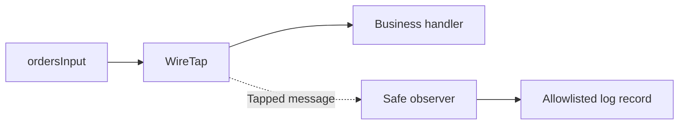
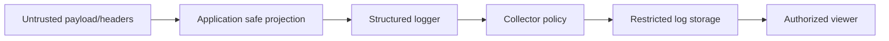
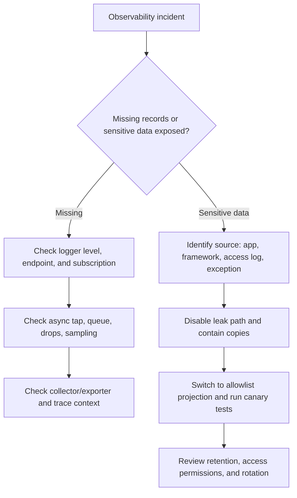

# Logging payloads, headers, and redaction

In **Spring Integration runtime**, a message passes through inbound adapters, channels, endpoints, consumers, pollers, executors, handlers, and error flows. When diagnosing "where is the message?", "why did it roll back?", or "why hasn't the aggregator released?", the fastest move is often turning on logs. However, **logging raw payloads or all headers** can expose customer data, authentication tokens, transaction contents, file paths, internal metadata, and exceptions carrying original messages.

The goal of observability is not to retain every byte that flowed through the pipeline. The goal is **capturing enough signal to explain runtime behavior while logs contain only permitted data**. This lesson belongs to the **Observability** chapter of the `SPRING_INTEGRATION_RUNTIME` module, focusing on payload/header logging strategies, redaction design, using `LoggingHandler`/`WireTap`, the `ErrorMessage` path, correlation, threading, transactions, and verification tests in real deployments.

> **Guiding principle:** treat payloads and externally supplied headers as *untrusted and potentially sensitive*; build an **allowlisted log projection** instead of serializing the raw `Message<?>`.

## 1. Why can `log.info("{}", message)` be dangerous?

Suppose a webhook receives a message containing payment details:

```text
Message<OrderPayment>
  payload:
    orderId: ORDER-42
    customerEmail: buyer@example.test
    cardToken: tok_live_example
    amount: 1499000
  headers:
    id: 8ad2...
    correlationId: ORDER-42
    authorization: Bearer secret-example
    x-api-key: secret-api-key
    replyChannel: internalReplyChannel
```

If a handler calls:

```java
// NOT RECOMMENDED in production.
log.info("Incoming message: {}", message);
log.debug("Headers: {}", message.getHeaders());
log.info("Payload: {}", message.getPayload());
```

then `toString()` on the message or DTO can include tokens and PII. Even when logged at `DEBUG`, that content can still reach log storage when debug logging is enabled during an incident, via disk log copies, or through centralized collection pipelines.

**Setting log level to `DEBUG` is not redaction.** Any value written to a log must be treated as having entered a storage system with its own retention lifecycle and access controls.

## 2. Classify data before logging

Start by asking: what data is **genuinely needed** to investigate the flow?

| Data category | Examples | Practical policy |
| --- | --- | --- |
| Low-sensitivity technical metadata | Application-assigned endpoint name, event type, handler status, duration, attempt count | Safe to allowlist, validate length and format |
| Opaque trace identifiers | System-generated trace ID, message UUID | Safe to log when encoding no personal data |
| Business identifiers | `customerId`, `orderId`, `correlationId` holding email/phone | Treat as potentially sensitive; use pseudonyms or controlled tokens |
| Content data | JSON payload, email text, file contents, HTTP body | Never log by default; extract only approved fields |
| Secrets and credentials | Bearer tokens, cookies, API keys, passwords, private keys, session IDs | Never log; even partial tokens require caution |
| Specially sensitive data | Payment, health, government ID data | Strictly restricted; exclude from standard application logs |
| Error details | Error code, exception type, retry state | Log at appropriate level, **never default to raw exception messages** |

Do not rely solely on field names. A `correlationId` header might be a harmless UUID or might be populated by a producer with a user's email. A `filename` might contain a customer name. A value is safe only when its **origin, contract, format, and intended use** are verified.

### 2.1. Suggested allowlist

A useful flow log record may need only:

```json
{
  "event": "message_handled",
  "flow": "orders-v3",
  "endpoint": "validateOrder",
  "trace_id": "4b7a18c7a1e04ae5",
  "message_id": "8571b530-c72c-4a45-b53d-8d7eeb50f0bc",
  "business_key_ref": "hmac:bc178e1dcdb079aa",
  "message_type": "ORDER_CREATED",
  "payload_size_bytes": 824,
  "attempt": 2,
  "outcome": "success",
  "duration_ms": 37
}
```

Numbers in this example are illustrative. `business_key_ref` is an application-computed pseudonym, **not** the raw business key. This log still connects related executions, surfaces retries, and measures latency without recording order contents.

## 3. Payloads: log observable structure, not full contents

Spring Integration payloads take many forms beyond JSON DTOs:

| Payload type | Logging pitfall | Safer observation approach |
| --- | --- | --- |
| Java record/DTO | `toString()` may print every field, including secrets | Build a dedicated allowlisted projection |
| `String` / JSON | May contain PII, tokens, free-form text | Log schema/event type from trusted fields, not raw body |
| `byte[]` | Binary dumps or garbled charset decoding | Log byte length or purposeful checksum |
| `File` / `Resource` | Paths/filenames may contain personal info | Log source alias, file type; pseudonymize path if truly needed |
| `InputStream` | Reading to log consumes the stream, starving the handler | Never read streams just to log; measure length from trusted metadata |
| `Flux`/`Mono`, reactive streams | Subscribing to log can trigger side effects/resubscription | Use signal-observation operators; avoid creating extra subscriptions |
| `ErrorMessage` | Payload may hold exception and failed message | Log only error code, exception type, and trace ID |

**Never serialize an arbitrary object solely to compute log size.** Serialization consumes CPU and memory, triggers unexpected getters, or leaks data. For `byte[]`, use `length`; for other types, log size only when reliable size metadata already exists.

### 3.1. Do not turn logging into a second consumer

If you log an `InputStream` by reading it to the end and passing it onward, the payload is already consumed. If a `Message<?>` is wire-tapped across multiple channels, the framework does not automatically **deep-copy** mutable payloads; one branch may observe the object before or after another branch mutates it. The right solution is **never mutating payloads to log**, building instead a compact observation record from permitted metadata.

## 4. Headers: there is no universally safe "log all headers except Authorization"

A message can carry standard headers like `id`, `timestamp`, `correlationId`, `sequenceNumber`, `sequenceSize`, `contentType`, `replyChannel`, `errorChannel`. JMS, Kafka, AMQP, HTTP adapters, and gateways add their own headers.

```text
Headers
  id
  timestamp
  correlationId
  replyChannel
  errorChannel
  authorization
  cookie
  x-api-key
  tracing baggage
  customTenantContext
  sourceFilePath
  ...
```

Excluding only `authorization`, `cookie`, and `password` is a **fragile denylist easily bypassed**. Secrets can hide in `X-Auth`, `proxy-authorization`, `session`, URL query strings, custom fields, or exception messages.

| Header | Handling suggestion | Condition |
| --- | --- | --- |
| `MessageHeaders.ID` | Log as UUID | Ensure it serves tracing only, never as a business key |
| `timestamp` | Safe to log | Do not infer source event time if it only marks message creation |
| `sequenceNumber`, `sequenceSize` | Log valid numbers when debugging aggregator/resequencer | Verify numbers stay within reasonable bounds |
| `correlationId` | Log system-issued opaque ID or HMAC of business key | Do not log raw emails/order numbers by default |
| `contentType` | Log from an accepted fixed set | Avoid printing arbitrary raw parameters |
| `replyChannel`, `errorChannel` | Usually omit object/`toString()` | May reveal internal structure and endpoint addresses |
| `Authorization`, `Cookie`, custom tokens/headers | Do not log | Never place in metric labels or trace baggage |
| Adapter-specific `errorMessage`/exception headers | Extract approved error code | Exception strings may embed payloads |

Never copy all `MessageHeaders` into MDC, OpenTelemetry baggage, or a JSON logger. **Header forwarding is a separate concern from log redaction**: if a message must be sent to another service, enforce a header forwarding/allowlist policy rather than merely hiding headers in logs.

## 5. Redaction, masking, hashing, and pseudonymization differ

| Technique | Result | Best suited when | Limitations |
| --- | --- | --- | --- |
| **Omit** | Field is not recorded | Payload/secret is unnecessary for diagnostics | Cannot query by that value |
| **Allowlist projection** | Keep only approved fields | Default approach for applications | Requires managing schema evolution |
| **Masking** | e.g., `***` or partial hiding | UI, support workflows under approved contracts | Unmasked portion may still be sensitive |
| **Unkeyed hash** | `SHA-256(value)` | High-entropy, unguessable data | Emails/phone numbers are vulnerable to dictionary attacks |
| **Keyed HMAC** | Secret-derived stable token | Correlating the same business key without exposing raw ID | Must protect key, plan rotation/retention |
| **Tokenization via secure vault** | Reference to original value | Authorized support workflows | Requires managing token vault and lookup audits |
| **Encryption** | Recoverable with key | Specialized storage mandated to keep content | Does not replace access control and data minimization |

**Plain hashing is not safe anonymization for low-entropy key spaces.** If values are predictable like emails or phone numbers, anyone holding hash logs can run a dictionary attack. For operational correlation, keyed HMAC using a secret managed outside source code is usually far more appropriate.

### 5.1. HMAC token for business keys

The Java 17+ example below pseudonymizes `orderId` without logging the raw value. The secret must come from a secret manager, **never hardcoded**, and must be sufficiently strong.

```java
import java.nio.charset.StandardCharsets;
import java.security.GeneralSecurityException;
import java.util.Arrays;
import java.util.HexFormat;

import javax.crypto.Mac;
import javax.crypto.spec.SecretKeySpec;

public final class BusinessKeyPseudonymizer {
    private final SecretKeySpec secret;

    public BusinessKeyPseudonymizer(byte[] keyMaterial) {
        if (keyMaterial == null || keyMaterial.length < 32) {
            throw new IllegalArgumentException("HMAC key must be sufficiently strong");
        }
        this.secret = new SecretKeySpec(keyMaterial, "HmacSHA256");
    }

    public String token(String namespace, String businessKey) {
        if (namespace == null || businessKey == null) {
            return "unavailable";
        }
        try {
            Mac mac = Mac.getInstance("HmacSHA256");
            mac.init(secret);

            // Domain separation prevents key collisions between two entity types.
            byte[] digest = mac.doFinal(
                    (namespace + ":" + businessKey)
                            .getBytes(StandardCharsets.UTF_8));

            // Illustration: 96-bit truncated token; choose length per collision-risk requirements.
            return "hmac:" + HexFormat.of()
                    .formatHex(Arrays.copyOf(digest, 12));
        }
        catch (GeneralSecurityException ex) {
            throw new IllegalStateException("Cannot compute log token", ex);
        }
    }
}
```

This creates a fresh `Mac` per call, avoiding sharing a non-thread-safe `Mac` instance. In production, establish a **key-versioning convention** such as `keyVersion` to distinguish tokens across secret rotations; note that rotating secrets changes pseudonym outputs and can break correlation between old and new logs unless planned for.

The inputs `namespace` and `businessKey` still exist in application memory. HMAC only prevents writing raw values to logs; it **does not** erase source data from other systems or remove data-protection obligations.

## 6. Build a safe log projection right at the boundary

A durable approach is building a **dedicated log record** rather than passing `Message<?>` to a formatter. For instance, a handler receives a message with any payload and logs only approved metadata.

```java
import java.util.Set;
import java.util.UUID;

import org.slf4j.Logger;
import org.slf4j.LoggerFactory;
import org.springframework.messaging.Message;
import org.springframework.messaging.MessageHeaders;
import org.springframework.stereotype.Component;

@Component
public final class SafeMessageObserver {
    private static final Logger log =
            LoggerFactory.getLogger(SafeMessageObserver.class);

    private static final Set<String> ALLOWED_EVENTS =
            Set.of("ORDER_CREATED", "ORDER_UPDATED", "ORDER_CANCELLED");

    public void observe(Message<?> message) {
        MessageHeaders headers = message.getHeaders();

        UUID messageId = headers.getId();
        String eventType = allowedEvent(headers.get("eventType"));
        String stage = safeStage(headers.get("flowStage"));

        Object payload = message.getPayload();
        long byteCount = payload instanceof byte[] bytes
                ? bytes.length : -1L;

        // DO NOT log raw payload, raw headers, raw correlationId,
        // exception message, or String.valueOf(message).
        log.info(
                "event=si_message_seen message_id={} event_type={} " +
                "stage={} payload_bytes={}",
                messageId, eventType, stage, byteCount);
    }

    private String allowedEvent(Object candidate) {
        if (!(candidate instanceof String value)) {
            return "UNKNOWN";
        }
        return ALLOWED_EVENTS.contains(value) ? value : "UNKNOWN";
    }

    private String safeStage(Object candidate) {
        if (!(candidate instanceof String value)) {
            return "UNKNOWN";
        }
        return switch (value) {
            case "RECEIVED", "VALIDATED", "PERSISTED", "PUBLISHED" -> value;
            default -> "UNKNOWN";
        };
    }
}
```

Here `eventType` and `flowStage` use **bounded allowlists**. This prevents not only content leakage but also **log forging** via client-supplied newlines, control characters, or arbitrary text. Whenever you must log a client-supplied opaque ID, validate length, characters, and origin first.

**Never use `messageId` as a business idempotency key** just because it appears in logs. A message reconstructed on retry/redelivery can get a new ID; use a contracted `businessKey` for deduplication, logging it as a token when needed.

### 6.1. Projection differs from modifying the real message

```text
Original Message (business flow)
  ├── original payload: handler may use per contract
  ├── original headers: routing/transaction/correlation used as needed
  └── observer builds only SafeLogRecord (allowlist)
           └── log pipeline
```

**Log redaction must never alter the payload or headers of the business message.** Using `MessageBuilder` to create a stripped-down message just for logging and forwarding that stripped message onward starves downstream handlers of required data; that is a functional bug, not proper data protection.

## 7. LoggingHandler and Java DSL `.log()`

Spring Integration provides `LoggingHandler` and the Java DSL `.log()` operator to observe message flows. They are convenient for debugging, provided you verify **which expression/content is actually logged**.

```java
// Java DSL fragment: log selected values, NOT the full message.
// Verify the exact API overload against your version.
IntegrationFlow flow = f -> f
        .log(org.springframework.integration.handler.LoggingHandler.Level.INFO,
                "orders.runtime",
                message -> "stage=accepted message_id="
                        + message.getHeaders().getId())
        .handle(orderService, "process");
```

The snippet above deliberately constructs a string with only a fixed stage and message ID. Never replace it with `message.toString()`, `message.getPayload().toString()`, or `message.getHeaders().toString()` in production.

Some framework logging configurations offer options to print the **entire message** or payloads/headers via expressions. Whenever used, inspect the final configuration and test log output on your **exact Spring Integration version**. Never assume that simply giving a logger the category `orders.runtime` performs redaction.

### 7.1. Where is observation meaningful?

For a flow:

```text
HTTP inbound
  -> validate
  -> transform
  -> ExecutorChannel
  -> call external service
  -> persist
  -> reply
```

You typically only need logs/metrics at key points:

1. **Received:** trace ID, message ID, event type, start timestamp.
2. **Validated:** validation outcome, error code if rejected.
3. **Dispatched:** logical destination, flow version, thread handoff if applicable.
4. **Attempt/Retry:** attempt number, categorized exception type.
5. **Committed/Failed:** business outcome, duration, redelivery/recovery status.
6. **Replied:** status code or outcome, never dumping response bodies.

Logging at every single channel for every message adds load without necessarily improving diagnostics. Signals like queue depth, send rates, and handler latencies usually belong in **metrics**.

## 8. WireTap: separating observation does not absolve security responsibility

`WireTap` lets messages on a channel be copied to an observation branch. That branch can contain a `LoggingHandler` or a handler emitting a safe log record. Model:



Java DSL fragment example (assuming `ordersInput`, `auditTap`, `orderService`, and `safeMessageObserver` are declared beans):

```java
import org.springframework.integration.dsl.IntegrationFlow;

// Business flow preserves the payload.
@Bean
IntegrationFlow orderFlow() {
    return IntegrationFlow.from("ordersInput")
            .wireTap("auditTap")
            .handle(orderService, "process")
            .get();
}

// Audit branch creates only a log projection.
@Bean
IntegrationFlow safeAuditFlow() {
    return IntegrationFlow.from("auditTap")
            .handle(safeMessageObserver, "observe")
            .get();
}
```

This illustrates **topology**, not a complete production setup. If `auditTap` is a `DirectChannel` and the observer runs synchronously, observer latency or exceptions **can impact** the main path. If auditing goes through an async executor/queue, you must define bounded buffers, overflow policies, and dedicated error handling.

**WireTap does not redact automatically.** It takes a message and forwards it to another branch; if the tap handler calls `log.info("{}", message)`, all sensitive data is still exposed.

### 8.1. Decisions required for an audit path

| Question | Policy to define |
| --- | --- |
| Can logging slow down the business handler? | Sync vs async, latency limits |
| What if the logging queue fills up? | Is dropping telemetry allowed, or must mandatory audits fail closed? |
| Should logs retain payloads? | Normally no; create projection before enqueueing |
| Do observer errors affect source acks? | Verify exception propagation per channel type |
| Do logs require ordering? | By message/group key and executor semantics |
| Do mandatory audits differ from debug logs? | Separate durable business audits from application diagnostic logs |

If your organization requires legal or accounting audits that must never be lost, **never use console logs or an in-memory WireTap as the source of truth**. Commit audit records inside the DB transaction/outbox with clear access controls and retention, then publish them to a durable audit store.

## 9. Log before or after transaction commit?

Suppose a handler executes:

```text
log "order processed successfully"
  -> DB INSERT
  -> downstream HTTP call
  -> exception
  -> DB rollback
```

The log claims "processed successfully" while the transaction actually rolled back. That is a **misleading log**.

Distinguish clearly:

| Event | When to log | Exact meaning |
| --- | --- | --- |
| `message_received` | Adapter/consumer received message | Does not prove business completion |
| `handler_started` | Handler begins an attempt | Not committed |
| `business_update_attempted` | Update call issued | May still roll back |
| `transaction_committed` | After confirming commit at the proper boundary | Changes in the transaction committed |
| `handler_failed` | Handler caught/saw an error | Source may retry/redeliver or recover |
| `message_acknowledged` | Source confirmed ack | Does not guarantee all external side effects succeeded |
| `recovery_recorded` | Failed work durably recorded | Depends on durability/transaction of that record |

**Never log "success" for an enqueue step** into `ExecutorChannel` or `QueueChannel`. `send() == true` may only mean the channel accepted the message; the downstream handler can still fail.

### 9.1. Post-commit does not mean everything is finished

If the DB transaction commits yet a subsequent event publish fails, `db_committed` differs from `event_published`. Logs should express distinct milestones, paired with outbox/retry mechanisms where needed. Logging "flow completed" inside a transaction never proves the transaction ultimately committed.

## 10. ErrorMessage and exceptions: an overlooked leak vector

In Spring Integration, errors can travel to `errorChannel` as `ErrorMessage`s; the payload of an `ErrorMessage` is typically a `Throwable` or an exception carrying the failed message.

Unsafe example:

```java
// Avoid when exception may carry failedMessage or request body.
log.error("Failure: {}", errorMessage.getPayload());
log.error("Flow failed", errorMessage.getPayload()); // Stack trace may leak data.
log.warn("Exception message: {}", throwable.getMessage());
```

A `MessagingException` can reference `failedMessage`. `toString()`, exception messages, or stack traces from underlying libraries sometimes embed request URLs with query tokens, SQL parameters, payloads, headers, or connection details. Thus, **redaction on the success path is not enough**.

### 10.1. Mapping errors to safe codes

An error-handling log record should look like:

```json
{
  "event": "message_failed",
  "flow": "orders-v3",
  "endpoint": "persistOrder",
  "message_id": "8571b530-c72c-4a45-b53d-8d7eeb50f0bc",
  "error_code": "DB_TRANSIENT",
  "exception_type": "TransientDataAccessException",
  "attempt": 3,
  "outcome": "retry_pending"
}
```

Never blindly copy `getMessage()` into `error_code`. Error codes must come from a **bounded application-owned enum/mapping**. When full stack traces are needed for deep investigations, enforce strict access controls and sanitize third-party library details; never treat stack traces as inherently safe.

### 10.2. Writing an ErrorMessage observer without dumping the original message

```java
import org.slf4j.Logger;
import org.slf4j.LoggerFactory;
import org.springframework.messaging.Message;
import org.springframework.messaging.support.ErrorMessage;
import org.springframework.stereotype.Component;

@Component
public final class SafeErrorObserver {
    private static final Logger log =
            LoggerFactory.getLogger(SafeErrorObserver.class);

    public void observe(ErrorMessage errorMessage) {
        Throwable failure = errorMessage.getPayload();

        // Do not log failure.toString(), getMessage(), or failedMessage.
        String code = classify(failure);

        log.warn("event=flow_failure error_code={} exception_type={}",
                code, safeType(failure));
    }

    private String classify(Throwable failure) {
        if (failure instanceof java.util.concurrent.TimeoutException) {
            return "TIMEOUT";
        }
        return "UNEXPECTED";
    }

    private String safeType(Throwable failure) {
        if (failure == null) {
            return "UNKNOWN";
        }
        // In production, map to an approved enum type.
        String name = failure.getClass().getSimpleName();
        return name.matches("[A-Za-z0-9_]{1,80}") ? name : "UNKNOWN";
    }
}
```

This is an observation handler, not a replacement for error handling. `ErrorMessage` handling and exception propagation depend on endpoint, adapter, and error channel configuration. If an observer catches an error and returns normally, the transaction/source may treat the message as handled; preserve proper retry, recovery, and redelivery contracts.

## 11. Trace ID, correlation ID, and message ID are not the same

To stitch logs for a message across multiple channels, you often need multiple keys:

| Key | Purpose | Safety note |
| --- | --- | --- |
| `traceId` | Links spans of the same request/flow | Best generated randomly/opaque, containing no PII |
| `spanId` | Identifies one operation in a trace | Does not by itself signify business completion |
| `MessageHeaders.ID` | Identifies a Spring message object | Can change when messages are rebuilt |
| `correlationId` | Links parts of a batch/group/reply | May be a sensitive business ID |
| `business event ID` | Idempotency and distinguishing deliveries of the same event | Log as a token instead of raw when data exposure risks exist |
| `deliveryCount`/`attempt` | Distinguishes source redeliveries from handler retries | Different sources do not provide identical counts |

Never use `traceId` as an aggregator group key just because it appears in logs. One trace can span multiple business groups; one correlation key can outlive a trace. Conversely, never put a `customerEmail` into tracing baggage hoping the exporter will hide it automatically.

### 11.1. One event across three threads

```text
[http-nio-1] event=received     trace=t123 endpoint=httpInbound
[task-exec-2] event=validated   trace=t123 endpoint=validator
[poller-3]   event=persisted    trace=t123 endpoint=jdbcHandler
```

Values are illustrative. When a flow crosses an `ExecutorChannel` or another poller, `ThreadLocal`/MDC does not transfer automatically across every thread boundary. Use framework-supported context propagation or executor configuration; never rely on thread names to tie business events together.

## 12. MDC and context propagation

`MDC` (Mapped Diagnostic Context) lets loggers automatically attach fields to every log line on a thread. It is helpful given two conditions: **fields in MDC are already safe** and **cleared when the thread is reused**.

```java
import org.slf4j.MDC;

void handleWithSafeTraceId(String opaqueTraceId, Runnable businessAction) {
    String traceId = opaqueTraceId != null
            && opaqueTraceId.matches("[0-9a-fA-F]{16,32}")
            ? opaqueTraceId : "unavailable";

    try (MDC.MDCCloseable ignored = MDC.putCloseable("trace_id", traceId)) {
        businessAction.run();
    }
}
```

`try-with-resources` releases the MDC field upon completion, preventing one request's data from bleeding into the next when an executor reuses threads. This snippet still addresses only **the current thread**. To propagate across a `TaskExecutor`, capture and restore context on task submission; with Reactor, choose version-compatible context propagation.

**Never copy all `MessageHeaders` into MDC.** A header may contain objects/secrets or an unsafe `toString()`, and loggers may automatically ship MDC to unintended sinks.

## 13. Structured logs, metric tags, and tracing attributes

Structured logging typically outputs JSON or key-value pairs. It makes querying easy, yet **JSON formatting does not perform redaction**.

```json
{
  "severity": "INFO",
  "service": "spring-integration-runtime",
  "event": "handler_completed",
  "flow_version": "orders-v3",
  "endpoint": "persistOrder",
  "trace_id": "4b7a18c7a1e04ae5",
  "outcome": "success",
  "latency_ms": 37
}
```

An observability stack typically has three channels:

- **Logs:** discrete events, reasons, and states at specific boundaries.
- **Metrics:** counts, rates, and latency distributions; ideal for queue depths, handler latency, error rates, and retry counts.
- **Traces:** span trees pinpointing slow/failing hops, spanning threads/processes when context propagates.

### 13.1. Preventing high cardinality

Never put `orderId`, `customerId`, `messageId`, or raw `correlationId` into **metric tags**: every distinct ID spawns a new time series, inflating memory and metrics costs. Use bounded-value tags like `flow`, `endpoint`, `outcome`, `exceptionClassMapped`, and `channelType`.

In logs, traceable IDs can be written as opaque trace IDs or controlled pseudonyms. In traces, attributes also need an allowlist; **span attributes and baggage can be exported outside the application** and are not inherently safer than logs.

## 14. Log levels, sampling, and performance cost

Suppose a message traverses ten endpoints. If each endpoint logs three lines at 5,000 messages/second, the application generates **150,000 log lines/second**. That incurs heavy CPU, I/O, network egress, and storage costs while repetitive lines add little diagnostic value.

| Level/mechanism | Typical content to record | Policy |
| --- | --- | --- |
| `INFO` | Categorized technical/business milestones, startup/cutover, key outcomes | Log sufficiently without per-hop chatter |
| `DEBUG` | Flow topology/routing decisions, sequence metadata | Enable with tight scope and time limits |
| `WARN` | Exhausted retries, abnormal backlogs, recoverable timeouts | Include error code, no payload dumps |
| `ERROR` | Unrecovered failures, unprocessable sources | Include context, no raw exception bodies |
| Metrics | Counters/timers/queue depth, commits/rollbacks, DLQ | Use bounded labels |
| Tracing samples | Spans per message/operation under sampling | Avoid payloads and secrets |

**Sampling is not a redaction control.** A log containing a secret remains a breach even if only 1% of messages are sampled. Redaction happens **before** deciding whether to log/export; sampling only trims volume after the record is safe.

### 14.1. Logging can exert backpressure onto the flow

A synchronous `WireTap` with a slow logger prolongs `send()` calls and reduces throughput. An unbounded async audit queue can exhaust memory. Therefore:

1. Cap record sizes and field counts.
2. Avoid unnecessary payload string/JSON formatting.
3. Monitor queue depths and drop/failure counts of the logging pipeline.
4. Separate **samplable/droppable debug telemetry** from **mandatory durable audits**.
5. Verify a logger/collector outage cannot inadvertently cause business flows to drop messages or mis-ack.

## 15. Multi-layer redaction: defense in depth

A solid redaction plan does not rely solely on regex rules at the log collector:



**Prioritize redaction inside the application** because once raw data leaves the process, it can linger in stdout, local files, buffers, crash dumps, or collector caches before downstream filters run.

Complementary layers:

| Layer | Responsibility | Cannot replace |
| --- | --- | --- |
| Application | Allowlist fields, HMAC pseudonyms, error codes | Third-party libraries logging requests/exceptions unless configured |
| Logger/appender | Structured encoder, size caps, global filters | Sensitive data buried in unstructured strings |
| Collector | Drop forbidden fields, pattern checks, sampling | Logs already written to disk/stdout before collection |
| Storage | Encryption at rest, retention, access control | Unnecessary sensitive data already stored |
| UI/query | RBAC, access auditing, export restrictions | Other admin/API access paths |

Regex redaction remains valuable as a **final safety net**, yet can never catch every encoding variant, nested JSON field, odd key name, or custom header. **Default deny + explicit allowlist** is a far more reliable foundation.

## 16. Log injection and untrusted data

Even a non-PII field can be abused for log forging:

```text
clientProvidedOrderRef =
"ORDER-42\nERROR payment_failed admin_override=true"
```

If the application concatenates this string straight into plain-text logs, readers may see a forged `ERROR` line. Structured logging helps preserve field boundaries, yet you must still handle control characters, encoding, and length caps. For enum-like fields, **map to a fixed enum** rather than echoing raw values.

Example sanitizer for opaque identifiers:

```java
final class SafeLogTokens {
    private SafeLogTokens() {}

    static String opaqueId(Object value) {
        if (!(value instanceof String text)) {
            return "unavailable";
        }
        if (text.length() > 64 || !text.matches("[A-Za-z0-9_-]+")) {
            return "invalid";
        }
        return text;
    }
}
```

A sanitizer only guarantees **format**; it does not prove the value contains no personal data. Use it only when the contract confirms the ID is opaque and permitted in logs.

## 17. Spring Integration specifics: observing the right boundary

### 17.1. Channel send and handler duration

| Boundary | What can be observed | What must not be inferred |
| --- | --- | --- |
| `DirectChannel.send()` returns | Synchronous dispatch completed per channel semantics | All external side effects are completely safe |
| `ExecutorChannel.send()` returns | Task was accepted per executor policy | Handler finished/committed |
| `QueueChannel.send()` returns | Message was accepted by the channel | Consumer called `receive()` |
| Poller `receive()` | Message was fetched from source | Business transaction committed |
| `ErrorMessage` emitted | A failure entered the error flow | Source definitely rolled back/redelivered |
| Aggregator release | A group satisfied the release strategy | Every message in the batch is valid or non-duplicate |
| Reactive `onNext` | Subscriber received an item per demand | Source acked or handler committed |

Accordingly, log events should have **names reflecting exact milestones** like `message_accepted_by_channel`, `handler_completed`, and `business_committed`, rather than logging `success` on every `send()`.

### 17.2. Useful yet sensitive correlation fields

Aggregators/resequencers require `correlationId`, `sequenceNumber`, and `sequenceSize`. To diagnose waiting groups, log `group_key_ref` via HMAC, group size, expected size, age, and release decision. **Never log payloads of all group members.**

Example:

```json
{
  "event": "aggregator_pending",
  "endpoint": "invoiceAggregator",
  "group_key_ref": "hmac:bc178e1dcdb079aa",
  "received_count": 2,
  "expected_count": 3,
  "group_age_ms": 4500,
  "release_decision": "WAITING_FOR_MEMBERS"
}
```

### 17.3. Dynamic flows and lifecycle

When `IntegrationFlowContext` registers `orders-v42`, logs should record `operationId`, `flowVersion`, lifecycle action, and preparing/active/retiring state. Never dump the bean graph, environment properties, or credentials when `register/start/stop/remove` fails. Cutover errors can expose URLs/connection strings if raw driver exceptions are logged verbatim.

## 18. Logging policy by source adapter

| Source | Useful fields | Fields to avoid |
| --- | --- | --- |
| HTTP inbound | Method, route name, status class, trace ID, latency | Full URL with query tokens, body, Authorization/Cookie |
| JMS | Destination alias, redelivery flag/count if present, outcome | Raw non-allowlisted JMS properties, message body |
| Kafka | Topic alias, partition, offset, consumer group | Raw headers, keys/values containing PII |
| File/SFTP | Source alias, file type, size, processed status | Paths containing user IDs, credentials/remote URLs |
| JDBC poller | Poll duration, rows received, transaction outcome | SQL with sensitive parameters, connection strings |
| Aggregator | Group HMAC key, count, age, release reason | Payloads of messages inside the group |
| Reactive flow | Demand/queue depth, in-flight count, error code | Event bodies or full trace baggage |

Availability of fields like JMS delivery count or Kafka headers depends on adapter and mapping configuration. Never assume every source provides `retryCount` or `redelivered` with identical semantics.

### 18.1. Source adapters may log outside your handler

Even if your application writes `SafeMessageObserver`, HTTP client libraries, JDBC drivers, SDKs, Spring Integration adapters, or global exception resolvers **may log data on their own** when wire/debug tracing is enabled. When auditing compliance, inspect log levels of those packages, request/response logging filters, access logs, and trace exporters.

## 19. Data retention, access control, and incident response

Even after redaction, logs can contain internal operational details. Enforce clear rules:

- **Retention:** keep logs only as long as operational and organizational needs require; never "keep forever just in case".
- **RBAC:** engineers with debug permissions do not automatically get access to all production data.
- **Encryption:** protect logs at rest and in transit, including backups and exports.
- **Separation:** dev/test, staging, and production must not share unrestricted log viewing permissions.
- **Audit access:** record accesses to sensitive logs or any decryption/token-lookup tools.
- **Deletion/rotation:** plan for HMAC secret rotation, token-mapping expiration, and purging mistakenly logged data.
- **Incident response:** if a secret leaks into logs, treat it as a security incident—contain scope, disable the leak source, consider secret rotation, tighten access, scrub retained copies/backups, and assess impact.

Never share raw logs containing PII/credentials in chat, public tickets, or screenshots. When requesting support, generate a scrubbed log containing only safe event codes and trace IDs.

## 20. Testing redaction with unit and integration tests

**Redaction should never be verified only by visual code review.** Assert directly on the record emitted to the appender or projection prior to logging.

### 20.1. Unit testing allowlists and log injection

```java
import static org.junit.jupiter.api.Assertions.assertEquals;

import org.junit.jupiter.api.Test;

class SafeLogTokensTest {
    @Test
    void rejectsControlCharactersAndUnboundedInputs() {
        assertEquals("invalid",
                SafeLogTokens.opaqueId("ORDER-42\nERROR admin=true"));
        assertEquals("invalid",
                SafeLogTokens.opaqueId("a".repeat(65)));
        assertEquals("opaque_trace_123",
                SafeLogTokens.opaqueId("opaque_trace_123"));
    }
}
```

This tests **format** alone, not that `opaque_trace_123` is inherently non-sensitive. For log projections, assert that sensitive fields **are absent** from the output, not merely that valid fields are present.

### 20.2. Testing that sensitive data does not leak along error paths

Create test data with canary markers:

```text
payload.customerEmail = canary-person@example.test
headers.Authorization = Bearer secret-canary-xyz
payload.paymentToken = payment-secret-canary
exception.message = "failed for canary-person@example.test"
```

Assert that observed output **contains none of the markers**, even when:

1. The handler succeeds.
2. The handler throws `RuntimeException`.
3. The error channel receives an `ErrorMessage` carrying `failedMessage`.
4. Retry advice exhausts all attempts.
5. A `WireTap` runs synchronously or asynchronously.
6. A dynamic flow is stopped/removed while callbacks are still running.
7. Messages traverse an `ExecutorChannel` or reactive subscriber.
8. Payloads are `byte[]`, `File`, or DTOs whose `toString()` prints every field.

When using a test appender (such as Logback `ListAppender`), scope it to the test, detach/clean up afterward, and never print canary markers to real CI console logs. Beyond log appenders, verify traces, metric tags, access logs, and error-reporting exporters if deployed.

## 21. Diagnosing "missing logs" and "sensitive data in logs"



If logs for a specific message are missing, resist turning on full payload logging. The message may not have reached the logging endpoint, the logger may be filtered, the event may have been sampled out, an error may have occurred before the observer, or trace context may have dropped across threads. Inspect safe `messageId`s, channel/handler counters, and error metrics first.

If a secret appears in logs, do not merely tweak a collector regex and call it fixed. Trace **the earliest point where the raw secret was serialized**, because copies may already exist in stdout, local files, backups, or exporters upstream of the filter.

## 22. Hands-on exercises

### Exercise 1 — Finding leaks from `Message.toString()`

Create a message DTO containing a fake email, fake token, and fake `Authorization` header. Print `message` in a test and observe which fields leak. Replace with `SafeMessageObserver` and verify no canary markers remain; never use real credentials.

### Exercise 2 — Header allowlisting

Create headers `id`, `timestamp`, `correlationId`, `sequenceNumber`, `authorization`, `x-api-key`, and `replyChannel`. Build a projection extracting only the fields needed for an aggregator flow, using HMAC for the correlation key if it represents a business ID.

### Exercise 3 — Safe WireTap

Build `DirectChannel → WireTap → business handler`. Have the tap branch log only event type and message ID. Make the observer throw an exception and compare impacts between synchronous and async tap branches; define an overflow/failure policy for logs that must be preserved.

### Exercise 4 — ErrorMessage leakage

Have a handler throw an exception embedding a fake secret marker in `getMessage()`. Compare `log.error("{}", exception)` variants against a log record using `error_code`. Confirm `failedMessage` is never serialized into logs.

### Exercise 5 — Threads and MDC

Build a flow crossing from `DirectChannel` to `ExecutorChannel`. Log the trace ID before and after the thread handoff; configure proper propagation and assert MDC is cleared after execution so subsequent requests do not inherit stale trace IDs.

### Exercise 6 — Stream and file payloads

Create a handler reading an `InputStream` alongside an observer. Demonstrate how an observer reading the stream to log alters what the handler receives; fix it so the observer uses only approved metadata. For `File`, ensure filenames containing personal info are never exposed.

### Exercise 7 — Commit and rollback

In a transactional service, log `handler_started` before updating, then intentionally force a rollback. Verify no false `business_committed` record is emitted. Add a hook/logging point aligned with the chosen transaction boundary.

### Exercise 8 — Metric cardinality

Compare metrics carrying an `orderId` label against metrics carrying only `endpoint` and `outcome` over a large synthetic ID set. Propose a log/trace design that preserves traceability without creating a time series per business event.

### Exercise 9 — Log data lifecycle

Design a checklist covering retention, access controls, HMAC key rotation, and incident response if a fake API key is accidentally logged. Specify actions at each layer: application, collector, storage, backups, and external exports.

## 23. Common mistakes

| Mistake | Risk | Fix |
| --- | --- | --- |
| Logging entire `Message<?>` | Payloads and headers exposed | Allowlist projection |
| Blocking only `Authorization` | Secrets in other headers or payloads | Never log raw headers |
| Using regex to scrub all JSON | Misses encodings and nested fields | Structured field selection at the source |
| Logging `Throwable.toString()`/stack traces unconditionally | Exceptions carry failed messages or tokens | Error codes, exception types, and safe trace IDs |
| Treating `DEBUG` as safe | Debug can be turned on in production | Redact before writing at every level |
| Unkeyed `hash(email)` | Vulnerable to dictionary attacks | Keyed HMAC with secret, or omit |
| Raw `correlationId` as metric tag | High cardinality, ID leakage | Bounded dimensions; tokens in logs when needed |
| Redacting by mutating the real payload | Handler loses data, breaking business logic | Build a separate log record |
| WireTap to a handler logging the raw message | Leak spreads to the secondary branch | Redact before emitting logs |
| Unpersisted audits in RAM buffers | Audits lost on restart/overflow | Durable audit records/outbox |
| Treating `send()` success as business success | Async downstream can still fail | Tie events to accurate milestones |
| Forgetting to clear MDC on pooled threads | Traces bleed across requests | Scope MDC with finally/close |
| Scrubbing logs while ignoring traces/baggage | Sensitive data still reaches exporters | Consistent policy across all telemetry |
| Enabling full SQL/HTTP request logging during incidents | Leaks credentials, queries, bodies | Bounded detail logging with field masking |
| Not testing error paths | Secrets leak when exceptions fire | Canary tests for ErrorMessage/retry/recovery |

## 24. Self-check questions

1. **Why not log `message.toString()`?** Because payloads, headers, and exceptions can appear in the string.
2. **How does an allowlist differ from a denylist?** An allowlist permits only approved fields; a denylist tries to block known dangerous names.
3. **Does `DEBUG` make sensitive data safe?** No.
4. **Why might `correlationId` be unsafe to log raw?** It could hold a business ID or PII set by the producer.
5. **Does a SHA-256 hash of an email guarantee the email cannot be recovered?** No; dictionary attacks are possible.
6. **When should you use HMAC?** When you need a stable token to correlate logs without exposing the raw key and can protect the secret.
7. **Does WireTap automatically redact payloads?** No.
8. **Why does `ErrorMessage` need its own logging policy?** Exceptions can carry `failedMessage` with payloads and headers.
9. **Does `ExecutorChannel.send()` succeeding mean the DB committed?** No.
10. **Does MDC automatically propagate cleanly across all threads/executors?** No; explicit context propagation and cleanup are needed.
11. **Should redaction modify the business message?** No; build a separate telemetry projection.
12. **What is dangerous about an `orderId` metric tag?** High cardinality and potential business identifier exposure.
13. **Does sampling replace redaction?** No; even a single sampled log can leak a secret.
14. **Why isn't log collector redaction sufficient?** Raw data may already exist in stdout or local files before the collector runs.
15. **Why log `business_committed` at the exact commit boundary?** To avoid reporting success for operations that later roll back.
16. **To observe which parts an aggregator is still missing, what should be logged?** Group key pseudonym, received/expected counts, age, and release decision—never the payloads of the whole group.

## 25. References for version verification

- [Spring Integration Reference Documentation](https://docs.spring.io/spring-integration/reference/): `LoggingHandler`, Java DSL logging/wire tap, message history, error handling, and channel semantics.
- [Spring Integration — Message Channels](https://docs.spring.io/spring-integration/reference/channel.html): `DirectChannel`, `ExecutorChannel`, `QueueChannel`, and interceptors.
- [Spring Integration — Error Handling](https://docs.spring.io/spring-integration/reference/error-handling.html): `ErrorMessage`, `errorChannel`, and asynchronous failures.
- [Micrometer Documentation](https://docs.micrometer.io/): metrics, tracing, observation, and tag cardinality principles.
- [OWASP Logging Cheat Sheet](https://cheatsheetseries.owasp.org/cheatsheets/Logging_Cheat_Sheet.html): sensitive data controls, log injection, and log security principles.

Verify exact DSL overloads, log expressions, tracing configurations, and message-history instrumentation against your **current Spring Integration/Spring Boot version**. Never assume every environment enables the same metrics or exporters automatically.

## 26. Summary

**Payload, header logging, and redaction are an observability data-flow design problem, not just picking `INFO` versus `DEBUG`.** Classify payloads and headers, construct allowlisted projections, handle exceptions and `ErrorMessage`s separately, bound what enters MDC/tracing/baggage, control logging cost, and define audit durability requirements.

When investigating a Spring Integration message flow, prioritize signals along **source → channel → endpoint → thread → handler attempt → transaction/ack → error/retry → business outcome**, linked by opaque trace IDs and pseudonymized business keys where needed. Log enough to distinguish whether a message was **received, enqueued, processed, committed, or recovered**—without ever needing or wanting to dump raw payloads or headers into your logging system.
