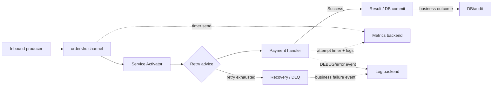
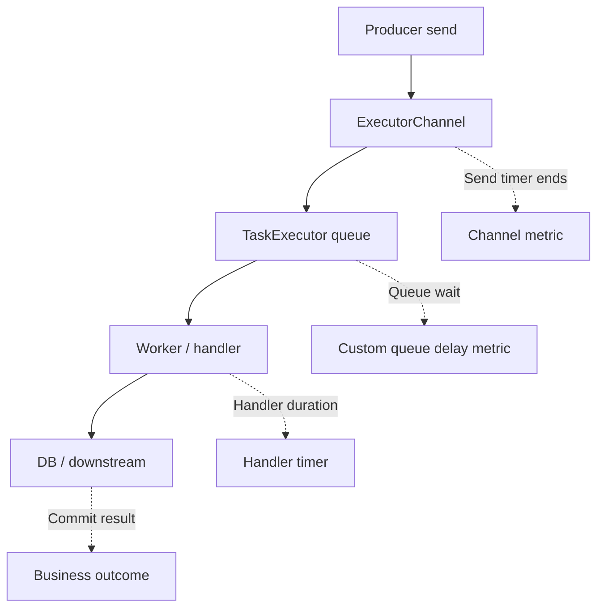
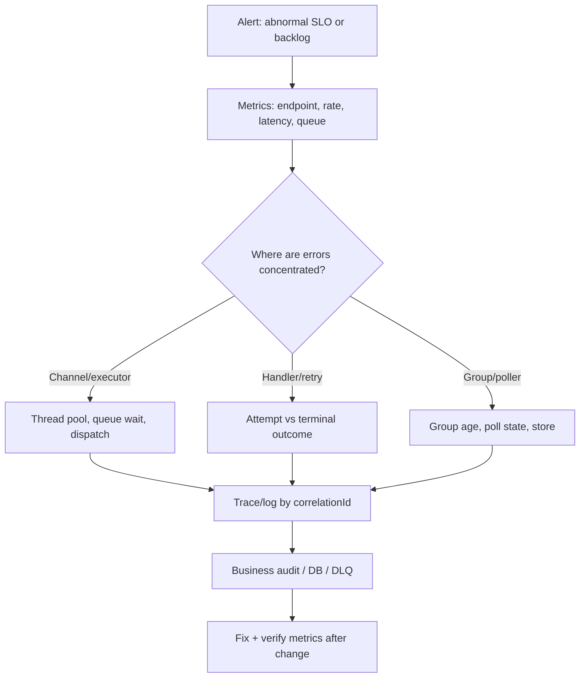

# Distinguishing runtime metrics from debug logs in Spring Integration

## 1. The most important question: is the system healthy, or where did one specific message go?

In Spring Integration, a message can pass through `MessageChannel`s, endpoints, consumers, pollers, executors, advice chains, message stores, aggregators, and error flows. When an incident hits, development teams often start by enabling DEBUG across all packages and reading thousands of log lines. That can locate a single exception, yet fails to answer broader operational questions well:

- Over the past minute, how many messages entered the system and how many **completed business processing**?
- When did handler p95/p99 latency start climbing? Is the bottleneck in a queue, executor, or downstream?
- Are messages retrying repeatedly? On which endpoints is the error rate rising?
- How many messages are backed up in a queue and how long has the oldest message waited?
- Why did message `order-42` go from `ordersIn` to `retryFailures` without any record appearing on `errorChannel`?
- After a restart, is there still backlog in the persistent store and are consumers running?

Two classes of telemetry serve **two different purposes**:

1. **Runtime metrics**: counts, durations, utilization, errors, and state aggregated along stable dimensions. They answer **"How many? Is it degrading? Where is it degrading?"**
2. **Debug logs**: contextual event records, typically tied to one message, execution, or exception. They answer **"What happened during this specific execution?"**

This lesson is **"Distinguishing runtime metrics from debug logs"** in the **Observability** chapter of **SPRING_INTEGRATION_RUNTIME**. The goal is operating and diagnosing the runtime across channels, endpoints, consumers, pollers, executors, retries, error handling, and correlation, while knowing **when you need metrics, when you need logs, and when to combine them with traces/audits**.

> **Foundational rule:** Metrics do not replace logs; DEBUG logs are not a reliable source for business counts. Tracing connects execution steps of a request, while transactional/committed business data confirms what actually completed.

## 2. Four layers of observability data to distinguish

| Layer | Data form | Questions answered well | Main limitations |
| --- | --- | --- | --- |
| **Metrics** | Counters, Timers, Gauges, LongTaskTimers, histograms | Frequency, rate, latency, saturation, trends, and alerts | Holds no per-message history; numbers depend on instrumentation boundaries |
| **Logs** | Event records with timestamp, level, logger, and fields | Where did this message go, which error occurred, what led to that decision? | Can be disabled, sampled, dropped, or duplicated; high cost if logging every message |
| **Distributed traces** | Parent–child traces/spans with timing and attributes | Which step took time in a request, across which threads/services? | Subject to sampling; requires propagation across async/brokers |
| **Business audit/state** | Committed records: order status, payment ID, DLQ, outbox | Did business work complete or stall, and can it be replayed? | Needs clear data model, transactions, idempotency, and retention |

Example of a layered flow:



A single message can increment **multiple channel/handler timers** while representing **one** business command. A single handler failure can also emit **multiple DEBUG logs** across retries before ultimately recovering or landing in a DLQ.

### Typical collaboration workflow

1. Metrics detect `p95 processing duration` rising and `retry exhausted rate` crossing a threshold.
2. Dashboards pinpoint endpoint `paymentsHandler` and the exact onset time.
3. Traces link spans from inbound to downstream, revealing 2 retries and queue wait.
4. Logs with `correlationId`/`businessId` locate the concrete exception/attempts.
5. Business audits confirm whether the order committed, awaits retry, or was quarantined.

Without any one of these four layers, diagnosis is still possible, yet the risk of misguessing rises significantly.

## 3. Metrics differ from debug logs in granularity and units

A counter named `messages_received_total` (an illustrative application-defined name) measures **messages arriving at a boundary**. Logs:

```text
DEBUG handler start: orderId=ORDER-42 attempt=1
DEBUG handler failed: orderId=ORDER-42 attempt=1
DEBUG handler start: orderId=ORDER-42 attempt=2
DEBUG handler failed: orderId=ORDER-42 attempt=2
DEBUG handler start: orderId=ORDER-42 attempt=3
INFO  order committed: orderId=ORDER-42
```

give us **6 log events** for **one incoming message** and **one business success**. Running a query "count logs containing `handler start`" and treating it as message throughput multiplies results by the retry count.

| Quantity | In the three-attempt example | Meaning |
| --- | ---: | --- |
| Message ingress | 1 | One message crossed the ingress boundary |
| Handler attempts | 3 | Handler was invoked three times |
| Attempt failures | 2 | Two calls threw exceptions |
| Retry exhausted | 0 | Retries succeeded before exhaustion |
| Business commits | 1 | One order actually committed |
| DEBUG/INFO log records | 6 | Merely the number of emitted log records |
| Channel sends | Possibly > 1 | Flow may traverse multiple channels |

**Unit of measurement** matters more than meter names: `message`, `attempt`, `handler invocation`, `delivery`, `retry cycle`, `business operation`, and `transaction commit` are not equivalent.

## 4. Micrometer meter types to know

Spring Integration integrates with Micrometer. When designing dashboards, choose the right meter type:

| Meter | How it works | Runtime examples |
| --- | --- | --- |
| `Counter` | Accumulates event counts; typically queried with `rate()` on time-series backends | Messages in, retries exhausted, DLQ write failures |
| `Timer` | Counts timed invocations and total duration; supports histograms/percentiles | Handler attempt duration, end-to-end latency |
| `Gauge` | Current value sampled at scrape/observation time | Queue size, active workers, current backlog |
| `LongTaskTimer` | Number of currently running tasks and their elapsed durations | Long in-flight gateways/handlers |
| `DistributionSummary` | Distribution of non-duration quantities | Items per batch, normalized payload sizes |

**A Counter is not an event log.** It resets on JVM restarts, scrapes can miss bursts, and samples do not retain per-order details. **A Gauge is not the total count of messages that ever passed through a queue**; the same gauge value of 10 can represent 10 completely different messages at two points in time.

Timers provide counts and latency summaries. For p95/p99 across multiple instances, configure **appropriate backend histograms**; never average per-instance averages and call that p95. Likewise, client-side percentiles usually cannot be aggregated accurately across instances.

## 5. Which metrics does Spring Integration record automatically?

The easiest pitfall to hit is that **two instrumentation paths** exist in modern Spring Integration releases: traditional Micrometer meters and Micrometer Observation.

### 5.1. Micrometer integration via MeterRegistry

Per the Spring Integration Reference, when a `MeterRegistry` is present in the ApplicationContext, the framework supports meters for many components extending `AbstractMessageChannel`, `AbstractMessageHandler`, and `AbstractMessageSource`.

Documented names/tags:

| Meter | Typical type/tags | Meaning |
| --- | --- | --- |
| `spring.integration.send` | `type=channel`, `name=<channel>`, `result`, `exception` | Timer for channel send operations |
| `spring.integration.send` | `type=handler`, `name=<handler>`, `result`, `exception` | Timer for handler execution |
| `spring.integration.receive` | `type=channel` or `type=source` | Receive counter on pollable channel/source |
| `spring.integration.channels` | Gauge | Number of managed channels |
| `spring.integration.handlers` | Gauge | Number of managed handlers |
| `spring.integration.sources` | Gauge | Number of managed sources |
| `spring.integration.channel.queue.size` | `type=channel`, `name=<queue>` | QueueChannel size |
| `spring.integration.channel.queue.remaining.capacity` | Queue tags | Remaining capacity of QueueChannel when applicable |

**Verify actual beans, versions, and meters in your registry.** These names/tags are documented for the Micrometer integration path; never assume every project, adapter, or version emits the exact same meter set. Depending on channel type, capacity settings, persistent backends, or custom implementations, supported meters may have limits.

When `DirectChannel.send()` succeeds, `spring.integration.send{type=channel,result=success}` reflects **the send call on that channel**. If a handler runs on an executor, this may indicate only that dispatch was accepted, **not** that the business handler finished.

### 5.2. Micrometer Observation (Spring Integration 6.0+)

Since Spring Integration 6.0, `ObservationRegistry` can collect **both** metrics and traces via `ObservationHandler`s. For `IntegrationManagement` components, the reference documents enabling Observation when an `ObservationRegistry` bean exists alongside `@EnableIntegrationManagement` and matching `observationPatterns`.

**Important:** `observationPatterns` selects no components for Observation instrumentation by default; set `"*"` to observe all eligible components, or select narrower patterns.

Documented observations/meters:

| Meter/Observation | Type | Meaning |
| --- | --- | --- |
| `spring.integration.handler` | Timer | Duration of handler receiving/processing a message |
| `spring.integration.handler.active` | LongTaskTimer | Currently active handlers |
| `spring.integration.producer` | Timer | Instrumented channel/send operation |
| `spring.integration.producer.active` | LongTaskTimer | Currently active producer/send operations |
| `spring.integration.gateway` | Timer | Request/reply gateway |
| `spring.integration.gateway.active` | LongTaskTimer | Currently active gateway requests/replies |

Low-cardinality keys declared by conventions carry the `spring.integration.` prefix, such as `spring.integration.name`, `spring.integration.type`, and—for gateways—`spring.integration.outcome`. Do not mentally translate every tag to traditional meter `name=...` tags and assume they share the same schema.

When using Observation, the framework **delegates metric creation to the matching ObservationHandler** rather than independently recording duplicate traditional meters on that same instrumentation path. Never add `spring.integration.send` counts and `spring.integration.producer` counts together to infer total business messages.

### 5.3. Example: enabling Observation selectively

```java
import org.springframework.context.annotation.Configuration;
import org.springframework.integration.config.EnableIntegration;
import org.springframework.integration.config.EnableIntegrationManagement;

@Configuration
@EnableIntegration
@EnableIntegrationManagement(
        observationPatterns = {"orders*", "payments*"})
public class IntegrationObservabilityConfig {
}
```

Prerequisite: an `ObservationRegistry` is already provided by the application's Micrometer/Observability setup along with matching `ObservationHandler`s/registries/tracing exporters. The annotation itself **does not create** a metrics server, collector, or trace backend.

Patterns are illustrative; verify actual component IDs (which may be auto-generated by the DSL) and pattern-matching rules for your exact version. Setting `"*"` in staging can be helpful, yet production environments with many **dynamic IntegrationFlows** or tenants can incur high meter/span overhead and cardinality.

## 6. Enabling metrics without enabling DEBUG logs

The two mechanisms are controlled separately:

- **Metrics**: depend on `MeterRegistry`/`ObservationRegistry`, instrumentation, and scrape/export configuration.
- **DEBUG logging**: depends on logger categories, the logging framework, log levels, and Spring Integration management settings.

Spring Integration provides `@EnableIntegrationManagement(defaultLoggingEnabled = ...)`. Setting `defaultLoggingEnabled=false` turns off the framework's message-flow DEBUG logging even when the logging framework level is DEBUG; **exception logging is unaffected by this flag**. Conversely, setting `true` only permits logging according to the logger's configured level, without forcing all packages to emit DEBUG.

Example of an application prioritizing metrics while curbing framework message-path DEBUG logs:

```java
import org.springframework.context.annotation.Configuration;
import org.springframework.integration.config.EnableIntegration;
import org.springframework.integration.config.EnableIntegrationManagement;

@Configuration
@EnableIntegration
@EnableIntegrationManagement(
        defaultLoggingEnabled = false,
        observationPatterns = {"orders*"})
public class RuntimeManagementConfig {
}
```

Do not treat this example as optimal for every system: during investigations, controlled detailed logging may be needed. `defaultLoggingEnabled` affects only one layer of Spring Integration logging, not custom SLF4J logs written by application handlers.

### No DEBUG logs does not mean metrics are off

A handler can record a `Timer` cleanly even with its logger set to `WARN` or `ERROR`. Conversely, seeing plenty of DEBUG logs does not prove a `MeterRegistry`/collector is receiving metrics.

To verify, query the exact registry/Actuator metrics endpoint or a live dashboard, and compare against a controlled test event.

## 7. Per-message debug logs: when are they useful?

DEBUG logs fit when you need **routing paths, permitted observable data, and decision conditions**:

- The `correlationId` header before a splitter/aggregator.
- Which channel a router chose and why.
- Whether a filter accepted or discarded a message.
- Retry attempt number, exception type, and chosen recoverer.
- Whether a poller received a message, or the source returned `null` or threw an exception.
- Adapter receive/send acks, callbacks, and transaction states when appropriately logged.
- Endpoint start/stop state and executing thread.

Example structured log (illustrative, not automatic Spring Integration log format):

```json
{
  "timestamp": "2026-11-22T10:18:31Z",
  "level": "DEBUG",
  "logger": "app.orders.flow",
  "event": "handler_attempt_started",
  "flow": "orders-v2",
  "endpoint": "paymentsHandler",
  "correlationId": "checkout-42",
  "businessId": "ORDER-42",
  "attempt": 2,
  "thread": "payments-exec-3"
}
```

Never put passwords, bearer tokens, payment cards, PII, or full payloads into logs solely for DEBUG. `Message.toString()` can include payloads/headers, so enabling full-message logging indiscriminately risks data leaks.

### Which log level for what?

| Level | Appropriate content | Avoid |
| --- | --- | --- |
| `TRACE` | Low-level dispatch/header details strictly for deep debugging | Leaving on indefinitely on high-traffic flows |
| `DEBUG` | Routing/filter decisions, attempts, correlation, threads | Logging full payloads or emitting lines for every trivial step |
| `INFO` | High-value operational events: start/stop, deploys, committed terminal outcomes | Using as a throughput counter instead of meters |
| `WARN` | Recoverable errors, degraded dependencies, policy-defined lag growth | Full stack traces on every routine failed attempt |
| `ERROR` | Terminal/recovery sink failures or broken invariants | Logging every retry attempt as a terminal business failure |

These are suggested conventions; follow your team's standards. A retryable exception may appear at WARN or DEBUG, while terminal failures should be recorded clearly in **one** place to avoid duplicate alerts.

## 8. Flow logging with Java DSL log() and Wire Tap

Spring Integration provides Java DSL `.log(...)` to observe messages. Per the reference, this operator uses a `WireTap` channel interceptor with a `LoggingHandler` subscriber. It logs while letting the message continue through the flow.

```java
import org.springframework.context.annotation.Bean;
import org.springframework.integration.dsl.IntegrationFlow;
import org.springframework.integration.handler.LoggingHandler;

@Bean
IntegrationFlow tracingOrderFlow() {
    return IntegrationFlow.from("ordersInput")
            .filter((String id) -> !id.isBlank())
            .log(LoggingHandler.Level.DEBUG, "app.orders.route",
                    message -> "messageId=" +
                            message.getHeaders().getId())
            .handle(message -> orderHandler.handle(message));
}
```

`orderHandler` is an application-provided handler bean, and `ordersInput` is a configured channel. The log point sits **after the filter**: messages rejected by the filter emit no log there. Because `log()` acts as a wire tap, it does not mark a business commit.

**Note on logging at the end of a flow:** since Spring Integration 6.0, a trailing `log()` operator no longer alters end-of-flow/reply semantics as in some older versions. For one-way flows that need no reply and only log, you can specify `nullChannel` per framework guidance. Do not rely on `log()` as the business consumer when a downstream endpoint still needs to process the message.

### XML Wire Tap and Logging Channel Adapter

```xml
<int:channel id="ordersInput">
    <int:interceptors>
        <int:wire-tap channel="orderDebugLog"/>
    </int:interceptors>
</int:channel>

<int:logging-channel-adapter
    id="orderDebugLog"
    level="DEBUG"
    expression="headers.id"
    logger-name="app.orders.wiretap"/>
```

This is a Spring Integration XML namespace fragment. Wire tap forwards a copy/reference of the message per framework mechanics to the logging handler; thus **a message entering the channel is still a single ingress**, even though logs are emitted via the observation branch.

Per the reference, `logging-channel-adapter` logs the payload by default. `log-full-message="true"` adds headers and can expose sensitive data; `expression` or `.log(..., message -> ...)` lets you select safe fields explicitly. Do not use `expression` and `log-full-message` together.

### Is Wire Tap "free"?

No. Formatting messages into strings, allocating log events, sending to appenders, JSON serialization, and shipping logs over the network all consume CPU/RAM/I/O. A synchronous logging channel prolongs send latency; an async branch can hit full queues, drop logs, or reorder entries. **Never treat tap logs as proof that every event was durably persisted.**

For flows handling millions of messages, consider DEBUG sampling, bounded retention, selective endpoint observation, and turning off investigative logging after incident resolution.

## 9. Message History: path tracking is not distributed tracing

Spring Integration provides `@EnableMessageHistory` to append a history header of traversed components. Per the reference, message history records a list of entries containing `name`, `type`, and `timestamp` for tracked components.

```java
import org.springframework.context.annotation.Configuration;
import org.springframework.integration.config.EnableIntegration;
import org.springframework.integration.config.EnableMessageHistory;

@Configuration
@EnableIntegration
@EnableMessageHistory({"orders*", "payments*"})
public class TrackedFlowsConfiguration {
}
```

Patterns must match **actual component names**; per the docs, declare only **one** `@EnableMessageHistory` in an application context. You can adjust scope through JMX/the configurer properly rather than manually creating multiple `MessageHistoryConfigurer` beans.

Message History helps verify `ordersIn → router → paymentsHandler` during diagnostics. However, it **does not** replace tracing:

- The history header travels inside the message and incurs size/serialization overhead.
- It does not automatically cover external HTTP calls, DB queries, or network spans in other services.
- It does not provide full parent/child span hierarchies of distributed tracing.
- If a message is rebuilt, branched, or crosses an executor, verify header propagation/cloning behavior for your version.
- Message history is not a business audit and vanishes if the message is not persisted.

Since Spring Integration 6.3, message history is optimized using append-only updates and header cloning on framework fan-out; in custom multi-producing logic, ensure mutable history is not shared improperly across branches.

## 10. Correlation ID, message ID, trace ID, and business key

To use metrics and logs together, place each ID type where it belongs:

| ID | Meaning | Where to use? |
| --- | --- | --- |
| `MessageHeaders.ID` | Identifies a specific Spring `Message` | DEBUG logs, message history, investigating a single delivery |
| `correlationId` | Links messages belonging to a batch/flow/request per business logic or splitter | Headers, structured logs, tracing attributes |
| `traceId` and `spanId` | Links spans in a distributed trace | Tracing backend / log correlation when propagated |
| `businessId`/`idempotencyKey` | Identifies a business operation across retries/replays | DB unique constraints, audits, logs, DLQs |
| `attempt` or `deliveryCount` | Processing retry or redelivery attempt | Logs and **normalized** metrics, never as a new unique key |

**Message IDs can change when messages are rebuilt.** One business command can receive multiple message IDs across retries, conversions, broker redeliveries, or replays. To prove an order was not processed twice, use a committed business idempotency key—never rely solely on the Spring message ID.

### In metrics: never put individual IDs into tags

Example of what **not** to do:

```java
// WRONG cardinality when there are many unique businessIds.
registry.counter(
        "app.orders.attempts",
        "businessId", commandId).increment();
```

Every `businessId` spawns a new time series. Hundreds of thousands of IDs exhaust metrics backend memory/storage and slow queries.

Much better:

```java
registry.counter(
        "app.orders.attempts",
        "flow", "orders",
        "outcome", "failure",
        "errorCategory", "downstream_timeout")
    .increment();
```

`flow`, `outcome`, and `errorCategory` are **low-cardinality** tags controlled by the application. Business IDs and correlation IDs belong in structured logs/traces with proper retention and access controls.

Especially with **dynamic IntegrationFlows** creating per-tenant component names, the `spring.integration.name` tag can grow very large. Standardize component names, bound flow counts, or filter/configure meters with `MeterFilter` instead of letting time series grow without bound.

## 11. Java example: metrics and debug logs measure two different things

Below is a `@ServiceActivator` using a Micrometer `Timer` to measure **each handler execution**, while logging DEBUG with business key/correlation. If retry advice wraps the handler, this method can run multiple times: the timer records **one sample per attempt**.

```java
import io.micrometer.core.instrument.MeterRegistry;
import io.micrometer.core.instrument.Timer;
import org.slf4j.Logger;
import org.slf4j.LoggerFactory;
import org.slf4j.MDC;
import org.springframework.integration.annotation.MessageEndpoint;
import org.springframework.integration.annotation.ServiceActivator;
import org.springframework.messaging.Message;

@MessageEndpoint
public final class ObservedOrderHandler {

    private static final Logger log =
            LoggerFactory.getLogger(ObservedOrderHandler.class);

    private final MeterRegistry registry;
    private final OrderProcessor processor;

    public ObservedOrderHandler(
            MeterRegistry registry,
            OrderProcessor processor) {
        this.registry = registry;
        this.processor = processor;
    }

    @ServiceActivator(inputChannel = "ordersIn")
    public void process(Message<OrderCommand> message) {
        OrderCommand order = message.getPayload();
        String correlationId = String.valueOf(
                message.getHeaders().get("correlationId"));

        Timer.Sample sample = Timer.start(registry);
        String outcome = "success";

        MDC.put("correlationId", correlationId);
        try {
            log.debug("Handler attempt started: orderId={}",
                    order.commandId());

            processor.process(order); // Application-defined side effect.

            log.debug("Handler attempt returned: orderId={}",
                    order.commandId());

        } catch (RuntimeException | Error ex) {
            outcome = "failure";
            log.warn("Handler attempt failed: orderId={} errorType={}",
                    order.commandId(), ex.getClass().getSimpleName());
            throw ex;

        } finally {
            sample.stop(
                    Timer.builder("app.orders.handler.attempt.duration")
                            .description("Duration of a handler attempt")
                            .tag("flow", "orders")
                            .tag("outcome", outcome)
                            .register(registry));
            MDC.remove("correlationId");
        }
    }

    public record OrderCommand(String commandId) {}

    public interface OrderProcessor {
        void process(OrderCommand order);
    }
}
```

The example assumes a `MeterRegistry` bean, an `OrderProcessor` bean, and an `ordersIn` channel are defined in the application context. `OrderProcessor` is simply an illustrative business interface. Configure your logging pattern/structured exporter so `MDC` appears as a log field; calling `MDC.put()` alone does not guarantee the backend renders that field.

**Important measurement constraints:**

- The Timer measures one **`process` method invocation**, not time spent sitting in a `QueueChannel` beforehand.
- Handler throws an exception → `outcome=failure` and still propagates for retry/error flows to handle.
- If `processor.process` swallows the error and returns, the timer sees success; that reflects method-invocation semantics, not business success.
- If retry advice sits **outside** the handler, the method may run multiple times for a single ingress; seeing a timer count higher than ingress is expected.
- With an `ExecutorChannel`, MDC on the producer thread **does not propagate automatically**; this example reads correlation from message headers and sets MDC locally for the handler.
- `MDC.remove` in `finally` prevents correlation IDs from leaking across tasks sharing worker threads.
- For sensitive data, evaluate business keys under your log policy; never log full order payloads.

A **business commit** measurement should sit at the layer verifying the business transaction/outcome, such as after the DB actually commits or from a committed outbox/event. Never increment `business_success` immediately after calling a method that might roll back at the end of the transaction.

## 12. Built-in metrics vs custom business metrics: do not add them together by mistake

An order flow passes through three channels and three handlers. Each step has its own instrumentation:

```text
ordersIn.send
  → validateHandler
  → validatedChannel.send
  → enrichHandler
  → paymentsChannel.send
  → paymentsHandler
  → business DB commit
```

A single successful message can trigger at least three channel `send`s and three handler executions. Therefore:

- `sum(spring.integration.send count)` across all channels is **not** total orders.
- `sum(handler timer count)` across all handlers is **not** ingress message count.
- The `spring.integration.channels` gauge is a component count, **not** throughput.
- The `QueueChannel.queue.size` gauge shows backlog at sampling time, **not** proof that backlog survives restarts.
- A custom `business_committed` metric recorded post-commit approximates completed transactions.

Best practice is picking one **ingress boundary** and one **terminal business outcome** for end-to-end SLIs. Remaining channel/handler meters serve to locate bottlenecks and isolate error sources.

### Three-scenario example

| Scenario | Ingress | Handler attempts | Attempt failures | Terminal failures | Business commits |
| --- | ---: | ---: | ---: | ---: | ---: |
| `order-1` succeeds immediately | 1 | 1 | 0 | 0 | 1 |
| `order-2` fails twice then succeeds | 1 | 3 | 2 | 0 | 1 |
| `order-3` exhausts three attempts, writes DLQ | 1 | 3 | 3 | 1 | 0 |
| **Total** | **3** | **7** | **5** | **1** | **2** |

The table assumes a max of 3 retry attempts, one delivery per message with no broker redeliveries, and one DLQ write. In real systems, broker redeliveries/replays can push deliveries above business operation counts.

If DEBUG logs every `handler attempt started`, there will be 7 lines; if the DEBUG logger is off, there may be **0** such lines. Metrics can still record 7 samples whenever registry/instrumentation is active.

## 13. Advice chains alter metrics and error-flow logs

Suppose advice ordering is:

```text
Option A: [RetryAdvice, AttemptTimingAdvice] → handler
Option B: [TotalTimingAdvice, RetryAdvice]   → handler
```

In **A**, retry advice re-invokes timing advice on each attempt; the timer observes multiple failures plus the final success/failed attempt. In **B**, total timing advice wraps one retry cycle, including backoff. If retry uses a `RecoveryCallback` that sends an `ErrorMessage` to a failure channel and **returns normally**, outer timing advice may record `success` even though the business operation was quarantined.

This is not a Micrometer bug; it is a **misinterpretation of outcome**. Separate them cleanly:

| Signal | Where to measure? |
| --- | --- |
| `handler_attempt_failure` | Inside retry, once per attempt throwing an exception |
| `retry_exhausted` | Retry recovery boundary when attempts run out |
| `dlq_write_committed` | After durable failure sink confirms write |
| `business_success_committed` | After business state actually commits |
| `processing_total_duration` | Spanning retries/backoff per defined boundary |
| `terminal_failure` | Once per business operation / terminal decision |

### ErrorMessages do not necessarily reach the global errorChannel

A failure can:

1. Be thrown from a handler on `DirectChannel` and propagate to the caller.
2. Be retried by `RequestHandlerRetryAdvice`, then recovered into a `retryFailures` channel.
3. Be converted into an `ErrorMessage` on a dedicated error channel by a poller/worker async error publisher.
4. Be caught and converted into a normal business return inside handler code.
5. Go unlogged if logger level/sampling suppresses it.

Therefore, **an empty log on global `errorChannel` does not prove a flow has no errors**. Measure retries/recovery and inspect actual error paths: `errorChannel` header, dedicated failure channels, broker DLQs, transactional rollbacks, or reactive `onError` signals.

## 14. Threading, executors, and pollers: which metric tells only half the story?

An `ExecutorChannel` allows the producer's send to succeed before the worker runs:



If `send` takes 1 ms, queue wait takes 2 seconds, and the handler runs in 40 ms:

- The channel send metric shows **1 ms** latency.
- The handler timer shows **40 ms** latency.
- End-to-end latency to commit is roughly **2.041 seconds** plus overhead.
- Handler DEBUG logs start 2 seconds after producer logs, even though both timestamps are accurate.

Hence you must measure—or obtain via appropriate tooling—**queue wait time** and **end-to-end latency**, not just handler duration.

### Pollable channels and pollers

With `QueueChannel → poller → ServiceActivator`:

- The channel receive counter reflects receives per implementation, not business commits.
- `fixedDelay`/`fixedRate` and `maxMessagesPerPoll` affect throughput and empty polls.
- With a persistent `MessageStore`, verify queue metrics against the specific provider and implementation.
- A message can roll back and be polled again; receive counts rise even though the business operation never committed.
- A running poller does not prove handlers are active when the source yields no messages or polling conditions are unmet.

Measure queue wait from the **true enqueue timestamp** to handler start; `MessageHeaders.TIMESTAMP` may reflect message creation time rather than enqueue time if earlier steps ran first.

### Reactive runtime

With `FluxMessageChannel` and `Publisher<Message<?>>`, backpressure, subscriptions, cancellations, `onError`, and retry operators produce signals unlike imperative flows. An `onError` can terminate a subscription without automatically emitting an `ErrorMessage` to a Spring Integration error channel. In reactive flows, track subscriptions/cancellations, concurrent inner publishers, latency, and retry placement; a "subscribed" DEBUG log is not proof a message was processed.

## 15. Observing correlation, aggregators, and message groups

Aggregators/resequencers are a classic case where **metrics and logs must work together**.

Key metrics:

- Number of **open groups** in `MessageGroupStore`.
- Age of the oldest group and time from first part to release.
- Counts of `completed`, `expired`, `partial`, and `discarded` groups.
- Counts of late arrivals and duplicate business fragments.
- Lock contention/wait when multiple threads or instances share groups.
- Output processing duration and downstream failure rate.

Logs need **group ID/correlation ID**, `sequenceNumber`, `sequenceSize`, release strategy decisions, and group outcomes to trace specific groups. If metrics show a group stuck for a long time after DEBUG logs have rolled off due to retention, inspect group state safely in the persistent store; **never run destructive/consuming operations on a group solely for debugging**.

Because `correlationId` is high-cardinality, never attach it directly to every meter tag. To answer "which group?", use logs, traces, or group-store audit reports. To answer "how many groups are stuck?", use Gauges/counters.

## 16. When should you use tracing instead of turning on full DEBUG?

Distributed tracing fits when following journeys across:

- Inbound HTTP/Kafka/JMS → channel → handler.
- `ExecutorChannel` to another worker.
- Outbound HTTP/gRPC or database operations.
- Messages traversing brokers or DB-backed persistent channels.
- Retries, async callbacks, and reactive publishers.

With Micrometer Observation, Spring Integration supports creating observations/spans at producers, handlers, and gateways depending on instrumented components. For continuous traces across distributed or persistent channels, **propagate trace context via headers at the producer and restore it at the consumer** alongside matching instrumentation. The reference emphasizes enabling observation on both the channel/producer side and the consumer side to link spans.

### Tracing is not business correlation

Traces can change when replaying a business command hours later; correlation IDs and business IDs must stay stable to link history. With sampling, **not every trace is stored**. Therefore:

- Tracing reveals latency breakdowns.
- Logs verify concrete decisions and exceptions.
- Business audits prove committed state.
- Metrics identify incident scope and onset timing.

Never confuse span duration with DB transaction commit if the span closes before commit or has an async tail. Always identify the measurement boundary.

## 17. Controlled DEBUG toggling during an incident

Spring Boot Actuator provides the `loggers` endpoint to view and adjust logging levels **at runtime**. This is a practical way to investigate one component without restarting the JVM when the endpoint is properly configured and secured.

Example (strictly for authenticated internal administration):

```bash
# Check the log level of a package:
curl http://localhost:8080/actuator/loggers/com.example.orders

# Temporarily enable DEBUG:
curl -X POST \
  -H "Content-Type: application/json" \
  -d '{"configuredLevel":"DEBUG"}' \
  http://localhost:8080/actuator/loggers/com.example.orders

# Restore inheritance of the default log level:
curl -X POST \
  -H "Content-Type: application/json" \
  -d '{"configuredLevel":null}' \
  http://localhost:8080/actuator/loggers/com.example.orders
```

Raising logger levels does not necessarily override Spring Integration's `defaultLoggingEnabled=false` for certain framework flow debug logs; check both control layers.

**Operational safety:** `POST /actuator/loggers` is a mutating endpoint requiring RBAC, network isolation, and auditing. Enable DEBUG on a **narrow** package, record who changed it and when, monitor log volume/PII, and revert afterward. If dashboard metrics already isolate the fault, avoid cluster-wide per-message logging.

## 18. Metric export and reading dashboards

A Spring Boot application using Actuator, Micrometer, and a matching registry/exporter can expose endpoints such as `/actuator/metrics` and `/actuator/prometheus`. Installing `spring-boot-starter-actuator` **does not provide a Prometheus server** or guarantee every meter is scraped.

Spring Boot-style configuration example (with access restricted at infrastructure level):

```properties
# Example assuming Micrometer registry, Actuator, and HTTP management are present.
management.endpoints.web.exposure.include=health,info,metrics,prometheus
```

Practical checks:

1. Is a `MeterRegistry` bean present in the context?
2. Is Observation enabled via `@EnableIntegrationManagement` and `observationPatterns`?
3. Has the endpoint been invoked at least once (many meters register lazily on use)?
4. Is the backend scraping/exporting successfully?
5. Was the meter denied or renamed by a `MeterFilter`?
6. Did tags/cardinality cause the backend to reject time series?

**A missing meter** does not automatically mean the endpoint is idle. Instrumentation may be disabled, the meter unregistered, scraping broken, or the name changed across versions/exporters.

### Example rate/ratio queries

Suppose the application creates Timer `app.orders.handler.attempt.duration`, exported to Prometheus under verified names and labels. You can compute:

```text
attempt_failure_rate =
    rate(attempt_duration_seconds_count{outcome="failure"}[5m])

attempt_error_ratio =
    failure_attempt_rate /
    (success_attempt_rate + failure_attempt_rate)
```

This is **illustrative notation**, not a default metric name; Micrometer/Prometheus backends apply their own naming and unit conventions. Before configuring alerts, verify `/actuator/prometheus` or actual Prometheus labels. An attempt-based ratio differs from a business-operation ratio; a single poison message can cause many failed attempts and push the attempt error ratio higher than the business failure ratio.

### Latency and backlog

A good dashboard places these side by side:

| Panel | Measurement | Action |
| --- | --- | --- |
| Traffic | Ingress rate, business commit rate | Spot load surges or upstream stalls |
| Errors | Retries exhausted, terminal failures, DLQ write failures | Isolate business and recovery faults |
| Latency | Handler p95/p99, total duration p95/p99 | Determine slow downstream vs retry/backoff |
| Saturation | Executor active threads, queue depth, rejected tasks | Detect capacity exhaustion |
| Queue | Backlog, oldest message age, poller lag | Spot stuck work |
| Storage | Message store DB latency, lock waits, group counts | Investigate persistence/transactions |
| Lifecycle | Endpoint running state, reconnect failures | Detect stopped consumers or disconnected adapters |

**Backlog can remain flat when both ingress and processing are zero.** That is not necessarily healthy; include `oldest_message_age`, consumer running state, and ingress heartbeat panels.

## 19. Common misconception: "logs say success, metrics say failure"

Both can actually be telling the truth if they observe **two different steps**.

### Example A: send succeeds while handler fails

```text
Producer → ExecutorChannel.send() [accepted: success]
                           |
                           v
                        Executor worker
                           |
                           v
                   Handler [throws TimeoutException]
                           |
                           v
                       error flow
```

The channel's send timer records success because the executor accepted the task. The handler timer records failure. Producer logs may state "Message dispatched" while the worker logs an error later. Accurate interpretation: **dispatch succeeded, processing failed**.

### Example B: high retry failures while business success is steady

A handler retries twice and then succeeds. Attempt failure metrics rise and DEBUG logs show exceptions, yet business commits remain steady with zero terminal failures. Alerting solely on "exception log count > 0" produces false positives; base alerts on retry rate, exhaustion rate, and latency SLOs.

### Example C: no DEBUG logs yet queue grows

The logger is at INFO, `defaultLoggingEnabled=false`, or logs are sampled/dropped. Queue gauges/age still climb when properly instrumented. That runtime signal points to checking pollers/executors/brokers; **do not** immediately enable cluster-wide DEBUG if metrics and Actuator health already isolate the bottleneck.

### Example D: global errorChannel is empty yet DLQ has messages

A retry recoverer sent an `ErrorMessage` to a dedicated recovery channel and returned normally. No unhandled exception reached the global error channel, while the terminal failure landed in the DLQ. To report accurately, instrument `retry_exhausted` and `dlq_write_committed` separately.

### Example E: DEBUG logs show the same message twice after restart

A broker or persistent queue provides at-least-once/redelivery: the same business command is delivered again with a new message ID. Two "received" log lines genuinely occurred, while a business idempotency key ensured only one commit. Never conclude duplicate business side effects without checking DB audits/unique keys.

## 20. Three-layer troubleshooting: detect, isolate, prove



### Investigation checklist

1. **Scope:** Is one flow/endpoint affected or all flows? When did it start?
2. **Unit:** Does this metric count `send`, `receive`, `attempt`, or `business commit`?
3. **Threading:** Are `ExecutorChannel`, `QueueChannel`, reactive publishers, or async gateways involved?
4. **Retries:** How many times was the handler invoked? Does the meter sit before or after advice?
5. **Error flow:** Did the exception go to the caller, a dedicated recovery channel, `errorChannel`, or a broker DLQ?
6. **Transactions:** Did side effects commit? Did ack/dequeue/offset commit?
7. **Correlation:** Do records belong to the same business command? Did message IDs change across replays?
8. **Persistence:** Do messages/stores/groups/checkpoints survive restarts? Are consumers actively polling?
9. **Telemetry:** Are logs disabled/sampled, meters filtered, or trace contexts missing propagation?
10. **Verification:** After fixing, did backlog age/terminal failures drop and business commits recover?

If you do not know endpoint or channel names, use **Integration Graph**/management views to inspect runtime topology. The graph depicts structural connections, not per-message event histories. Never perform destructive queue/group reads solely for observation.

## 21. Hands-on labs: metrics and debug logs of a simple flow

### Lab A: log counts differ from message counts

1. Configure `ordersIn` with a handler having at most 3 retry attempts.
2. Send one message that succeeds immediately, one that fails transiently twice, and one poison message that fails completely.
3. Measure `handler attempts` via Timer count or a custom Counter; log DEBUG on each attempt.
4. Reconcile totals against Section 12's table: 3 ingress, 7 attempts, 5 failed attempts, 2 business commits, 1 terminal failure.
5. Turn off the DEBUG logger and resend with fresh business IDs; confirm meters still increment when instrumentation is active.

**Expectation:** DEBUG line counts vary with logger settings, while metrics still record measured executions.

### Lab B: DirectChannel vs ExecutorChannel

1. Run a 200 ms slow handler behind a `DirectChannel`.
2. Measure `send()` duration, handler duration, and log timestamps.
3. Swap to an `ExecutorChannel` with a spacious queue and slow worker.
4. Send 50 messages concurrently; compare `send()` and handler latencies.
5. Measure executor queue wait and p95 end-to-end; verify send success does not mean business completion.

**Expectation:** producer latency and handler/queue-wait latency diverge across the async boundary.

### Lab C: scoped, time-boxed DEBUG activation

1. Run a high-throughput flow at INFO logging level.
2. Use Actuator `loggers` in a test environment to enable DEBUG for `app.orders`.
3. Log only `messageId`, `correlationId`, and endpoint name; omit full payloads.
4. Measure log records/second, CPU, and exporter queue depth.
5. Disable DEBUG and verify metrics continue unaffected while log rate returns to baseline.

**Expectation:** log level does not alter meter semantics, yet log volume can affect runtime performance.

### Lab D: Observation vs legacy Micrometer

1. Prepare an app with `MeterRegistry` and matching management enabled.
2. Measure and list the meters actually registered for your version.
3. Enable `ObservationRegistry`/`@EnableIntegrationManagement(observationPatterns={"orders*"})`.
4. Verify corresponding observation timers/spans and actual tag names.
5. Compare `spring.integration.send` against `spring.integration.handler`/`producer`; never sum metrics of different units to compute throughput.

**Expectation:** understand which instrumentation path is active and how exporters name series.

### Lab E: exhausted retries and error routing

1. Have a handler always throw, exhaust retries, and let the recoverer route to `retryFailures`.
2. Observe failed-attempt timers and WARN logs.
3. Confirm the dedicated recovery channel receives the error without requiring global `errorChannel` to receive it too.
4. Force the durable DLQ sink to fail; verify errors propagate per policy without incrementing `dlq_committed`.
5. Record a failure entry with a business key and verify replays do not create duplicates.

**Expectation:** metrics distinguish `attempt failure`, `terminal failure`, and `recovery write success`.

### Lab F: correlation, tracing, and queue backlog

1. Create a 3-part batch with `correlationId=BATCH-7`.
2. Delay one part; measure group age and open group count.
3. Enable `@EnableMessageHistory` selectively to inspect component paths.
4. Enable observation/tracing across required boundaries, verifying trace propagation and MDC across thread hops.
5. Back with a persistent message store and restart the app; compare JVM-reset metrics with durable business/group state in the DB.

**Expectation:** metrics detect stuck groups, logs/traces pinpoint the group, and store/audits prove true post-restart state.

### Lab G: high load and cardinality

1. Send many business commands with unique IDs.
2. Intentionally add a `businessId` meter tag in a test environment and observe time series growth.
3. Replace with low-cardinality `flow`, `outcome`, and `errorCategory`.
4. If using per-tenant dynamic flows, evaluate unique values of `spring.integration.name`.
5. Configure `MeterFilter` or naming conventions and measure memory/exporter throughput.

**Expectation:** log-level granularity must not be copied verbatim into metric labels.

## 22. Production observability design checklist

- **Defined measurement units:** ingress, channel send, handler attempt, terminal failure, business commit, and delivery are distinct.
- **Metrics to detect:** throughput, errors, p95/p99, executor/queue saturation, backlog, and oldest age.
- **Logs to investigate:** DEBUG scoped by flow/endpoint/correlation; INFO/WARN/ERROR at right levels for terminal events.
- **Tracing where needed:** propagate headers across executors, brokers, or persistent channels; verify sampling/context.
- **Business audits:** committed state, idempotency keys, and replayable failure records.
- **Version awareness:** legacy `spring.integration.send/receive` and Observation `spring.integration.handler/producer/gateway` are not automatically identical meters.
- **Logging controls:** `defaultLoggingEnabled`, logger levels, wire tap/log adapters, `log-full-message`, and PII policies.
- **Cardinality controls:** never attach message/business/correlation IDs to meter tags; audit dynamic component names.
- **Error-flow mapping:** DirectChannel/ExecutorChannel/poller/recoverer/reactive `onError`; never assume all errors hit global `errorChannel`.
- **Lifecycle and persistence:** know which data survives restarts, which metrics reset, and which consumers must start.
- **Runbooks:** metrics detect → logs/traces isolate → DB/DLQ confirm → fix → re-measure.
- **Tested thoroughly:** retries, queue wait, terminal failures, recovery sink failures, sampling, restarts, and high load.

## 23. Conclusion

**Runtime metrics** are aggregated signals to detect, measure, and alert on flow health. **Debug logs** are per-event details to reconstruct a single execution. Spring Integration/Micrometer provide built-in instrumentation for channels, handlers, sources, and Observation when configured, yet you must read them against exact **units of measurement, advice placement, channel types, and transaction boundaries**.

A system can see multiple handler failures while business work succeeds after retries; it can record channel send successes while async workers fail; it can have zero global `errorChannel` logs even when a recovery channel received a terminal failure. Therefore, **never use log line counts as counters or channel send success timers to assert business commits**. Combine metrics (how many), logs (what details), traces (where it went), and audits/stores (what actually committed) to diagnose Spring Integration runtime reliably.

## References

- [Spring Integration Reference — Metrics and Management](https://docs.spring.io/spring-integration/reference/metrics.html)
- [Spring Integration Reference — Java DSL log() Operator](https://docs.spring.io/spring-integration/reference/dsl/java-log.html)
- [Spring Integration Reference — Logging Channel Adapter](https://docs.spring.io/spring-integration/reference/logging-adapter.html)
- [Spring Integration Reference — Wire Tap and Channel Configuration](https://docs.spring.io/spring-integration/reference/channel/configuration.html)
- [Spring Integration Reference — Message History](https://docs.spring.io/spring-integration/reference/message-history.html)
- [Spring Integration Reference — Error Handling](https://docs.spring.io/spring-integration/reference/error-handling.html)
- [Spring Integration Reference — Integration Graph](https://docs.spring.io/spring-integration/reference/graph.html)
- [Spring Boot Reference — Actuator Loggers](https://docs.spring.io/spring-boot/reference/actuator/loggers.html)
- [Spring Boot Reference — Actuator Endpoints](https://docs.spring.io/spring-boot/reference/actuator/endpoints.html)
- [Micrometer Reference — Timers, Counters, Gauges, Observation](https://docs.micrometer.io/micrometer/reference/)
