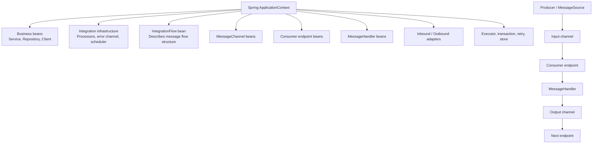
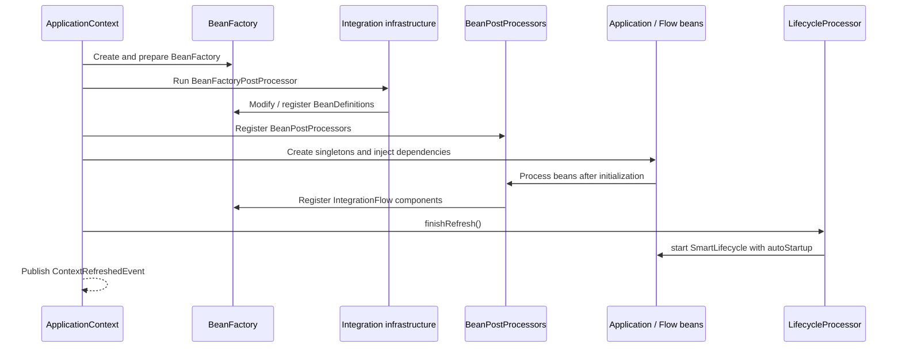
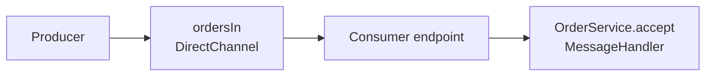

# Spring ApplicationContext Initializing Integration Beans

Spring Integration uses the bean management and lifecycle mechanisms of the Spring Framework to build message flows. When an application starts, the `ApplicationContext` reads the configuration, registers the integration infrastructure, creates business beans, processes `IntegrationFlow` declarations, and then starts endpoints that support lifecycle management. After the initialization phase completes, producers send messages into channels for consumers and handlers to process.

Understanding this order helps answer common questions: Why does an `IntegrationFlow` bean exist yet the endpoint is not running? Why can sending a message in `@PostConstruct` fail? Why does `autoStartup=false` prevent a flow from receiving messages even though both the channel and handler exist? And when the context closes, which component is responsible for stopping pollers or adapters?

This lesson focuses on how Spring initializes integration beans within the Spring Integration runtime. The concepts of channel, endpoint, consumer, poller, executor, transaction, retry, and error channel are placed in the exact lifecycle stage in which they participate.

## 1. ApplicationContext as the Starting Point of the Runtime

`ApplicationContext` is the IoC container that manages the application's beans. Spring Integration does not create a separate container to hold message flows. Instead, integration components are registered in the `BeanFactory` belonging to the application context that configures them.

A single context can simultaneously manage:

- Business beans such as services, repositories, and clients connecting to external systems.
- Spring Integration infrastructure beans such as the error channel, scheduler, converters, and configuration processors.
- Flow-describing beans such as `IntegrationFlow`.
- Runtime beans used by flows such as `MessageChannel`, consumer endpoints, message handlers, message sources, and adapters.
- Supporting beans such as executors, transaction managers, retry advice, message stores, and metadata stores.

`ApplicationContext` is responsible for creating beans, injecting dependencies, managing lifecycles, and publishing application events. It does not transport messages directly. Message transfer happens through channels; endpoints receive messages and invoke the corresponding handlers.



The diagram shows two different perspectives: the branches from `ApplicationContext` describe bean management relationships; the chain from producer to endpoint describes the message path at runtime. These two relationships should not be conflated.

## 2. Which Configuration Brings Spring Integration into the Context?

### 2.1. Enabling Infrastructure with @EnableIntegration

In Java configuration, `@EnableIntegration` is the common entry point for registering Spring Integration infrastructure. It imports the necessary configurations and processors so the framework understands integration components and supports annotation-based messaging and Java DSL.

```java
@Configuration
@EnableIntegration
public class IntegrationConfiguration {
    // Declare MessageChannel, IntegrationFlow, and integration beans.
}
```

The default infrastructure may include shared beans such as `errorChannel` and `taskScheduler`, along with components supporting expressions, conversion, and message headers. The application can provide custom beans as needed. When using a dedicated scheduler, executor, or error channel, you must properly configure the name and reference on the endpoint that uses them.

If the project uses Spring Boot, starters and auto-configuration may automatically activate part of the configuration. That depends on the dependencies and version in use. Inspect the dependency tree and actual beans in the context rather than assuming every application has the same set of default beans.

### 2.2. Ways to Declare Integration Components

Spring Integration supports multiple declaration styles, all of which ultimately result in beans managed within the context:

| Declaration style | Spring input | Runtime result |
|---|---|---|
| Java DSL with `@Bean IntegrationFlow` | Bean describing a chain of operations | Channels, endpoints, and handlers forming the flow |
| Annotations such as `@ServiceActivator`, `@Transformer`, `@Router` | Bean method annotated to handle messages | Message handler and endpoint connecting the handler to a channel |
| XML namespace | Integration elements in XML | Bean definitions for channels, endpoints, adapters, and related configuration |
| Inbound / outbound adapter | Configuration connecting external source or target | Component receiving data into or sending data out of a message flow |
| Messaging gateway | Configured gateway interface or bean | Proxy receiving Java method calls and translating them into message exchanges |

Java DSL is often suitable when you want to read a flow in sequential order of steps. Annotations are convenient when a handler is tied to a business bean. XML is useful in systems whose integration configuration is managed in XML. These styles can coexist within the same application context.

## 3. In What Order Does Spring Refresh the Context?

Integration bean initialization takes place within the `refresh()` lifecycle of `ApplicationContext`. The sequence below simplifies internal steps while preserving the key milestones for Spring Integration.



Key milestones:

| Spring phase | What happens | Significance for integration beans |
|---|---|---|
| Prepare BeanFactory | Creates a new bean factory and configures the environment, class loader, and resource loader | This is where integration beans will be registered and looked up |
| Run BeanFactoryPostProcessor | Processors can read or modify bean definitions before regular beans are created | Integration infrastructure can add or adjust bean configurations |
| Register BeanPostProcessor | Spring registers processors that intercept bean creation | Processors for flows and annotations can process corresponding beans |
| Instantiate non-lazy singletons | Spring creates regular beans, injects dependencies, and invokes initialization callbacks | Services, channels, and flow-declaring beans are created; DSL flows are parsed when the processor detects the bean |
| finishRefresh | Spring initializes the lifecycle processor and calls `onRefresh()` | `SmartLifecycle` beans with `autoStartup` are started according to their phase |
| Publish ContextRefreshedEvent | Context announces that refresh has completed | Listeners can observe state after the lifecycle processor has been invoked |

A few details to keep in mind:

- `BeanFactoryPostProcessor` operates at the bean definition level, before Spring creates regular business beans.
- `BeanPostProcessor` participates in the bean creation process. It can receive a bean before or after initialization callbacks and perform specialized processing.
- Beans declared as lazy may not yet be created during regular singleton instantiation. You should not rely on them as if every bean in the context had already been initialized.
- `finishRefresh()` invokes the lifecycle processor to start components that support `SmartLifecycle`. Therefore, the time a bean exists and the time an endpoint begins receiving messages are two different milestones.

## 4. How Is an IntegrationFlow Converted into Runtime Beans?

With Java DSL, a `@Bean` method returns an `IntegrationFlow` object. This object describes the flow structure: where messages come from, which transformer or handler to invoke, and which channel to forward to.

Example:

```java
@Configuration
@EnableIntegration
public class OrderIntegrationConfiguration {

    @Bean
    public MessageChannel ordersIn() {
        return new DirectChannel();
    }

    @Bean
    public IntegrationFlow ordersFlow(OrderService orderService) {
        return IntegrationFlow.from("ordersIn")
                .handle(orderService, "accept")
                .get();
    }
}
```

The business bean is injected as a standard Spring dependency:

```java
@Component
public class OrderService {

    public void accept(Order order) {
        // Handle order business logic.
    }
}
```

An `IntegrationFlow` is not a thread or a self-running loop. It is a specification for the framework to build messaging components. In Java DSL, `IntegrationFlowBeanPostProcessor` detects flow beans and registers the components produced by the flow into the bean factory. These components can include channels, message handlers, and consumer endpoints.

The example above creates the following logical relationship:



When the application runs, the producer sends a message to `ordersIn`; the consumer endpoint subscribed to the channel delivers the message to the handler. With `DirectChannel`, subscriber invocation occurs synchronously on the sending thread, unless a downstream component actively hands work off to an executor or another asynchronous mechanism.

### 4.1. Flow Beans and Endpoints Are Two Distinct Concepts

A single flow can produce multiple runtime components. The `IntegrationFlow` bean represents the structure; the endpoint connects a channel to a handler or message source.

| Component | Role during initialization |
|---|---|
| `IntegrationFlow` | Holds the declared flow structure |
| `IntegrationFlowBeanPostProcessor` | Detects flows and registers the components built by the flow |
| `MessageChannel` | Connection point between producer and consumer |
| `MessageHandler` | Processes payload and headers when invoked by an endpoint |
| Consumer endpoint | Connects an input channel to a handler; manages how messages are received |
| `MessageSource` | Supplies messages for a polling consumer or adapter |
| Inbound adapter | Connects an external source to a message flow |
| Outbound adapter | Sends messages from a flow to an external system |

An endpoint can be created successfully without running yet. For example, the endpoint bean exists in the context, but `autoStartup` is disabled. In that case, looking up the bean and finding it does not prove that the endpoint is receiving messages.

### 4.2. Annotation-Driven Endpoints

With annotations, a bean method can become a message handler:

```java
@Component
public class PaymentHandler {

    @ServiceActivator(inputChannel = "paymentsIn")
    public void handle(Payment payment) {
        // Process payment.
    }
}
```

Channel configuration:

```java
@Configuration
@EnableIntegration
public class PaymentIntegrationConfiguration {

    @Bean
    public MessageChannel paymentsIn() {
        return new DirectChannel();
    }
}
```

Spring Integration's annotation processors detect the annotated method, create the necessary handler and endpoint, and then bind the endpoint to the channel named `paymentsIn`. If the channel does not exist, has a mismatched name, or is incompatible with the expected consumer type, an error may occur during bean creation or when the endpoint is initialized.

## 5. When Does an Endpoint Actually Start Running?

Endpoints and adapters manage their operation through Spring's lifecycle mechanism. Many integration components implement `SmartLifecycle`, allowing Spring to start and stop them according to the context lifecycle.

When the context finishes refreshing, the lifecycle processor calls `onRefresh()`. `SmartLifecycle` components with `autoStartup=true` are started automatically. If an endpoint has `autoStartup=false`, the bean can still exist, but it must be started explicitly using the appropriate lifecycle API.

Several properties and mechanisms affect when execution starts:

| Property / mechanism | Effect |
|---|---|
| `autoStartup` | Determines whether the component starts automatically on context refresh |
| `phase` | Orders startup and shutdown across components supporting `SmartLifecycle` |
| `start()` / `stop()` | Allows explicit lifecycle control when supported by the component's API |
| `isRunning()` | Checks whether the component is currently running |
| `SmartLifecycle` | Provides a lifecycle contract supporting auto-start and phase |
| `LifecycleProcessor` | Coordinates starting and stopping lifecycle beans in the context |

For `SmartLifecycle` components, lower phases start first; on shutdown, the order is reversed so higher-phase components stop first. This ordering helps applications control dependency order, such as stopping a consumer before an underlying resource it depends on is closed.

### 5.1. Pollers and Executors Also Have Their Own Lifecycles

A polling endpoint needs a poller to periodically read messages from a `MessageSource` or a pollable channel. The poller uses a scheduler for scheduling; depending on configuration, work may be handed off to an executor.

- `TaskScheduler` coordinates when the poller is triggered.
- `TaskExecutor` executes work on threads managed by the executor.
- If the poller is not running yet, the polling source may not be read yet, even if the message source bean already exists.
- An executor that is not ready or has already been shut down can prevent work from executing.
- With `DirectChannel`, the producer typically invokes the subscriber directly on the sending thread; no poller is needed just to pass messages through this channel.

Do not assume that every `IntegrationFlow` is asynchronous. The actual thread depends on the specific channel, endpoint, poller, executor, and adapter.

## 6. Sending Messages During Initialization: When Is It Safe?

A common mistake is sending messages too early, when the channel already exists but the endpoint has not started yet.

### 6.1. Callbacks That Run Before Lifecycle Startup

Constructors, `@PostConstruct`, `InitializingBean.afterPropertiesSet()`, and many bean initialization callbacks run while Spring is instantiating singletons. At this point, the context may not have reached `finishRefresh()` yet, so `SmartLifecycle` endpoints have not been automatically started by the lifecycle processor.

Example requiring caution:

```java
@Component
public class EarlyPublisher {

    private final MessageChannel ordersIn;

    public EarlyPublisher(
            @Qualifier("ordersIn") MessageChannel ordersIn) {
        this.ordersIn = ordersIn;
    }

    @PostConstruct
    public void publish() {
        // May run before the consumer endpoint is started.
        ordersIn.send(new GenericMessage<>(new Order("A-100")));
    }
}
```

With `DirectChannel`, if there is no active subscriber yet, sending a message can fail due to no available subscriber. With buffered channels, the message may be retained, though the consumer is not necessarily ready to process it yet. Behavior depends on the channel type and specific configuration.

### 6.2. Using ApplicationRunner in Spring Boot

If the application uses Spring Boot and needs to send initial data after context refresh, you can use `ApplicationRunner`. Runners are invoked after the application context has been refreshed during Spring Boot's startup phase.

```java
@Component
public class InitialOrderPublisher implements ApplicationRunner {

    private final MessageChannel ordersIn;

    public InitialOrderPublisher(
            @Qualifier("ordersIn") MessageChannel ordersIn) {
        this.ordersIn = ordersIn;
    }

    @Override
    public void run(ApplicationArguments args) {
        ordersIn.send(
                new GenericMessage<>(new Order("A-100"))
        );
    }
}
```

In plain Spring Framework applications, `ApplicationRunner` is not available. You can use `ContextRefreshedEvent` or a custom lifecycle coordination mechanism if you need an action after refresh. Avoid duplicate execution when an application has multiple parent-child contexts or refreshes multiple times.

An important ordering detail in Spring Framework is that the lifecycle processor is invoked in `finishRefresh()` before `ContextRefreshedEvent` is published. In Spring Boot, `ApplicationReadyEvent` occurs even later, after runners; choose the milestone that matches the application's startup requirements.

## 7. Parent-Child Contexts and Integration Bean Registration Scope

Spring supports multiple `ApplicationContext` instances in a parent-child hierarchy. Beans in a child context can look up beans from the parent context; the parent context cannot see beans that exist only in the child context.

This affects the integration runtime:

- Flows declared in a child context are created and managed in the child context's bean factory.
- Channels or services in the parent context can be used from the child context if bean lookup and dependencies permit.
- An endpoint in a child context can reference shared infrastructure beans from the parent context.
- Flows registered dynamically via `IntegrationFlowContext` belong to the scope of the context managed by that `IntegrationFlowContext` bean.
- Closing a child context stops and destroys lifecycle beans belonging to the child context; the parent context can continue running.

Do not register the same flow in multiple contexts without clearly defining ownership of channels, endpoints, and resources. Sharing beans across contexts should be deliberate, especially when closing one context might affect still-active flows.

## 8. What Happens When the Context Closes?

The integration lifecycle does not end at startup. When the application closes the context, Spring invokes the lifecycle processor to stop lifecycle-aware components, then performs bean destruction and resource cleanup.

For the integration runtime, pay attention to the following:

- Endpoints and adapters must stop accepting new work.
- Pollers need to stop their polling schedules.
- Application-managed executors and schedulers must be shut down according to proper ownership.
- Connections or sessions to external systems must be closed by the component that owns them.
- Dynamically registered flows should be removed properly if their lifecycle ends before the application context.
- Messages sitting in a queue or store must be evaluated against the application's durability and recovery policy.

Not all channels persist messages durably. A standard `QueueChannel` is an in-memory buffer; if message recovery after a restart is required, you must configure a message store or a persistence mechanism suited to the use case.

## 9. Diagnosing When Integration Beans Fail to Initialize or Run

Distinguish between three states:

1. The bean definition has been registered.
2. The bean instance has been created and dependencies have been injected.
3. The endpoint has been started and is receiving messages.

One state does not automatically prove the other two.

| Symptom | Phase to inspect | Diagnostic question |
|---|---|---|
| Channel bean not found | Bean definition registration / configuration | Is the channel declared in the right context? Does the bean name match? |
| IntegrationFlow bean fails to create | Singleton creation and dependency resolution | Is a dependency missing, mistyped, or involved in a circular dependency? |
| Flow bean exists but endpoint does not appear | IntegrationFlow processing | Is the Java DSL processor registered? Was the flow actually created in this context? |
| Endpoint exists but receives no messages | Lifecycle startup | Does the endpoint have `autoStartup=false` or has it not been started? |
| Polling source does not run | Lifecycle and scheduler | Is a poller configured? Is the scheduler active? |
| Sending a message too early fails | Startup order | Is the producer sending before the consumer endpoint starts? |
| Handler runs on an unexpected thread | Dispatch and executor | Is the channel Direct, Executor, or pollable? Is an executor switching threads? |
| Context shutdown hangs | Lifecycle stop and resource cleanup | Is an endpoint or adapter waiting indefinitely on a task? Does an executor have unfinished tasks? |

You can inspect beans by type from the context:

```java
Map<String, MessageChannel> channels =
        applicationContext.getBeansOfType(MessageChannel.class);

Map<String, AbstractEndpoint> endpoints =
        applicationContext.getBeansOfType(AbstractEndpoint.class);

endpoints.forEach((name, endpoint) ->
        log.info("endpoint={}, running={}", name, endpoint.isRunning()));
```

Imports in the example are omitted. When using `AbstractEndpoint`, ensure the endpoint classes in your Spring Integration version match the lookup type. You can start with `getBeansOfType(AbstractEndpoint.class)` to inspect standard endpoints and use Actuator or startup logs to observe finer details when the application has many types of adapters.

An effective debugging sequence:

1. Identify the application context containing the flow and endpoint.
2. Check `@EnableIntegration`, XML namespace, or the corresponding auto-configuration.
3. Inspect bean definitions and dependencies of channels, services, schedulers, and executors.
4. Confirm the flow was processed and endpoints were registered.
5. Check `isRunning()`, `autoStartup`, and `phase`.
6. Check when producers send messages relative to when endpoints start.
7. Monitor logs for the poller, error channel, retry advice, and adapters if messages do not reach the handler.

## 10. Comprehensive Example: From Configuration to the First Message

The example below brings the core components together in a single context. When the context starts, Spring creates the channel, service, and flow; the Java DSL processor registers the endpoint; the lifecycle processor starts the endpoint; and the Spring Boot runner sends a message after refresh.

```java
@Configuration
@EnableIntegration
public class OrderIntegrationConfiguration {

    @Bean
    public MessageChannel ordersIn() {
        return new DirectChannel();
    }

    @Bean
    public IntegrationFlow ordersFlow(OrderService orderService) {
        return IntegrationFlow.from("ordersIn")
                .handle(orderService, "accept")
                .get();
    }
}

@Component
class OrderService {

    public void accept(Order order) {
        System.out.println("Processing order " + order.id());
    }
}

record Order(String id) {}

@Component
class InitialOrderPublisher implements ApplicationRunner {

    private final MessageChannel ordersIn;

    InitialOrderPublisher(
            @Qualifier("ordersIn") MessageChannel ordersIn) {
        this.ordersIn = ordersIn;
    }

    @Override
    public void run(ApplicationArguments args) {
        ordersIn.send(new GenericMessage<>(new Order("A-100")));
    }
}
```

Execution sequence:

1. Spring reads `OrderIntegrationConfiguration` and registers the configuration.
2. `@EnableIntegration` brings Spring Integration infrastructure into the context.
3. Spring creates `ordersIn`, `OrderService`, and the `ordersFlow` bean.
4. The Java DSL processor detects the flow and registers the runtime components.
5. The context completes refresh; the lifecycle processor starts the consumer endpoint.
6. Spring Boot invokes `InitialOrderPublisher.run()`.
7. The producer sends a message into `ordersIn`; `DirectChannel` dispatches to the consumer endpoint and the handler calls `OrderService.accept()`.

In this example, the handler runs synchronously on the dispatch path of `DirectChannel`. If you switch to a channel or endpoint backed by an executor, the processing thread and how errors are propagated back to the producer can change.

## 11. Design Principles to Follow for Startup

- Register integration infrastructure in the same application context that manages the flows.
- Ensure business beans, channels, schedulers, and executors are ready before endpoints use them.
- Distinguish between an existing bean and a running endpoint.
- Configure `autoStartup` and `phase` according to dependency relationships among endpoints.
- Do not emit messages too early from constructors or `@PostConstruct` if consumers have not been started yet.
- Use `ApplicationRunner` when you need to send messages after refresh in Spring Boot; use an appropriate lifecycle event in plain Spring Framework.
- When the context closes, stop endpoints and release schedulers, executors, and connections according to proper ownership.
- Observe bean state, lifecycle, and message dispatch together; checking `ApplicationContext.containsBean()` alone is not enough to conclude a flow is active.

## References

- [Spring Framework — Container Extension Points](https://docs.spring.io/spring-framework/reference/core/beans/factory-extension.html)
- [Spring Framework — Lifecycle Callbacks](https://docs.spring.io/spring-framework/reference/core/beans/factory-nature.html)
- [Spring Framework — ApplicationContext](https://docs.spring.io/spring-framework/reference/core/beans/basics.html)
- [Spring Integration — Configuration and Namespace Support](https://docs.spring.io/spring-integration/reference/configuration.html)
- [Spring Integration — Java DSL](https://docs.spring.io/spring-integration/reference/dsl.html)
- [Spring Integration — Endpoint Lifecycle](https://docs.spring.io/spring-integration/reference/endpoint.html)
- [Spring Boot — Application Events and Listeners](https://docs.spring.io/spring-boot/reference/features/spring-application.html)
