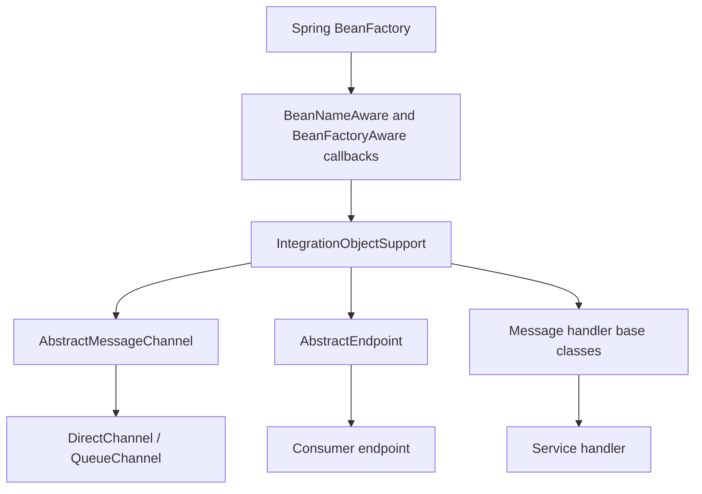
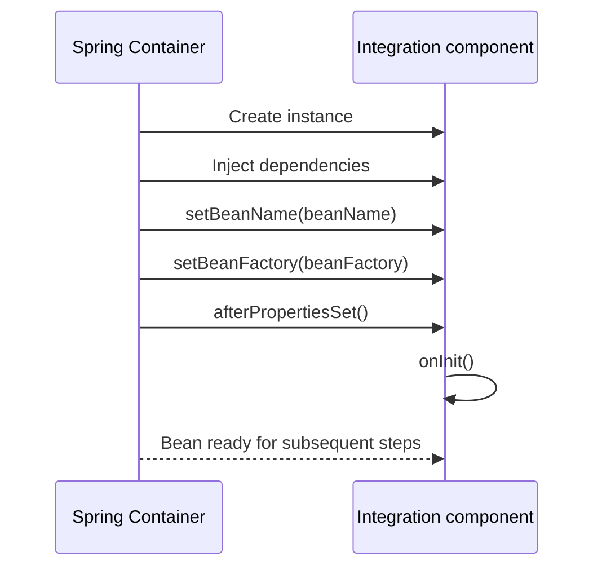
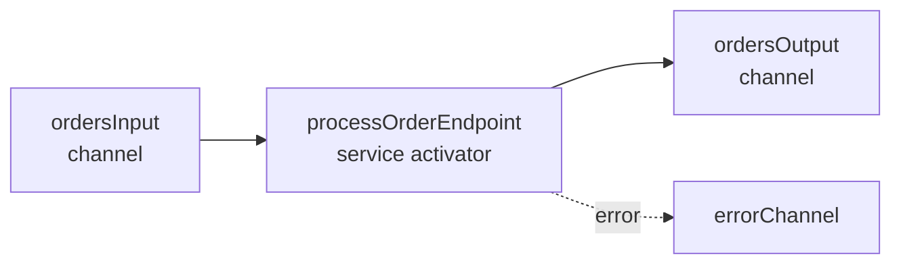

# IntegrationObjectSupport and Component Names

Spring Integration creates many types of objects so a message flow can operate: channels, endpoints, handlers, adapters, gateways, and coordination components. When the application runs, we need to know which flow each object belongs to, what role it plays, and under what name it is registered in the Spring container. `IntegrationObjectSupport` provides a shared base class for many Spring Integration components; **component name** is the identifier used to recognize a component in configuration and when observing the runtime.

Understanding these two concepts helps you read framework-generated component names, assign stable endpoint names in Java DSL, and trace logs or the Integration Graph when a flow has an issue.

## 1. Where Does IntegrationObjectSupport Sit in the Runtime?

`IntegrationObjectSupport` is a base-layer support class in Spring Integration. Many integration components extend it directly or indirectly to use common framework capabilities, such as:

- Receiving `BeanFactory` from the Spring container.
- Receiving the bean name via the `BeanNameAware` callback.
- Holding component identification and component type metadata.
- Performing initialization after Spring has injected dependencies.
- Accessing certain Spring Integration infrastructure services that the component needs during operation.

This class is not a channel, endpoint, or flow orchestration engine. It provides a shared foundation upon which concrete classes build those behaviors.

A simplified view of the inheritance hierarchy:



The diagram illustrates common component branches. Not every concrete class extends `IntegrationObjectSupport` directly; there are many intermediate classes in the hierarchy.

The key point is that the name and container information are attached to the component while Spring creates the bean. Therefore, once the component is initialized, the framework can use the same metadata in logging, management, and flow topology observation.

## 2. How Does Spring Provide a Bean Name to a Component?

Spring manages objects through a `BeanFactory` or `ApplicationContext`. Each bean definition has a primary name. That name typically comes from one of the following declarations:

| Declaration style | Commonly used bean name |
|---|---|
| `@Component` | Default name derived from class name, or name passed to the annotation |
| `@Service("orderService")` | `orderService` |
| `@Bean` on method `ordersInput()` | `ordersInput` |
| `@Bean(name = "orders.input")` | `orders.input` |
| Registered via BeanDefinition | Name supplied when registering the definition |

A component extending `IntegrationObjectSupport` participates in the `BeanNameAware` callback. Spring calls `setBeanName(...)` with the bean name during initialization; the component stores that name as its component name so other parts of the framework can query it.

Example:

```java
@Configuration
class OrderChannels {

    @Bean
    DirectChannel ordersInput() {
        return new DirectChannel();
    }

}
```

Here, the channel bean is named `ordersInput`. `DirectChannel` is a Spring Integration component, so the bean name is used as the channel's component name. This name can also be referenced when configuring a flow:

```java
@Bean
IntegrationFlow orderFlow(OrderService orderService) {
    return IntegrationFlow.from("ordersInput")
            .handle(orderService, "process")
            .get();
}
```

When Spring Integration resolves the string `ordersInput`, it looks up the corresponding channel bean in the container. Thus, the bean name serves both as an identifier in Spring and as part of how components are wired in integration configuration.

Do not read the component name inside a constructor assuming it already has a value. The constructor runs before the `BeanNameAware` callback; use the name after Spring completes dependency injection and bean initialization.

## 3. Component Name and Component Type

Integration components typically provide two distinct pieces of information:

- **Component name** answers: "Which instance is this in the application context?"
- **Component type** answers: "What kind of component is this instance?"

Illustrative example:

| Component | Component name | Component type |
|---|---|---|
| Order receiving channel | `ordersInput` | Channel |
| Order processing endpoint | `processOrderEndpoint` | Service activator or corresponding endpoint type |
| Result channel | `ordersOutput` | Channel |
| Audit handler | `auditHandler` | Message handler |

The specific component type value is provided by the component or endpoint class; you should not infer it merely by parsing the bean name. Two components with different names can share the same type, and two components of the same type can have different configurations or business roles.

In the Spring Integration API, `NamedComponent` is the abstraction representing a component with a name and type. `IntegrationObjectSupport` provides the foundation for many components to implement this contract. The methods commonly used when observing a component are:

- `getComponentName()`: retrieves the component's identifying name.
- `getComponentType()`: retrieves the component's type.

Name and type are technical metadata. They do not replace message ID, correlation ID, or business keys in the payload.

## 4. Distinguishing Bean Name, Component Name, Flow ID, and Endpoint ID

These names are related but not synonymous. Confusing them can waste time when searching for beans, reading graphs, or investigating logs.

| Concept | Scope | Purpose |
|---|---|---|
| Bean name | Spring container | Registering and looking up beans |
| Component name | Spring Integration component | Identifying a component at runtime and in management tools |
| Component type | Spring Integration component | Classifying a component by technical role |
| IntegrationFlow ID | Bean representing the flow | Identifying a declared or registered flow |
| Endpoint ID | Endpoint in the flow | Naming the endpoint for management and observability |
| Channel name | Channel bean | Routing messages between producers and consumers |
| Message ID | A specific message | Identifying the message |
| Correlation ID | A group or sequence of related messages | Correlating messages belonging to the same business process |

For components declared as standalone beans, the bean name is usually the source of the component name. In Java DSL, however, a flow can create multiple internal endpoints and channels. These internal components may receive framework-generated names based on the flow and the component's position in the configuration.

For example, a flow with ID `orderFlow` may contain channels and endpoints created by the DSL. Do not depend on auto-generated internal name strings if those names are part of operational procedures or dashboards. When a stable identifier is needed, set an explicit ID on the endpoint or declare the channel as a clearly named bean.

### Setting an Explicit Endpoint ID in Java DSL

```java
@Bean
IntegrationFlow orderFlow(OrderService orderService) {
    return IntegrationFlow.from("ordersInput")
            .handle(orderService, "process",
                    endpoint -> endpoint.id("processOrderEndpoint"))
            .get();
}
```

In this example:

- `orderFlow` is the flow's bean name.
- `ordersInput` is the name of the channel used by the flow as input.
- `processOrderEndpoint` is the explicit ID of the processing endpoint.
- `OrderService` is the business service invoked by the endpoint.

The endpoint name helps identify the processing step in configuration and management tools. The service bean name, if the service is registered separately, remains a separate identifier.

Setting explicit IDs is especially useful when a long flow has multiple endpoints of the same type. When logs or the graph report an error at an endpoint, a meaningful name identifies the processing location faster than an auto-generated name like a sequence index.

## 5. Initialization Lifecycle and the onInit() Hook

`IntegrationObjectSupport` participates in Spring's bean initialization lifecycle. A simplified sequence can be described as follows:



The actual sequence includes other Spring callbacks and BeanPostProcessors. The diagram focuses on the points relevant to components extending `IntegrationObjectSupport`.

`afterPropertiesSet()` is the `InitializingBean` callback. The base class uses this stage to finish initialization and invoke the `onInit()` hook. Subclasses can override `onInit()` to validate configuration or prepare required resources after dependencies have been injected.

Example of a custom component:

```java
public class AuditMessageHandler extends AbstractMessageHandler {

    private static final Logger log =
            LoggerFactory.getLogger(AuditMessageHandler.class);

    private final AuditService auditService;

    public AuditMessageHandler(AuditService auditService) {
        this.auditService = auditService;
    }

    @Override
    protected void onInit() {
        super.onInit();
        Assert.notNull(this.auditService, "auditService is required");
    }

    @Override
    protected void handleMessageInternal(Message<?> message) {
        log.debug("component={}, messageId={}",
                getComponentName(),
                message.getHeaders().getId());

        this.auditService.record(message);
    }

}
```

`AbstractMessageHandler` is the base class for handlers; it already provides common message handler mechanics and inherits Spring Integration's support foundation. The example uses `getComponentName()` in the log to indicate which handler instance is processing the message.

Registering the handler as a bean:

```java
@Bean
AuditMessageHandler auditHandler(AuditService auditService) {
    return new AuditMessageHandler(auditService);
}
```

The bean is named `auditHandler`, so the handler can use the corresponding component name after Spring completes the naming callback. If the bean name changes, logs based on the component name change accordingly.

### What Should onInit() Do?

This hook is suitable for work that needs to run once configuration and dependencies are ready:

- Validate required properties.
- Check for conflicting configuration.
- Prepare necessary data structures or helper objects.
- Perform internal initialization owned by the component whose lifecycle it can manage.

Do not use `onInit()` to execute long-running business work, block indefinitely, or spawn unmanaged threads without a shutdown mechanism. Component initialization and endpoint start/stop are separate concerns. Endpoints that need to start and stop with the ApplicationContext typically participate in Spring's lifecycle separately, such as through endpoint abstractions implementing `SmartLifecycle`.

## 6. Where Are Component Names Used in Operations?

Component names link configuration to runtime traces. Depending on the component type and enabled management features, the name may appear in:

- Initialization logs, message processing logs, or error logs.
- Component information and topology in the Integration Graph.
- Metadata for managing endpoints, channels, and handlers.
- Metrics or observations tagged with the component identifier.
- Diagnostic details when an endpoint fails to start or a channel has no consumer.

Not every application enables all of these observability surfaces. Where names appear also depends on the Spring Integration version, Spring Boot, management dependencies, and endpoint exposure configuration.

An Integration Graph can help visualize the relationship between channels and endpoints:



Component names help operators connect nodes in the graph to beans or endpoints in configuration. When a message is not processed, you can trace:

1. Does the input channel exist and receive the message?
2. Which endpoint is subscribed to that channel?
3. Was the endpoint initialized and started?
4. Does the component name in logs/graph match the ID you are looking for?
5. Are any channels or endpoints given duplicate names, or do multiple flows create similar components?

When tracking a message across multiple endpoints, the component name tells you **where it was processed**, while message ID and correlation ID tell you **which message and which business flow**. Combining them makes logs far more diagnostic.

## 7. Naming Components for Operability

Good names should help a reader understand a component's role without immediately opening the implementation code. You can apply these guidelines:

| Guideline | Recommended example | Reason |
|---|---|---|
| State role or primary data | `ordersInput` | Makes clear what data type the channel receives |
| State endpoint action | `validateOrderEndpoint` | Makes clear what the processing step does |
| Distinguish branches | `persistOrderEndpoint`, `publishOrderEndpoint` | Avoids confusing endpoints of the same type |
| Keep names stable | `inventoryLookupEndpoint` | Dashboards and logs remain easy to follow across deployments |
| Scope names in large flows | `billing.retryEndpoint` | Reduces name collisions and makes locating easier |

Common naming mistakes:

- Using generic names like `handler1`, `channel2`, `flowA`; the name does not describe the role.
- Using declaration-order-dependent names like `endpoint3`; when a step is added, the name becomes misleading.
- Naming a component after a message's business data; a component name is a technical identifier and should not vary per order.
- Assuming channel name, endpoint name, and flow name are the same value.
- Using component name as a correlation key; correlation must come from appropriate business data or metadata.
- Renaming a bean without updating name references, monitoring configuration, or operational documentation.

Component names should remain stable across deployments if operational tools rely on them. If a bean has multiple aliases, an alias is an additional lookup name in the container, not an independent component instance. Do not assume accessing a bean via an alias changes its component name to that alias.

## 8. Dynamic IntegrationFlow Registration and Component Names

For statically declared flows, Spring creates flow beans from configuration in the ApplicationContext. When a flow must be registered while the application is running, Spring Integration provides `IntegrationFlowContext`.

When registering dynamically, the application supplies a registration ID for the flow. This ID identifies the flow in the registration context and manages registration lifecycle. Components created by the flow may receive names derived from the flow ID and each endpoint's metadata.

Illustrative registration example:

```java
IntegrationFlowRegistration registration =
        integrationFlowContext
                .registration(orderFlow)
                .id("tenantOrderFlow")
                .register();
```

The snippet is an abbreviated example; the application needs to inject `IntegrationFlowContext`, build `orderFlow`, and manage the registration according to the lifecycle of the corresponding tenant or feature.

When removing a dynamic flow, stop or destroy the registration via the appropriate API. If you merely drop the reference in application code without unregistering, the endpoint and related components may still remain in the ApplicationContext. Registration names should be stable and unique within the scope managed by `IntegrationFlowContext`.

For multi-tenant systems, avoid using one fixed name for all dynamic flows if they need to coexist concurrently. You can include a tenant key or a normalized feature identifier in the registration ID. Do not place sensitive data directly in the name, because component names may appear in logs or management tools.

## 9. What IntegrationObjectSupport Does Not Replace

Understanding the exact scope of the base class prevents assigning responsibilities to the wrong place:

| Need | Appropriate component |
|---|---|
| Retrieving component name and metadata | `IntegrationObjectSupport` / `NamedComponent` |
| Registering and looking up beans | Spring `BeanFactory` / `ApplicationContext` |
| Connecting producer to consumer | `MessageChannel` |
| Triggering message processing | Message endpoint and consumer |
| Reading data on a schedule | Poller and message source or pollable channel |
| Starting/stopping endpoints | Endpoint lifecycle, typically integrated with Spring lifecycle |
| Grouping messages of the same business unit | Correlation and aggregator/message group store |
| Identifying a single message | Message ID |
| Propagating errors | Error message and error channel |

`IntegrationObjectSupport` does not create transactions on its own, does not provide a retry policy for every handler, does not store messages in place of `MessageStore`, and does not guarantee an endpoint is running merely because the bean has been initialized. Those capabilities belong to other specialized Spring Integration abstractions and configurations.

For regular business services, there is no need to extend `IntegrationObjectSupport` just to obtain a bean name. Use dependency injection or the appropriate Spring API instead. Only use this base class when building a custom integration component that needs Spring Integration's shared mechanics. If you only need a name for logging, use a logger and injected metadata in a simpler way, avoiding unnecessary coupling to framework internal base classes.

## 10. Component Name Diagnostic Checklist

When a component does not appear in logs or the Integration Graph as expected, check in order:

- Is the bean actually registered in the right ApplicationContext?
- Under what name is the bean registered: default name, explicit name, or DSL-generated name?
- Does the component extend or implement an abstraction providing `NamedComponent`?
- Has Spring invoked the naming callback and completed the initialization phase?
- Is `getComponentName()` being read too early inside a constructor?
- Was an explicit endpoint ID set in Java DSL?
- Was a dynamic flow registered successfully and does it still exist?
- Are the corresponding management tools or Actuator endpoints enabled and exposed?
- Are logs using component name together with message ID/correlation ID to identify both the location and the message?

By naming deliberately and understanding the lifecycle of `IntegrationObjectSupport`, you can read flow configurations more easily, identify the exact endpoint processing a message, and correlate log entries with runtime topology. This is a small but vital foundation for managing and diagnosing Spring Integration as the number of channels, endpoints, and flows grows.
