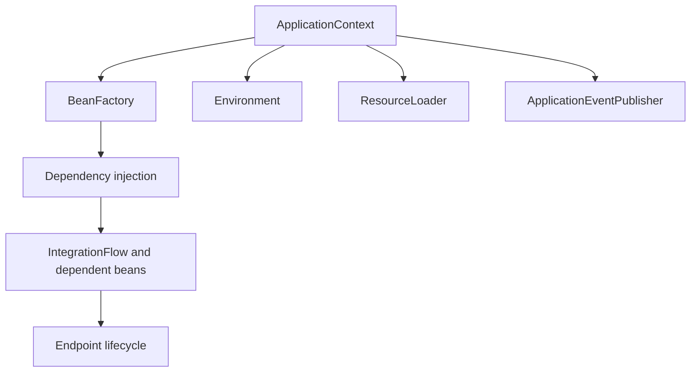
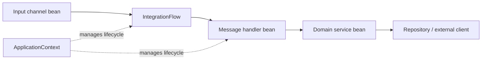

# BeanFactoryAware, ApplicationContextAware, and Dependencies

In Spring Integration, a message flow runs inside the Spring container. The channels, endpoints, handlers, pollers, executors, and services invoked by the flow are all beans or are managed by Spring through beans. Therefore, how a component receives its dependencies and when it is initialized by the container directly affect the flow's ability to start, stop, and be tested.

Spring provides dependency injection to supply collaborators to beans, along with `Aware` callbacks so a bean can receive a reference to a part of the container infrastructure. Two common callbacks are `BeanFactoryAware` and `ApplicationContextAware`. Each has a distinct purpose; understanding the boundary between callbacks and dependency injection helps avoid creating service locators, circular dependencies, and premature initialization errors.

## 1. BeanFactory and ApplicationContext in the Runtime

`BeanFactory` is the foundational contract of the IoC container. It manages bean definitions, creates beans, and provides bean lookup APIs. `ApplicationContext` extends those capabilities while integrating configuration environments, resource loading, message sources, event publishing, and parent-child context hierarchies.

| Capability | `BeanFactory` | `ApplicationContext` |
| --- | --- | --- |
| Bean creation and lookup | Yes | Yes, inherited from `BeanFactory` |
| Dependency injection and bean lifecycle management | Yes | Yes |
| Environment and active profiles | Not a `BeanFactory` API | Yes via `EnvironmentCapable` |
| Reading resources via Spring abstractions | Not a `BeanFactory` API | Yes via `ResourceLoader` |
| Publishing application events | Not a `BeanFactory` API | Yes via `ApplicationEventPublisher` |
| Message source and context hierarchy | No | Yes |

In a Spring Boot application or a standard Spring Integration application, beans are created within an `ApplicationContext`. Spring Integration components are registered in that context and participate in the container's lifecycle. When the context initializes, the framework processes `IntegrationFlow` beans, registers the associated channels/endpoints, and manages endpoint lifecycles via Spring's lifecycle mechanism.



`ApplicationContext` can be viewed as a fuller-featured container, but that does not mean every bean needs to hold a reference to the entire context. Request only the exact dependencies a bean needs.

## 2. Where Do `Aware` Callbacks Sit in the Bean Lifecycle?

A Spring-created bean typically goes through the following main steps:

```mermaid
flowchart TD
    A[Read BeanDefinition and create instance] --> B[Populate properties / inject dependencies]
    B --> C[BeanNameAware, BeanClassLoaderAware, BeanFactoryAware]
    C --> D[BeanPostProcessor before initialization<br/>including ApplicationContextAwareProcessor]
    D --> E[@PostConstruct / InitializingBean / init-method]
    E --> F[BeanPostProcessor after initialization]
    F --> G[Bean ready to serve]
    G --> H[Destroy callbacks when context closes]
```

This is a conceptual order to locate callbacks, not an exhaustive list of every internal hook. The key point is that dependencies are populated before `Aware` callbacks, and those callbacks run before initialization callbacks such as `InitializingBean.afterPropertiesSet()` or `init-method`.

Two groups of callbacks should be distinguished:

- `BeanNameAware`, `BeanClassLoaderAware`, and `BeanFactoryAware` are invoked directly during bean initialization by `BeanFactory`.
- Callbacks such as `EnvironmentAware`, `ResourceLoaderAware`, `ApplicationEventPublisherAware`, `MessageSourceAware`, and `ApplicationContextAware` are handled by `ApplicationContextAwareProcessor` as a `BeanPostProcessor` before initialization.

Consequently, an `Aware` callback is not the right place to perform heavy business work, wait for messages, arbitrarily open connections, or call deeply into other beans. At that moment the bean graph may not be complete; looking up new beans inside a callback can also trigger premature initialization or circular dependencies.

Callbacks are only invoked by the container on container-managed objects. If the application writes `new MyComponent()` manually and uses that object, Spring will neither inject dependencies nor call `setBeanFactory()` or `setApplicationContext()` on it.

## 3. `BeanFactoryAware`: When a Bean Needs to Know the BeanFactory

`BeanFactoryAware` allows a bean to receive the `BeanFactory` managing it through the method:

```java
public interface BeanFactoryAware extends Aware {
    void setBeanFactory(BeanFactory beanFactory) throws BeansException;
}
```

After the callback, the bean can use `BeanFactory` APIs such as `getBean()`, `containsBean()`, `isSingleton()`, or `getType()`. This is useful for certain infrastructure components that must look up beans by name or metadata at runtime. However, if a bean already knows the type of collaborator it needs, constructor injection is clearer and easier to test.

The example below illustrates an infrastructure registry that must resolve handlers by runtime-configured names:

```java
@Component
final class NamedHandlerRegistry implements BeanFactoryAware {

    private BeanFactory beanFactory;

    @Override
    public void setBeanFactory(BeanFactory beanFactory) {
        this.beanFactory = beanFactory;
    }

    Handler resolve(String handlerBeanName) {
        return beanFactory.getBean(handlerBeanName, Handler.class);
    }
}
```

This is a special case: the bean name is only known after reading runtime configuration. If there are only one or a few known handlers ahead of time, inject them directly or inject `Map<String, Handler>` so Spring supplies beans keyed by name. Scattering `getBean()` calls inside business services hides dependencies and delays missing-bean errors until that code path runs.

`BeanFactoryAware` only supplies a `BeanFactory`. Do not cast it to `ApplicationContext` just to access events, resources, or environment; if you genuinely need one of those capabilities, request the corresponding interface.

## 4. `ApplicationContextAware`: When a Bean Needs Context Access

`ApplicationContextAware` allows a bean to receive the current context:

```java
public interface ApplicationContextAware extends Aware {
    void setApplicationContext(ApplicationContext applicationContext)
            throws BeansException;
}
```

Example of an infrastructure diagnostics component that needs to report context identification details:

```java
@Component
final class RuntimeContextDiagnostics implements ApplicationContextAware {

    private ApplicationContext applicationContext;

    @Override
    public void setApplicationContext(ApplicationContext applicationContext) {
        this.applicationContext = applicationContext;
    }

    RuntimeContextInfo describe() {
        return new RuntimeContextInfo(
            applicationContext.getId(),
            applicationContext.getDisplayName(),
            applicationContext.getEnvironment().getActiveProfiles()
        );
    }
}
```

In an ordinary application, a component like the one above could normally inject `Environment` and the required configuration values directly. Using `ApplicationContextAware` makes sense when an infrastructure component genuinely needs multiple context-level APIs or must integrate with context management mechanics.

`ApplicationContext` provides many capabilities at once: bean lookup, resource reading, environment access, event publishing, message source access, and viewing the parent context. If a service calls `applicationContext.getBean("paymentService")` to obtain another service on every message, it is using the context as a service locator. Dependencies are no longer visible in the constructor, and substituting dependencies in unit tests becomes difficult.

### Prefer Narrower Interfaces

Spring provides `Aware` interfaces per capability. Choose the smallest interface that gets the job done:

| Need | Interface or dependency to use |
| --- | --- |
| Reading configuration and active profiles | `Environment` / `EnvironmentAware` |
| Reading resources | `ResourceLoader` / `ResourceLoaderAware` |
| Publishing application events | `ApplicationEventPublisher` / `ApplicationEventPublisherAware` |
| Reading externalized messages | `MessageSource` / `MessageSourceAware` |
| Looking up beans by name/metadata at runtime | `BeanFactory` or `BeanFactoryAware` |
| Needing multiple context-level APIs for an infrastructure adapter | `ApplicationContext` / `ApplicationContextAware` |

For business code, constructor injection of these interfaces is usually sufficient. `Aware` callbacks are primarily useful when building a container-initialized infrastructure component where the callback is the appropriate integration contract.

## 5. Dependency Injection: The Default Way to Wire Beans

Dependency injection makes clear which collaborators a bean requires. Spring resolves dependencies when creating the bean and passes references via constructor, setter, or field. For new applications, constructor injection is generally the best choice because required dependencies appear directly in the constructor signature and the object can use `final` fields.

```java
@Service
final class OrderMessageHandler {

    private final PricingService pricingService;
    private final InventoryService inventoryService;

    OrderMessageHandler(PricingService pricingService,
                        InventoryService inventoryService) {
        this.pricingService = pricingService;
        this.inventoryService = inventoryService;
    }

    OrderResult handle(Order order) {
        Price price = pricingService.calculate(order);
        Reservation reservation = inventoryService.reserve(order);
        return new OrderResult(order.id(), price, reservation);
    }
}
```

If there is only one matching bean per interface, Spring can resolve by type automatically. When multiple implementations exist, use `@Qualifier`, `@Primary`, or an explicit registry to specify which bean to inject.

```java
@Service
final class PaymentRouter {

    private final Map<String, PaymentGateway> gateways;

    PaymentRouter(Map<String, PaymentGateway> gateways) {
        this.gateways = gateways;
    }

    PaymentGateway gatewayFor(String provider) {
        PaymentGateway gateway = gateways.get(provider);
        if (gateway == null) {
            throw new IllegalArgumentException("Unknown provider: " + provider);
        }
        return gateway;
    }
}
```

Spring can inject a collection or map of beans of the same type. With a map, the keys are typically bean names. This approach fits when selecting among a known set of implementations in the container; it is generally clearer than holding `ApplicationContext` and calling `getBean()`.

### Injecting Dependencies via `@Bean` Methods

In Java configuration, parameters of a `@Bean` method are also dependencies resolved by Spring:

```java
@Configuration
class OrderFlowConfiguration {

    @Bean
    MessageChannel ordersInput() {
        return new DirectChannel();
    }

    @Bean
    IntegrationFlow orderFlow(MessageChannel ordersInput,
                              OrderMessageHandler handler) {
        return IntegrationFlow.from(ordersInput)
            .handle(handler, "handle")
            .get();
    }
}
```

`orderFlow` receives the channel and handler through its parameters. Spring Integration uses the `IntegrationFlow` bean to register the corresponding flow components in the context. This declaration style keeps the flow's dependencies visible, supports substituting channels/handlers in tests, and keeps all components within Spring's lifecycle.

If multiple `MessageChannel` beans of the same type exist, assign clear bean names and use `@Qualifier("ordersInput")` on the parameter that needs disambiguation. Do not rely on bean declaration order to select a channel.

## 6. Optional, Lazy, and Prototype Dependencies

Not every dependency must be present at the moment a bean is created. Spring provides abstractions to defer resolution or allow missing dependencies without accessing the entire context.

### `ObjectProvider<T>`

`ObjectProvider<T>` allows resolving a dependency when needed:

```java
@Component
final class OptionalAuditPublisher {

    private final ObjectProvider<AuditPublisher> publisherProvider;

    OptionalAuditPublisher(ObjectProvider<AuditPublisher> publisherProvider) {
        this.publisherProvider = publisherProvider;
    }

    void publishIfConfigured(AuditRecord record) {
        AuditPublisher publisher = publisherProvider.getIfAvailable();
        if (publisher != null) {
            publisher.publish(record);
        }
    }
}
```

`getIfAvailable()` suits genuinely optional dependencies. `getObject()` requires a matching bean and throws an error if none can be resolved. `orderedStream()` is useful when iterating over implementations in Spring's ordered sequence. Define clear behavior when multiple beans exist if using methods that resolve a single bean.

### `@Lazy`

`@Lazy` on a dependency can create a proxy so target bean initialization is deferred until first use. It is useful when initialization cost is high or when breaking certain eager initialization dependencies, but should not be used to mask a design-level dependency cycle. If two beans call each other during message processing, a proxy only delays the failure rather than eliminating the logical dependency cycle.

### Prototypes Injected into Singletons

If a `prototype`-scoped bean is injected directly into a singleton, Spring creates one instance when the singleton is created. The singleton keeps holding that same instance; it does not automatically receive a fresh prototype on every method call. When a fresh instance per processing call is needed, use `ObjectProvider<PrototypeWorker>`:

```java
@Component
final class BatchCoordinator {

    private final ObjectProvider<BatchWorker> workerProvider;

    BatchCoordinator(ObjectProvider<BatchWorker> workerProvider) {
        this.workerProvider = workerProvider;
    }

    void process(Batch batch) {
        BatchWorker worker = workerProvider.getObject();
        worker.process(batch);
    }
}
```

Use prototype scope only when a stateful instance per invocation is truly required. For stateless message handlers, singleton scope is usually simpler and more economical.

## 7. Circular Dependencies and Premature Initialization

A clean dependency graph has a clear direction: flow depends on handler, handler depends on service, service depends on repository or client. If A requires B and B also requires A in their constructors, Spring cannot finish creating A before B and cannot create B before A. Constructor circular dependencies fail during context initialization.

Setter/field injection may allow some reference cycles to be resolved in certain cases, but relying on that behavior makes lifecycles harder to understand and can be restricted by proxy mechanisms or container configuration. A better fix is splitting responsibilities, extracting shared logic into a third bean, or inverting dependencies with events/port interfaces.

Another mistake is calling `beanFactory.getBean()` or `applicationContext.getBean()` inside `setBeanFactory()`, `setApplicationContext()`, or an initialization callback. This can force the container to create another bean while the graph is not ready, causing `BeanCurrentlyInCreationException`, creating proxies at the wrong time, or registering endpoints before related dependencies finish initializing.

If work needs to run after the context is ready, choose the lifecycle/event hook meant for that purpose, such as `ApplicationReadyEvent` in a Spring Boot application for post-startup work. Do not treat an `Aware` callback as a signal that the entire application is up and running.

## 8. Applying This in the Spring Integration Runtime

An `IntegrationFlow` typically connects channel, handler, and service beans. Inject these components into the flow configuration or handler constructors. This gives the flow a clear dependency graph and allows Spring Integration to manage endpoints according to the context lifecycle.



### Static Flow Declarations

When a flow is known at configuration time, declare `IntegrationFlow` with `@Bean` and inject dependencies via method parameters. Endpoints are registered during context initialization and participate in Spring's start/stop mechanism. Do not instantiate a handler with `new` when it has Spring dependencies and attach it to a flow if that object needs container management.

### Dynamic Flow Registration

When the number of flows is only determined at runtime—for instance, one flow per tenant—Spring Integration provides `IntegrationFlowContext`. Inject this abstraction directly instead of grabbing `ApplicationContext` and manually registering beans via `getBean()` or low-level bean factory manipulation.

```java
@Component
final class TenantFlowRegistry {

    private final IntegrationFlowContext flowContext;

    TenantFlowRegistry(IntegrationFlowContext flowContext) {
        this.flowContext = flowContext;
    }

    IntegrationFlowRegistration register(String tenantId,
                                         MessageChannel input,
                                         TenantMessageHandler handler) {
        return flowContext.registration(
                IntegrationFlow.from(input)
                    .handle(handler, "handle")
                    .get())
            .id("tenant-" + tenantId)
            .useFlowIdAsPrefix()
            .register();
    }
}
```

`IntegrationFlowContext` returns an `IntegrationFlowRegistration`. The registration object provides access to the input channel and lets you unregister the flow via `destroy()` when a tenant is removed or configuration changes:

```java
registration.destroy();
```

The application must retain the registration corresponding to each tenant to shut down the right flow when its lifecycle ends. Flow IDs must be unique; registering a duplicate ID can cause registration to fail. Define who owns the registration, when the flow stops, and how in-flight messages are handled before destroying the flow.

### Endpoint Lifecycle

Spring Integration endpoints typically participate in `Lifecycle`/`SmartLifecycle` and are coordinated by the context during start, stop, or close. When you need to control when an endpoint runs, use framework-provided lifecycle mechanisms such as auto-startup, phase, or `IntegrationFlowContext` registration. Do not call `start()` inside `ApplicationContextAware.setApplicationContext()` because that callback only signals that the container assigned the context to the bean; it is not a hook for managing the operational state of the entire message flow.

## 9. Choosing the Right Mechanism for Each Need

| Need | Preferred approach | Reason |
| --- | --- | --- |
| Handler needs to invoke a specific service | Constructor injection | Explicit dependencies, easy to mock and test. |
| Flow needs channels and handlers | Parameters of `@Bean` method | Spring resolves beans and manages lifecycle. |
| Selecting an implementation from known beans | Inject `Map<String, T>` or `List<T>` | Avoids service locator pattern. |
| Dependency may be absent | `ObjectProvider<T>` | Makes optional dependency explicit. |
| Need a fresh prototype instance per call | `ObjectProvider<T>` | Resolves a fresh instance when calling `getObject()`. |
| Infrastructure component needs runtime lookup by bean name | `BeanFactoryAware` or inject `BeanFactory` | Scoped lookup API without full context coupling. |
| Component needs environment/resource/event | Inject corresponding interface or use narrow `Aware` callback | Avoids depending on the entire context. |
| Infrastructure adapter needs multiple context-level APIs | `ApplicationContextAware` | Intentional access to context APIs. |
| Creating and destroying IntegrationFlows at runtime | `IntegrationFlowContext` | Dedicated flow registration and lifecycle management. |

## 10. Common Errors and How to Diagnose Them

| Symptom | Possible cause | How to check or fix |
| --- | --- | --- |
| `setBeanFactory()` is not called | Object was created with `new`, or is not managed by BeanFactory. | Check bean registration and where the instance is created. |
| `setApplicationContext()` is not called | Object does not belong to `ApplicationContext`, or is not managed by the context. | Check the context creating the bean and the registration process. |
| `NoSuchBeanDefinitionException` when handling a message | Wrong bean name lookup, missing profile/condition, or bean not registered. | Check bean name, type, qualifier, and active profile; prefer static injection when dependencies are known. |
| `NoUniqueBeanDefinitionException` | Multiple beans of the same type exist without specifying which bean to use. | Use `@Qualifier`, `@Primary`, or collection injection. |
| `BeanCurrentlyInCreationException` | Circular dependency or premature bean lookup in callback/init. | Redraw the dependency graph, switch to constructor injection, and remove lookups from initialization callbacks. |
| Prototype does not create a new instance per processing call | Prototype is injected directly into a singleton. | Use `ObjectProvider<T>` to obtain an instance per call. |
| Flow does not start/stop at the right time | Endpoint was created outside the context or lifecycle is manually controlled in the wrong place. | Register flows via `@Bean`/`IntegrationFlowContext`, check auto-startup and lifecycle phase. |
| Dynamic flow keeps running after tenant deletion | Registration was not retained or `destroy()` was not called. | Track registrations per tenant and destroy when the tenant ends. |

When diagnosing an initialization error, inspect the first exception in the cause chain, which bean was being created, which dependency was being resolved, and which callbacks had already run. For Spring Integration, also verify whether the `IntegrationFlow`, channel, and endpoint beans were actually registered in the expected context.

## 11. Workflow for Designing Dependencies in a Message Flow

1. List the channels, handlers, services, and executors required by the flow.
2. Declare static components as beans and inject them via constructors or `@Bean` parameters.
3. If multiple implementations exist, define selection rules using qualifiers or collection injection.
4. Use `ObjectProvider` only when a dependency is genuinely optional, lazy, or requires per-call instantiation.
5. Use `BeanFactoryAware` only when runtime lookup by bean metadata/name is necessary and cannot be modeled with standard injection.
6. Use `ApplicationContextAware` only when an infrastructure component needs context-level capabilities; if only a single capability is needed, inject the corresponding narrow interface.
7. For dynamic flows, use `IntegrationFlowContext` and retain registrations to manage `destroy()`.
8. Test context refresh, start/stop, and close in integration tests to verify endpoints are properly lifecycle-managed.

## 12. Key Takeaways

- `BeanFactoryAware` receives `BeanFactory`; `ApplicationContextAware` receives the context, which adds environment, resource, event, and message source capabilities.
- `Aware` callbacks execute during bean initialization, after dependencies are populated and before initialization callbacks. They do not prove the entire application is ready.
- Constructor injection is the default way to declare dependencies. `Aware` is better suited to infrastructure components that must integrate directly with the container.
- Using the context as a service locator hides dependencies and increases the risk of premature initialization and circular dependencies.
- In Spring Integration, declare static flows with `@Bean`, manage dynamic flows with `IntegrationFlowContext`, and let Spring coordinate endpoint lifecycles.

## References

- [Spring Framework Reference — Container Extension Points](https://docs.spring.io/spring-framework/reference/core/beans/factory-extension.html)
- [Spring Framework Reference — Classpath Scanning and Managed Components](https://docs.spring.io/spring-framework/reference/core/beans/classpath-scanning.html)
- [Spring Framework Reference — Dependency Injection](https://docs.spring.io/spring-framework/reference/core/beans/dependencies/factory-collaborators.html)
- [Spring Integration Reference — Java DSL](https://docs.spring.io/spring-integration/reference/dsl.html)
- [Spring Integration Reference — Dynamic and Runtime Integration Flows](https://docs.spring.io/spring-integration/reference/dsl/java-runtime-flows.html)
