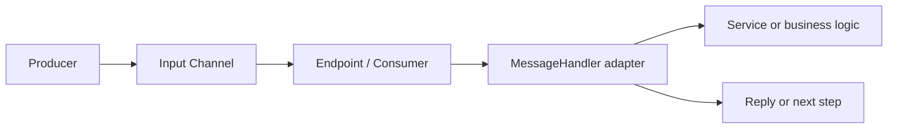
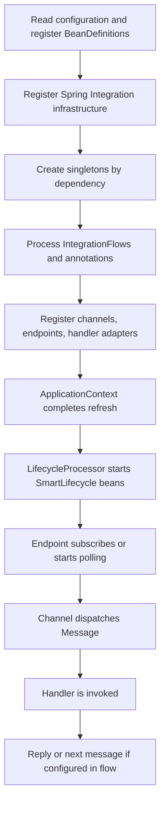

# Initialization Order Between Channel, Endpoint, and Handler

In the Spring Integration runtime, channels, endpoints, and handlers have distinct responsibilities. A channel transports or distributes messages; an endpoint connects a channel to a consumer/handler and manages how the consumer operates; a handler executes logic when a message arrives. To understand initialization order, separate three milestones: **bean creation**, **endpoint registration**, and **endpoint startup**. They occur during ApplicationContext initialization, though they do not form a fixed linear sequence across every application.

This lesson belongs to the **Application context** section of the `SPRING_INTEGRATION_RUNTIME` module. This module focuses on how Spring Integration coordinates message flows across channels, endpoints, consumers, pollers, and executors, while helping learners manage IntegrationFlow lifecycles, transactions, retries, message stores, errors, correlation, and runtime state diagnostics.

## 1. Distinguishing Channel, Endpoint, and Handler

The three components collaborate without substituting for each other's roles:

| Component | Responsibility | When it participates |
|---|---|---|
| **Channel** | Receives and delivers messages to consumers or holds messages in a queue | Created as a bean or registered by the DSL in ApplicationContext |
| **Endpoint** | Connects an input channel to a consumer/handler; manages subscription or polling and start/stop lifecycle | Registered in the context, then started according to lifecycle |
| **Handler** | Executes message processing: invokes a service, transforms, filters, routes, or performs side effects | Invoked when the endpoint receives a message |

An endpoint is typically an implementation of `AbstractEndpoint`, such as `EventDrivenConsumer` or `PollingConsumer`. The endpoint holds references to the input channel and the message handler. It manages consumer registration rather than containing all business logic.

A handler can be a direct implementation of `MessageHandler`, or an adapter invoking a method on a POJO/service. For example, a service activator creates an adapter such as `ServiceActivatingHandler` to turn a message into a business method invocation. Transformers and filters also have corresponding handler adapters.



Key point to remember: **a channel does not invoke business methods directly**. The endpoint subscribes the handler to the channel or reads messages from the channel via a poller. The handler is invoked only when a message is dispatched to it.

## 2. Three Distinct Milestones During Initialization

When Spring builds the ApplicationContext, do not assume the runtime always executes the exact sequence "create channel, then create endpoint, then create handler." In practice, the following stages occur.

### 2.1. Bean Definition Registration and Infrastructure

Before instantiating singletons, Spring reads Java/XML configuration, component scans, and other bean registration sources to build BeanDefinitions in the BeanFactory. `BeanFactoryPostProcessor` implementations can add or adjust bean definitions before beans are instantiated.

In Spring Integration, infrastructure configuration is typically enabled via `@EnableIntegration` or the corresponding auto-configuration. This infrastructure supplies the processors and services needed to register endpoints, resolve channels, process annotations, and manage message flows.

At this stage, Spring mainly prepares **bean blueprints**. A BeanDefinition is not yet a running instance.

### 2.2. Bean Creation and IntegrationFlow Processing

When instantiating singletons, Spring resolves dependencies along the dependency graph. If an endpoint needs a reference to a channel or handler bean, that dependency must be resolved during endpoint initialization. Consequently, channels or services may be created before endpoints due to dependency injection, yet the order is not determined merely by the order `@Bean` methods are written in a configuration file.

With Java DSL, an `IntegrationFlow` bean describes the flow steps. `IntegrationFlowBeanPostProcessor` processes the flow bean and registers the corresponding Spring Integration components, including the required channels, endpoints, and handler adapters. The DSL flow is a configuration model for building a pipeline; it is not a thread or a consumer that runs immediately when the flow-declaring method is called.

A flow can contain explicit channels:

```java
@Bean
MessageChannel ordersInput() {
    return new DirectChannel();
}

@Bean
MessageChannel ordersValidated() {
    return new DirectChannel();
}

@Bean
IntegrationFlow ordersFlow(OrderService orderService) {
    return IntegrationFlow.from(ordersInput())
        .handle(orderService, "validate")
        .channel(ordersValidated())
        .handle(orderService, "persist")
        .get();
}
```

In this example:

- `ordersInput` and `ordersValidated` are channel beans.
- `ordersFlow` describes the processing chain and the links between channels and handlers.
- Endpoints are registered for the processing steps in the flow.
- `OrderService` is a business bean injected into the flow configuration; handler adapters invoke the specified methods when messages arrive.

If an implicit channel is used between two endpoints, Java DSL can create an appropriate channel for that link. When you need explicit control over channel type, to share a channel across multiple flows, or to observe a channel by name, declare the channel as an explicit bean.

### 2.3. Endpoint Startup by Lifecycle

After the required singletons have been created and the ApplicationContext finishes refreshing, Spring invokes the LifecycleProcessor to start lifecycle-capable beans. Integration endpoints typically implement `SmartLifecycle`, so they can be started automatically when context refresh completes if `autoStartup` is enabled.

This is when endpoints begin connecting to channels:

- For subscribable channels, the endpoint registers the handler as a subscriber.
- For queue channels, the polling consumer begins its schedule for fetching messages according to the poller configuration.
- For executor-dispatched channels, the endpoint registers the consumer; subsequent handler invocations are dispatched through the executor.

Finishing endpoint creation does not mean it is already receiving messages. An endpoint can exist in the ApplicationContext yet not be running if `autoStartup=false` or it has not been started manually.

### 2.4. Handlers Execute Only When Messages Arrive

Once an endpoint is active and receives a message, it invokes its handler. For a service activator, the adapter translates the message/payload/headers into a method call on the service. For a transformer, the handler produces the transformed result. For a filter, the handler decides whether the message is forwarded.

A service's constructor, dependency injection, or `@PostConstruct` may run during bean creation. However, the business method configured as a handler is not invoked simply because the ApplicationContext starts; it is invoked when the endpoint receives a message.

## 3. Overall Flow: From ApplicationContext to First Execution



The diagram shows the conceptual order. In practice, some bean creation and component registration steps may interleave because Spring resolves dependencies and post-processors according to container mechanics. Do not use this diagram to infer that every channel in every application is created before every endpoint.

## 4. How Endpoints Connect to Channels by Channel Type

The input channel type determines the consumer endpoint type and how the endpoint behaves.

| Channel type | Typical consumer endpoint | Behavior on endpoint startup |
|---|---|---|
| `DirectChannel` | `EventDrivenConsumer` | Registers handler as subscriber; dispatches synchronously on sending thread |
| `PublishSubscribeChannel` | `EventDrivenConsumer` | Registers subscriber; a single message can be distributed to multiple subscribers |
| `ExecutorChannel` | `EventDrivenConsumer` | Registers subscriber; dispatches handler via an executor |
| `QueueChannel` | `PollingConsumer` | Starts scheduled polling to retrieve messages from the queue |
| `PriorityChannel` | `PollingConsumer` | Polls messages according to queue priority order |

### 4.1. SubscribableChannel: Endpoint Registers a Subscriber

Channels such as `DirectChannel`, `PublishSubscribeChannel`, and `ExecutorChannel` implement subscription semantics. The endpoint registers its handler with the channel when the endpoint starts.

With `DirectChannel`, the handler is typically invoked directly on the sending thread. With `ExecutorChannel`, the channel delegates dispatch to an executor, so the handler may run on another thread. Although the two channels differ in threading, connecting the endpoint to the channel is still subscription-based.

If a message is sent before the consumer endpoint registers, the outcome depends on the channel type and dispatch configuration. With `DirectChannel`, the message may fail to reach the intended consumer or the send may fail because no suitable subscriber is registered yet. With `PublishSubscribeChannel`, the message may have no receiving subscribers. Therefore, startup order between producers and consumers matters.

### 4.2. PollableChannel: Endpoint Starts Polling

`QueueChannel` and `PriorityChannel` are examples of `PollableChannel`. Rather than subscribing in the manner of `DirectChannel`, the endpoint uses a `PollingConsumer` to retrieve messages from the queue on a schedule.

The poller defines the polling cadence, such as fixed delay or fixed rate. A TaskScheduler executes poll attempts. Therefore, an endpoint may already be started while the handler has not yet run if the queue is empty or the next poll has not arrived.

Example configuring a flow that reads a queue periodically:

```java
@Bean
IntegrationFlow queuedOrders(OrderService orderService) {
    return IntegrationFlow.from("orders.queue")
        .bridge(endpoint -> endpoint.poller(
            Pollers.fixedDelay(500)))
        .handle(orderService, "process")
        .get();
}
```

In this example, the polling endpoint starts when the lifecycle allows. Messages are pulled from `orders.queue` on the poller schedule before being delivered to the handler.

## 5. Who Determines Endpoint Startup Order?

Endpoints implementing `SmartLifecycle` are managed by Spring's LifecycleProcessor. Two key properties are `autoStartup` and `phase`.

- `autoStartup`: determines whether the endpoint starts automatically when ApplicationContext refresh completes. If disabled, the application or a flow management component must start the endpoint intentionally.
- `phase`: determines the start/stop order among SmartLifecycle beans. Lower phases start first; when stopping the context, higher phases stop first.

If a flow has a producer endpoint sending messages into a `DirectChannel`, the downstream consumer endpoint must be ready before the producer starts emitting messages. You can set the consumer's phase lower than the producer's phase so the consumer starts first.

Example configuring phase for two processing endpoints in a flow:

```java
@Bean
IntegrationFlow orderedFlow(OrderService orderService) {
    return IntegrationFlow.from("orders.in")
        .handle(orderService, "validate",
            endpoint -> endpoint.id("validateOrders").phase(100))
        .channel("orders.validated")
        .handle(orderService, "persist",
            endpoint -> endpoint.id("persistOrders").phase(0))
        .get();
}
```

Here the `persistOrders` endpoint has a lower phase, so it starts before the `validateOrders` endpoint. This ensures the downstream consumer is subscribed to `orders.validated` before the upstream step begins processing messages. If an inbound adapter acts as a producer for `orders.in`, that source endpoint must also be accounted for in phase ordering so it does not emit messages too early.

Do not assign phases arbitrarily to every endpoint. Adjust them only when there is a startup timing dependency, especially with active message sources emitting during application startup.

## 6. Distinguishing phase from depends-on

Two mechanisms are frequently confused:

| Mechanism | What does it control? | When to use |
|---|---|---|
| Dependency injection / `@DependsOn` | Bean dependency relationships and instantiation order; dependent beans are created after dependencies | When one bean needs another bean initialized first to complete configuration |
| `SmartLifecycle.phase` | Start/stop order of lifecycle components | When an endpoint or producer must start after another consumer/endpoint |
| `autoStartup` | Whether to start automatically on context refresh | When activation must be intentionally deferred or controlled |
| `start()` / `stop()` | Runtime lifecycle control | When the application needs to toggle endpoints based on business or admin state |

`@DependsOn` should not be used in place of `phase` when the real requirement is that a subscriber must be registered before a producer starts. A bean being created earlier does not mean the endpoint has subscribed to the channel; subscription only happens when the endpoint starts.

## 7. Static Flow Initialization vs. Dynamic Flow Registration

For static flows, `IntegrationFlow` beans are declared in application configuration and processed during ApplicationContext initialization.

For dynamic flows, `IntegrationFlowContext` allows registering flows while the application is running. Upon registration, Spring Integration creates the components required for the flow and returns a registration handle for the application to manage. Depending on configuration, the flow can start automatically or be started via the registration.

Illustrative example:

```java
IntegrationFlowRegistration registration =
    flowContext.registration(flow)
        .id("tenantFlow")
        .autoStartup(false)
        .register();

// When business conditions are ready:
registration.start();

// When the flow is no longer needed:
registration.stop();
registration.destroy();
```

In this scenario, the ApplicationContext is already running, yet endpoints belonging to the dynamic flow are only activated according to the registration's lifecycle. This is why you must distinguish "bean is registered" from "endpoint is running."

## 8. Common Issues When Initialization Order Is Wrong

| Symptom | Possible cause | How to check |
|---|---|---|
| Message sent to `DirectChannel` has no receiving consumer | Endpoint not started yet, `autoStartup=false`, or producer emits too early | Check endpoint state, phase, and logs during context refresh |
| Flow bean exists but does not process messages | Flow was not processed/registered properly or endpoint is inactive | Check IntegrationFlow configuration, IntegrationFlowBeanPostProcessor, and lifecycle |
| Queue holds messages but handler has not run | Polling endpoint not started, poller misconfigured, or scheduler delayed | Check poller, TaskScheduler, queue depth, and PollingConsumer state |
| Handler runs on an unexpected thread | Channel is `ExecutorChannel` or flow uses an executor/poller | Check channel type, executor, and poller configuration |
| Context fails to start when creating endpoint | Channel cannot be resolved, wrong handler method signature, or missing dependency | Read root cause in bean and endpoint initialization logs |
| Application sends messages at startup before downstream is ready | Producer endpoint starts before consumer endpoint | Adjust phase or defer producer until the flow is ready |

When diagnosing, inspect logs across all three stages: bean creation, endpoint startup, and message processing. A bean creation failure typically appears during context refresh; a lifecycle issue typically appears when endpoints start; a dispatch or business failure only appears when a message arrives.

## 9. Procedure for Verifying Initialization Order in an Application

When a flow misbehaves after ApplicationContext startup, verify step by step:

1. **Confirm configuration is loaded.** Check configuration classes, component scans, `@EnableIntegration`, or required auto-configuration.
2. **Confirm channels exist.** For named channels, verify bean names, channel types, and declaration sites. For implicit DSL channels, verify the links between endpoints.
3. **Confirm endpoints are registered.** Verify the flow or annotations were processed and endpoints appear in the context.
4. **Confirm handler adapters are valid.** Check business beans, method names, parameter types, return types, and injected dependencies.
5. **Confirm endpoints have started.** Check `autoStartup`, phase, and lifecycle state.
6. **Confirm consumers are connected to channels.** For subscribable channels, check subscribers; for pollable channels, check the poller and scheduler.
7. **Trace the first message dispatch.** Inspect thread, queue depth, dispatch timing, and handler logs.

You can enable DEBUG logging for relevant Spring Integration packages to trace endpoint registration, channel subscriptions, pollers, and dispatches. When observing the overall runtime topology, you can use the Integration Graph or enabled actuator/management endpoints in the application.

## 10. Principles to Remember

- `@Bean` declaration order is not a general rule that determines initialization order for all channels, endpoints, and handlers.
- The dependency graph drives bean creation; post-processors and IntegrationFlow/annotation configuration register integration components.
- Creating an endpoint does not mean the endpoint has started. LifecycleProcessor starts SmartLifecycle endpoints according to `autoStartup` and `phase`.
- Channels do not invoke business logic directly. Endpoints connect channels to handlers; handlers are invoked when messages arrive.
- With `DirectChannel` and `ExecutorChannel`, endpoints register subscribers. With `QueueChannel`, polling endpoints pull messages via a poller.
- Use dependency injection or `@DependsOn` for bean instantiation order; use `phase` and `autoStartup` for endpoint activation timing.
- For dynamic flows, manage lifecycles via `IntegrationFlowContext` registrations.

When analyzing the runtime, ask yourself three questions: **have the beans been created, has the endpoint started and connected to the channel, and has the message actually reached the handler?** Separating these three milestones narrows down bugs faster and avoids confusing ApplicationContext configuration issues with dispatch, poller, or business logic errors.
