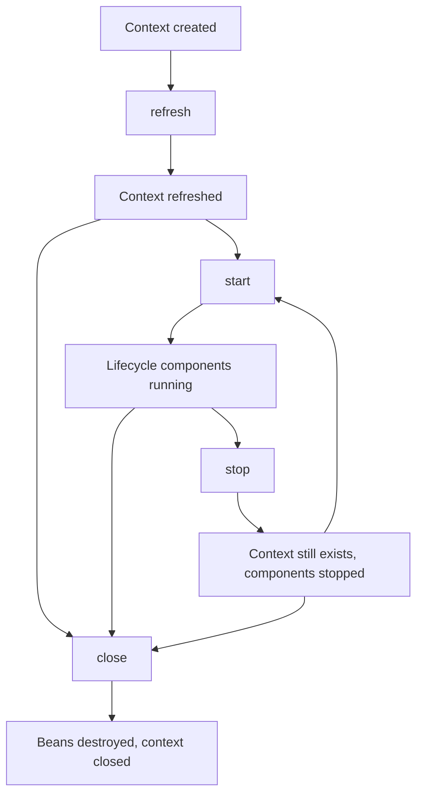
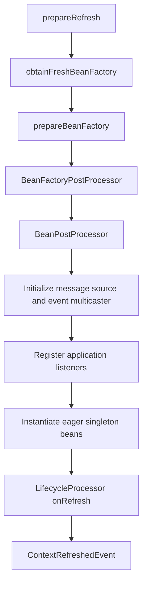

# Context Refresh, Start, Stop, and Close

Spring Integration runs inside the Spring `ApplicationContext`. The context creates and wires beans, initializes integration infrastructure, and then manages the lifecycle of the endpoints participating in message processing. Therefore, to control a flow properly, you must distinguish four context-level operations: `refresh()`, `start()`, `stop()`, and `close()`.

`refresh()` builds or refreshes the container and completes application initialization. `start()` and `stop()` control lifecycle-participating beans, especially endpoints implementing `SmartLifecycle`. `close()` closes the context, stops running components, and destroys singletons to release resources. These operations have different purposes and effects; calling `stop()` is not equivalent to `close()`, and `refresh()` is not a way to resume a paused flow.

## 1. Four ApplicationContext-Level Operations

| Operation | Purpose | Primary effect | Destroys singleton beans? |
|---|---|---|---|
| `refresh()` | Initialize or refresh the container | Creates BeanFactory, processes bean definitions, instantiates non-lazy singletons, initializes lifecycle processor, and completes refresh | May destroy created beans if refresh fails; successful refresh keeps beans in the context |
| `start()` | Start registered lifecycle components | Instructs lifecycle processor to start eligible components | No |
| `stop()` | Pause lifecycle components | Instructs components to stop receiving or processing work per their policies | No |
| `close()` | Close context and release resources | Stops lifecycle, invokes bean destroy callbacks, closes BeanFactory, and marks context closed | Yes |

You can visualize the relationships among these operations as follows:



After `stop()`, the context still retains its beans and can be started again if components support restarting. After `close()`, the context has released its beans and resources; applications typically create a new context if they need to restart.

## 2. How Does Refresh Build the Container?

`refresh()` is the process of setting up the container. In an `AbstractApplicationContext`, this process is organized into multiple phases. Internal method names may vary across context types or versions, but the general flow includes:

1. Preparing refresh state and the context environment.
2. Creating or obtaining a fresh BeanFactory.
3. Registering foundational components and preparing BeanFactory.
4. Running `BeanFactoryPostProcessor`s to modify bean metadata before regular beans are created.
5. Registering `BeanPostProcessor`s to intercept bean initialization.
6. Initializing the message source, application event multicaster, and registering application listeners.
7. Instantiating eager singletons and finishing BeanFactory initialization.
8. Starting auto-startup lifecycle beans, then publishing `ContextRefreshedEvent`.



Spring Integration relies on this container to register channels, endpoints, and infrastructure components. `IntegrationFlow` beans declared in the context are processed by Spring Integration's flow registration mechanism; endpoints are created and wired to their corresponding channels. Endpoints participating in lifecycle management are coordinated by the lifecycle processor when the context finishes refreshing.

### 2.1. Refresh Is Not Start

Refresh builds the application structure and finishes bean initialization. Automatic startup on refresh applies primarily to `SmartLifecycle` beans whose `isAutoStartup()` returns `true`. A bean that only implements plain `Lifecycle` does not share the same auto-startup commitment during the refresh phase.

You can disable endpoint auto-startup via appropriate configuration and then start it explicitly once the application is ready. This is useful when you need to load configuration, verify dependencies, recover state, or wait for an external condition before accepting messages.

Do not use `refresh()` in place of `start()` after calling `stop()`. Refresh may recreate the BeanFactory and beans depending on the context type's semantics; it does not simply re-enable stopped endpoints. Some context types only support refreshing once, so check the context type before planning repeated refreshes.

### 2.2. Refresh Failures

If a bean cannot be created, configuration is invalid, or an initialization step fails, refresh may terminate with an exception. Spring destroys singletons already created during the failed refresh and closes the corresponding BeanFactory to avoid leaving a half-initialized context. Read the root cause of the error and check bean dependencies, endpoint configuration, adapter connections, and resources created during initialization.

## 3. Bean Lifecycle and Context Lifecycle Are Two Distinct Layers

A bean has its own lifecycle inside the context lifecycle. Spring supports bean initialization and destruction callbacks, for example:

| Callback | Typical timing | Purpose |
|---|---|---|
| `@PostConstruct` | After dependency injection completes | Validate or prepare internal bean state |
| `InitializingBean.afterPropertiesSet()` | After properties are set | Initialization callback per Spring contract |
| `initMethod` | During bean initialization phase | Invoke custom initialization method |
| `@PreDestroy` | When bean is destroyed | Release resources owned by the bean |
| `DisposableBean.destroy()` | When bean is destroyed | Destruction callback per Spring contract |
| `destroyMethod` | When bean is destroyed | Invoke custom resource-closing method |

Initialization callbacks do not replace `SmartLifecycle`. For example, `@PostConstruct` is suitable for validating configuration or preparing internal data; it is not a good place to manually open listeners, start pollers, or implement a complex start/stop workflow. Work that needs lifecycle control should live in a `SmartLifecycle` bean or a Spring Integration-managed endpoint.

Similarly, `@PreDestroy` and `destroyMethod` are suitable for releasing resources owned by a bean. If a component needs to stop accepting messages, finish in-flight work, and signal when stopping is complete, use the lifecycle contract rather than relying solely on destroy callbacks.

## 4. Lifecycle and SmartLifecycle

`Lifecycle` defines three basic operations:

```java
public interface Lifecycle {
    void start();
    void stop();
    boolean isRunning();
}
```

`SmartLifecycle` extends this contract with auto-startup, phase-based ordering, and stop callback support:

```java
public interface SmartLifecycle extends Lifecycle, Phased {
    boolean isAutoStartup();
    void stop(Runnable callback);
}
```

Spring Integration endpoints typically participate in lifecycle management through this mechanism. `DefaultLifecycleProcessor` coordinates starting and stopping components. Applications can also implement `SmartLifecycle` for a custom producer, listener, or worker that must be tightly bound to the context's lifetime.

Example of a component that can be toggled with the context:

```java
@Component
class ExternalFeedLifecycle implements SmartLifecycle {

    private volatile boolean running;

    @Override
    public void start() {
        if (!running) {
            openFeed();
            running = true;
        }
    }

    @Override
    public void stop() {
        if (running) {
            closeFeed();
            running = false;
        }
    }

    @Override
    public void stop(Runnable callback) {
        try {
            stop();
        }
        finally {
            callback.run();
        }
    }

    @Override
    public boolean isRunning() {
        return running;
    }

    @Override
    public boolean isAutoStartup() {
        return true;
    }

    @Override
    public int getPhase() {
        return 100;
    }

    private void openFeed() { /* Open listener or connection */ }
    private void closeFeed() { /* Stop listener and release connection */ }
}
```

The example above illustrates the structure. If the actual stop operation is asynchronous, do not invoke the callback immediately after issuing the stop request; invoke the callback only once the work has stopped or been handled according to the shutdown policy.

### 4.1. Ordering with Phase

`SmartLifecycle` allows ordering start and stop using phase:

- On start, lower phases are started first.
- On stop, higher phases are stopped first.

For example, if an inbound producer must stop accepting messages before internal consumers stop, the producer can be given a higher phase than the consumer. On shutdown, the producer is stopped first; the consumer gets extra time to finish processing already-received work. Choose phases based on real dependencies and test the ordering rather than relying on bean declaration order.

`depends-on` and bean dependency relationships also affect bean creation and destruction order. Phase resolves lifecycle ordering for `SmartLifecycle` components; the two mechanisms serve different purposes and should not be used interchangeably.

### 4.2. Synchronous and Asynchronous Stop

`stop(Runnable callback)` allows a component to notify the lifecycle processor when stopping is complete. This is crucial for listener containers, executors, or producers with in-flight work. A component can stop accepting new work, wait for in-flight work to finish within a bounded period, and then invoke the callback.

A time-bounded shutdown prevents the context from hanging indefinitely. If work cannot complete within the allowed timeout, establish a clear policy: cancel tasks, let the transport redeliver, persist recovery state, or emit an alert. Never invoke the callback early just to make the context close faster if doing so could lose messages.

## 5. Start and Stop: Pausing Operations While Keeping the Context

`ConfigurableApplicationContext.start()` and `stop()` delegate to the lifecycle processor to control lifecycle components. They do not recreate beans and do not destroy the BeanFactory.

In Spring Integration, this operation can be used to pause lifecycle-aware endpoints—for instance, stopping an inbound adapter during maintenance. Afterward, the endpoint can be started again if the adapter and underlying transport support restarting. When stopping, be clear about where messages currently reside:

- Messages not yet read from the source may remain in the broker, file system, or data source.
- Messages already placed into a channel may remain in a queue channel while the channel still exists.
- Messages currently executing on an executor may continue running depending on the endpoint's and executor's shutdown mechanics.
- Messages mid-transaction may commit or roll back according to transaction boundaries and the transport.

Therefore, `stop()` does not implicitly mean every message has finished processing. For an orderly shutdown, coordinate stopping new message ingestion, draining backlogs, waiting for consumers, and managing acknowledgements.

You can control an individual endpoint via its lifecycle API if the application holds an appropriate reference. However, when controlling an entire flow, prefer the context-managed lifecycle mechanism rather than hunting down and invoking individual handlers manually.

## 6. Close: Stopping and Destroying the Context

`ConfigurableApplicationContext.close()` closes the context. This process typically consists of:

1. Marking the context as closing and publishing `ContextClosedEvent`.
2. Invoking the lifecycle processor to stop running lifecycle beans.
3. Invoking destroy callbacks on singleton beans in appropriate dependency order.
4. Closing BeanFactory and releasing associated resources.
5. Marking the context as no longer active.

`ContextClosedEvent` signals that the context is closing; do not treat it as proof that all endpoints have finished stopping. Lifecycle stopping is coordinated in the subsequent step. When you need to control ordering or wait for asynchronous shutdown, use `SmartLifecycle.stop(Runnable)`.

In Spring Boot applications, the framework normally manages closing the context when the process stops. In plain Spring applications, you can call `close()` explicitly or register a shutdown hook appropriately. Either way, beans owning external resources still require proper resource-closing callbacks.

## 7. Application Events and How to Observe Lifecycle

Spring publishes events related to the context lifecycle:

| Event | When published | Appropriate usage |
|---|---|---|
| `ContextRefreshedEvent` | When context completes refresh | Observing that the application finished the refresh phase |
| `ContextStartedEvent` | After the context is asked to start | Tracking context-level start operations |
| `ContextStoppedEvent` | After the context is asked to stop | Tracking context-level stop operations |
| `ContextClosedEvent` | When the context begins closing | Starting shutdown observation or notification tasks |

You can listen for events with `@EventListener`:

```java
@Component
class ContextLifecycleObserver {

    @EventListener
    void onRefresh(ContextRefreshedEvent event) {
        log.info("Context refreshed: {}", event.getApplicationContext().getId());
    }

    @EventListener
    void onStop(ContextStoppedEvent event) {
        log.info("Context stopped: {}", event.getApplicationContext().getId());
    }

    @EventListener
    void onClose(ContextClosedEvent event) {
        log.info("Context closing: {}", event.getApplicationContext().getId());
    }
}
```

In a context hierarchy, events can propagate up to the parent context. If a listener only cares about one specific context, compare `event.getApplicationContext()` with the context the listener manages to avoid duplicate handling or mistaking a child context's event.

Event listeners are suitable for observation, status updates, or triggering auxiliary tasks. Do not use events as the sole mechanism to enforce endpoint start/stop ordering; the lifecycle processor and `SmartLifecycle` are designed for that job.

`ApplicationReadyEvent` is a Spring Boot event indicating that the Boot application is ready to serve requests per Boot's lifecycle. It is not a core Spring Framework event and does not replace `ContextRefreshedEvent` in plain Spring applications.

## 8. How Does Spring Integration Manage IntegrationFlows?

When declaring flows with Java DSL or XML, Spring Integration registers the required components in the application context. Endpoints connect channels to handlers, sources, or adapters. Lifecycle-aware endpoints managed by the context are started and stopped via `SmartLifecycle`.

It is important to distinguish the flow definition from the running endpoints. An `IntegrationFlow` bean describes the topology. The flow registration mechanism turns that description into runtime beans such as consumer endpoints, source adapters, and related components. Lifecycle management operates on those runtime components.

Example of a flow declared in the context:

```java
@Bean
IntegrationFlow ordersFlow(OrderService orderService) {
    return IntegrationFlow
            .from("orders.input")
            .handle(orderService, "accept")
            .get();
}
```

When the context refreshes, the flow is registered and the endpoint is created. When the lifecycle processor starts the endpoint, messages can flow from the `orders.input` channel to the handler. If the endpoint does not start automatically, the context can still refresh successfully, yet the flow will not receive messages until the endpoint is started.

### 8.1. Controlling Dynamic Flows

`IntegrationFlowContext` allows registering flows while the application is running. This is helpful when topology must vary by tenant or runtime configuration:

```java
IntegrationFlowRegistration registration = flowContext
        .registration(tenantFlow)
        .id("tenant-" + tenantId)
        .register();

// Can control the registration according to application policy.
registration.start();
registration.stop();
registration.destroy();
```

Depending on registration configuration, the flow may start automatically or wait for an explicit start command. `start()` and `stop()` control the registration's components; `destroy()` unregisters and releases beans managed by the registration. Ensure IDs are unique and call destroy when a flow is no longer needed.

Dynamic flows should not be created per message. If the goal is merely selecting a branch by tenant or data type, a router is usually more suitable and avoids creating unnecessary endpoints.

## 9. Coordinating Lifecycle with Pollers, Executors, and Adapters

A flow can contain multiple components with different execution models:

| Component | What to control on start/stop |
|---|---|
| Inbound event-driven adapter | Start/stop listener, callback, or consumer; define acknowledgement for in-flight messages |
| Polling adapter | Start/stop trigger, handle in-progress poll execution, and bound messages per poll |
| `TaskScheduler` | Stop scheduling new runs, handle running tasks, and release threads |
| `TaskExecutor` | Stop accepting new tasks, drain or cancel queued tasks per policy |
| `QueueChannel` | Decide whether to keep backlog in memory, persist durably, or hand off before context closes |
| Outbound adapter | Handle outbound requests in progress, timeouts, and transport connections during shutdown |

A reliable shutdown normally stops inbound producers first, gives consumers time to process already-received messages, and then stops remaining processing resources. You can use phases to express this order. With queues or brokers, acknowledgement and redelivery must be considered alongside lifecycle; stopping an endpoint alone does not guarantee messages will automatically return to the source.

If an executor is shared across multiple flows, establish which bean owns the executor and who is responsible for closing it. Do not let one flow close a shared resource while other flows are still running.

## 10. Common Scenarios and How to Diagnose Them

| Symptom | Possible cause | Investigation approach |
|---|---|---|
| Context refreshes successfully but flow receives no messages | Endpoint has `autoStartup=false`, endpoint has not started, or adapter is not connected | Check `isRunning()` status, auto-startup config, and lifecycle logs |
| `stop()` called yet messages are still processing | Consumer or executor already accepted tasks prior to stop | Check stop semantics, active tasks, and drain policy |
| `start()` called yet adapter does not resume | Adapter or client does not support restart after stop, or resources were closed improperly | Check lifecycle implementation and connection/listener state |
| Context closes slowly | `stop(Runnable)` did not invoke callback, worker is blocked, or shutdown timeout is long | Check each phase, thread dumps, and pending tasks |
| Context closes yet background threads remain | Bean spawned threads manually without integrating lifecycle or destroy callbacks | Check thread ownership, executors, and bean destroy callbacks |
| Event listener executes multiple times | Repeated context refreshes, context hierarchy, or listener does not filter context | Check event source and make handlers idempotent |
| Dynamic flow still exists after tenant deletion | Registration was not destroyed or related beans still hold references | Track registration IDs and unregister/destroy procedure |

A useful investigation sequence:

1. Confirm application context state: refreshed, active, or closed.
2. Confirm related endpoint state via `isRunning()` or runtime observability mechanisms.
3. Check `autoStartup`, phase, and dependency relationships among lifecycle beans.
4. Check whether pollers, schedulers, executors, and listener containers have pending tasks or messages.
5. Read start/stop logs, refresh exceptions, and resource-cleanup errors.
6. For dynamic flows, confirm the registration was started, stopped, or destroyed at the right time.

In environments with Spring Boot Actuator and appropriate observability endpoints, health, metrics, and the Integration graph can help inspect application state, topology, and message flow activity. These tools complement logs; they do not replace identifying which bean owns each resource and which lifecycle controls it.

## 11. Lifecycle Design Principles for Production Flows

- **Let the context manage endpoints:** declare endpoints as beans and use Spring Integration's built-in lifecycle contracts.
- **Separate initialization from start:** use bean initialization callbacks to validate configuration; use `SmartLifecycle` to toggle listeners, workers, or background resources.
- **Design shutdown order:** assign phases based on producer/consumer relationships and test start/stop order in realistic environments.
- **Stop with bounded waits:** stop accepting new work, drain in-flight work, and invoke the callback once stopping completes.
- **Define resource ownership:** every executor, scheduler, connection, or listener needs an owner and a clear release path.
- **Distinguish pause from destroy:** `stop()` keeps the context and beans so they can restart; `close()` destroys beans and closes the context.
- **Make event listeners idempotent:** context hierarchies or repeated refreshes can cause listeners to receive multiple similar events.
- **Manage dynamic flows:** retain registration IDs, bound the number of flows, and destroy registrations when no longer in use.

When operating a Spring Integration flow, identify clearly whether the required action is refreshing the container, starting/stopping endpoints, or closing the entire context. Choosing the right lifecycle boundary avoids duplicate initialization, incomplete resource shutdown, message loss during shutdown, and lingering background threads after the application closes.
