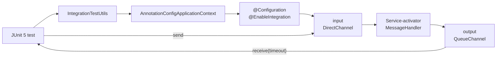
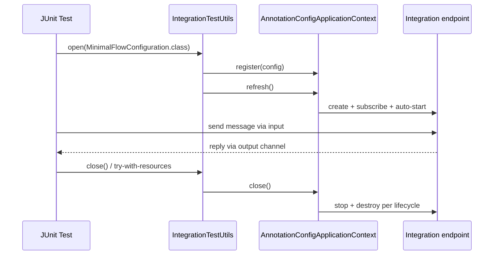

# Initializing IntegrationTestUtils with a Minimal Context

## 1. Why is a small Spring Integration context needed when testing runtime?

A Spring Integration flow is not just a Java function that receives a payload and returns a result. At runtime, the framework needs to register `MessageChannel`, consumer endpoints, subscribers, pollers, schedulers, and message orchestration components. A handler may be correct when called directly, yet fail when integrated into a flow because the channel has no subscriber, the endpoint bean has not started, the message loses headers, or the result does not reach the reply channel.

To test those behaviors, we need **a Spring application context small enough yet still backed by real Spring Integration infrastructure**. Instead of booting the entire application along with databases, brokers, HTTP servers, and every integration flow, this lesson builds a test utility named **`IntegrationTestUtils`**, which helps:

- Create an `AnnotationConfigApplicationContext` with only the specified test configuration classes.
- Enable Spring Integration with `@EnableIntegration`.
- Retrieve the exact input `MessageChannel` and output `PollableChannel` from the context.
- Send messages, receive results with an explicit timeout, and inspect exceptions.
- Close the context after the test to stop endpoints, pollers, and schedulers managed by the context.
- Gradually extend toward transactions, retries, error channels, correlation, and threading tests without pulling in the entire system.

This lesson belongs to the **Testing runtime** chapter of the **SPRING_INTEGRATION_RUNTIME** module: exploring and practicing the message lifecycle across channels, endpoints, consumers, pollers, executors, managing `IntegrationFlow`, and observing runtime state.

> **Naming scope:** In this lesson, `IntegrationTestUtils` is a **helper created by the test project itself**; do not assume it is a standard API class available in a specific Spring Integration package. Spring Integration also has its own testing support, so be sure to distinguish framework tools from helpers written inside the project.

## 2. What components make up a “minimal context”?



A minimal configuration for a **synchronous test** typically requires:

1. An input `MessageChannel` bean on which the test can call `send()`.
2. A handler/endpoint receiving messages, registered inside an `IntegrationFlow`.
3. An output `PollableChannel` so the test can call `receive(timeout)` without running a separate poller.
4. `@EnableIntegration` to register the Spring Integration infrastructure.
5. An `ApplicationContext` that is `refresh()`ed before sending messages and `close()`d after the test.

There is no need for `@SpringBootTest`, a servlet container, an HTTP endpoint, a database, or a broker for this kind of test. `@Configuration` together with `@EnableIntegration` provides sufficient infrastructure for the framework to create and wire the flow's endpoints.

**Minimal does not mean “without Spring”.** Calling `new MyHandler().handle(message)` directly is a handler unit test—it does not verify message dispatch or the Spring endpoint lifecycle.

### Three testing levels that should be kept separate

| Level | What is needed? | What it proves | What it does not prove |
| --- | --- | --- | --- |
| **Unit test** | Handler or pure function, fake dependencies | Payload transformation, business rules | Channel wiring, poller, and lifecycle. |
| **Minimal-context integration test** | `AnnotationConfigApplicationContext` + a few Integration beans | Dispatch, reply, headers, errors, endpoint state | Real broker, real database transactions, crash recovery. |
| **System/runtime test** | Adapters, real database/broker, scheduler, and real infrastructure as needed | Ack, transactions, restart, multi-instance contention | Does not necessarily prove the root cause of failures without detailed observation. |

A good learning progression starts from a small context for fast feedback, then **adds exactly one runtime factor** per test.

## 3. Dependencies and source layout

The examples use Java 17+, compatible Spring Framework/Spring Integration versions, and JUnit Jupiter (JUnit 5). The foundational components:

- `spring-integration-core`: `IntegrationFlow`, DSL, `DirectChannel`, `QueueChannel`, `@EnableIntegration`.
- `spring-context` and `spring-messaging`: application context, `Message<?>`, `MessageChannel`.
- `junit-jupiter`: `@Test` and assertions.
- **Optional** `spring-integration-test`: test utilities provided by Spring Integration, such as `@SpringIntegrationTest` or endpoint mocking mechanisms appropriate for the version in use; the helper in this lesson has no mandatory dependency on this module.

Conceptual Maven declaration example when the project already manages versions via the Spring Boot BOM or another dependency management setup:

```xml
<dependencies>
    <dependency>
        <groupId>org.springframework.integration</groupId>
        <artifactId>spring-integration-core</artifactId>
    </dependency>
    <dependency>
        <groupId>org.junit.jupiter</groupId>
        <artifactId>junit-jupiter</artifactId>
        <scope>test</scope>
    </dependency>
</dependencies>
```

If the project has no BOM/dependency management, **compatible versions** must be declared for the dependencies. Depending on the build tool, configure JUnit Platform to discover JUnit 5 tests. There is no need to add `spring-boot-starter-test` solely to run examples using `AnnotationConfigApplicationContext`.

Create the Java files in the same test package, for example:

```text
src/test/java/example/runtime/testing/
    IntegrationTestUtils.java
    MinimalFlowConfiguration.java
    MinimalFlowTest.java
    PollingFlowConfiguration.java
    PollingFlowTest.java
```

The example files below share the package `example.runtime.testing`. You may choose a different name as long as imports and configurations stay consistent. Do not expose test helpers in production APIs just because a test wants to access internal beans.

## 4. Writing `IntegrationTestUtils` to self-manage the context

The helper should have a small responsibility: **creating, providing typed beans, and closing the context**. Do not stuff business rules or arbitrary commands to enable/disable the entire application into it.

```java
package example.runtime.testing;

import java.time.Duration;
import java.util.Objects;

import org.springframework.context.annotation.AnnotationConfigApplicationContext;
import org.springframework.messaging.Message;
import org.springframework.messaging.MessageChannel;
import org.springframework.messaging.PollableChannel;

public final class IntegrationTestUtils implements AutoCloseable {

    private final AnnotationConfigApplicationContext context;

    private IntegrationTestUtils(AnnotationConfigApplicationContext context) {
        this.context = context;
    }

    public static IntegrationTestUtils open(Class<?>... configurationTypes) {
        Objects.requireNonNull(configurationTypes, "configurationTypes");

        if (configurationTypes.length == 0) {
            throw new IllegalArgumentException(
                "At least one @Configuration class is required");
        }

        AnnotationConfigApplicationContext context =
            new AnnotationConfigApplicationContext();

        try {
            context.register(configurationTypes);
            context.refresh(); // Create beans and start auto-start endpoints.
            return new IntegrationTestUtils(context);
        } catch (RuntimeException failure) {
            context.close();
            throw failure;
        }
    }

    public MessageChannel input(String beanName) {
        return context.getBean(beanName, MessageChannel.class);
    }

    public PollableChannel output(String beanName) {
        return context.getBean(beanName, PollableChannel.class);
    }

    public Message<?> receive(String beanName, Duration timeout) {
        Objects.requireNonNull(timeout, "timeout");

        if (timeout.isNegative()) {
            throw new IllegalArgumentException(
                "Timeout must not be negative");
        }

        return output(beanName).receive(timeout.toMillis());
    }

    public <T> T bean(String beanName, Class<T> beanType) {
        return context.getBean(beanName, beanType);
    }

    @Override
    public void close() {
        context.close();
    }
}
```

Several intentional design points:

- `register(configurationTypes)` registers only the specified test configurations; **it does not component-scan the entire application**.
- `refresh()` completes bean creation and starts `SmartLifecycle` endpoints with `autoStartup=true`. Tests should not send messages **before** this step.
- If initialization fails, `close()` in the `catch` branch cleans up already-created resources.
- `getBean(name, type)` verifies the bean has the right type; wrong channel/bean names surface clearly instead of silently fetching the wrong bean.
- `receive(Duration)` applies only to **`PollableChannel`**. Do not call `receive()` on a `DirectChannel`.
- `AutoCloseable` allows `try-with-resources` to close the context even if an assertion or handler throws an exception.

**Do not treat the helper as a singleton context shared across all tests** if tests require independent state. Sharing a context causes leftover messages in queues, retry state, caches, or running pollers to leak into other tests. By default, use **one context per test case**; only optimize for reuse when state is controlled and reset.

## 5. Building a minimal `@Configuration` for a synchronous flow

We create a flow that receives a string, trims leading/trailing whitespace, and converts it to uppercase. With the special input `FAIL`, the handler throws an exception to support failure testing.

```java
package example.runtime.testing;

import java.util.Locale;

import org.springframework.context.annotation.Bean;
import org.springframework.context.annotation.Configuration;
import org.springframework.integration.channel.DirectChannel;
import org.springframework.integration.channel.QueueChannel;
import org.springframework.integration.config.EnableIntegration;
import org.springframework.integration.dsl.IntegrationFlow;
import org.springframework.messaging.MessageChannel;
import org.springframework.messaging.PollableChannel;

@Configuration
@EnableIntegration
public class MinimalFlowConfiguration {

    @Bean("sample.in")
    public MessageChannel input() {
        return new DirectChannel();
    }

    @Bean("sample.out")
    public PollableChannel output() {
        return new QueueChannel(10);
    }

    @Bean
    public IntegrationFlow sampleFlow() {
        return IntegrationFlow.from("sample.in")
            .handle(String.class, (payload, headers) -> {
                if ("FAIL".equals(payload)) {
                    throw new IllegalArgumentException(
                        "Simulated handler failure");
                }
                return payload.strip().toUpperCase(Locale.ROOT);
            })
            .channel("sample.out")
            .get();
    }
}
```

**Execution flow:**

1. `context.refresh()` creates `sample.in`, `sample.out`, and the subscriber/endpoint of `sampleFlow`.
2. The test sends a message to `sample.in` using `MessageChannel.send`.
3. `DirectChannel` invokes the consumer synchronously on the sending thread in this configuration.
4. The handler receives the `String` payload and produces the uppercase result.
5. The reply is sent to `sample.out` — a `QueueChannel` capable of holding messages for the test.
6. The test calls `receive(timeout)` to retrieve the resulting message and assert on it.

There is no poller, executor, database, or broker in this example. Here, `QueueChannel(10)` is merely an **in-memory output buffer** with no durability. What the test verifies is **Spring Integration's dispatch and transformation behavior**, not a guarantee that messages survive a JVM restart.

### Why use explicit bean names?

Declaring `@Bean("sample.in")`/`@Bean("sample.out")` avoids collisions with default channels or beans created by other flows. Reuse these exact names when calling `input("sample.in")` and `receive("sample.out", ...)`; if a name is wrong, the test should fail with a bean lookup error to catch miswiring early.

## 6. JUnit 5: the first passing test

```java
package example.runtime.testing;

import java.time.Duration;

import org.junit.jupiter.api.Test;
import org.springframework.messaging.Message;
import org.springframework.messaging.MessageChannel;
import org.springframework.messaging.support.MessageBuilder;

import static org.junit.jupiter.api.Assertions.*;

class MinimalFlowTest {

    @Test
    void shouldTransformPayloadThroughRealIntegrationFlow() {
        try (IntegrationTestUtils test =
                IntegrationTestUtils.open(MinimalFlowConfiguration.class)) {

            MessageChannel input = test.input("sample.in");

            Message<String> request = MessageBuilder
                .withPayload("  spring integration  ")
                .setHeader("traceId", "test-001")
                .build();

            boolean accepted = input.send(request);

            assertTrue(accepted, "DirectChannel must dispatch message");

            Message<?> reply =
                test.receive("sample.out", Duration.ofSeconds(1));

            assertNotNull(reply, "Flow must produce output message");
            assertEquals("SPRING INTEGRATION", reply.getPayload());
        }
    }
}
```

The assertions check three different things:

- `send()` returns `true`: the channel **accepted/dispatched** according to the contract in use. Do not infer a database commit or broker ack when those components are not present.
- `reply != null`: an output message reached `sample.out` before the timeout.
- Payload matches: the handler was invoked through a real endpoint, not merely via a direct method call.

Even with a synchronous flow, where the message typically reaches the output before `send()` finishes, you should still use `receive(timeout)` rather than an unbounded `receive()`; if wiring is broken, the test must terminate with a clear message.

**Regarding headers:** message ID and timestamp may be generated when constructing or transforming a message. Do not assume every custom header automatically survives across every handler/transformer. If the business logic requires `traceId` or `correlationId`, add a dedicated assertion on the output for the configuration under test.

## 7. Testing errors on `DirectChannel` and empty output conditions

When the handler in `MinimalFlowConfiguration` receives `FAIL`, an exception is thrown directly on the synchronous dispatch path. In Spring Integration, exceptions may be wrapped by the messaging/endpoint layer before returning to the caller; prefer checking the **root cause** or business-meaningful error information rather than coupling unnecessarily to a single wrapper class.

```java
package example.runtime.testing;

import java.time.Duration;

import org.junit.jupiter.api.Test;
import org.springframework.messaging.support.GenericMessage;

import static org.junit.jupiter.api.Assertions.*;

class MinimalFlowFailureTest {

    @Test
    void shouldSurfaceHandlerFailureWithoutReply() {
        try (IntegrationTestUtils test =
                IntegrationTestUtils.open(MinimalFlowConfiguration.class)) {

            RuntimeException failure = assertThrows(
                RuntimeException.class,
                () -> test.input("sample.in")
                    .send(new GenericMessage<>("FAIL")));

            assertNotNull(failure);
            assertNull(
                test.receive("sample.out", Duration.ofMillis(50)),
                "Must not send reply when handler fails");
        }
    }
}
```

**Do not equate exceptions with `ErrorMessage`:** a synchronous `DirectChannel` typically propagates the error back to the calling thread; it **does not by default send an `ErrorMessage` to `errorChannel` just because a handler threw an exception**. With an asynchronous poller or executor, error handling mechanisms can emit an `ErrorMessage` if configured. You must test those two paths separately.

If you need to inspect the root cause class or the failed message, use the corresponding `MessagingException` handling APIs and verify against the library version in use. Avoid making tests brittle by asserting on full stack traces or wrapper message strings.

## 8. Verifying lifecycle: why `context.refresh()` and `close()` matter

`AnnotationConfigApplicationContext` creates and starts `SmartLifecycle` endpoints according to their `autoStartup` configuration. When `close()` is called, the Spring context lifecycle handles stopping and destroying the registered beans. This is why **giving each test its own context** prevents pollers or subscribers from a previous test from remaining active in the next test.



### Mistakes to avoid

| Setup mistake | Symptom | Fix |
| --- | --- | --- |
| Forgetting `@EnableIntegration` in minimal config | Endpoints or integration infrastructure are not created as expected | Use a configuration that properly enables Spring Integration. |
| Not calling `refresh()` | Beans are not created, no consumer is active | The helper must refresh before returning. |
| Sending to a wrong bean name | `NoSuchBeanDefinitionException` or sending to the wrong channel | Use explicit names and typed lookup. |
| Sending to a `DirectChannel` with no subscriber | “no subscribers” error or delivery failure | Check the flow bean, whether endpoints started, and channel names. |
| Forgetting to close the context | Pollers/executors/resources may outlive the test | Use `try-with-resources` and `AutoCloseable`. |
| Sharing one context across multiple tests | Stale messages in queues, order-dependent test state | Separate contexts or explicit state reset. |
| Using `@SpringBootTest` for a tiny probe | Slow tests, many unrelated external dependencies | Choose `AnnotationConfigApplicationContext` and minimal beans. |

**Note:** multiple tests can run in parallel if each test uses a completely isolated context and state. If tests share singletons, ports, database schemas, or broker topics, you must manage isolation and cleanup; separate contexts **do not automatically make external resources independent**.

## 9. Extending into an asynchronous test with a poller

After testing the synchronous flow, we change the topology: the input becomes a `QueueChannel` and a polling consumer receives messages on a schedule. This tests **runtime scheduling** rather than merely invoking a handler directly.

```java
package example.runtime.testing;

import java.time.Duration;
import java.util.Locale;

import org.springframework.context.annotation.Bean;
import org.springframework.context.annotation.Configuration;
import org.springframework.integration.channel.QueueChannel;
import org.springframework.integration.config.EnableIntegration;
import org.springframework.integration.dsl.IntegrationFlow;
import org.springframework.integration.dsl.Pollers;
import org.springframework.messaging.PollableChannel;

@Configuration
@EnableIntegration
public class PollingFlowConfiguration {

    @Bean("poll.in")
    public PollableChannel input() {
        return new QueueChannel(10);
    }

    @Bean("poll.out")
    public PollableChannel output() {
        return new QueueChannel(10);
    }

    @Bean
    public IntegrationFlow pollingFlow() {
        return IntegrationFlow.from("poll.in",
                endpoint -> endpoint
                    .id("poll.consumer")
                    .poller(Pollers.fixedDelay(Duration.ofMillis(100))
                        .maxMessagesPerPoll(1)))
            .handle(String.class, (payload, headers) ->
                payload.toUpperCase(Locale.ROOT))
            .channel("poll.out")
            .get();
    }
}
```

With a `QueueChannel`, the test can call `send()` to enqueue a message into the input, but `send()` usually returns **before** the polling endpoint processes it. Therefore, an assertion immediately after `send()` should not expect the output to be ready yet. You need a **bounded wait**.

```java
package example.runtime.testing;

import java.time.Duration;

import org.junit.jupiter.api.Test;
import org.springframework.messaging.Message;
import org.springframework.messaging.support.GenericMessage;

import static org.junit.jupiter.api.Assertions.*;

class PollingFlowTest {

    @Test
    void shouldProcessMessageOnPollingConsumer() {
        try (IntegrationTestUtils test =
                IntegrationTestUtils.open(PollingFlowConfiguration.class)) {

            assertTrue(test.input("poll.in")
                .send(new GenericMessage<>("async")));

            Message<?> reply =
                test.receive("poll.out", Duration.ofSeconds(3));

            assertNotNull(reply, "Poller must run and produce output");
            assertEquals("ASYNC", reply.getPayload());
        }
    }
}
```

**Why use 3 seconds?** This is a wait budget for verifying scheduling in a test environment, **not a transaction timeout**, and it does not mean the poller runs after exactly 100 ms. Actual timing is affected by the scheduler, CI load, executors, and bean configuration. Do not use a single `Thread.sleep(100)` as reliable proof.

If the test times out, check whether the `poll.consumer` endpoint is running, whether the input queue still holds the message, whether the handler threw an exception, and whether the output channel is wired properly. Do not jump to concluding business logic is broken without inspecting scheduling first.

## 10. Testing endpoint start/stop via `SmartLifecycle`

A minimal test can also verify the lifecycle of a polling endpoint given `id("poll.consumer")`:

```java
package example.runtime.testing;

import java.time.Duration;

import org.junit.jupiter.api.Test;
import org.springframework.context.SmartLifecycle;
import org.springframework.messaging.support.GenericMessage;

import static org.junit.jupiter.api.Assertions.*;

class PollingLifecycleTest {

    @Test
    void shouldHoldMessagesWhilePollerStopped() {
        try (IntegrationTestUtils test =
                IntegrationTestUtils.open(PollingFlowConfiguration.class)) {

            SmartLifecycle consumer =
                test.bean("poll.consumer", SmartLifecycle.class);

            consumer.stop();
            assertFalse(consumer.isRunning());

            // Message is still accepted into QueueChannel within the same JVM.
            assertTrue(test.input("poll.in")
                .send(new GenericMessage<>("paused")));

            assertNull(test.receive(
                "poll.out", Duration.ofMillis(200)));

            consumer.start();

            var reply =
                test.receive("poll.out", Duration.ofSeconds(3));

            assertNotNull(reply);
            assertEquals("PAUSED", reply.getPayload());
        }
    }
}
```

This verification is intentional because **stopping the poller does not clear the `QueueChannel`**. However:

- `stop()` does not mean a message **already received before stopping** will automatically roll back.
- The test must send the message **after stop has completed** so the poller does not pick it up beforehand.
- If another consumer also reads from `poll.in`, the message may still be consumed; this example has only one polling endpoint.
- The queue here resides in RAM, so this test cannot be used to claim messages survive a crash/restart.

To test stopping while a handler is actively running, add a `CountDownLatch` or a fake service that lets you control completion timing, then assert **in-flight** separately from **pending**. That is a more complex runtime test than a simple lifecycle test.

## 11. Distinguishing direct tests from tests using `ExecutorChannel`

`DirectChannel` and polling endpoints have different threading models. If you replace the channel in a flow with an `ExecutorChannel`, the handler may run on a worker thread rather than the thread calling `send()`. Therefore:

| Observation point | `DirectChannel` | `ExecutorChannel`/poller |
| --- | --- | --- |
| When the handler runs | Within the `send()` call stack, if the consumer is synchronous | May happen after `send()` has already returned |
| Exception from handler | Can propagate back to the caller | Usually follows the worker/poller error handling path |
| Transaction bound to caller thread | Can participate if on the same thread | Does not automatically transfer to the worker thread |
| Output assertion | Output may already exist when `send()` returns | Requires bounded waiting; do not assume ordering |
| Cleanup | Context close stops endpoints; task control is still needed | Must watch executor shutdown, in-flight tasks, and wait times |

**Do not assume** `MessageHeaders.ID`, `correlationId`, or `traceId` carries the JDBC transaction context. Headers are data/tracing metadata, whereas typical JDBC transactions rely on thread-bound resource bindings.

A good threading test should record `Thread.currentThread().getName()` in the producer and handler, or store IDs in a `BlockingQueue`/`CountDownLatch` to assert on them. Avoid asserting **exact thread name literals** if executor configurations may vary across environments; verify the thread relationship and actual required outcome.

## 12. Faking dependencies so real brokers, databases, or HTTP are not pulled into tests

A minimal context can instantiate fake implementations for **business ports** instead of loading the entire production configuration.

For example, a pure Java business interface:

```java
package example.runtime.testing;

public interface AuditSink {
    void record(String value);
}
```

An in-memory recording fake:

```java
package example.runtime.testing;

import java.util.List;
import java.util.concurrent.CopyOnWriteArrayList;

public final class RecordingAuditSink implements AuditSink {

    private final List<String> events = new CopyOnWriteArrayList<>();

    @Override
    public void record(String value) {
        events.add(value);
    }

    public List<String> snapshot() {
        return List.copyOf(events);
    }
}
```

A test configuration that registers only the fake:

```java
package example.runtime.testing;

import org.springframework.context.annotation.Bean;
import org.springframework.context.annotation.Configuration;
import org.springframework.integration.config.EnableIntegration;
import org.springframework.integration.dsl.IntegrationFlow;
import org.springframework.integration.channel.DirectChannel;
import org.springframework.messaging.MessageChannel;

@Configuration
@EnableIntegration
public class RecordingFlowConfiguration {

    @Bean
    public RecordingAuditSink auditSink() {
        return new RecordingAuditSink();
    }

    @Bean("audit.in")
    public MessageChannel auditInput() {
        return new DirectChannel();
    }

    @Bean
    public IntegrationFlow auditFlow(AuditSink sink) {
        return IntegrationFlow.from("audit.in")
            .handle(String.class, (payload, headers) -> {
                sink.record(payload);
                return null; // One-way handler, no reply sent.
            })
            .get();
    }
}
```

A test that sends to the channel and checks the fake:

```java
@Test
void shouldInvokeFakeServiceThroughEndpoint() {
    try (IntegrationTestUtils test =
            IntegrationTestUtils.open(RecordingFlowConfiguration.class)) {

        test.input("audit.in").send(new GenericMessage<>("evt-42"));

        RecordingAuditSink sink =
            test.bean("auditSink", RecordingAuditSink.class);

        assertEquals(java.util.List.of("evt-42"), sink.snapshot());
    }
}
```

The final snippet is an **excerpt**: it needs the corresponding JUnit `@Test`, `assertEquals`, and `GenericMessage` imports from earlier sections. When running through a synchronous `DirectChannel`, the fake has already received the message before `send()` returns. If switched to an executor or poller, the test needs a bounded wait for the eventual result.

**Benefit:** you can verify wiring between channels and handlers without calling REST APIs or writing to a real database. **Limitation:** a fake does not prove transactions, acks, or real API compatibility.

## 13. Testing error channels, retries, and transactions: adding just what is needed

A small context is well-suited for verifying **wiring and policies**, but you must add components incrementally based on the kind of behavior you want to prove.

### Error channel

- If using a synchronous `DirectChannel`, check the exception at `send()` as in section 7.
- If using a polling consumer or executor, configure error handling appropriate to the endpoint/adapter under test, and route error notifications to a clearly named output `PollableChannel`.
- When reading an `ErrorMessage`, distinguish `Throwable`, root cause, and `MessagingException.getFailedMessage()` if present. Do not assume every error includes a failed message or that every error goes through the default `errorChannel`.
- Also test the case where the error handler has no registered subscriber to detect secondary failures, while avoiding leaving an unhandled error that hangs the entire suite.

### Retry

To test retry counts, use a fake handler with an `AtomicInteger` counting attempts and intentionally throw exceptions on the initial calls. Attach the retry advice to the endpoint under test; assert the attempt count, final output, and exhausted branch. Do not rely solely on how many times a log line is printed.

For asynchronous retries, use a timeout and await a completion signal. Check whether retry wraps the handler or wraps the transaction; those two configurations differ in deadlines and rollback-only state. Do not set long backoffs in small tests unless you specifically need to test timing.

### Transaction

A context containing only in-memory `DirectChannel` and `QueueChannel` **does not prove JDBC rollback**. If a test targets transactions, it must add:

1. A test `DataSource` and schema.
2. A `PlatformTransactionManager` matching the `DataSource`.
3. A JDBC handler invoked through the properly scoped Spring proxy/advice.
4. Assertions on committed/rolled-back data in a real database or a test database with appropriate semantics.
5. When needed, additional tests across an `ExecutorChannel` boundary to detect lost thread-bound resource bindings.

Do not mark a transaction test as PASS merely because `@Transactional` appears in the source code or because an exception was thrown.

## 14. When to use `@SpringIntegrationTest` instead of a custom helper?

Spring Integration provides testing utilities in the `spring-integration-test` module. For projects using Spring TestContext/JUnit 5, you can use corresponding annotations/utilities, such as `@SpringIntegrationTest` and `MockIntegrationContext` (if available in your dependency version), to integrate with the test context already managed by Spring.

| Need | Appropriate approach |
| --- | --- |
| Running a 2–3 endpoint flow without Boot | Custom helper with `AnnotationConfigApplicationContext` as shown in this lesson. |
| Needing tests with injection, profiles, `@SpringJUnitConfig`, and Spring Test context caching | Spring TestContext framework. |
| Replacing a real endpoint with a mock in an integration context | Look into `spring-integration-test` and `MockIntegrationContext` appropriate for your version. |
| Verifying full Boot auto-configuration, properties, and actuator | Consider `@SpringBootTest` or an appropriate test slice. |
| Verifying durable broker/JDBC/restart | Integration/system tests with real resources and possibly container/process-level testing. |

**Do not place a project-written helper in the same package as framework classes**. In this document, `example.runtime.testing.IntegrationTestUtils` serves solely as a context fixture. If your team already has a utility with the same name, choose another name or unify the API with a clear contract.

A minimal context should also **not clone every production bean by default**. Only import the configurations needed for the behavior under test; if you have to import many configs, that is a signal the test is approaching an integration/system test.

## 15. Common issues when running the suite on CI

| Symptom | Possible cause | How to check |
| --- | --- | --- |
| `NoSuchBeanDefinitionException` when looking up input | Wrong bean name, config not registered, context not refreshed | Check `@Bean("sample.in")`, `open(MinimalFlowConfiguration.class)`. |
| `Dispatcher has no subscribers` | Flow not created/started, input channel not connected to endpoint | Check flow bean, endpoint lifecycle, and channel name. |
| `receive(timeout)` returns `null` | Handler did not emit reply, wrong output, poller has not run, or exception occurred | Inspect flow chain, error handling, and queue state. |
| Test hangs indefinitely | Calling `receive()` without timeout, blocking handler, or unreleased latch | Always set timeouts and use `finally` for cleanup. |
| Test PASSES alone, FAILS in full suite | Context leak, static state/fake, leftover queue messages, shared external state | Isolate contexts and clean up/namespace per test. |
| Flaky poller test | Fixed `Thread.sleep`, overloaded scheduler, timeout too short | Use conditional waiting, clear timeouts, and scheduling logs. |
| Assertions on thread names fail | Thread pool changes configuration/names across environments | Assert thread boundary semantics instead of literal names. |
| Test assumes rollback occurred but DB still committed | Missing/wrong transaction manager, proxy bypass, async boundary | Inspect transaction logs and actually committed data. |
| Context not closed | Missing try-with-resources, exception during setup | `AutoCloseable` and `close()` even on setup failure paths. |
| Output queue full | Test sends many messages without calling `receive` | Drain outputs, set capacity/test isolation. |
| Aggregator/correlation test groups messages wrongly | Missing `correlationId` header or altered during transform | Log group key, sequence headers, and `MessageGroupStore`. |
| Order-dependent tests | One test mutates state/singleton used by another | Isolate test state; avoid relying on `@TestMethodOrder`. |

### Do not abuse timeouts

Even synchronous tests should receive replies with a finite timeout so they do not hang on miswiring. Poller tests need a budget large enough for real scheduling; **do not use tiny timeouts** just to speed up the suite if it makes tests flaky. Conversely, overly large timeouts mask errors and slow down CI when failures happen.

You can record wait durations against test SLAs, emit metrics for sent/received message counts, preserve the root cause log on timeouts, and separate failures caused by **no subscriber**, **handler exceptions**, or **scheduler not running**.

## 16. Incremental runtime testing matrix

| ID | Component added to context | Behavior to assert |
| --- | --- | --- |
| T01 | `DirectChannel` + handler + `QueueChannel` output | Payload transformation and correct reply. |
| T02 | Handler throws exception | Caller sees error; no stray reply. |
| T03 | Custom header `traceId` | Required header is preserved or transformed as designed. |
| T04 | `QueueChannel` input + poller | Message is processed asynchronously within finite time. |
| T05 | `SmartLifecycle` poller | Stop retains unreceived messages; start resumes processing. |
| T06 | `ExecutorChannel` | Appropriate thread boundary and error handling. |
| T07 | Fake business dependency | Handler calls the right business port without hitting external systems. |
| T08 | Retry advice + attempt-counting fake | Attempt count and exhausted path are correct. |
| T09 | JDBC test DataSource + transaction manager | Rollback/commit verified via DB state. |
| T10 | Aggregator + `MessageGroupStore` | Correlation key and release strategy form the right group. |
| T11 | Persistent message/group store | State survives a new context per store contract. |
| T12 | Real broker/HTTP adapter | Ack, routing, and error flow verified against real resources. |
| T13 | Two instances / JVM restart | Duplicates/idempotency, redelivery, and recovery meet requirements. |
| T14 | Dynamic `IntegrationFlow` registration | Registration starts/stops/destroys properly and cleanup leaves no leftover endpoints. |

This lesson starts at T01–T05. The later cases **cannot be proven with just three in-memory beans**; corresponding dependencies or test harnesses must be added.

## 17. Hands-on exercises and self-check questions

**Exercise 1 — Write the helper.** Create `IntegrationTestUtils.java` following the `AutoCloseable` contract. Intentionally omit `refresh()` in a separate test branch and observe the error on lookup or send; restore the helper and explain the lifecycle.

**Exercise 2 — Synchronous test.** Use `MinimalFlowConfiguration` and `MinimalFlowTest`. Add an assertion verifying that input `"  java  "` produces output `"JAVA"`. Send three consecutive messages and verify reply order when only one thread sends through `DirectChannel`.

**Exercise 3 — Failure test.** Send `FAIL`, catch the exception, and verify there is no reply. Add logic to extract the root cause without relying on wrapper error message strings. Explain why an `ErrorMessage` is not automatically produced in this synchronous test.

**Exercise 4 — Poller test.** Use `PollingFlowConfiguration` and `PollingFlowTest`. Send two messages into the input queue and use `receive(Duration)` to retrieve both outputs; replace `Thread.sleep` with bounded waiting.

**Exercise 5 — Lifecycle testing.** Stop `poll.consumer` via `SmartLifecycle`, send a message, verify output is empty while stopped; start again and receive the message. Try closing the context while the poller is running and observe cleanup.

**Exercise 6 — Threading test.** Replace the input `DirectChannel` with an `ExecutorChannel` in a separate test with a context-managed executor. Record producer/handler threads, verify results received via the queue, and route exceptions into an appropriate error-handling path.

**Exercise 7 — Fake dependency.** Use `RecordingAuditSink`. Try adding a `CountDownLatch` and two concurrent producers, compare ordering and recorded counts, and note which assertions only hold in synchronous tests.

**Exercise 8 — Real transaction.** Add a test `DataSource` and `JdbcTemplate`. Run a handler that updates two tables and intentionally throws an exception after the first SQL statement; prove rollback by querying the DB, not by counting log lines.

**Exercise 9 — Correlation.** Create an aggregator receiving three elements with the same `batchId` using an in-memory `MessageGroupStore`; interleave two batches and verify they do not mix. Switch the store to a persistent implementation when testing restarts.

**Exercise 10 — Comparing test scopes.** Rewrite T01 using the Spring TestContext framework. Measure bootstrap time, bean list, isolation level, and maintainability; choose the right fit for your team's suite.

### Self-check questions

1. Why is directly calling a handler via `new` not a Spring Integration runtime test?
2. What is the role of `@EnableIntegration` in a minimal context?
3. Why must the helper call `refresh()` before sending messages?
4. Why does `AutoCloseable` make tests more stable when using pollers/executors?
5. What is the difference between `MessageChannel` and `PollableChannel` when writing assertions?
6. Why does `send() == true` not prove the database committed?
7. How do `DirectChannel` and a polling `QueueChannel` differ in when the handler is invoked?
8. Why does an exception in a `DirectChannel` not necessarily produce an `ErrorMessage` on the error channel?
9. How do you avoid flaky asynchronous tests caused by `Thread.sleep`?
10. When is a minimal-context helper sufficient, and when is `@SpringBootTest` needed?
11. Why does a fake service not prove the behavior of a real HTTP API or broker?
12. When switching to `ExecutorChannel`, how must transaction context expectations and thread assertions change?
13. Why does a test with an in-memory `QueueChannel` not prove messages survive a JVM crash?
14. What components must be added to verify retry, correlation, and JDBC rollback?
15. If a JUnit test passes in isolation but fails in the full suite, what sources of shared state should you check?

**Operating principle:** start with a simple `IntegrationTestUtils` that only **opens, provides beans, and closes** an `AnnotationConfigApplicationContext`; enable `@EnableIntegration` and register only the minimal channels/flows. Test **real messages flowing through endpoints** with clear inputs/outputs, assertions, and finite timeouts. When you need to prove pollers, executors, transactions, errors, correlation, persistence, or recovery, add the exact corresponding infrastructure and state the limits of each test level clearly, rather than extrapolating from a passing synchronous flow.
