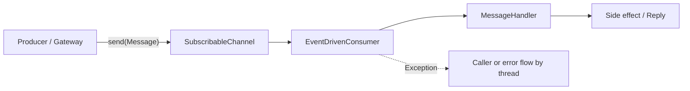
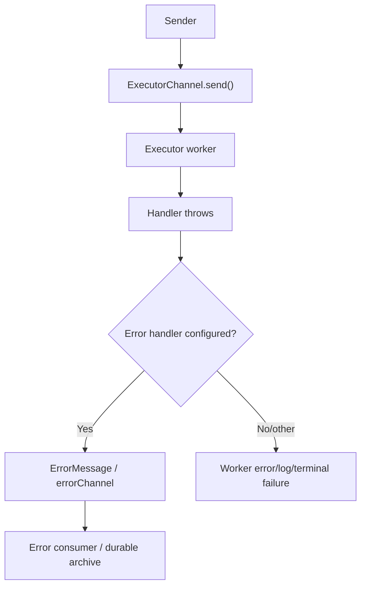

# Testing Event-Driven Endpoints in Spring Integration

## Learning objectives

In Spring Integration, an *event-driven* endpoint receives a message immediately when a `SubscribableChannel` delivers it to a subscriber. Unlike a polling consumer that waits for a poll schedule, this type of endpoint is triggered by the message-send event, yet it **may execute synchronously or asynchronously** depending on the channel type. Therefore, a test that only checks `send() == true` does not prove the handler received the message, finished processing, persisted data successfully, or emitted the right reply.

The **Testing Event-Driven Endpoints** lesson belongs to the **Testing runtime** chapter of the **SPRING_INTEGRATION_RUNTIME** module. We inspect how Spring Integration executes and coordinates messages across channels, endpoints, consumers, and executors, contrasting them with pollers to avoid confusing the two models. The examples also test `IntegrationFlow` lifecycle, exceptions, error flows, retries, transactions, message stores, correlation, runtime state, and performance observability.

After this lesson, you will be able to:

- Distinguish `EventDrivenConsumer` on `DirectChannel`, `ExecutorChannel`, and `PublishSubscribeChannel` from `PollingConsumer` on `PollableChannel`.
- Build a small Spring Test context, send a `Message<?>` to an input channel, and verify payload, headers, endpoint ID, handler invocation, and processing results.
- Write synchronous tests in JUnit 5 without `Thread.sleep()`; use latches/probes with finite timeouts for endpoints running on an executor.
- Verify whether exceptions propagate to the caller or appear in an error flow depending on thread boundaries and error publisher configuration.
- Substitute a handler in an integration test via `MockIntegrationContext` when external dependencies need to be isolated.
- Test endpoint start/stop, stopped handlers, missing subscribers, retries, redelivery, idempotency, and correlation.
- Design a repeatable test matrix with sufficient evidence for runtime/incident verification.

> **Key takeaway:** Event-driven means **the endpoint is triggered when the channel delivers a message**, not by default “a dedicated thread”, “non-blocking processing”, “already committed”, or “durable messaging”.

## 1. What is an event-driven endpoint?

An event-driven endpoint listens on a `SubscribableChannel`. When a message arrives, the channel invokes the subscriber/handler according to its contract.



In the DSL, a `service activator` or `MessageHandler` connected to a `DirectChannel` typically creates an event-driven consumer. How the consumer is triggered differs from using a `QueueChannel` plus a poller:

```text
Event-driven:
  Producer -> DirectChannel.send -> Consumer/Handler
  No poller needed to fetch messages from the channel.

Polling:
  Producer -> QueueChannel.send -> queue
  Poller tick -> PollingConsumer.receive -> Handler
```

**Lesson when testing:** the exact same business handler can run on the sender thread via `DirectChannel`, in a thread pool via `ExecutorChannel`, or from a scheduler via `QueueChannel` + poller. If a test does not pin down the channel type, assumptions about assertion timing, transactions, errors, and ordering no longer hold.

### 1.1. Comparison table of common channels

| Input channel | How the endpoint receives messages | Thread boundary | Suitable assertion style |
| --- | --- | --- | --- |
| `DirectChannel` | `send()` invokes the dispatcher to a subscriber | Usually the sender thread | Assert immediately after `send()` when handler is synchronous |
| `ExecutorChannel` | `send()` submits a task to an executor; worker dispatches | Usually a different thread | Latch/queue capturing results, wait with timeout |
| `PublishSubscribeChannel` | Delivers messages to subscribers | Synchronous or via executor depending on config | Check each subscriber/fan-out |
| `QueueChannel` | Messages wait in queue; consumer actively calls `receive()` | Polling consumer thread | Test poller/trigger; **not** considered event-driven |
| `FluxMessageChannel` | Bridge to Reactive Streams subscribers | Per subscription/scheduler | Test subscription, demand, and reactive completion separately |

`send()` may throw an exception or return a boolean depending on the channel; with an executor or queue, a successful send return does not itself prove the handler completed.

### 1.2. Every test must declare the boundary it verifies

For example, consider three completely different goals:

1. **Message accepted by the channel:** `send()` did not error / returned true.
2. **Handler was invoked:** a test double/probe received the message with the right payload and headers.
3. **Business processing completed:** the repository committed, the reply was emitted properly, or a fake client confirmed the outcome.

Do not substitute assertions for goal 1 in place of goal 3. Especially when the handler uses an executor, retry, or an external API call, verify completion at the appropriate boundary.

## 2. Testing layers and choosing scope

A Spring Integration system typically needs multiple test layers, without booting the entire application for every test.

| Test layer | Real components | Mocked dependencies | Goal |
| --- | --- | --- | --- |
| **Handler unit** | Java method / `MessageHandler` | Fake client/DAO | Mapping, validation, exceptions, business logic |
| **Component integration** | Channel + endpoint + handler in a small Spring context | Fake client/DAO | Subscription, headers, exceptions, and lifecycle |
| **Flow integration** | Router, transformer, splitter, aggregator, and related channels | External dependencies replaced | Flow order, correlation, release, error route |
| **Infrastructure integration** | Broker, JDBC store, real adapter, transaction manager | Testcontainers services | Ack/rollback, persistence, and redelivery |
| **Failure/restart test** | Process/context and replay-capable source | Fault-injectable fake dependencies | Crash windows, idempotency, recoverability |

This lesson focuses primarily on **component integration tests of event-driven endpoints**, then expands to highlight limits when executors, transactions, and persistence are involved.

### 2.1. Dependencies and test framework

The Java examples below assume Spring Integration 6.x, Spring Framework 6, Java 17+, JUnit Jupiter, and Spring Test. Common artifacts depending on project modules:

```text
Production:
  spring-integration-core
  spring-context / spring-messaging (transitively)

Testing:
  spring-test
  spring-integration-test          # when MockIntegrationContext is needed
  junit-jupiter
  Mockito / Awaitility (optional, not required)
```

Spring Boot projects should let the Boot BOM/parent manage compatible versions; do not randomly mix versions of Spring Framework, Spring Integration, and JUnit. The examples below use `@SpringJUnitConfig` instead of booting the entire application so tests stay focused and predictable.

## 3. Minimal fixture: DirectChannel + event-driven endpoint

We create an input `DirectChannel`, a fake recorder capturing messages, and an endpoint with an explicit ID. The recorder makes no network or DB calls, making it easy to verify **delivery to the handler**.

### 3.1. IntegrationFlow under test

```java
import java.util.List;
import java.util.concurrent.CopyOnWriteArrayList;

import org.springframework.context.annotation.Bean;
import org.springframework.context.annotation.Configuration;
import org.springframework.integration.channel.DirectChannel;
import org.springframework.integration.config.EnableIntegration;
import org.springframework.integration.dsl.IntegrationFlow;
import org.springframework.messaging.Message;
import org.springframework.messaging.MessageChannel;
import org.springframework.messaging.MessageHandler;
import org.springframework.beans.factory.annotation.Qualifier;

@Configuration
@EnableIntegration
class AuditFlowTestConfig {

    @Bean("auditInput")
    MessageChannel auditInput() {
        return new DirectChannel();
    }

    @Bean
    RecordingHandler recordingHandler() {
        return new RecordingHandler();
    }

    @Bean
    IntegrationFlow auditFlow(
            @Qualifier("auditInput") MessageChannel input,
            RecordingHandler recorder) {

        MessageHandler handler = recorder::record;

        return IntegrationFlow.from(input)
                .handle(handler, endpoint ->
                        endpoint.id("auditHandlerEndpoint"))
                .get();
    }

    static final class RecordingHandler {
        private final List<Message<?>> received =
                new CopyOnWriteArrayList<>();

        void record(Message<?> message) {
            received.add(message);
        }

        List<Message<?>> snapshot() {
            return List.copyOf(received);
        }

        void clear() {
            received.clear();
        }
    }
}
```

**Key points to note:**

- `DirectChannel` is a `SubscribableChannel`. The handler is called synchronously when the producer sends a message in this fixture.
- `auditHandlerEndpoint` is an explicit endpoint ID, useful for lifecycle tests and runtime inspection.
- `RecordingHandler` records the **entire message**, not just the payload; we can also assert `id`, `correlationId`, and business keys.
- `CopyOnWriteArrayList` is fine for low-volume test fixtures, not as a high-throughput production queue.
- The recorder bean is a singleton in the test context; reset it between tests so assertions do not depend on execution order.

### 3.2. Sending messages and verifying headers

```java
import org.junit.jupiter.api.BeforeEach;
import org.junit.jupiter.api.Test;
import org.springframework.beans.factory.annotation.Autowired;
import org.springframework.beans.factory.annotation.Qualifier;
import org.springframework.integration.IntegrationMessageHeaderAccessor;
import org.springframework.messaging.Message;
import org.springframework.messaging.MessageChannel;
import org.springframework.messaging.support.MessageBuilder;
import org.springframework.test.context.junit.jupiter.SpringJUnitConfig;

import static org.junit.jupiter.api.Assertions.*;

@SpringJUnitConfig(AuditFlowTestConfig.class)
class AuditEventDrivenEndpointTest {

    @Autowired
    @Qualifier("auditInput")
    MessageChannel input;

    @Autowired
    AuditFlowTestConfig.RecordingHandler recorder;

    @BeforeEach
    void reset() {
        recorder.clear();
    }

    @Test
    void directChannelDeliversSynchronouslyWithHeaders() {
        Message<String> command = MessageBuilder
                .withPayload("ORD-42")
                .setHeader("businessKey", "tenant-a:ORD-42")
                .setHeader(
                        IntegrationMessageHeaderAccessor.CORRELATION_ID,
                        "workflow-42")
                .build();

        assertTrue(input.send(command));

        assertEquals(1, recorder.snapshot().size());
        Message<?> seen = recorder.snapshot().get(0);

        assertEquals("ORD-42", seen.getPayload());
        assertEquals("tenant-a:ORD-42",
                seen.getHeaders().get("businessKey"));
        assertEquals("workflow-42", seen.getHeaders().get(
                IntegrationMessageHeaderAccessor.CORRELATION_ID));
        assertEquals(command.getHeaders().getId(),
                seen.getHeaders().getId());
    }
}
```

This is a **true event-driven test**, because it sends a message through a channel in a Spring context and verifies the recorder at the endpoint. There is no poller or `Thread.sleep()`. Because `DirectChannel` uses a synchronous handler here, by the time `send()` returns true, the recorder has already captured the message.

### 3.3. Why check both payload and headers?

In real runtimes, transformers, enrichers, splitters, and adapters can construct new messages. Asserting only the payload can miss lost `correlationId` or `businessKey` headers, preventing error flows/aggregators from linking messages back to the original workflow.

A test should state the contract:

```text
Input:
  payload = "ORD-42"
  headers.businessKey = "tenant-a:ORD-42"
  headers.correlationId = "workflow-42"

Expected at handler:
  payload = "ORD-42"
  businessKey and correlationId preserved
  no extra unexpected invocation
```

In a `DirectChannel` fixture without a transformer, the message arriving at the handler is the exact message sent. If you add a transformer that creates a new message, `MessageHeaders.ID` may change; in that case, assert correlation/business keys and only assert ID equality if required by the actual contract.

## 4. Lifecycle testing: stopping and starting an event-driven endpoint

Endpoints typically have their own lifecycle. When the subscriber of a `DirectChannel` is stopped, the channel may have no remaining subscribers to accept messages; depending on configuration, sending can fail fast.

### 4.1. Testing on an isolated context

You can add this method to `AuditEventDrivenEndpointTest`:

```java
import org.springframework.context.ApplicationContext;
import org.springframework.context.Lifecycle;
import org.springframework.messaging.MessageDeliveryException;

// input and recorder fields are reused from the section 3 fixture.
@Autowired
ApplicationContext applicationContext;

@Test
void stopUnsubscribesAndStartResubscribes() {
    Lifecycle endpoint = applicationContext.getBean(
            "auditHandlerEndpoint", Lifecycle.class);
    boolean initiallyRunning = endpoint.isRunning();

    try {
        endpoint.stop();
        assertFalse(endpoint.isRunning());

        Message<String> ignored = MessageBuilder
                .withPayload("ORD-43")
                .build();

        // Fixture has only one subscriber on DirectChannel.
        assertThrows(MessageDeliveryException.class,
                () -> input.send(ignored));
        assertTrue(recorder.snapshot().isEmpty());

        endpoint.start();
        assertTrue(endpoint.isRunning());

        assertTrue(input.send(
                MessageBuilder.withPayload("ORD-44").build()));
        assertEquals(1, recorder.snapshot().size());
    }
    finally {
        // Prevent endpoint state from leaking to other tests.
        if (initiallyRunning && !endpoint.isRunning()) {
            endpoint.start();
        }
        if (!initiallyRunning && endpoint.isRunning()) {
            endpoint.stop();
        }
    }
}
```

This snippet **belongs to the same test class and context as section 3**, not a standalone Java source file. In a fixture with a single subscriber and a `DirectChannel`, you can assert failure when the endpoint is stopped. If the channel has additional subscribers, another adapter, or buffering, expectations differ; test the exact topology running.

**Important limitation:** `endpoint.stop()` only stops the lifecycle/subscription per contract. It does not guarantee that an already-running task is cancelled, an already-sent API call is rolled back, or queued messages will automatically replay. This test measures the endpoint's **control behavior**, not durability.

### 4.2. Do not stop the wrong bean

A POJO handler or `MessageHandler` may not implement `Lifecycle`; the bean to stop is typically the **consumer endpoint** created by the DSL, not necessarily the handler bean itself. Setting `endpoint.id("auditHandlerEndpoint")` helps tests retrieve the right object.

With dynamic flows registered via `IntegrationFlowContext`, lifecycle on a registration differs from a single endpoint; see section 12 to avoid accidentally removing the entire flow when you only meant to pause an endpoint.

## 5. Testing asynchronous event-driven endpoints via ExecutorChannel

An endpoint is still **event-driven** if its input source is an `ExecutorChannel`; the difference is that the channel hands dispatch off to an executor worker. Therefore, assertions must await a signal with a finite timeout.

### 5.1. Context with a dedicated worker

```java
import java.util.concurrent.CountDownLatch;
import java.util.concurrent.ExecutorService;
import java.util.concurrent.Executors;
import java.util.concurrent.TimeUnit;
import java.util.concurrent.atomic.AtomicReference;

import org.springframework.beans.factory.annotation.Qualifier;
import org.springframework.context.annotation.Bean;
import org.springframework.context.annotation.Configuration;
import org.springframework.integration.channel.ExecutorChannel;
import org.springframework.integration.config.EnableIntegration;
import org.springframework.integration.dsl.IntegrationFlow;
import org.springframework.messaging.Message;
import org.springframework.messaging.MessageChannel;
import org.springframework.messaging.MessageHandler;

@Configuration
@EnableIntegration
class AsyncEndpointTestConfig {

    @Bean(destroyMethod = "shutdownNow")
    ExecutorService testExecutor() {
        return Executors.newSingleThreadExecutor(
                job -> new Thread(job, "async-endpoint-test-worker"));
    }

    @Bean("asyncInput")
    MessageChannel asyncInput(ExecutorService testExecutor) {
        return new ExecutorChannel(testExecutor);
    }

    @Bean
    AsyncProbe asyncProbe() {
        return new AsyncProbe();
    }

    @Bean
    IntegrationFlow asyncFlow(
            @Qualifier("asyncInput") MessageChannel input,
            AsyncProbe probe) {

        MessageHandler handler = probe::accept;

        return IntegrationFlow.from(input)
                .handle(handler, endpoint ->
                        endpoint.id("asyncHandlerEndpoint"))
                .get();
    }

    static final class AsyncProbe {
        final CountDownLatch received = new CountDownLatch(1);
        final AtomicReference<Message<?>> message =
                new AtomicReference<>();
        final AtomicReference<String> workerThread =
                new AtomicReference<>();

        void accept(Message<?> input) {
            message.set(input);
            workerThread.set(Thread.currentThread().getName());
            received.countDown();
        }
    }
}
```

The executor bean uses a single worker to keep tests predictable; `shutdownNow` cleans up the worker when the Spring test context closes. If the project defines multiple `ExecutorService` beans, add an explicit `@Qualifier` to the factory method parameter.

### 5.2. Test waiting for the handler to actually run

```java
import java.util.concurrent.TimeUnit;

import org.junit.jupiter.api.Test;
import org.springframework.beans.factory.annotation.Autowired;
import org.springframework.beans.factory.annotation.Qualifier;
import org.springframework.messaging.Message;
import org.springframework.messaging.MessageChannel;
import org.springframework.messaging.support.MessageBuilder;
import org.springframework.test.context.junit.jupiter.SpringJUnitConfig;

import static org.junit.jupiter.api.Assertions.*;

@SpringJUnitConfig(AsyncEndpointTestConfig.class)
class AsyncEventDrivenEndpointTest {

    @Autowired
    @Qualifier("asyncInput")
    MessageChannel input;

    @Autowired
    AsyncEndpointTestConfig.AsyncProbe probe;

    @Test
    void executorChannelDispatchesOnWorker() throws Exception {
        Message<String> command = MessageBuilder
                .withPayload("ORD-42")
                .setHeader("correlationId", "workflow-42")
                .build();

        String senderThread = Thread.currentThread().getName();

        assertTrue(input.send(command));

        // Do not infer completion from send() alone.
        assertTrue(probe.received.await(5, TimeUnit.SECONDS),
                "Timed out waiting for handler invocation");

        Message<?> received = probe.message.get();
        assertNotNull(received);
        assertEquals("ORD-42", received.getPayload());
        assertEquals("workflow-42",
                received.getHeaders().get("correlationId"));
        assertNotEquals(senderThread, probe.workerThread.get());
    }
}
```

Why use `CountDownLatch`: `send()` on an `ExecutorChannel` can return before the worker runs. `Thread.sleep(500)` makes tests slow and easily flaky on loaded CI machines; a timed latch verifies **the event actually occurred**.

**Note:** counting down the latch inside `probe.accept()` does not prove all business processing has committed. For end-to-end tests, place the signal after the transaction commit step or observe the real repository/business outcome.

### 5.3. Why tests should not implicitly assert order

If the executor has multiple workers, event A may start before B yet finish after B. Using a single worker in a fixture makes dispatch easy to check; to test concurrency, configure multiple workers and assert supported conditions without assuming global ordering. If business rules require sequential processing per `orderId`, use key-based partitioning/serialization and test it separately.

## 6. PublishSubscribeChannel: testing multiple subscribers

`PublishSubscribeChannel` delivers messages to multiple subscribers according to its configuration, unlike `DirectChannel`, which typically selects one subscriber per send.

A small test verifying fan-out at the channel level:

```java
import java.util.concurrent.atomic.AtomicInteger;

import org.junit.jupiter.api.Test;
import org.springframework.integration.channel.PublishSubscribeChannel;
import org.springframework.messaging.support.MessageBuilder;

import static org.junit.jupiter.api.Assertions.*;

class PublishSubscribeChannelTest {

    @Test
    void oneMessageIsDeliveredToBothSubscribers() {
        PublishSubscribeChannel channel = new PublishSubscribeChannel();

        AtomicInteger accountingCalls = new AtomicInteger();
        AtomicInteger analyticsCalls = new AtomicInteger();

        channel.subscribe(message -> accountingCalls.incrementAndGet());
        channel.subscribe(message -> analyticsCalls.incrementAndGet());

        assertTrue(channel.send(
                MessageBuilder.withPayload("ORD-42").build()));

        // PublishSubscribeChannel by default has no executor configured:
        assertEquals(1, accountingCalls.get());
        assertEquals(1, analyticsCalls.get());
    }
}
```

This is a **unit test of channel semantics**; to verify real endpoint lifecycle/fan-out, create two `IntegrationFlow` instances with distinct endpoint IDs subscribed to the same `PublishSubscribeChannel`, and assert on both recorders.

**Additional cases to test:**

- One subscriber throws an exception: whether remaining subscribers receive the message depends on error handling, `ignoreFailures`, and executor policy.
- Channel uses an executor: wait for each subscriber's completion rather than asserting right after `send()`.
- No subscribers: how does `send()` behave under the current configuration?
- Duplicate side effects: the same event can be delivered to two handlers with different responsibilities; do not confuse fan-out with competing consumers.

## 7. Testing exceptions on DirectChannel

With synchronous handlers, errors can unwind the call stack back to the producer. Tests must confirm errors **are not swallowed** and the message source handles them properly.

### 7.1. Fake handler that intentionally fails

```java
import org.springframework.context.annotation.Bean;
import org.springframework.context.annotation.Configuration;
import org.springframework.integration.channel.DirectChannel;
import org.springframework.integration.config.EnableIntegration;
import org.springframework.integration.dsl.IntegrationFlow;
import org.springframework.messaging.MessageChannel;
import org.springframework.messaging.MessageHandler;

@Configuration
@EnableIntegration
class FailingEndpointConfig {

    @Bean("failingInput")
    MessageChannel failingInput() {
        return new DirectChannel();
    }

    @Bean
    IntegrationFlow failingFlow() {
        MessageHandler handler = message -> {
            throw new IllegalStateException("Downstream unavailable");
        };

        return IntegrationFlow.from("failingInput")
                .handle(handler, endpoint ->
                        endpoint.id("failingHandlerEndpoint"))
                .get();
    }
}
```

### 7.2. Asserting exceptions and the cause chain

```java
import org.junit.jupiter.api.Test;
import org.springframework.beans.factory.annotation.Autowired;
import org.springframework.beans.factory.annotation.Qualifier;
import org.springframework.messaging.MessageChannel;
import org.springframework.messaging.support.MessageBuilder;
import org.springframework.test.context.junit.jupiter.SpringJUnitConfig;

import static org.junit.jupiter.api.Assertions.*;

@SpringJUnitConfig(FailingEndpointConfig.class)
class FailingEventDrivenEndpointTest {

    @Autowired
    @Qualifier("failingInput")
    MessageChannel input;

    @Test
    void failureIsVisibleToSynchronousSender() {
        RuntimeException failure = assertThrows(
                RuntimeException.class,
                () -> input.send(
                        MessageBuilder.withPayload("ORD-42").build()));

        assertTrue(containsCause(failure, IllegalStateException.class));
    }

    private static boolean containsCause(
            Throwable failure, Class<? extends Throwable> expected) {
        for (Throwable cursor = failure;
                cursor != null; cursor = cursor.getCause()) {
            if (expected.isInstance(cursor)) {
                return true;
            }
        }
        return false;
    }
}
```

Do not lock assertions onto a single exact outer exception class if it depends on adapters, advice, or Spring Messaging wrappers. In many flows, business exceptions are wrapped in `MessagingException` or `MessageHandlingException`; tests should inspect the **root cause and failed message** when that is part of the contract.

### 7.3. Why errorChannel might receive nothing

A synchronous error thrown back to the caller **is not automatically published as an `ErrorMessage`** merely because the message carries an `errorChannel` header. Something must catch the error and publish it, or there must be an asynchronous boundary with a configured error handler.

Therefore, a test should not expect “handler throws → global errorChannel receives message” if the topology is just a `DirectChannel` + handler with no error publisher.

## 8. Testing errors on ExecutorChannel and error flows

On an `ExecutorChannel`, errors can happen on the worker after `send()` has returned. In that situation, asserting that `send()` throws an exception to the sender is usually wrong. Check **where the error is handled**:



An integration test plan for asynchronous errors:

1. Use an `ExecutorChannel` whose executor is shut down after the test.
2. Have a fake handler throw an exception with an easily traceable `businessKey` and `correlationId`.
3. Configure the error publisher/error channel **according to the exact adapter or task-executor mechanism in use**, along with an error consumer/probe.
4. Send the message and await the error probe using a latch with a timeout.
5. Assert `ErrorMessage.getPayload()` is a `Throwable`, checking the cause chain and original/failed message if present.
6. Verify source ack/rollback **per the configured contract**; do not infer it simply because an error record exists.
7. Verify the consumer/probe does not receive two error records for a single failure unless retry/redelivery is configured to do so.

Do not assume every `ExecutorChannel` automatically publishes to an arbitrary error channel; this depends on the error handler and header/channel resolution in the test environment. To test the real error path, use the application's configuration (or create an equivalent test configuration) instead of hard-coding external assumptions.

### 8.1. Contents of an ErrorMessage

```java
import org.springframework.messaging.Message;
import org.springframework.messaging.MessagingException;
import org.springframework.messaging.support.ErrorMessage;

void assertFailureContainsCorrelation(ErrorMessage error) {
    Throwable failure = error.getPayload();

    Message<?> original = error.getOriginalMessage();
    if (original == null && failure instanceof MessagingException messaging) {
        original = messaging.getFailedMessage();
    }

    if (original == null) {
        throw new AssertionError("No original/failed message");
    }

    Object correlation = original.getHeaders().get("correlationId");

    if (!"workflow-42".equals(correlation)) {
        throw new AssertionError("Unexpected correlation: " + correlation);
    }
}
```

In practice, `getOriginalMessage()` and `getFailedMessage()` may return `null` or messages from different stages. Tests must know the contract of the specific error publisher; this snippet is a sample helper when the flow **is required** to carry the original message. `ErrorMessage.getPayload()` is the exception, **not** the order payload.

## 9. Using MockIntegrationContext to replace a handler when needed

In Spring Integration Test, `@SpringIntegrationTest` and `MockIntegrationContext` support substituting certain endpoint components in tests, such as injecting a fake `MessageHandler` into an endpoint that has an ID.

### 9.1. Proper purpose of substitution

Suppose the real flow has transformer → router → outbound handler calling a partner API. You want to verify payloads/headers reach the right endpoint **without making an HTTP request**. Replacing the target handler with a recording fake in the test verifies routing without depending on the partner.

```text
Input -> Validate -> Transform -> Route -> [Real Partner Handler]
                                            |
                                 Replaced with a recording fake in tests
```

Substituting a handler helps test orchestration, but **does not** test the real handler's logic or network communication. Dedicated adapter/client tests still need to run separately.

### 9.2. Illustrative usage

```java
import java.util.concurrent.atomic.AtomicReference;

import org.junit.jupiter.api.Test;
import org.springframework.beans.factory.annotation.Autowired;
import org.springframework.beans.factory.annotation.Qualifier;
import org.springframework.integration.test.context.SpringIntegrationTest;
import org.springframework.integration.test.mock.MockIntegrationContext;
import org.springframework.messaging.Message;
import org.springframework.messaging.MessageChannel;
import org.springframework.messaging.MessageHandler;
import org.springframework.messaging.support.MessageBuilder;
import org.springframework.test.context.junit.jupiter.SpringJUnitConfig;

import static org.junit.jupiter.api.Assertions.*;

@SpringJUnitConfig(AuditFlowTestConfig.class)
@SpringIntegrationTest
class HandlerReplacementExample {

    @Autowired
    MockIntegrationContext mockIntegrationContext;

    @Autowired
    @Qualifier("auditInput")
    MessageChannel input;

    @Test
    void captureMessageAtTargetEndpoint() {
        AtomicReference<Message<?>> captured = new AtomicReference<>();
        MessageHandler fake = captured::set;

        mockIntegrationContext.substituteMessageHandlerFor(
                "auditHandlerEndpoint", fake);

        try {
            Message<String> original = MessageBuilder
                    .withPayload("ORD-42")
                    .setHeader("correlationId", "workflow-42")
                    .build();

            assertTrue(input.send(original));
            assertNotNull(captured.get());
            assertEquals("ORD-42", captured.get().getPayload());
            assertEquals("workflow-42",
                    captured.get().getHeaders().get("correlationId"));
        }
        finally {
            mockIntegrationContext.resetBeans("auditHandlerEndpoint");
        }
    }
}
```

This example reuses `AuditFlowTestConfig` from section 3; `@SpringIntegrationTest` enables `MockIntegrationContext` support from the `spring-integration-test` dependency. When replacing the handler on endpoint `auditHandlerEndpoint`, the test still sends messages through the real channel while inspecting results in the fake. Substitution/reset methods require the exact endpoint ID and must match the handler types supported for substitution by your test-support version.

**Why must you reset?** Spring Test can cache the application context across multiple tests; a mock handler left attached after a test can cause other tests to fail intermittently. `finally` ensures restoration even if an assertion fails.

### 9.3. When NOT to use MockIntegrationContext?

- If testing the handler's own logic: replacing the handler removes the very object under test.
- If real transactions/acks/HTTP responses must be verified: a fake handler can hide those semantics.
- If testing concurrency/ordering: a synchronous mock can mask worker/queue boundaries.
- If the endpoint does not support substitution under your setup: inject fake dependencies at the client/repository boundary instead.

You can start with **constructor injection for handler dependencies**. That generally depends less on framework mocking mechanisms and makes tests more faithful.

## 10. Testing filtering, routing, and header propagation at endpoints

A message can be enriched/filtered/routed before reaching an event-driven handler. Tests should not only verify “received”, but also verify **the right handler** and **the right contract**.

| Step type | Test input | What to assert |
| --- | --- | --- |
| Header enricher | Missing `correlationId`, has `orderId` | Header is added with stable type/value |
| Transformer | `OrderEvent` → `OrderCommand` | Payload/schema correct; required headers preserved |
| Filter | Valid/invalid events | Only accepted messages reach downstream |
| Router | Tenant A/Tenant B | Message reaches **exactly one** endpoint if contract requires |
| Splitter | One order with three items | Three part messages with right correlation/sequence |
| Aggregator | Three parts with same group key | Releases exact group; handles duplicates/late arrivals |
| Service activator | Normalized message | Handler invoked exact number of times per contract |

**Do not** insist the message ID must stay unchanged across every transformation step. `MessageHeaders.ID` identifies a message instance; `businessKey` and `correlationId` link new messages back to the workflow. Tests should check each header according to its meaning.

### 10.1. Testing correlation and grouping

Example of two messages coming from different branches:

```text
payment:
  id = UUID-A
  correlationId = tenant-a:ORD-42

inventory:
  id = UUID-B
  correlationId = tenant-a:ORD-42

Expected:
  Different message IDs
  Same correlation key
  Aggregator group ID = tenant-a:ORD-42
```

If the aggregator uses `payload.orderId` instead of `headers['correlationId']`, assert the **actual group key produced by the strategy**, not merely that a header exists. With a persistent group store, verify release/cleanup and re-reading after restart in higher-level tests.

When an aggregator uses a `MessageGroupStore`, tests must distinguish the **group ID** (returned by the correlation strategy) from the **message UUID** (used by `MessageStore` when looking up a specific message). Having two messages with the same group ID does not mean the handler will be invoked immediately: the release strategy also decides when output is produced. An event-driven endpoint ahead of the group also does not turn group storage into a poller or an automatic replay schedule.

## 11. Testing retry, recovery, and idempotency of event-driven handlers

A test that sends a message only once misses issues when downstream fails and retries or the source redelivers. However, distinguish:

- **Retry attempt:** the same invocation re-invoking the handler via advice.
- **Source redelivery:** the broker/poller delivering a new delivery.
- **Manual replay:** pulling from an error archive/DLQ and resending.
- **Duplicate business event:** the same `businessKey` or event ID arriving from multiple sources.

### 11.1. Fake client that fails then succeeds

```java
import java.util.concurrent.atomic.AtomicInteger;

final class FlakyInventoryClient {
    final AtomicInteger calls = new AtomicInteger();

    void reserve(String sku) {
        if (calls.incrementAndGet() <= 2) {
            throw new IllegalStateException("Temporary unavailable");
        }
        // Third attempt succeeds per simulated logic.
    }
}
```

If the endpoint uses `RequestHandlerRetryAdvice` with `maxAttempts=3` and allows retrying this error type, a test can assert the handler/client was called three times and the flow succeeded. Still verify that **the advice is actually attached to the endpoint and wraps the right handler**, rather than assuming so just because a retry bean exists in the context.

If retry advice has a recovery callback that swallows the error and returns normally, tests must check the outcome and error archive per contract; do not equate “no exception thrown” with business success.

### 11.2. Testing a message delivered twice

Simulate resending a message with the same `businessKey=tenant-a:ORD-42` after an earlier successful run. These may have two different `MessageHeaders.ID` values if the source creates a new message.

```text
Delivery 1: businessKey=tenant-a:ORD-42, messageId=UUID-A
Delivery 2: businessKey=tenant-a:ORD-42, messageId=UUID-B

Expected:
  2 deliveries observed
  1 business side effect committed, if required by idempotency policy
```

A recorder receiving two messages does not prove the business created a duplicate; assert at the fake repository/ledger or target system that the unique business key is preserved. With external APIs, use an idempotency key if the API supports it.

### 11.3. Do not confuse retry with exception propagation

On a `DirectChannel` without retry advice, the handler throws an exception and the caller sees the error. When retry is added, the exception may surface only after the final attempt or be converted by recovery into another result. When switching to an `ExecutorChannel`, the caller of `send()` normally does not wait for worker attempts/side effects.

Therefore, whenever changing runtime configuration, update **assertion timing** and **error contracts**, rather than copying synchronous tests verbatim to asynchronous setups.

## 12. Transactions and thread boundaries in tests

A `@Transactional` test does not automatically propagate the test transaction across an `ExecutorChannel`. With imperative Spring transactions, transaction context is typically bound to the caller thread.

```text
Test thread:
  begin test transaction
  input.send(message)
  test transaction rollback
                 |
                 v
Executor worker:
  handler -> repository.save(...)
  transaction may differ or have already committed
```

Consequently, a test running through an executor can leave real data in the test database even when the test's transaction rolls back. Do not rely solely on `@Transactional` on the test method to clean up state when handlers run on workers.

### 12.1. Choosing the right test DB/transaction setup

To prove real commit/rollback, use a real test datasource or container DB, the application's transaction manager, reproducible failures, and an independent cleanup strategy:

1. Send messages with a unique business key per test.
2. Wait for the **handler completion** signal, not just `send()`.
3. Query the DB from an appropriate transaction to verify records committed/rolled back.
4. Resend the same business key to verify unique constraints/idempotency.
5. Clean up data per policy after the test, rather than relying on a test-thread rollback when work crossed onto an executor.

An HTTP call is not automatically part of a JDBC transaction; if a handler succeeds on an API call and the DB then rolls back, tests should identify the crash window and duplicate side effects upon retry.

### 12.2. Timeouts and test liveness

Set finite timeouts on latch waits, DB queries, fake HTTP calls, and test methods. If a test hangs too long, report **lack of progress**, not just a generic timeout. Logs should include endpoint, message ID/correlation, active threads, and handler invocation count.

## 13. Lifecycle and test isolation: preventing tests from affecting each other

A Spring Test context may be cached between test methods or classes. If one test stops an endpoint or replaces a handler without restoring it, subsequent tests may fail depending on execution order.

### 13.1. Isolation rules

- Reset recorders/atomic counters before each test.
- Use distinct business keys; never share uncleaned data across tests.
- With `CountDownLatch`, create separate probes/latches per scenario or separate contexts.
- Restore endpoint lifecycle in `finally`.
- Reset mock substitutions via `MockIntegrationContext.resetBeans(...)`.
- Shut down executors/schedulers created for tests to prevent thread leaks.
- Cancel subscriptions/reactive pipelines when tests finish.
- When a test context becomes too dirty to restore safely, consider `@DirtiesContext` **deliberately**, avoiding applying it across the entire suite unnecessarily.
- Never run stop/start tests that affect production or shared real brokers/DBs.

### 13.2. Determinism instead of sleep

| Flaky approach | More reliable approach |
| --- | --- |
| `Thread.sleep(500)` then assert queue | `CountDownLatch.await(timeout)` or probe with clear condition |
| Assert right after `ExecutorChannel.send()` | Wait for handler or business completion |
| Rely on test execution order | Reset state and build independent fixtures |
| Test with unbounded thread pool | Use a bounded executor with timeouts |
| Wait for long real retry/backoff durations | Use short retry policies in tests, or virtual clock when supported |
| Treat log “success” as proof | Assert on recorder/repository/response |
| Read DB state from an uncommitted transaction | Use a transaction/connection reading at the right boundary |

A test with a timeout is not automatically “non-flaky”: you also must pick the **right completion signal**. Counting down a latch as soon as the handler starts and then asserting the database committed models the wrong boundary.

## 14. Testing stop/start and dynamic IntegrationFlow

When flows are registered dynamically, `IntegrationFlowContext` manages the registration. A test should verify the registration ID, input channel, and lifecycle rather than hard-coding auto-generated bean names.

```java
import org.springframework.integration.dsl.IntegrationFlow;
import org.springframework.integration.dsl.context.IntegrationFlowContext;
import org.springframework.messaging.MessageHandler;

void registerAndExerciseDynamicFlow(
        IntegrationFlowContext flowContext) {

    MessageHandler handler = message -> {
        // Test probe or fake handler.
    };

    IntegrationFlow definition = flow ->
            flow.handle(handler);

    var registration = flowContext.registration(definition)
            .id("test.orders.dynamic.v1")
            .register();

    try {
        if (registration.getInputChannel() == null) {
            throw new AssertionError("Missing input channel");
        }

        registration.getInputChannel()
                .send(org.springframework.messaging.support.MessageBuilder
                        .withPayload("ORD-42")
                        .build());

        // In a real test: assert that the probe received the message.
    }
    finally {
        flowContext.remove(registration.getId());
    }
}
```

This is a lifecycle snippet inside a test with a fully configured Spring context, not a standalone main program. When creating dynamic flows, pay attention to how the input channel is registered so `getInputChannel()` is provided per contract. If a flow gets input from a dedicated adapter rather than a registration-managed channel, how input is received may differ.

**Warning:** `flowContext.remove(...)` does not delete persistently stored messages or automatically drain tasks. Only remove test registrations after confirming critical tasks have finished, and keep cleanup for any created executors/stores.

### 14.1. Flow versions and idempotency when testing rollouts

To test v1 → v2, send a message carrying `flowVersion`, switch the active route, then replay the v1 message. Assert it is not forced onto v2 if policy requires version pinning. With brokers/redelivery, do not treat `send()` success as proof the right version ran; inspect the handler/side effect recorded per version.

## 15. Testing event-driven endpoints in operations

Production failures often show up through runtime signals that simple functional tests do not measure:

| Signal | Meaning | How tests relate |
| --- | --- | --- |
| `endpoint.isRunning` | Endpoint lifecycle | Start/stop and subscriber checks |
| `channel.send.accepted` | Sender accepted by channel | Assert send result/exception |
| `handler.started` | Handler invoked | Probe at start of handler |
| `handler.completed` | Handler finished | Probe after successful processing |
| `handler.failed` | Handler threw error | Cause chain/error archive |
| `executor.active` / `queue.depth` | Thread/queue capacity | Saturation test, bounded executor |
| `errorChannel.received` | Error publisher active | Error-flow integration test |
| `retry.attempts` | Actual attempt count | Fake client counter |
| `business.commit` | Side effect recorded | Repository/ledger assertions |
| `correlationId` / `businessKey` | Links messages of the same workflow | Assert headers and traces |
| `message.group.pending` | Aggregator still waiting | Correlation/release tests |
| `source.redelivery` | Source redelivered message | Broker/infrastructure tests |

Metric names are **suggested instrumentation**, not a claim that Spring Integration provides all of them out of the box. In tests, use explicit probes; in production, use structured logs/tracing and cardinality-controlled metrics.

### 15.1. Diagnosing common test failures

| Symptom | Possible cause | Check |
| --- | --- | --- |
| `send()` reports no subscribers | Endpoint not started, wrong input channel, flow not subscribed | ID, `isRunning`, topology |
| Async test occasionally asserts 0 | Asserted before worker ran | Use latch/await on true completion |
| Fast locally, times out on CI | Executor contention, timeout too short | Isolate pools, limit load, log threads |
| Handler called twice though test sent once | `PublishSubscribeChannel` fan-out, duplicate registration/subscriber | Graph and subscriber count |
| Stop test breaks subsequent test | Lifecycle not restored | `finally`, test context isolation |
| Mock handler stays active in another test | Forgot to reset `MockIntegrationContext` | `resetBeans(...)` |
| Exception type mismatch | Spring Messaging/advice wrapped exception | Inspect cause chain |
| Error channel empty | Synchronous flow does not publish errors or different error handler | Thread boundary/error publisher config |
| Business DB still has records after test rollback | Executor worker used separate transaction | Transaction boundary and cleanup |
| Duplicate after retry | Handler side effect ran before error/timeout | Business key and idempotency |
| Aggregator never releases | Wrong group key, missing part, or duplicate | Correlation strategy/group state |
| Broker redelivers after restart | Source did not ack, message already committed | Ack policy, business result, dedupe |
| Test hangs indefinitely | Waiting on latch/future without timeout | Timeouts and failure diagnostics |

### 15.2. What should a good test report record?

```text
Test: executorChannelDispatchesOnWorker
Input:
  messageId = UUID-A
  businessKey = tenant-a:ORD-42
  correlationId = workflow-42
Channel: asyncInput (ExecutorChannel)
Endpoint: asyncHandlerEndpoint
Expected:
  1 handler invocation on worker thread
  original payload and correlation preserved
Actual:
  send accepted = true
  handler observed = true
  workerThread != senderThread
Timeout budget: 5s
Cleanup: executor shutdown via Spring context
```

This report states what **was measured**, without adding unverified claims that business logic committed or messages are durable. When extending to E2E tests, include ack state and the business ledger.

## 16. Event-driven endpoint test matrix

| Case | Input / configuration | Core assertion | Risk controlled |
| --- | --- | --- | --- |
| Basic DirectChannel | One valid message | Handler receives payload/headers synchronously | Miswiring, lost headers |
| DirectChannel failure | Handler intentionally throws | Caller sees error/cause | Swallowed errors |
| Stop/start endpoint | Single subscriber | No dispatch when stopped; resumes when started | Broken lifecycle |
| ExecutorChannel | One worker | Handler runs on worker; bounded await | Assertion race |
| Executor saturation | Bounded pool/queue | Rejection/backlog matches policy | Message loss, overload |
| PublishSubscribeChannel | Two subscribers | Both receive once | Broken fan-out |
| Transformer/router | Multi-tenant messages | Right endpoint and correlation | Cross-tenant misrouting |
| Filter | Valid/invalid payloads | Only permitted events reach handler | Wrong filter condition |
| Successful retry | Fake client fails twice | Total attempts match config | Retry policy not attached |
| Exhausted retry | Fake always fails | Error/recovery matches contract | Wrong ack, lost messages |
| Async error flow | Handler on worker throws | Error probe/archiver sees exception | Errors lost in worker |
| Redelivery duplicate | Same business key sent twice | One side effect if idempotent | Duplicates |
| Transaction | DB rollback/commit per config | Persistent state is correct | Wrong transaction thread |
| Aggregator | Branches arrive out of order | Releases per correlation/strategy | Stuck or mis-grouped batches |
| Restart test | Durable source + worker kill | Redelivery/recovery and idempotency | Lost in-flight data |
| Dynamic flow | Register/start/stop/remove | Registration and consumer state accurate | Resource leaks |
| No traffic | No messages sent | No false liveness failures | False alerts |
| Bounded stress | High event volume, slow backend | Queue age/latency observed | Backpressure |

**Division of responsibility:** most basic cases run quickly in a Spring Test context; crash/restart, JDBC transactions, broker acks, and latency under load should have a dedicated integration test suite with real infrastructure in an isolated environment.

## 17. Guided exercises

### Exercise A — Write the first test for DirectChannel

Create the fixture from section 3, send a message with `businessKey` and `correlationId`, and assert the recorder received exactly one message with the right payload/headers. Send another message and verify the recorder count increments accurately.

**Expected outcome:** understand that the subscriber/handler is triggered immediately upon sending on a `DirectChannel` in this fixture, with no poller wait.

### Exercise B — Lifecycle testing and state cleanup

Add the stop/start test from section 4. Send a message while the endpoint is stopped; then start it and send a new message. Ensure `finally` restores the original state.

**Expected outcome:** endpoint IDs are identified accurately, tests do not leak state to other tests, and you understand the difference between a channel with no subscribers and a message-buffering queue.

### Exercise C — Async assertions without sleep

Switch the input to an `ExecutorChannel` with a clearly named worker thread. Use `CountDownLatch` and `AtomicReference` to verify the message, thread, and time when the handler received it.

**Expected outcome:** never assert processing results immediately after `send()`; tests have finite timeouts and do not flake due to machine-dependent timing.

### Exercise D — Testing exceptions and error boundaries

Create a handler that throws on a `DirectChannel` and inspect the cause from the caller. Then switch to an executor, configure an error publisher/consumer path, and use an error probe instead of asserting exceptions on `send()`.

**Expected outcome:** understand that synchronous and asynchronous errors follow different paths; do not assume the `errorChannel` header guarantees publishing.

### Exercise E — Verifying fan-out and routing

Use a `PublishSubscribeChannel` with two recorders to test fan-out. Add a tenant A/B router with two endpoints; assert messages reach only the matching tenant's endpoint per contract.

**Expected outcome:** distinguish broadcasting to multiple subscribers from selecting one handler; do not confuse fan-out duplicates with redelivery.

### Exercise F — Testing retry and idempotency

Make a fake client fail twice then succeed; configure retry advice with max three attempts and inspect the counter. Resend the same `businessKey` after success and assert the fake repository holds only one business record if idempotency policy is configured.

**Expected outcome:** distinguish handler invocation count, retry attempt count, and real side effects; when retry is attached to the wrong endpoint, the test catches it.

### Exercise G — Transactions across thread boundaries

Use an isolated test DB. Send via `DirectChannel` and then `ExecutorChannel` into a DB-writing handler; observe commits, rollbacks, post-test cleanup, and async completion timing.

**Expected outcome:** test-level `@Transactional` does not automatically cover worker threads; DB assertions must reflect the real transaction.

### Exercise H — Simulating restart and recovery

Set up a durable test source/broker and an event with a business key. Have the handler commit the side effect, then kill the worker before ack; start a new consumer and observe redelivery.

**Expected outcome:** the message can be redelivered while the business side effect happens only once if idempotency is right; in-memory `MessageStore` or `ExecutorChannel` cannot guarantee this on their own.

## 18. Self-check questions

1. How does an event-driven endpoint differ from a polling endpoint in how it receives messages?
2. Both `DirectChannel` and `ExecutorChannel` can trigger event-driven consumers; how do they differ in threading and assertion timing?
3. Why does `send() == true` not mean business work committed?
4. Why can a `DirectChannel` test assert the recorder immediately while an `ExecutorChannel` test must wait?
5. When an endpoint is `STOPPED`, how may a `DirectChannel` with a single subscriber react to `send()`?
6. Why is an explicit endpoint ID needed for lifecycle testing?
7. In JUnit tests, why is `Thread.sleep(500)` less reliable than a latch or completion signal?
8. What is the difference between `PublishSubscribeChannel` and two subscribers on a `DirectChannel`?
9. When a handler throws an exception on the sender thread, where does the error go? What about when the handler runs on an executor?
10. Why do you not always see an `ErrorMessage` on the global error channel in synchronous flows?
11. What does `MockIntegrationContext.substituteMessageHandlerFor` help test, and what can it not verify?
12. Why must bean/endpoint lifecycle be reset after tests?
13. If a transformer creates a new message ID, which headers must be preserved to link it to the same workflow?
14. How do a correlation ID and a message ID differ?
15. When retry advice allows three attempts, what evidence do you check to confirm the advice actually wraps the handler?
16. Two deliveries of the same order can generate two different UUIDs; which ID should protect idempotency?
17. Does `@Transactional` on a test method automatically roll back work done on an `ExecutorChannel`?
18. What duplicate bug can an aggregator release test miss if it only checks `group.size() >= 3`?
19. Which tests require a real durable backend/broker instead of just an in-RAM Spring context?
20. Which metrics help confirm an endpoint is RUNNING yet making no progress?
21. Why does stopping/removing a dynamic flow not automatically drain all in-flight messages?
22. To keep tests non-flaky, where must the **completion signal** be placed?
23. When an error archive fails, what must tests verify regarding acks and replayability?
24. After a restart, what evidence confirms business effects were not duplicated?

**Remember:** Testing event-driven endpoints must trace **message sent → channel dispatch → handler invocation → processing or error → business outcome**, placing assertions at the right boundary. Use a small Spring Test context and `DirectChannel` for clear synchronous tests; with `ExecutorChannel`, await a real signal; with `PublishSubscribeChannel`, verify fan-out; and for errors/transactions/retries, identify who owns acks, retries, and error flows. Good tests don't just pass—they prove correlation is preserved, errors are never dropped, and durability or exactly-once guarantees are never overclaimed.
