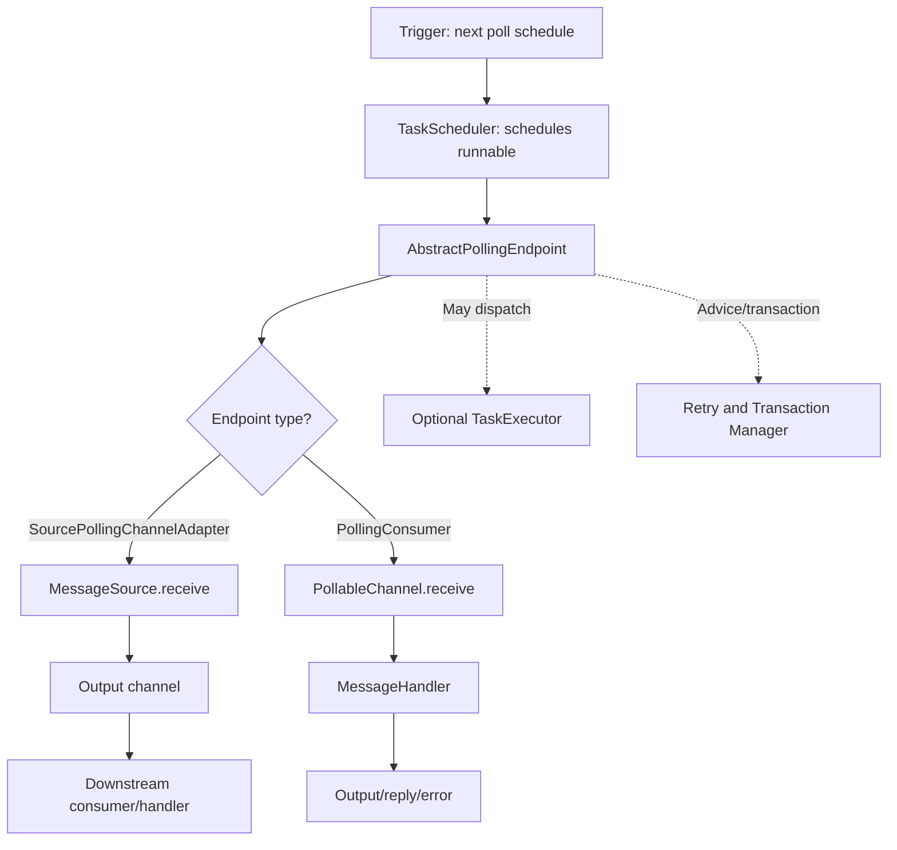
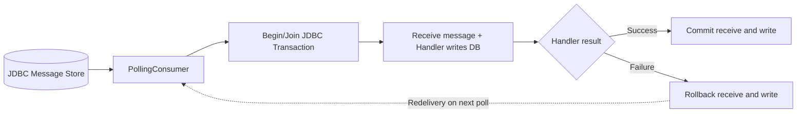

# Testing Polling Endpoints and Simulated Schedulers in Spring Integration

## 1. Goal: testing polling behavior without depending on a wall clock

A `PollingConsumer` can pull messages from a `QueueChannel` on a schedule; a `SourcePollingChannelAdapter` can periodically invoke `MessageSource.receive()` to ingest messages from files, databases, APIs, or other data sources. In production, the schedule might be every few seconds, every hour, or a nightly cron expression. If tests wait on the real schedule, the test suite becomes slow, flaky, and hard to reproduce failures in.

For example: a service processes invoices at 02:00, polling at most 10 records per cycle. The test requirement is not “wait until 02:00”, but to prove **when a poll cycle runs**, the endpoint receives the expected number of messages, invokes the handler the expected number of times, handles errors/rollbacks per policy, and stops polling properly per lifecycle. You should **control the trigger or scheduler** instead of sleeping in tests and guessing.

The **“Testing Polling Endpoints and Simulated Schedulers”** lesson belongs to the **Testing runtime** chapter of the **SPRING_INTEGRATION_RUNTIME** module. It connects to how Spring Integration orchestrates channels, endpoints, consumers, pollers, executors, and `IntegrationFlow` lifecycle, while also touching on transactions, retries, message stores, error channels, correlation, threading, performance, and runtime state.

After this lesson, you will be able to:

1. Clearly distinguish **poller**, **Trigger**, **TaskScheduler**, **TaskExecutor**, and the polled processing flow.
2. Use `@SpringIntegrationTest(noAutoStartup=...)` and `MockIntegrationContext` to replace message sources, handlers, or triggers during tests.
3. Use `OnlyOnceTrigger` to trigger a controlled single poll cycle without waiting on long cron intervals.
4. Properly verify `maxMessagesPerPoll`, `receiveTimeout`, and the differences between the two polling endpoint types.
5. Design tests for stop/start, async workers, transactions/rollbacks, retries, source errors, and persistent queues.
6. Avoid tests that become unstable due to `Thread.sleep`, system clocks, timezones, DST, and shared state across tests.

> **Version scope:** Examples target **Spring Integration 6.5.x**, **Spring Framework 6.x**, **Spring Integration Test 6.5.x**, **JUnit Jupiter 5**, and **Java 17+**. `MockIntegrationContext.substituteTriggerFor(...)` has been available since Spring Integration **6.3**. This is STEP 4 authoring content; execution and specialized QA belong to other workflow stages.

## 2. Architecture of a polling endpoint and fakeable points



Components have distinct responsibilities:

| Component | Question it answers | What tests should observe |
| --- | --- | --- |
| `Trigger` | **When** is the next poll cycle scheduled? | Trigger counts, ordering, and logical timestamps. |
| `TaskScheduler` | **Who** registers/runs tasks per the Trigger? | Whether a task is scheduled, cancelled after stop, and how threads execute. |
| `TaskExecutor` (optional) | Is processing handed off to workers? | Thread boundaries, queue/rejections, and completion timing. |
| `SourcePollingChannelAdapter` | Calls `MessageSource.receive()` then sends messages to an output channel. | Source calls, payload/headers, emitted message count. |
| `PollingConsumer` | Calls `PollableChannel.receive()` then delivers to a handler. | Consumed count, handler invocations, remaining backlog. |
| `PollerMetadata` / `PollerSpec` | Configures trigger, executor, advice, timeout, poll limits. | Configuration attached to the right endpoint and affects behavior. |

**Replacing a Trigger is not the same as replacing the scheduler.** `OnlyOnceTrigger` is a **fake firing schedule** used by the real `TaskScheduler` to schedule almost immediately. It avoids waiting on long crons, yet the task still runs on a scheduler thread and tests must synchronize via queues/latches with timeouts. If you need **virtual time** control and manual task execution, you must replace `TaskScheduler` with a test implementation or unit-test scheduling logic directly; you cannot call `OnlyOnceTrigger` a full virtual clock.

### 2.1. Comparing the two endpoint types

| Aspect | `SourcePollingChannelAdapter` | `PollingConsumer` |
| --- | --- | --- |
| What is polled | `MessageSource<?>` (file/database/API/fake source). | `PollableChannel` (e.g., `QueueChannel`). |
| Output of a poll cycle | Message sent to the output channel. | Message handed to the target handler. |
| Default `maxMessagesPerPoll` | **1**. | **-1** (unbounded until `receive()` returns `null`). |
| When receive returns `null` | Emits no message for that cycle; may schedule next cycle. | Stops the receive loop of the current poll cycle. |
| `receiveTimeout` | Depends on `MessageSource` implementation. | Limits how long `PollableChannel.receive()` may block. |
| Substituting in tests | `substituteMessageSourceFor(endpointId, fake)`. | `substituteMessageHandlerFor(endpointId, fake)` or sending messages into a test queue. |
| Replacing schedule in tests | `substituteTriggerFor(endpointId, trigger)`. | Also uses `substituteTriggerFor(endpointId, trigger)`. |

The difference in defaults matters: a `MessageSource` that always returns messages with `maxMessagesPerPoll=-1` can keep the poller running nonstop, starving the scheduler and making it hard to stop. In tests, set **explicit** bounds.

## 3. Choosing testing techniques by goal

| Goal | Suitable technique | What not to infer |
| --- | --- | --- |
| Test handler payload logic | Direct Java method call or plain mock handler. | Does not prove poller or channel wiring is right. |
| Test one poll of a data source | Fake `MessageSource` + `OnlyOnceTrigger` + output queue. | Does not prove daily cron schedules work across real timezones. |
| Test consumer reading N messages per poll | `QueueChannel` + one-shot trigger + `maxMessagesPerPoll=N`. | Does not prove multi-worker concurrency. |
| Test trigger time calculation and DST | Unit test `Trigger.nextExecution(TriggerContext)` with controlled context/clock. | Does not exercise `TaskScheduler` or endpoints. |
| Test real scheduling/cancellation/threads | Integration test with `TaskScheduler` and latch/await. | Do not rely on exact millisecond wall times. |
| Test transaction/rollback during poll | Real JDBC store + transaction manager + poller. | In-memory fakes do not prove DB rollback. |
| Test pause/resume, dynamic lifecycle | Control `AbstractEndpoint.start()/stop()` or flow lifecycle. | Stop does not automatically drain all in-flight tasks. |
| Test real adapters (file/JPA/JMS/AMQP) | Testcontainers/controlled test sources; never production endpoints. | Do not mix reliability tests with schedule unit tests. |

The **triangulation** principle: verify **(a) source/receive invocation count**, **(b) emitted message or handler output**, and **(c) endpoint/queue state after the poll**. A single assertion `results.receive(...) != null` can miss extra source calls or duplicated messages.

## 4. Spring Integration Test tools: isolating before startup

The primary test dependency is `spring-integration-test` (test scope), alongside `spring-test` and JUnit 5. Mockito can be added for complex mocks; the examples below use plain Java lambdas/fakes without requiring Mockito.

`@SpringIntegrationTest` registers a `MockIntegrationContext` bean in the test context. The `noAutoStartup` parameter takes **endpoint bean names**, not source or input channel names; basic patterns like `source*` and `*Source` are supported. When an endpoint is marked no-auto-startup, you can replace its source/trigger before starting it, avoiding polling real external sources while the Spring context boots.

`MockIntegrationContext` in 6.5 supports:

```java
// Endpoint must exist in the Spring application context.
mockIntegrationContext.substituteMessageSourceFor(
        "ordersSourceEndpoint", fakeSource, false);

mockIntegrationContext.substituteMessageHandlerFor(
        "ordersConsumerEndpoint", fakeHandler, false);

mockIntegrationContext.substituteTriggerFor(
        "ordersSourceEndpoint", new OnlyOnceTrigger(), false);

// After test: restore the original beans that were substituted.
mockIntegrationContext.resetBeans();
```

The `false` argument in these overloads means the endpoint **does not auto-start after substitution**. You can replace both the source and trigger, check preconditions, and call `endpoint.start()` at the right moment. Do not replace a trigger after a task is already scheduled expecting all prior tasks to vanish immediately: stop the endpoint, substitute, and restart when the test needs a clean boundary.

> **Easy-to-miss ID:** `substituteMessageSourceFor("ordersSourceEndpoint", ...)` needs the ID of the `SourcePollingChannelAdapter`. In Java DSL, set the ID via `endpointSpec.id("ordersSourceEndpoint")` and verify the bean has that exact ID.

## 5. Runnable example: testing one poll of SourcePollingChannelAdapter

The example stays completely inside a Spring test context with no network/database connections. The config defines a dummy `() -> null` real source, which the test **substitutes** with a fake `MessageSource` returning exactly one message. The simulated production schedule is **every 12 hours**; the test avoids waiting 12 hours thanks to `OnlyOnceTrigger`.

### 5.1. Test configuration

```java
import java.time.Duration;

import org.springframework.context.annotation.Bean;
import org.springframework.context.annotation.Configuration;
import org.springframework.integration.annotation.EnableIntegration;
import org.springframework.integration.channel.QueueChannel;
import org.springframework.integration.core.MessageSource;
import org.springframework.integration.dsl.IntegrationFlow;
import org.springframework.integration.dsl.Pollers;
import org.springframework.messaging.PollableChannel;

@Configuration
@EnableIntegration
class PollingSourceTestConfig {

    @Bean
    MessageSource<String> originalSource() {
        return () -> null; // Does not contact external resources.
    }

    @Bean
    PollableChannel polledResults() {
        return new QueueChannel();
    }

    @Bean
    IntegrationFlow scheduledSourceFlow(MessageSource<String> originalSource) {
        return IntegrationFlow
                .from(originalSource, endpoint -> endpoint
                        .id("ordersSourceEndpoint")
                        .poller(Pollers.fixedDelay(Duration.ofHours(12))
                                .maxMessagesPerPoll(1)))
                .channel("polledResults")
                .get();
    }
}
```

Explanation:

- Bean `ordersSourceEndpoint` is the `SourcePollingChannelAdapter` created by the DSL.
- `.maxMessagesPerPoll(1)` limits one poll cycle to at most one `MessageSource.receive()` call.
- `polledResults` is a `QueueChannel` used to **observe** messages successfully sent by the adapter.
- `fixedDelay(12h)` represents a slow production schedule; the test replaces the trigger.
- There is no downstream handler, so this test focuses on **wiring + poll + output**, not verifying business side effects.

### 5.2. JUnit test with MockIntegrationContext and OnlyOnceTrigger

```java
import java.util.concurrent.atomic.AtomicInteger;

import org.junit.jupiter.api.AfterEach;
import org.junit.jupiter.api.Test;
import org.springframework.beans.factory.annotation.Autowired;
import org.springframework.beans.factory.annotation.Qualifier;
import org.springframework.integration.core.MessageSource;
import org.springframework.integration.endpoint.SourcePollingChannelAdapter;
import org.springframework.integration.test.context.MockIntegrationContext;
import org.springframework.integration.test.context.SpringIntegrationTest;
import org.springframework.integration.test.util.OnlyOnceTrigger;
import org.springframework.messaging.Message;
import org.springframework.messaging.PollableChannel;
import org.springframework.messaging.support.GenericMessage;
import org.springframework.test.annotation.DirtiesContext;
import org.springframework.test.context.junit.jupiter.SpringJUnitConfig;

import static org.junit.jupiter.api.Assertions.*;

@SpringJUnitConfig(PollingSourceTestConfig.class)
@SpringIntegrationTest(noAutoStartup = "ordersSourceEndpoint")
@DirtiesContext(classMode = DirtiesContext.ClassMode.AFTER_EACH_TEST_METHOD)
class OneShotSourcePollingTest {

    @Autowired
    MockIntegrationContext mocks;

    @Autowired
    @Qualifier("ordersSourceEndpoint")
    SourcePollingChannelAdapter endpoint;

    @Autowired
    @Qualifier("polledResults")
    PollableChannel results;

    @AfterEach
    void cleanup() {
        endpoint.stop();
        mocks.resetBeans();
    }

    @Test
    void pollsExactlyOneMessageWithoutWaitingForProductionSchedule() {
        AtomicInteger sourceCalls = new AtomicInteger();
        MessageSource<String> fakeSource = () -> {
            int invocation = sourceCalls.incrementAndGet();
            return invocation == 1 ? new GenericMessage<>("invoice-42") : null;
        };

        mocks.substituteMessageSourceFor(
                "ordersSourceEndpoint", fakeSource, false);
        mocks.substituteTriggerFor(
                "ordersSourceEndpoint", new OnlyOnceTrigger(), false);

        assertFalse(endpoint.isRunning());
        endpoint.start(); // TaskScheduler schedules immediately per OnlyOnceTrigger.

        Message<?> received = results.receive(3_000);
        assertNotNull(received);
        assertEquals("invoice-42", received.getPayload());
        assertEquals(1, sourceCalls.get());
        assertNull(results.receive(0)); // No second output.
    }
}
```

**What the test proves:** the endpoint is created by Spring from the IntegrationFlow; the endpoint itself executes a poll via the scheduler, invokes the fake source once, and emits the right message to the channel. There is no 12-hour `Thread.sleep` or machine-clock dependency.

**Limitation:** The test still uses a real task scheduler, so thread scheduling latency exists. `results.receive(3_000)` is a **bounded await**, not an assumption that “the task finishes instantaneously” or a promise of completion within 3,000 ms. On very slow CI, use an appropriately configured timeout rather than zero wait time.

**Test lifecycle:** `@AfterEach` stops the endpoint and restores substituted beans; `@DirtiesContext` isolates state between tests. For large suites, you can omit `@DirtiesContext` once full cleanup of queues, tasks, and trigger state is proven, though you should never reuse an already-consumed `OnlyOnceTrigger` across two tests without resetting it.

## 6. Testing PollingConsumer and maxMessagesPerPoll with a single poll

`PollingConsumer` reads from a `PollableChannel` that already holds messages, unlike the adapter in section 5 that pulls from a `MessageSource`. To test **at most N messages per poll cycle**, use a `QueueChannel` containing three messages, cap at two messages, and replace the trigger with `OnlyOnceTrigger`.

### 6.1. Flow configuration consuming from QueueChannel

```java
import java.time.Duration;

import org.springframework.context.annotation.Bean;
import org.springframework.context.annotation.Configuration;
import org.springframework.integration.annotation.EnableIntegration;
import org.springframework.integration.channel.QueueChannel;
import org.springframework.integration.dsl.IntegrationFlow;
import org.springframework.integration.dsl.Pollers;
import org.springframework.messaging.PollableChannel;

@Configuration
@EnableIntegration
class PollingConsumerTestConfig {
    @Bean
    PollableChannel workQueue() {
        return new QueueChannel();
    }

    @Bean
    PollableChannel handledQueue() {
        return new QueueChannel();
    }

    @Bean
    IntegrationFlow workConsumerFlow() {
        return IntegrationFlow.from("workQueue")
                .handle((payload, headers) -> "handled:" + payload,
                        endpoint -> endpoint
                                .id("ordersConsumerEndpoint")
                                .poller(Pollers
                                        .fixedDelay(Duration.ofHours(6))
                                        .maxMessagesPerPoll(2)
                                        .receiveTimeout(0)))
                .channel("handledQueue")
                .get();
    }
}
```

`.handle((payload, headers) -> ...)` is a Service Activator producing a reply that goes to `handledQueue`. `receiveTimeout(0)` prevents `QueueChannel` polls from blocking when empty. `maxMessagesPerPoll(2)` caps the consumer at two successful receives per trigger firing.

### 6.2. JUnit test: two messages handled, one remaining in the queue

```java
import org.junit.jupiter.api.AfterEach;
import org.junit.jupiter.api.Test;
import org.springframework.beans.factory.annotation.Autowired;
import org.springframework.beans.factory.annotation.Qualifier;
import org.springframework.integration.endpoint.PollingConsumer;
import org.springframework.integration.test.context.MockIntegrationContext;
import org.springframework.integration.test.context.SpringIntegrationTest;
import org.springframework.integration.test.util.OnlyOnceTrigger;
import org.springframework.messaging.Message;
import org.springframework.messaging.PollableChannel;
import org.springframework.messaging.support.GenericMessage;
import org.springframework.test.annotation.DirtiesContext;
import org.springframework.test.context.junit.jupiter.SpringJUnitConfig;

import static org.junit.jupiter.api.Assertions.*;

@SpringJUnitConfig(PollingConsumerTestConfig.class)
@SpringIntegrationTest(noAutoStartup = "ordersConsumerEndpoint")
@DirtiesContext(classMode = DirtiesContext.ClassMode.AFTER_EACH_TEST_METHOD)
class OneShotPollingConsumerTest {
    @Autowired MockIntegrationContext mocks;

    @Autowired
    @Qualifier("ordersConsumerEndpoint")
    PollingConsumer consumer;

    @Autowired
    @Qualifier("workQueue")
    PollableChannel work;

    @Autowired
    @Qualifier("handledQueue")
    PollableChannel handled;

    @AfterEach
    void cleanup() {
        consumer.stop();
        mocks.resetBeans();
    }

    @Test
    void oneScheduledPollHandlesAtMostTwoMessages() {
        assertTrue(work.send(new GenericMessage<>("A")));
        assertTrue(work.send(new GenericMessage<>("B")));
        assertTrue(work.send(new GenericMessage<>("C")));

        mocks.substituteTriggerFor(
                "ordersConsumerEndpoint", new OnlyOnceTrigger(), false);
        assertFalse(consumer.isRunning());
        consumer.start();

        Message<?> first = handled.receive(3_000);
        Message<?> second = handled.receive(3_000);
        assertNotNull(first);
        assertNotNull(second);
        assertEquals("handled:A", first.getPayload());
        assertEquals("handled:B", second.getPayload());
        assertNull(handled.receive(0));

        // Item C was not pulled by PollingConsumer in the single poll.
        Message<?> pending = work.receive(0);
        assertNotNull(pending);
        assertEquals("C", pending.getPayload());
    }
}
```

The test goes through the real **QueueChannel → PollingConsumer → handler → output channel** path. The fake trigger prevents a second poll cycle from picking up message C. Calling the handler lambda directly or calling `work.receive()` alone would not prove the endpoint actually uses `maxMessagesPerPoll=2`.

**Cleanup warning:** `work.receive(0)` at the end of the test also **consumes message C from the queue** to assert on it. With persistent queues and transactions, inspection tests should use non-destructive checks if post-restart state must be verified.

### 6.3. Different values of maxMessagesPerPoll

| Value | Behavior in one poll cycle | What to test |
| --- | --- | --- |
| `1` | At most one message per cycle. | Even with backlog, only one message is received. |
| `2` | At most two messages per cycle. | The A/B/C case above. |
| `-1` | Continues until source/channel returns `null` (unbounded count). | Fake must be finite and return `null`; avoid infinite loops. |
| `0` | Does not call `receive()`; can pause polling at the fetch level. | Source calls = 0; changing config allows resuming. |

Setting `maxMessagesPerPoll=0` is **not the same as** `endpoint.stop()`. The endpoint may still be woken up by the scheduler while skipping message retrieval; `stop()` is a lifecycle change. When testing pause/resume, distinguish `isRunning()` from `receive()` call counts.

## 7. Simulating time: pure Trigger vs. real TaskScheduler execution

### 7.1. Testing cron calculation with a fixed Clock

To prove a cron expression behaves properly for a timezone, **you do not need to start an endpoint**. Spring Framework 6 provides `Trigger.nextExecution(TriggerContext)` and `SimpleTriggerContext(Clock)`, allowing you to fix the clock to compute an `Instant`.

```java
import java.time.Clock;
import java.time.Instant;
import java.time.ZoneId;
import java.time.ZoneOffset;
import org.junit.jupiter.api.Test;
import org.springframework.scheduling.support.CronTrigger;
import org.springframework.scheduling.support.SimpleTriggerContext;
import static org.junit.jupiter.api.Assertions.*;

class CronTriggerClockTest {
    @Test
    void dailyNineAmVietnamTimeMapsToTwoAmUtc() {
        Clock clock = Clock.fixed(
                Instant.parse("2026-01-15T00:00:00Z"), ZoneOffset.UTC);
        SimpleTriggerContext context = new SimpleTriggerContext(clock);

        CronTrigger daily = new CronTrigger(
                "0 0 9 * * *", ZoneId.of("Asia/Ho_Chi_Minh"));

        assertEquals(
                Instant.parse("2026-01-15T02:00:00Z"),
                daily.nextExecution(context));
    }
}
```

The test sleeps zero seconds; it verifies **scheduling logic**. In zones with DST (such as `Europe/Berlin`), test transition days with explicit timezones: 02:30 may be skipped or occur twice depending on the zone and schedule policy.

### 7.2. Fake Trigger returning one predetermined Instant

```java
import java.time.Instant;
import java.util.concurrent.atomic.AtomicBoolean;
import org.junit.jupiter.api.Test;
import org.springframework.scheduling.Trigger;
import org.springframework.scheduling.support.SimpleTriggerContext;
import static org.junit.jupiter.api.Assertions.*;

@Test
void customTriggerEmitsExactlyOneLogicalSchedule() {
    AtomicBoolean unused = new AtomicBoolean(true);
    Instant fireAt = Instant.parse("2026-01-15T04:00:00Z");
    Trigger once = context ->
            unused.compareAndSet(true, false) ? fireAt : null;

    SimpleTriggerContext context = new SimpleTriggerContext();
    assertEquals(fireAt, once.nextExecution(context));
    assertNull(once.nextExecution(context));
}
```

This is a **unit test of the Trigger's decision**, not a test of the scheduler executing tasks. If a past `fireAt` is given to a real scheduler, it may run immediately; with a future `fireAt`, you still must wait unless `TaskScheduler` is replaced. Do not confuse `Clock.fixed` with a mechanism that controls a real scheduler thread.

### 7.3. When must you fake the full TaskScheduler?

A *manual/virtual-time scheduler* for testing typically:

1. Implements `TaskScheduler` or uses a test implementation; stores registered tasks rather than spawning threads/timers.
2. Captures `Runnable`, `Trigger`, and a fake `ScheduledFuture<?>`; supports cancellation on stop.
3. Exposes test methods such as `advanceTo(Instant)` or `runNext()` to run runnables explicitly.
4. Updates `TriggerContext` and reschedules per trigger rules; skipping this only tests a single execution.
5. Clarifies threading/concurrency: running every task immediately on the test thread does not simulate production executor behavior.

That design is **more complex than `OnlyOnceTrigger`**. Only build a custom scheduler when you must test many virtual-time events or high-precision task cancellation. A fake scheduler that fails to implement `ScheduledFuture.cancel()` properly can cause stop/start tests to false-pass.

### 7.4. Fixed rate and fixed delay are not synonymous

| Schedule | Interval measured from | Consequence if handler runs slowly |
| --- | --- | --- |
| `fixedDelay(5s)` | Previous cycle **completes** plus delay. | Next cycle shifts later by processing time. |
| `fixedRate(5s)` | Previous **start/scheduled time** plus period. | Cycles can schedule back-to-back if processing takes long, depending on scheduler/concurrency. |
| `cron("...")` | Wall-clock milestones and timezone. | Subject to DST, missed schedules, and cron policies. |

Pure Trigger tests can inspect `nextExecution(...)`. Real throughput/concurrency tests need a real `TaskScheduler` and workers, not just `Clock.fixed`.

## 8. Testing empty sources, failing sources, and error channel routing

A polling endpoint may fire on schedule yet **emit no message** because `MessageSource.receive()` returns `null`, or throw an exception while polling the source. Test both cases separately; timing out waiting for output does not itself prove `receive()` was ever called.

### 8.1. Empty source: verifying the poll actually occurred

In the section 5 test context, replace the source with a fake that records invocations:

```java
import java.util.concurrent.CountDownLatch;
import java.util.concurrent.TimeUnit;
import org.springframework.integration.core.MessageSource;
import org.springframework.integration.test.util.OnlyOnceTrigger;

CountDownLatch attempted = new CountDownLatch(1);
MessageSource<String> emptySource = () -> {
    attempted.countDown();
    return null;
};

mocks.substituteMessageSourceFor(
        "ordersSourceEndpoint", emptySource, false);
mocks.substituteTriggerFor(
        "ordersSourceEndpoint", new OnlyOnceTrigger(), false);
endpoint.start();

assertTrue(attempted.await(3, TimeUnit.SECONDS));
assertNull(results.receive(0));
```

Unlike `assertNull(results.receive(100))` alone, the assertions above prove the fake source **was polled at least once** and produced no message. To verify exact invocation counts, use an `AtomicInteger` and `maxMessagesPerPoll(1)` as in section 5.

### 8.2. Failing source: verifying poller error handling

A `SourcePollingChannelAdapter` normally runs on a scheduler/worker thread. Source exceptions may be caught by the poller's error handling mechanism and emitted as an `ErrorMessage`; they are **not** automatically thrown back to the JUnit thread calling `endpoint.start()` like a synchronous Java call.

Add an error output to the section 5 test config:

```java
@Bean
PollableChannel pollErrors() {
    return new QueueChannel();
}
```

Update the `scheduledSourceFlow` poller configuration:

```java
.poller(Pollers.fixedDelay(Duration.ofHours(12))
        .maxMessagesPerPoll(1)
        .errorChannel("pollErrors"))
```

In a dedicated test, inject `PollableChannel pollErrors`, replace the fake source to throw an exception, and replace the trigger:

```java
import org.springframework.integration.core.MessageSource;
import org.springframework.integration.test.util.OnlyOnceTrigger;
import org.springframework.messaging.Message;
import org.springframework.messaging.support.ErrorMessage;

MessageSource<String> brokenSource = () -> {
    throw new IllegalStateException("Simulated source connection failure");
};

mocks.substituteMessageSourceFor(
        "ordersSourceEndpoint", brokenSource, false);
mocks.substituteTriggerFor(
        "ordersSourceEndpoint", new OnlyOnceTrigger(), false);
endpoint.start();

Message<?> failure = pollErrors.receive(3_000);
assertNotNull(failure);
assertTrue(failure instanceof ErrorMessage);
assertNotNull(((ErrorMessage) failure).getPayload());
assertNull(results.receive(0)); // No successful business message
```

This example **requires adding to the config first**—it is not standalone without declaring the `pollErrors` bean and adding `.errorChannel(...)`. Distinguish the **poller's error channel** from an inbound adapter's error channel or `RequestHandlerRetryAdvice`'s recovery channel. If handler advice has a recovery callback returning normally, the exception may not reach the error channel as the test expects.

### 8.3. Error taxonomy to test

| Simulated failure | Behavior to verify |
| --- | --- |
| `receive()` returns `null` | No message emitted, no error, and poller can run the next cycle. |
| `receive()` throws transient exception | ErrorMessage/retry per policy; never marked as business success. |
| Source returns malformed payload | Conversion/validation failure at the right layer; quarantine if non-retryable. |
| Handler throws after pulling message | Transaction/ack/error handling determines whether it is re-fetched. |
| Error channel has no consumer or consumer fails | Do not assume errors were handled safely; check fallback and alerts. |
| Repeated poison message | Do not let the poller spin endlessly without backoff or hold workers. |

## 9. Testing transactions and redelivery: must use resources with real rollback

**`OnlyOnceTrigger` controls scheduling, not transactions.** To prove `receive()` rolls back, you need a transactional store (such as `JdbcChannelMessageStore`) and poller transaction configuration via `PollerSpec.transactional(transactionManager)`. An in-RAM `QueueChannel` tested with `AtomicInteger` does not participate in JDBC rollbacks.

Suppose the production flow is:



This diagram holds **when the actual transaction spans both the receive and synchronous JDBC processing on the same DataSource**. The placement of the poller's `TransactionInterceptor` and thread boundaries must be verified against the real implementation.

### 9.1. Integration test matrix with JDBC and Once Trigger

| Scenario | Setup | Expected assertion |
| --- | --- | --- |
| Handler succeeds | Queue has one message; transactional JDBC poller; one-shot trigger. | Business row commits; message is deleted from store. |
| Handler fails after JDBC write | Same as above; handler throws to roll back transaction. | Business row rolls back; message remains/restores in store. |
| Second poll after rollback | Stop/reset endpoint, apply new trigger and succeeding fake handler. | Message is reprocessed in a controlled manner. |
| External side effect then timeout | Fake external service records call then times out. | Idempotency/reconciliation prevents duplicate side effects on redelivery. |
| Recovery swallows exception | Advice emits error event then returns fallback/null. | Check whether poller commits; never treat recovery as business success. |
| Poller uses separate executor thread | Has `taskExecutor` and transaction. | Measure actual transaction/thread; never assume producer transaction propagates to handler. |

If a trigger emits only one schedule, **rollback does not automatically trigger a second retry cycle**. Redelivery requires another poll cycle: apply a fresh trigger after stopping/reconfiguring, or use a separate test context. Never write a test expecting two replies from a single `OnlyOnceTrigger` assuming the framework automatically retries.

### 9.2. Transactional poller configuration (DSL snippet)

```java
// Example placed inside the .handle(...) endpoint specification of PollingConsumer.
.poller(Pollers.fixedDelay(Duration.ofSeconds(1))
        .maxMessagesPerPoll(1)
        .receiveTimeout(0)
        .transactional(transactionManager))
```

`transactionManager` must be the exact manager for both the store and the business JDBC connection. Placing `@Transactional` solely on the handler may **not** cover removing the message from the store. For JMS/AMQP/Kafka, acks, offset commits, and redelivery have their own protocols; do not extrapolate JDBC test results to claim broker correctness.

**Durability across restarts:** to prove messages survive rollback/crash, tests must genuinely close and recreate the application context against the same persistent backend/region/group ID, not merely inspect an in-RAM list. Also verify payloads/headers still deserialize, correlation stays intact, and no duplicate business effects occur.

## 10. Threading, scheduler backlogs, and non-flaky tests

A polling endpoint may run tasks on a `TaskScheduler` thread or delegate to a `TaskExecutor`. `endpoint.start()` returning does **not** mean a message was processed, and `send()` into a queue only proves the queue accepted the message.

### 10.1. Using latches instead of sleep to catch handler start

A fake handler can use two latches to hold one invocation in progress for stop/cancel tests:

```java
import java.util.concurrent.CountDownLatch;
import java.util.concurrent.TimeUnit;
import java.util.concurrent.atomic.AtomicReference;

final class PausingFakeHandler {
    final CountDownLatch entered = new CountDownLatch(1);
    final CountDownLatch release = new CountDownLatch(1);
    final AtomicReference<String> threadName = new AtomicReference<>();

    public void handle(String payload) throws InterruptedException {
        threadName.set(Thread.currentThread().getName());
        entered.countDown();
        if (!release.await(3, TimeUnit.SECONDS)) {
            throw new IllegalStateException("Test handler wait exceeded");
        }
    }
}
```

In the test, enqueue a message, start the poller, `assertTrue(fake.entered.await(3, TimeUnit.SECONDS))`, then perform an action such as `endpoint.stop()`; finally **always call `fake.release.countDown()` in `finally`** to avoid leaving a waiting thread if an assertion fails. Log thread names/IDs of the producer, scheduler, and handler to distinguish synchronous execution from executor handoffs.

When testing stop, do not assert “no handler is running” right after `stop()` without verifying the endpoint's lifecycle contract/semantics. An already-started task may continue or be interrupted depending on the scheduler, advice, and I/O type; measure real outcomes and design draining/checkpointing.

### 10.2. Causes of flaky timing tests

| Habit | Why it is unstable | Replace with |
| --- | --- | --- |
| `Thread.sleep(1000)` then count messages | CI scheduler does not guarantee completion in that time. | `receive(timeout)`, `CountDownLatch`, `Future.get(timeout)`. |
| Assert exact 100 ms timing | JIT/GC/OS scheduling introduce jitter. | Reasonable time bounds or trigger unit test with `Clock.fixed`. |
| Use production cron in tests | Long waits; timezone/DST changes outcomes. | `substituteTriggerFor` + `OnlyOnceTrigger`. |
| Omit `noAutoStartup` | Poller runs before fake is substituted, leaking test data. | Suppress startup first, swap source/trigger, start explicitly. |
| Share `OnlyOnceTrigger` across tests | Trigger schedules only once; later tests don't run. | Create a fresh trigger or `reset()` and reschedule properly. |
| Test async with `assertThrows(() -> endpoint.start())` | Processing exception happens on worker, not the thread calling start. | Observe error channel and fake side effects. |
| Keep shared QueueChannel across test methods | Old backlog mixes with next test's messages. | Separate contexts, explicit drain/cleanup, and business keys. |
| Fail to shut down executor/scheduler | Threads outlive tests; test order causes interference. | Clean up test-created resources and destroy contexts properly. |

### 10.3. When concurrency > 1

A message source or store can be polled concurrently when multiple endpoints/threads are active. Single-threaded tests cannot prove:

- Whether a message is picked up twice due to a race.
- Whether `MessageSource.receive()` is thread-safe and uses proper backend locking.
- Whether final business effects duplicate on transaction rollback/redelivery.
- Whether backpressure holds when executor workers run out, queues fill, or sources slow down.
- Whether `stop()` waits for or cancels running tasks per policy.

In concurrency tests, use a fake source with barriers, `AtomicInteger` or maps keyed by business key, a real bounded executor, finite timeouts, and DB/broker tests when needed. Do not use thread names as the sole oracle; also check message counts, correlation, ordering contracts, commit states, and recovery events.

## 11. Lifecycle testing: pause, stop, start, restart, and dynamic flows

A polling endpoint implements Spring Integration lifecycle and is typically managed by a scheduler. At least three states must be distinguished:

- **Endpoint not started:** no new polling tasks are registered (excluding external tasks outside endpoint lifecycle).
- **Endpoint running with `maxMessagesPerPoll=0`:** may still schedule ticks while skipping message retrieval.
- **Endpoint stopped:** stops further scheduling per lifecycle policy, though it does not prove in-flight messages or downstream tasks finished.

### 11.1. Testing flow startup without touching real sources

When using inbound adapters for files, databases, FTP, JMS, or remote services, a common bug is the test application context **auto-starting** and calling the real source before the fake source is wired. Use `@SpringIntegrationTest(noAutoStartup = "myAdapterEndpoint")` when isolating startup itself.

A safe sequence:

1. Initialize context with `noAutoStartup` targeting exact **endpoint IDs**.
2. Create `QueueChannel`s/fake latches and clear state.
3. Call `MockIntegrationContext.substituteMessageSourceFor(...)` or `substituteMessageHandlerFor(...)`.
4. Call `substituteTriggerFor(...)` to install a fake trigger.
5. Verify `endpoint.isRunning() == false` before `start()`.
6. Start, await a signal with timeout, assert results and pending state.
7. Stop the endpoint before cleanup, call `resetBeans()`, release latches/executors, and close the context if needed.

### 11.2. Do not misunderstand `OnlyOnceTrigger.reset()`

`OnlyOnceTrigger` provides `reset()` so the trigger can emit a new schedule. However, if the scheduler already executed the first cycle and no task remains registered, **calling `reset()` alone does not make the scheduler create a new task**. To fire another controlled cycle, you typically must:

- Stop the endpoint.
- Configure a reset trigger or a fresh `OnlyOnceTrigger`.
- Restart the endpoint so the new schedule is registered.

Observe `isRunning()` and call counts rather than assuming everything is fine just because `reset()` threw no exception. For large test suites, creating a new trigger instance per test is simpler than sharing/resetting a mutable trigger.

### 11.3. Testing dynamically registered flows

With `IntegrationFlowContext`, a runtime-registered flow containing a `SourcePollingChannelAdapter` can be stopped/removed and re-registered with another ID. Tests must prove:

| Phase | What must be verified |
| --- | --- |
| Register new flow | Unique registration ID exists; endpoints appear in the context. |
| `autoStartup(false)` | No unintended polls occur before the test swaps the trigger/source. |
| Start flow | One poll cycle fires and traverses the right channel/handler. |
| Stop | No **new** cycles are scheduled after stop; in-flight work handled explicitly. |
| Destroy | Registration-owned beans are cleaned up; no stray threads, connections, or task schedulers remain. |
| Re-register | Message store/backlog/metadata state must be handled explicitly; removing a flow does not wipe persistent data. |

Tests like this need exact IDs for each endpoint; avoid a blanket wildcard `noAutoStartup = "*"` across the whole application if it inadvertently disables other endpoints the test needs.

## 12. Diagnostic matrix when poller tests fail

| Symptom | Possible cause | How to check |
| --- | --- | --- |
| Context hits external service on load | `noAutoStartup` has wrong endpoint ID or non-matching pattern. | Inspect real endpoint beans, test annotations, and lifecycle. |
| Test times out waiting for output | Trigger not scheduled, endpoint not started, source returned `null`, or handler threw. | Fake source counter/latch, `isRunning()`, error channel, and poller config. |
| Fake trigger ignored | Replaced after endpoint already scheduled with old trigger, or wrong endpoint ID. | Stop first, replace trigger, restart; inspect registration. |
| Source called three times when expecting one | `maxMessagesPerPoll` > 1 or poller re-triggered. | Assert source calls and schedule firings separately. |
| PollingConsumer drains all three messages when expecting two | `maxMessagesPerPoll` unset or using default -1. | Set explicit value 2 and `OnlyOnceTrigger`. |
| Message gone from queue even though handler failed | Non-transactional receive, in-RAM store, or recovery swallowed exception. | Poller transaction advice, DataSource, and error/recovery config. |
| Error does not appear on test thread | Scheduler/worker runs asynchronously. | Poller `errorChannel`, `ErrorMessage`, and bounded wait. |
| `assertNull(receive(0))` passes yet poll never ran | Test has no signal confirming poll started. | `CountDownLatch` or `AtomicInteger` on fake source/handler. |
| Output still arrives after stop | In-flight task or downstream executor still active. | Log thread/timestamp, drain, await ack with timeout. |
| Re-running test misses a cycle | Old `OnlyOnceTrigger` not reset or stale context/queue state. | Fresh trigger/clean context, `resetBeans()`, cleanup. |
| Test varies across CI timezones | Cron uses default timezone. | Pass explicit `ZoneId` and verify `Instant` with fixed Clock. |
| Queue has backlog yet low throughput | Poller interval, receiveTimeout, thread/DB connection pool, or slow handler. | Measure queue depth/age, poll duration, active workers, lock waits. |

### 12.1. Useful metrics for runtime and tests

Consider collecting:

- `pollAttempts`: how many poll cycles were triggered.
- `sourceReceiveCalls`: how many times source/queue receive actually ran.
- `messagesReceived` and `messagesHandled`: records reaching the handler vs. handled successfully.
- `nullReceives`: cycles with no message; distinguishes *no data* from *no schedule*.
- `pollDuration` and `handlerDuration`: poll/handler timings, not just end-to-end latency.
- `errorCount`, `retryCount`, `rollbackCount`: whether failures escalate at the right layer.
- `queueDepth`, oldest message age, thread pool active/queued/rejected counts, DB lock wait.
- Endpoint ID, integration flow ID, and business/correlation keys in protected traces or logs.

**Observation must not mutate state** in production. Measuring backlog by calling `PollableChannel.receive(0)` removes a message from the queue and alters real behavior; use read-only metrics/store queries or proper APIs. Never attach unique business keys as metric labels, as that causes high cardinality.

### 12.2. Test timeouts are a budget, not a precise schedule

When a fake trigger schedules nearly instantaneously, a `receive(3_000)` test only says “allow waiting up to 3 seconds”; it does not confirm the scheduler guarantees sub-3-second latency in every environment. Separate **correctness tests** (exactly one right message, no duplicates) from **load/latency tests** (SLAs below a threshold in a stable environment).

A test without a bounded await can hang forever. Conversely, a 10 ms timeout is too short and causes random failures. Pick a timeout sufficient for CI, and on failure print endpoint ID, trigger state, source calls, error channel, queue depth, and active threads for diagnosis.

## 13. Hands-on exercises

**Exercise 1 — One-shot source:** starting from section 5, send `invoice-42` via a fake source and a one-shot trigger. Assert `sourceCalls == 1`, exact payload, and no second output. Change the fake source to return `null` and use a latch to prove the poll still ran without emitting a business message.

**Exercise 2 — maxMessagesPerPoll:** change `maxMessagesPerPoll(2)` in section 6 to 1 and 3. With queue A/B/C and `OnlyOnceTrigger`, predict output count and pending count. Try `-1` with a bounded fake queue; explain why `receiveTimeout(0)` is needed.

**Exercise 3 — Error channel:** have the fake source throw `IllegalStateException` when polled. Configure `PollerSpec.errorChannel("pollErrors")`, verify one `ErrorMessage`, and no business reply. Remove the custom error channel and locate the error in the endpoint's default error handling.

**Exercise 4 — Timezone:** write a test for cron `0 0 9 * * *` in Vietnam using `Clock.fixed`. Then test a DST-observing timezone on two days around the transition; compare schedules by `Instant`, not by offset-less local time strings.

**Exercise 5 — One cycle then restart:** run a one-shot trigger, stop the endpoint, replace with a fresh `OnlyOnceTrigger`, and start again. Assert source calls increment by one. Compare with calling only `reset()` while the endpoint is stopped without rescheduling.

**Exercise 6 — Real scheduler and executor:** use `PausingFakeHandler` with latches to inspect producer, scheduler, and handler threads. Try configuring `PollerSpec.taskExecutor(...)` to observe the thread boundary. Release latches and close the executor in `finally`.

**Exercise 7 — JDBC rollback:** insert a message into a test PostgreSQL `JdbcChannelMessageStore`, use a transactional poller and a fake handler that writes JDBC then throws. With a one-shot trigger, verify rollback; with a subsequent poll cycle, verify redelivery and idempotency.

**Exercise 8 — Pausing via configuration:** set `maxMessagesPerPoll` to 0 and test a tick that never calls the source; then change it to 1 and trigger another tick. Compare with `endpoint.stop()` regarding `isRunning()`, scheduled tasks, and in-flight messages.

**Exercise 9 — Bounding retries:** configure retry advice with max 3 attempts on the handler plus source redelivery. Inject a deterministic failure and count actual calls across two poll cycles; design a limit/quarantine instead of a poison-message loop.

**Exercise 10 — Multi-instance:** run two consumers against a shared store/broker, mocking each consumer's schedule to fire once. Record business event IDs, transaction outcomes, and unique constraints to prove no lost or duplicated business effects under concurrent polling.

### Self-check questions

1. How do `Trigger` and `TaskScheduler` differ in responsibility?
2. Why is `OnlyOnceTrigger` not considered a full virtual-time scheduler?
3. How do `PollingConsumer` and `SourcePollingChannelAdapter` differ in what they poll and their default `maxMessagesPerPoll`?
4. Why should you use `@SpringIntegrationTest(noAutoStartup=...)` when substituting an inbound adapter's data source?
5. From which Spring Integration version is `MockIntegrationContext.substituteTriggerFor(...)` supported?
6. Why does `endpoint.start()` not mean the business handler has finished?
7. How do you distinguish a poll that ran on an empty source from a poll that never ran at all?
8. How does `receiveTimeout` differ from a `Trigger`'s interval?
9. With one `OnlyOnceTrigger` and `maxMessagesPerPoll=5`, how many times can the source be called?
10. When a poller uses transactional JDBC, why can rollback enable redelivery yet not automatically roll back an HTTP side effect?
11. Why must triggers, fake sources, endpoints, and executors be cleaned up after every test?
12. How do you verify cron timezone/DST rules without waiting for the transition day?

## 14. Official references

- Spring Integration **6.5** — [Testing support](https://docs.spring.io/spring-integration/reference/6.5/testing.html): `@SpringIntegrationTest`, `MockIntegrationContext`, `OnlyOnceTrigger`, and test context.
- Spring Integration **6.5** — [Message Endpoints](https://docs.spring.io/spring-integration/reference/6.5/endpoint.html): `PollingConsumer`, triggers, `receiveTimeout`, `maxMessagesPerPoll`.
- Spring Integration **6.5** — [Channel Adapter](https://docs.spring.io/spring-integration/reference/6.5/channel-adapter.html): `SourcePollingChannelAdapter`, default maxMessagesPerPoll, and poller configuration.
- Spring Integration **6.5** — [Transaction Support](https://docs.spring.io/spring-integration/reference/6.5/transactions.html): poller transactions, advice order, and transaction boundaries.
- Spring Integration **6.5** — [Message Store](https://docs.spring.io/spring-integration/reference/6.5/message-store.html), [JDBC Message Store](https://docs.spring.io/spring-integration/reference/6.5/jdbc/message-store.html): persistence, receive/rollback, and redelivery.
- Spring Integration **6.5 API** — [`MockIntegrationContext`](https://www.springframework.org/spring-integration/docs/6.5.0/api/org/springframework/integration/test/context/MockIntegrationContext.html): `substituteMessageSourceFor`, `substituteMessageHandlerFor`, `substituteTriggerFor`.
- Spring Integration **6.5 API** — [`OnlyOnceTrigger`](https://www.springframework.org/spring-integration/docs/6.5.0/api/org/springframework/integration/test/util/OnlyOnceTrigger.html): one-shot scheduling, `reset`, and `await`.
- Spring Integration **6.5 API** — [`Pollers`](https://www.springframework.org/spring-integration/docs/6.5.0/api/org/springframework/integration/dsl/Pollers.html), [`PollerSpec`](https://www.springframework.org/spring-integration/docs/6.5.0/api/org/springframework/integration/dsl/PollerSpec.html).
- Spring Framework **6.2 API** — [`TriggerContext`](https://docs.spring.io/spring-framework/docs/6.2.6/javadoc-api/org/springframework/scheduling/TriggerContext.html), [`SimpleTriggerContext`](https://docs.spring.io/spring-framework/docs/6.2.6/javadoc-api/org/springframework/scheduling/support/SimpleTriggerContext.html): clock and next-execution.

**Conclusion:** reliable polling tests are not “sleep long enough and hope the poll ran”. Instead, **control the trigger, substitute sources/handlers with fakes, start endpoints deliberately, use bounded awaits, and assert both messages and remaining state**. When you need to verify transactions, concurrency, or restarts, move to tests with real stores/schedulers aligned with system boundaries.
