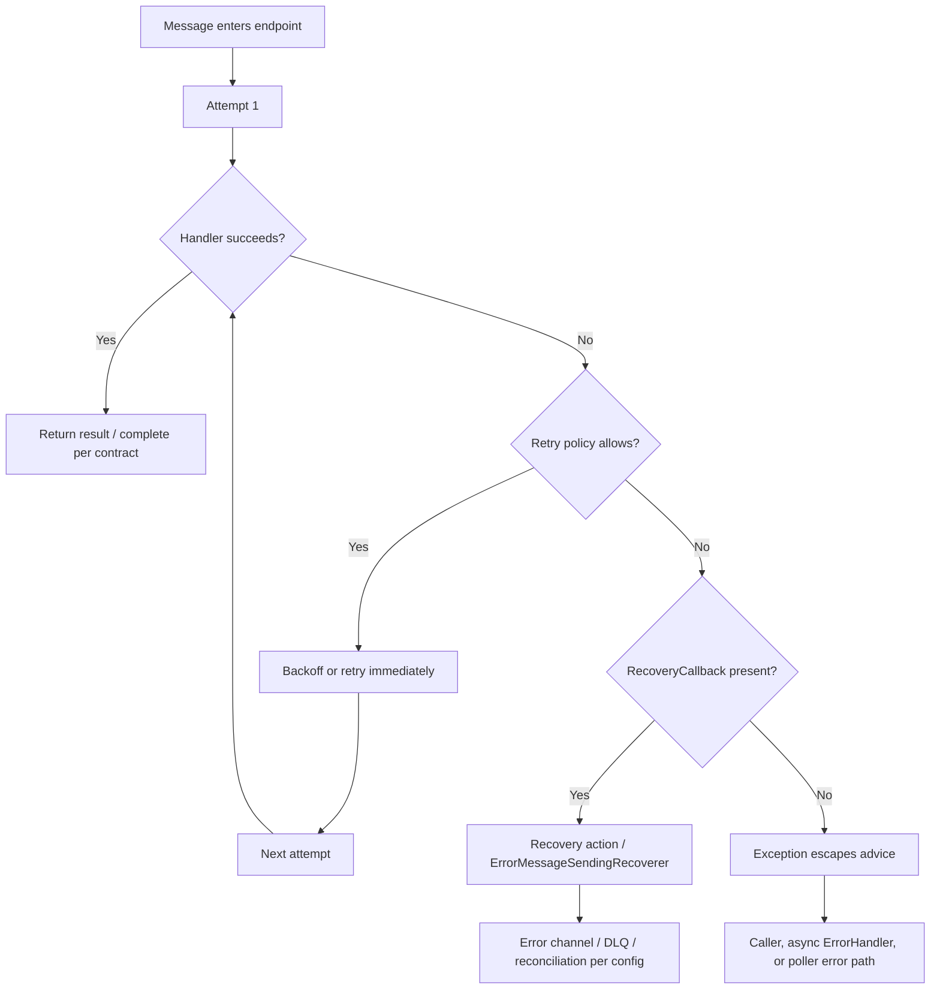
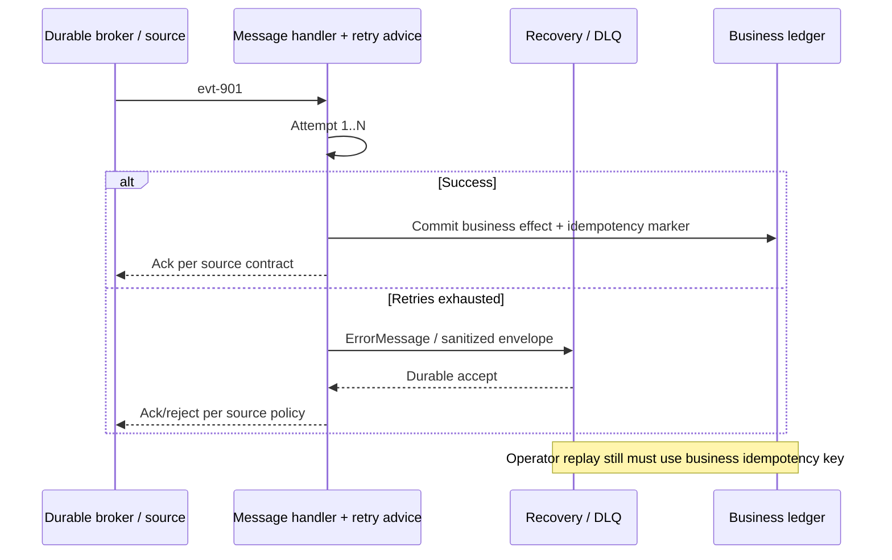
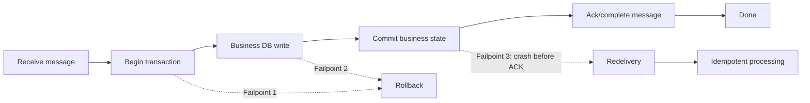

# Testing Retries, Error Channels, and Recovery in Spring Integration

## 1. Why must we also test the error path of a message flow?

In the **Testing runtime** chapter of the `SPRING_INTEGRATION_RUNTIME` module, a flow must not only work when valid messages pass through channels, endpoints, and consumers. It must also behave **predictably** when a handler throws an exception, an executor is busy, a poller rolls back, a broker redelivers a message, or the application restarts mid-processing.

Suppose a consumer receives `ReserveStock(eventId="evt-501", sku="SKU-7")`. The database service times out twice and succeeds on the third attempt. Another event hits a permanent error; once retries are exhausted, the message must enter a **recovery flow** for inspection and manual handling. In an asynchronous flow, an exception may occur on a worker thread and need to be published as an `ErrorMessage` rather than thrown directly back to the producer.

A test that only checks `input.send(...) == true` proves none of those requirements:

- `send()` may return true because the channel accepted the message, **not because the business transaction committed**.
- Retries may invoke the handler multiple times while creating **a business effect only once**.
- A synchronous error from a `DirectChannel` can unwind to the caller, whereas an asynchronous error is emitted via an error-publishing mechanism.
- A recovery callback may receive an error after retries are exhausted yet **does not by itself guarantee the message is durably stored or placed in a DLQ**.
- Failure after database commit but before broker ack can cause the message to be redelivered after restart.

### Learning objectives

After this lesson, you will be able to:

1. Trace the exact chain **attempt → retry → recovery/error channel → ack/replay**.
2. Configure a test fixture using `RequestHandlerRetryAdvice`, `RetryTemplate`, `QueueChannel`, and `ErrorMessageSendingRecoverer`.
3. Write JUnit 5 tests verifying **handler invocation count**, business outcome, and error messages after retries are exhausted.
4. Distinguish **synchronous** vs. **asynchronous** error channel testing, including the per-message `errorChannel` header.
5. Use latches, queue timeouts, and observable state to write stable tests without assumptions about thread ordering.
6. Verify rollbacks, retry/backoff, idempotency, message stores, recovery after restart, and error paths in pollers.
7. Build a test matrix and failure injection plan to verify real runtime limits.

## 2. Three mechanisms often confused as one

| Mechanism | Who triggers it? | Typical outcome | What must not be assumed |
|---|---|---|---|
| **Retry in handler** | `RequestHandlerRetryAdvice` or similar policy wrapping handler invocation | The same logical request is retried on eligible exceptions | Not broker redelivery; does not automatically roll back non-DB side effects |
| **Error channel** | A component catching and **publishing** exceptions as `ErrorMessage`, or a recovery callback sending the error | Error consumer receives a message whose payload is a `Throwable` | Not every synchronous exception automatically goes to the global `errorChannel` |
| **Recovery after retries exhausted** | `RecoveryCallback`, error flow/DLQ, or source recovery mechanism | Message is classified, stored, notified, or handled by an operator | Sending to an in-memory error channel does not survive a process crash |

A single message can pass through all three, though the **order and intersection points** depend on topology.



**Testing rule:** every arrow needs an assertion or observable signal if it affects business outcomes. Never just assert “no exception” when the goal is to verify recovery ran.

## 3. Designing the contract before writing tests

Clearly define inputs, behaviors, and **oracles** (the evidence proving a test is right):

| Scenario | Input / failure injection | Oracle to verify |
|---|---|---|
| Immediate success | Handler throws no error | One call, one business result, no recovery error |
| Transient failure then success | First two attempts throw; third succeeds | Three attempts **total**, one result, error channel empty |
| Retries exhausted | Every attempt throws | Attempts equal policy max, one error recovery notice, no business result |
| Permanent error | Invalid payload/non-retryable exception | No retry per classifier policy; routed to right recovery destination |
| Asynchronous failure | Handler throws on executor thread | Caller does not necessarily receive exception; error channel receives `ErrorMessage` within timeout |
| DB rollback | Exception occurs between two SQL statements in same transaction | No partial record/side effect committed |
| Crash after commit before ack | Same event is redelivered | Idempotency ledger blocks duplicate business effect |
| Source/poller retry | Message returns to source or queue per transaction/ack contract | Work is neither lost nor duplicated |
| Recovery sink failure | Error DLQ/DB temporarily unavailable | System does not falsely report “recovered”; emits error/retry or operator alert |

**Two vital invariants:**

1. **Safety:** a logical event produces a business effect at most once when the contract requires idempotency, even if the handler runs multiple times.
2. **Liveness:** a valid message recovering from transient failures has a path to completion or an observable terminal state; it never gets stuck forever in retries.

Tests must verify **both safety and liveness**; a flow that drops every message avoids duplicates yet is still seriously broken.

## 4. Test pyramid for Spring Integration runtime

Split tests by scope to stay both fast and trustworthy:

| Level | Scope | Example | Resources |
|---|---|---|---|
| **Unit test** | Retry policy, selector, exception classifier, idempotency key | `RetryTemplate` with service stub throwing by attempt index | No ApplicationContext needed |
| **Integration slice** | `MessageChannel`, endpoint, advice, error channel, and handler | JUnit test in section 6 with `DirectChannel` and `QueueChannel` | In-memory Spring context |
| **Component integration** | Poller, executor, transaction manager, JDBC message store | Inject failure then verify rollback/re-receive | Controlled DB or test infrastructure |
| **End-to-end / crash test** | Broker ack, restart, recovery, DLQ, and business effect | Kill consumer between DB commit and ack; replay same event | Real broker/DB or Testcontainers |
| **Runtime/observability test** | Logs, metrics, attempts, error/correlation, threads | Check retry counts, error destination, and oldest backlog age | Instrumented test app |

Spring Integration also provides the `spring-integration-test` module with `@SpringIntegrationTest`, `MockIntegrationContext`, `MockMessageHandler`, and utilities like `TestUtils`. These help when substituting endpoints or inspecting messages, though they are **not mandatory** for the first fixture if using just a Spring context and JUnit 5.

A reference dependency set for a Spring Boot project (letting the project's BOM pick compatible versions):

```groovy
dependencies {
    implementation "org.springframework.boot:spring-boot-starter-integration"
    implementation "org.springframework.retry:spring-retry"

    testImplementation "org.springframework.boot:spring-boot-starter-test"
    testImplementation "org.springframework.integration:spring-integration-test"
}
```

When using Java DSL, JDBC, Kafka/AMQP, or dedicated clients, add the corresponding artifacts. **Do not randomly combine incompatible Spring Integration 6.x/7.x and Spring Framework/Boot versions**; follow dependency management and documentation for the exact version in use.

## 5. JUnit fixture: configuring real retry and recovery without mocking the whole flow

The fixture below uses:

- A `DirectChannel` named `commands` so the handler runs synchronously and tests can assert immediately after `send()`.
- `RequestHandlerRetryAdvice` with a `RetryTemplate` allowing up to **3 attempts including the initial call**.
- `NoBackOffPolicy` so tests run quickly and deterministically by attempt count—not a production policy.
- `ErrorMessageSendingRecoverer` sending failures after retries are exhausted to a `QueueChannel` named `recoveryErrors`.
- A handler that fails by attempt count so tests can control execution precisely.

**File `RetryFlowFixture.java` (Java 17+):**

```java
package example.integration;

import java.util.concurrent.atomic.AtomicInteger;

import org.springframework.beans.factory.annotation.Qualifier;
import org.springframework.context.annotation.Bean;
import org.springframework.context.annotation.Configuration;
import org.springframework.integration.annotation.ServiceActivator;
import org.springframework.integration.channel.DirectChannel;
import org.springframework.integration.channel.QueueChannel;
import org.springframework.integration.config.EnableIntegration;
import org.springframework.integration.handler.advice.ErrorMessageSendingRecoverer;
import org.springframework.integration.handler.advice.RequestHandlerRetryAdvice;
import org.springframework.messaging.MessageChannel;
import org.springframework.retry.backoff.NoBackOffPolicy;
import org.springframework.retry.policy.SimpleRetryPolicy;
import org.springframework.retry.support.RetryTemplate;

@Configuration
@EnableIntegration
public class RetryFlowFixture {

    public record WorkCommand(String eventId) {}

    @Bean("commands")
    public MessageChannel commands() {
        return new DirectChannel();
    }

    @Bean("recoveryErrors")
    public QueueChannel recoveryErrors() {
        return new QueueChannel();
    }

    @Bean("retryAdvice")
    public RequestHandlerRetryAdvice retryAdvice(
            @Qualifier("recoveryErrors") MessageChannel recoveryErrors) {

        RetryTemplate template = new RetryTemplate();
        template.setRetryPolicy(new SimpleRetryPolicy(3));
        template.setBackOffPolicy(new NoBackOffPolicy());

        RequestHandlerRetryAdvice advice = new RequestHandlerRetryAdvice();
        advice.setRetryTemplate(template);
        advice.setRecoveryCallback(
                new ErrorMessageSendingRecoverer(recoveryErrors));
        return advice;
    }

    @Bean
    public ProbeHandler probeHandler() {
        return new ProbeHandler();
    }

    public static class ProbeHandler {

        private final AtomicInteger attempts = new AtomicInteger();
        private final AtomicInteger successfulCalls = new AtomicInteger();
        private volatile int failFirstAttempts;

        public void failFirst(int count) {
            failFirstAttempts = count;
        }

        public int attempts() {
            return attempts.get();
        }

        public int successfulCalls() {
            return successfulCalls.get();
        }

        @ServiceActivator(
                inputChannel = "commands",
                adviceChain = "retryAdvice")
        public void handle(WorkCommand command) {
            int current = attempts.incrementAndGet();

            if (current <= failFirstAttempts) {
                throw new IllegalStateException(
                        "Temporary failure for " + command.eventId());
            }

            successfulCalls.incrementAndGet();
        }
    }
}
```

### Why is this fixture small yet valuable?

`@ServiceActivator` creates a real message handler endpoint via annotation processing. The advice is attached to the handler via bean name `retryAdvice`; tests **do not call `ProbeHandler.handle(...)` directly** because doing so bypasses the channel/endpoint/advice chain. `@EnableIntegration` must be applied when creating the context.

`ErrorMessageSendingRecoverer` runs only after retries are exhausted. It **publishes the error**, without fixing it or storing it in a durable dead-letter queue on its own. The `QueueChannel` in the fixture is **in-memory**, suited for testing synchronous outcomes but not preserving data across restarts.

### Distinguishing maxAttempts from retry count

With `new SimpleRetryPolicy(3)`:

```text
Attempt 1: fails
Attempt 2: fails      <- retry 1
Attempt 3: fails      <- retry 2
RecoveryCallback    <- after 3 attempts exhausted
```

Thus `maxAttempts=3` means **3 total invocations**, not “initial call plus 3 retries”.

## 6. JUnit 5: succeeding after retry and exhausted retries going to recoveryErrors

**File `RetryFlowFixtureTest.java` (same package):**

```java
package example.integration;

import org.junit.jupiter.api.AfterEach;
import org.junit.jupiter.api.BeforeEach;
import org.junit.jupiter.api.Test;
import org.springframework.context.annotation.AnnotationConfigApplicationContext;
import org.springframework.integration.channel.QueueChannel;
import org.springframework.messaging.Message;
import org.springframework.messaging.MessageChannel;
import org.springframework.messaging.support.ErrorMessage;
import org.springframework.messaging.support.MessageBuilder;

import static org.junit.jupiter.api.Assertions.*;

class RetryFlowFixtureTest {

    private AnnotationConfigApplicationContext context;
    private MessageChannel input;
    private QueueChannel recoveryErrors;
    private RetryFlowFixture.ProbeHandler probe;

    @BeforeEach
    void setUp() {
        context = new AnnotationConfigApplicationContext(
                RetryFlowFixture.class);
        input = context.getBean("commands", MessageChannel.class);
        recoveryErrors = context.getBean("recoveryErrors",
                QueueChannel.class);
        probe = context.getBean(RetryFlowFixture.ProbeHandler.class);
    }

    @AfterEach
    void tearDown() {
        context.close();
    }

    private boolean sendEvent(String eventId) {
        return input.send(MessageBuilder.withPayload(
                new RetryFlowFixture.WorkCommand(eventId)).build());
    }

    @Test
    void retriesTwiceThenSucceedsWithoutRecoveryMessage() {
        probe.failFirst(2);

        assertTrue(sendEvent("evt-501"));

        assertEquals(3, probe.attempts());
        assertEquals(1, probe.successfulCalls());
        assertNull(recoveryErrors.receive(0));
    }

    @Test
    void exhaustedRetryPublishesExactlyOneErrorMessage() {
        probe.failFirst(Integer.MAX_VALUE);

        assertTrue(sendEvent("evt-502"));

        assertEquals(3, probe.attempts());
        assertEquals(0, probe.successfulCalls());

        Message<?> error = recoveryErrors.receive(1_000);
        assertNotNull(error);
        assertInstanceOf(ErrorMessage.class, error);
        assertInstanceOf(Throwable.class, error.getPayload());

        // There is no ErrorMessage per attempt.
        assertNull(recoveryErrors.receive(0));
    }

    @Test
    void successfulFirstAttemptDoesNotEnterRecovery() {
        probe.failFirst(0);

        assertTrue(sendEvent("evt-503"));

        assertEquals(1, probe.attempts());
        assertEquals(1, probe.successfulCalls());
        assertNull(recoveryErrors.receive(0));
    }
}
```

### Reading test results correctly

1. **Retry success:** `attempts=3`, `successfulCalls=1`, and `recoveryErrors` is empty. This proves the advice re-invoked the handler and stopped retrying once it succeeded.
2. **Exhausted:** the handler was called three times and an `ErrorMessage` was sent once to the recovery channel via `ErrorMessageSendingRecoverer`.
3. **Success on first attempt:** the advice does not perform three calls if the handler succeeds right away.
4. **Test isolation:** each test creates a fresh context, store, and counters. Avoid sharing one singleton bean across tests and accidentally accumulating attempt counts.
5. **Timeouts:** `receive(1_000)` waits at most one second; `receive(0)` is a **non-blocking** check on a `PollableChannel`. Never use `Thread.sleep` to guess when errors appear.

**What the test does not prove yet:** the fixture has no database, broker, real retry backoff, transactions, or idempotency. `successfulCalls` is just a counter in the demo handler, not evidence of a database commit. Each resource must be verified in the following sections.

### When a test does not behave as expected

If the handler runs only once:

- Check whether `adviceChain = "retryAdvice"` is attached to the right `@ServiceActivator`.
- Ensure messages are sent via `commands` instead of calling `ProbeHandler.handle(...)` directly.
- Check whether the handler caught and swallowed the exception; advice only sees exceptions **escaping** the wrapped call.
- Distinguish exceptions classified as retryable from exceptions excluded by policy.

If the handler fails yet `recoveryErrors` is empty:

- Check `setRecoveryCallback(...)` and the target `MessageChannel`.
- Distinguish the recovery callback's error channel from the **global `errorChannel`** or a per-message header.
- Check whether another consumer is accidentally draining messages from the `QueueChannel`.
- Check whether the recovery publisher threw an exception or the flow stopped before publishing.

## 7. Testing error channels: synchronous vs. asynchronous differ

A very easy test mistake:

```text
DirectChannel.send(...) -> ServiceActivator throws RuntimeException
```

With a synchronous handler and **no recovery advice**, the exception can propagate back up the call stack to `send()`. The framework does **not** always wrap exceptions in an `ErrorMessage` and send them to the global `errorChannel`.

Conversely:

```text
ExecutorChannel.send(...) -> worker thread -> handler throws exception
                                        -> ErrorHandler/error publisher
                                        -> ErrorMessage on errorChannel
```

An error on a worker thread cannot unwind onto the producer's call stack once `send()` has already returned synchronously. Spring Integration uses appropriate error handling at asynchronous boundaries. If the message carries a `MessageHeaders.ERROR_CHANNEL` header, the error publisher may route to that channel first; otherwise, it may fall back to the global `errorChannel`. Actual policy depends on the configured adapter/dispatcher/error handler.

### Oracle table

| Flow | Primary assertion | What not to assert |
|---|---|---|
| `DirectChannel` + always-throwing handler, no recovery | `assertThrows(...)` on `send`; verify handler was invoked | Global error channel is guaranteed to receive error |
| `DirectChannel` + retry + recoverer from section 5 | `send` does not throw when recovery succeeds; recovery channel gets one error | One `ErrorMessage` per attempt |
| `ExecutorChannel` + throwing handler | `send` may return early; receive `ErrorMessage` with finite timeout | `assertThrows(...)` on producer thread is enough |
| Polling endpoint + throwing handler | Poller error handling/transaction per advice and source | Message definitely returns to queue if queue is in-memory |
| Source adapter/broker | Ack/nack/requeue/DLQ per adapter contract | Error channel receiving an error means broker redelivered |

## 8. Async example: testing the per-message errorChannel header

To avoid mixing `RequestHandlerRetryAdvice` recovery with asynchronous dispatcher errors, create a **separate fixture** without retry advice.

**File `AsyncErrorFixture.java`:**

```java
package example.integration;

import org.springframework.beans.factory.annotation.Qualifier;
import org.springframework.context.annotation.Bean;
import org.springframework.context.annotation.Configuration;
import org.springframework.integration.annotation.ServiceActivator;
import org.springframework.integration.channel.ExecutorChannel;
import org.springframework.integration.channel.QueueChannel;
import org.springframework.integration.config.EnableIntegration;
import org.springframework.messaging.MessageChannel;
import org.springframework.scheduling.concurrent.ThreadPoolTaskExecutor;

@Configuration
@EnableIntegration
public class AsyncErrorFixture {

    @Bean("workerExecutor")
    public ThreadPoolTaskExecutor workerExecutor() {
        ThreadPoolTaskExecutor executor = new ThreadPoolTaskExecutor();
        executor.setThreadNamePrefix("async-test-");
        executor.setCorePoolSize(1);
        executor.setMaxPoolSize(1);
        executor.setQueueCapacity(10);
        return executor;
    }

    @Bean("asyncCommands")
    public MessageChannel asyncCommands(
            @Qualifier("workerExecutor")
            ThreadPoolTaskExecutor workerExecutor) {
        return new ExecutorChannel(workerExecutor);
    }

    @Bean("asyncErrors")
    public QueueChannel asyncErrors() {
        return new QueueChannel();
    }

    @Bean
    public AsyncFailureHandler asyncFailureHandler() {
        return new AsyncFailureHandler();
    }

    public static class AsyncFailureHandler {

        @ServiceActivator(inputChannel = "asyncCommands")
        public void handle(String payload) {
            throw new IllegalStateException("Async failure: " + payload);
        }
    }
}
```

**JUnit 5 test:**

```java
import org.junit.jupiter.api.Test;
import org.springframework.context.annotation.AnnotationConfigApplicationContext;
import org.springframework.integration.channel.QueueChannel;
import org.springframework.messaging.Message;
import org.springframework.messaging.MessageChannel;
import org.springframework.messaging.MessageHeaders;
import org.springframework.messaging.support.ErrorMessage;
import org.springframework.messaging.support.MessageBuilder;

import static org.junit.jupiter.api.Assertions.*;

class AsyncErrorFixtureTest {

    @Test
    void routesAsyncFailureToPerMessageErrorChannel() {
        try (var context = new AnnotationConfigApplicationContext(
                AsyncErrorFixture.class)) {

            MessageChannel input = context.getBean(
                    "asyncCommands", MessageChannel.class);
            QueueChannel errors = context.getBean(
                    "asyncErrors", QueueChannel.class);

            Message<String> request = MessageBuilder
                    .withPayload("event-900")
                    .setHeader(MessageHeaders.ERROR_CHANNEL, errors)
                    .build();

            assertTrue(input.send(request));

            Message<?> failure = errors.receive(3_000);
            assertNotNull(failure);
            assertInstanceOf(ErrorMessage.class, failure);
            assertInstanceOf(Throwable.class, failure.getPayload());
        }
    }
}
```

The fixture creates an `ExecutorChannel` with a dedicated worker executor. The test passes a **`QueueChannel` object** in the `errorChannel` header so it does not depend on string channel name resolution. It waits for the error using `receive(3_000)` instead of `sleep`.

**Oracle limitation:** the test confirms an error is published to the specified channel via the asynchronous dispatcher's error handler under this configuration. If a project swaps the dispatcher/error handler or inserts another adapter in between, the same message may take a different error route; re-test against the **exact production topology**. Never infer from `send()==true` that the handler succeeded.

### Reading the failed message defensively

An `ErrorMessage` carries a `Throwable` payload, often related to `MessagingException`. Depending on the failure point, not every exception carries the full original message:

```java
import org.springframework.messaging.MessagingException;
import org.springframework.messaging.support.ErrorMessage;

void inspectError(ErrorMessage error) {
    Throwable cause = error.getPayload();

    if (cause instanceof MessagingException messagingError) {
        var failed = messagingError.getFailedMessage();
        if (failed != null) {
            System.out.println("Failed message id="
                    + failed.getHeaders().getId());
        }
    }

    var original = error.getOriginalMessage();
    if (original != null) {
        System.out.println("Original message id="
                + original.getHeaders().getId());
    }
}
```

**Never log the entire `failedMessage` or raw payload** in production: it may contain tokens, PII, payment details, or non-serializable objects. In tests, use synthetic event IDs/safe headers and check message identity where components preserve it.

## 9. Testing classification: which errors are worth retrying?

A well-designed system should not retry every exception identically:

- **Transient:** database deadlock, brief network timeout, bounded HTTP 503; safe to retry with backoff.
- **Permanent/business:** invalid schema, missing required key, invalid business state; retrying rarely helps.
- **Ambiguous outcome:** timeout after sending payment; the provider may have processed it. Retry only with an **idempotency key** or status query mechanism.
- **Concurrency/lock busy:** retrying can make sense, though total duration must be bounded and multiple consumers must not hammer the same hot key.

Tests should verify **actual classification**, not just default counts:

| Error type | Expected policy | Assertions |
|---|---|---|
| `TransientDataAccessException` | Retry up to N attempts | Count = N when always failing; Count < N if succeeding early |
| `IllegalArgumentException` | No retry | Count = 1, error/recovery per contract |
| HTTP 503 | Backoff + bounded retries | No tight loop; attempts keep the same idempotency key |
| Ambiguous timeout after side effect | Conditional retry | Final business effect occurs only once |
| `InterruptedException` / cancellation | Respect cancel/interrupt | Do not keep retrying indefinitely or swallow interrupts |

A `SimpleRetryPolicy` configured with exception classification can be tested on its own:

```java
import java.util.Map;
import org.springframework.dao.TransientDataAccessException;
import org.springframework.retry.policy.SimpleRetryPolicy;

var retryable = Map.<Class<? extends Throwable>, Boolean>of(
        TransientDataAccessException.class, true,
        IllegalArgumentException.class, false
);

SimpleRetryPolicy policy =
        new SimpleRetryPolicy(3, retryable, true);
```

`traverseCauses=true` is helpful when exceptions can be wrapped by the framework; test using **realistic** exception chains (e.g., `MessagingException` wrapping a cause). With this setup, unlisted exceptions are not retried by default unless the classifier is configured otherwise.

### Backoff should not make unit tests slow or flaky

Section 5's fixture uses `NoBackOffPolicy` to test the **attempt count contract**. A separate component-level test can use `FixedBackOffPolicy` or `ExponentialBackOffPolicy`, though asserting exact millisecond timings is unstable under scheduling/CI load.

```java
import org.springframework.retry.backoff.FixedBackOffPolicy;

FixedBackOffPolicy backOff = new FixedBackOffPolicy();
backOff.setBackOffPeriod(100L); // ms, for integration test only
```

Instead of asserting `elapsed == 200 ms`, verify retries do not spin in a tight loop, waits fall within **reasonable bounds**, and total execution stays under the test deadline. Where architecture allows injecting a scheduler/clock, prefer a **virtual time/fake clock** or unit-test the delay calculation separately.

## 10. Real recovery: an error message is not automatically a durable DLQ

`ErrorMessageSendingRecoverer` publishes errors to `recoveryErrors` in the fixture. If the process dies right after, an in-memory `QueueChannel` **loses** state across restarts.

A production recovery flow must clearly define:

1. **Which messages enter recovery?** Exhausted retries, permanently invalid data, or indeterminate external state.
2. **Where are they stored?** Durable broker DLQ, database recovery table, persistent message store, or an appropriate ticketing system.
3. **Who can inspect and replay them?** Authorized operators, approval workflow, unique IDs, action audit logs.
4. **Where is idempotency during replay?** Same business event ID and a ledger with sufficient retention to prevent duplicate side effects.
5. **What happens if the recovery sink fails?** Never mark as handled if the error was not actually persisted. Need a clear escalation/durability path.
6. **Cleanup rules:** retain failed messages, error metadata, and tombstones at least through the policy's replay/audit window.



The diagram shows the **target workflow**: `ErrorMessageSendingRecoverer` by itself does not handle broker acks and cannot guarantee durable acceptance if the target channel is in-memory. Real adapters and integration tests are needed to prove the corresponding commit/ack ordering.

### What does a recovery callback return?

In a request–reply flow, the callback can return an alternate result or throw an exception, depending on the contract. If recovery returns `null` or uses a `void` handler, a gateway awaiting a reply may time out or throw `ReplyRequiredException` when a reply is required.

Therefore, when testing gateways, besides the error channel, assert **reply semantics**: whether the final error returns to the gateway as an exception, an explicit status code, or a `RecoveryResult` object. Avoid the trap where “error channel test PASSES” yet the caller still times out meaninglessly.

## 11. Retries and transactions: rollbacks must be tested with real data

In imperative Spring transactions, `@Transactional` typically binds the transaction to the thread invoked through the proxy. If the flow contains an `ExecutorChannel`, the producer's transaction **does not automatically cross** the executor. Retry advice and transaction advice also differ in nesting order:

```text
RetryAdvice(
    TransactionAdvice(
        businessAttempt()
    )
)
=> Typically each attempt can open its own transaction.

TransactionAdvice(
    RetryAdvice(
        businessAttempt()
    )
)
=> Multiple attempts can share one transaction;
   an earlier failure may mark it rollback-only.
```

Tests must verify transaction boundaries against the **real topology**; no single advice order fits every configuration or resource.

### Rollback example in a single database

Suppose the handler receives `eventId` and updates inventory along with a marker in the same JDBC transaction:

```sql
CREATE TABLE stock (
    sku VARCHAR(60) PRIMARY KEY,
    available INTEGER NOT NULL
);

CREATE TABLE processed_event (
    event_id VARCHAR(120) PRIMARY KEY,
    processed_at TIMESTAMP NOT NULL DEFAULT CURRENT_TIMESTAMP
);

INSERT INTO stock(sku, available) VALUES ('SKU-7', 10);
```

The service below assumes a `JdbcTemplate jdbc` and a transaction manager matching the datasource:

```java
import org.springframework.transaction.annotation.Transactional;

@Transactional(transactionManager = "transactionManager")
public void reserve(String eventId, String sku, int amount) {
    int inserted = jdbc.update(
            "INSERT INTO processed_event(event_id) VALUES (?) " +
            "ON CONFLICT DO NOTHING",
            eventId);

    if (inserted == 0) {
        return; // Duplicate, do not deduct stock again.
    }

    int updated = jdbc.update(
            "UPDATE stock SET available = available - ? " +
            "WHERE sku = ? AND available >= ?",
            amount, sku, amount);

    if (updated != 1) {
        throw new IllegalStateException("Insufficient stock");
    }
}
```

This example uses PostgreSQL `ON CONFLICT DO NOTHING`; adapt the SQL for other DBMSs. To test rollback, inject a failure after inserting the marker but before the method commits. Assertions:

- After failure and rollback, **no `processed_event(eventId)` exists**.
- Stock remains at 10.
- A succeeding retry afterward inserts the marker and deducts stock exactly once.
- Replaying after commit must not deduct again.
- If two workers receive the same event, unique constraints/transactions guard the race; non-atomic `SELECT` then `INSERT` is an anti-pattern.

**Note:** `RequestHandlerRetryAdvice` can retry calls on a transaction already marked rollback-only if the advice order is wrong. Tests must observe **real commits**, not just that the handler threw no exception. When combining retry + transaction + poller, also test rollback of pulling the message from the source.

## 12. Pollers and message stores: test requeue, not just exceptions

A polling consumer reads from a `PollableChannel`. When the handler fails, the message's outcome also depends on the **source store/transaction**:

| Source | When handler throws | Required test |
|---|---|---|
| In-memory `QueueChannel` | JDBC transaction rollback **does not undo an in-RAM dequeue** | Check whether message remains or is lost; decide external replay |
| `QueueChannel` with `JdbcChannelMessageStore` | Receive can join the JDBC transaction if poller is configured properly | Crash/failure: row remains or is restored for subsequent polls |
| JMS/AMQP/Kafka adapter | Ack/requeue/offset/visibility per adapter and broker | Redelivery count, DLQ, real transaction/ack; do not infer from error channel |
| File poller/filter with metadata | Marker file may update before business handler | On retry after failure, is it re-polled? Does marker need rollback/removal? |
| Aggregator/message group store | Group may be partially stored before release | Restart: group persists, timeout/expiry, and duplicate semantics |

### Polling integration test checklist

1. Use a source **whose pending/in-flight state can be inspected** (JDBC message store/test broker).
2. Insert exactly one event with a stable business ID into the source.
3. Make the handler throw an exception at a chosen point.
4. Verify **transaction state** and source ack/requeue after the error.
5. Allow the handler to succeed on the next cycle or allow recovery to DLQ.
6. Verify the business effect occurred once and the message is not stuck forever.
7. Restart the ApplicationContext/worker between milestones; verify pending work remains.
8. Verify error handling does not swallow exceptions too early, causing the poller to commit mistakenly.

If a poller has an advice chain combining transactions and retries, the ordering must be tested with real data. `errorChannel` is an **error-reporting path**, not a queue-rollback mechanism by itself.

## 13. Testing concurrency, async timing, and avoiding flaky tests

### 13.1. Do not use sleep to “wait long enough to be sure”

In async flows, `send()` can return before the handler runs. `Thread.sleep(500)` fails to deterministically capture behavior under CI load and slows down tests when everything finishes early.

Use one of these alternatives:

- `QueueChannel.receive(timeout)` to await `ErrorMessage`/replies within finite bounds.
- `CountDownLatch.await(timeout, unit)` when verifying one or a few callbacks.
- `Awaitility` or timed polling assertions to check eventual DB/metric state.
- `CompletableFuture`, `StepVerifier` for reactive flows when contracts return a `Publisher`.
- `Testcontainers`/broker test resources with explicit readiness and cleanup.

### 13.2. Latch example confirming a worker ran

```java
import java.util.concurrent.CountDownLatch;
import java.util.concurrent.TimeUnit;
import java.util.concurrent.atomic.AtomicInteger;

CountDownLatch handled = new CountDownLatch(1);
AtomicInteger attempts = new AtomicInteger();

Runnable work = () -> {
    try {
        attempts.incrementAndGet();
    } finally {
        handled.countDown();
    }
};

Thread worker = new Thread(work, "test-worker");
worker.start();

boolean finished = handled.await(2, TimeUnit.SECONDS);
assertTrue(finished);
assertEquals(1, attempts.get());

worker.join(2_000);
```

This snippet only illustrates a **test synchronization primitive**. When testing Spring Integration, place the latch inside a real handler/spy receiving messages via a channel, rather than running an isolated `Runnable` and treating it as proof the endpoint processed properly.

### 13.3. Testing duplicates from concurrent retry/redelivery

Send two messages with the **same business event ID** processed by two consumers. The right outcome is not “method called once”, but **business effect committed only once** if the business enforces idempotency. Use unique constraints/inbox tables and same-database transactions.

Do not rely solely on an in-memory `AtomicInteger` to claim multi-JVM safety. Cluster-level tests require two contexts/instances sharing the **same database** and measuring final state.

### 13.4. Cleaning up resources after every test

Every test should:

- Close the `ApplicationContext`, executors, message sources, and connections.
- Never let schedulers/pollers from an earlier test keep running into the next test.
- Clean database/queues by test ID or use appropriate transaction cleanup; avoid deleting data belonging to parallel tests.
- Use distinct event names per test; avoid reusing keys that cause persistent idempotency markers to make the next test skip.
- Use finite timeouts and failure messages reporting attempt count, thread, channel, and error queue.
- When using `@SpringBootTest` and `@SpringIntegrationTest`, manage application context caching/`@DirtiesContext` appropriately rather than resetting global state arbitrarily.

## 14. Failure injection: faults must happen at the right point

Often the hardest part of a test is not configuring retry, but **picking the right breakpoint**:



| Failpoint | How to simulate | Invariant to verify |
|---|---|---|
| Before entering handler | Adapter disconnected, input send rejected | No business effect and source retry path exists |
| Attempt 1 or 2 | Stub handler throws by attempt index | Advice retries within budget and stops on success |
| Right after DB marker insert | Throw unchecked exception before commit | Marker and business update both roll back |
| After DB commit before ack | Kill process/stop adapter at sync point | Redelivery does not duplicate side effects |
| Error channel target full | Small queue capacity or executor rejection | Recovery failure is handled, never falsely reported as success |
| DLQ/broker unavailable | Block connection or simulate publish failure | Error message is not silently lost |
| Worker thread interrupted | Interrupt at controlled wait point | Thread stops per policy; no infinite retry |
| Restart after claim/lock | Kill worker while holding state | Lock/lease expires and replay recovery works properly |
| Two-instance race | Same event sent to two instances | One business effect, no double credit |

**Never use random exceptions** for correctness tests. Failure injection should be deterministic via attempt index, barriers/latches, or clear transaction checkpoints so failures are reproducible.

## 15. Runtime diagnostics via logs, metrics, and error envelopes

When a retry/error/recovery test fails, what needs verification is the **actual path** of the message:

```text
received_at
  -> attempt_no / handler_thread
  -> exception_type + retry decision
  -> transaction_commit_or_rollback
  -> error_published_at + destination
  -> recovery_persisted_at
  -> source_ack_or_redelivery
```

Spring Integration does not automatically store all of these milestones as ready-made fields. Test fixtures must instrument what needs verification. Prefer structured logs/metrics containing **synthetic business event IDs**, avoiding printing raw payloads or `ErrorMessage.toString()` if sensitive data may be present.

| Metric/observation | Verification question |
|---|---|
| `handler_attempts_total` by outcome | How many times was an event attempted? |
| `handler_success_total` | How many business operations succeeded? |
| `retry_exhausted_total` | How many events entered recovery? |
| `error_channel_published_total` | Were errors published, and to which channel? |
| `recovery_durable_accept_total` | Did the DLQ/store commit the error record? |
| `source_redelivery_total` | How many times did the broker/file/poller redeliver? |
| `business_duplicate_suppressed_total` | Did idempotency protect against replays? |
| `oldest_pending_message_age` | Is any event stuck without progress? |
| `executor_rejected_total` / queue depth | Was the failure caused by saturation? |
| `transaction_rollback_total` | Did business data roll back along the error path? |

These metric names are **application measurement suggestions**, not a claim that Spring Integration exposes identically named meters by default. Combine them with Micrometer `spring.integration.*`, Observation/tracing, channel interceptors, and message history depending on version.

### When ErrorMessage lacks enough information

Do not assert that every `ErrorMessage` has the exact same exception class or a non-null `failedMessage`. Across different adapters/handlers/proxies, exceptions may be wrapped or messages transformed. Tests should:

1. Assert `ErrorMessage` and its `Throwable` payload.
2. If business logic needs the event ID, explicitly preserve that ID via headers/envelopes.
3. Check `MessagingException.getFailedMessage()` **if present**.
4. Check `ErrorMessage.getOriginalMessage()` **if present**.
5. Classify root causes/error types per policy, rather than comparing raw `Exception.toString()` strings that shift across versions.

## 16. Common anti-patterns in runtime testing

| Anti-pattern | Why it is dangerous | Fix |
|---|---|---|
| Calling handler method directly | Bypasses advice chain, channel, and error publisher | Send messages through real channels/endpoints |
| Asserting `send() == true` means business committed | With async/pollers, send only confirms one handoff step | Wait for business/recovery outcome |
| Using `Thread.sleep(1000)` to wait | Flaky and slow; no clear outcome deadline | Queue receive/latch/Awaitility with timeout |
| Testing only attempt count | Does not prove rollback and idempotency | Assert final database/side-effect state |
| Retrying every error | Permanent errors can cause poison loops | Test classifier and DLQ separately |
| Calling an in-memory recovery channel a durable DLQ | Restart loses error messages | Test persistent store/broker ack |
| Catching exceptions and returning normally inside a transaction | Advice/poller may commit wrongly | Propagate or deliberately mark rollback-only |
| Sharing one context across many cases | State/queues/counters leak across tests | Create fresh contexts or reset the entire fixture properly |
| Expecting every error in global `errorChannel` | Sync exceptions may throw directly; per-message header takes priority | Test each sync/async boundary |
| Infinite retries in unit tests | Hangs tests and loads infrastructure | Bounded attempts, timeouts, and backoff |
| Treating “recovered” log lines as sufficient | Sink may not have committed | Verify durable receipt and source state |
| Printing full ErrorMessage/payload | Data leaks, log spikes | Redact + allowlist event ID/correlation |

## 17. Minimum test case checklist to approve a production flow

A practical checklist for the engineering team:

- [ ] Valid message succeeds on the first attempt with no recovery event.
- [ ] Transient failure twice then succeeds on the third attempt; no duplicate business effect.
- [ ] Continuous failure exhausts the retry budget; exactly one final recovery event.
- [ ] Permanent failure does not retry or is classified accurately per policy.
- [ ] `DirectChannel` synchronous throw asserted at caller when no recovery advice exists.
- [ ] `ExecutorChannel` async error reaches the right `errorChannel` header or global channel per config.
- [ ] Error handlers and recovery callbacks never accidentally swallow exceptions causing wrong commits.
- [ ] DB rollback between statements leaves no partial marker/idempotency state.
- [ ] Broker/JDBC poller redelivery after crash causes no duplicate business effects.
- [ ] Unavailable recovery sink does not let error messages disappear silently.
- [ ] Request–reply gateway produces a meaningful result or exception after recovery.
- [ ] Retry/backoff is bounded, avoids tight loops, and supports timeouts and cancellation.
- [ ] Tests perform lifecycle cleanup for context/executor/scheduler/database/broker.
- [ ] Logs/metrics correlate attempts by business event ID without exposing sensitive data.

### Extended exercises

1. Modify section 5's fixture to retry only `TransientDataAccessException` and not `IllegalArgumentException`. Write two tests counting attempts.
2. Replace `NoBackOffPolicy` with `FixedBackOffPolicy` and check reasonable time bounds; do not assert exact milliseconds.
3. Replace in-memory `recoveryErrors` with a consumer writing to a database recovery table. Simulate a commit failure at the recovery sink and prove the error is not treated as durable.
4. Switch input to `ExecutorChannel`, add a per-message `errorChannel`, and verify worker exceptions are not wrongly asserted on `send()`.
5. Add a JDBC service using `@Transactional`, inject an error after inserting the marker; assert rollback and that retry commits exactly once.
6. Build a flow using `JdbcChannelMessageStore` and a transactional poller; restart the context when the handler fails to verify pending messages can be reprocessed.
7. With a test broker, kill the consumer **after DB commit before ack**, verify redelivery and idempotency, and document the full timeline.
8. With a gateway, design an explicit `RecoveryResult` so duplicate/final failures do not turn into confusing timeouts.

## 18. Takeaways

- **Retry**, **error channel**, and **recovery** are distinct contracts. Test attempt counts, error paths, and final business effects together.
- `SimpleRetryPolicy(3)` means **3 total attempts**, not 3 additional retries.
- `ErrorMessageSendingRecoverer` can publish an `ErrorMessage` when exhausted; an in-memory channel is not automatically a durable DLQ.
- **DirectChannel** can propagate exceptions directly to the caller; **ExecutorChannel** needs tests with asynchronous error signals via queues/latches with timeouts.
- An `ErrorMessage` proves an error was reported to a receiver; it does not prove database rollback, broker redelivery, or recovery store commit.
- Transactions, source acks, and idempotency must be tested on **real resources** when crash/restart recovery is the goal.
- Good runtime tests have **deterministic fault injection**, **assertions on final state**, **finite timeouts**, **explicit cleanup**, and logs/metrics that never leak payloads.

### Official references

- [Spring Integration Reference — Retry Advice](https://docs.spring.io/spring-integration/reference/handler-advice/classes.html): `RequestHandlerRetryAdvice`, recovery callbacks, and advice chains.
- [Spring Integration Reference — Error Handling](https://docs.spring.io/spring-integration/reference/error-handling.html): `ErrorMessage`, global/per-message `errorChannel`, synchronous/asynchronous handling.
- [Spring Integration Reference — Testing Support](https://docs.spring.io/spring-integration/reference/testing.html): `spring-integration-test`, test utilities, and mock integration context.
- [Spring Integration Reference — Transaction Support](https://docs.spring.io/spring-integration/reference/transactions.html): poller transactions, rollbacks, and thread boundaries.
- [Spring Integration Reference — Polling Consumer](https://docs.spring.io/spring-integration/reference/endpoint.html): polling endpoints, schedulers, advice, and message receive.
- [Spring Integration Reference — Message Store](https://docs.spring.io/spring-integration/reference/message-store.html): durable queue/group state, replay, and store lifecycle.
- [Spring Retry Reference](https://docs.spring.io/spring-retry/reference/): `RetryTemplate`, `RetryPolicy`, backoff, recovery, and retry classification.
