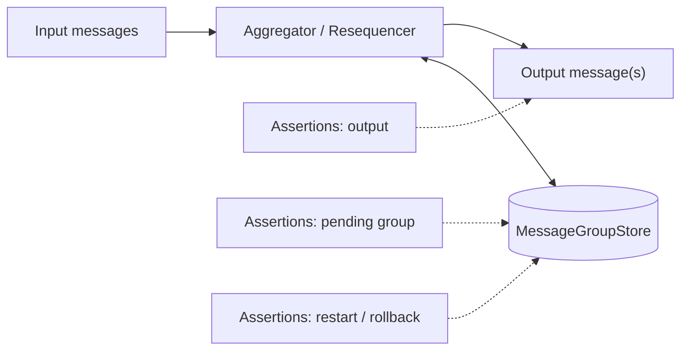
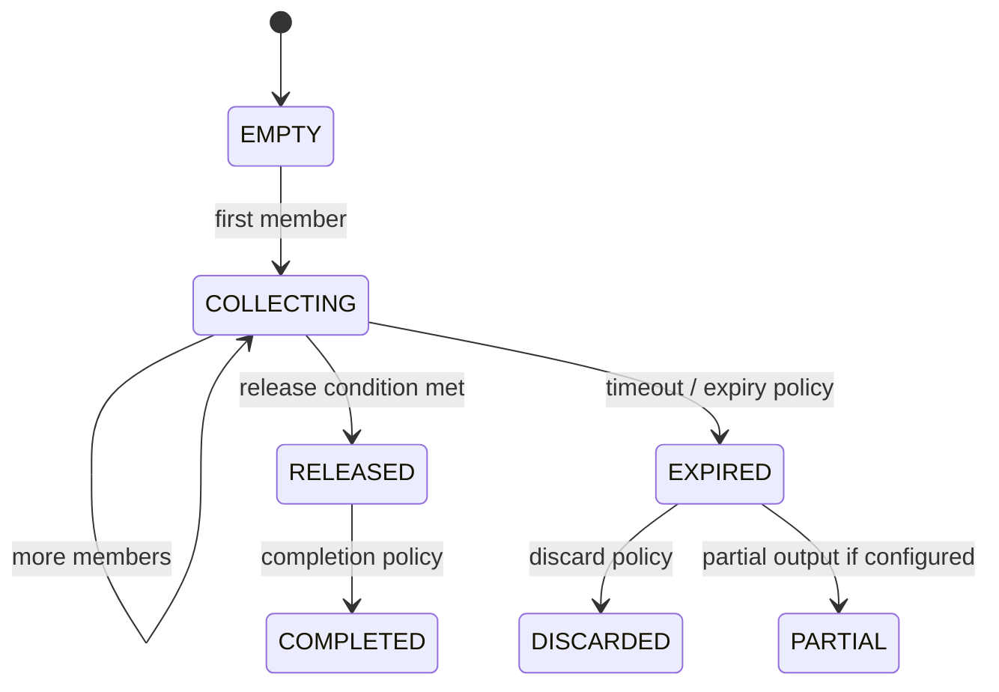
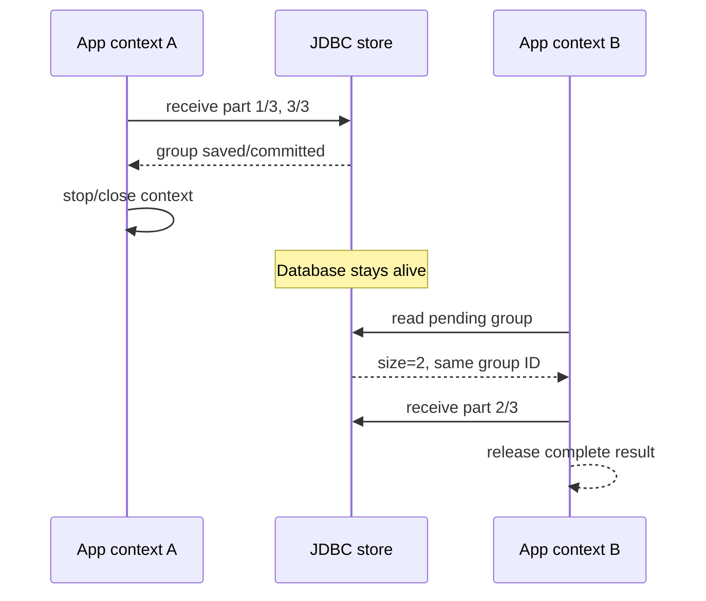
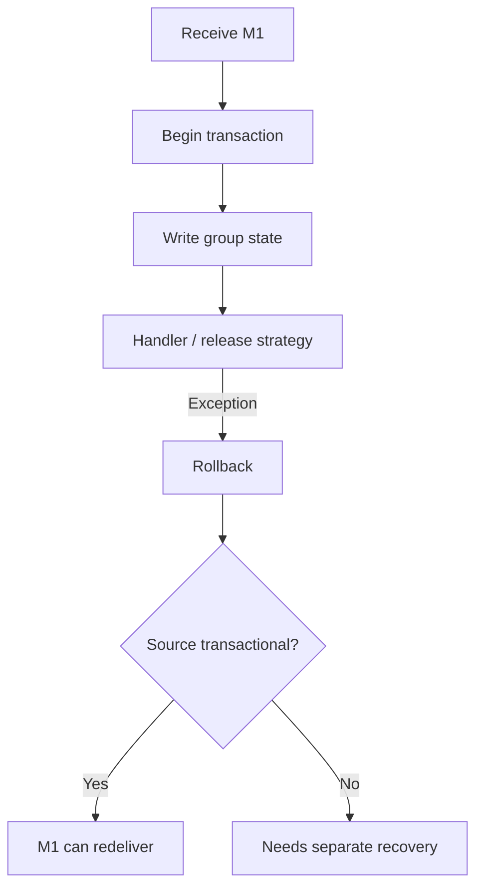
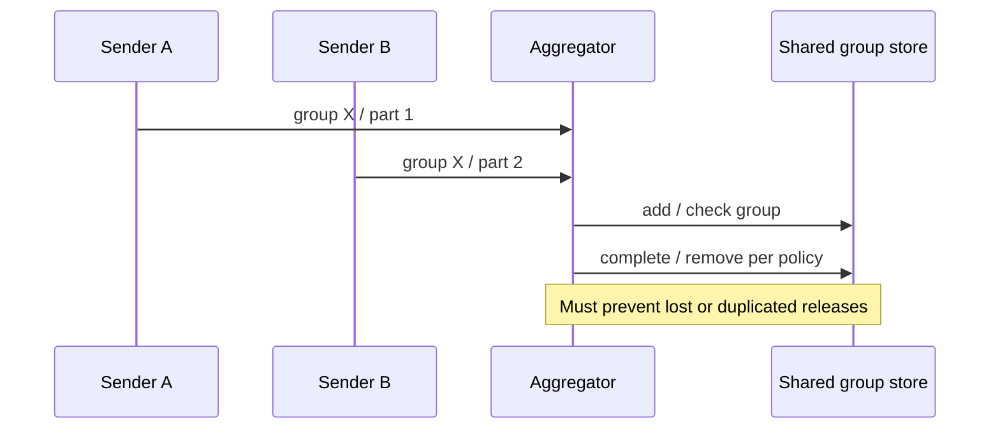
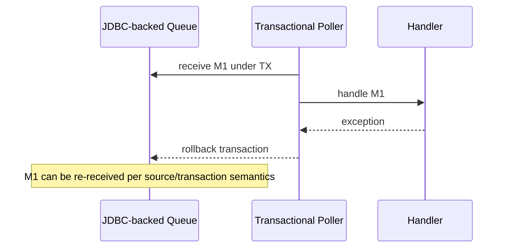

# Testing Message Stores and Group State

In **Spring Integration runtime**, messages are not always processed immediately upon entering a channel. A `QueueChannel` may hold messages for a poller to pull later; an **aggregator** must wait for all parts sharing a correlation key; a **resequencer** holds out-of-order messages; and a **message group store** persists state across receives. Consequently, a test that merely checks “the handler produced output” often fails to prove the runtime behaves properly under **missing messages, retries, rollbacks, restarts, or concurrent consumers**.

This lesson belongs to the **Testing runtime** chapter of the `SPRING_INTEGRATION_RUNTIME` module. Its goal is to build a testing strategy for message stores and the `MessageGroup` lifecycle, understand the boundary between channel stores and group stores, observe correlation/sequence/release/expiry, simulate failures, and diagnose leftover state when a flow stops or restarts.

Core message: **test both emitted data and unemitted state**. Absence of output may mean the system is legitimately waiting, or it may mean a message was lost or a group is stuck.

## 1. Two questions that must be tested separately

When a flow holds state, tests need to answer two questions:

1. **Data-plane:** which messages enter, which messages exit, and do count, order, content, and business outcomes match?
2. **State-plane:** before/after each step, which queue or group holds the message, is it completed/expired, and can it recover after failure or restart?



Suppose an invoice `INV-42` is split into three messages:

| Message | Correlation key | Sequence | Expected size |
| --- | --- | --- | --- |
| `line-A` | `INV-42` | 1 | 3 |
| `line-B` | `INV-42` | 2 | 3 |
| `line-C` | `INV-42` | 3 | 3 |

Proper testing must prove: after the first two parts, **there is no output yet, while the group holds two members**; when the third part arrives, output is produced per the release strategy; post-release state **matches the completed-group retention/removal policy**, rather than blindly assuming rows always vanish.

## 2. Store types to distinguish

Spring Integration has several components with similar names. Picking the wrong class in a test leads to wrong conclusions.

| Component | Common role | What matters to test |
| --- | --- | --- |
| `SimpleMessageStore` | In-RAM store, commonly used for messages and groups in simple tests/flows | Adding/reading groups, completion within one JVM |
| `JdbcMessageStore` | Persists messages and message groups in a database | Persistence, restart, SQL transactions, serialization |
| `JdbcChannelMessageStore` | Backing store for JDBC-backed queue channels | Enqueue/dequeue, poller transactions, redelivery |
| `MessageGroupStore` | Contract for storing and managing `MessageGroup`s | Add, inspect, complete/expire/remove per API |
| `MessageStore` | Contract for storing/retrieving individual messages | Lookup by ID, serialization, and cleanup |
| `MessageGroupStoreReaper` | Cleans up/expires groups on policy and schedule | Incomplete groups, timeouts, discard/partial release |
| `MetadataStore` | Key-value store for markers/checkpoints/idempotency | Accepted/claimed state, not group payloads |

**Important:** `JdbcMessageStore` and `JdbcChannelMessageStore` must not be treated as interchangeable. One serves **correlating groups**, while the other typically **backs queue channels**. Testing an aggregator does not automatically verify JDBC dequeue semantics, and testing a `QueueChannel` does not verify aggregator release.

### 2.1. In-memory vs. persistent yield two different kinds of evidence

- Testing `SimpleMessageStore` proves **grouping/release logic** when everything runs in one process. It does **not** prove state survives restarts.
- Testing `JdbcMessageStore` inside a single application context checks JDBC integration, yet does not prove a new process can read prior state.
- Testing by **closing context A, opening context B against the same database**, and continuing processing comes close to real restart/recovery evidence.
- Testing **two processes/nodes sharing one backing store** also checks locking, transaction isolation, and concurrency that single-JVM unit tests cannot prove.

## 3. State model of MessageGroup

A `MessageGroup` is identified by a **group ID/correlation key**. An endpoint may use a `CorrelationStrategy` to determine the key and a `ReleaseStrategy` to decide when to emit results.



This diagram illustrates **testable business logic**; state names like `COLLECTING`, `PARTIAL`, or `DISCARDED` are not necessarily built-in store enums.

| Phase | Assertion to test | Common mistake |
| --- | --- | --- |
| Before arrival | No messages belong to the group | Assuming group does not exist in all implementations despite empty/completed markers |
| Incomplete arrival | Group holds exact received members; no output yet | Only calling `assertNull(output)` without checking group state |
| Release condition met | Output appears per strategy | Assuming output count is always 1, even for a resequencer |
| After release | Group is completed or removed per policy | Assuming the group must have `size==0` or vanish |
| Group expired | Discard/partial/error matches config | Assuming timeout always emits partial results automatically |
| Late arrival | Late arrival handled per policy | Assuming the same key is always re-accepted |
| Restart | State persists or recovers as required | Testing in-memory and claiming durability |

**The moment “enough members arrive” does not guarantee business correctness.** If the same `sequenceNumber` is sent twice or duplicates arrive with new IDs, tests must verify member identity and idempotency; `group.size()` alone does not prove the three intended parts arrived.

## 4. Define invariants before writing tests

Specify assertable invariants rather than merely describing expected outputs in prose.

```text
INV-1: Each message is assigned to the right group key.
INV-2: Two groups with different keys never share members.
INV-3: Release condition not met -> no output.
INV-4: Condition met -> output has exact cardinality and data.
INV-5: Retry/duplicate does not create wrong business effects.
INV-6: Group timeout has a clear outcome, never stuck forever.
INV-7: With durable store: restart does not lose committed state.
INV-8: Rollback never reports false business completion.
INV-9: Concurrency never violates group isolation and transitions.
INV-10: Cleanup never deletes state still needed for recovery.
```

Spring Integration does not guarantee all of these invariants out of the box. For example, **INV-5 requires application-level deduplication**, while **INV-7 requires a persistent store and proper transactions**. Tests must reflect the **configured flow's contract**, rather than expecting the framework to solve every failure automatically.

## 5. An appropriate testing pyramid

| Level | What to use | Main checks | Does not prove |
| --- | --- | --- | --- |
| Unit | `SimpleMessageStore`, test `CorrelationStrategy`/`ReleaseStrategy` | Group ID, member count, release condition | Database and restart |
| Flow integration | `@SpringJUnitConfig`, `DirectChannel`, `QueueChannel`, JUnit | Endpoint receives/groups/releases accurately | Real broker redelivery |
| Persistence integration | `JdbcMessageStore` + PostgreSQL/Testcontainers | Schema, serialization, transactions, restart | Consumer concurrency outside test setup |
| Concurrency/stress | Multiple senders/consumers, latches, executors | Races, group locking, duplicates | Full production load representation |
| Failure/recovery | Exception injection, rollback, stop/restart, broker source | Crash windows, reprocessing, pending state | End-to-end exactly-once without measuring business effects |

You do not need a database for every small test. However, **real-backend integration tests are mandatory** before claiming a system persists state durably and can recover.

## 6. Message fixtures with proper correlation and sequence

Reliable tests should construct explicit message headers rather than relying on `MessageHeaders.ID` as a group key.

```java
import org.springframework.messaging.Message;
import org.springframework.messaging.support.MessageBuilder;

final class TestMessages {
    private TestMessages() {}

    static Message<String> part(
            String groupId, int sequenceNumber,
            int sequenceSize, String payload) {

        return MessageBuilder.withPayload(payload)
                .setHeader("correlationId", groupId)
                .setHeader("sequenceNumber", sequenceNumber)
                .setHeader("sequenceSize", sequenceSize)
                .build();
    }
}
```

In Spring Integration, the corresponding standard header keys are declared in `IntegrationMessageHeaderAccessor`; the example uses string names for readability. Real producers need an explicit contract for `correlationId`/`sequenceNumber`/`sequenceSize`; when payloads come from outside, validate header types and correctness.

### 6.1. Easily isolated test data

In tests, use:
- Distinct group IDs per case, such as `test:invoice:run-42`.
- A business ID separate from message ID when testing duplicates.
- Sequence numbers starting at 1, with expected size matching part count.
- Small, serializable payloads when using a JDBC store.
- Never real customer data, tokens, or sensitive payloads.

Do not reuse group IDs across two tests sharing a context unless completed-group retention and cleanup are controlled. A leftover completed marker can make a subsequent test fail in very confusing ways.

## 7. Direct unit testing of MessageGroupStore

When you only want to test the group storage API, use `SimpleMessageStore` and JUnit 5. The example below focuses on **two adds and inspection**, without an aggregator.

```java
import static org.junit.jupiter.api.Assertions.assertEquals;

import org.junit.jupiter.api.Test;
import org.springframework.integration.store.MessageGroupStore;
import org.springframework.integration.store.SimpleMessageStore;
import org.springframework.messaging.Message;
import org.springframework.messaging.support.MessageBuilder;

class MessageGroupStoreUnitTest {

    @Test
    void storesMembersUnderTheSameGroupKey() {
        MessageGroupStore store = new SimpleMessageStore();
        String groupKey = "test:invoice:42";

        Message<String> first = MessageBuilder
                .withPayload("line-A").build();
        Message<String> second = MessageBuilder
                .withPayload("line-B").build();

        store.addMessageToGroup(groupKey, first);
        store.addMessageToGroup(groupKey, second);

        var group = store.getMessageGroup(groupKey);

        assertEquals(2, group.size());
        assertEquals(groupKey, group.getGroupId());
    }
}
```

Here `getGroupId()` and `size()` confirm the group stored the members. The test does not depend on the iteration order of `group.getMessages()`. When moving to JDBC later, verify the **semantics guaranteed by the framework/backend**; store insertion/read order is not automatically business order.

### 7.1. Why is this test still not enough?

Two successful `addMessageToGroup` calls only prove the store accepts data in a simple case. They do not prove:

1. A real `Aggregator` actually uses this exact store instance.
2. `ReleaseStrategy` triggers at the right time.
3. After release, the group is completed/expired per policy.
4. The store preserves state across restarts.
5. Two concurrent consumers do not release duplicates.
6. Rollback/redelivery handling does not lose or duplicate business effects.

Therefore, next-level flow tests are needed.

## 8. Integration test: aggregator holds pending group before releasing

The example below uses Spring Integration Java DSL, JUnit 5, and Spring Test. The configuration uses `DirectChannel` to avoid asynchronous poller noise when testing **grouping** alone; a `QueueChannel` at the output allows asserting with `receive()`.

```java
import static org.junit.jupiter.api.Assertions.assertEquals;
import static org.junit.jupiter.api.Assertions.assertNotNull;
import static org.junit.jupiter.api.Assertions.assertNull;

import java.util.Collection;
import java.util.HashSet;
import java.util.Set;

import org.junit.jupiter.api.Test;
import org.springframework.beans.factory.annotation.Autowired;
import org.springframework.beans.factory.annotation.Qualifier;
import org.springframework.context.annotation.Bean;
import org.springframework.context.annotation.Configuration;
import org.springframework.integration.annotation.EnableIntegration;
import org.springframework.integration.channel.DirectChannel;
import org.springframework.integration.channel.QueueChannel;
import org.springframework.integration.dsl.IntegrationFlow;
import org.springframework.integration.store.MessageGroupStore;
import org.springframework.integration.store.SimpleMessageStore;
import org.springframework.messaging.Message;
import org.springframework.messaging.MessageChannel;
import org.springframework.messaging.PollableChannel;
import org.springframework.messaging.support.MessageBuilder;
import org.springframework.test.context.junit.jupiter.SpringJUnitConfig;

@SpringJUnitConfig(classes = AggregatorStateTest.Config.class)
class AggregatorStateTest {
    @Autowired
    @Qualifier("partsInput")
    private MessageChannel input;

    @Autowired
    @Qualifier("aggregatedResults")
    private PollableChannel output;

    @Autowired
    private MessageGroupStore store;

    @Test
    void waitsForThirdPartAndReleasesOneResult() {
        String key = "test:invoice:complete-42";

        input.send(part(key, 3, 3, "C"));
        input.send(part(key, 1, 3, "A"));

        assertEquals(2, store.getMessageGroup(key).size());
        assertNull(output.receive(0)); // Incomplete parts, so not released yet.

        input.send(part(key, 2, 3, "B"));

        Message<?> result = output.receive(2_000);
        assertNotNull(result);
        Collection<?> payload = (Collection<?>) result.getPayload();
        assertEquals(Set.of("A", "B", "C"), new HashSet<>(payload));

        assertNull(output.receive(0)); // No second result.
        // DO NOT assume the group disappears after release:
        // retention/completed-group policy decides this.
    }

    private Message<String> part(
            String key, int number, int size, String value) {
        return MessageBuilder.withPayload(value)
                .setHeader("correlationId", key)
                .setHeader("sequenceNumber", number)
                .setHeader("sequenceSize", size)
                .build();
    }

    @Configuration
    @EnableIntegration
    static class Config {
        @Bean
        MessageChannel partsInput() {
            return new DirectChannel();
        }

        @Bean
        QueueChannel aggregatedResults() {
            return new QueueChannel();
        }

        @Bean
        MessageGroupStore store() {
            return new SimpleMessageStore();
        }

        @Bean
        IntegrationFlow aggregateFlow(MessageGroupStore store) {
            return IntegrationFlow.from("partsInput")
                    .aggregate(spec -> spec.messageStore(store))
                    .channel("aggregatedResults")
                    .get();
        }
    }
}
```

In an appropriate default configuration, the aggregator uses correlation and sequence headers to recognize when a three-part group is complete; the default aggregating processor typically returns a collection payload. If the application uses a custom `MessageGroupProcessor`, **assert that processor's exact contract** instead of casting to a collection. Check exact API/behavior against the Spring Integration version in use.

### 8.1. Why send inputs 3, 1, 2?

This tests that the aggregator **does not require 1, 2, 3 arrival order** to group properly. However, aggregation does not imply preserving output list order unless the processor/strategy specifies it. The test uses a `Set` to assert only **completeness of elements**, without assuming ordering inside the group store.

If the problem requires ordering, test a `Resequencer` or use a processor that explicitly sorts by `sequenceNumber`.

### 8.2. Testing pre-release state is the highest-value check

In the example, the line:

```java
assertEquals(2, store.getMessageGroup(key).size());
```

is a core assertion. Checking only the output after all three messages arrive can miss pending-state persistence bugs or store mismatches. To inspect group contents, read `group.getMessages()` and compare **member keys or payload sets**, without inferring order unless the API guarantees it.

## 9. Two interleaved correlation groups

A very common real-world bug is choosing an overly broad correlation key that merges messages from two orders into one group. A test can send:

```text
A/1, B/1, A/2, B/2, B/3, A/3
```

Check at each milestone:

| After message | Group A | Group B | Expectation |
| --- | --- | --- | --- |
| `A/1` | 1 | 0 | No output yet |
| `B/1` | 1 | 1 | No output yet |
| `A/2` | 2 | 1 | No output yet |
| `B/2` | 2 | 2 | No output yet |
| `B/3` | 2 | Release | Only B output |
| `A/3` | Release | Completed | Only A output, no B mixed in |

A good test checks **each output's content** alongside its matching group key. If the output only carries an aggregated payload without the correlation header, include a business key in the output contract or use a dedicated adapter test to verify.

### 9.1. A group key must not be just the message ID

Each Spring message has its own `MessageHeaders.ID`. Using that ID as the group key puts every part in its own group. Separate:
- `messageId`: identifies a single message object/delivery.
- `correlationId`: identifies a group processed together.
- `businessEventId`: idempotency key across retries/redeliveries.
- `sequenceNumber`: position of a member in a sequence.

## 10. Resequencer: testing output order and waiting state

A resequencer uses correlation ID and sequence headers to wait for missing parts, then emits individual messages in the right order. Unlike an aggregator, it normally **does not merge payloads into a single output**.


A resequencer integration test can use this flow:

```java
@Bean
IntegrationFlow resequencerFlow(MessageGroupStore store) {
    return IntegrationFlow.from("outOfOrderInput")
            .resequence(spec -> spec.messageStore(store))
            .channel("orderedOutput")
            .get();
}
```

This is a fragment assuming `outOfOrderInput`, `orderedOutput`, and `store` are declared. The test sends sequence numbers `3, 1, 2` in the same group, reads three outputs, and asserts `sequenceNumber` increases per policy.

**Note on release:** a resequencer may use a strategy that releases contiguous segments as soon as available rather than waiting for the entire `sequenceSize`. Therefore, do not assert “zero output before all three parts arrive” without verifying the specific release strategy configuration.

### 10.1. Testing ordering after an executor is a separate problem

If an `ExecutorChannel` with multiple workers follows the resequencer, messages can be **emitted in order** yet finish side effects out of order. When testing a “DB updates happen in order” requirement, assert **commit order or final state**, not merely dequeue order from `orderedOutput`.

## 11. Testing completed groups and late arrivals

After an aggregator releases, a store may keep a marker for completed groups or remove the group depending on configuration. Tests must identify the **exact policy** before asserting.

```text
T0:  A/1, A/2, A/3  -> release A
T1:  duplicate A/2 -> late arrival
T2:  new batch reused same key A
```

Questions to test:

1. Is a completed group retained or removed?
2. Is a late-arriving message **discarded**, errored, or used to start a new group?
3. If the marker is deleted, can a duplicate with the old key form a new group?
4. If the marker is retained, is memory/DB footprint cleaned up on schedule?
5. When business creates a new batch, is the key **versioned** so it never collides with an old batch?

**Never reuse a key solely because a group already released.** A key like `INV-42` may need a `batchVersion`/`runId` suffix if business runs multiple batches for the same invoice.

## 12. Testing group timeouts, expiry, and discard

Suppose a group expects three messages yet receives only `1/3` and `3/3`. Here the system needs an explicit policy, otherwise groups can linger forever.

| Policy | Expected outcome | Assertion to check |
| --- | --- | --- |
| Keep waiting | Group stays pending | Group age/size, no output |
| Expire and discard | No business result | Discard/error audited; state cleaned up per policy |
| Release partial | Output marked incomplete | Payload contains only received parts, with partial/quality flag |
| Quarantine/recovery | Record persisted for reprocessing | Durable recovery state, no false ack |
| Reaper cleanup | Cleans completed/expired groups | Does not delete groups still needed by business |

Spring Integration can use `groupTimeout`, `sendPartialResultOnExpiry`, discard channels, and `MessageGroupStoreReaper` depending on endpoint/version. **Timeout does not automatically mean emitting partial results**; assert against the flow's exact configuration.

### 12.1. Avoiding flaky timeout tests

Avoid:
```java
// Easily flaky on CI due to scheduler and runner latency.
Thread.sleep(100);
assertEquals(0, countPendingGroups());
```

Prefer:
- Use timeouts large enough relative to CI jitter.
- Use **Awaitility** or conditional waiting with a deadline.
- Where possible, inject a controllable `TaskScheduler`/clock in tests per real APIs.
- Assert **outcome and state**, not just “slept for 100 ms”.
- Clean up scheduled tasks after tests to avoid interfering with other tests.

```java
import static org.awaitility.Awaitility.await;
import java.time.Duration;

// Fragment example; predicate depends on app and store:
await().atMost(Duration.ofSeconds(5))
        .until(() -> recoveryEventsFor(groupId) == 1);
```

**Note:** Reactor `StepVerifier` virtual time does not automatically control Spring Integration timeout schedulers unless both share the same clock/scheduler. Do not apply virtual time based on guesswork.

## 13. JDBC MessageGroupStore: testing the right backend and schema

When durability is needed, use `JdbcMessageStore` with the database and schema matching your Spring Integration version. Run tests against the **same database engine as production** whenever feasible, because SQL dialects, locking, and transaction isolation differ.

Basic bean example:

```java
import javax.sql.DataSource;
import org.springframework.context.annotation.Bean;
import org.springframework.context.annotation.Configuration;
import org.springframework.integration.jdbc.store.JdbcMessageStore;

@Configuration
class JdbcGroupStoreConfig {

    @Bean
    JdbcMessageStore groupMessageStore(DataSource dataSource) {
        return new JdbcMessageStore(dataSource);
    }
}
```

This snippet requires the `spring-integration-jdbc` module and the message-store schema initialized per official documentation. **Do not assume Spring Boot creates all tables automatically** just because the bean is declared. Depending on database/version, scripts/schemas, region, serializer, and transaction manager must be configured explicitly.

### 13.1. What must be verified with JDBC

| Item | Why |
| --- | --- |
| Schema properly initialized | Missing tables/indexes fail tests when messages arrive |
| Serializer/deserializer | Payloads/headers may be non-serializable or incompatible across deployments |
| Region/namespace | Two flows may share group IDs yet must not share state |
| Transaction manager | Do group saves and business DB writes share the same transaction? |
| Commit visibility | Can context B read state committed by context A? |
| Cleanup/expiry | Are completed/expired groups cleaned up on schedule? |
| Lock contention | Are two consumers on the same group properly synchronized? |
| Restart migration | Can old payload classes/schemas still be read after an upgrade? |

`JdbcChannelMessageStore` has a different purpose—backing JDBC queue channels. If the problem involves transactional dequeue, test that source/channel store **separately** rather than extrapolating from aggregator `JdbcMessageStore` tests.

## 14. Testcontainers: building a reproducible integration environment

A common plan:
1. Start a dedicated PostgreSQL container for the suite.
2. Load the exact SQL schema for the Spring Integration version under test.
3. Create the `DataSource`, transaction manager, and `JdbcMessageStore`.
4. Send messages and inspect state via the store API.
5. Close the Spring context and open a new context against the same database.
6. Send remaining parts, verify group/output, and clean up.

Skeleton with JUnit 5, Spring Boot test, and Testcontainers:

```java
import org.junit.jupiter.api.Test;
import org.springframework.boot.test.context.SpringBootTest;
import org.springframework.test.context.DynamicPropertyRegistry;
import org.springframework.test.context.DynamicPropertySource;
import org.testcontainers.containers.PostgreSQLContainer;
import org.testcontainers.junit.jupiter.Container;
import org.testcontainers.junit.jupiter.Testcontainers;

@Testcontainers
@SpringBootTest
class JdbcGroupStoreIntegrationTest {

    @Container
    static PostgreSQLContainer<?> postgres =
            new PostgreSQLContainer<>("postgres:16-alpine")
                    .withDatabaseName("si_test");

    @DynamicPropertySource
    static void dataSourceProperties(DynamicPropertyRegistry registry) {
        registry.add("spring.datasource.url", postgres::getJdbcUrl);
        registry.add("spring.datasource.username", postgres::getUsername);
        registry.add("spring.datasource.password", postgres::getPassword);
    }

    @Test
    void restartScenarioShouldBeVerifiedWithTwoContexts() {
        // Skeleton: a complete test step must initialize schema,
        // start contexts A and B sequentially against the same database,
        // assert pending group after A and release after B.
    }
}
```

**This is an illustrative skeleton, not a complete runnable integration test.** `@SpringBootTest` does not automatically close and reopen two independent contexts just because a test method is named `restartScenario`. To test restart, explicitly orchestrate two `ApplicationContext` instances or run two separate app phases against the same database.

### 14.1. How must a real restart be tested?



Do not run A and B simultaneously if the goal is sequential restart testing. Before opening B, ensure A's transactions committed and A no longer has pollers/consumers holding the source. Keep **endpoint group region/ID and compatible serializers** so B reads the exact same state rather than accidentally creating a new group.

A test that merely creates a **new `JdbcMessageStore` instance in the same context** tests partial persistence, not application restart lifecycle and recovery.

## 15. Testing transaction rollback at the right boundary

Suppose a message is added to a group inside a database transaction, and then the handler throws an exception. Tests must distinguish:
- Did the **group-save** transaction roll back?
- Did the **source receive** transaction roll back/redeliver?
- Did the **business DB update** transaction roll back?
- Was output emitted before rollback re-emitted?



**A database rollback does not put a message back into an in-RAM `QueueChannel`.** Redelivery requires an appropriate broker/transactional channel store and a poller transaction wrapping `receive`/handler properly. Conversely, a `JdbcMessageStore` for an aggregator does not itself prove the source adapter has transactional dequeue.

### 15.1. Why can `@Transactional` on a test mislead you?

A test wrapped in a transaction by Spring Test usually **rolls back when the test ends**. While helpful for cleanup, it can mislead you:
- The test assumes state was committed when another context actually cannot see it.
- Calls crossing an `ExecutorChannel` thread do not share the test thread's transaction.
- Closing the context before the test transaction commits invalidates restart results.

When testing commits/restarts, use `TransactionTemplate` or explicit transaction management; if `@Transactional` is on the test, end the transaction before reading from another context/connection. Never use `Thread.sleep()` to “wait for the transaction to commit”.

### 15.2. Assertion table by failure point

| Where failure happens | Assertion to record |
| --- | --- |
| Before adding to group | Store has no new member |
| After add, before commit | After rollback, state matches transaction and store implementation |
| After group commit, before release | Pending group remains readable after restart if durable |
| After release, before output ack | May re-emit after redelivery; idempotency required |
| Business DB commits, source ack fails | Business effect is not applied a second time |
| Error handler swallows exception | Check whether the source considers the message succeeded |

Do not collapse all cases into a single assertion “final message count equals 1”. Inspect the transaction outcome and the real state of the source/store.

## 16. Retries, redelivery, and duplicate messages

A group can receive a member again due to handler retries or source redelivery. Test at least two duplicate forms:

```text
Case A: same Message ID is re-sent/re-stored.
Case B: new Message ID, same businessMemberId and sequenceNumber.
```

**A new Message ID does not mean a new business event.** Across broker redelivery/bridges, messages can be reconstructed with new IDs. If the release strategy only checks `group.size() >= 3`, three duplicate business parts can trigger a false release while real parts are still missing.

### 16.1. Concrete test cases

| Input | Expectation with business-member dedup | What to verify |
| --- | --- | --- |
| `A1, A2, A3` | One complete result | Exactly three distinct members |
| `A1, A2, A2, A3` | No false result, no doubled A2 | Member key and release strategy |
| `A1, A2` then redeliver `A1` | Still missing A3 | Duplicate not counted toward valid parts |
| `A1, A2, A3` then redeliver `A3` | Business effect not re-emitted | Completed group policy, inbox/idempotency |
| Retry after partially committed side effect | Committed business updates not re-applied | Unique business event ID/transaction |

Spring Integration group stores have their own semantics for message IDs and completed groups; **do not assume automatic deduplication by `businessMemberId`**. If required, design validation/idempotency in the producer/consumer or group processor and explicitly test that behavior.

### 16.2. Exactly-once is a business invariant

Even when an aggregator test sees one output on a `QueueChannel`, the application can still:
1. Send output to an external system.
2. Crash before marking completion.
3. Re-receive the message and produce output again.

To verify **business effect once**, assert on the **database/inbox/outbox or target API with an idempotency key**, not merely message count on an output channel.

## 17. Concurrency: multiple senders sharing a correlation key

A group store can be called concurrently by multiple consumers/executors. Single-threaded tests cannot catch races caused by interleaved **add, check release, complete**.



### 17.1. Using a latch to synchronize startup

```java
import java.util.concurrent.CountDownLatch;
import java.util.concurrent.ExecutorService;
import java.util.concurrent.Executors;
import java.util.concurrent.Future;
import java.util.concurrent.TimeUnit;

// Test fragment; input and part(...) are provided by the fixture above.
int workers = 3;
CountDownLatch start = new CountDownLatch(1);

ExecutorService pool = Executors.newFixedThreadPool(workers);
try {
    Future<?> a = pool.submit(() -> {
        awaitStart(start);
        input.send(part("group-concurrent", 1, 3, "A"));
    });
    Future<?> b = pool.submit(() -> {
        awaitStart(start);
        input.send(part("group-concurrent", 2, 3, "B"));
    });
    Future<?> c = pool.submit(() -> {
        awaitStart(start);
        input.send(part("group-concurrent", 3, 3, "C"));
    });

    start.countDown();
    a.get(5, TimeUnit.SECONDS);
    b.get(5, TimeUnit.SECONDS);
    c.get(5, TimeUnit.SECONDS);
    // Assert output count + data; also inspect store state.
}
finally {
    pool.shutdownNow();
}
```

The snippet uses Java 17-compatible `try/finally`. `awaitStart` is a custom test helper: it calls `start.await(...)` with a deadline, catches `InterruptedException`, restores `Thread.currentThread().interrupt()`, and wraps failures in an appropriate test exception. To measure contention, log threads and pseudonymized group keys. **A single passing run does not prove race freedom**: run multiple seeds/interleavings, combine with stress tests, and run multi-instance tests with a persistent store.

### 17.2. Never use an unsynchronized shared ArrayList to record test outputs

If handler callbacks run on multiple threads, a plain non-thread-safe `ArrayList` can introduce a **race in the test itself**. Use a `BlockingQueue`/`ConcurrentLinkedQueue` or atomic counters, then assert after futures and outputs complete.

## 18. Lock registry, multiple instances, and group isolation

With `SimpleMessageStore`, separate JVMs hold separate state copies. Adding `DefaultLockRegistry` on each node does not coordinate groups across processes. Clustering requires:
- An appropriate shared persistent group store.
- Group locks/coordinators spanning all consumers.
- Transaction/locking semantics guaranteed by the backend.
- Namespaces/regions preventing group ID collisions.
- Crash/lease-timeout/stale-worker tests if using distributed locks.

### 18.1. Two distinct groups must progress independently

Some concurrency tests only use **one key**, easily hiding overly coarse locks. Add a test with two groups `A` and `B`:
- Both progress concurrently without waiting unreasonably on a global lock.
- No member of A ends up in B.
- Timeout/expiry of A never deletes B's state.
- Identical keys in two tenants/flow versions do not collide if in separate domains.

If a shared business invariant spans two keys, tests must reflect the real lock/state scope—**a group key is not always the right lock key for the entire business effect**.

## 19. Serialization, headers, and schema evolution

A persistent store must serialize payloads and headers. Therefore, beyond asserting counts, test:

| Component | Check |
| --- | --- |
| Payload | Read back with exact type/content after restart |
| `correlationId` | Unchanged or migrated per contract |
| `sequenceNumber`/`sequenceSize` | Still valid for release/resequencing |
| `replyChannel`/`errorChannel` | Valid recovery path; avoid assuming runtime objects are serializable |
| Domain DTO | Compatibility across class/package/serializer upgrades |
| Message group metadata | Created/last-modified/completed timestamps preserved per contract |
| Null/unsupported payload | Serialization errors surfaced clearly, never silently dropped |

A `DirectChannel` is a runtime object, not a durable business identifier. Relying on a header containing a channel object for replies after restart may fail to restore as expected. For durable request–reply, use appropriate mappings or durable routing contracts.

### 19.1. Testing payload schema upgrades

Run two phases:
1. Version A writes a pending group using the old DTO/schema.
2. Version B reads from the store and completes the group.
3. Assert deserialization succeeds and business keys/sequences are intact.
4. If incompatible, define migration before deploying B.

A test using the same binary for both write and read only proves the serializer works **within one version**, not that deployment upgrades are safe.

## 20. Testing group cleanup and state leaks

Completed or expired groups may be retained to handle late arrivals, yet without a cleanup policy the store can grow unbounded.

```text
after 1 hour:
  pending groups:       12
  completed markers:    9,800
  expired groups:       45
  recovery jobs:        3
```

Numbers are illustrative. Cleanup tests must verify:
- Which groups are eligible for deletion per policy?
- Which still-pending groups must not be deleted?
- How long must completed markers remain to guard against late duplicates?
- Does the reaper run on the right schedule, region, and transaction?
- Are cleanup failures retried/audited?
- Does closing a flow with incomplete groups route them to recovery?

**Do not wipe the whole message store in `@AfterEach` and assume production cleanup works properly.** Test cleanup separately with concrete time/criteria; cleaning test fixtures is a separate task.

### 20.1. Completed state can be data worth protecting

Deleting a completed marker immediately after release can let an old redelivery recreate a new group. Tests should cover late messages both inside and outside the retention window; desired outcomes must be documented per the business contract.

## 21. Pollers and transactional channel stores: an independent test

If a flow uses a `QueueChannel` backed by `JdbcChannelMessageStore`, write a dedicated test suite for **channel receive semantics**. Sample scenario:



The test must assert:
1. The poller receives the message inside the properly configured transaction.
2. The handler exception propagates (not mistakenly swallowed by an error flow).
3. Rollback happens; afterward the message can be polled again per store contract.
4. Successful commit prevents the message from being dequeued again.
5. Redelivery does not duplicate business side effects.

If replacing `JdbcChannelMessageStore` with an in-RAM `QueueChannel`, **do not keep expecting rollback to restore the message**. Tests must distinguish source semantics rather than treating everything named `queue` identically.

## 22. Async and polling: assert with deadlines, never guess with sleep

Flows with `ExecutorChannel`, task schedulers, or polling consumers can run on different threads. Tests must wait for **conditions**, not arbitrary millisecond sleeps.

```java
import static org.awaitility.Awaitility.await;
import java.time.Duration;

await()
    .atMost(Duration.ofSeconds(5))
    .untilAsserted(() ->
        assertEquals(1, businessOutcomeRepository.countCommitted("E-42")));
```

`businessOutcomeRepository` is just an illustrative collaborator, not a Spring Integration API. When asserting group state during concurrent processing, avoid reading a snapshot and claiming global invariants while writes are ongoing; use checkpoints/latches to inspect at a consistent point.

### 22.1. Timeouts are safety bounds, not test logic

There are three distinct durations:
- **Business timeout**: when an incomplete group must expire.
- **Poll/receive timeout**: how long a test waits for output.
- **CI safety timeout**: prevents tests from hanging indefinitely.

Do not set all three to the same tiny value because of CPU scheduling/GC/IO jitter. Also avoid unbounded awaits: deadlock tests must have deadlines so runtime bugs are distinguished from suites that never finish.

## 23. Testing stop/restart of dynamic IntegrationFlows

If the application swaps flows at runtime with `IntegrationFlowContext`, tests must measure **in-flight and pending groups** before stopping/removing.

```text
Flow A:
  group X = 2/3
  in-flight handler = 1
  pending reply = 0

Manager:
  register/start Flow B
  switch ingress
  stop/remove A  <-- too early if state X still needs A
```

Assert:
- Flow B receives new messages after cutover.
- Flow A receives no new messages beyond handoffs already belonging to A.
- Group X is pinned to A or migrated to B per protocol.
- Stopping A does not implicitly delete state needed for recovery.
- After restart, pending groups remain valid or have recovery records.

**Whether a flow registration is alive or removed is not the same as whether a message group completed.** A dynamic flow can be removed while groups still sit in the JDBC store; that can be a state needing migration, not a reason to wipe the DB.

## 24. Observing group state without leaking payloads

When a test fails, printing full `group.getMessages()` into CI logs can expose payloads/headers. Emit safe structured logs instead:

```json
{
  "event": "group_state_observed",
  "endpoint": "invoiceAggregator",
  "group_key_ref": "hmac:example-token",
  "received_count": 2,
  "expected_count": 3,
  "completed": false,
  "pending_age_ms": 840,
  "store_type": "JdbcMessageStore",
  "test_phase": "before_restart"
}
```

If group keys contain emails/PII, never log them raw. Never attach individual group keys as unbounded-cardinality metric labels. When debugging serializers, log **allowlisted class names**, byte counts, or exception codes rather than dumping payloads and all headers.

Useful signals:
- `group_count`/pending/completed/expired per endpoint.
- `group_age`, `group_size`, `release_count`, `discard_count`.
- `store_write_duration`, `store_read_duration`, `lock_wait_duration`.
- `retry_count`, `redelivery_count`, `business_committed_count`.
- `queue_depth`, `poller_lag`, `in_flight_handlers`.

Do not assume all of these metrics are exported out of the box by the framework; instrumentation in the app/stores may be needed.

## 25. A comprehensive regression test matrix

| Case | Input/condition | State to verify | Output/business outcome |
| --- | --- | --- | --- |
| Complete group | A1, A2, A3 | Group releases per strategy | One accurate result |
| Incomplete group | A1, A3 | Pending size=2 | No complete result yet |
| Out of order | A3, A1, A2 | Valid group/sequence | Complete aggregation; resequencing in exact order |
| Interleaved groups | A1, B1, A2, B2, A3, B3 | State isolated by key | No mixed payloads |
| Missing headers | Missing required correlation/sequence | Validation/error policy | Not mis-grouped |
| Bad sequence | size=3 with part 4 or duplicate part 2 | Do not equate size with valid data | Outcome per policy |
| Duplicate | A1, A2, A2, A3 | Member dedup | No double business effect |
| Late arrival | Duplicate after completion | Completion retention/discard | No unintended replay |
| Timeout | Only 2/3, past deadline | Expired/discard/partial | Matches policy |
| Restart | Save 2/3, close A, open B | B reads pending group | Receives part 3 and releases |
| Serialization | Version A payload/headers | Deserialization in B | No lost/corrupt data |
| Save rollback | Exception before commit | State uncommitted if transaction covers it | Appropriate retry mechanism exists |
| Source rollback | Transactional queue receive | Message re-pollable per contract | Not silently lost |
| Concurrency | 3 senders on same group | No malformed group, no deadlock | Exact result count |
| Multi-node | 2 apps sharing store | Locking/region/ownership | No duplicate business effects |
| Reaper cleanup | Mix of completed/expired/pending | Deletes only eligible groups | No lost recovery state |
| Dynamic remove | Flow A still holds pending group | State A retained/migrated | No lost messages when switching to B |

For each case, define **expected state at each checkpoint**, not only a final snapshot. If a case fails intermittently, record seeds/timings, threads, transaction outcomes, and config versions in the report.

## 26. Hands-on exercises

### Exercise 1 — Direct SimpleMessageStore test

Create two messages with different IDs and the same group key. Write via `addMessageToGroup`, read via `getMessageGroup`, and assert size/payload set. Change one message's group key and prove the two groups are independent.

### Exercise 2 — Aggregator waiting for the final member

Use a Java DSL flow with `SimpleMessageStore` and a `QueueChannel` output. Send parts 3/3 and 1/3, asserting group size=2 with no output yet. Send 2/3 and assert one output containing all three parts.

### Exercise 3 — Resequencer and ordering

Send sequences 3, 1, 2 to a `Resequencer`; identify the release policy in use and assert the actual output order. Place an `ExecutorChannel` after the resequencer and explain why side-effect commit order can differ from emission order.

### Exercise 4 — Group timeout

Send only 1/3 and 3/3. Configure group timeout and discard/recovery policy; use Awaitility to await the outcome. Assert the group is cleaned/retained per policy and no false complete result is emitted.

### Exercise 5 — Persistent group across restart

Use PostgreSQL Testcontainers and `JdbcMessageStore`. Context A stores two parts, commits, then closes; context B against the same database reads the group, sends the final part, and asserts output. Change a DTO class between versions to test serializer compatibility.

### Exercise 6 — Duplicates with business member IDs

Send the same part twice with different message IDs. Prove a size-only release strategy can be insufficient; add deduplication by `businessMemberId`/`sequenceNumber` per contract and verify results and state.

### Exercise 7 — Rollback and redelivery

Compare an in-RAM `QueueChannel` with a channel backed by `JdbcChannelMessageStore` polled inside a transaction. Throw an exception from the handler, observe rollback and re-receive behavior; do not assume the two sources behave alike.

### Exercise 8 — Same-group stress test

Have three senders released simultaneously by a latch, all adding parts to one group. Repeat many times across distinct keys, asserting no stuck groups/duplicate outputs and no deadlocks. Measure store/lock waits.

### Exercise 9 — Completed markers and late arrivals

After release, redeliver an old part. Observe late-arrival behavior under your chosen `expireGroupsUponCompletion` and cleanup settings. Try reusing a group ID for a new batch and fix it with versioned keys.

### Exercise 10 — Multi-node with shared store

Run two Spring application contexts or processes against the same database, sending message parts through both. Verify group/region, transaction, and lock consistency; verify each business event applies only once in the authoritative DB.

### Exercise 11 — Cleanup and reaper

Create pending, completed, and expired groups in the same store. Run the configured cleanup mechanism; assert only eligible groups are removed. Simulate a cleanup error and check recovery/auditing.

### Exercise 12 — Dynamic flow cutover

Create flow A with a pending group, stage flow B with `IntegrationFlowContext`, then switch ingress. Prove removing A too early prevents the group from completing; test pinning/migrating state so it completes cleanly.

## 27. Common mistakes

| Mistake | Consequence | Fix |
| --- | --- | --- |
| Asserting only final output | Misses broken pending groups | Assert store state at checkpoints |
| Testing JdbcMessageStore via SimpleMessageStore then claiming durability | Skips persistence/serialization checks | Real backend + restart |
| Confusing `JdbcMessageStore` with `JdbcChannelMessageStore` | Wrong conclusions about dequeue rollback | Test the two scopes separately |
| Reusing group keys across tests | Completed markers/state leak across cases | Unique keys, policy-accurate cleanup |
| Assuming groups disappear after release | Test breaks with completed-group retention | Assert per explicit config |
| Using `Thread.sleep` to await expiry | Flaky CI or hanging tests | Conditional await + deadline |
| Assuming `sequenceSize==3` means 3 unique parts | Duplicates can trigger false release | Dedup/member identity |
| Asserting store iterator order without a guarantee | Test couples to implementation | Compare sets or sort explicitly |
| Opening new context before `@Transactional` test commits | Context B sees nothing even if code is right | Explicit transaction control |
| Using message ID as business event key | Redelivery can generate new IDs | Stable business ID |
| Wiping the whole store after each case and assuming cleanup is tested | Misses reaper/retention bugs | Test cleanup separately |
| Treating `send()==true` as business success | Async handler can still fail | Assert commit/ack/outcome |
| Running concurrency test only once | Race may not manifest | Latches, multiple interleavings, stress |
| Ignoring serializer on upgrades | Old groups cannot recover | Two-version compatibility tests |
| Printing all group messages on failure | Leaks payloads/headers | Safe structured diagnostics |
| Using one context to “test restart” | Only tests beans/state in the same process | Close A / open B on same DB |
| Treating one output as end-to-end exactly-once | External side effects can repeat | Inbox/outbox and business outcome assertions |

## 28. Self-check questions

1. **Why assert group state before release?** Because lack of output can mean valid waiting or lost state; you need to know what the group holds.
2. **How does `MessageGroupStore` differ from `JdbcChannelMessageStore`?** One stores correlation groups; the other backs JDBC-persisted queue channels.
3. **Does `SimpleMessageStore` keep state across JVM restarts?** No; it is an in-RAM store.
4. **After an aggregator releases, must the group disappear?** No; it depends on the completion/expiry policy.
5. **Does a resequencer always wait for the full `sequenceSize` before emitting?** Never assume; check the actual release strategy.
6. **Why is message ID insufficient as a business deduplication key?** IDs can change across retries/redeliveries or message reconstruction.
7. **Is testing restart within the same Spring context enough?** No; verify state recovers from the backend in a new context/process.
8. **Why can `@Transactional` on a test distort persistence conclusions?** The test transaction may not have committed or may roll back after the test.
9. **Does a handler rollback automatically return a message to an in-RAM QueueChannel?** No.
10. **Does `group.size()==3` prove three distinct business members arrived?** No, unless duplicates are blocked.
11. **Why must group expiry be tested?** Incomplete groups can linger indefinitely without a recovery/cleanup policy.
12. **Should tests assert `group.getMessages()` order by default?** Not unless the store guarantees that ordering.
13. **What must concurrency tests observe at minimum?** Group completeness/isolation, release count, errors/lock waits, and business outcomes.
14. **With `ExecutorChannel`, does `send()` succeeding mean committed?** No; it may only mean enqueued.
15. **Why test serializer compatibility when deploying a new version?** Pending groups may contain payloads/headers from the older version.
16. **On late arrivals after completion, what must be tested?** Marker/retention policy, discard/reopen behavior, and duplicate business effects.
17. **Does a group store test prove exactly-once business effects?** No; verify at the authoritative business DB/API.
18. **What makes a good log entry when a group times out?** Pseudonymized correlation key, group size, expected size, age, outcome—never raw payloads.

## 29. References

- [Spring Integration Reference Documentation](https://docs.spring.io/spring-integration/reference/): message stores, aggregators, resequencers, message channels, pollers, transactions, and testing.
- [Spring Integration — Aggregator](https://docs.spring.io/spring-integration/reference/aggregator.html): correlation, release strategies, timeouts, and message groups.
- [Spring Integration — JDBC Support](https://docs.spring.io/spring-integration/reference/jdbc.html): JDBC message store and schema/backends.
- [Spring Integration — Testing](https://docs.spring.io/spring-integration/reference/testing.html): test utilities and integration testing.
- [Testcontainers for Java](https://java.testcontainers.org/): integrating real databases/containers in test suites.
- [Awaitility](https://github.com/awaitility/awaitility): awaiting conditions in asynchronous tests.

Always cross-check API names, DSL overloads, lifecycle, and SQL schemas **against the exact Spring Integration version in use**. Illustrative code fragments do not replace compiling and running tests against your application's dependencies.

## 30. Summary

**Testing message stores and group state is more than sending three messages and awaiting one output.** You must verify **correlation keys**, pending members, release/expiry/completion, late arrivals, duplicates, serialization, transactions, retries/redelivery, concurrency, restarts, and cleanup. An in-RAM store is suitable for testing logic; a real backing store and a fresh application context lifecycle are required to verify durability.

When encountering “messages stopped moving” or “processed twice”, trace **source → channel/queue → poller/consumer → correlation group → MessageGroupStore → release strategy → output → business transaction/ack → retry/recovery**. Good tests place assertions at each key boundary, enforce clear deadlines, and measure real business effects. **Correct state after failures, restarts, and concurrent workers is the true proof of a reliable runtime flow.**
