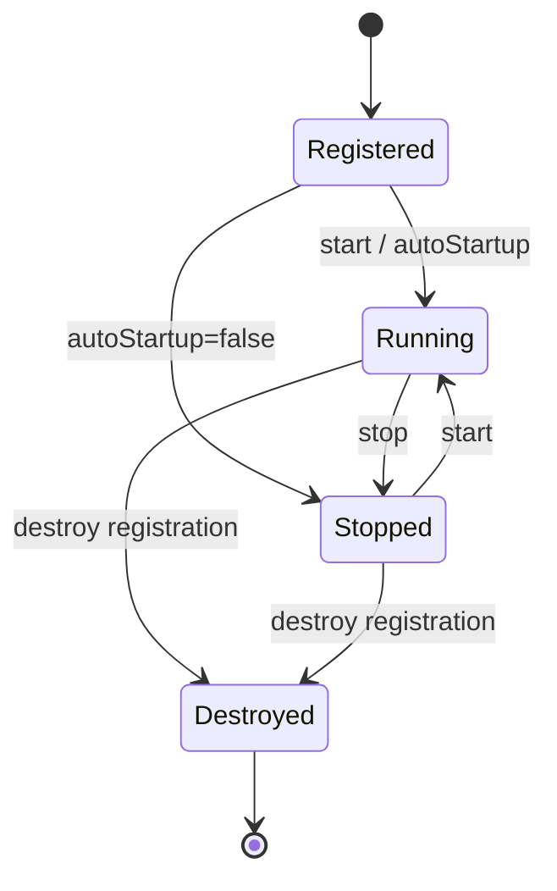
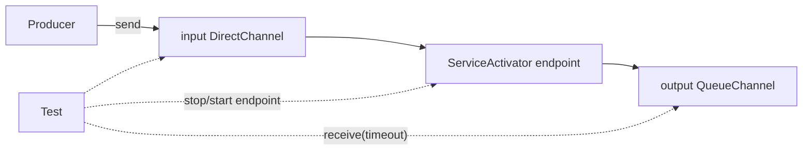
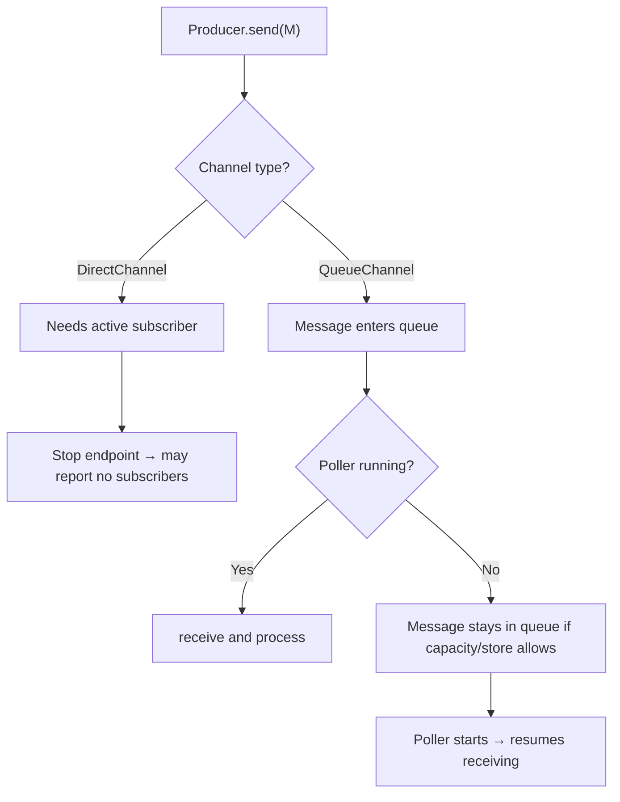
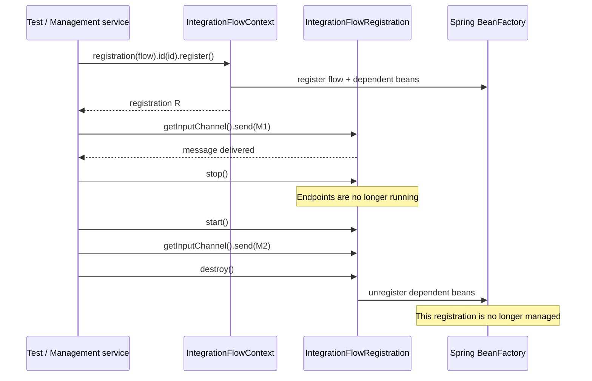
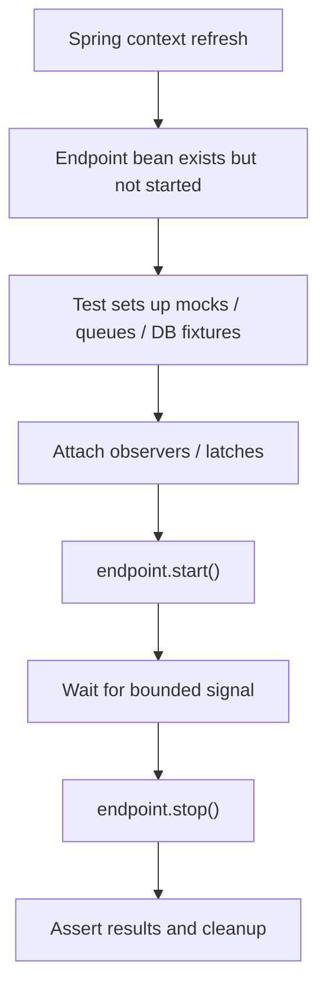
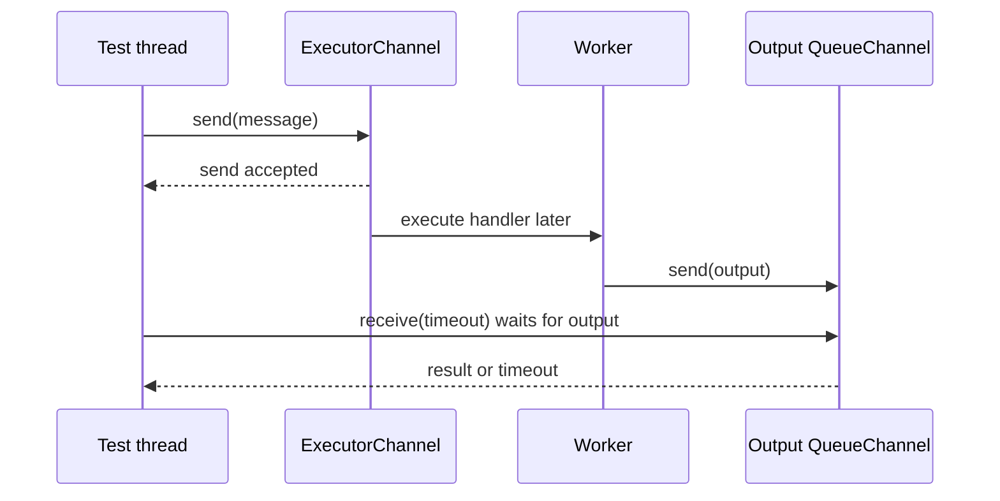
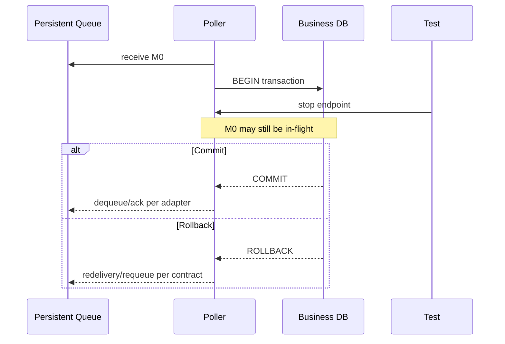

# Testing Start, Stop, and Dynamic Registration in Spring Integration Runtime

## 1. Lesson goal and real-world problem

In the **SPRING_INTEGRATION_RUNTIME** module, testing a message flow does not stop at verifying that a handler returns the right payload. The application must also **start endpoints**, **stop receiving or consuming messages**, **register an `IntegrationFlow` at runtime**, and **unregister** it without leaving unexpected threads, subscriptions, messages, or beans behind. This is especially critical with inbound adapters, pollers, `ExecutorChannel`, `QueueChannel`, aggregators, transactions, retries, and message stores.

This lesson belongs to the **Testing runtime** chapter with a direct focus: **Testing start, stop, and dynamic registration**. The emphasis is on verifying **runtime lifecycle** and **dynamic topology**, not merely proving the Spring context loads.

After this lesson, you will be able to:

- Distinguish `ApplicationContext` lifecycle, endpoint `SmartLifecycle`, and `IntegrationFlowRegistration` lifecycle.
- Build a JUnit 5/Spring Test fixture with `DirectChannel`, `QueueChannel`, and named endpoints, then verify `isRunning()`, `stop()`, `start()`, and outputs.
- Use `IntegrationFlowContext.registration(flow).id(...).register()`, `getInputChannel()`, `stop()`, `start()`, and `destroy()` to test dynamically created flows.
- Explain why stopping a consumer **does not mean** stopping all producers, emptying queues, aborting DB transactions, or deleting messages.
- Test pollers and asynchronous flows using `CountDownLatch`/finite timeouts instead of relying on fixed `Thread.sleep()`.
- Distinguish single-JVM lifecycle tests from restart recovery, transactions, and multi-replica tests.
- Clean up registrations/threads/test state so tests do not interfere with one another; combine graphs, metrics, and error flows for diagnostics.

Examples target **Java 17+, Spring Integration 6.x (targeting 6.5.x), JUnit Jupiter 5, and Spring Test**. Overloaded DSL method names or annotations may vary between versions; when applying to a real project, align your BOM/dependencies with the running Spring Integration version.

## 2. What do “start” and “stop” mean in Integration runtime?

Spring Integration has multiple objects with distinct lifecycles. A channel, an endpoint, an `IntegrationFlow`, and an inbound connection are not the same entity.

| Object | Primary mechanism | On start | On stop |
|---|---|---|---|
| `ApplicationContext` | `refresh()` and Spring lifecycle processor | Creates beans, starts auto-start `SmartLifecycle` beans | Closes context; stops/destroys beans per lifecycle |
| `EventDrivenConsumer` | `SmartLifecycle` | Subscribes handler to `SubscribableChannel` | Unsubscribes handler; channel may still exist |
| `PollingConsumer` | `SmartLifecycle` and `TaskScheduler` | Schedules polling tasks, receives messages, invokes handler | Stops scheduling/polling per implementation |
| `SourcePollingChannelAdapter` | `SmartLifecycle` | Schedules receiving messages from `MessageSource` | Stops polling the source |
| `IntegrationFlowRegistration` | `start()`, `stop()`, `destroy()` | Coordinates endpoints of the registered flow | Stops endpoints; registration and topology remain |
| `QueueChannel` | `PollableChannel`/message store | Channel can still accept `send()` | Stopping consumer does not clear the queue |
| `DirectChannel` | `SubscribableChannel` | Has active subscribers | May have no subscribers left, causing `send()` to fail |

Several channel types have no `start()`/`stop()`. On a `DirectChannel`, the effect of `endpoint.stop()` can be that the **consumer is unsubscribed** from the dispatcher, not that the channel bean vanishes.

### States to distinguish



The diagram is a **conceptual model**: `destroy()` applies directly to dynamic registrations, whereas static endpoints are normally destroyed by Spring when `ApplicationContext` closes. An endpoint can be created yet not running; a stopped flow still retains its bean definitions and channels.

### Three distinct questions in a test

1. **Lifecycle state:** did `isRunning()` change from `true` to `false`?
2. **Behavior:** after `stop()`, are messages still processed by the consumer?
3. **Resources:** were polling tasks, executor jobs, in-flight transactions, messages, and registrations properly managed/cleaned up?

Checking only question (1) is not enough. `isRunning()==false` does not guarantee no callbacks are still executing, nor does it tell you how many messages remain in a queue.

## 3. Runtime topology and test boundaries



A good lifecycle test typically has:

- **A controllable input**: calling `MessageChannel.send()` or `MessagingTemplate`.
- **An endpoint with a stable name** for looking up the bean or registration.
- **An observable output**: `QueueChannel`, mock handler, or latch/counter.
- **A finite termination condition**: `receive(timeout)`, `Future.get(timeout)`, or `CountDownLatch.await(timeout)`.
- **A cleanup step**: `try/finally` for dynamic registrations; closing the context or `@DirtiesContext` when configuration is mutated.

In real production code, add diagnostics on failure: endpoint ID, `SmartLifecycle` state, `IntegrationGraphServer`, queue size, thread name, error channel, transaction outcome, and retry attempt count.

### Test pyramid by scope

| Test layer | Goal | What can be omitted? |
|---|---|---|
| Handler unit test | Input → output and method error handling | Spring endpoint lifecycle, channel dispatch |
| Spring Integration context test | Channels, endpoints, start/stop, wiring | Real broker/DB if simulated |
| Dynamic registration test | Register, start, stop, destroy, bean name collisions | Cluster behavior and JVM restart |
| Integration test with JDBC/broker | Ack, rollback, redelivery, persistent store, poller | Full production infrastructure |
| Process/chaos test | Process kill, restart, rolling deployment, multi-instance | Should not be replaced by an in-JVM context restart |

**Do not call a test that sends directly into a handler a “lifecycle integration test”.** Calling `new MyHandler().handleMessage(...)` directly bypasses consumer endpoints, subscriptions, pollers, advice chains, and transaction boundaries.

## 4. Preparing dependencies and the JUnit 5 fixture

A project using the Spring Boot BOM typically needs equivalent dependencies:

```text
Main:
  spring-boot-starter-integration

Test:
  spring-boot-starter-test
  spring-integration-test

Depending on scenario:
  spring-integration-jdbc
  spring-jdbc
  Testcontainers + JDBC driver
  Reactor Test
  WireMock or mock HTTP server
```

`spring-integration-test` provides `@SpringIntegrationTest`, `MockIntegrationContext`, and specialized test tools. It is not required for every test: `@SpringJUnitConfig` plus a few beans can be enough for basic lifecycle checks.

### A small Spring Integration fixture with explicit endpoint IDs

```java
package example.runtime.testing;

import java.util.Locale;

import org.springframework.context.annotation.Bean;
import org.springframework.context.annotation.Configuration;
import org.springframework.integration.channel.DirectChannel;
import org.springframework.integration.channel.QueueChannel;
import org.springframework.integration.config.EnableIntegration;
import org.springframework.integration.dsl.IntegrationFlow;
import org.springframework.messaging.MessageChannel;

@Configuration
@EnableIntegration
public class LifecycleFixture {

    @Bean
    public MessageChannel staticInput() {
        return new DirectChannel();
    }

    @Bean
    public QueueChannel staticOutput() {
        return new QueueChannel(16);
    }

    @Bean
    public IntegrationFlow staticFlow() {
        return IntegrationFlow.from("staticInput")
                .handle(
                        (payload, headers) -> payload.toString()
                                .trim().toUpperCase(Locale.ROOT),
                        endpoint -> endpoint.id("uppercaseEndpoint"))
                .channel("staticOutput")
                .get();
    }
}
```

Key fixture points:

- `staticInput` is a `DirectChannel`; producers invoke `send()` synchronously into the subscriber.
- `uppercaseEndpoint` is given an **explicit endpoint ID**, avoiding reliance on auto-generated bean names or registration order.
- The handler creates a new payload and sends it to `staticOutput`.
- `staticOutput` is a `QueueChannel`; the test can receive output with a timeout.
- With no real outbound HTTP/broker/DB, lifecycle checks run fast and deterministically.

To compile, place the public class in a correspondingly named Java file, configure compatible dependencies, and create the test class shown in the next section. With Spring Integration DSL APIs, the handler lambda is converted by the framework into a message handler/consumer endpoint.

## 5. Testing start → stop → start with a static endpoint

A `@Bean IntegrationFlow` normally auto-starts when the context refreshes, depending on `autoStartup` and lifecycle configuration. Tests should assert initial state before mutating it.

```java
package example.runtime.testing;

import static org.assertj.core.api.Assertions.assertThat;
import static org.assertj.core.api.Assertions.assertThatThrownBy;

import org.junit.jupiter.api.Test;
import org.springframework.beans.factory.annotation.Autowired;
import org.springframework.beans.factory.annotation.Qualifier;
import org.springframework.context.SmartLifecycle;
import org.springframework.integration.channel.QueueChannel;
import org.springframework.messaging.MessageChannel;
import org.springframework.messaging.MessagingException;
import org.springframework.messaging.support.GenericMessage;
import org.springframework.test.annotation.DirtiesContext;
import org.springframework.test.context.junit.jupiter.SpringJUnitConfig;

@SpringJUnitConfig(LifecycleFixture.class)
@DirtiesContext(classMode = DirtiesContext.ClassMode.AFTER_CLASS)
class StaticLifecycleTest {

    @Autowired
    @Qualifier("staticInput")
    MessageChannel input;

    @Autowired
    @Qualifier("staticOutput")
    QueueChannel output;

    @Autowired
    @Qualifier("uppercaseEndpoint")
    SmartLifecycle endpoint;

    @Test
    void stopAndRestartAnEventDrivenConsumer() {
        assertThat(endpoint.isRunning()).isTrue();

        assertThat(input.send(new GenericMessage<>(" order-1 ")))
                .isTrue();
        assertThat(output.receive(1_000).getPayload())
                .isEqualTo("ORDER-1");

        endpoint.stop();
        assertThat(endpoint.isRunning()).isFalse();

        // DirectChannel with no subscribers typically reports an error
        // rather than holding the message to reprocess when the endpoint starts.
        assertThatThrownBy(() ->
                input.send(new GenericMessage<>(" order-stopped ")))
                .isInstanceOf(MessagingException.class);

        assertThat(output.receive(0)).isNull();

        endpoint.start();
        assertThat(endpoint.isRunning()).isTrue();

        assertThat(input.send(new GenericMessage<>(" order-2 ")))
                .isTrue();
        assertThat(output.receive(1_000).getPayload())
                .isEqualTo("ORDER-2");
    }
}
```

**Meaning of the assertions:**

1. Before stop, `SmartLifecycle.isRunning()` is `true` and a message completes the flow.
2. After stop, endpoint state is `false`.
3. `DirectChannel` has no active subscriber left; `send()` can throw `MessageDeliveryException` (a `MessagingException`). The exact outcome depends on topology; this test **only holds when** the input channel has no other consumer.
4. No new output appears after the failed send.
5. After restarting, new messages are processed normally.

**Do not impose the same assertion on `QueueChannel`.** With a queue, producers can still `send()` successfully while the poller is stopped; messages stay in the queue until the poller restarts.

### Why use `@DirtiesContext`?

The test directly mutates `SmartLifecycle` bean state. Spring TestContext can cache an `ApplicationContext` across multiple test classes. If a test stops an endpoint and fails an assertion before restarting it, later tests can inherit dirty state. `@DirtiesContext(AFTER_CLASS)` closes the context after the class; `try/finally` also cleans up right inside the method.

In large suites, creating a fresh context for every test is expensive. Reserve `@DirtiesContext` for cases that genuinely alter bean definitions, registrations, or lifecycle state that cannot be reset safely.

## 6. When stop does not make `send()` fail: QueueChannel and pollers

A critical difference:



Suppose a `PollingConsumer` reads from a `QueueChannel`. When `consumer.stop()` runs:

- The poller stops scheduling subsequent receives per its lifecycle contract.
- Producers can still send to the queue if capacity remains.
- Already-enqueued messages are **not deleted** simply because of stop.
- Processing already started before stop may finish or terminate depending on executor, transaction, and endpoint implementation.
- On restart, the consumer can pick up remaining messages in the queue.

### Pseudocode for testing queue/poller

```java
// Pseudocode: pollerEndpoint and queue must be registered in Spring.
// pollerEndpoint.stop();
// assertThat(pollerEndpoint.isRunning()).isFalse();
//
// assertThat(queue.send(new GenericMessage<>("M1"))).isTrue();
// assertThat(queue.getQueueSize()).isEqualTo(1);
//
// // No new poll during the test window, after
// // ensuring any old in-flight task has quiesced.
// assertThat(processedCount.get()).isZero();
//
// pollerEndpoint.start();
// awaitAtMost(Duration.ofSeconds(3),
//         () -> processedCount.get() == 1);
// assertThat(queue.getQueueSize()).isZero();
```

**This is pseudocode:** `awaitAtMost` is a custom helper or Awaitility; `getQueueSize()` and consumer scheduling require proper configuration. Do not assert “once stopped, zero callbacks run” if the poller already pulled M0 before stop and the callback is still in-flight.

### Stop is not pausing a transaction

A transaction already started when the consumer received M0 does not immediately roll back just because an operator called `stop()`. Tests must observe transaction completion, rollback, or timeout separately against the real adapter and transaction manager.

## 7. Dynamic registration via IntegrationFlowContext

`IntegrationFlowContext` is the Java DSL API for creating an `IntegrationFlow` **after the ApplicationContext has started**. You can assign a registration ID to manage its lifecycle.

```java
import org.springframework.integration.dsl.IntegrationFlow;
import org.springframework.integration.dsl.IntegrationFlowContext;

IntegrationFlow flow = ...;

IntegrationFlowContext.IntegrationFlowRegistration registration =
        flowContext.registration(flow)
                .id("runtime-orders-v1")
                .register();
```

`flowContext` is a Spring bean provided by Integration DSL/configuration. Creating the Java variable `flow` does **not** run it: you must call `registration(...).register()` so the framework creates and registers the corresponding beans/endpoints.

### Lifecycle diagram of a dynamic flow



| API | Purpose | What to verify |
|---|---|---|
| `flowContext.registration(flow)` | Starts a registration builder | Flow is not yet registered at this step |
| `.id("runtime-orders-v1")` | Assigns a unique registration ID | Does not collide with another registration/bean |
| `.register()` | Registers flow and dependent beans | Success, auto-start policy, bean collisions |
| `registration.getId()` | Reads the assigned ID | Used for tracking/cleanup |
| `registration.getInputChannel()` | Input channel of the registered flow | Meaningful only when the flow has an appropriate input channel |
| `registration.getMessagingTemplate()` | Template to interact with the flow | Watch request/reply/timeouts |
| `registration.isRunning()` | Flow lifecycle status | Does not guarantee all in-flight tasks finished |
| `registration.stop()/start()` | Stops/restarts endpoints | Does not delete registration or state |
| `registration.destroy()` | Destroys registration/dependent beans | Does not resolve messages already outside the flow |

`IntegrationFlowContext` supports configuring `autoStartup` and managing bean IDs on the builder; with multiple dynamic flows, use clearly namespaced IDs. `useFlowIdAsPrefix()` helps generate bean names prefixed by the registration ID to reduce collisions across flows, though it will not save you if you intentionally share the same global named channel.

### How does stop differ from destroy?

```text
registered + running:
  flow has active beans and consumers

stop():
  flow remains registered, can be started again

destroy():
  registration and dependent beans are destroyed/removed per API
  must re-register if creating a new flow
```

If you call `registration.destroy()`, **never call `start()` on that same registration expecting “recovery”**. Build and register a new flow with a valid ID. Resources created and held by the application outside the registration (such as thread pools, broker queues, or database rows) need their own cleanup/lifecycle.

## 8. Complete dynamic test: register → send → stop → start → destroy

A JUnit fixture with a Spring context enabling only `@EnableIntegration` can test the entire dynamic flow lifecycle without an external broker.

```java
package example.runtime.testing;

import static org.assertj.core.api.Assertions.assertThat;

import java.util.Locale;
import java.util.UUID;

import org.junit.jupiter.api.Test;
import org.springframework.beans.factory.annotation.Autowired;
import org.springframework.context.annotation.Configuration;
import org.springframework.integration.channel.DirectChannel;
import org.springframework.integration.channel.QueueChannel;
import org.springframework.integration.config.EnableIntegration;
import org.springframework.integration.dsl.IntegrationFlow;
import org.springframework.integration.dsl.IntegrationFlowContext;
import org.springframework.messaging.MessageChannel;
import org.springframework.messaging.Message;
import org.springframework.messaging.support.GenericMessage;
import org.springframework.test.annotation.DirtiesContext;
import org.springframework.test.context.junit.jupiter.SpringJUnitConfig;

@SpringJUnitConfig(DynamicRegistrationTest.Config.class)
@DirtiesContext(classMode = DirtiesContext.ClassMode.AFTER_CLASS)
class DynamicRegistrationTest {

    @Configuration
    @EnableIntegration
    static class Config {
    }

    @Autowired
    IntegrationFlowContext flowContext;

    @Test
    void registerStartStopRestartAndDestroy() {
        QueueChannel output = new QueueChannel(8);
        String flowId = "test-flow-" + UUID.randomUUID();

        IntegrationFlow flow = IntegrationFlow.from(new DirectChannel())
                .handle((payload, headers) ->
                        payload.toString().toUpperCase(Locale.ROOT))
                .channel(output)
                .get();

        IntegrationFlowContext.IntegrationFlowRegistration registration =
                flowContext.registration(flow)
                        .id(flowId)
                        .register();

        try {
            assertThat(registration.getId()).isEqualTo(flowId);
            assertThat(registration.isRunning()).isTrue();

            MessageChannel input = registration.getInputChannel();
            assertThat(input.send(new GenericMessage<>("alpha")))
                    .isTrue();
            Message<?> first = output.receive(1_000);
            assertThat(first).isNotNull();
            assertThat(first.getPayload()).isEqualTo("ALPHA");

            registration.stop();
            assertThat(registration.isRunning()).isFalse();

            // Do not send more to a stopped DirectChannel:
            // no-subscriber is an implementation consequence, not queueing.
            assertThat(output.receive(0)).isNull();

            registration.start();
            assertThat(registration.isRunning()).isTrue();

            assertThat(input.send(new GenericMessage<>("beta")))
                    .isTrue();
            Message<?> second = output.receive(1_000);
            assertThat(second).isNotNull();
            assertThat(second.getPayload()).isEqualTo("BETA");
        }
        finally {
            // Clean up registration beans even if an assertion fails.
            registration.destroy();
        }
    }
}
```

**What this test proves:**

- A dynamic flow can be registered after the Spring context already exists.
- Endpoints auto-start per the registration's default policy.
- Messages can be sent via the input channel retrieved from the registration.
- After stop, the flow is no longer running; after start, processing resumes.
- `finally` releases ownership/beans created by the flow.
- The test does not rely on auto-generated endpoint bean names or node ID ordering.

**What it does not prove:** concurrent request handling, transaction persistence, crashes between commit/ack, cleanup of all externally owned resources, or distributed orchestration.

### Note on random flow IDs

Using `UUID` in tests prevents collisions during parallel runs, but **never attach unbounded random IDs as production metric tags**. For dynamic flows outside tests, establish namespacing, TTLs, cleanup, and monitoring policies for active flow counts.

### Registering initially in the stopped state

The builder supports an auto-start policy. Example configuration on supported versions:

```java
IntegrationFlowContext.IntegrationFlowRegistration registration =
        flowContext.registration(flow)
                .id("manual-orders")
                .autoStartup(false)
                .register();

// Verify registered but not yet running:
assertThat(registration.isRunning()).isFalse();

registration.start();
assertThat(registration.isRunning()).isTrue();
```

`flowContext`, `flow`, and `assertThat` are assumed present in the test/method. **Set `autoStartup(false)` before `register()`**, since default registration normally auto-starts. Do not use this pattern to simulate a source that was already running with in-flight tasks; this is a **cold start** test.

## 9. When to use `@SpringIntegrationTest(noAutoStartup)`?

The `spring-integration-test` module provides `@SpringIntegrationTest`. A useful feature is `noAutoStartup`, instructing matching endpoints not to auto-start in the test context.

```java
import org.springframework.integration.test.context.SpringIntegrationTest;
import org.springframework.test.context.junit.jupiter.SpringJUnitConfig;

@SpringJUnitConfig(PollerFixture.class)
@SpringIntegrationTest(noAutoStartup = "ordersPollerEndpoint")
class ControlledPollerTest {
    // ordersPollerEndpoint is an endpoint ID present in PollerFixture.
}
```

`PollerFixture` is an application-defined test configuration that must contain endpoint ID `ordersPollerEndpoint`. The snippet above only shows **how to use the annotation**, not a claim that a bean magically appears. You can `@Autowired`-inject the endpoint and call `start()` once dependencies/mocks are ready.

### Why is `noAutoStartup` useful?

If a poller reads the filesystem, a JMS queue, or calls HTTP during `ApplicationContext.refresh()`, it can run before the test installs mocks, seeds data, or registers assertions. That causes a race: the first message is processed **before** the test starts observing.

When `noAutoStartup` applies, the sequence is:



**Note:** Spring Test and Spring Integration test infrastructure require the right dependencies; importing the annotation without `spring-integration-test` can prevent tests from running or applying configuration. `noAutoStartup` patterns match endpoint lifecycle IDs, not arbitrary Java method names.

### `@SpringIntegrationTest` and `MockIntegrationContext`

`MockIntegrationContext` can be injected in tests annotated with `@SpringIntegrationTest` to replace message handlers or triggers on endpoints supported by test-support, for example:

- Replace an outbound network handler with a mock to test the rest of the flow.
- Replace a poller trigger with a controllable trigger.
- Isolate external side effects without deleting the entire `IntegrationFlow`.

Do not assume every endpoint type can be replaced with the same API or that every substitution works while the consumer is active. Preferably configure `noAutoStartup` first, substitute mocks, and then start. Ensure test cleanup reverts substitutions per test-support's contract so cached contexts are not polluted.

## 10. Testing polling consumers without depending on wall-clock time

Pollers are the easiest place to introduce flaky tests, because receiving messages depends on `TaskScheduler`, cron/fixed delays, thread pools, source availability, and transactions.

### Anti-pattern: waiting a fixed duration

```java
// Avoid:
endpoint.start();
Thread.sleep(250);
assertThat(processedCount.get()).isEqualTo(1);
```

CI machines can be busy, pause for GC, or schedule slowly. Sleeping 250 ms does not guarantee a poll happened; raising the sleep to 5 seconds makes tests slow while still non-deterministic.

### Pattern: `CountDownLatch` + timeout

```java
import static org.assertj.core.api.Assertions.assertThat;

import java.util.concurrent.CountDownLatch;
import java.util.concurrent.TimeUnit;
import java.util.concurrent.atomic.AtomicInteger;

CountDownLatch processed = new CountDownLatch(1);
AtomicInteger count = new AtomicInteger();

MessageHandler testHandler = message -> {
    count.incrementAndGet();
    processed.countDown();
};

// Wire/publish testHandler into the polling flow, then start the endpoint.
endpoint.start();

boolean completed = processed.await(3, TimeUnit.SECONDS);
assertThat(completed).isTrue();
assertThat(count.get()).isGreaterThanOrEqualTo(1);

endpoint.stop();
```

This is a **method-level snippet**: `endpoint` and `testHandler` must actually be wired into the poller flow; import `org.springframework.messaging.MessageHandler`. Install the latch before starting so you do not miss the first message.

### Do not assert “exactly once” from a latch alone

A poller may invoke a handler multiple times if the source returns duplicate messages, retry advice is active, or `maxMessagesPerPoll` is greater than 1. `CountDownLatch(1)` only proves **at least one signal occurred**, not that no second signal happened.

To test an exactly-once business effect:

- Use a unique business event ID.
- Record outputs/rows in a store with clear concurrency semantics.
- Wait until the flow quiesces, then assert the final summary.
- Test source redelivery and acks/transactions rather than inferring from latch timing.

### Controlling the source instead of controlling the clock

A fake `MessageSource` can return one message and then `null`:

```java
import java.util.concurrent.atomic.AtomicBoolean;
import org.springframework.integration.core.MessageSource;
import org.springframework.messaging.Message;
import org.springframework.messaging.support.GenericMessage;

AtomicBoolean first = new AtomicBoolean(true);

MessageSource<String> source = () -> {
    if (first.compareAndSet(true, false)) {
        return new GenericMessage<>("only-once");
    }
    return null;
};
```

Pair this source with a scheduled poller or an explicitly triggered test trigger to reduce the risk of “indeterminate poll counts”. Each test must create a fresh `AtomicBoolean` instance or reset state before each case; never share a singleton fake source across parallel tests.

## 11. Testing asynchronous flows: `ExecutorChannel` and worker threads

With `ExecutorChannel`, `input.send()` may return right after handing the task to the executor, before the handler finishes.



**Wrong:**

```java
input.send(new GenericMessage<>("hello"));
assertThat(processedCount.get()).isEqualTo(1);
```

If the handler runs on another thread, the assertion can run before the worker, producing a false negative.

**Right in principle:**

```java
assertThat(input.send(new GenericMessage<>("hello"))).isTrue();

Message<?> actual = outputQueue.receive(3_000);

assertThat(actual).isNotNull();
assertThat(actual.getPayload()).isEqualTo("HELLO");
```

The variables in this snippet are configured in the test fixture; `outputQueue` is a `PollableChannel`/`QueueChannel` receiving output from the worker.

### Testing stop while a worker is still running

A test controlled with two latches:

```java
CountDownLatch enteredHandler = new CountDownLatch(1);
CountDownLatch releaseHandler = new CountDownLatch(1);
CountDownLatch finishedHandler = new CountDownLatch(1);

// Inside async handler:
enteredHandler.countDown();
try {
    if (!releaseHandler.await(5, TimeUnit.SECONDS)) {
        throw new IllegalStateException("Test handler timed out");
    }
    performBusinessAction();
}
finally {
    finishedHandler.countDown();
}
```

Test sequence:

1. Send message M0 and wait on `enteredHandler` to confirm the handler started.
2. Call stop on the endpoint in a **separate thread** if stop may wait on in-flight work; put a timeout on `Future.get()`.
3. Observe whether stop blocks **receiving new messages** while M0 is still in-flight.
4. Release `releaseHandler` in `finally` to prevent hanging the test.
5. Wait on `finishedHandler` and verify the business effect ran once per contract.
6. Shut down the executor per the lifecycle created by Spring/test and verify no worker threads leak.

**Do not make a blanket claim** that stop interrupts a running handler or waits for it to finish: behavior depends on `TaskExecutor`, consumer type, timeouts, and implementation. Tests must verify the desired behavior for the system in use.

## 12. Checking endpoint state and source/consumer contracts

A lifecycle test plan must know **what is being stopped**.

| Test calls stop on... | What can happen | Valid assertion |
|---|---|---|
| Event-driven consumer on `DirectChannel` | Unsubscribes | `isRunning()==false`; new messages have no subscriber if no other consumer exists |
| Polling consumer reading `QueueChannel` | Stops poll schedule | Queue still accepts/holds messages; resumes consuming on start |
| Inbound file/JMS adapter | Stops polling/consumer container | Source produces no new messages per contract while stopped |
| Outbound handler with endpoint wrapper | Endpoint accepts no new messages | Remote requests already sent before stop may continue |
| Aggregator endpoint | Stops receiving parts | Persistent/in-memory groups keep state per store |
| `IntegrationFlowRegistration` | Flow endpoints change lifecycle | Registration/beans remain until destroy |
| `ApplicationContext` | Closes Spring container | Beans/resources cleaned up per lifecycle; external storage persists |

### Stopping a source differs from stopping a downstream handler

If you stop the **handler** while the upstream inbound adapter stays active:

```text
Inbound adapter still reads source
    → send(inputChannel)
    → no subscribers
    → error/delivery failure/error flow depending on configuration
```

This can cause message loss or retry storms in real systems. To pause safely, you normally need to **stop/quiesce the source first**, let in-flight work finish, and then stop downstream. Tests should verify this sequence rather than stopping things arbitrarily.

## 13. Do not confuse stop/start with a real restart

### In-memory context stop/start

```text
Spring ApplicationContext still alive
  endpoint.stop()
  endpoint.start()
```

State in `SimpleMessageStore`/`QueueChannel`, singleton beans, and in-memory references normally survives when only the endpoint is stopped. Thus, proving a group survives stop/start is **not** proof it survives a JVM crash.

### Context close/recreate

```text
Context A close()
Context B start()
```

This is a stronger test for persistently stored state, though it still does not fully simulate `OS kill -9`, network partitions, or DB process crashes. Within the same JVM, some singleton/static state can also outlive the context unless cleaned up by tests.

### Real process kill/restart

To test durability and restart recovery:

- Use `JdbcMessageStore`/`JdbcChannelMessageStore`/`JdbcMetadataStore` with a real DB or Testcontainers.
- Send messages and verify records committed.
- Stop or kill the application at a chosen point.
- Start a new instance pointing to the **same persistent resource**.
- Check redelivery, group completion/orphan cleanup, transaction rollbacks, and idempotency.
- Check broker acks/offsets and outbox/inbox tables if external systems are involved.

**Never use in-memory `SimpleMessageStore` to claim post-restart persistence**, and never treat dynamic `registration.stop/start` as a crash recovery test.

## 14. Transactions, retries, acks, and mid-flight stop

### Case: poller pulls a message and business transaction is running



When testing stop, distinguish:

- **Not receiving new M1** after stop per contract.
- **In-flight M0** may either complete or roll back.
- **Queue state** after commit/rollback depends on source, store, transaction manager, and ack mode.
- **Retry advice** may hold the thread in backoff or emit an error message.
- **Error flows** may run on a different thread/channel and keep running after the original endpoint stops.

Putting `@Transactional` on the handler does not automatically make `QueueChannel.receive()` and the business write atomic. To test atomic dequeue + business update, poller transaction advice must wrap **both the receive and processing**, with compatible resources/transaction managers.

### Transaction/lifecycle test matrix

| Stop/failure point | What to assert |
|---|---|
| Before poller receive | No message taken; source still holds M |
| After receive, before business commit | Rollback and redelivery/requeue per contract; no lost business event |
| After business commit, before broker ack | Redelivery may happen; inbox/idempotency blocks duplicate business effect |
| During retry backoff | System does not hold resources/locks too long; shutdown policy is clear |
| While outbound HTTP is running | Stop does not automatically roll back an already-completed remote side effect |
| While a group is incomplete | Persistent `MessageGroupStore` keeps state; orphan timeout/reaper policy applies |
| After destroying dynamic flow | Registration disappears, while durable messages/DB rows are not accidentally deleted |

**Exactly-once effect** is not proven by a single handler invocation after start. Test duplicate deliveries, unique constraints/inboxes, idempotent outbound operations, and crash windows.

## 15. Testing dynamic registration with duplicate IDs and component names

Dynamic flows easily hit **bean name collisions** when two registrations create endpoints with the same name.

```java
IntegrationFlow flowA = ...;
IntegrationFlow flowB = ...;

var first = flowContext.registration(flowA)
        .id("orders-flow")
        .register();

try {
    // In a typical context, duplicate registration IDs
    // cannot be treated as an independent new flow.
    // Tests should assert the exception/registration policy
    // of the version in use.
    flowContext.registration(flowB)
            .id("orders-flow")
            .register();
}
finally {
    first.destroy();
}
```

This snippet illustrates an error case, **not happy-path test code**. Never try to recover from a failed registration by assuming no bean was created: check framework rollback/cleanup and the test context. Use `@DirtiesContext` if context state was mutated after a failed registration.

### Namespaced IDs

```text
Usually preferred:
  tenant-A-orders-flow-v2
  batch-import-worker-01

Prone to collision:
  flow
  input
  handler
```

Although stable names help debugging, never use unbounded-cardinality business IDs directly for per-request flows. If you create tens of thousands of registrations without destroying them, memory, the bean registry, scheduling, and metrics can grow without bound.

### Choosing reuse vs. recreate?

- **stop/start** when pausing and resuming the **same topology/configuration**.
- **destroy/re-register** when changing structure, handlers, or input channels.
- To replace a running flow with a new version, quiesce the source, drain/hand off in-flight messages, register the new flow, switch traffic, and clean up the old flow.
- Test rollback when the new registration fails: does the old flow still work? Does traffic hit a consumer-less “gap”?

## 16. Test isolation: context caching, test parallelism, and cleanup

A lifecycle test can pass alone yet fail in the full suite because contexts or dynamic registrations are reused.

### Sources of shared state

1. Spring TestContext cached across test classes sharing the same configuration.
2. `IntegrationFlowContext` retains registrations until destroyed.
3. `TaskScheduler` and `ThreadPoolTaskExecutor` retain workers.
4. Static counters/singletons/fake test sources.
5. `SimpleMessageStore`, `QueueChannel`, or `MessageGroupStore` with leftover data.
6. Error channels or message interceptors still attached to the context.
7. Global Micrometer/Reactor hooks or mock framework state.
8. JDBC/Testcontainers schemas shared across multiple tests.

### Cleanup rules

```java
IntegrationFlowContext.IntegrationFlowRegistration registration =
        flowContext.registration(flow)
                .id(flowId)
                .register();

try {
    // Test behavior, which may throw assertions.
}
finally {
    registration.destroy();
}
```

When creating executors directly:

```java
ExecutorService pool = Executors.newFixedThreadPool(2);
try {
    // Submit work; wait on Future.get(timeout).
}
finally {
    pool.shutdownNow();
    pool.awaitTermination(5, TimeUnit.SECONDS);
}
```

If using a Spring-managed `ThreadPoolTaskExecutor`, let Spring lifecycle manage shutdown or configure its shutdown policy properly; never call `shutdownNow()` on a context-shared bean mid-suite.

### Do not run two tests in parallel if they mutate the same flow

If two parallel tests `stop()`/`start()` the same singleton endpoint, they can step on each other:

```text
Test A: stop endpoint
Test B: assert running
Test A: start endpoint
Test B: send message

=> result depends on interleaving, not a product bug
```

Solutions:

- Use separate configs/contexts for test classes mutating lifecycle.
- Use test execution resource locks or disable parallel execution for that group.
- Use distinct flow IDs and separate input/output test resources.
- Use `@DirtiesContext` selectively; do not apply it indiscriminately to all unit tests.

## 17. Observing with `IntegrationGraphServer`, metrics, and logs

When a dynamic registration test fails, inspecting the graph confirms **whether the flow was actually registered**.

```java
// Assumes IntegrationGraphServer graphServer is already injected.
var graphAfterRegister = graphServer.rebuild();

var names = graphAfterRegister.getNodes().stream()
        .map(node -> node.getName())
        .toList();

System.out.println(names);
```

`rebuild()` refreshes the cached topology; `getGraph()` may return a stale topology after dynamic registration. However:

- The graph shows **component topology**, not proof that messages were processed.
- Stopping an endpoint does not necessarily remove its node; lifecycle and topology are two different layers.
- `nodeId` can change across rebuilds, so assert on **component names/links** rather than hard-coding numeric IDs.
- Beans created dynamically without registering under the same `ApplicationContext` may not appear as expected.

### Useful diagnostic signals

| Signal | What to check |
|---|---|
| `registration.getId()` | Was the right flow ID assigned? |
| `registration.isRunning()` | Is the flow lifecycle running? |
| `SmartLifecycle.isRunning()` | Is the specific endpoint active? |
| `IntegrationGraphServer.rebuild()` | Are current nodes/links right? |
| Channel `send()` outcome | Did the producer dispatch/queue succeed? |
| `QueueChannel.receive(timeout)` | Is there an output message? |
| `errorChannel` | Are there async/retry/recovery errors? |
| Micrometer `spring.integration.*` | Send/handler counts, durations, failures, queue size |
| Thread dump | Consumer stuck on lock, blocking I/O, or scheduler |
| Message store/broker metrics | Backlog, redelivery, oldest message age |

Never treat an increment in `spring.integration.send` as proof the handler finished when the flow uses `ExecutorChannel` or `QueueChannel`. The send timer can stop once the task is handed off/queued while the handler runs later.

### Example lifecycle audit log

```text
2026-... flowId=orders-flow-v2 action=register outcome=success
2026-... flowId=orders-flow-v2 action=start running=true
2026-... flowId=orders-flow-v2 action=stop running=false
2026-... flowId=orders-flow-v2 action=destroy outcome=success
```

This is a **log structure sample**, not logs automatically emitted by Spring Integration. In production, add deployment instance, authenticated operator ID, and a correlation key for auditing, while avoiding tokens, PII-bearing payloads, or sensitive business IDs.

## 18. Comprehensive test plan table

| Case | Fixture | Action | Expected outcome |
|---|---|---|---|
| Context auto-start | Static flow | Refresh context | Endpoint runs if `autoStartup=true` |
| Static direct flow | `DirectChannel` + service activator | Send M1 | Receive transformed output |
| Stop event-driven | `DirectChannel` + endpoint | Stop then send M2 | Not handled by stopped endpoint; no-subscriber may throw |
| Restart event-driven | Same endpoint | Start then send M3 | Processes M3 |
| Cold start | `autoStartup(false)` | Register then inspect | Bean/registration exists, not yet running |
| Dynamic register | `IntegrationFlowContext` | Register new flow | Input channel and endpoint usable |
| Dynamic stop/start | Registration | Stop/start | `isRunning` toggles properly; new messages flow again |
| Dynamic destroy | Registration | Destroy | Registration/dependent bean lifecycle cleanup |
| Duplicate ID | Two flows with same ID | Register second time | Fails appropriately without breaking old flow |
| Stop poller | `QueueChannel` + poller | Stop, enqueue M | M retained; no new consumes per policy |
| Restart poller | Same queue | Start | M processed |
| In-flight stop | Executor + latch | Stop while M0 running | Outcome matches policy, no deadlock |
| Handler throws | `DirectChannel` | Send failing input | Caller/error flow matches synchronous contract |
| Async error | `ExecutorChannel` | Handler throws | Error channel/handler sees error if configured |
| Retry/recovery | Advice chain | Fail twice | Expected attempts/outcome; no duplicate business effect |
| Persistent restart | JDBC message store | Kill/recreate | Durable message recovered and processed safely |
| Aggregator restart | JDBC group store | Stop at 2/3 parts | Group remains; completion/orphan cleanup per policy |
| Parallel tests | Multiple flow IDs | Register concurrently | No collision/leak, accurate topology |
| Security/control API | Management endpoint | Start/stop flow via API | Only authorized callers can operate |

Not every case fits a single JUnit fixture. Prefer fast tests for wiring/lifecycle, real integration tests for persistence/brokers, and process-level tests for crash windows.

## 19. Common testing pitfalls

### 19.1. “Context loaded successfully” yet endpoint does not run

Possible causes:

- `autoStartup=false` or `@SpringIntegrationTest(noAutoStartup=...)` was applied.
- Endpoint bean was not created/registered in the test context.
- Poller lacks an appropriate trigger/scheduler.
- Input channel has no subscriber.
- Dynamic flow was only **built**, not `register()`ed.

Check bean IDs, `isRunning()`, graph nodes/links, and startup logs instead of just asserting the context is non-null.

### 19.2. Sending a message after stop still produces output

Possible reasons:

- Message was sent **before** stop and remained in-flight.
- Another consumer exists on `PublishSubscribeChannel`/`DirectChannel`.
- Stopped the wrong bean instead of the endpoint under test.
- Channel is a `QueueChannel` and another poller processed the enqueued message.
- `start()` was called again by another test/thread or context lifecycle.

Tests must separate message IDs before vs. after stop and only assert on messages sent **after confirming quiescence**.

### 19.3. Dynamic flow still exists after the test finishes

Usually `registration.destroy()` is missing or the test threw before cleanup. Use `finally`; if beans/endpoints remain, inspect external resources held by the app outside the registration.

### 19.4. Tests hang or fail intermittently on CI

- Waiting on queue `receive()` without a timeout.
- Using `Thread.sleep` assuming exact scheduler timing.
- A latch never counts down due to an exception.
- Stopping an endpoint while the handler waits for the test thread to release a latch, causing deadlock.
- Worker pool exhausted by blocking/retrying jobs.
- Parallel tests sharing a singleton registration/context.

Use finite timeouts on all waits, release latches and clean up in `finally`, and capture thread dumps on CI timeouts.

### 19.5. Sending one message and asserting one output false-passes

With retries/redelivery, a test may read the first valid output while a second duplicate arrives late. For a business exactly-once contract, wait until the system reaches quiescence or rely on durable uniqueness assertions; never call `receive(1000)` once and conclude zero duplicates exist.

### 19.6. Stop test “loses” messages

You may have stopped the consumer out of order while upstream kept emitting and `DirectChannel` had no subscribers left. Do not paper over this by routing all send exceptions into a recoverer that returns success. Design quiescing/acks/retries properly and test error flows by source.

## 20. Incremental hands-on path

### Exercise A — Static endpoint

1. Create `LifecycleFixture` and `StaticLifecycleTest`.
2. Confirm the endpoint auto-starts.
3. Send a message and receive output.
4. Stop the endpoint; confirm state and the no-subscriber error on `DirectChannel` (with a single subscriber).
5. Restart and send a new message.
6. Switch input to `QueueChannel` + poller and describe which assertions must change.

### Exercise B — Dynamic registration

1. Use `IntegrationFlowContext` to register a flow with a unique ID.
2. `getInputChannel().send(M1)` and receive output.
3. Stop/start, verify `isRunning()`, and send M2.
4. Destroy in `finally`.
5. Register another flow under the same ID after cleanup; check policy and the graph.
6. Try `autoStartup(false)` and confirm no output is emitted before start.

### Exercise C — Controlled poller

1. Create a fake `MessageSource` returning one message.
2. Suppress poller auto-start with `@SpringIntegrationTest(noAutoStartup=...)`.
3. Install a mock handler and `CountDownLatch` before starting.
4. Start and wait with a bounded timeout.
5. Stop and verify no new polls happen after quiescence.
6. Test an error case; verify the error channel/recovery and no hung tasks.

### Exercise D — In-flight work and transactions

1. Use `ExecutorChannel` so a handler holds a latch before a DB update.
2. Send M0, then stop the endpoint and observe behavior.
3. Release the latch and observe transaction commit/rollback.
4. Try two messages, M0 before stop and M1 after stop; distinguish outcomes.
5. Try a broker/JDBC-backed queue and verify acks and redelivery.
6. Never use a local in-memory queue to claim post-crash durability.

### Exercise E — Multi-instance and flow upgrades

1. Run two application instances against the same test broker/DB.
2. Register a dynamic flow on instance A only.
3. Use `IntegrationGraphServer` on each instance to verify differing local topologies.
4. Test transferring ownership/traffic to B during a rolling deployment.
5. Ensure business idempotency even if both instances receive a duplicate event during handoff.
6. Test failure between destroying the old flow and registering the new flow, with rollback/recovery capability.

## 21. Production-ready checklist for lifecycle tests

- [ ] Every key flow/endpoint has a stable ID for testing and observability.
- [ ] Tests distinguish context start from endpoint start and dynamic registration.
- [ ] Start → send → output → stop → restart test exists for event-driven consumers.
- [ ] `DirectChannel` no-subscriber assertions are never applied blindly to `QueueChannel`/pollers.
- [ ] `autoStartup(false)` and `@SpringIntegrationTest(noAutoStartup)` are tested when sources have startup side effects.
- [ ] Dynamic registrations use distinct IDs, verify `getInputChannel()`/output, and destroy in `finally`.
- [ ] Never attempt to restart a registration after destroy; create a new registration.
- [ ] Bean/flow ID collisions are prevented, with cleanup policies and active flow count checks.
- [ ] All asynchronous waits have finite timeouts; never rely on arbitrary `Thread.sleep()`.
- [ ] Poller tests wire sources/triggers/latches before starting.
- [ ] Tests cover stopping while a handler is in-flight and verify cancellation/draining policies.
- [ ] Tests cover error flows, retries, transaction rollbacks, and ack behavior.
- [ ] For persistent stores, test real process/context restarts and redelivery.
- [ ] Aggregators/resequencers test group state, late arrivals, and post-restart orphan timeouts.
- [ ] Cleanup covers executors, latches, dynamic flows, mock substitutions, and controlled context caching.
- [ ] Lifecycle tests never run in parallel when mutating the same singleton bean/context.
- [ ] Failure diagnostics include endpoint state, graph, error messages, queue depth, and thread dumps.
- [ ] Tests assert business outcomes/idempotency rather than mistaking send for business commit.
- [ ] Management/control APIs test authn/authz so arbitrary callers cannot start/stop flows.

## References

- [Spring Integration Reference — Testing Support](https://docs.spring.io/spring-integration/reference/testing.html): `spring-integration-test`, `@SpringIntegrationTest`, `MockIntegrationContext`, and test utilities.
- [Spring Integration Reference — Java DSL and Dynamic Flows](https://docs.spring.io/spring-integration/reference/dsl/java-runtime-flows.html): `IntegrationFlowContext` and runtime flow registration.
- [Spring Integration 6.5 Javadoc — IntegrationFlowContext](https://docs.spring.io/spring-integration/docs/6.5.0/api/org/springframework/integration/dsl/context/IntegrationFlowContext.html): registration builder, flow management.
- [Spring Integration 6.5 Javadoc — IntegrationFlowRegistration](https://docs.spring.io/spring-integration/docs/6.5.0/api/org/springframework/integration/dsl/context/IntegrationFlowContext.IntegrationFlowRegistration.html): `getInputChannel()`, `start()`, `stop()`, `destroy()`.
- [Spring Integration Reference — Endpoint and Polling Consumer](https://docs.spring.io/spring-integration/reference/endpoint.html): polling endpoints, lifecycle, task scheduling.
- [Spring Integration Reference — Message Channels](https://docs.spring.io/spring-integration/reference/channel.html): `DirectChannel`, `QueueChannel`, `ExecutorChannel`, and threading.
- [Spring Integration Reference — Integration Graph](https://docs.spring.io/spring-integration/reference/graph.html): runtime topology, rebuilding when dynamic registrations change.
- [Spring Integration Reference — Transactions](https://docs.spring.io/spring-integration/reference/transactions.html): transaction boundaries of pollers and message flows.
- [Spring Integration Reference — Error Handling](https://docs.spring.io/spring-integration/reference/error-handling.html): synchronous/async error flows and `errorChannel`.
- [Spring Framework Reference — Spring TestContext Framework](https://docs.spring.io/spring-framework/reference/testing/testcontext-framework.html): context caching, `@DirtiesContext`, and JUnit integration.
- [JUnit 5 User Guide](https://junit.org/junit5/docs/current/user-guide/): lifecycle and assertions/timeouts.
- [Testcontainers Documentation](https://java.testcontainers.org/): testing databases/brokers in containers when needed.

**Remember:** a proper Spring Integration runtime test verifies **whether the endpoint/flow exists, what state it is running in, whether it actually receives and processes messages, and whether it cleans up registrations/resources**. `stop()` does not delete messages or roll back all in-flight transactions; `destroy()` differs from stop; dynamic flows must be `register()`ed before use. Across `DirectChannel`, `QueueChannel`, pollers, and executors, behavior after stop/start differs—so always combine **lifecycle assertions, behavioral assertions, finite timeouts, and cleanup**.
