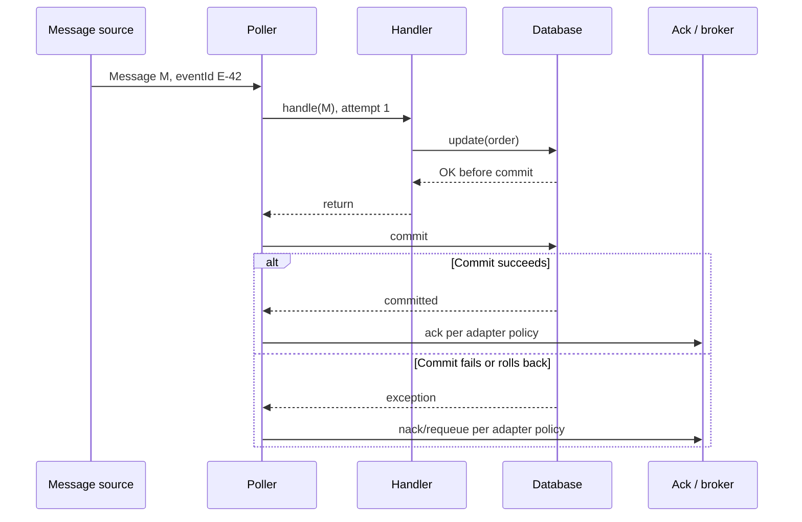

# Testing Concurrency, Ordering, and Backpressure in Spring Integration Runtime

## 1. The problem: one message flow, three distinct failure modes

A system receives order events, passes them through an `ExecutorChannel` to call an inventory service, and then uses an aggregator to await each order's results. In development with one message at a time, the flow works fine. Under load, three problems appear:

1. **Concurrency:** two workers update the same correlation group simultaneously, causing duplicate outputs or overwritten state.
2. **Ordering:** event `CREATED` is sent before `CANCELLED`, yet `CANCELLED` finishes processing first.
3. **Backpressure:** the producer pushes faster than the consumer, queues or executors build a backlog, and the application runs out of memory or starts rejecting tasks.

In the **Testing runtime** chapter of the **SPRING_INTEGRATION_RUNTIME** module, the lesson **“Testing Concurrency, Ordering, and Backpressure”** shows how to prove behavior with tests rather than assuming from happy-path runs. Examples connect to channels, endpoints, consumers, pollers, executors, `IntegrationFlow` lifecycle, message stores, transactions, retries, error handling, and correlation.

Goals after this lesson:

- State an assertable **invariant** for each behavior type: safety, ordering, liveness, and bounded resource usage.
- Write multi-threaded tests **coordinated with latches/barriers**, minimizing OS scheduler dependency.
- Inspect the order of **sending**, **receiving**, **starting processing**, **completion**, **commit**, and **publishing** as separate concepts.
- Test backpressure using `request(n)`, `StepVerifier`, and queue/concurrency bounds.
- Set up a Spring Integration test context, stub sources/handlers/triggers, and restore mocks between tests.
- Use failure injection, metrics, and logs to detect races, duplicate retries, backlogs, and timeouts without creating flaky tests.

Java snippets target Java 17+, JUnit Jupiter, Spring Integration 6.x, Spring Test, and Reactor; choose compatible dependency versions in your project. Pure channel unit tests do not need an application context; integration tests require the corresponding beans and Spring Integration infrastructure.

## 2. Four questions to separate before testing

| Property | Test question | Example invariant |
| --- | --- | --- |
| **Safety / mutual exclusion** | Can two conflicting operations run concurrently? | For the same `orderId`, no two writers enter the critical section simultaneously. |
| **Ordering** | Which order must be preserved, and at which boundary? | Events in the same partition **commit** in ascending `sequenceNumber` order. |
| **Liveness** | Does a valid message complete within finite time? | While downstream stays healthy, all N messages are processed or routed to error/DLQ on time. |
| **Backpressure / boundedness** | When the consumer slows down, how is the producer constrained? | In-flight count never exceeds 32; producer cannot spawn unbounded pending tasks. |

Two numbers—“10,000 messages processed” and “zero exceptions”—**do not prove** all four properties. Messages could have been lost, duplicated, or completed out of order.

### 2.1. Milestones in a message's lifecycle


Not every flow follows every step in the exact diagram order; this is a model for asking questions. An `ExecutorChannel` can return from `send()` before the handler starts. A broker can ack at a different point from the DB commit. A cold `Mono` may not execute until subscribed.

Therefore, a test must state explicitly whether it is asserting **acceptance order**, **dequeue order**, **handler invocation order**, or **business completion order**. “Messages arrive in order” is too imprecise.

## 3. Channel semantics shape what you are allowed to expect

| Channel / endpoint | Model | What can be tested | What must not be assumed |
| --- | --- | --- | --- |
| `DirectChannel` | Synchronous on sender thread | With **one sequential sender** and a synchronous subscriber, processing follows send order | Multiple concurrent senders will have a single total order or auto-serialize. |
| `ExecutorChannel` | Handoff to `TaskExecutor` | Task count, rejections, async errors, max concurrency | **Completion** order matches send order when the executor has multiple workers. |
| `QueueChannel` | FIFO buffer under typical config | Receive order of a single consumer and capacity | Multiple consumers finish FIFO, or JDBC/brokers share identical semantics. |
| `PriorityChannel` | Prioritizes by comparator/priority | Dequeue by priority among currently queued elements | Arrival order is preserved, especially with concurrent pollers. |
| `PublishSubscribeChannel` | Fan-out to subscribers | Each subscriber receives per routing contract and error policy | A single global order when using an executor or async fan-out. |
| `FluxMessageChannel` | `Publisher<Message<?>>` to reactive subscribers | Demand, cancellation, completion, and operator behavior | Durable queueing, broker acks, or end-to-end backpressure if upstream is imperative. |
| Aggregator | Groups by correlation key | Release when eligible, no double-release, late-arrival policy | Arrival order is automatically business sequence order. |
| Resequencer | Stores and releases by `sequenceNumber` | Reordering within the **same correlation group** | Handles arbitrary infinite gaps or matches pass-through channel throughput. |

Spring Integration Java DSL offers `.resequence()`; by default it relies on `CORRELATION_ID` and `SEQUENCE_NUMBER`/`SEQUENCE_SIZE`, unlike merely enabling multiple threads. A flow may need a resequencer **before** order-sensitive steps, while also needing tests for gaps, duplicates, timeouts, and post-restart group state.

### 3.1. A common false assumption

```text
send(M1); send(M2);            // Producer sent M1 before M2

Executor worker A: M1 starts → I/O takes 300 ms
Executor worker B: M2 starts → I/O takes 10 ms

M2 finishes and commits before M1.
```

There is not necessarily a bug in `ExecutorChannel` here. A flawed test often demands “parallel execution yet all results must complete FIFO” without designing ordering in: **single-thread executor, partitioned workers, `concatMap`, resequencer, or key-based coordination**.

## 4. Test pyramid and appropriate tools

| Test level | Tools | What to verify |
| --- | --- | --- |
| Pure Java unit test | JUnit Jupiter, `CountDownLatch`, `CyclicBarrier`, `ExecutorService` | Shared state, races, locking, concurrency caps, and timeouts. |
| Channel test | Spring Integration `DirectChannel`, `ExecutorChannel`, `QueueChannel` | Actual dispatch, buffering, ordering, and errors. |
| Integration flow test | Spring Test, `@SpringJUnitConfig`, `@SpringIntegrationTest` | Bean wiring, endpoint lifecycle, pollers, advice, flow outputs. |
| Reactive operator test | Reactor `StepVerifier`, `VirtualTimeScheduler`, `TestPublisher` | Demand, backpressure, cancellation, retry/backoff, and errors. |
| Backend test | Testcontainers or appropriate DB/broker environment | JDBC message store, ack/redelivery, distributed locks, and transactions. |
| Load/soak test | K6/Gatling or suitable generator, metrics/traces | Latency under load, backlog growth, resource saturation, and leaks. |

**Never use mocks to prove properties of a real backend.** A `ConcurrentHashMap` test does not prove `JdbcMessageStore` is atomic across two JVMs. A `Flux.range` test does not prove a broker adapter manages prefetch/acks on demand when the network disconnects.

### 4.1. Commonly needed test libraries

- `spring-integration-test` for test context, `MockIntegrationContext`, and test utilities.
- `spring-test` and JUnit Jupiter for context/test lifecycle.
- `reactor-test` for `StepVerifier` and `TestPublisher`.
- Depending on scenario: Mockito, Awaitility (optional), Testcontainers, and real backend drivers.

Do not pull in every library just for a channel unit test. Pick the smallest infrastructure sufficient to reproduce the failure mode.

## 5. Principles for non-flaky concurrency testing

**A reliable concurrency test must control meeting points** between threads. `Thread.sleep(100)` is not a synchronization primitive: running on slow CI or under GC pauses can alter the entire execution schedule.

### 5.1. Using latches/barriers instead of sleep

```text
Test thread:
  create 4 tasks
  wait for all 4 tasks to enter critical section / observation point
  assert condition holds
  release all tasks
  await completion (finite timeout)

Worker threads:
  signal "entered"
  await "release"
  process and signal completion
```

Different tools serve different roles:

| Tool | When to use | Notes |
| --- | --- | --- |
| `CountDownLatch` | Wait for N events, then open one gate | Cannot be reset; one latch typically serves one phase. |
| `CyclicBarrier` | N threads meet at a point then proceed | If one worker fails/times out, barrier breaks; handle exceptions cleanly. |
| `Phaser` | Multiple phases or dynamic participant counts | Fits multi-round stress tests, though overly complex if unnecessary. |
| `Semaphore` | Bound concurrency via permits | Verifies resource protection and bounded in-flight counts. |
| `AtomicInteger`/`LongAdder` | Count attempts, active tasks, peak concurrency | Does not replace business-level transaction atomicity. |
| `Future.get(timeout)` | Collect exceptions and results from workers | Prevents tests from hanging forever if a task deadlocks. |
| `ExecutorService.shutdownNow()` | Cleanup if test fails/times out | Always release gates in `finally` before shutting down. |

### 5.2. A test needs both positive and negative conditions

Do not merely assert “received N messages”—also verify:

1. **Was concurrent execution actually achieved?** Otherwise the test never exercised the race.
2. **What is forbidden?** E.g., two threads mutating the same group or exceeding size bounds.
3. **What must make progress?** Once gates open, tasks finish within the deadline.
4. **No resource leaks left?** Executors shut down, mock endpoints reset, subscriptions cancelled, and DB rolled back/cleaned per procedure.

A test that passes because tasks accidentally ran sequentially gives **false confidence**, not proof of concurrency safety.

## 6. Test 1 — `DirectChannel` is synchronous, yet multiple senders can still run concurrently

Common misconception: “`DirectChannel` is synchronous, therefore all handler invocations are serialized one after another.” In reality it is **synchronous per `send()` call**: each sender runs the handler on its own sender thread; if multiple senders call it, they can enter the handler simultaneously.

The test below **forces four senders to meet inside the handler** and measures peak concurrency:

```java
import static org.junit.jupiter.api.Assertions.*;

import java.util.ArrayList;
import java.util.List;
import java.util.concurrent.Callable;
import java.util.concurrent.CountDownLatch;
import java.util.concurrent.ExecutorService;
import java.util.concurrent.Executors;
import java.util.concurrent.Future;
import java.util.concurrent.TimeUnit;
import java.util.concurrent.atomic.AtomicInteger;

import org.junit.jupiter.api.Test;
import org.springframework.integration.channel.DirectChannel;
import org.springframework.messaging.support.MessageBuilder;

class DirectChannelConcurrencyTest {

    @Test
    void concurrentSendersCanRunTheSameSubscriberConcurrently()
            throws Exception {
        int senders = 4;
        DirectChannel channel = new DirectChannel();
        ExecutorService pool = Executors.newFixedThreadPool(senders);

        CountDownLatch enteredHandler = new CountDownLatch(senders);
        CountDownLatch releaseHandler = new CountDownLatch(1);
        AtomicInteger inFlight = new AtomicInteger();
        AtomicInteger maxInFlight = new AtomicInteger();
        List<Future<?>> futures = new ArrayList<>();

        channel.subscribe(message -> {
            int active = inFlight.incrementAndGet();
            maxInFlight.accumulateAndGet(active, Math::max);
            enteredHandler.countDown();
            try {
                if (!releaseHandler.await(5, TimeUnit.SECONDS)) {
                    throw new IllegalStateException("Handler gate timeout");
                }
            } catch (InterruptedException ex) {
                Thread.currentThread().interrupt();
                throw new IllegalStateException(ex);
            } finally {
                inFlight.decrementAndGet();
            }
        });

        try {
            for (int i = 0; i < senders; i++) {
                final int number = i;
                futures.add(pool.submit((Callable<Boolean>) () ->
                        channel.send(MessageBuilder
                                .withPayload(number)
                                .build())));
            }

            assertTrue(enteredHandler.await(3, TimeUnit.SECONDS),
                    "All senders must reach the handler");
            assertEquals(senders, maxInFlight.get(),
                    "Concurrent sends must overlap");

            releaseHandler.countDown();
            for (Future<?> future : futures) {
                assertEquals(Boolean.TRUE, future.get(3, TimeUnit.SECONDS));
            }
            assertEquals(0, inFlight.get());
        } finally {
            releaseHandler.countDown(); // Do not hold workers if an assertion fails.
            pool.shutdownNow();
            assertTrue(pool.awaitTermination(3, TimeUnit.SECONDS));
        }
    }
}
```

**What the test proves:** four `send()` calls are inside the handler waiting to complete at the same time. It does **not** prove processing order, since four senders start concurrently and ordering is decided by the scheduler.

If business logic requires sequential updates for the same `orderId`, add protection: a `LockRegistry` keyed by correlation key, database optimistic locking, a single-thread partitioned executor, or another suitable mechanism. Never assume `DirectChannel` provides a group-level mutex.

### 6.1. Testing `LockRegistry` safety: measure the critical section, not only the result

Additional test pattern:

```text
Input: 100 messages, 10 correlation keys.

Worker:
  lockRegistry.obtain(groupId).lock()
  try:
    activeForGroup[groupId]++
    assert activeForGroup[groupId] == 1
    update group
  finally:
    activeForGroup[groupId]--
    unlock

Expectation:
  max active for the same group = 1
  max active across the whole flow can be > 1
  all groups processed, no deadlock.
```

This is pseudocode for a property test. Across multiple nodes, you must use a **distributed** `LockRegistry` and shared `MessageGroupStore` in an integration test; `DefaultLockRegistry` only guards within its own JVM. Add fault injection for lost leases, dead nodes, and stale writers if the system relies on distributed locks.

## 7. Test 2 — One producer's order and completion order are not the same

### 7.1. Positive control: `DirectChannel` with a single sender

```java
import static org.junit.jupiter.api.Assertions.assertEquals;

import java.util.ArrayList;
import java.util.List;
import org.junit.jupiter.api.Test;
import org.springframework.integration.channel.DirectChannel;
import org.springframework.messaging.support.MessageBuilder;

class DirectChannelOrderTest {

    @Test
    void sequentialSendFromOneThreadPreservesInvocationOrder() {
        DirectChannel channel = new DirectChannel();
        List<Integer> handled = new ArrayList<>();

        channel.subscribe(message ->
                handled.add((Integer) message.getPayload()));

        for (int sequence = 1; sequence <= 5; sequence++) {
            channel.send(MessageBuilder
                    .withPayload(sequence)
                    .build());
        }

        assertEquals(List.of(1, 2, 3, 4, 5), handled);
    }
}
```

This test has **one subscriber and one sender**, and the handler spawns no async tasks. It proves *invocation/return* order under those conditions—not when callers invoke `send()` from multiple threads or when the handler publishes to an `ExecutorChannel`.

### 7.2. Testing FIFO enqueue/dequeue of `QueueChannel`

```java
import static org.junit.jupiter.api.Assertions.*;

import org.junit.jupiter.api.Test;
import org.springframework.integration.channel.QueueChannel;
import org.springframework.messaging.Message;
import org.springframework.messaging.support.MessageBuilder;

class QueueChannelOrderTest {

    @Test
    void singleConsumerReceivesInFifoOrder() {
        QueueChannel queue = new QueueChannel(3);

        assertTrue(queue.send(MessageBuilder.withPayload(1).build()));
        assertTrue(queue.send(MessageBuilder.withPayload(2).build()));
        assertTrue(queue.send(MessageBuilder.withPayload(3).build()));

        for (int expected = 1; expected <= 3; expected++) {
            Message<?> received = queue.receive(1_000);
            assertNotNull(received);
            assertEquals(expected, received.getPayload());
        }
        assertEquals(0, queue.getQueueSize());
    }
}
```

This is an in-memory queue with **one consumer** and no `PriorityChannel` or external broker. FIFO order at dequeue does **not** guarantee multiple consumers will finish, commit, or send replies in FIFO order.

### 7.3. Controlled out-of-order test on `ExecutorChannel`

Never use `Thread.sleep(300)` to “hope” message 2 finishes before message 1. Deliberately **block message 1's handler**, wait for message 2 to finish, and then open the gate:

```java
import static org.junit.jupiter.api.Assertions.*;

import java.util.List;
import java.util.concurrent.ConcurrentLinkedQueue;
import java.util.concurrent.CountDownLatch;
import java.util.concurrent.ExecutorService;
import java.util.concurrent.Executors;
import java.util.concurrent.TimeUnit;

import org.junit.jupiter.api.Test;
import org.springframework.integration.channel.ExecutorChannel;
import org.springframework.messaging.support.MessageBuilder;

class ExecutorChannelOrderTest {

    @Test
    void completionCanBeOutOfSendOrder() throws Exception {
        ExecutorService executor = Executors.newFixedThreadPool(2);
        ExecutorChannel channel = new ExecutorChannel(executor);

        CountDownLatch firstStarted = new CountDownLatch(1);
        CountDownLatch releaseFirst = new CountDownLatch(1);
        CountDownLatch secondFinished = new CountDownLatch(1);
        CountDownLatch bothFinished = new CountDownLatch(2);
        ConcurrentLinkedQueue<Integer> completion = new ConcurrentLinkedQueue<>();

        channel.subscribe(message -> {
            int id = (Integer) message.getPayload();
            if (id == 1) {
                firstStarted.countDown();
                try {
                    if (!releaseFirst.await(5, TimeUnit.SECONDS)) {
                        throw new IllegalStateException("Gate timeout");
                    }
                } catch (InterruptedException ex) {
                    Thread.currentThread().interrupt();
                    throw new IllegalStateException(ex);
                }
            }
            completion.add(id);
            if (id == 2) {
                secondFinished.countDown();
            }
            bothFinished.countDown();
        });

        try {
            assertTrue(channel.send(
                    MessageBuilder.withPayload(1).build()));
            assertTrue(firstStarted.await(2, TimeUnit.SECONDS));

            assertTrue(channel.send(
                    MessageBuilder.withPayload(2).build()));
            assertTrue(secondFinished.await(2, TimeUnit.SECONDS));
            assertEquals(List.of(2), List.copyOf(completion));

            releaseFirst.countDown();
            assertTrue(bothFinished.await(2, TimeUnit.SECONDS));
            assertEquals(List.of(2, 1), List.copyOf(completion));
        } finally {
            releaseFirst.countDown();
            executor.shutdownNow();
            assertTrue(executor.awaitTermination(3, TimeUnit.SECONDS));
        }
    }
}
```

The test proves an `ExecutorChannel` backed by a two-worker executor **can** complete message 2 before message 1 even though the producer sent 1 before 2. This is **expected semantics**, not a Spring Integration bug.

**Transaction/error consequence:** `send()` can return success before the worker executes. If the worker later throws an exception, it does not automatically enter the sender's already-finished transaction. For a real flow, test `errorChannel`/ack/retry and **commit order** too, not only callback lists.

## 8. Test 3 — Resequencer restores order by correlation and sequence

When business logic **requires** emitting in `sequenceNumber` order, test a component with an ordering contract rather than demanding `ExecutorChannel` maintain FIFO completion on its own.

Spring Integration resequencer:

- Groups messages by `CORRELATION_ID`.
- Uses `SEQUENCE_NUMBER` to order them.
- Relies on `SEQUENCE_SIZE`/release strategy to know when enough parts have arrived.
- Optionally supports partial sequence release, timeouts, discard channels, and `MessageGroupStore`.

### 8.1. Flow configuration

```java
import org.springframework.context.annotation.Bean;
import org.springframework.context.annotation.Configuration;
import org.springframework.integration.channel.DirectChannel;
import org.springframework.integration.channel.QueueChannel;
import org.springframework.integration.config.EnableIntegration;
import org.springframework.integration.dsl.IntegrationFlow;
import org.springframework.messaging.MessageChannel;
import org.springframework.messaging.PollableChannel;

@Configuration
@EnableIntegration
public class ResequencerTestConfiguration {

    @Bean("unordered")
    public MessageChannel unordered() {
        return new DirectChannel();
    }

    @Bean("ordered")
    public PollableChannel ordered() {
        return new QueueChannel();
    }

    @Bean
    public IntegrationFlow resequenceFlow() {
        return IntegrationFlow.from("unordered")
                .resequence()
                .channel("ordered")
                .get();
    }
}
```

### 8.2. Test sending 3 → 1 → 2 and receiving 1 → 2 → 3

```java
import static org.junit.jupiter.api.Assertions.*;

import org.junit.jupiter.api.Test;
import org.springframework.context.annotation.AnnotationConfigApplicationContext;
import org.springframework.integration.IntegrationMessageHeaderAccessor;
import org.springframework.messaging.MessageChannel;
import org.springframework.messaging.PollableChannel;
import org.springframework.messaging.support.MessageBuilder;

class ResequencerOrderTest {

    @Test
    void releasesOneGroupInSequenceNumberOrder() {
        try (var context = new AnnotationConfigApplicationContext(
                ResequencerTestConfiguration.class)) {
            MessageChannel input =
                    context.getBean("unordered", MessageChannel.class);
            PollableChannel output =
                    context.getBean("ordered", PollableChannel.class);

            sendPart(input, 3);
            sendPart(input, 1);

            // Default: incomplete sequence, no partial release yet.
            assertNull(output.receive(0));

            sendPart(input, 2);

            for (int expected = 1; expected <= 3; expected++) {
                var part = output.receive(1_000);
                assertNotNull(part);
                assertEquals("part-" + expected, part.getPayload());
            }
        }
    }

    private static void sendPart(MessageChannel input, int number) {
        assertTrue(input.send(MessageBuilder.withPayload("part-" + number)
                .setHeader(IntegrationMessageHeaderAccessor.CORRELATION_ID, "batch-42")
                .setHeader(IntegrationMessageHeaderAccessor.SEQUENCE_NUMBER, number)
                .setHeader(IntegrationMessageHeaderAccessor.SEQUENCE_SIZE, 3)
                .build()));
    }
}
```

This is an integration test with **one correlation group** and the default in-memory store. In practice, add tests for:

1. Two interleaved groups (`batch-42` and `batch-43`) not mixing together.
2. Duplicate sequence numbers and late-arriving messages handled per actual strategy/policy.
3. Missing sequence 2 causing the group to wait; timeout/partial release deciding the outcome.
4. An upstream filter dropping an element while `sequenceSize` remains 3.
5. Restarting while a group is incomplete, comparing `SimpleMessageStore` with `JdbcMessageStore`.
6. Two JVMs updating a persistent group store concurrently with an appropriate distributed lock registry.

**Do not equate resequencer with exactly-once.** It orders elements within a group per contract; it does not prevent the source from redelivering or downstream from processing the same business event twice.

## 9. Test 4 — Bounded `QueueChannel` and overload signals

**Capacity** limits how many messages can sit in the queue at once, not the total messages sent over the application's lifetime. With capacity 2 and no consumer, a third send cannot enqueue immediately while both slots are occupied.

```java
import static org.junit.jupiter.api.Assertions.*;

import org.junit.jupiter.api.Test;
import org.springframework.integration.channel.QueueChannel;
import org.springframework.messaging.Message;
import org.springframework.messaging.support.MessageBuilder;

class BoundedQueueTest {

    @Test
    void rejectsImmediateSendWhenQueueIsFull() {
        QueueChannel queue = new QueueChannel(2);

        assertTrue(queue.send(MessageBuilder.withPayload("A").build(), 0));
        assertTrue(queue.send(MessageBuilder.withPayload("B").build(), 0));

        assertEquals(2, queue.getQueueSize());
        assertEquals(0, queue.getRemainingCapacity());

        // timeout=0: do not wait for more capacity.
        assertFalse(queue.send(MessageBuilder.withPayload("C").build(), 0));

        Message<?> first = queue.receive(0);
        assertNotNull(first);
        assertEquals("A", first.getPayload());
        assertEquals(1, queue.getRemainingCapacity());

        assertTrue(queue.send(MessageBuilder.withPayload("C").build(), 0));
        assertEquals("B", queue.receive(0).getPayload());
        assertEquals("C", queue.receive(0).getPayload());
    }
}
```

This test verifies **bounded buffering and non-blocking offer** under the in-memory `QueueChannel` implementation. A flow may pick a different policy when full: wait up to a timeout, fail fast, route to a fallback, send to a DLQ, or rate-limit upstream.

### 9.1. Do not confuse a bounded queue with Reactive Streams backpressure

A queue with capacity 2 only means that after two messages, the next enqueue must **wait or fail** per timeout/policy. It does not implement the `Subscriber.request(n)` protocol, nor does it make an upstream publisher automatically reduce emission rate.

| Mechanism | Meaning | Additional tests needed |
| --- | --- | --- |
| `QueueChannel(capacity)` | Limits messages buffered in channel | Producer block/reject; data loss on crash if in-memory. |
| `ExecutorChannel` + bounded executor | Limits workers and task queue | Rejection handler, error routing, in-flight tasks. |
| Reactive Streams `request(n)` | Subscriber signals demand | Does upstream actually honor demand? |
| Broker prefetch / consumer credits | Buffer/credits managed by protocol adapter | Offset/ack/commit, redelivery, and backpressure bridge. |
| Rate limiter / bulkhead | Caps request rate or concurrency | On overload: reject, retry, or wait; per-tenant fairness. |

Notably, increasing `QueueChannel` capacity lets the system **absorb bursts better**, yet does not raise consumer processing capacity; under sustained load exceeding the service rate, the backlog still grows until full.

## 10. Test 5 — Reactive Streams emit only upon demand

To test the **Reactive Streams protocol**, a test initializes the subscriber with zero initial demand, then grants increments via `request(n)`. Reactor `StepVerifier` supports this with `create(publisher, initialRequest)` and `thenRequest(n)`.

```java
import static org.junit.jupiter.api.Assertions.assertEquals;

import java.time.Duration;
import java.util.concurrent.atomic.AtomicLong;
import org.junit.jupiter.api.Test;
import reactor.core.publisher.Flux;
import reactor.test.StepVerifier;

class ReactiveDemandTest {

    @Test
    void publisherRespectsSubscriberDemand() {
        AtomicLong requested = new AtomicLong();

        Flux<Integer> source = Flux.range(1, 3)
                .doOnRequest(requested::addAndGet);

        StepVerifier.create(source, 0)
                .expectSubscription()
                .expectNoEvent(Duration.ofMillis(20))
                .thenRequest(1)
                .expectNext(1)
                .thenRequest(2)
                .expectNext(2, 3)
                .verifyComplete();

        assertEquals(3L, requested.get());
    }
}
```

**What was verified:** `Flux.range` emitted no `onNext` while subscriber demand was zero, then emitted exact requested counts. This is a *protocol-level unit test* and does not prove a specific Spring Integration adapter connected to a broker/file/JDBC also throttles upstream by demand.

### 10.1. Where does `FluxMessageChannel` fit in tests?

`FluxMessageChannel` both accepts Spring messages and acts as a `Publisher<Message<?>>` for reactive subscribers. It is not a traditional `SubscribableChannel`/`PollableChannel`. When testing a real flow with `FluxMessageChannel`:

1. Create a `Publisher<Message<?>>` test source that records `request(n)` counts.
2. Connect the source via `ReactiveStreamsSubscribableChannel.subscribeTo(...)` or the corresponding DSL.
3. Subscribe with `StepVerifier` using small initial demand, or use `BaseSubscriber` to control requests manually.
4. Verify **upstream requested count**, messages consumed by handlers, errors/completion, and cancellation.
5. Test publishers slower/faster than the consumer, with/without `publishOn`, and measure buffers/in-flight work.
6. Repeat with **real adapters** if end-to-end backpressure across sources is required.

**Limitation:** when an imperative producer calls `channel.send(message)` repeatedly without downstream demand, behavior depends on the channel's semantics/buffering and implementation version. Do not treat the `Flux.range` test above as proof that every `FluxMessageChannel` setup blocks senders rather than buffering or rejecting.

### 10.2. Testing backpressure of reactive handlers

Spring Integration has `ReactiveMessageHandler` returning `Mono<Void>`; when running in `ReactiveStreamsConsumer`, the framework can compose the publisher into the stream via `flatMap`, respecting demand within the pipeline. When a handler is bridged into an imperative flow, the framework may subscribe immediately, breaking **end-to-end** demand propagation.

Thus at least two distinct tests are needed:

| Test | Input | Expected conclusion |
| --- | --- | --- |
| Reactive consumer | `FluxMessageChannel` + reactive handler | Demand/in-flight bounded by subscriber/operators. |
| Imperative bridge | `DirectChannel` → handler returning `Mono` | Async work may decouple from downstream demand; buffering must be bounded separately. |

A pipeline containing a `Mono` does not automatically become “backpressure-ready”. To prove it, measure **demand at the source**, not just that the handler returns quickly on the first call.

## 11. Test 6 — Timeouts, retries, and cancellation with virtual time

Tests with `delay` or exponential backoff should not wait for minutes on a wall clock. Reactor `StepVerifier.withVirtualTime(...)` lets you control a virtual scheduler when the publisher is created **inside the supplier**, after the test scheduler is ready.

### 11.1. Testing timeouts without real waiting

```java
import java.time.Duration;
import java.util.concurrent.TimeoutException;
import org.junit.jupiter.api.Test;
import reactor.core.publisher.Mono;
import reactor.test.StepVerifier;

class ReactiveTimeoutTest {

    @Test
    void timesOutUnresponsiveOperation() {
        StepVerifier.withVirtualTime(
                    () -> Mono.<String>never()
                            .timeout(Duration.ofMinutes(5)))
                .expectSubscription()
                .thenAwait(Duration.ofMinutes(5))
                .expectError(TimeoutException.class)
                .verify();
    }
}
```

This test **makes no real remote API call**. It only verifies publisher timeout under a virtual clock. To test real HTTP clients, broker cancellations, DB transactions, or network timeouts, write separate integration tests against the appropriate backend/adapter.

### 11.2. Retries can resubscribe and cause duplicate side effects

For example, if a cold publisher sends a request on subscription, upstream may be invoked again after `retryWhen`:

```java
import static org.junit.jupiter.api.Assertions.assertEquals;

import java.util.concurrent.atomic.AtomicInteger;
import org.junit.jupiter.api.Test;
import reactor.core.publisher.Mono;
import reactor.test.StepVerifier;

class ReactiveRetryTest {

    @Test
    void retryCanSubscribeMultipleTimes() {
        AtomicInteger invocations = new AtomicInteger();

        Mono<String> operation = Mono.defer(() -> {
            int current = invocations.incrementAndGet();
            return current < 3
                    ? Mono.error(new IllegalStateException("temporary"))
                    : Mono.just("OK");
        }).retry(2);

        StepVerifier.create(operation)
                .expectNext("OK")
                .verifyComplete();

        assertEquals(3, invocations.get()); // 1 initial attempt + 2 retries.
    }
}
```

When side effects involve payments, emails, or HTTP calls, subscription count does **not** equal unique valid business executions. Tests must include an **idempotency key** and verify final backend state, not just `StepVerifier.verifyComplete()`.

### 11.3. Cancellation does not mean external side effects rolled back

```java
import java.time.Duration;
import org.junit.jupiter.api.Test;
import reactor.core.publisher.Flux;
import reactor.test.StepVerifier;

class CancellationTest {

    @Test
    void subscriberCanCancelAfterTwoItems() {
        StepVerifier.withVirtualTime(() ->
                        Flux.interval(Duration.ofSeconds(1)))
                .expectSubscription()
                .thenAwait(Duration.ofSeconds(2))
                .expectNext(0L, 1L)
                .thenCancel()
                .verify();
    }
}
```

This shows the subscriber stopped receiving further items on the subscription. It does **not** prove a broker rewound its offset, a database rolled back, or an HTTP request was cancelled on a remote server.

### 11.4. Virtual time does not control every clock

Do not expect `VirtualTimeScheduler` to automatically control:

- `Thread.sleep` inside Java handlers.
- A real running Spring Integration poller's `TaskScheduler`.
- Timers inside databases, sockets, JMS/Kafka brokers, or Redis.
- Custom `ExecutorService`/`ScheduledExecutorService` pools outside Reactor.

For those parts, use **fake clocks/triggers, latches, appropriate test schedulers, or backend tests with deadlines**. A passing virtual-time test cannot substitute for verifying retries/acks in a real broker environment.

## 12. Spring Integration test harness: controlling sources, pollers, and handlers

Spring Integration provides `spring-integration-test` to enhance Spring Test contexts. `@SpringIntegrationTest` registers `MockIntegrationContext`, allowing replacement of sources/handlers on existing endpoints. This is very useful when production flows contain adapters connecting to databases, SFTP, or brokers that unit/integration tests should not auto-connect.

### 12.1. Test context that does not auto-start inbound endpoints

```java
import org.junit.jupiter.api.AfterEach;
import org.springframework.beans.factory.annotation.Autowired;
import org.springframework.integration.test.context.MockIntegrationContext;
import org.springframework.integration.test.context.SpringIntegrationTest;
import org.springframework.test.context.junit.jupiter.SpringJUnitConfig;

@SpringJUnitConfig(YourFlowConfiguration.class)
@SpringIntegrationTest(noAutoStartup = {"ordersInboundAdapter", "*RemoteSource*"})
class FlowHarnessSkeleton {

    @Autowired
    MockIntegrationContext mocks;

    @AfterEach
    void restoreMocks() {
        mocks.resetBeans();
    }
}
```

`YourFlowConfiguration` here is your application's flow configuration class under test, not a framework class. `noAutoStartup` accepts endpoint name patterns, preventing matching components from starting under the default `autoStartup=true`. **It does not replace the source by itself**; call `MockIntegrationContext` APIs before starting the test endpoint.

Key APIs:

| API | What does it replace? | Common mistake |
| --- | --- | --- |
| `substituteMessageSourceFor(endpointId, source)` | `MessageSource<?>` of `SourcePollingChannelAdapter` | `endpointId` is the endpoint bean name, not the output channel name. |
| `substituteMessageHandlerFor(endpointId, handler)` | `MessageHandler` inside `IntegrationConsumer` | `endpointId` does not necessarily match the POJO method bean name. |
| `substituteTriggerFor(endpointId, trigger)` | `Trigger` of a polling endpoint (since Spring Integration 6.3) | Must replace the trigger before starting the endpoint. |
| `resetBeans()` | Restores components replaced during the test | Call after every test to avoid leaking state to the next test. |

### 12.2. Complete one-shot poller test

The example below uses `OnlyOnceTrigger` to poll once without `Thread.sleep` waiting on a fixed delay.

**`OneShotPollerConfiguration.java`**

```java
import java.time.Duration;
import org.springframework.context.annotation.Bean;
import org.springframework.context.annotation.Configuration;
import org.springframework.integration.channel.QueueChannel;
import org.springframework.integration.config.EnableIntegration;
import org.springframework.integration.core.MessageSource;
import org.springframework.integration.dsl.IntegrationFlow;
import org.springframework.integration.dsl.Pollers;
import org.springframework.messaging.PollableChannel;

@Configuration
@EnableIntegration
public class OneShotPollerConfiguration {

    @Bean("pollResults")
    public PollableChannel pollResults() {
        return new QueueChannel();
    }

    @Bean
    public IntegrationFlow oneShotFlow() {
        // Original source is a placeholder; the test will substitute it.
        MessageSource<String> placeholder = () -> null;

        return IntegrationFlow.from(
                    placeholder,
                    endpoint -> endpoint.id("ordersInboundAdapter")
                        .poller(Pollers.fixedDelay(Duration.ofHours(1))
                            .maxMessagesPerPoll(1)))
                .channel("pollResults")
                .get();
    }
}
```

**`OneShotPollerTest.java`**

```java
import static org.junit.jupiter.api.Assertions.*;

import java.util.concurrent.atomic.AtomicBoolean;
import org.junit.jupiter.api.AfterEach;
import org.junit.jupiter.api.Test;
import org.springframework.beans.factory.annotation.Autowired;
import org.springframework.beans.factory.annotation.Qualifier;
import org.springframework.integration.core.MessageSource;
import org.springframework.integration.endpoint.SourcePollingChannelAdapter;
import org.springframework.integration.test.context.MockIntegrationContext;
import org.springframework.integration.test.context.SpringIntegrationTest;
import org.springframework.integration.test.util.OnlyOnceTrigger;
import org.springframework.messaging.PollableChannel;
import org.springframework.messaging.support.GenericMessage;
import org.springframework.test.context.junit.jupiter.SpringJUnitConfig;

@SpringJUnitConfig(OneShotPollerConfiguration.class)
@SpringIntegrationTest(noAutoStartup = "ordersInboundAdapter")
class OneShotPollerTest {

    @Autowired
    MockIntegrationContext mocks;

    @Autowired
    @Qualifier("ordersInboundAdapter")
    SourcePollingChannelAdapter endpoint;

    @Autowired
    @Qualifier("pollResults")
    PollableChannel results;

    @AfterEach
    void cleanUp() {
        endpoint.stop();
        mocks.resetBeans();
    }

    @Test
    void pollsExactlyOneMessageFromStubSource() {
        AtomicBoolean produced = new AtomicBoolean();
        MessageSource<String> source = () ->
                produced.compareAndSet(false, true)
                        ? new GenericMessage<>("SO-42")
                        : null;

        mocks.substituteMessageSourceFor("ordersInboundAdapter", source);
        mocks.substituteTriggerFor("ordersInboundAdapter",
                new OnlyOnceTrigger()); // SI 6.3+

        endpoint.start();

        var message = results.receive(3_000);
        assertNotNull(message);
        assertEquals("SO-42", message.getPayload());
        assertNull(results.receive(0));
    }
}
```

**Test limitation:** it controls the source and trigger inside the **same Spring context**, proving the poller pulled one message from the stub. It does not prove transactions with a JDBC store, broker acks, or how an external source behaves on network loss. Tests must also run on a Spring Integration version supporting `substituteTriggerFor` (6.3+).

### 12.3. Replacing a handler to verify order without network calls

For a flow calling a remote API, you can replace the `MessageHandler` on an endpoint with a mock recording sequences/message headers; Spring Integration provides `MockIntegration.mockMessageHandler(...)` and `MockIntegrationContext.substituteMessageHandlerFor(...)`. Be sure to mock the **endpoint ID**, not an arbitrary handler interface name.

To test ordering, store results in a `BlockingQueue` or thread-safe list, wait for N items, then assert order. To test concurrency, use a mock handler with a latch before side effects to force overlap. Never rely solely on Mockito `verify(handler, times(N))`: it counts invocations without proving completion/commit order.

## 13. End-to-end backpressure: tests must measure both at the source and at the consumer

Reactive Streams propagates demand signals between `Publisher` and `Subscriber`. However, an integration flow may bridge across:

```mermaid
flowchart LR
    A["Reactive source<br/>request(n)"] --> B["FluxMessageChannel"]
    B --> C["ReactiveStreamsConsumer"]
    C --> D["Reactive client<br/>Mono<Void>"]
    C --> E["Bounded in-flight"]
    X["Imperative adapter"] -->|send() push| B
    Y["Broker prefetch / ack"] --> X
```

**Measurements needed at both ends:**

- **Upstream demand**: total `request(n)` count and request timing.
- **Downstream completion**: processed `onNext` count, `onComplete`, `onError`, and cancel.
- **In-flight**: currently executing operations, max concurrency.
- **Backlog/buffer**: queue size, executor queue, broker lag, when saturation occurs.
- **Acceptance/rejection**: whether producers block, `send` returns `false`, or exceptions throw per contract.

If the consumer is slow while upstream demand keeps growing unbounded, the pipeline may be **prefetching/buffering** more than expected. Do not conclude “protocol violation” merely from seeing a large `request(n)`: operators like `flatMap` and `publishOn` prefetch to sustain throughput. Compare against **configured concurrency/prefetch** and acceptable memory bounds.

### 13.1. Testing a reactive pipeline with bounded concurrency

This example caps concurrent operations at three using `flatMap` and checks the outcome. It does not use a Spring Integration channel; it is a baseline step proving Reactor semantics before wiring channels:

```java
import static org.junit.jupiter.api.Assertions.*;

import java.util.concurrent.atomic.AtomicInteger;
import org.junit.jupiter.api.Test;
import reactor.core.publisher.Flux;
import reactor.core.publisher.Mono;
import reactor.test.StepVerifier;

class ReactiveConcurrencyLimitTest {

    @Test
    void neverExceedsConfiguredFlatMapConcurrency() {
        AtomicInteger current = new AtomicInteger();
        AtomicInteger maximum = new AtomicInteger();

        Flux<Integer> pipeline = Flux.range(1, 100)
                .flatMap(i -> Mono.defer(() -> {
                    int active = current.incrementAndGet();
                    maximum.accumulateAndGet(active, Math::max);

                    return Mono.just(i)
                            .doOnTerminate(current::decrementAndGet);
                }), 3);

        StepVerifier.create(pipeline)
                .expectNextCount(100)
                .verifyComplete();

        assertTrue(maximum.get() <= 3);
        assertEquals(0, current.get());
    }
}
```

**Caution:** `Mono.just(i)` completes almost instantly, so this test mainly proves **not exceeding the cap**, not that `maximum==3` was reached. To test real load forcing three overlapping tasks, use an async publisher with a **controllable completion gate** (e.g., `Sinks.One`/`TestPublisher`), wait for three active subscriptions, and only allow the fourth task to start after one completes. Never assert “max must equal 3” in a test that creates no overlap.

### 13.2. Prefetch differs from execution capacity

An operator may request more items ahead of actual execution concurrency to reduce overhead. Tests should track separately:

| Quantity | Example | Meaning |
| --- | --- | --- |
| `requested` | Upstream receives `request(32)` | Subscriber permits up to 32 items for that request; does not mean 32 HTTP calls run concurrently. |
| `buffered` | Operator holds 20 items | Occupies memory even though not yet processed. |
| `inFlight` | 3 HTTP operations | Number of concurrent side effects. |
| `completed` | 100 operations | Total finished work. |
| `acknowledged` | 97 broker records | Depends on protocol/adapter; may differ from completed count. |

A test that only asserts `inFlight<=3` while allowing `buffered` to grow without bound does not protect memory. Load tests must verify both **pending buffer bounds** and steady throughput.

## 14. Ordering by partition, correlation group, and business invariants

Not every message in a system needs a single total order. Usually **per-key ordering** is enough:

```text
Order SO-42: CREATED → RESERVED → CANCELLED
Order SO-99: CREATED → SHIPPED

SO-42 and SO-99 can be processed in parallel.
Within each order, SHIPPED must not commit before CREATED.
```

This is a different problem from guaranteeing “which worker starts first”. Approaches include:

- Partitioned queues by `orderId`, each partition having a sequential consumer.
- `ExecutorChannel` only when downstream enforces key-based ordering.
- Resequencer when sequence headers exist and gaps are bounded.
- `LockRegistry` to prevent **concurrent updates** to the same group, combined with version/sequence checks to handle **out-of-order** arrivals.
- Optimistic locking/unique constraints in the DB to reject stale writes.

**Locks do not impose ordering.** If `CANCELLED` acquires the lock before `CREATED`, the lock still only prevents two workers from writing simultaneously. If business rules require order, the handler must enforce state transitions or sequence versions; tests should deliberately inject out-of-order arrivals.

### 14.1. A proper assertion set for per-key ordering

Suppose each order has `sequenceNumber` from 1 to 100. Record **committed sequence numbers per order ID** in a test sink or DB:

```text
For every orderId:
  all committed sequence numbers are unique
  committed[0] == 1
  committed[i] == committed[i-1] + 1
  final committed sequence == expected size

Across different orderIds:
  no global ordering required
  peak concurrency > 1 may be observed
```

When the system has retries/redelivery and idempotency, the same `sequenceNumber` may arrive multiple times at **ingress**, yet only one **business commit** should occur per event ID. Tests must distinguish arrivals, handler attempts, and committed state.

### 14.2. Testing gaps and late arrivals

Suppose sequences `1, 3` arrive while `2` is delayed:

- With a wait-for-all resequencer, output may not release until the sequence is complete.
- With partial release enabled, message 1 may release before 2 and 3 arrive.
- On group timeout, behavior depends on `sendPartialResultOnExpiry`, `expireGroupsUponTimeout`, and the discard channel.
- After group completion, retaining empty group metadata can help block late arrivals; removing the group can let the same correlation ID start a new group.

Tests must assert **output content, order, retained/lost group state, and discard/error messages**, not just `QueueChannel.getQueueSize()`.

## 15. Concurrency + transactions: test exact commit and acknowledgment boundaries

In transactional flows, “handler threw no exception” and “business operation committed” are two different things. If the transaction interceptor throws during commit, handler meters may have already recorded success beforehand.

Example timeline:



The ack branches in the diagram are **illustrative**: rollback/ack capability depends on source adapter/container, transaction manager, resources, and threads. `DataSourceTransactionManager` does not automatically roll back Kafka offsets or JMS acknowledgments unless coordinated properly.

### 15.1. Invariants of transaction + redelivery tests

An anti-duplicate test should verify:

| Condition | Evidence to collect |
| --- | --- |
| A business event commits only once | Unique constraint/idempotency record by stable `eventId`, final DB state. |
| Retrying after transient failure loses no messages | Source can redeliver or a durable retry queue holds the message. |
| Synchronous handler failure triggers proper rollback | DB transaction outcome, message store state, error channel/exception. |
| Async worker failure is not swallowed | Future/publisher exceptional completion or `ErrorMessage` on expected channel. |
| Commit succeeds yet ack fails leading to safe replay | Event is re-received without creating a second side effect. |
| Poison message exhausts retries | Clear DLQ/discard/recovery policy; no infinite loop. |

A test asserting only “`repository.save()` was called once” via Mockito is insufficient. When exactly-once **at the local business effect** must be proven, assert database state, unique event IDs, and outcomes after restart/redelivery.

### 15.2. Failure injection points

```text
receive → validate → reserveInventory → write DB → commit → ack → publish
    ^         ^            ^                ^        ^       ^
    A         B            C                D        E       F
```

- **A:** source receives message, then poller crashes before handler.
- **B:** validation rejects; no business side effect invoked.
- **C:** remote inventory times out, yet remote actually processed it.
- **D:** DB commit fails or transaction was marked rollback-only earlier.
- **E:** DB commit finishes, yet broker ack fails → redelivery.
- **F:** already acked/committed, yet event publish fails → needs outbox or other recovery.

Tests at each point must define independent **expected outcomes**: delivery count, attempt count, DB state, source offset/ack, error/DLQ, and eventual reply. If the state at a point is undefined, that is a **design gap** requiring idempotency or reconciliation.

### 15.3. True concurrency on persistent stores

A two-thread test using `SimpleMessageStore` only proves operations inside one JVM's memory. When production runs multiple replicas sharing `JdbcMessageStore`, `JdbcChannelMessageStore`, a distributed `LockRegistry`, or a Redis/JDBC metadata store, test against a **shared backend** with **multiple app contexts/processes**:

1. Two nodes concurrently receive parts carrying `correlationId=SO-42`.
2. Deliberately make them contend for the group lock or update state simultaneously.
3. Track lock ownership, transaction commit order, and duplicate outputs.
4. Kill one node right while holding the lock or before DB commit.
5. Let the remaining node proceed; check business state and tombstones.
6. Test lease expiry and stale owners to confirm locks are not fencing tokens.

Do not manually delete lock or message rows inside tests without understanding transaction/lifecycle boundaries; doing so can create false passes by bypassing the exact contention condition under test.

## 16. Testing backpressure when sources use prefetch, brokers, or pollers

A reactive test with `Flux.range` does not represent Kafka/JMS/AMQP or file polling. Those sources have their own delivery/ack mechanisms and buffers:

| Source | What to test for backpressure? | What to also test for data safety? |
| --- | --- | --- |
| Bounded `QueueChannel` | Enqueue full → block/reject; slow consumer; drain on resume | Are in-memory messages lost on restart? |
| `ExecutorChannel` | Bounded executor queue, max active, rejection policy | Do errors reach the sender or async error channel? |
| Source polling | `maxMessagesPerPoll`, trigger cadence, consumer saturation | Transaction boundary around receive, source rollback. |
| JMS/AMQP listener | Container concurrency, prefetch, ack delay | Redelivery, DLQ, and transaction/ack when consumer fails. |
| Kafka inbound | Max poll/pause/resume, partition assignment, consumer lag | Offset commit, duplicate delivery, and per-partition ordering. |
| File/SFTP inbound | Poll frequency, max files per scan, accept-once filter | Marker files after handler errors, replay, checkpoints. |
| Reactive source | `request(n)`, operator prefetch, buffers, cancel | Error/retry, subscription lifecycle, durable upstream. |

### 16.1. Testing a slow consumer without letting producer memory grow forever

Sample scenario:

```text
Configuration:
  queue capacity: 100
  executor: 4 workers, queue capacity: 20
  downstream: each request takes 200 ms
  producer: burst of 1000 messages

Expected:
  accepted + rejected + retried = 1000 (no silent message loss)
  queue size <= 100
  executor pending <= 20
  worker active <= 4
  no unbounded buffers at other bridges
  after producer stops: backlog drains or moves to DLQ in a controlled way
```

Numbers are **example parameters**, not Spring Integration defaults. Count by stable event ID and outcome so retries do not double-count the same event.

### 16.2. Source polling does not automatically become demand-driven

`Pollers.fixedDelay(...)` schedules pulling messages. If downstream uses a `DirectChannel` and a blocking handler, the polling task may block for the processing duration. Switching to an `ExecutorChannel` lets the poller **receive and hand off faster** than real processing capacity, building an executor backlog.

Tests should drive the source faster than the service rate and measure:

- `poll count`, `receive()` calls, receive timeouts, and `maxMessagesPerPoll`.
- Tasks accepted, queued, and rejected by the executor.
- Message source cursor/ack behavior when workers are slow or fail.
- Queue depth, queue wait time, and transaction lifetimes.
- Stopping/starting the poller without losing messages.

For a `SourcePollingChannelAdapter` wired to a reactive `ReactiveStreamsSubscribableChannel` output, some versions bridge polling schedules to `Flux` and downstream demand. Still, **never assume every poller setup obeys Reactive Streams**: test the exact configuration in use.

## 17. Fault injection, repeatability, and durability testing

Concurrency bugs often surface only under a rare interleaving. One green test run is not enough; yet running an uncoordinated racy test 10,000 times can also pass every time if the scheduler happens to be favorable.

### 17.1. Three testing tiers

1. **Deterministic tests:** latches/barriers create the exact race window, assert state, and clean up. This tier runs quickly in every CI build.
2. **Randomized/stress tests:** vary thread counts, seeds, correlation keys, sequence order, delays, and retry profiles. On failure, log the **seed and input sequence** for reproduction.
3. **Integration/chaos tests:** process kills, network/Redis lease loss, DB restarts, broker rebalances, slow consumers, and crashes after commit before ack. This tier runs against production-like backends with proper test isolation.

### 17.2. Property-based tests for ordering and message loss

Randomly generate:

```text
orders = 50
partsPerOrder = 1..20
events = shuffle(allParts) + selectedDuplicates
faults = [transient-failure, timeout, redelivery, cancellation]
randomSeed = 48216
```

After each run:

- Each order has committed sequences **strictly ascending**, with no gaps unresolved per policy.
- One stable `eventId` never produces two business commits.
- Every input event ends in a clear state: **completed / rejected / DLQ / pending with reason**.
- Throughout the run, queues and in-flight counts stay within declared bounds.
- Zero active tasks/subscriptions or leaked locks remain after shutdown.

If a test fails, record seed, correlation IDs, arrival order, fault stage, timestamps, and component names. Avoid logging raw customer payloads unnecessarily.

### 17.3. Deadlocks and liveness

`Future.get(timeout)` or `await(timeout)` failing tells you **no progress occurred by the deadline**, which is not yet proof of deadlock. Gather thread dumps, lock states, DB wait graphs, backend metrics, and exception chains.

For instance, two aggregators acquiring nested locks in opposite orders can deadlock even when each uses `try/finally` properly. A test can coordinate:

```text
T1: holds lock(groupA), waits for lock(groupB)
T2: holds lock(groupB), waits for lock(groupA)

assert: timeout reported + CI does not hang.
cleanup: attempt release or cancel per test policy.
resolution: standardize lock order or avoid nested locks.
```

Do not run an intentional deadlock test using two non-daemon threads with no termination mechanism inside the shared JVM test runner; it can hang the entire CI job. Use sandbox/process isolation for real deadlock reproductions, while unit tests simulate timeouts/failure states.

## 18. Observability to support runtime testing

Spring Integration exposes meters via `MetricsCaptor`/`MicrometerMetricsCaptor` and, in 6.x, **Micrometer Observation**. Test metrics are helpful as long as you understand **which boundary they measure**.

| Signal | Used to verify | Does not prove |
| --- | --- | --- |
| `spring.integration.send` timer | Channel send or handler invocation counts/timings in traditional metrics | Async worker committed. |
| `spring.integration.receive` counter | Receive counts on the corresponding source/channel | Unique business event count. |
| `QueueChannel.getQueueSize()` | Backlog in a specific queue | Backlog in other executors/brokers. |
| Executor active/queued tasks | Pool concurrency/saturation | Commit order per business key. |
| Custom `inflight` gauge | Currently executing business operations | All cancelled futures or rolled-back side effects. |
| Application `completion_total`/`failure_total` | Business outcomes per contract | Automatic deduplication if raw counters alone are used. |
| `errorChannel`/DLQ counts | Async errors and recovery | That the source rolled back the failed message cleanly. |

When testing retries:

```text
event E-42:
  receive count = 2       (source redelivery)
  handler attempts = 3    (additional in-JVM retry)
  business commits = 1
  published replies = 1
```

All these counts can be valid simultaneously. Never assert every counter must be equal. In traces/logs, keep `eventId` and `correlationId` to correlate attempts, yet **never use `eventId` as a metric tag** due to excessive cardinality.

### 18.1. Suggested metrics for test/load environments

- `processing_inflight` — current active operations.
- `processing_concurrency_peak` — peak reset between runs.
- `queue_wait_duration` — time from enqueue to dequeue.
- `out_of_order_completion_total` — completions arriving out of expected sequence under an ordered contract.
- `duplicate_delivery_total` and `duplicate_commit_total` — two distinct concepts.
- `backpressure_rejected_total` — producer rejections due to capacity.
- `retry_attempts_total`, `dlq_total`, `transaction_rollback_total`.
- `oldest_pending_message_age` — detects a stuck message even when queue size is low.

These are **suggested application metric names**, not a list automatically exported by Spring Integration. Choose low-cardinality labels (`flowType`, `stage`, `outcome`, `exceptionClass`) and put event/trace IDs into logs/traces rather than metrics.

## 19. Diagnostic table when concurrency/ordering/backpressure tests fail

| Symptom | Common cause | Check immediately |
| --- | --- | --- |
| Concurrent test passes yet production races | Test created no overlap; single sender or single JVM | Use latch to confirm max concurrency; test multiple JVMs/shared backend. |
| `DirectChannel` shows handler concurrency > 1 | Multiple concurrent senders | Distinguish sync call stack from serialization; add per-key locking if needed. |
| `ExecutorChannel` completes out of FIFO order | Multiple workers, varying I/O latency | Assert arrival vs. commit order separately; add resequencer or partition ordering. |
| `QueueChannel` dequeues in order yet DB commits out of order | Multiple consumers after dequeue | Measure begin/commit order, not just dequeue; limit consumer concurrency per key. |
| Resequencer never releases | Missing sequence, wrong `sequenceSize`, filter dropped part | Inbound headers, group metadata, timeout/discard policy. |
| Resequencer releases duplicates | Duplicate events, expired/removed group, redelivery | Stable event ID, group tombstones, message store/transactions. |
| Queue `send` returns `false` when full | Bounded capacity, timeout=0 | Reject/backpressure/retry policy; avoid silent drops. |
| Producer keeps pushing while downstream slows | Imperative push, buffers/prefetch, no rate limit | Measure `request(n)`, upstream buffering, and executor queue. |
| Reactive test passes yet broker overloads | Test used only `Flux.range`, omitting adapter prefetch/ack | Test against real broker, configure consumer credits/offset policy. |
| `StepVerifier` hangs | Forgot `thenRequest` with initial demand 0, or virtual clock not advanced | Check expectations, demand, `thenAwait`, and terminal signals. |
| Virtual-time test passes yet poller fails | Poller uses real Spring `TaskScheduler` | Test `OnlyOnceTrigger` or scheduler/clock at the right layer. |
| Test flaky only on CI | Sleep used, timeout too short, GC/CPU contention | Latches, bounded awaits, diagnostics, reduce timing coupling. |
| Test hangs forever after assertion failure | Unreleased gate, unclosed executor/subscription | Release latches in `finally`, shut down executors, cancel subscriptions. |
| Source ack succeeded yet DB did not commit | Wrong transaction boundary/ack order | Inspect adapter ack, DB transaction, async handoff. |
| DB commits cleanly yet event arrives again | Ack failed or source redelivered | Assert idempotent business effects, not just receive counts. |
| Two replicas release the same group | Local lock registry with shared store | Shared/distributed `LockRegistry` + persistent store + ownership tests. |
| Retry count much higher than expected | Reactor retry, handler advice, and broker redelivery stacking | Count attempts at each layer; cap total retry budget. |
| Adding workers does not increase throughput | Hot correlation key, lock contention, downstream connection pool | Peak in-flight, lock wait, p95 latency, and saturation. |
| Memory grows despite small queue capacity | Other buffers in publishers/operators/executors/broker clients | Measure every boundary, not just `QueueChannel`. |
| Messages lost after restart | In-memory queue/store, checkpoint before commit, or swallowed errors | Test persistence, crash points, and recovery/replay. |

### 19.1. 9-step procedure for hard-to-reproduce runtime bugs

1. **State the exact invariant:** “each order ID has at most one commit per sequence number”, not just “all messages stay in order”.
2. **Map the path:** inbound source → channel → consumer → executor/poller → group store → DB/broker/output.
3. **Mark thread boundaries:** where `DirectChannel` is synchronous vs. where `ExecutorChannel`/reactive/`QueueChannel` switches threads.
4. **Mark transaction boundaries:** who opens, who commits, where source ack happens, and whether retry sits inside or outside the transaction.
5. **Log consistent traces:** event ID, correlation key, sequence, thread, attempt, ingress/start/commit/ack timestamps.
6. **Force the suspected interleaving:** use latches/barriers or controlled backend contention tests.
7. **Assert final outcomes:** DB state, output order, queues, DLQs, and retained group metadata—not just handler call counts.
8. **Observe bounds:** max in-flight, buffer/queue sizes, executor rejections, and deadlines.
9. **Clean up and repeat:** clean resources, save seeds/traces on failure, run short stress tests in CI and periodic chaos tests.

## 20. Checklist for meaningful, non-flaky tests

### 20.1. Design

- [ ] Named the invariant: **concurrent safety**, **ordering**, **eventual completion**, or **boundedness**?
- [ ] Separated **send order**, **receive order**, **handler start**, **finish**, **DB commit**, and **ack/reply**?
- [ ] Picked the right abstraction: `DirectChannel`, `QueueChannel`, `ExecutorChannel`, resequencer, or `FluxMessageChannel`?
- [ ] Included a **positive control** proving the test actually forced overlap or reordering?
- [ ] Tested duplicates, missing sequences, late arrivals, and out-of-order inputs?
- [ ] Enforced deadlines per **test policy**, avoiding infinite waits?

### 20.2. Resources and repeatability

- [ ] Avoided `Thread.sleep` as a mechanism for creating interleavings?
- [ ] Used `CountDownLatch`, barriers/virtual time, or controllable sources/triggers?
- [ ] Released all gates in `finally` even when assertions fail?
- [ ] Shut down `ExecutorService`, stopped endpoints, cancelled subscriptions, and reset mock beans?
- [ ] Tested against real DB/brokers when proving persistence, acks, or distributed locks?
- [ ] Avoided leftover state from prior tests (old message stores, group tombstones, persisted offsets)?
- [ ] Recorded seeds, topology, component IDs, and needed metrics on failure?

### 20.3. Business accuracy

- [ ] Asserted outcomes by **stable business event ID**, not just message delivery ID?
- [ ] Distinguished attempts, accepted, completed, committed, and DLQ?
- [ ] Verified transaction commits/errors outside the handler rather than only mocking repository calls?
- [ ] Clarified whether ordering applies **per key/partition** or system-wide?
- [ ] Verified backpressure across **demand**, **buffer bounds**, and **in-flight** counts?
- [ ] For reactive publishers, tested resubscription, cancellation, and timeouts?
- [ ] Never claimed exactly-once merely because a lock or resequencer succeeded?

## 21. Hands-on exercises

### Exercise A — Controlling concurrency for a single order

1. Create a `DirectChannel` with four senders and run section 6's test to observe peak in-flight equal to 4.
2. Wrap the handler's state update with a `LockRegistry` keyed by `orderId`.
3. Send 100 messages across 10 order IDs concurrently; prove **per-order peak = 1** while global peak can exceed 1.
4. Move to two JVMs sharing a `JdbcMessageStore`; replace the local registry with a shared lock registry and inject mid-flight failures.
5. Note explicitly that a lock does **not** automatically enforce sequence order if messages arrive out of order.

### Exercise B — Reordering after an executor

1. Run `ExecutorChannelOrderTest` to reproduce `2 → 1` completion.
2. Build a DSL flow `split → executor → resequence → output` with stable sequence headers.
3. Send `3, 1, 2` and verify `1, 2, 3` output for the same group.
4. Omit part 2, measure group waiting, and test timeout/partial release.
5. Interleave events from two correlation groups; verify no mixing and no false requirement for global total order.

### Exercise C — Boundedness and backpressure

1. Create `QueueChannel(2)` and test sending when full with timeout=0.
2. Switch to bounded producer blocking, proving the producer resumes after the consumer dequeues.
3. Test Reactor `StepVerifier.create(flux, 0)`, granting `thenRequest(1)` then `thenRequest(2)`.
4. Build a flow with `FluxMessageChannel` wired to a demand-aware publisher; measure upstream request counts and downstream in-flight counts.
5. Inject an imperatively pushing source to locate where the flow must buffer/reject rather than propagate demand.

### Exercise D — Crash, redelivery, and transactions

1. Have the source emit 10 events with stable `eventId`s and a unique constraint in the business DB.
2. Trigger a DB rollback on an event's first attempt, ensuring the event can still be retried.
3. Commit the DB successfully then simulate lost acknowledgment; redeliver the same event ID.
4. Assert the event had **multiple deliveries** yet only **one business commit** and contract-compliant output.
5. Increase consumer concurrency and let multiple events for the same order ID contend for locks; check final version/state ordering.

### Exercise E — Soak testing and diagnostics

1. Generate a burst of 10,000 messages across many correlation IDs plus one **hot key** receiving heavy traffic.
2. Measure throughput, end-to-end latency, max in-flight, queue depth, error/retry counts, and lock wait times.
3. Increment executor threads step by step and record changes in throughput and contention.
4. Slow down downstream several-fold; verify queues stay bounded and producers reject/block per policy.
5. Stop/start the flow while a backlog exists; check data safety, duplicates/late arrivals, and resource leaks.

### Self-check questions

1. Why does synchronous `DirectChannel` **not** mean only one thread invokes the handler at any given time?
2. Which latch pattern proves two senders genuinely overlapped inside a handler?
3. At which milestone does `ExecutorChannel` break ordering: accept, start, or completion?
4. Does FIFO dequeue from a `QueueChannel` guarantee FIFO DB commits with multiple consumers?
5. What does `LockRegistry` protect, and why does it not order events by `sequenceNumber` on its own?
6. Which headers does a resequencer rely on to determine group and order?
7. When `sequenceSize=3` yet part 2 is dropped by a filter, what outcomes must a timeout test check?
8. Is a bounded `QueueChannel` equivalent to Reactive Streams `request(n)`?
9. When `StepVerifier.create(publisher, 0)` emits nothing, which method increases demand?
10. Why is a `Flux.range` test insufficient to prove a JMS/Kafka adapter honors backpressure?
11. Does `VirtualTimeScheduler` automatically control `Thread.sleep` or Spring's `TaskScheduler`?
12. Why can `getQueueSize()==0` still coexist with thousands of tasks currently executing?
13. After a DB commit followed by a crash before broker ack, which key should idempotency test on redelivery?
14. Distinguish handler invocation count, source receive count, and business commit count.
15. How do you prove a concurrency test **actually created a race window** instead of accidentally running sequentially?
16. Why can a stress test passing 10,000 iterations still fail to prove correctness when production runs two JVMs?

## 22. References

- [Spring Integration Reference — Testing Support](https://docs.spring.io/spring-integration/reference/testing.html)
- [Spring Integration Reference — Message Channels](https://docs.spring.io/spring-integration/reference/channel/configuration.html)
- [Spring Integration Reference — Aggregators and Resequencers (Java DSL)](https://docs.spring.io/spring-integration/reference/dsl/java-aggregators.html)
- [Spring Integration Reference — Resequencer](https://docs.spring.io/spring-integration/reference/resequencer.html)
- [Spring Integration Reference — Aggregator and MessageGroupStore](https://docs.spring.io/spring-integration/reference/aggregator.html)
- [Spring Integration Reference — Reactive Streams Support](https://docs.spring.io/spring-integration/reference/reactive-streams.html)
- [Spring Integration Reference — Transactions](https://docs.spring.io/spring-integration/reference/transactions.html)
- [Spring Integration Reference — Error Handling](https://docs.spring.io/spring-integration/reference/error-handling.html)
- [Spring Integration 6.4 API — QueueChannel](https://docs.spring.io/spring-integration/docs/6.4.2/api/org/springframework/integration/channel/QueueChannel.html)
- [Spring Integration 6.4 API — IntegrationMessageHeaderAccessor](https://docs.spring.io/spring-integration/docs/6.4.2/api/org/springframework/integration/IntegrationMessageHeaderAccessor.html)
- [Reactor Test — StepVerifier](https://projectreactor.io/docs/test/release/api/reactor/test/StepVerifier.html)
- [Project Reactor Reference — Testing](https://projectreactor.io/docs/core/release/reference/testing.html)
