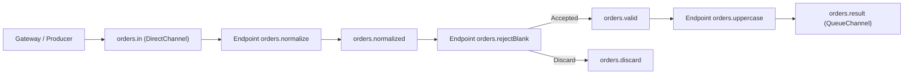
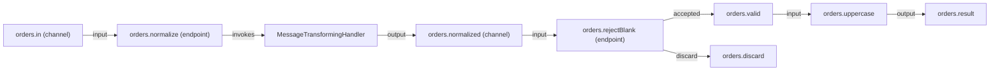
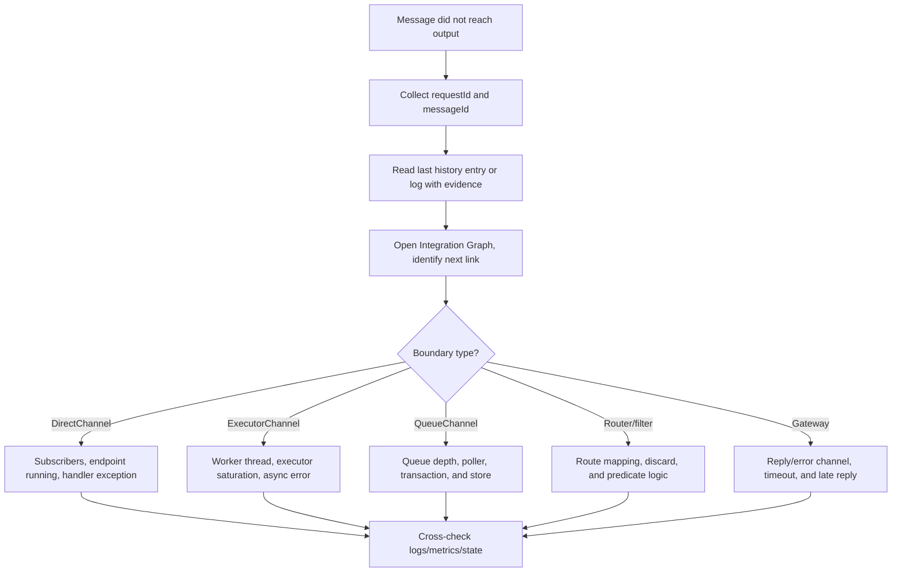

# Reading Component Names and Endpoint Chains in Spring Integration

## 1. Why Does Reading Component Names Correctly Matter When Debugging Runtime Issues?

Spring Integration splits a message flow into multiple components: `MessageChannel`, `MessageHandler`, `EventDrivenConsumer`, `PollingConsumer`, `MessageProducer`, gateway, transformer, router, aggregator, and outbound adapter. A single request may pass through many beans before returning a reply; a log line that looks like a "handler" sometimes actually refers to a consumer endpoint or a channel.

Example errors:

```text
MessageDeliveryException: Dispatcher has no subscribers for channel 'orders.valid'
ReplyRequiredException: No reply produced by handler 'orders.verify'
MessageHandlingException: error occurred in message handler
beanName:      ordersFlow.org.springframework.integration.config.ConsumerEndpointFactoryBean#0
componentName: ordersFlow.transformer#0
```

The lines above are **illustrative informational formats**, not logs from a running application. The difficulty lies in the fact that **bean name**, **component name**, **endpoint ID**, **handler name**, **flow ID**, and **channel name** are related, yet not always identical.

The lesson **Reading Component Names and Endpoint Chains** belongs to the **Debugging** chapter of the `SPRING_INTEGRATION_RUNTIME` module. Its focus is analyzing how Spring Integration coordinates channels, endpoints, consumers, pollers, and executors; tracing `IntegrationFlow` lifecycle, transactions, retries, message stores, errors, correlation, threading, and runtime state when a message gets stuck or is processed incorrectly.

**After this lesson, you will be able to:**

1. Separate channel, endpoint, handler, and flow names when reading logs/stack traces.
2. Recognize auto-generated names in Java DSL and child names in `MessageHandlerChain`.
3. Reconstruct endpoint wiring paths with `IntegrationGraphServer`.
4. Read `MessageHistory`, `WireTap` logs, and message/correlation IDs accurately.
5. Analyze chains involving executors, pollers, gateways, routers, retries, and dynamic flows.
6. Write integration tests to detect misrouting or unstarted endpoints.

> **Reference versions:** Spring Integration 6.5, Spring Framework 6.x, Java 17, Spring Boot 3.x. Auto-generated names containing `#0`, `#1` only illustrate the naming convention and are not stable identifiers across versions or refactors.

## 2. A Message Flow Is a Graph, Not a List of Java Methods

Suppose a flow receives an order, normalizes the string, validates the data, and forwards it to the result step:



Each node has a **different role**:

| Component | Type | Role |
|---|---|---|
| `orders.in` | `DirectChannel` | Where the producer sends messages, and the dispatcher forwards to subscribers. |
| `orders.normalize` | Endpoint/consumer with ID | Receives the message and invokes the transformer. |
| Inner transformer | `MessageHandler` | Transforms the payload. |
| `orders.normalized` | `MessageChannel` | Connects the normalize step to the filter. |
| `orders.rejectBlank` | Filter endpoint | Accepts or discards based on a predicate. |
| `orders.valid` | `DirectChannel` | Forwards valid messages to the next endpoint. |
| `orders.uppercase` | Transformer endpoint | Converts the payload to uppercase. |
| `orders.result` | `QueueChannel` | Holds results for a consumer or test `receive()`. |

Seeing `orders.normalized` in a log does not necessarily mean it came from a transformer; the log might be emitted by a **channel**. Seeing `orders.normalize` may be the name of a **consumer endpoint**. Seeing `.handler` usually refers to the bean holding the endpoint's **MessageHandler**, not the channel.

### 2.1. Basic Endpoint Structure

```text
MessageChannel
  -> EventDrivenConsumer or PollingConsumer (AbstractEndpoint)
       -> MessageHandler
            -> Transformer / POJO / Router / Aggregator / OutboundAdapter
```

- `SubscribableChannel` such as `DirectChannel` typically uses `EventDrivenConsumer`.
- `PollableChannel` such as `QueueChannel` typically uses `PollingConsumer` with a poller.
- `MessageSource` is typically polled by `SourcePollingChannelAdapter` and sent into a channel; this is a **producer endpoint**, not a consumer receiving from a channel.
- `ExecutorChannel` can dispatch the handler on a different thread, altering exception/transaction propagation paths.

**Do not confuse an endpoint chain with a Java call stack.** A flow can span durable queues, multiple threads, router branches, or retry attempts. There is no single stack trace that always covers the entire journey.

## 3. Six Easily Confused Name Types

| Concept | Example | What is it used for? |
|---|---|---|
| **Flow bean name / flow ID** | `ordersFlow` | Identifies the `IntegrationFlow` and acts as prefix for generated names. |
| **Channel bean name** | `orders.in`, `orders.valid` | Destination, subscriptions, and routing. |
| **Endpoint bean name / ID** | `orders.normalize` | Looking up consumer lifecycle, attaching advice, testing endpoints. |
| **Handler bean name** | `orders.normalize.handler` (depends on mechanism) | Bean of the endpoint's `MessageHandler`. |
| **componentName** | `ordersFlow.transformer#0` | Logical `NamedComponent` name in history/logs/graph. |
| **Message ID / correlation ID** | UUID, `correlationId` header | Identifies a message or request group, not a bean name. |

`NamedComponent` in Spring Integration provides:

```java
String getComponentName();
String getComponentType();
```

`componentName` is useful for debugging; `getComponentType()` describes the integration role. It does not necessarily equal the Java class simple name, nor is it necessarily a bean name you can pass to `applicationContext.getBean(name)`.

### 3.1. What Are the `#0`, `#1` Suffixes?

Java DSL generates bean names when a component does not have an ID. Since Spring Integration 5.0.6, these auto-generated names usually use the **flow bean name** as a prefix. Examples shown in the documentation:

```text
lambdaFlow.org.springframework.integration.config.ConsumerEndpointFactoryBean#0
lambdaFlow.transformer#0
```

`#0` is a **name-generation index** assigned when building the flow, not a message sequence number, retry count, or handler execution count. Reordering steps, renaming the flow bean, or upgrading versions can change the index or name.

**Rule:** at important boundaries, set explicit endpoint IDs rather than treating auto-generated names as a fixed API for monitoring or lifecycle control.

## 4. Configuring Explicitly Named Endpoints with Java DSL

Spring Integration 6.5 provides `transformWith(...)` accepting a `TransformerEndpointSpec` to supply both the transformer and `id(...)` for the endpoint. `filter(...)` also has its own endpoint configuration. Complete example requiring no external broker:

```java
import java.util.Locale;

import org.springframework.context.annotation.Bean;
import org.springframework.context.annotation.Configuration;
import org.springframework.integration.channel.DirectChannel;
import org.springframework.integration.channel.QueueChannel;
import org.springframework.integration.config.EnableIntegration;
import org.springframework.integration.config.EnableMessageHistory;
import org.springframework.integration.dsl.IntegrationFlow;
import org.springframework.messaging.MessageChannel;
import org.springframework.messaging.PollableChannel;

@Configuration
@EnableIntegration
@EnableMessageHistory
public class NamedOrdersFlowConfig {

    @Bean("orders.in")
    MessageChannel input() {
        return new DirectChannel();
    }

    @Bean("orders.normalized")
    MessageChannel normalized() {
        return new DirectChannel();
    }

    @Bean("orders.valid")
    MessageChannel valid() {
        return new DirectChannel();
    }

    @Bean("orders.discard")
    PollableChannel discard() {
        return new QueueChannel();
    }

    @Bean("orders.result")
    PollableChannel result() {
        return new QueueChannel();
    }

    @Bean
    IntegrationFlow ordersFlow() {
        return IntegrationFlow.from("orders.in")
                .transformWith(t -> t
                        .transformer((String s) -> s.trim())
                        .id("orders.normalize"))
                .channel("orders.normalized")
                .filter(String.class, s -> !s.isBlank(),
                        e -> e.id("orders.rejectBlank")
                              .discardChannel("orders.discard"))
                .channel("orders.valid")
                .transformWith(t -> t
                        .transformer((String s) ->
                                s.toUpperCase(Locale.ROOT))
                        .id("orders.uppercase"))
                .channel("orders.result")
                .get();
    }
}
```

The flow above has two `QueueChannel` output channels so it can be tested using `receive()`. Because the channels in the DSL are all referenced by name, they can be cross-checked with the graph and BeanFactory.

**When sending payload `"  abc  "`:**

```text
orders.in
  -> orders.normalize          => "abc"
  -> orders.normalized
  -> orders.rejectBlank        => accept
  -> orders.valid
  -> orders.uppercase          => "ABC"
  -> orders.result
```

**When sending `"   "`:**

```text
orders.in
  -> orders.normalize          => ""
  -> orders.normalized
  -> orders.rejectBlank        => reject
  -> orders.discard
```

### 4.1. Endpoint ID and Channel Name Are Two Different Things

```java
.transformWith(t -> t
        .transformer((String s) -> s.trim())
        .id("orders.normalize"))
.channel("orders.normalized")
```

Here:

- `orders.normalize` is the **endpoint ID**.
- `orders.normalized` is the **channel bean name**.
- The transformer handler created by the DSL may have its own name according to conventions.
- `ordersFlow` is the name of the flow bean, which is not synonymous with either of the two names above.

If a log reports there are no subscribers on `orders.normalized`, renaming the transformer method will not necessarily fix the error. You need to find which consumer subscribes to that channel and whether it is running.

### 4.2. Annotation-Based Endpoint

When using annotations instead of Java DSL, you can name a consumer with `@EndpointId`:

```java
import org.springframework.integration.annotation.EndpointId;
import org.springframework.integration.annotation.ServiceActivator;
import org.springframework.stereotype.Component;

@Component
class OrderPersistenceHandler {

    @EndpointId("orders.persist")
    @ServiceActivator(inputChannel = "orders.valid",
                      outputChannel = "orders.result")
    public String persist(String order) {
        return "SAVED:" + order;
    }
}
```

**Note:** This is an **alternative** to the step on `orders.valid`, and should not be added alongside `orders.uppercase` from `NamedOrdersFlowConfig` unless you intentionally want **two competing consumers** on the `DirectChannel`.

With XML, `id` on `<int:service-activator>`, `<int:transformer>`, or `<int:chain>` also identifies the component, though wrapper beans/handlers follow their own naming rules. When debugging, you need to know the actual declaration mechanism.

## 5. Reading the Channel → Endpoint → Handler → Output Path



| Where does the log/graph stop? | Check immediately |
|---|---|
| `orders.in` | Are there subscribers? Is the downstream endpoint started? |
| `orders.normalize` | Did the transformer throw, return null, or hit a type conversion error? |
| `orders.normalized` | Is the filter subscribed, and is the channel name referenced accurately? |
| `orders.rejectBlank` | Did the predicate return false or throw? Does the discard channel have a consumer? |
| `orders.valid` | Is it the expected endpoint after the filter, or another competing subscriber? |
| `orders.uppercase` | Did the handler return an output and route properly? |
| `orders.result` | This is a `QueueChannel`: has anything polled/received the result yet? |

### 5.1. Event-Driven Consumer

With `DirectChannel`, `send()` typically invokes the subscriber handler on the sender's thread. An exception can propagate back to the caller. Having no subscribers can cause `MessageDeliveryException`.

If the stack trace contains:

```text
DirectChannel.send(...)
UnicastingDispatcher.doDispatch(...)
EventDrivenConsumer / MessageHandler ...
```

read the **channel name in the exception** and then find the **subscribing endpoint**. Do not modify business code when the fault is an unstarted endpoint or a wrong channel name.

### 5.2. Polling Consumer vs. Source Polling Adapter

- `PollingConsumer` calls `PollableChannel.receive()`, then invokes the handler.
- `SourcePollingChannelAdapter` calls `MessageSource.receive()`, then **sends** the message to a channel.
- A queue with a backlog and a stopped poller will produce no handler invocations. Not seeing handler logs does not prove the message was lost.
- A message source with no data will not create messages; check the source and its trigger/poller separately.

### 5.3. Thread Boundaries

```text
http-nio-8080-exec-4 -> orders.in -> orders.normalize
task-executor-7       -> orders.valid -> orders.persist
```

If an `ExecutorChannel` or a queue/poller sits between steps, downstream processing can run on a different thread. Thread-local transactions/MDC do not automatically propagate with the message. Never read logs in chronological order and assume they represent a single synchronous call chain.

## 6. Why Do Logs Show Both ConsumerEndpointFactoryBean#0 and transformer#0?

A single Java DSL step can generate **multiple objects**:

```text
IntegrationFlow bean
  -> ConsumerEndpointFactoryBean (creates the consumer endpoint)
  -> MessageTransformingHandler
  -> Transformer delegate or method reference
```

Generated names in documentation:

```text
ordersFlow.org.springframework.integration.config.ConsumerEndpointFactoryBean#0
ordersFlow.transformer#0
```

One name relates to the endpoint/factory bean, while the other relates to the transformer/handler. Two different log lines can still belong to the same logical step. `#0` says nothing about how many messages have been processed.

When setting `id("orders.normalize")`, the endpoint gets a clear bean name, yet the handler may still be named by the framework according to convention. Retrieve the **actual instances** from the Spring context.

### 6.1. Listing Endpoint Beans

```java
import java.util.Map;
import org.springframework.context.ApplicationContext;
import org.springframework.integration.endpoint.AbstractEndpoint;

void printEndpoints(ApplicationContext context) {
    Map<String, AbstractEndpoint> endpoints =
            context.getBeansOfType(AbstractEndpoint.class);

    endpoints.forEach((beanName, endpoint) ->
            System.out.printf("bean=%s class=%s running=%s%n",
                    beanName,
                    endpoint.getClass().getSimpleName(),
                    endpoint.isRunning()));
}
```

Inspect `beanName`, Java class, and `isRunning()` to distinguish `EventDrivenConsumer`, `PollingConsumer`, and `SourcePollingChannelAdapter`. Some factories/proxies/inner components may not appear as standalone `AbstractEndpoint` beans; therefore, combine this with the graph or handler enumeration.

### 6.2. Listing Handler Beans and componentName

```java
import org.springframework.integration.support.management.NamedComponent;
import org.springframework.messaging.MessageHandler;

context.getBeansOfType(MessageHandler.class)
        .forEach((beanName, handler) -> {
            String componentName =
                    handler instanceof NamedComponent named
                            ? named.getComponentName() : "(unnamed)";
            System.out.printf("bean=%s component=%s class=%s%n",
                    beanName, componentName,
                    handler.getClass().getSimpleName());
        });
```

If `beanName` and `componentName` differ, that is not automatically an error. The bean name is used for container access; `componentName` is used for identification in management/logs/history. A component name can exist even if the object is not registered as a standalone bean.

**Do not expose a full dump of all bean names over public HTTP.** It can leak internal structure, tenants, and protocol destinations.

## 7. MessageHandlerChain Is One Endpoint with Multiple Child Handlers

A `MessageHandlerChain` differs from a sequence of multiple independent consumer endpoints. XML example:

```xml
<int:chain id="somethingChain" input-channel="input">
    <int:service-activator id="somethingService"
                           ref="someService" method="someMethod"/>
    <int:object-to-json-transformer/>
</int:chain>
```

According to the official documentation, the name interpretation is:

| Component | Illustrative Name | Meaning |
|---|---|---|
| Chain endpoint | `somethingChain` | Consumer endpoint wrapping the entire chain |
| Chain handler bean alias | `somethingChain.handler` | Alias to `MessageHandlerChain` |
| Service activator child bean | `somethingChain$child.somethingService.handler` | Child handler, **not** a separate endpoint |
| Child `componentName` | `somethingChain$child.somethingService` | Logical name, without `.handler` |
| Unnamed transformer child | `somethingChain$child#1` | Component name by position in the chain |

The child's `#1` is its position in the chain; it does not indicate a message sequence number or retry attempt. Changing the child order can change the name. You can set an `id` on important children for easier debugging.

### 7.1. Reading Chain Stack Traces

```text
somethingChain$child.somethingService
somethingChain.handler
somethingChain
```

These names may sequentially refer to **child handler → chain handler → outer endpoint**. The business error may lie in `someService.someMethod()` while the exception wrapper/log displays the outer endpoint name. Read the deepest `cause` and identify the failing child rather than relying only on the outermost name.

### 7.2. Chains with Retry/Transaction Advice

Advice placed on the outer endpoint can wrap the invocation of the entire chain; advice placed inside a child handler (if supported by the configuration) wraps only that child. Therefore, to know whether a retry re-ran the whole chain or just a single step, you must check the actual advice placement in configuration instead of inferring from a single log line.

## 8. Integration Graph: Reconstructing the Endpoint Chain from Runtime

`IntegrationGraphServer` provides a graph of the actual components in the application context, consisting of nodes and links. It is especially helpful when Java DSL generates bean names, routers have multiple branches, or `IntegrationFlowContext` adds/removes flows.

### 8.1. Nodes and Links

Example node:

```text
nodeId:        14
name:          orders.normalize
componentType: transformer
properties:    {...}
```

Per the reference documentation, graph links have the following types:

| Link type | Meaning |
|---|---|
| `input` | Channel → endpoint via input/request channel |
| `output` | Handler/producer/endpoint → output channel |
| `error` | Handler/source/poller → error channel |
| `discard` | Filter → discard channel |
| `route` | Router → target channel via known mappings or routes |

**Read the graph using node IDs and links**; do not treat the element order in the nodes array as message flow order. A router can choose a branch at runtime based on payload/headers, so the graph shows **possible topology**, not proof of which branch a specific message took.

### 8.2. Declaring and Using the Graph API

```java
import org.springframework.context.annotation.Bean;
import org.springframework.integration.graph.IntegrationGraphServer;

@Bean
IntegrationGraphServer integrationGraphServer() {
    return new IntegrationGraphServer();
}
```

Reading the graph:

```java
import org.springframework.integration.graph.Graph;
import org.springframework.integration.graph.IntegrationGraphServer;
import org.springframework.integration.graph.IntegrationNode;
import org.springframework.integration.graph.LinkNode;

void printGraph(IntegrationGraphServer server) {
    Graph graph = server.rebuild();

    for (IntegrationNode n : graph.getNodes()) {
        System.out.printf("id=%d name=%s type=%s%n",
                n.getNodeId(), n.getName(), n.getComponentType());
    }
    for (LinkNode link : graph.getLinks()) {
        System.out.printf("from=%d to=%d kind=%s%n",
                link.getFrom(), link.getTo(), link.getType());
    }
}
```

`getGraph()` returns the cached graph; `rebuild()` updates the topology cache when beans are added/removed, such as when dynamic flows are registered/destroyed. Stats inside the graph may be live, but the cached graph topology does not necessarily reflect recent registrations until rebuilt.

Only expose the graph via authenticated management endpoints. The full graph can reveal channel names, broker destinations, tenant names, and internal services.

## 9. MessageHistory: Where Did This Message Actually Go?

The graph answers **"where can it go?"**; `MessageHistory` helps answer **"which components recorded this message?"**.

Enabling tracking:

```java
import org.springframework.context.annotation.Configuration;
import org.springframework.integration.config.EnableIntegration;
import org.springframework.integration.config.EnableMessageHistory;

@Configuration
@EnableIntegration
@EnableMessageHistory
class HistoryConfiguration {
}
```

An application only needs **one source of MessageHistory configuration**. For example, `NamedOrdersFlowConfig` already has `@EnableMessageHistory`; do not add a second history configuration bean into the same application context. You can restrict component-name patterns:

```java
@EnableMessageHistory({"orders.*", "*Gateway"})
```

Names in the pattern must match the actual tracked `componentName`; if a component does not appear in history, that does not guarantee the message bypassed it.

### 9.1. History Header Structure

```text
history = [
  {name=orders.in, type=channel, timestamp=...},
  {name=orders.normalize, type=transformer, timestamp=...},
  {name=orders.normalized, type=channel, timestamp=...}
]
```

This is a **structural example**; the exact list depends on tracking configuration and how the message was created/propagated. `MessageHistory` contains entries with `name`, `type`, and `timestamp`.

Reading via API:

```java
import java.util.Properties;
import org.springframework.integration.history.MessageHistory;
import org.springframework.messaging.Message;

void describeHistory(Message<?> message) {
    MessageHistory history = MessageHistory.read(message);

    if (history == null) {
        System.out.println("No message history recorded");
        return;
    }
    for (Properties entry : history) {
        System.out.printf("name=%s type=%s at=%s%n",
                entry.getProperty(MessageHistory.NAME_PROPERTY),
                entry.getProperty(MessageHistory.TYPE_PROPERTY),
                entry.getProperty(MessageHistory.TIMESTAMP_PROPERTY));
    }
}
```

**Important limitations:**

- History only records tracked components; it does not guarantee recording every step.
- A custom transformer that constructs a new message and drops headers can cause history to disappear.
- Since Spring Integration 6.3, history has been optimized to be append-only; the framework handles cloning in key fan-out/split/router scenarios, but custom multi-producers still need to take care when copying/cloning messages.
- History introduces memory/CPU overhead and expands headers; do not enable it broadly without measuring cost under high traffic.
- History timestamps are not full distributed tracing spans.
- History headers do not prove transaction commits/acks or who issued an administrative command.

## 10. WireTap and log(): Observing Messages Without Altering the Main Flow

DSL `log()` typically attaches a `WireTap` with a `LoggingHandler` at the current position. It provides observability, not a business handler replacing output.

```java
import org.springframework.integration.handler.LoggingHandler;

// Inside IntegrationFlow DSL:
.filter(String.class, s -> !s.isBlank(),
        e -> e.id("orders.rejectBlank")
              .discardChannel("orders.discard"))
.log(LoggingHandler.Level.DEBUG, "orders.debug",
        m -> "id=" + m.getHeaders().getId()
             + " requestId=" + m.getHeaders().get("requestId"))
.channel("orders.valid")
```

The log line only appears if the logger/configuration enables the appropriate level and the message passes the filter to reach the wire tap. Never log full payloads containing PII, tokens, or secrets. `orders.debug` is a **logger category**, not automatically a componentName or bean name.

### 10.1. Do Not Confuse WireTap with an Output Channel

A tap branch is added for observation; it does not cause business replies to be automatically sent through `LoggingHandler`. However, when logging is expensive or the tap subscriber is slow, the side-channel can affect latency, backpressure, or cause exceptions depending on the channel/dispatcher. When debugging, observe the executing thread and timing.

### 10.2. Tracing by Correlation

```text
flow=ordersFlow
component=orders.rejectBlank
channel=orders.valid
requestId=REQ-140
messageId=<technical-message-id>
correlationId=<group-or-request-id>
thread=task-executor-7
payloadType=OrderCommand
```

Use a stable business request ID across retries and thread boundaries. `MessageHeaders.ID` can change whenever a new message is created and is not equivalent to a business ID. In splitter/aggregator flows, `CORRELATION_ID` usually describes the **message group**, not necessarily the HTTP request ID.

## 11. Reading Failures from the Last Confirmed Point

When a message does not reach its destination, do not immediately conclude "it died at the last component in the logs". Find the **last point with evidence of processing** and the **next point that should have produced evidence**. Compare three sources:

1. **Graph**: how components/channels are wired at runtime.
2. **History/log/trace**: which nodes the specific message reached.
3. **State/metrics/store**: whether the endpoint is running, the channel still has subscribers, the queue has a backlog, or threads/executors are busy.



### 11.1. `Dispatcher has no subscribers`

Example:

```text
Dispatcher has no subscribers for channel 'orders.valid'
```

Possibilities to check:

- Does the `orders.valid` channel bean exist and is it the exact bean referenced by the flow?
- Was the endpoint listening to that channel created, registered, and started?
- Was a dynamic flow stopped or destroyed (`destroy()`/`stop()`)?
- Are two different channel instances in use due to manual instantiation instead of sharing the same bean name?
- Did a startup error prevent the consumer from registering its subscription?
- Did something call `send()` before the context was fully ready?

**This is not** caused by missing data in a `QueueChannel`; it is a subscription/dispatch issue on a subscribable channel. Read the `MessageDeliveryException` and channel name before modifying handler code.

### 11.2. Filter Producing No Downstream Output

The message reaches `orders.rejectBlank`, and nothing appears on `orders.result`. The filter may have **rejected** it. Confirm via `orders.discard` or predicate metrics rather than assuming the downstream transformer is broken.

A default filter can silently drop messages depending on configuration; in the example with `discardChannel`, the message goes to that branch. If the discard channel is a `QueueChannel`, a test can call `receive()` to prove it.

### 11.3. Router Choosing the Wrong Branch

A router has multiple target channels, so the graph contains multiple `route` links. Which branch a specific message selects depends on headers, payload, and mapping configuration at runtime.

A helpful troubleshooting log:

```text
requestId=R-2
routeKey=EU
routerComponent=orders.regionRouter
selectedChannel=orders.eu
```

These values come from application instrumentation. Do not treat every `route` link in the graph as steps the message traversed; a router **only selects the actual branch**.

### 11.4. ReplyRequiredException and Gateway Timeout

A handler may return `null`, a filter may drop the message, or an aggregator may be holding a group. If an endpoint/gateway requires a reply, the caller may receive `ReplyRequiredException` or time out.

Separate the possibilities:

| Observation | Question |
|---|---|
| Handler throws | Error from business handler or advice? Failed message/cause? |
| Handler returns `null` | Is `requiresReply` enabled? Is one-way processing intentional? |
| Handler returns reply but gateway times out | Did the reply route to the right `replyChannel`/output? Did it exceed the deadline? |
| Aggregator has not released | Are `CorrelationStrategy`/`ReleaseStrategy`/group store configured properly? |
| Flow crosses `ExecutorChannel` | Did the worker finish? Where are errors sent? |

Do not use the word `gateway` in an exception to assume the bug is inside the gateway proxy: the gateway may simply be the **caller waiting** on a downstream step.

### 11.5. Errors Inside MessageHandlerChain

When the outer name is `somethingChain`, the endpoint-level exception wrapper can obscure the failing child. Read the deepest `cause`, inspect `MessageHandlingException.getFailedMessage()` and the child `componentName` in history/logs; if needed, add IDs/logging to the child.

Do not rush to move retry advice before knowing whether the advice wraps the entire chain or a single handler.

## 12. Threading and Transactions: Why Do Endpoint Chains "Break" in Logs?

A flow may be logically wired correctly yet have logs split across multiple threads.

| Channel/boundary | When does the handler run? | Errors and transactions |
|---|---|---|
| `DirectChannel` | Synchronously on the sending thread | Exceptions usually propagate back to sender; thread-bound tx can continue. |
| `ExecutorChannel` | Handled by an executor worker | Different thread; caller tx/MDC do not auto-propagate, errors can go through async error infrastructure. |
| `QueueChannel` + `PollingConsumer` | Poller calls `receive()` then processes | Messages can sit in the queue for a long time; poller lifecycle/transaction governs progress. |
| `PublishSubscribeChannel` | One or more subscribers; sync or async | History/logs have multiple branches; event order is not a single linear chain. |
| `Splitter/Aggregator` | Splits into multiple messages then holds/merges groups | Correlation/sequence headers and message store determine group release. |
| Remote gateway/broker | Outside JVM/process | Local graph does not include the remote system's internals; distributed tracing/correlation is required. |

### 12.1. "Lost Header" Errors After ExecutorChannel

The message itself may still retain its headers, while logging that relies on ThreadLocal/MDC set by an HTTP filter on the sender thread may **not appear** on the worker thread. That does not prove message correlation was lost.

Distinguish between:

- `headers['requestId']`: data carried inside `Message<?>` if steps preserve/copy headers.
- MDC `requestId`: thread-local logging context, requiring explicit propagation across executors.
- `MessageHistory`: history attached to message headers, which can travel with the message across threads.
- Tracing span context: requires proper instrumentation/propagation for your tracing stack.

### 12.2. Transactions Do Not Follow the Flow Bean Name

A message passing through `ordersFlow` from start to finish does not mean the entire flow executes in one transaction. `@Transactional` on handlers, transactional pollers, `RequestHandlerRetryAdvice`, and thread boundaries define transaction scopes.

Example:

```text
HTTP Thread:   TX-A -> orders.in -> ExecutorChannel.send() -> TX-A commits
Worker Thread:                 -> orders.persist -> TX-B if configured
```

If the worker fails, the HTTP sender's transaction does not automatically roll back. Read thread names and transaction boundaries in logs, not just component names.

### 12.3. Persistent Queues Can Retain Messages Across Restarts

When a `QueueChannel` is backed by a `JdbcChannelMessageStore`, messages remaining in the store can be polled after a restart. The `QueueChannel` name and the store's group/region ID must remain stable so you do not create an "orphaned" backlog.

An error log showing an old component name after a deployment may be a **message persisted from a previous flow version**, not the current endpoint regenerating it. Check serialization/schema, version headers, and source retry/redelivery counts.

## 13. Dynamic IntegrationFlow: Reading Names After Register/Destroy

An `IntegrationFlow` can be created at runtime:

```java
IntegrationFlowContext.IntegrationFlowRegistration registration =
        flowContext.registration(tenantFlow)
                .id("tenant.alpha.orders")
                .useFlowIdAsPrefix()
                .autoStartup(true)
                .register();
```

Setting `id(...)` on the registration ties it back to the tenant/flow. `useFlowIdAsPrefix()` namespaces generated bean names within the flow and avoids collisions. However, manual endpoint IDs, global/shared bean names, and external resource names must still be unique according to their semantics.

### 13.1. When Should You Rebuild the Integration Graph?

After registering or destroying dynamic components, call `IntegrationGraphServer.rebuild()` when you need a fresh topology snapshot. If you only use a cached `getGraph()` from before tenant onboarding, the newly added flow may be missing; do not conclude the tenant flow does not exist.

### 13.2. When the Same Flow Exists Across Multiple Replicas

`IntegrationFlowContext` and `BeanFactory` are **scoped to one JVM/application context**. Two pods can both have an endpoint named `tenant.alpha.orders.transformer#0` that are **two distinct objects**.

For multi-replica debugging, logs must include at least:

```text
environment=prod
application=orders-worker
instanceId=pod-3
flowId=tenant.alpha.orders
endpoint=...
requestId=...
```

Do not search solely by `componentName` and assume it represents a single cluster-wide endpoint.

### 13.3. State After Stop/Start

Check registration/endpoint lifecycle before concluding a message is "not routing":

- `registration.stop()` pauses endpoints while keeping the registration.
- `registration.destroy()` removes the dynamic flow and its dependent beans.
- Brokers/JDBC stores may still hold messages even if the flow has been destroyed.
- Upon context restart, dynamic flows must be restored from the tenant catalog/configuration.
- In-flight async tasks can finish after a stop command; `isRunning()==false` does not mean in-flight work has drained.

## 14. Tests Verifying Names and Message Paths in a Flow

Uses Java 17, JUnit 5, Spring Boot Test, and `NamedOrdersFlowConfig` from section 4. These test **behavior and stable milestones**, without locking down every generated bean name.

```groovy
dependencies {
    implementation 'org.springframework.boot:spring-boot-starter-integration'
    testImplementation 'org.springframework.boot:spring-boot-starter-test'
}
```

### 14.1. Sending a Valid Message and Reading History

```java
import static org.junit.jupiter.api.Assertions.*;

import org.junit.jupiter.api.Test;
import org.springframework.beans.factory.annotation.Autowired;
import org.springframework.beans.factory.annotation.Qualifier;
import org.springframework.boot.test.context.SpringBootTest;
import org.springframework.integration.history.MessageHistory;
import org.springframework.messaging.Message;
import org.springframework.messaging.MessageChannel;
import org.springframework.messaging.PollableChannel;
import org.springframework.messaging.support.MessageBuilder;

@SpringBootTest(classes = NamedOrdersFlowConfig.class)
class NamedOrdersFlowTest {

    @Autowired @Qualifier("orders.in")
    MessageChannel input;

    @Autowired @Qualifier("orders.result")
    PollableChannel result;

    @Autowired @Qualifier("orders.discard")
    PollableChannel discard;

    @Test
    void successfulOrderTraversesNamedFlow() {
        Message<String> in = MessageBuilder
                .withPayload("  abc  ")
                .setHeader("requestId", "REQ-41")
                .build();

        assertTrue(input.send(in));
        Message<?> out = result.receive(1_000);

        assertNotNull(out);
        assertEquals("ABC", out.getPayload());
        assertEquals("REQ-41",
                out.getHeaders().get("requestId"));

        MessageHistory history = MessageHistory.read(out);
        assertNotNull(history);
        assertTrue(history.stream()
                .anyMatch(step ->
                        String.valueOf(step.get("name"))
                                .startsWith("orders.")));
    }

    @Test
    void rejectedOrderGoesToDiscardChannel() {
        assertTrue(input.send(
                MessageBuilder.withPayload("   ").build()));

        Message<?> rejected = discard.receive(1_000);
        assertNotNull(rejected);
        assertEquals("", rejected.getPayload());
        assertNull(result.receive(0));
    }
}
```

**Illustrative test:** the test context uses Spring Integration Java DSL, `@EnableMessageHistory`, and the declared channels. In a real project, ensure the test application scans/configures all required beans and that each test has isolated or cleared queues. Because `QueueChannel` stores messages in RAM, parallel tests sharing the same application context must be isolated so they do not read messages from another test.

Do not assert that history equals `["orders.in","orders.normalize","orders.normalized",...]` verbatim; the framework may record additional named components or alter ordering depending on instrumentation configuration. Assert key names/checkpoints and the target payload. If a test enforces an exact path, lock that behavior intentionally and understand the refactoring cost.

### 14.2. Testing That an Endpoint ID Exists and Is Running

```java
import static org.junit.jupiter.api.Assertions.*;
import org.springframework.context.ApplicationContext;
import org.springframework.integration.endpoint.AbstractEndpoint;

void assertEndpointRunning(ApplicationContext context) {
    AbstractEndpoint endpoint = context.getBean(
            "orders.normalize", AbstractEndpoint.class);

    assertTrue(endpoint.isRunning());
}
```

If this test runs after an admin stops the endpoint or when `autoStartup(false)` is set, `isRunning()` reflects the configured state rather than an error. Do not hardcode auto-generated handler names to assert lifecycle when explicit endpoint IDs exist.

### 14.3. Preventing Inbound Pollers from Auto-Starting in Tests

For real adapters (JMS/SFTP/DB polling), use Spring Integration Test to control lifecycle:

```java
import org.springframework.integration.test.context.SpringIntegrationTest;

@SpringIntegrationTest(noAutoStartup = {"ordersFileInbound"})
class OrdersFileInboundTest {
    // Endpoint bean ordersFileInbound is prevented from auto-starting
    // so it does not connect to the real source before the test configures mocks.
}
```

This annotation requires the Spring Integration test infrastructure; patterns match **endpoint bean names**, not arbitrary `MessageHandler` names. `MockIntegrationContext.substituteMessageSourceFor(...)` also takes the corresponding source endpoint name. Hence, assigning intentional endpoint IDs makes tests stable.

## 15. Incident Investigation Workflow by Component Name

### Step 1 — Identify the Exact Message and Scope

Collect `requestId`/business key, timestamp, instance ID, tenant, flow ID, and root cause exception. Do not start by grepping all `Exception` logs and mixing unrelated requests together.

### Step 2 — Find the Last Confirmed Point

From filtered/`WireTap` logs, `MessageHistory.read(message)`, or tracing spans, identify the last component that received the message. If history is missing, check whether it was enabled/tracked and whether headers were stripped.

### Step 3 — Find the Defined Path

Use `IntegrationGraphServer.rebuild()` (when topology may change) to find the next node and link. For routers, list the possible branches and the actual mapping.

### Step 4 — Distinguish Endpoint vs. Handler

From node/link/bean names:

- If the fault is at a channel: check subscribers, type, capacity, and send/receive.
- If the fault is at an endpoint: check lifecycle, poller, and thread.
- If the fault is at a handler: check return/throw, advice, type conversion, and outbound calls.
- If the fault is inside a chain: find the child component rather than stopping at the outer name.
- If the fault is at a gateway: inspect reply routing/timeout and downstream completion.

### Step 5 — Inspect Async Boundaries

Mark thread hops at executors/queues/pollers; cross-check error infrastructure, transactions, and retries. Do not expect worker errors to always be thrown back to the HTTP caller.

### Step 6 — Check Sources/Stores

Is the message sitting in a `QueueChannel`/JDBC store/broker, aggregator group, or retry queue? Old persistent messages may be processed under a newer flow version. Verify matching region/group IDs and serializers.

### Step 7 — Fix at the Right Layer

If the endpoint is stopped, fix lifecycle; if a filter validly discarded the message, fix the test/expectation; if routing is wrong, fix headers/mappings; if the store fails to recover, fix transaction/ack boundaries; if the handler throws, fix business logic and configure appropriate retry/error handling.

### Step 8 — Add a Regression Test

Write a test asserting the output and at least one stable boundary name, then add negative cases (discard, timeout, missing subscriber, stopped poller, or wrong tenant). Avoid using generated `#0` names as test contracts unless the test specifically verifies the naming convention.

## 16. Quick Diagnosis Table

| Symptom | Do Not Jump to This Conclusion | Check Properly |
|---|---|---|
| `ordersFlow.transformer#0` in logs | This is step 0 of the message | Generated component name, flow prefix, handler type |
| `ConsumerEndpointFactoryBean#0` and `transformer#0` on same request | There were two transformations | Endpoint factory and handler of the same EIP step |
| Graph has a route to `orders.eu` | The message took the EU branch | Which mapping did the router choose for this specific message? |
| History lacks `orders.persist` | The handler definitely did not run | Track patterns, header propagation, naming, and custom message creation |
| `Dispatcher has no subscribers` | DB/business handler failed | Channel destination, subscriber count, endpoint running state |
| Filter produces no output | Message was lost over network | Did the predicate reject it? Is there a discard channel? |
| `QueueChannel` has high depth | Handler is processing slowly | Poller started, trigger, maxMessagesPerPoll, executor, and store |
| Handler logs success but gateway times out | DB did not commit | ReplyChannel routing, async completion, gateway deadline |
| Error appears on `errorChannel` | Transaction definitely rolled back | Exception propagation across transaction boundaries and error handler outcome |
| Duplicate after restart | MessageHistory is wrong | Broker/JDBC redelivery, idempotency key, store identity |
| Two pods share the same componentName | Same single endpoint instance | Include application/instance/tenant ID in traces |
| Flow missing from graph after dynamic register | Flow was not created | `getRegistry()` and `graphServer.rebuild()` |
| `isRunning()==false` | Completely drained | Check in-flight tasks, acks, and transactions |

## 17. Practice Exercises with Answers

### Exercise A — Reading Generated Names

The log shows:

```text
billingFlow.org.springframework.integration.config.ConsumerEndpointFactoryBean#1
billingFlow.transformer#1
```

**Question:** Can you infer that the message is being processed a second time?

**Answer:** No. `#1` follows Java DSL's auto-generated component numbering rule, not retry or message sequence numbers. Look up the corresponding endpoint/handler beans in the context or graph.

### Exercise B — Filter Losing Messages?

Input `orders.in` receives `"   "`, there is no message in `orders.result`, while `orders.discard` contains payload `""`.

**Answer:** The flow is working as configured: normalize trims the string to empty, and the filter rejects and discards it. There is no need to "fix" `orders.uppercase`.

### Exercise C — Unusually Short MessageHistory

History only contains `orders.in` even though business logs show the handler ran.

**Question:** What should you check first?

**Answer:** `@EnableMessageHistory` configuration, name patterns, whether the handler is tracked, whether custom transformers copy headers/history, and whether the message you are inspecting belongs to the same request/reply branch.

### Exercise D — Queue Backlog

The graph shows link `source.queue → billing.consumer`, yet queue depth increases and the consumer emits no logs.

**Answer:** The graph shows topology, not proof that the consumer is polling. Check `PollingConsumer.isRunning()`, trigger/scheduler, transactions, queue receive, and the store.

### Exercise E — Gateway Timeout

A gateway sends a message via `ExecutorChannel`; the worker commits to the DB but returns the reply after the timeout.

**Answer:** Separate DB commit status from reply delivery. Inspect worker threads/late replies and reply channel configuration; caller retries require idempotency—do not infer rollback solely from a timeout.

### Exercise F — Dynamic Flow Across Two Pods

`tenant.alpha.orders` appears on pod A but is missing on pod B.

**Answer:** `IntegrationFlowContext` is a local registry. You need a tenant catalog/reconciliation mechanism or ownership distribution to create/start flows per policy; registering on pod A does not synchronize to pod B.

## 18. Self-Check Questions

**1.** Are `componentName` and Spring bean name always the same?  
**Answer:** No. A component can have a logical name different from its bean name or not be a standalone bean; endpoints and handlers can have separate names.

**2.** What does the `#0` suffix in a generated bean name indicate?  
**Answer:** The name-generation index in DSL configuration, not a message count or retry attempt.

**3.** How does `EventDrivenConsumer` differ from `PollingConsumer`?  
**Answer:** Event-driven subscribes to a `SubscribableChannel`; a polling consumer calls `receive()` from a `PollableChannel` via a poller.

**4.** In `MessageHandlerChain`, is `somethingChain$child#1` a second independent endpoint?  
**Answer:** No. It is a child component inside one chain endpoint and may not be registered as a separate bean.

**5.** Does `IntegrationGraphServer.getGraph()` always contain a newly dynamically registered flow?  
**Answer:** Not necessarily; graph topology is cached. Call `rebuild()` if components were added or removed.

**6.** Can `MessageHistory` replace the Integration Graph?  
**Answer:** No. History describes tracked steps for a single message, whereas the graph describes topology configuration and possible links.

**7.** Is the absence of a history entry for an endpoint sufficient proof that the endpoint did not process the message?  
**Answer:** Not yet. You must check track patterns, header preservation, and the actual component name.

**8.** How does `.log()` in the DSL typically work?  
**Answer:** As a `WireTap` attaching a `LoggingHandler` to observe messages without replacing business handlers or output.

**9.** Why should you not infer a rollback solely from a gateway timeout?  
**Answer:** The worker may have committed before the reply failed or arrived late; you must check transactions and idempotency.

**10.** Is an identical `componentName` across two pods a shared bean?  
**Answer:** No. Each pod/JVM has its own context; you must attach instance IDs and tenant/flow IDs when debugging.

## 19. Official References

1. [Spring Integration 6.5 — Working With Message Flows](https://docs.spring.io/spring-integration/reference/6.5/dsl/java-flows.html): flow building, generated component names, and naming conventions.
2. [Spring Integration 6.5 — DSL and Endpoint Configuration](https://docs.spring.io/spring-integration/reference/6.5/dsl/java-endpoints.html): `EndpointSpec.id(...)`, endpoint options, and Java DSL.
3. [Spring Integration 6.5 — Message History](https://docs.spring.io/spring-integration/reference/6.5/message-history.html): `@EnableMessageHistory`, tracked component names, and history header.
4. [Spring Integration 6.5 — Integration Graph](https://docs.spring.io/spring-integration/reference/6.5/graph.html): nodes, links, and input/output/error/discard/route semantics.
5. [Spring Integration 6.5 — Message Handler Chain](https://docs.spring.io/spring-integration/reference/6.5/chain.html): child names, `$child`, `.handler`, and `componentName`.
6. [Spring Integration 6.5 — Messaging Channels](https://docs.spring.io/spring-integration/reference/6.5/channel.html): DirectChannel, ExecutorChannel, QueueChannel.
7. [Spring Integration 6.5 — Error Handling](https://docs.spring.io/spring-integration/reference/6.5/error-handling.html): errors across sync/async boundaries and errorChannel.
8. [Spring Integration 6.5 — Testing Support](https://docs.spring.io/spring-integration/reference/6.5/testing.html): `@SpringIntegrationTest`, `MockIntegrationContext`, and endpoint IDs.
9. [Spring Integration 6.5 — Dynamic and Runtime Integration Flows](https://docs.spring.io/spring-integration/reference/6.5/dsl/java-runtime-flows.html): `IntegrationFlowContext`, IDs, and flow prefixes.
10. [Spring Integration 6.5 API — IntegrationGraphServer](https://docs.spring.io/spring-integration/docs/6.5.0/api/org/springframework/integration/graph/IntegrationGraphServer.html): `getGraph()` and `rebuild()`.
11. [Spring Integration 6.5 API — MessageHistory](https://docs.spring.io/spring-integration/docs/6.5.0/api/org/springframework/integration/history/MessageHistory.html): `MessageHistory.read(...)` and properties.
12. [Spring Integration 6.5 API — TransformerEndpointSpec](https://docs.spring.io/spring-integration/docs/6.5.0/api/org/springframework/integration/dsl/TransformerEndpointSpec.html): `transformer(...)`, `id(...)`, and transformer options.
