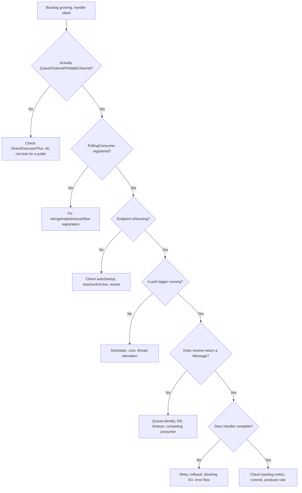
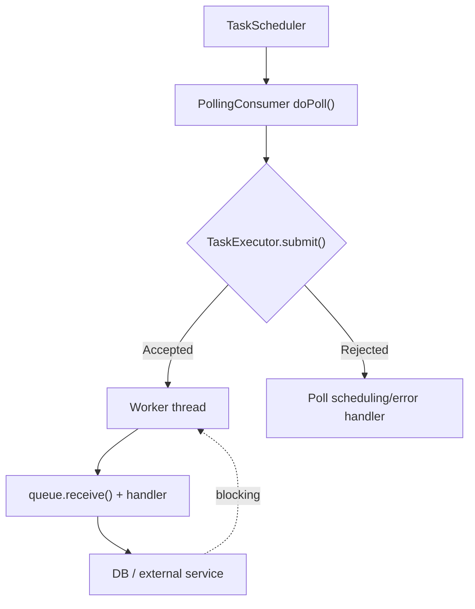
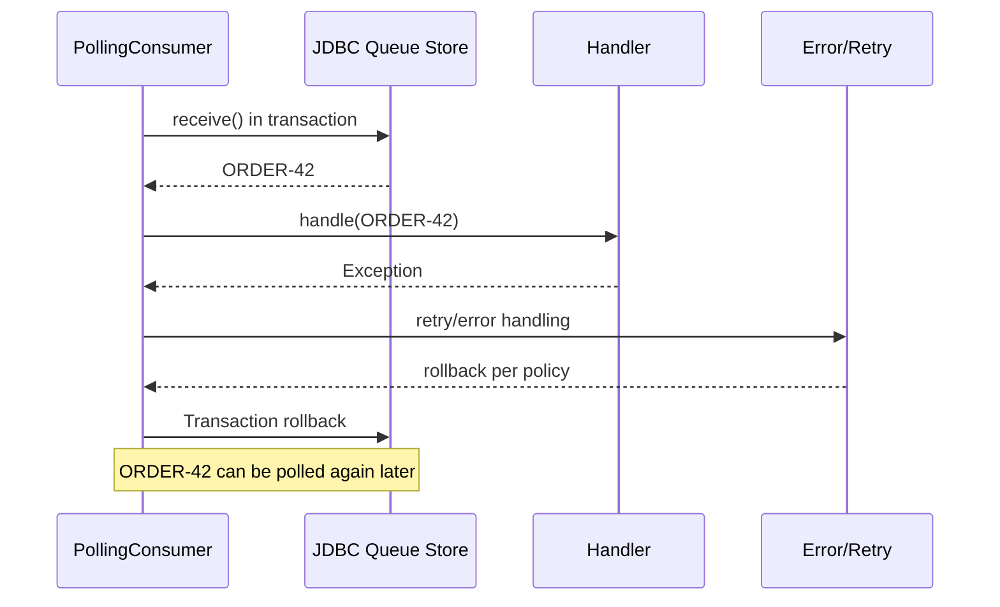

# Diagnosing Queued Messages Not Being Polled in Spring Integration

## 1. Symptom: Messages Sit in the Queue While the Handler Stays Silent

A dashboard reports **`ordersQueue backlog = 2,400`**, while `ordersWorker` logs no new processing. The producer continues to send successfully; after an application restart, the backlog grows even larger. An operator might immediately conclude "`QueueChannel` is broken." In reality, the root cause may lie in the endpoint/poller, scheduler, transaction, persistent store identity, or how the metric is measured.

In Spring Integration, a message typically follows this path:

```mermaid
flowchart LR
    A["Producer"] -->|send| B["QueueChannel / PollableChannel"]
    B -->|receive(timeout)| C["PollingConsumer"]
    T["TaskScheduler / Trigger"] -->|triggers| C
    C --> D["MessageHandler"]
    D --> E["Business DB / outbound adapter"]
    D -. "Exception / retry / rollback" .-> R["Error flow / recovery"]
```

**A message sitting in a queue does not invoke a handler on its own.** `QueueChannel` is a `PollableChannel`: the producer sends into the queue; a **polling consumer** must be created, started, and triggered by a scheduler to call `receive()` and hand the message off to the handler.

The lesson **"Diagnosing Queued Messages Not Being Polled in Spring Integration"** belongs to the **Debugging** chapter of the **SPRING_INTEGRATION_RUNTIME** module. Its goal is to isolate issues accurately along **channel → endpoint → poller → scheduler/executor → transaction/retry/error flow**, while preserving messages during inspection and handling post-restart scenarios.

> **Safety rule:** Never use `queue.receive()` to "check if there are messages" in production. `receive()` **consumes** a message; if the store is transactional and you are outside an appropriate transaction, the observation action itself can lose a work item. Start with counts, bean states, metrics, logs, and read-only store queries.

## 2. First Clarify What "Not Polling" Actually Means

A system can show an unshrinking backlog under several very different states:

| Scenario | `receive()` Operation | Handler | Common Symptoms |
| --- | --- | --- | --- |
| **A. No active polling consumer** | Not called | Not running | Missing/stopped endpoint, scheduler has not triggered |
| **B. Polling occurs but gets no message** | Called, returns `null` or errors | Not running | Wrong queue inspected, different region, DB unavailable, receive timeout |
| **C. Polled then failed/rolled back** | Returns message | Runs then fails | Same business ID repeats; backlog does not drop; retry/error logs |
| **D. Polled, processing very slowly** | Returns message | Currently running | Blocked thread, DB lock, remote API timeout; next poll delayed |
| **E. Another consumer took it first** | Current poller gets `null` | Handler on another instance | Competing consumers, per-node metrics mismatch |
| **F. Dashboard measures the wrong target** | Varies | May be running normally | Stale metrics, different queue, different region, sampled logs |

A report saying "the queue has 10 messages and the handler hasn't run" is only a **symptom**. You must collect **poll count**, **receive-returned-message count**, **handler-started count**, and **handler-committed count**; only by separating these four numbers can you pinpoint where progress stopped.

## 3. Quick Incident Triage Workflow



**The optimal diagnostic order** moves from relatively cheap structural checks to expensive, risky business checks: verify channel type, endpoint existence, lifecycle, poll schedule, `receive()`, and only then transactions/handlers.

### Non-Destructive Information to Capture Immediately

1. Timestamp, environment/instance name, and application version.
2. Channel bean ID, endpoint ID, flow ID, and `region`/table prefix if using JDBC.
3. Current backlog, oldest message age, and growth rate.
4. Endpoint state `isRunning()`, `isAutoStartup()`, and last state transition.
5. Last poll time; empty poll count, poll error count, and received message count.
6. Scheduler active/blocked threads and executor active/queued/rejected counts.
7. DB/broker error logs, transaction rollbacks, and error channel activity.
8. Whether other nodes are sharing the same queue.

For critical systems, capture logs, thread dumps, and metric snapshots before restarting the poller; restarting can destroy deadlock evidence or alter message redelivery order.

## 4. Verify the Channel Type Before Debugging a Poller

Spring Integration offers multiple channel types with different semantics.

| Channel | How consumers receive | Is a poller needed to read the channel? | Common confusion |
| --- | --- | --- | --- |
| `DirectChannel` | `SubscribableChannel`, dispatches to handler on caller thread | **No** | Stopping an endpoint can cause "no subscribers" send errors instead of a backlog |
| `ExecutorChannel` | Dispatches handler via `TaskExecutor` | **No** | "Queue full" is sometimes the executor's queue, not a `QueueChannel` |
| `PublishSubscribeChannel` | Broadcasts to subscribers | **No** | Multiple subscribers differ from competing consumers |
| `QueueChannel` | `PollableChannel.receive(timeout)` | **Yes**, when processed via a polling consumer | Messages stay in the queue with no handler running automatically |
| `PriorityChannel` | Pollable by priority | **Yes** | Dequeue order may differ from enqueue order |
| `RendezvousChannel` | Synchronous handoff, pollable | **Yes**, when using a polling consumer | Sender may block waiting for receiver; not meant for large backlogs |
| `FluxMessageChannel` | `Publisher<Message<?>>`, Reactive Streams subscription | Does not use a poller like a queue | Depends on subscription and demand |

Use `ApplicationContext` or the Integration Graph to verify the **actual bean class**. A bean named `ordersQueue` is not guaranteed to be a `QueueChannel` if a refactor replaced it with a `DirectChannel` or another gateway/channel.

### Distinguishing a Channel Queue from an Executor Queue

`ExecutorChannel` may use a `ThreadPoolTaskExecutor` with an internal task queue. A rising `executor.queue.size` metric means tasks are backed up **before the handler executes**, with no `PollableChannel.receive()` on that path.

Conversely, `QueueChannel` stores **messages**, and workers need a polling consumer. Both kinds of "backlog" can grow simultaneously, yet their fixes are completely different.

## 5. Properly Configuring QueueChannel and PollingConsumer

A Java annotation configuration clearly illustrates the parts:

```java
import org.springframework.context.annotation.Bean;
import org.springframework.context.annotation.Configuration;
import org.springframework.integration.annotation.MessageEndpoint;
import org.springframework.integration.annotation.Poller;
import org.springframework.integration.annotation.ServiceActivator;
import org.springframework.integration.channel.QueueChannel;
import org.springframework.integration.config.EnableIntegration;

@Configuration
@EnableIntegration
public class QueueConfiguration {

    @Bean("ordersQueue")
    public QueueChannel ordersQueue() {
        return new QueueChannel(500); // Bounded in-memory queue.
    }
}

@MessageEndpoint
class OrderQueueConsumer {

    private final OrderService orderService;

    public OrderQueueConsumer(OrderService orderService) {
        this.orderService = orderService;
    }

    @ServiceActivator(
            inputChannel = "ordersQueue",
            poller = @Poller(
                    fixedDelay = "1000",
                    maxMessagesPerPoll = "10",
                    receiveTimeout = "100"))
    public void handle(OrderCommand command) {
        orderService.process(command);
    }
}
```

`OrderCommand` and `OrderService` are application-defined business types; the service bean must be registered in the context. `@MessageEndpoint` requires matching component scanning. This example uses an in-memory queue for testing the poller; it **does not persist messages across restarts**.

With proper wiring:

1. The producer sends `Message<OrderCommand>` to the `ordersQueue` bean.
2. Spring Integration creates a polling consumer endpoint for `@ServiceActivator` because its input is a `PollableChannel`.
3. `TaskScheduler` invokes the poller according to `fixedDelay`.
4. On each cycle, the poller pulls up to 10 messages (or stops when `receive` returns no more messages), then calls the handler method.
5. If the handler throws an exception, error handling/rollback follows the configured error handler, advice, and transaction settings.

**Having a queue bean without a consumer/poller is not enough.** When using annotations, a frequent mistake is that the package containing `@MessageEndpoint` falls outside component scan scope.

### Equivalent XML Configuration

```xml
<int:channel id="ordersQueue">
    <int:queue capacity="500"/>
</int:channel>

<int:service-activator id="ordersQueueConsumer"
                       input-channel="ordersQueue"
                       ref="orderService"
                       method="process">
    <int:poller fixed-delay="1000"
                max-messages-per-poll="10"
                receive-timeout="100"/>
</int:service-activator>
```

This XML snippet is part of a Spring context with the `int` namespace; the `orderService` bean is defined by the application. `id="ordersQueueConsumer"` makes locating the endpoint easier. Do not configure **two identical polling consumers** in both Java and XML simultaneously unless competing consumers are intentional.

## 6. What Happens If a Poller Is Missing?

When a handler receives from a `PollableChannel`, Spring Integration requires either a specific poller configuration or an appropriate **global default poller**.

For XML/DSL, if a `PollingConsumer` has neither a poller nor a global default, the application context usually **fails at startup** due to a missing `Trigger`, rather than silently running a hidden poller. Still, you can encounter a backed-up queue in a running application if:

- The queue is a standalone bean with no endpoint connected to it.
- The endpoint is only created inside an **unregistered** dynamic flow.
- The endpoint was stopped by an operator or Control Bus.
- The flow has `autoStartup=false` or its registration has not called `start()`.
- A profile/condition prevented the consumer bean from being created.
- The endpoint's input channel name **differs** from the actual queue used by the producer.
- A default poller exists, but its trigger has not fired or the scheduler is inactive.

Therefore, do not just grep for `@Poller` in source code. Inspect the **runtime bean graph** to verify an actual `PollingConsumer` is attached to the exact channel ID and has a trigger.

### Global Default Poller

An application can define a global default poller for polling endpoints without their own configuration. In XML, use `<int:poller default="true" .../>`; in Java configuration, register a suitable poller bean per Spring Integration conventions.

If a global default exists, **do not assume** every endpoint uses the desired interval: an endpoint with its own poller overrides the default. An overly sparse default poller, misconfigured cron, or congested scheduler can slow down multiple flows at once.

## 7. Checking Whether the Endpoint Has Started

Many Spring Integration endpoints implement `SmartLifecycle`, which provides `start()`, `stop()`, `isRunning()`, and auto-start/phase metadata.

Safe observation example (adjust the bean ID for your application):

```java
import org.springframework.context.ApplicationContext;
import org.springframework.context.SmartLifecycle;

public final class PollerLifecycleProbe {

    private final ApplicationContext context;

    public PollerLifecycleProbe(ApplicationContext context) {
        this.context = context;
    }

    public String describe(String endpointBeanName) {
        SmartLifecycle endpoint =
                context.getBean(endpointBeanName, SmartLifecycle.class);

        return "endpoint=" + endpointBeanName
                + " running=" + endpoint.isRunning()
                + " autoStartup=" + endpoint.isAutoStartup()
                + " phase=" + endpoint.getPhase();
    }
}
```

This is read-only diagnostic code. The bean ID must be the **endpoint**, not the queue name or service object. In the XML from section 5, the ID is `ordersQueueConsumer`; with annotations or DSL, the framework may assign a different endpoint name.

### Reasons Why running=false

- `autoStartup=false` or the component was configured to start paused.
- Control Bus/JMX/management API called `stop()`.
- Dynamic `IntegrationFlowRegistration` was created with `autoStartup(false)`.
- The context is shutting down or the endpoint did not start due to an earlier startup error.
- A container/adapter has its own lifecycle; an external failure occurred and the app has not reconciled yet.
- An operator stopped the poller to handle downstream errors and forgot to resume it.

**Only call `start()` after verifying the root cause and ensuring downstream safety.** Re-enabling a poller can drain the entire backlog immediately, causing a traffic spike to the DB/HTTP service/broker.

### Control Bus Operations

In Spring Integration 6.4+/7.x, the Control Bus accepts managed commands in the form `beanName.methodName`, for example:

```text
ordersQueueConsumer.stop
ordersQueueConsumer.start
```

This is an administrative operation **that mutates runtime state**, not something to run merely for inspection. The older SpEL syntax `@ordersQueueConsumer.start()` belongs to legacy Control Bus usage and should not be applied verbatim to 6.4+/7.x. After restarting, measure backlog and failure rates; do not treat "command sent" as confirmation that the consumer is healthy.

## 8. When Does the Poller Actually Run?

A poller uses a `Trigger` such as `fixedDelay`, `fixedRate`, or `cron`:

| Property | Meaning | Common Pitfall |
| --- | --- | --- |
| `fixedDelay` | Waits a fixed duration after the previous run finishes before starting the next | Slow handlers delay the next poll |
| `fixedRate` | Schedules periodically; if threads are busy, runs may still slip | Expecting higher throughput than scheduler capacity |
| `cron` | Runs when the calendar expression matches | Wrong date/time/time zone, schedule only active during business hours |
| `initialDelay` | Delay before the first poll | Newly deployed and queue appears unpolled immediately |
| `maxMessagesPerPoll` | Maximum messages fetched per poll cycle | Too low slows backlog drain; too high hogs scheduler threads |
| `receiveTimeout` | Wait time for a polling consumer when the channel has no message | Many pollers waiting long can exhaust scheduler threads |
| `taskExecutor` | Executor used by the poller if configured | Executor rejects or queues up, making the scheduler look stuck |

### Subtle Detail: maxMessagesPerPoll Has Different Defaults

Spring Integration distinguishes:

- **`PollingConsumer`** (reading from `QueueChannel`/`PollableChannel`): defaults to `maxMessagesPerPoll = -1`, meaning it can keep receiving until `receive()` returns `null`.
- **`SourcePollingChannelAdapter`** (polling a `MessageSource`): defaults to `maxMessagesPerPoll = 1` in the documentation.
- Since Spring Integration 5.5, `maxMessagesPerPoll = 0` is documented as a way to **skip calling `MessageSource.receive()`** on inbound source adapters to pause pulling. **Do not mechanically apply that explanation to a QueueChannel `PollingConsumer`**; verify the specific handler and version.

If the queue continuously has messages and uses `-1`, a single poll can run for a very long time. To maintain fairness across multiple pollers, choose a reasonable positive bound and measure actual backlog and throughput.

### Backlog Calculation Example

Suppose a poller runs with `fixedDelay=1000 ms`, `maxMessagesPerPoll=5`, and each handler call takes 100 ms. Ignoring overhead, each cycle processes 5 messages in 500 ms and then waits roughly 1 second; actual throughput is about **3.3 messages/s**, lower than the naive assumption of "5 messages/s".

If the producer emits **10 messages/s**, the backlog grows by roughly **6.7 messages/s**; the poller **is still running normally** but cannot keep up. Increasing `maxMessagesPerPoll`, assigning a dedicated executor, or scaling only makes sense after identifying the bottleneck and ensuring downstream safety.

## 9. receiveTimeout: Queue Is Non-Empty Yet Another Poller Is Waiting?

`receiveTimeout` specifies the **maximum time a polling consumer waits for a message** when calling `receive()` on a wait-capable channel.

Example:

```xml
<int:service-activator id="fastQueueConsumer"
                       input-channel="ordersQueue"
                       ref="orderService"
                       method="process">
    <int:poller fixed-delay="1000"
                receive-timeout="100"
                max-messages-per-poll="5"/>
</int:service-activator>
```

In most configurations, if the queue already holds a message, `receive()` returns immediately; `receiveTimeout` does not make the handler wait 100 ms every time. When the queue is empty, the polling thread can wait up to the timeout. When multiple pollers share a scheduler, those waiting threads still occupy resources during the wait.

Per the reference documentation, the default `receiveTimeout` of a polling consumer is **1 second**. When many pollers run concurrently, a small scheduler pool can be tied up by waiting calls, preventing other endpoints from being triggered on schedule.

### Long Polling vs. Continuous Polling

- Long `fixedDelay` + short `receiveTimeout`: threads rarely block waiting, but messages arriving between polls wait longer.
- Short `fixedDelay` + long `receiveTimeout`: reacts quickly to new messages, yet holds threads waiting longer.
- Polling file sources typically return immediately when no files exist; `receiveTimeout` on such adapters does not carry the same blocking-wait semantics as `QueueChannel`.

Choose timeouts and scheduler pool size based on endpoint count, load, and latency SLA; do not tweak `receiveTimeout` blindly as a speed knob.

## 10. TaskScheduler Starvation: Poller Running Without Execution Turns

Spring Integration provides a shared task scheduler (conventionally bean name `taskScheduler`). Per the reference documentation, the default is typically `ThreadPoolTaskScheduler` with a pool of **10 threads** in the documented default setup; if the application defines a custom `taskScheduler` bean, its size/autoStartup may differ.

Typical incident:

```text
taskScheduler pool: 10 threads
  8 threads: pollers waiting on long receiveTimeout
  1 thread : file adapter blocking on I/O
  1 thread : JDBC handler taking 60 seconds
  -------------------------------------
  ordersQueueConsumer: scheduled, no free thread available
```

The `ordersQueue` backlog grows even though `ordersQueueConsumer.isRunning() == true` because **registering a scheduled task does not prove a thread is executing that task on time**.

### Signs of Scheduler Congestion

- Multiple polling endpoints lag simultaneously, not just one flow.
- Thread dumps show `taskScheduler-...` threads parked in `QueueChannel.receive`, JDBC calls, or blocking HTTP calls.
- Active scheduler threads gauge stays pegged at pool size for extended periods.
- Actual poll intervals far exceed `fixedDelay`/`fixedRate`.
- When another endpoint is stopped or an HTTP call times out, queues suddenly resume polling.
- Not necessarily accompanied by ERROR logs; threads simply are not free.

### How to Handle It

1. Use thread dumps/profilers to identify **who is hogging the scheduler**, rather than just inflating pool size.
2. Reduce `receiveTimeout` where appropriate; avoid hundreds of pollers waiting for long periods simultaneously.
3. For blocking/long handlers, configure a **dedicated `TaskExecutor`** for the polling consumer or design an async boundary with backpressure.
4. Configure timeouts on DB/HTTP clients so one poller cannot hold a thread indefinitely.
5. Bound executor concurrency/queue size so congestion is not merely shifted into another pool.
6. Monitor dynamically created endpoint counts and scheduler capacity across the cluster.

**Caution:** Moving handler execution from the scheduler to an executor can alter transaction boundaries and error handling. With a JDBC-backed `QueueChannel`, re-test ack/dequeue/rollback/duplicate behavior whenever adding a task executor.

## 11. TaskExecutor Saturation and Rejection

A poller may be triggered on schedule yet fail to submit work to an executor:

- `ThreadPoolTaskExecutor` runs out of active threads.
- Task queue is full; rejection policy throws `TaskRejectedException` or `RejectedExecutionException`.
- Worker threads are blocked on database locks or remote APIs.
- Executor was shut down/stopped while the poller is still running.

Diagram:



Exact ordering between `submit` and `receive` depends on polling endpoint configuration and framework internals. When a poller has an executor, do not assume the scheduler thread is directly executing the message; inspect the actual stack.

**Do not set an unbounded queue capacity to hide saturation.** That only postpones the problem and can turn an in-memory task queue into an OOM. Instead, enforce rate limits, timeouts, observable rejections, and backpressure handling.

## 12. Wiring Mismatch: Producer Sends to One Queue, Poller Reads Another

A very common bug when multiple beans share the same type:

```text
Producer → "ordersQueue"       (QueueChannel A, 200 messages)
Consumer ← "orderQueue"        (QueueChannel B, 0 messages)
```

A missing `s`, a differing namespace prefix, or a wrong `@Qualifier` annotation creates two paths that never meet.

Other sources of confusion:

- Beans in a parent context and child context share the same name yet are distinct instances.
- A dynamic `IntegrationFlow` creates its **own input channel**, while the producer sends to the old bean.
- `@ServiceActivator(inputChannel="...")` is off by a single character.
- The producer sends to a `PriorityChannel` or `ExecutorChannel` instead of the measured queue.
- A router picks a different output channel than expected.
- A new version was deployed with a renamed channel ID while backlog remains in the old store.
- The poller is running on instance B while the dashboard inspects the bean on instance A.

### Non-Destructive Diagnosis

```java
import org.springframework.context.ApplicationContext;
import org.springframework.integration.channel.QueueChannel;

public final class QueueIdentityProbe {

    private final ApplicationContext context;

    public QueueIdentityProbe(ApplicationContext context) {
        this.context = context;
    }

    public int queued(String channelBeanName) {
        QueueChannel queue =
                context.getBean(channelBeanName, QueueChannel.class);
        return queue.getQueueSize(); // Reads count only, does NOT dequeue.
    }

    public boolean sameBean(String first, String second) {
        return context.getBean(first) == context.getBean(second);
    }
}
```

`QueueChannel.getQueueSize()` reflects the number of messages in the channel according to its implementation. With external stores or concurrent consumers, this value is a **snapshot** that can change immediately after reading; do not rely on it as a transactional invariant.

Cross-check the runtime graph `input-channel → consumer endpoint` against producer/router logs. If you need to inspect a specific message, use **correlation logs/traces or read-only store queries**; never call `receive(0)`, because even with a timeout of 0 it still dequeues and consumes a message if one is present.

## 13. Persistent QueueChannel: Rows Exist in DB Yet Poller Sees Nothing

In-memory queues differ from queues backed by `JdbcChannelMessageStore`. Spring Integration recommends `JdbcChannelMessageStore` for DB-backed channels.

```xml
<!-- Illustrative snippet; requires Spring Integration schema and namespace. -->
<bean id="ordersChannelStore"
      class="org.springframework.integration.jdbc.store.JdbcChannelMessageStore">
    <constructor-arg ref="dataSource"/>
    <property name="region" value="ORDERS_V1"/>
    <property name="channelMessageStoreQueryProvider"
              ref="ordersSqlQueryProvider"/>
</bean>

<int:channel id="ordersQueue">
    <int:queue message-store="ordersChannelStore"/>
</int:channel>
```

You must have `spring-integration-jdbc`, the standard schema, the SQL query provider matching your database, a datasource/transaction manager, and appropriate SELECT/INSERT/DELETE privileges. **Do not declare `capacity` alongside `message-store` in XML `<int:queue>`**.

### Data in the DB Does Not Mean the Consumer Can See It

The store can partition records by:

- **Channel name / group ID**.
- **Region**, such as `ORDERS_V1`.
- Table prefix/schema and datasource.
- SQL query provider clauses, transactions, and locking.

For example, an old version used `ordersQueue + ORDERS_V1`, and a new version reads `ordersQueueV2 + ORDERS_V2`: the old rows remain in the DB, yet the new consumer cannot see them under the new store identity.

**Do not change the region just to "test a fix."** First compare pre/post-deploy configs, tables/regions, row counts per queue, and DB permissions. If migration is needed, plan carefully to avoid duplicate reads or lost messages while two versions overlap.

### Query Provider and Schema Traps

`JdbcChannelMessageStore` uses a `ChannelMessageStoreQueryProvider` matching the SQL dialect. A provider mismatched with the database or missing schema/indexes can cause polling SQL failures or transaction lock issues.

Since Spring Integration 6.2, JDBC stores verify table existence at `start()` time in some implementations; if the schema is missing, this can cause **application context startup failure** rather than silent execution. Even so, post-startup DB failures or datasource misconfigurations can still stall the poller.

When multiple instances read the same DB, row locks, isolation/MVCC behavior, connection pool starvation, or deadlocks can occur. Do not assume "queue is empty" just because a query returns 0 on a connection running under an inappropriate transaction/isolation level.

## 14. Transaction Rollbacks Creating the Illusion of "Not Polling"

When a polling consumer dequeues a message and the handler fails, if `receive()` and the handler participate in the same suitable transaction, the dequeue operation can roll back. The message **returns to an unconsumed state** in the DB.



Symptoms:

- Backlog does not decrease even though the poller runs.
- The same `businessId` appears repeatedly in attempt logs.
- DB shows many rolled-back transactions.
- `handler_attempts_total` climbs while `business_commits_total` stays flat.
- A "poison message" occupies the head of the queue, delaying subsequent messages depending on queue/ordering/locking.

**Another case:** retry advice with a `RecoveryCallback` absorbs the exception, sends an `ErrorMessage` to a failure channel, and returns normally. The poller transaction may **commit**; the queue shrinks while the business operation still failed. This is not "message wasn't polled," but **handled according to recovery policy**.

### Read the Error Flow Accurately

- With a synchronous `DirectChannel`, exceptions usually return to the sending thread.
- With a poller using `MessagePublishingErrorHandler`, exceptions can become an `ErrorMessage` published to the error channel.
- `RequestHandlerRetryAdvice` can retry and then route to a **dedicated recovery channel**.
- If the error channel consumer only logs and returns normally, that does not prove the failure record was durably persisted.

When debugging backlogs, inspect **poller error logs, retry counts, transaction outcomes, and the DLQ**, not just the global `errorChannel`.

## 15. Poller Actually Triggers Yet the Handler Never Starts

Less obvious causes:

1. `receive()` returns `null` due to wrong store identity/region or another consumer draining the queue.
2. `receive()` throws an exception (JDBC connection, message deserialization, permissions).
3. Polling advice/filter blocks execution before the handler.
4. Input message conversion/parameter mapping is incompatible with the `@ServiceActivator` method; the error occurs before entering the handler body.
5. The endpoint is created properly, yet the target handler reference is not the expected bean.
6. The message is filtered/discarded or routed to a different branch.
7. The transaction interceptor fails to begin before entering the handler.
8. The thread is interrupted/stopped while waiting in receive.
9. `TaskExecutor` rejects the task before polling/dispatching depending on topology.

Therefore, **having no DEBUG log at the top of the handler method** is insufficient to conclude "the poller isn't running." Place signals across multiple boundaries: **poll triggered → receive returned message → handler entered → handler completed → business commit**.

Do not leave full DEBUG enabled for hours: logging every message can cause log storms, add latency, or even mask the original issue. Scope logging to narrow endpoints/packages and log correlation IDs instead of full payloads/PII.

## 16. How to Observe a Poller Non-Destructively

A recommended set of application-defined metrics:

| Metric | Type | Purpose |
| --- | --- | --- |
| `app.integration.queue.depth` | Gauge | Current backlog |
| `app.integration.queue.oldest_age` | Gauge | Age of oldest message by enqueue timestamp |
| `app.integration.poll.triggered` | Counter | Poll cycles actually triggered by the scheduler |
| `app.integration.poll.empty` | Counter | Polls where `receive() == null` |
| `app.integration.poll.received` | Counter | Messages successfully retrieved |
| `app.integration.handler.started` | Counter | Handler invocations started |
| `app.integration.handler.completed` | Counter | Handler invocations succeeded at the defined boundary |
| `app.integration.handler.failed` | Counter | Handler errors thrown, counted per attempt |
| `app.integration.tx.rollback` | Counter | Transaction rollbacks |
| `app.integration.executor.rejected` | Counter | Tasks rejected by the executor |
| `app.integration.poll.last_success_age` | Gauge | Elapsed time since the last poll that received a message |
| `app.integration.dlq.committed` | Counter | Failure records durably persisted |

**The names above are examples, not built-in meters across all versions.** With Micrometer/Observation, Spring Integration already provides built-in instrumentation for channels/handlers/sources in many cases; however, measuring "which polls were empty" or "oldest message age" specifically may require additional application instrumentation or reading from the broker/store.

### Queue Depth Gauge with Micrometer

```java
import io.micrometer.core.instrument.MeterRegistry;
import io.micrometer.core.instrument.Tags;
import org.springframework.integration.channel.QueueChannel;

// ordersQueue is an existing singleton bean in the ApplicationContext.
// registry is the MeterRegistry provided by Spring/Micrometer.
registry.gauge(
        "app.integration.queue.depth",
        Tags.of("queue", "ordersQueue"),
        ordersQueue,
        QueueChannel::getQueueSize);
```

This metric **does not consume messages**. However, it does not show the oldest message age or whether the poller is running; nor does it replace business commit counters.

In multi-instance deployments, each instance has its own in-memory queue, so you must know **which node's queue** a metric reflects. With a shared JDBC store, instances view the same backlog; avoid **summing** the same shared queue depth across nodes and mistaking it for multiplied messages.

### Minimal Structured Debug Log

```json
{
  "time": "2026-11-22T10:18:31Z",
  "level": "DEBUG",
  "event": "poll_received",
  "flow": "orders",
  "endpoint": "ordersQueueConsumer",
  "channel": "ordersQueue",
  "instance": "worker-2",
  "messageId": "spring-message-id",
  "businessId": "ORDER-42",
  "correlationId": "checkout-42",
  "thread": "taskScheduler-4"
}
```

This log format is **illustrative**. Record `messageId`, `businessId`, and correlation IDs in access-controlled logs/traces; **do not export them as high-cardinality Micrometer tags**.

## 17. A Custom Hook to Know Whether the Poller Runs

If you want a probe right at the poll boundary, you can use **poller advice** or endpoint instrumentation infrastructure. The goal is to distinguish "scheduler did not fire" from "poll fired but receive returned nothing."

A solid instrumentation design should measure:

```text
Scheduled poll START
    |
    v
receive() called
    |--- null → empty_poll++
    |--- exception → poll_errors++
    |--- Message<?> → poll_received++
                           |
                           v
                     handler attempt
                       |        |
                    success   failure
                       |        |
                    commit    retry/rollback
```

**Do not place the poll metric inside the handler and call it the poll count.** The handler only runs once a message has already been received and handed over. Empty polls or errors before the handler will go uncounted.

When using a custom `MethodInterceptor`/poller advice, pick the right placement and scope. Some advice wraps `doPoll()` across an entire trigger cycle, while other advice wraps the handler invocation; they measure **different units**. If transaction advice is also present, advice ordering governs whether errors propagate and whether timings include retry/backoff.

### Easy-to-Deploy Boundary Log Probe

You can temporarily raise log levels on poller/scheduler packages in a test environment or a selected instance. Combine that with a log at **handler entry**, DB trace/error logs, and backlog metrics. Include the thread name in logs to distinguish scheduler threads from executor threads.

Once the incident is isolated, revert DEBUG levels rather than relying permanently on verbose logs to measure throughput.

## 18. Diagnosing the Scheduler with Thread Dumps

If an endpoint has `isRunning=true` yet emits no poll logs, take a thread dump right as the backlog grows (via authorized JVM/management tools):

- Look for threads named `taskScheduler-...`, `pool-...`, or your configured thread prefix.
- Count threads in `RUNNABLE`, `WAITING`, `TIMED_WAITING`, and `BLOCKED` states.
- Inspect stack frames for `QueueChannel.receive`, `PollingConsumer`, JDBC pools, blocking HTTP socket reads, or locks.
- Identify threads waiting on the same database lock or connection pool.
- Take repeated thread dumps a few seconds apart to tell **normal waiting** from **prolonged stalls**.
- Cross-check against `maxMessagesPerPoll`, `receiveTimeout`, and the number of pollers sharing `TaskScheduler`.

**Do not assume every TIMED_WAITING thread is a bug.** A poller waiting up to `receiveTimeout` when its queue is truly empty is normal. It becomes suspicious when **the queue that consumer is supposed to read has a backlog**, or when threads are waiting on the wrong queue/source and starving other endpoints.

### Clock and Cron Issues

If a cron expression only runs during certain hours or uses an unexpected time zone, thread dumps can look completely healthy. Check the trigger, zone, last/next scheduled execution, and clock/time sync. A time zone difference between dev and production can turn "every minute" into "only a specific window of the day."

## 19. MessageGroup and Metadata: Do Not Confuse Them with QueueChannel Backlog

Not every message sitting in the database is **waiting to be polled**.

| Data seen in DB | Meaning | Who processes it next? |
| --- | --- | --- |
| JDBC channel store rows | Messages waiting in a persistent `QueueChannel` | `PollingConsumer` for that specific channel |
| `JdbcMessageStore`/`MessageGroupStore` rows | Aggregator/resequencer holding fragments | Correlation handler/release strategy/reaper |
| `JdbcMetadataStore` records | Checkpoints/accept-once/idempotency markers | Inbound adapter/selector or application |
| Outbox rows | Business events awaiting publication | Outbox publisher/worker |
| DLQ/failure records | Isolated failed messages | Replay/admin/recovery worker |

An aggregator group holding 2 of 3 fragments may sit idle **by design** until the final fragment arrives or the expiry/reaper runs. Adding more poller threads to `ordersQueue` will not help an aggregator release an incomplete group.

Similarly, a file marked "accepted" in metadata will not be re-polled by the source; that is a filter/checkpoint behavior, not a `QueueChannel` holding an unreadable file.

## 20. Classic Test Case: Poller Alive Yet Backlog Growing

Suppose 60-second metrics show:

```text
incoming_rate            = 40 messages/s
polling_consumer_running = true
poll_triggered           = 30/minute
poll_received            = 300/minute
handler_success          = 290/minute
handler_failed           = 10/minute
queue_depth              = 1200 → 3300
```

If measured accurately, the poller received **5 messages/s** while the producer generated **40 messages/s**, giving a theoretical backlog growth of **35 messages/s**, or **2,100 messages/minute**. The jump from 1,200 to 3,300 matches. The problem is **throughput/capacity**, not a missing poller.

Remediation options include checking handler latency, batch size, scheduler/executor sizing, DB throughput, and producer rate limiting; only scale consumers once transactions, downstream systems, and retry/idempotency are safe.

### When Receives Rise While Handler Success Stays at 0

This can happen due to errors during poller-to-handler handoff (payload conversion), handlers always throwing, or recovery callbacks swallowing exceptions after the source polled. Check `handler_started`, `attempt_failure`, `tx_rollback`, and `DLQ_committed`; do not look at backlog alone.

### When Queue Depth Drops While Business Commits Stay at 0

The poller pulled the messages, yet handlers may be routing them to discard/recovery branches or acking too early without business commits. This is a **risk of silent business loss**—prioritize inspecting error/transaction paths rather than celebrating the shrinking backlog.

## 21. Root Causes Ordered by Priority

| Level | Symptom | Quick Check | Resolution Path |
| --- | --- | --- | --- |
| P0 | Queue has backlog, endpoint bean missing | Runtime graph / bean registry | Fix component scan, profiles, dynamic flow registration |
| P0 | Endpoint `isRunning=false` | Lifecycle/management audit | Confirm stop reason; start in a controlled manner |
| P0 | Poller attached to wrong channel | Producer route vs. endpoint input-channel | Fix wiring/bean ID |
| P0 | `TaskScheduler` inactive | Scheduler bean state, thread dump | Fix `autoStartup`/pool/trigger |
| P1 | Trigger too infrequent / wrong cron | FixedDelay/cron/zone/last poll | Fix schedule, verify with tests |
| P1 | Scheduler threads starved | Thread dump + pool stats | Reduce blocking, offload to executor/resize |
| P1 | `TaskExecutor` rejecting | Rejection logs, active/queue metrics | Quotas, backpressure, executor policy |
| P1 | Wrong JDBC store region/schema/provider | Read-only SQL/bean config | Restore store identity, schema/query provider |
| P1 | DB pool/locks blocking poll | DB waits, connection pool, tx logs | Fix connections/isolation, retries |
| P1 | Receive gets messages but handler throws | Attempts, exceptions, rollbacks | Fix handler, DLQ, idempotency |
| P2 | Queue grows due to slow consumer | Ingress vs. processed rate | Throughput/capacity planning |
| P2 | Messages taken by another consumer | Multi-node/competing consumers | Check node/partition ownership |
| P2 | Dashboard stale/wrong queue | Scrape timestamps/tags | Fix instrumentation and aggregation |

**Priority levels are only triage conventions**; adjust them to your SLO and business impact. A payment downstream stuck in infinite retries may demand P0 attention even though the scheduler is running.

## 22. Production Incident Runbook Template

Upon receiving an alert `ordersQueue oldestAge > 10m`:

1. **Confirm the alert:** Are backlog and oldest age still rising over 5 minutes? Does it match ingress vs. commit rates?
2. **Scope the incident:** Which exact channel/region, app instances, and consumer endpoints are affected?
3. **Preserve messages:** Do not run `receive()`, `purge()`, delete DB rows, or change regions during investigation.
4. **Verify lifecycle:** Do the beans exist, are they running, and is polling scheduled/started?
5. **Verify last poll:** Were there recent triggers, empty polls, poll errors, or received messages?
6. **Check resources:** Scheduler thread dumps, executor saturation, DB pool/locks, CPU/memory/GC.
7. **Trace the handler path:** Retries/rollbacks/DLQ and business commit counts.
8. **Pick the lowest-risk action:** Start the endpoint if genuinely stopped; fix schedules/timeouts; scale capacity safely; restore DB health; isolate poison messages via business mechanisms.
9. **Verify after fix:** Backlog depth/oldest age must drop, business commits must rise, and errors/retries must not spike abnormally.
10. **Write postmortem:** Root cause, metrics/log/trace evidence, configuration changes, and prevention steps.

### If You Must Restart the Poller

- Determine whether messages are currently in-flight; stopping does not mean in-flight work has completed.
- For brokers/DBs, understand ack and transaction rollback/redelivery behavior.
- With multiple app instances, avoid two operators toggling start/stop concurrently or unexpectedly scaling concurrent consumers.
- After starting, verify both `isRunning` **and** readiness/handler progress.
- Do not use "restart the whole JVM" as your first step; it can erase scheduler starvation evidence and disrupt unrelated flows.

## 23. Hands-On Labs: Building Reproducible Failures

### Lab A — QueueChannel Without a Consumer

1. Create bean `ordersQueue = new QueueChannel(50)` without any downstream `@ServiceActivator`/flow.
2. Send 3 messages with business IDs `A`, `B`, `C`.
3. Use `getQueueSize()` to confirm backlog = 3.
4. Inspect the bean registry/runtime graph and verify no polling consumer is attached.
5. Add `@MessageEndpoint` with `@ServiceActivator(poller=@Poller(...))` as in section 5.
6. Start the updated context and observe the handler receive the 3 messages (if sharing the same in-memory context; after a process restart you must resend because the old RAM queue is lost).

**Expected takeaway:** a queue by itself does not create a consumer; component scanning and endpoint configuration govern polling.

### Lab B — PollingConsumer Stop/Start

1. Use the XML in section 5 with ID `ordersQueueConsumer`.
2. Send 1 message and verify the handler receives it while running.
3. Call `SmartLifecycle.stop()` in a test environment.
4. Enqueue 5 more messages; verify backlog increases.
5. Confirm `isRunning=false`; call `start()`.
6. Observe the backlog drain, recording handling latency and receive order.

**Expected takeaway:** stopping a poller does not clear an in-memory queue within the same JVM. Restarting the process with an in-memory queue will lose that backlog.

### Lab C — Trigger, Timeout, and maxMessagesPerPoll

1. Configure a consumer with `fixedDelay=5000`, `maxMessagesPerPoll=1`, and a 100 ms handler.
2. Enqueue 20 messages and record throughput and backlog.
3. Try `fixedDelay=1000`, `maxMessagesPerPoll=5`, `receiveTimeout=100`.
4. Measure actual poll timings; distinguish fixed delay after completion from fixed rate.
5. Use a separate `SourcePollingChannelAdapter` to observe the default of 1 and the pause behavior of `maxMessagesPerPoll=0` in supported versions.
6. Do not extrapolate the source adapter's `0` setting to a `PollingConsumer` reading a queue.

**Expected takeaway:** a poller does not need exceptions to run **too slowly**; schedule and batch size dictate speed.

### Lab D — Scheduler Starvation

1. Create a small lab-only scheduler pool, such as 2 threads.
2. Register multiple queue-based polling consumers with long `receiveTimeout` values.
3. Let the other pollers sit waiting on empty queues while `ordersQueue` has messages.
4. Capture thread dumps, measure last poll time, and check queue age.
5. Lower receive timeouts or provide a suitable task executor, then observe the poller recover.
6. Note the impact on transaction/error flows when offloading processing to an executor.

**Expected takeaway:** `isRunning=true` can still fail to execute timely polls.

### Lab E — JDBC Store, Region, and Restart

1. Configure `JdbcChannelMessageStore` with the proper database schema/provider and region `ORDERS_V1`.
2. Send messages to the persistent `QueueChannel` and verify the enqueue commit.
3. Stop the consumer and restart the app with the same datasource/channel name/region.
4. Start the consumer and verify the messages are picked up.
5. Try changing the region in staging; observe old data is not read by the new region even though DB rows remain.
6. Make the DB unavailable and inspect poll exceptions, transaction rollbacks, and recovery once DB connectivity returns.

**Expected takeaway:** a persistent store protects committed data, yet store identity/schema/worker lifecycle determine readability across restarts.

### Lab F — Poison Message and Transaction Rollback

1. Use a transactional poller with a handler that always throws for `businessId=POISON-1`.
2. Track every `poll_received` and `handler_failed`; confirm the queue entry may remain after rollback.
3. Send message `OK-2` behind it and observe head-of-line blocking/starvation behavior depending on store and policy.
4. Cap retries, persist failure records durably to a DLQ, and confirm the sink committed before treating source work as done.
5. Re-run with an idempotent handler and check business outcomes.
6. Never resolve this by manually deleting `POISON-1`'s row without a replay/audit plan.

**Expected takeaway:** an unshrinking backlog can be caused by **polling followed by transaction rollback**, not a missing scheduler.

### Lab G — Two Consumers on the Same Queue

1. Create one `QueueChannel` and two polling consumers with distinct IDs, or two app instances sharing a suitable JDBC channel store.
2. Enqueue 100 messages with unique business IDs.
3. Count how many messages each consumer/instance receives.
4. Verify point-to-point queue semantics: a single message is not broadcast to both like `PublishSubscribeChannel`.
5. Observe idempotency, transactions, and behavior when killing one consumer mid-processing.
6. Compare per-node queue depth metrics: do not sum two readings of the same shared DB queue as if they were independent sources.

**Expected takeaway:** consumer A having 0 processed messages is not necessarily an error if consumer B consumed everything; consider topology and load balancing.

### Lab H — Observing Non-Destructively

1. Populate a queue with 10 messages.
2. Call `getQueueSize()`; cross-check metrics and enqueue logs.
3. Record `MessageHeaders.ID` from producer logs instead of calling `receive()` just to inspect.
4. For a JDBC store, run a read-only row count query grouped by region/channel per your schema version without modifying rows.
5. Test `queue.receive(0)` **only on an isolated lab queue**, observing queue size drop by 1 to understand the risk.
6. Document a production runbook forbidding `receive()`, `purge()`, and manual cleanup during diagnosis.

**Expected takeaway:** operators know how to separate **inspection** from **consumption**.

## 24. Pre-Conclusion Root Cause Checklist

- **Right channel type?** `PollableChannel` or executor/Direct/Flux?
- **Right channel ID?** Do producer, router, and polling consumer reference the same bean/region?
- **Does the endpoint exist?** Was `@MessageEndpoint` scanned, or the dynamic `IntegrationFlow` registered?
- **Is the endpoint running?** `autoStartup`, management stop, phase, and desired state?
- **Is the trigger firing?** Fixed delay/rate, cron/timezone, scheduler startup?
- **Does the scheduler have enough threads?** Are threads stuck in `receiveTimeout`, JDBC, HTTP, or a deadlock?
- **Is the executor rejecting?** Capacity, worker saturation, thread lifecycle?
- **Is the poller getting messages?** Does `receive()` return a message, `null`, or throw an exception?
- **Is the persistent store right?** DataSource, schema, query provider, region, channel name, transaction?
- **Are other consumers present?** Competing consumers/instances or another route?
- **Did the handler run and roll back?** Retries, poison messages, error handler swallowing exceptions?
- **Is the backlog growing from slowness?** Is ingress rate higher than commits/second?
- **Was inspection safe?** No messages consumed or deleted solely for debugging?
- **Was recovery proven?** Backlog age decreasing, terminal outcomes increasing, no lost/duplicated side effects?

## 25. Summary

When messages sit in a `QueueChannel` and appear "not polled," do not rush to restart the JVM or purge the queue. Verify **whether a polling consumer exists, whether the endpoint is running, whether TaskScheduler/TaskExecutor triggers polls on schedule, whether `receive()` returns messages, whether the handler finishes, and whether transactions commit**.

Branches to distinguish clearly:

- **Not polling**: endpoint was never created/started, or scheduler/trigger is not firing.
- **Empty polls**: wrong channel/region, store/DB error, another consumer took the message, or metrics measure the wrong target.
- **Polling then rolling back**: handler fails, transaction rolls back, and message is re-queued/redelivered.
- **Slow polling**: scheduler starvation, `receiveTimeout`, small batch size, or overloaded executor/downstream.
- **No business outcome**: error/recovery/transaction semantics diverge from raw receive counts.

Spring Integration runtime debugging works best with **per-boundary metrics, correlation-ID logs, timely thread dumps, read-only store inspection, and restart/idempotency tests**. Every configuration change should be evaluated for both throughput and business correctness, because "the poller is running again" does not guarantee "messages are processed exactly once."

## References

- [Spring Integration Reference — Message Endpoints and Poller Configuration](https://docs.spring.io/spring-integration/reference/endpoint.html)
- [Spring Integration Reference — Configuring the Task Scheduler](https://docs.spring.io/spring-integration/reference/configuration/namespace-taskscheduler.html)
- [Spring Integration Reference — Channel Adapter and maxMessagesPerPoll](https://docs.spring.io/spring-integration/reference/channel-adapter.html)
- [Spring Integration Reference — Configuring Message Channels](https://docs.spring.io/spring-integration/reference/channel/configuration.html)
- [Spring Integration Reference — Message Channel Implementations](https://docs.spring.io/spring-integration/reference/channel/implementations.html)
- [Spring Integration Reference — JDBC Message Store](https://docs.spring.io/spring-integration/reference/jdbc/message-store.html)
- [Spring Integration Reference — Transaction Support](https://docs.spring.io/spring-integration/reference/transactions.html)
- [Spring Integration Reference — Error Handling](https://docs.spring.io/spring-integration/reference/error-handling.html)
- [Spring Integration Reference — Metrics and Management](https://docs.spring.io/spring-integration/reference/metrics.html)
- [Spring Integration Reference — Control Bus](https://docs.spring.io/spring-integration/reference/control-bus.html)
