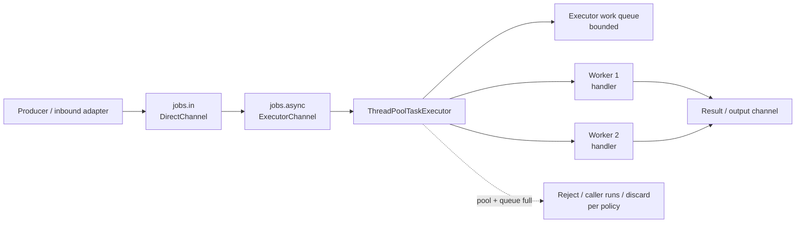
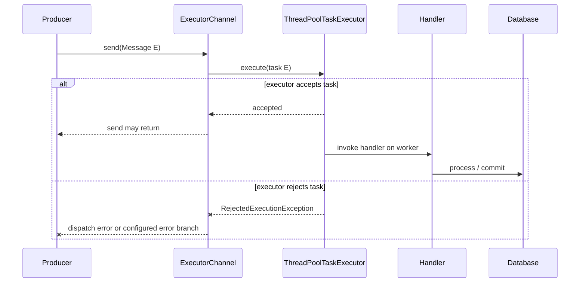
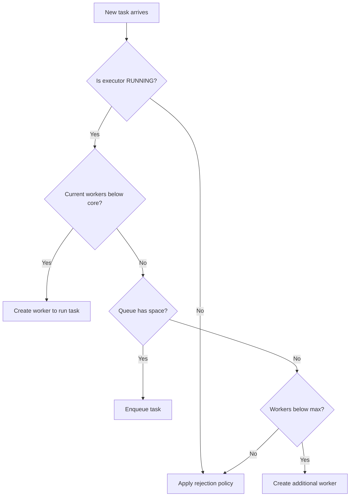
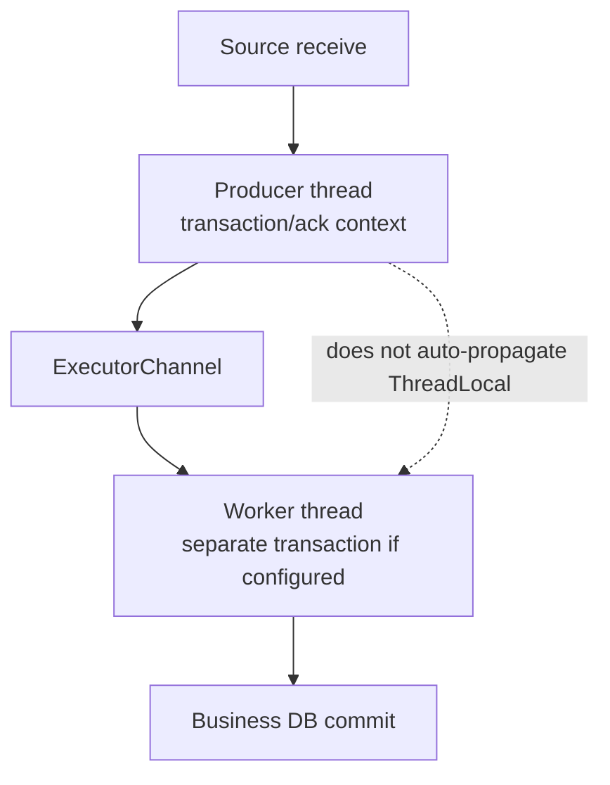
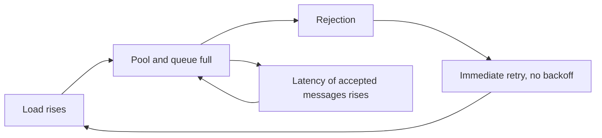

# Diagnosing Full or Rejecting Executors

## 1. Problem: Messages Are Sent Yet Workers Stop Accepting More

In Spring Integration, an `IntegrationFlow` can receive messages through a `DirectChannel`, hand work off to an `ExecutorChannel`, or trigger a polling consumer using a task executor. When message volume spikes, downstream slows down, or the thread pool is misconfigured, the executor can **run out of capacity to accept additional work**.

For example, an invoice-processing flow receives 300 messages/second, yet each message must wait on a database or HTTP API. Once all workers are busy and the executor queue is full, submitting a new task may throw `TaskRejectedException` or `RejectedExecutionException`, follow another rejection policy, or shift execution onto the producer's thread.

Operators commonly see one or more of these symptoms:

- Logs contain `TaskRejectedException`, `RejectedExecutionException`, or "executor did not accept task" messages.
- `ExecutorChannel` fails during dispatch, while the business handler sometimes never runs.
- Active threads equal the maximum worker count, the queue is full, and latency climbs.
- Broker lag, `QueueChannel` backlog, or poller wait times rise.
- The producer/gateway slows down noticeably after changing the rejection policy.
- No obvious exception appears, yet some messages never reach downstream because a policy drops tasks.

This lesson belongs to the **Debugging** chapter of the **SPRING_INTEGRATION_RUNTIME** module: investigating message coordination across channels, endpoints, consumers, pollers, and executors; and the effects on transactions, retries, message stores, error channels, correlation, flow lifecycle, and runtime performance.

**Goal:** read saturation signals accurately, pinpoint which thread pool has the problem, reproduce the failure in a controlled manner, distinguish rejections from business processing failures, and fix the root cause without losing messages or causing a retry storm.

> **Key principle:** A successful `send()` does not mean **the handler completed**, and `RejectedExecutionException` is not automatically a handler bug. Locate the exact boundary between **message intake**, **executor task submission**, **handler execution**, **business commit**, and **acknowledgement**.

## 2. Where Does the Executor Sit in a Message Flow?



**`ExecutorChannel`** uses an `Executor` to dispatch messages to subscribers/handlers. If the thread pool still has room to accept tasks, the `send` call can return **before** the handler finishes. When the worker pool or queue saturates, task **submission** can fail right at the dispatch boundary.

In a polling flow, there can be **two separate queues**:

1. **Message queue** such as a `QueueChannel`/broker: holds messages not yet picked up by a polling consumer.
2. **Executor work queue** inside `ThreadPoolTaskExecutor`: holds `Runnable` tasks already submitted but awaiting an available worker.

These two queues have different owners and durability semantics. A `QueueChannel` can be configured with a persistent message store; **a thread pool's default queue is not a persistent message store** and does not recover automatically after a JVM crash.

### Timeline of a Single Message



The error branch may be wrapped in a Spring Messaging exception or handled by a dedicated error handler, depending on endpoint type and configuration. **Do not assume every rejection error is routed to the same `errorChannel`.** Verify with tests on your actual topology.

## 3. How `ThreadPoolExecutor` Decides Thread Creation, Queueing, and Rejection

Spring's `ThreadPoolTaskExecutor` wraps Java's `ThreadPoolExecutor` model. Core parameters:

| Parameter | Role | Important Note |
| --- | --- | --- |
| `corePoolSize` | Maximum core workers prioritized when accepting tasks | Pools typically create workers lazily as tasks arrive; core threads are not all pre-created by default. |
| `maxPoolSize` | Upper worker limit | With a very large queue, the pool may **not grow to max** until the queue fills up. |
| `queueCapacity` | Maximum queued tasks inside the executor | `0` typically uses direct handoff without storing in a queue; positive capacity creates a bounded queue. |
| `keepAliveSeconds` | Duration threads above core may stay idle before reclamation | Cannot fix hung handlers or exhausted database pools. |
| Rejection policy | What happens when no more tasks can be accepted | May throw an error, run on caller, or drop the task. |
| `threadNamePrefix` | Worker thread naming prefix | Useful for locating the right executor in logs/thread dumps. |

For a standard `ThreadPoolExecutor`, the approximate decision path is:



**An easily misunderstood consequence:** configuring `core=2, max=16, queueCapacity=10000` does not mean the pool quickly scales to 16 workers when 100 messages arrive. Once core workers are created, most tasks wait in the queue; the pool only grows past core when the queue becomes full. Setting an overly large queue can silently spike latency long before rejections appear.

If `queueCapacity=0`, there is no storage queue; once workers cannot accept handoffs, the pool can scale to max and then reject per policy. Proper sizing depends on workload—no single default fits every application.

**Beyond saturation, a shut-down or shutting-down executor will also reject tasks.** Therefore, always verify lifecycle before concluding you need more threads.

## 4. Distinguishing Four Commonly Misdiagnosed Scenarios

| Symptom | Signs | Primary Diagnosis |
| --- | --- | --- |
| **Executor saturation** | `active≈max`, queue near capacity, new tasks rejected | Load exceeds capacity during observation window, slow handlers, or limits set too low. |
| **Executor shutdown** | Tasks rejected after stop/destroy/context close even when queue is not full | Lifecycle, deployment, shutdown race, or using a closed executor. |
| **No subscribers** | `Dispatcher has no subscribers` on `DirectChannel` or another channel | Wiring/consumer lifecycle; **not** a full executor. |
| **Handler failure** | Task executed, stack trace shows business/JDBC/HTTP error | Exception on worker after submission; inspect transactions, retries, and error handling. |
| **Executor work queue not draining** | Workers busy/waiting long, queued tasks climbing | Slow I/O, lock waits, deadlocks, GC, connection pool starvation, or CPU saturation. |
| **Caller-runs causes slowdown** | No rejections seen, producer thread suddenly runs the handler | Rejection policy shifts work to caller, introducing implicit backpressure. |
| **Discard policy drops messages** | Few errors, business throughput lower than submitted tasks | Tasks dropped per policy; audit loss and durability. |

A message saying "channel send returned false" is also insufficient to pinpoint the cause. Look up the **exception type and root cause**, channel name, executor name, thread pool state at failure time, and actual processed message count.

## 5. Java DSL Example: A Small Pool to Trigger Saturation Easily

Let us build an experimental topology with:

- `jobs.in`: `DirectChannel` so the test observes submission timing.
- `jobs.async`: `ExecutorChannel` backed by a dedicated executor.
- `jobs.executor`: `ThreadPoolTaskExecutor` with **core=2, max=2, queueCapacity=2**.
- `jobs.out`: `QueueChannel` receiving results.
- `ProcessingGate`: pauses handlers at a controlled point instead of using `Thread.sleep` to guess when the pool is busy.

```java
package example.runtime.debugging;

import java.util.concurrent.CountDownLatch;
import java.util.concurrent.TimeUnit;

public final class ProcessingGate {

    private final CountDownLatch firstTwoEntered = new CountDownLatch(2);
    private final CountDownLatch mayContinue = new CountDownLatch(1);

    public void process(String jobId) {
        firstTwoEntered.countDown();
        try {
            if (!mayContinue.await(15, TimeUnit.SECONDS)) {
                throw new IllegalStateException("Gate timeout: " + jobId);
            }
        } catch (InterruptedException interrupted) {
            Thread.currentThread().interrupt();
            throw new IllegalStateException("Handler interrupted", interrupted);
        }
    }

    public boolean awaitTwoBusy(long timeout, TimeUnit unit)
            throws InterruptedException {
        return firstTwoEntered.await(timeout, unit);
    }

    public void releaseAll() {
        mayContinue.countDown();
    }
}
```

Handlers on workers will wait on `mayContinue`. Once the first two handlers enter `process`, **both workers are busy**. Submitting two more messages fills the capacity-2 queue. A fifth message hits the experimental executor's rejection policy.

Spring configuration:

```java
package example.runtime.debugging;

import org.springframework.beans.factory.annotation.Qualifier;
import org.springframework.context.annotation.Bean;
import org.springframework.context.annotation.Configuration;
import org.springframework.integration.channel.DirectChannel;
import org.springframework.integration.channel.ExecutorChannel;
import org.springframework.integration.channel.QueueChannel;
import org.springframework.integration.config.EnableIntegration;
import org.springframework.integration.dsl.IntegrationFlow;
import org.springframework.messaging.MessageChannel;
import org.springframework.messaging.PollableChannel;
import org.springframework.scheduling.concurrent.ThreadPoolTaskExecutor;

import java.util.concurrent.ThreadPoolExecutor;

@Configuration
@EnableIntegration
public class SaturatedFlowConfiguration {

    @Bean("jobs.executor")
    ThreadPoolTaskExecutor jobsExecutor() {
        ThreadPoolTaskExecutor executor = new ThreadPoolTaskExecutor();
        executor.setCorePoolSize(2);
        executor.setMaxPoolSize(2);
        executor.setQueueCapacity(2);
        executor.setThreadNamePrefix("invoice-worker-");
        executor.setRejectedExecutionHandler(
            new ThreadPoolExecutor.AbortPolicy());
        return executor; // Bean lifecycle will initialize/shut down the executor.
    }

    @Bean("jobs.in")
    MessageChannel jobsIn() {
        return new DirectChannel();
    }

    @Bean("jobs.async")
    MessageChannel jobsAsync(
            @Qualifier("jobs.executor") ThreadPoolTaskExecutor executor) {
        return new ExecutorChannel(executor);
    }

    @Bean("jobs.out")
    PollableChannel jobsOut() {
        return new QueueChannel(100);
    }

    @Bean
    ProcessingGate processingGate() {
        return new ProcessingGate();
    }

    @Bean
    IntegrationFlow jobsFlow(ProcessingGate gate) {
        return IntegrationFlow.from("jobs.in")
            .channel("jobs.async")
            .handle(String.class, (payload, headers) -> {
                gate.process(payload);
                return "DONE:" + payload;
            })
            .channel("jobs.out")
            .get();
    }
}
```

This is an **intentionally failing configuration for testing**, not a recommended production setup. With `AbortPolicy`, when no worker or queue slot remains, the executor rejects with an exception rather than silently dropping work.

Inside a Spring container, `ThreadPoolTaskExecutor` is a lifecycle-managed bean; there is no need to call `initialize()` manually in this example. If you instantiate an executor with `new` outside Spring, clearly define who initializes and shuts it down, otherwise you risk thread leaks or using an uninitialized executor.

## 6. JUnit 5: Deterministically Testing Rejection

```java
package example.runtime.debugging;

import java.util.ArrayList;
import java.util.List;
import java.util.concurrent.TimeUnit;

import org.junit.jupiter.api.Test;
import org.springframework.context.annotation.AnnotationConfigApplicationContext;
import org.springframework.messaging.Message;
import org.springframework.messaging.MessageChannel;
import org.springframework.messaging.PollableChannel;
import org.springframework.messaging.support.GenericMessage;
import org.springframework.scheduling.concurrent.ThreadPoolTaskExecutor;

import static org.junit.jupiter.api.Assertions.*;

class ExecutorSaturationTest {

    static boolean send(MessageChannel channel, String id) {
        return channel.send(new GenericMessage<>(id));
    }

    @Test
    void rejectsFifthTaskWhenTwoWorkersAndTwoQueueSlotsAreBusy()
            throws Exception {

        try (var context = new AnnotationConfigApplicationContext(
                SaturatedFlowConfiguration.class)) {

            MessageChannel input =
                context.getBean("jobs.in", MessageChannel.class);
            PollableChannel output =
                context.getBean("jobs.out", PollableChannel.class);
            ProcessingGate gate =
                context.getBean(ProcessingGate.class);
            ThreadPoolTaskExecutor executor =
                context.getBean(
                    "jobs.executor", ThreadPoolTaskExecutor.class);

            try {
                assertTrue(send(input, "J-1"));
                assertTrue(send(input, "J-2"));

                assertTrue(gate.awaitTwoBusy(5, TimeUnit.SECONDS),
                    "Two workers must enter the handler");

                // Both workers are held; the queue has exactly two slots left.
                assertTrue(send(input, "J-3"));
                assertTrue(send(input, "J-4"));
                assertEquals(2, executor.getQueueSize());

                // AbortPolicy: submitting the fifth task is rejected.
                assertThrows(RuntimeException.class,
                    () -> send(input, "J-5"));

            } finally {
                // Release workers even if assertions fail so the test does not hang.
                gate.releaseAll();
            }

            List<String> results = new ArrayList<>();
            for (int i = 0; i < 4; i++) {
                Message<?> reply = output.receive(5_000);
                assertNotNull(reply, "Must receive all four results");
                results.add(String.valueOf(reply.getPayload()));
            }

            assertEquals(4, results.size());
            assertTrue(results.containsAll(List.of(
                "DONE:J-1", "DONE:J-2", "DONE:J-3", "DONE:J-4")));
            assertFalse(results.contains("DONE:J-5"));
        }
    }
}
```

**What the test proves:** two tasks are running, two tasks are queued, and the fifth task is rejected **at the executor submission boundary**, not due to a business failure. Once the gate opens, the four accepted tasks continue and finish.

**What the test does not prove:** broker retries, durability across restarts, exactly-once guarantees, JDBC timeouts, or error-channel routing across all adapters. The test uses in-memory channels/executors with no transaction manager or broker.

Why only `assertThrows(RuntimeException.class)`? Spring may wrap rejection errors in `TaskRejectedException`, `MessageDeliveryException`, or another wrapper depending on dispatch path and version. This is a minimal assertion to avoid brittle wrapper coupling; **production tests should inspect the cause chain** and distinguish rejections from unrelated business exceptions. Never write assertions or monitors assuming "any exception equals saturation."

Completion order of the four tasks is **not guaranteed** because the worker pool has multiple threads. Therefore, we compare the result set rather than exact return order.

## 7. Reading Executor Metrics Instead of Guessing from Stack Traces

During a production investigation, capture these metrics at the same point in time:

| Metric | Source | What it tells you |
| --- | --- | --- |
| `poolSize` | `ThreadPoolTaskExecutor.getPoolSize()` | Current worker count, not always equal to core or max. |
| `activeCount` | `getActiveCount()` | Whether active workers are near or at the cap. |
| `corePoolSize` | `getCorePoolSize()` | Configured core worker count. |
| `maxPoolSize` | `getMaxPoolSize()` | Maximum worker threshold. |
| `queueSize` | `getQueueSize()` | Tasks currently waiting in the executor queue. |
| Queue capacity | Configured value and queue type | Remaining acceptance capacity; no single uniform API across all `Executor` implementations. |
| Rejected task counter | Custom rejection handler/metric or instrumentation | How many times tasks were rejected. |
| Handler latency p50/p95/p99 | Timer around processing | Whether slow handlers are holding workers too long. |
| Pre-handler wait time | Timestamps at enqueue and worker start | Separates executor queueing delay from handler execution. |
| `QueueChannel` backlog / broker lag | Channel/broker metrics | Upstream message pressure, distinct from the executor work queue. |

Snapshot snippet from the bean:

```java
import org.springframework.scheduling.concurrent.ThreadPoolTaskExecutor;

ThreadPoolTaskExecutor executor =
    context.getBean("jobs.executor", ThreadPoolTaskExecutor.class);

System.out.printf(
    "pool=%d active=%d core=%d max=%d queue=%d%n",
    executor.getPoolSize(),
    executor.getActiveCount(),
    executor.getCorePoolSize(),
    executor.getMaxPoolSize(),
    executor.getQueueSize());
```

`context` is a running Spring `ApplicationContext`. These values are **point-in-time snapshots** that can change immediately after reading. Do not take a single snapshot and declare the pool never saturated; collect time-series metrics and correlate them with rejection timestamps.

With Micrometer/Actuator, exact metric names and automatic instrumentation depend on versions, observation configuration, and executor beans. **Verify which metrics are actually exported**; never assume Actuator automatically provides rejected-count or queue-wait histograms for every executor.

### Do Not Measure the Wrong Queue Type

In a flow where a `QueueChannel` is read by a poller using a `TaskExecutor`, you can observe:

- `QueueChannel.size()`: number of **messages** not yet picked up by the polling consumer, if the implementation supports size reporting.
- `ThreadPoolTaskExecutor.getQueueSize()`: number of **tasks** waiting for a worker, where each task might correspond to one poll, one handler call, or other work.

Do not add these two numbers together as "pending messages" without knowing how many messages each task processes. One task may handle multiple messages, or one message may be retried repeatedly.

## 8. How Rejection Policies Alter Message Behavior

Java provides standard `RejectedExecutionHandler` implementations. They have vastly different consequences in messaging systems.

| Policy | Behavior when pool/queue cannot accept a task | Risk in Spring Integration |
| --- | --- | --- |
| `AbortPolicy` | Throws `RejectedExecutionException` or wrapper | Easy to observe if handled properly; requires appropriate backpressure/retry or fail-fast. |
| `CallerRunsPolicy` | May run the task directly on the thread calling `execute` if not shut down | Suddenly turns an async path synchronous, increasing producer/poller latency. |
| `DiscardPolicy` | Silently drops the task | **Very dangerous** for business messages because work vanishes without a clear rejection signal. |
| `DiscardOldestPolicy` | Drops the oldest queued task and retries submitting the new one | Can lose older messages, break ordering/correlation, and make bugs hard to reproduce. |
| Custom handler | Application-defined | Must prove no silent drops, no deadlocks, and clear metrics/semantics. |

### `CallerRunsPolicy`: Fewer Rejections, Different Thread

```mermaid
sequenceDiagram
    participant P as Producer thread
    participant EC as ExecutorChannel
    participant EX as Full executor
    participant H as Handler
    P->>EC: send(E)
    EC->>EX: execute(task E)
    Note over EX: workers busy, queue full
    EX-->>P: CallerRunsPolicy
    P->>H: handler runs right on producer thread
    H-->>P: completion
    Note over P: send slows down; async boundary shifts
```

This policy can provide useful backpressure **if the caller can afford to wait**. However, if the caller is a poller, event loop, or tightly timed gateway, running the handler inline blocks the call stack and stalls intake.

Specifically, because the handler sometimes runs on the **producer thread** under saturation, ThreadLocal assumptions (MDC, security context, transactions, resource bindings) change dynamically with load. **Do not use CallerRunsPolicy to "fix" missing transaction propagation**; design explicit transaction boundaries and test both thread modes.

Once the executor has shut down, `CallerRunsPolicy` per the JDK contract may **not execute the task at all**. Do not treat it as a guarantee that tasks always run.

### Why `DiscardPolicy` Is Usually Unsuitable for Business Messages

If a task is dropped after upstream already acknowledged the message or recorded a checkpoint, an order can vanish from processing without any error message. In systems requiring delivery guarantees, **observable rejection** is nearly always better than **silently dropping tasks**.

## 9. Separating Rejected Submissions from Post-Acceptance Handler Failures

This is the most critical boundary when tracing a failure:

```text
Producer / InboundAdapter
   |
   +-- 1) send() -> ExecutorChannel -> submit rejected
   |       Handler never ran; failure surfaces at caller/adapter
   |
   +-- 2) send() -> ExecutorChannel -> submit accepted
           |
           +-- worker runs handler -> success
           |
           +-- worker runs handler -> exception
                   Worker's transaction/retry/error path
```

**Case 1: submission rejected.** The handler likely **never ran**. If the source still holds the message unacknowledged, you can retry with backoff. If a gateway sent a request without a retry contract, return an appropriate error to the caller.

**Case 2: handler fails after submission.** `send()` may already have returned. Error handling must rely on the error channel, retry advice, recoverer, or source adapter mechanics configured for the worker—not on catching exceptions around the producer's `send()`.

An `errorChannel` header is merely an address for components that honor it. Do not assume every channel/adapter automatically emits an `ErrorMessage` for both rejections and handler exceptions. Test explicitly on your Spring Integration version and topology.

### Headers and Correlation

Log `MessageHeaders.ID`, `correlationId`, business `eventId`, and trace IDs across submit/reject/handler-start/handler-end. The aim is to trace **a single message** from source through executor to downstream. Do not use a newly generated message ID after each transform as an idempotency key if an event can be redelivered under another ID.

## 10. How Transactions and Acknowledgements Are Affected

On a synchronous `DirectChannel`, the handler typically runs on the sending thread, so an open producer transaction can be shared if using the same transaction manager and resources. Crossing an `ExecutorChannel` means the handler can run on a **different worker thread**, so the producer's transaction context/`TransactionSynchronizationManager` **does not propagate automatically**.



Ask these questions:

1. Does the message source use broker acks, offset commits, or `QueueChannel` receives?
2. Does source ack/commit happen **before or after** the worker handler finishes?
3. When submission is rejected, does the source receive an error so it can redeliver?
4. When submission succeeds but the handler fails, does the exception reach the transaction/ack owner?
5. Do business side effects have idempotency keys or unique constraints against redelivery?

**Warning:** handing a message off from a polling consumer to an asynchronous `ExecutorChannel` can allow the poller's transaction/ack scope to finish **before the worker completes**, depending on configuration. A transaction wrapping `send()` **does not automatically cover** handler execution running later on another thread.

If the source already acked while the executor work queue lives only in RAM, a hard crash after submit and before handler execution can lose work. If the source has not acked and redelivers, the same event may run again after side effects already committed. You must verify transactions, acks, persistence, and idempotency **end-to-end**, not just increase `queueCapacity`.

## 11. Retries: Why Immediate Retries on a Full Pool Trigger Error Storms

When an executor is full, a destructive feedback loop can form:



Immediate retries generally **create zero additional processing capacity** while inflating CPU, logs, broker traffic, and contention. Distinguish:

- **Transient saturation:** pool temporarily full due to a burst. You can retry with **bounded attempts, backoff, and jitter**, or let a durable source hold messages until capacity returns.
- **Sustained saturation:** arrival rate exceeds processing rate. Retries cannot solve this; you must throttle intake, speed up handlers, tune concurrency, or scale out properly.
- **Shutdown rejection:** retrying against a stopped executor keeps failing; fix lifecycle/restart rather than retrying endlessly.
- **Business failure:** do not change pool size when the root cause is a database constraint or payload validation error.

If the source is a broker, examine nack/requeue, retry topics, delayed delivery, or DLQs for that transport. Never call `ack` upfront hoping an in-memory retry will survive a crash.

**Idempotency:** messages may be resent because the caller cannot tell whether the previous submission was accepted or executed. Use stable business event IDs and idempotent writes at target databases/APIs. `MessageHeaders.ID` does not guarantee the same ID across redeliveries.

## 12. Finding the True Root Cause: Slow Handler, Locks, Database, or CPU?

When `activeCount` stays near max and the queue grows, saturation is a **symptom**, not the final root cause.

| Scenario | Notable Signs | What to Measure |
| --- | --- | --- |
| CPU-bound handler | High CPU, workers continuously RUNNABLE | CPU utilization, CPU profiling, core count, compute duration. |
| Slow HTTP call | Workers WAITING/TIMED_WAITING or long socket reads | Request latency, connect/read timeouts, retry counts. |
| Exhausted JDBC connection pool | Workers waiting to acquire connections | Pool active/idle/pending, DB throughput, transaction length. |
| Database locks/deadlocks | Blocked queries or deadlock victim errors | DB lock graph, SQL/transaction ordering, isolation level. |
| `LockRegistry` contention | Multiple workers waiting on the same business key | Lock wait/hold time, lock keys, owning threads. |
| GC/heap pressure | Long pauses, high allocation rate | GC pauses, heap usage, allocation profiles. |
| Foreign tasks sharing the executor | Pool occupied by work from outside the observed flow | Executor bean → endpoint/task source mapping. |
| Blocked downstream reply | Workers blocked sending to a full output channel/queue | Channel capacity, send timeout, subscriber lifecycle. |
| Retry/backoff holding workers | Workers sleeping between attempts | Retry advice scope, backoff durations, attempt counts. |

Having 16 workers does not mean a system processes 16 messages/second. If each message waits 5 seconds on HTTP while holding a worker, the theoretical throughput of 16 workers is roughly `16 / 5 = 3.2` messages/second with zero overhead. Receiving 100 messages/second will build a massive backlog rapidly.

**Do not conclude the database is slow from a thread dump alone.** Cross-check pool metrics, DB query traces, HTTP timings, and submit-to-handler-start timestamps. If all workers are `WAITING`, identify **what condition** they are waiting on.

## 13. Thread Dumps and Logs to Spot a Stuck Executor

When the application makes no progress, capture a thread dump using an authorized JVM tool in your environment, for example:

```bash
jcmd <pid> Thread.print
# Or use an equivalent JVM inspection tool for your OS.
```

This is a command example; you do not need to run it while reading. In production, follow access policies, protect sensitive data inside thread dumps, and adhere to your organization's incident collection procedures.

Search for threads by prefix such as `invoice-worker-` and inspect:

- Are threads `RUNNABLE`, `WAITING`, or `TIMED_WAITING`?
- Are stacks inside handlers, database drivers, HTTP clients, `Lock.lock()`, `Future.get()`, or waiting on a queue?
- Is there a lock wait cycle across multiple threads?
- Are tasks sitting in the executor queue with no active worker pulling them?
- Is the same pool shared with other adapters or scheduled tasks?
- Are there shutdown/rejection signs caused by lifecycle stops during deployment?

**A thread in WAITING state does not automatically mean a deadlock.** It may simply be waiting on a queue, latch, HTTP call, or JDBC connection. Examine lock owners, wait-for graphs, and progress over time.

### Structured Diagnostic Logs

```text
event=E-101 endpoint=invoiceFlow executor=jobs.executor phase=SUBMIT
event=E-101 thread=http-nio-8080-exec-3 pool=2 active=2 queue=2
event=E-101 phase=REJECTED error=TaskRejectedException
event=E-099 phase=HANDLER_START thread=invoice-worker-1
event=E-099 phase=HANDLER_FINISH outcome=SUCCESS durationMs=7800
```

Values are illustrative. Log **event ID, executor ID, channel ID, endpoint ID, thread name, enqueue/wait/run timings**, and outcome. Never log sensitive payloads or credentials.

If rejection logs only say "rejected task" without an executor ID, pinpointing which pool saturated in an application with multiple task executors becomes difficult.

## 14. Prioritized Investigation Playbook

### Step 1 — Identify When the Failure Happens

Find the root exception or why a message failed to arrive:

- `RejectedExecutionException`/`TaskRejectedException` at **submit**?
- Handler exception **after submit**?
- `Dispatcher has no subscribers` from a stopped endpoint?
- `MessageDeliveryException` because a channel/output refused the message?
- Continuous broker redelivery or poller rollbacks?

Do not tune pool sizes before classifying the failure.

### Step 2 — Identify the Exact Executor

Map **endpoint → channel → executor bean → configuration**. `ExecutorChannel` may use a dedicated executor; polling endpoints may also have their own task executor or scheduler. Do not tune `applicationTaskExecutor` by mistake if the flow actually uses another bean.

### Step 3 — Capture State Over Time

Track `poolSize`, `activeCount`, `queueSize`, rejects, accepted rate, completed rate, handler latency, and broker lag. Correlate against deploy/start/stop events.

- `active=max, queue=capacity, rejects rising`: direct evidence of saturation.
- `active low, queue low, rejects rising`: check executor shutdown, policy, or broken instrumentation.
- `active=core, queue large, max higher than core`: check queue-before-grow behavior rather than assuming JVM CPU starvation.
- `queue growing without rejects`: latency and memory pressure may be accumulating silently.

### Step 4 — Investigate Why Workers Are Not Freeing Up

Measure time inside the handler, DB/HTTP waits, lock contention, GC, and backoffs. Compare normal latency against failure latency. If a flow shares an executor with other work, break down metrics by task source.

### Step 5 — Inspect Message and Error Boundaries

Cross-reference event IDs and sources:

- Can unacknowledged messages be redelivered?
- When submit rejects, does the exception reach the adapter to nack/retry?
- When a worker fails, which error channel or recoverer catches it?
- If `CallerRunsPolicy` is used, does running on the producer thread alter transactions/timeouts?
- Is the queue RAM-only or backed by a persistent store? Would a crash lose accepted work?

### Step 6 — Shed Load and Recover Safely

Apply backpressure, throttle ingress concurrency if needed, bound retries, measure true throughput, and only then adjust pool/queue/instance counts. Afterward, verify backlog shrinks, rejects stop rising, p95/p99 recover, and **business events are neither lost nor duplicated outside policy**.

## 15. Sizing Thread Pools and Queues from Workload

### Illustrative Calculation

Suppose:

- Arrival rate `λ = 120 messages/second`.
- Average worker hold time `S = 0.1 seconds/message`.
- Pool has 4 workers.
- Executor queue capacity = 400 tasks.
- Overhead, retries, and other load sources ignored.

Ideal peak capacity of 4 workers is roughly `4 / 0.1 = 40 messages/second`. At 120 messages/second intake, backlog grows by roughly `120 − 40 = 80 tasks/second`; a 400-slot queue fills in roughly `400 / 80 = 5 seconds` if initially empty and rates stay constant. This is a rough estimate, not a precise rejection-time guarantee.

To sustain that arrival rate steadily at unchanged latency, the minimum average worker capacity needed is about `λ × S = 12` workers, **before adding headroom for bursts, p99 latency, I/O, CPU, DB pool limits, or thread overhead**. Do not blindly set `maxPoolSize=120` just because 120 messages/second arrive.

### Choosing by Workload Type

| Workload Type | Analysis Direction |
| --- | --- |
| CPU-bound | Base worker count on core count and true compute time; excessive threads increase context switching. |
| I/O-bound | May support higher concurrency, but check downstream HTTP/DB connection pools and rate limits. |
| Many independent keys/partitions | Partition work by key while preserving per-key ordering and idempotency. |
| Long, unstable tasks | Require timeouts, circuit breakers, bulkheads, and bounded queues; adding threads will not unhang remote services. |
| Large ingress bursts, steady downstream | Durable brokers/queues and backpressure usually fit better than giant executor queues. |

**Keep queues bounded** and define clear full-queue policies so failures surface cleanly. Unbounded queues may prevent immediate rejections, yet hoard memory and convert failures into extreme latency or OOMs.

### Check Other Resource Limits Too

Scaling workers from 8 to 40 when a JDBC pool only grants 10 connections simply leaves 30 extra threads waiting for connections. Latency and memory rise while throughput stays flat. Likewise, if a downstream API enforces a 50 requests/second rate limit, adding threads cannot bypass that external cap.

## 16. Dangerous Fixes vs. Better Alternatives

| Common Quick Fix | Why It Is Dangerous | Better Approach |
| --- | --- | --- |
| Setting a huge `queueCapacity` | Hides saturation, inflates wait times, memory, and crash-loss risk | Bounded queue + durable backlog/backpressure + early alerts. |
| Raising `maxPoolSize` arbitrarily | May do nothing if queue is not full; worsens DB/API contention | Size from workload type and measured throughput/latency. |
| Switching to `DiscardPolicy` | Tasks vanish without obvious errors | Controlled abort/retry or observable backpressure. |
| Enabling `CallerRunsPolicy` untested | Producer thread executes handlers, shifting latency and tx assumptions | Use only when callers can wait; test under saturation. |
| Infinite immediate retries | Retry storm keeps the pool saturated | Backoff + jitter + retry budget + DLQ/durable source. |
| Restarting the app to "clear the queue" | Loses in-memory tasks, risks duplicate side effects on redelivery | Find root cause and plan drain/recovery. |
| Acking source right after submit | Accepted tasks may not have run yet; crashes lose work | Ack at true completion boundary or durable handoff. |
| Rapidly toggling endpoint stop/start | Shutdown rejections, in-flight tasks, consumer races | Quiesce/drain, controlled stop, observe lifecycle. |
| Sharing one executor across all flows | One slow downstream stalls unrelated flows | Isolate pools/bulkheads for critical workloads when needed. |
| Monitoring exceptions alone | Caller-runs/discard and queue buildup may emit no exceptions | Track throughput, latency, queue depth, rejects, and business outcomes. |

## 17. Additional Critical Runtime Scenarios to Test

A single `AbortPolicy` unit test is not enough to trust a production flow. Add dedicated tests for:

| Test ID | Scenario | What to Assert |
| --- | --- | --- |
| E01 | Pool=2, queue=2, submit fifth task | Rejection is observed; fifth task's handler never ran. |
| E02 | Open gate after saturation | Four accepted tasks finish; no duplicate outputs outside policy. |
| E03 | Switch to `CallerRunsPolicy` | Task under full load runs on caller thread; send latency rises; no assumed async boundary. |
| E04 | Shut down executor then submit | Error/loss is detected even when queue is not full. |
| E05 | Handler throws after acceptance | Worker error path is observed, distinct from submit rejection. |
| E06 | JDBC pool exhausted | Workers block acquiring connections; latency climbs, queue builds. |
| E07 | Output `QueueChannel` full | Workers block on output send; distinguished from input rejection. |
| E08 | Poller using saturated executor | Verify poll policy, receive/ack, retries, and source backlog. |
| E09 | Unbounded retries under full load | Demonstrates retry storm; replace with backoff/jitter and caps. |
| E10 | Redelivery with same business ID | Idempotency prevents duplicate side effects after submit/ack failure. |
| E11 | Stop endpoint or context with tasks active | Observe shutdown rejections, in-flight tasks, and cleanup. |
| E12 | Crash after submit, before handler | RAM tasks may be lost; durable sources replay per configuration. |
| E13 | Two flows sharing an executor | One stalled flow impacts the other; compare with isolated pools. |
| E14 | Sudden load spike then drop | Queue drains, p95/p99 recover, and rejects return to zero. |

**Tests must be time-bounded.** Use `CountDownLatch` and `try/finally` as shown; avoid `Thread.sleep(10000)` as the sole synchronization mechanism since CI can lag and make tests flaky. For true system faults, use a test harness controlling the broker/database and capturing pre/post-crash state.

## 18. Practical Incident Response Checklist

When an "executor rejected" alert fires, proceed in order:

1. **Confirm the failure path:** reject at submit, handler exception after acceptance, or endpoint with no subscribers?
2. **Identify the pool:** which executor bean, which endpoints/channels use it, and is it shared?
3. **Inspect configuration:** `corePoolSize`, `maxPoolSize`, `queueCapacity`, rejection handler, lifecycle state.
4. **Measure symptoms:** active, pool size, queue size, reject count, accepted/completed rate, p95/p99 latency.
5. **Find root cause:** thread dumps, DB connections/row locks, HTTP timeouts, GC, retry/backoff, blocking output.
6. **Check messages:** is the source durable, where do ack/tx happen, were events lost or duplicated?
7. **Recover safely:** apply backpressure, shed load, bound retries; never drop tasks or wipe queues arbitrarily.
8. **Tune with evidence:** optimize handlers, pools/bulkheads, or instance counts, then load-test and re-measure.
9. **Record outcomes:** rejects, queue depth, handler throughput, backlog, business completion, and idempotency post-fix.
10. **Add regression tests:** reproduce queue saturation and shutdown rejection in CI per your test suite.

### Quick Triage Table

| Symptom | Primary Suspect | Priority Evidence |
| --- | --- | --- |
| `RejectedExecutionException`, active=max, queue=cap | Pool saturation | Coincident pool/queue/reject counters. |
| Rejects right after deploy, active low | Executor stopped/shut down, lifecycle race | Startup/shutdown logs and executor state. |
| No rejects yet API response slows down | `CallerRunsPolicy` or blocked producer | Handler thread name, send duration. |
| High accepted, low business completed | Handler errors, discards, or unstarted tasks | Business metrics, error channel, queue growth. |
| Executor queue grows endlessly | Low core, huge queue, slow handlers | Queue config, wait latency, handler timing. |
| Many threads yet flat throughput | DB/HTTP bottleneck or lock contention | DB pool pending, external rate limit, thread dumps. |
| Poller lags even with idle executor | Scheduler/poller inactive, inbound source blocked | Endpoint lifecycle, poll timing, source backlog. |
| Duplicate messages after retry | Ack delayed relative to commit, missing idempotency | Event ID, DB unique markers, redelivery count. |
| Lost messages after crash | Tasks held in RAM executor queue, source already acked | Ack timeline, persisted message state. |
| "No subscribers" error | Wrong endpoint/channel wiring or stopped endpoint | Consumer registration and runtime bean lifecycle. |

## 19. Practice Labs and Self-Check Questions

**Lab 1 — Reproduce saturation.** Run `SaturatedFlowConfiguration` and `ExecutorSaturationTest`. Confirm two workers are held by the gate, two tasks wait in the queue, and the fifth is rejected. Measure `activeCount`, `queueSize`, and `send` latency.

**Lab 2 — Distinguish core/max/queue.** Try `core=2, max=8, queueCapacity=100`. Submit 10 gate-held tasks and observe when the pool grows beyond core. Next try `queueCapacity=0` and explain why the result differs.

**Lab 3 — CallerRunsPolicy.** Switch the policy to `CallerRunsPolicy` in tests. Log thread names in both handler and producer and measure the duration of the fifth `send`. Why does an async-designed flow suddenly execute synchronously?

**Lab 4 — Shutdown rejection.** Programmatically stop/shut down the test executor and then submit a task. Compare active/queue metrics against saturation rejections; add cause-classification logic.

**Lab 5 — Handler failure.** Make the worker handler throw an exception after task acceptance. Wire an error flow for your test setup and verify the error carries root cause and business ID without being confused for a submit rejection.

**Lab 6 — Database bottleneck.** Use a test datasource with a very small connection pool and a controlled slow JDBC handler. Observe workers waiting on connections as the queue builds. Raise worker count without raising DB pool size: does throughput scale as expected?

**Lab 7 — Safe retries.** Simulate a 200-message burst against a 2-worker pool with a small queue. Compare immediate retries against bounded backoff/jitter retries, inspecting completed tasks, duplicates, DLQ, and recovery time.

**Lab 8 — Message durability.** With a durable source or persistent channel store, saturate the pool and simulate a crash before workers drain it. Verify replay capability and idempotent side effects. Compare against an in-memory executor queue alone.

**Lab 9 — Measure under load.** Drive traffic at 10, 50, and 100 messages/second, measuring throughput, queue depth, rejects, p95/p99, and downstream capacity. Propose a justified optimal configuration rather than merely raising worker counts.

**Lab 10 — Blast radius isolation.** Create two flows sharing an executor; stall one flow and observe the other. Then separate their executors and evaluate isolation, resource usage, and observability.

### Self-Check Questions

1. How does `ExecutorChannel` differ from `DirectChannel` regarding threads and when `send()` returns?
2. How does an executor work queue differ from a `QueueChannel`, especially across crashes?
3. When does `ThreadPoolExecutor` prefer queueing over scaling workers from core to max?
4. Why might `maxPoolSize=100` have almost no effect if the queue is very large?
5. How do saturation rejections differ from executor shutdown rejections?
6. How do `AbortPolicy`, `CallerRunsPolicy`, and `DiscardPolicy` impact message delivery?
7. Why can `CallerRunsPolicy` break transaction or thread-local assumptions?
8. Does `send()==true` prove the worker handler committed successfully?
9. If a polling consumer acks before an async handler completes, what can a crash cause?
10. Why can immediate retries against a full executor worsen the outage?
11. Which metrics tell whether backlog sits in the executor queue vs. the message source?
12. When `active=max` yet CPU is low, what components should you inspect?
13. Why can raising pool size without checking JDBC/HTTP limits increase latency?
14. In what ways is a `CountDownLatch` test better than `Thread.sleep` when testing saturation?
15. When do you need backpressure, a durable broker, idempotency, and a DLQ instead of just raising `queueCapacity`?
16. What evidence proves an incident is resolved without lost or wrongly duplicated messages?

**Operational principle:** when an executor fills up or rejects, do not fix it by blindly raising threads or queue capacity. Pinpoint **the exact executor and failure boundary**, measure `activeCount`, `queueSize`, reject counts, and wait/execution durations; inspect handlers, databases, HTTP calls, locks, and lifecycle. Then design **bounded capacity, backpressure, bounded retries, durable handoffs, and idempotency** aligned with your message source's transaction/ack model. An executor can process faster after tuning, but only **delivery and business outcome** verification proves the message flow works correctly.
