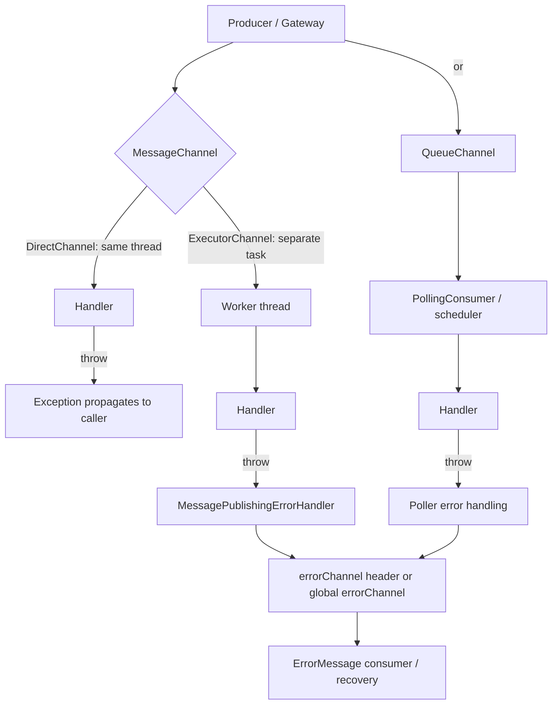
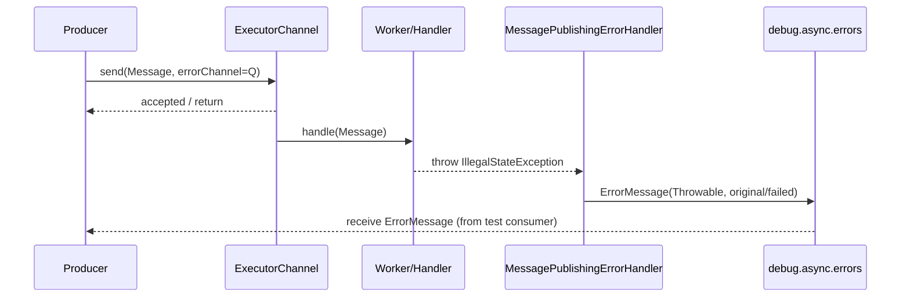
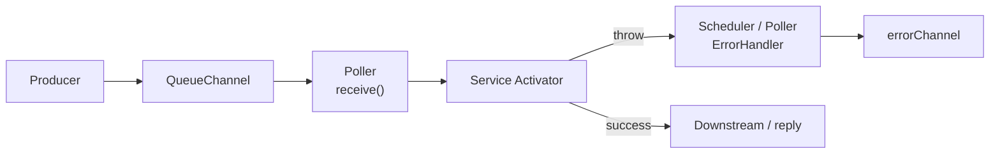
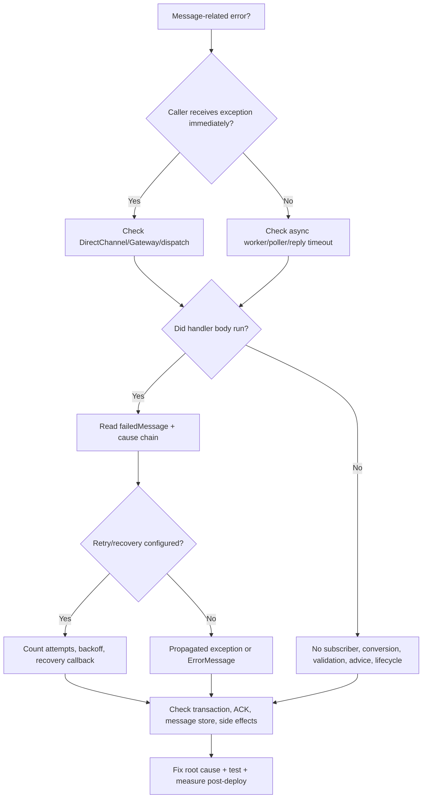

# Diagnosing Handler Exceptions in Spring Integration Runtime

## 1. Problem: A Handler Throws an Exception, but Where Is the Root Cause?

In Spring Integration, a `Message<?>` is sent through a `MessageChannel` to a consumer endpoint and then into a `MessageHandler`. A handler can throw an exception due to invalid input data, missing beans/configuration, network errors, lock timeouts, transaction failures, or a bug in business code.

At runtime, the exact same `throw new IllegalStateException(...)` statement can produce **very different symptoms**:

- A producer calling `DirectChannel.send()` receives the exception immediately.
- A producer sending via `ExecutorChannel` sees `send()` succeed, while a worker processes later and emits an `ErrorMessage`.
- A poller pulling a message from a `QueueChannel` fails and routes the error to an error channel via `MessagePublishingErrorHandler`.
- A gateway throws the error back to the caller, returns an error response via an error flow, or times out before receiving a reply.
- Retry advice invokes the handler multiple times, then rethrows the final error or sends an `ErrorMessage` to a recovery channel.
- A transaction rolls back and the broker redelivers, yet an external side effect from the previous attempt may already have occurred.

Therefore, **"the handler threw an exception" is not enough to know how the message was processed**. You must find the root cause, where the exception is observed, the executing thread, the message being processed, transaction boundaries, and error/retry/recovery configuration.

The lesson **Diagnosing Handler Exceptions in Spring Integration Runtime** belongs to the **Debugging** chapter of the **`SPRING_INTEGRATION_RUNTIME`** module. Its content directly connects to message coordination across channels, endpoints, consumers, pollers, executors, `IntegrationFlow` lifecycle management, transactions, retries, message stores, errors, correlation, threading, performance, and runtime state.

### 1.1. Learning Outcomes

After this lesson, you will be able to:

1. Trace an exception's path from `MessageHandler` back to the caller or `errorChannel`.
2. Distinguish `MessagingException` wrappers from the **root cause** and inspect `getFailedMessage()`.
3. Run Java examples reproducing handler exceptions on `DirectChannel` and `ExecutorChannel`.
4. Handle `ErrorMessage` safely while preserving correlation IDs and business request context.
5. Inspect `RequestHandlerRetryAdvice`, `ErrorMessageSendingRecoverer`, and attempt counts.
6. Distinguish handler failures from no-subscriber errors, timeouts, dropped messages, rejected sends, converter errors, or database rollbacks.
7. Design integration tests, logging/metrics, and incident runbooks without introducing duplicate side effects.

**API scope:** Spring Integration **6.x**, referencing **6.5** documentation, Spring Framework 6.x, and Java 17+. Spring Retry examples require the `spring-retry` dependency; tests use JUnit 5, `spring-test`, and where needed `spring-integration-test`.

## 2. Understand the Pipeline Before Reading Stack Traces

### 2.1. Handler and Endpoint Are Not the Same Object

A configuration like:

```java
@ServiceActivator(inputChannel = "orders.input")
public void process(Message<Order> message) {
    orderService.process(message.getPayload());
}
```

is normally realized by Spring Integration via a **consumer endpoint** dispatching messages to a **service-activating handler** that invokes the method. Stack traces can include framework classes such as:

- `DirectChannel` and dispatchers.
- `AbstractMessageHandler`, `ServiceActivatingHandler`.
- `MessagingMethodInvokerHelper` or method invocation helpers.
- `MessageHandlingException`, `MessageDeliveryException`.
- Proxies/interceptors/retry advice or transaction advice.

Not seeing your business method name on the very first exception line **does not mean Spring Integration is the root cause**. Walk down the cause chain, inspect the failed message, and check the bean definition source.

### 2.2. Observe Along Synchronous / Asynchronous Boundaries



Error paths are **not identical**:

| Where the handler runs | Who initiates the operation? | What happens when the handler throws? | Primary observation path |
|---|---|---|---|
| Synchronous `DirectChannel` | Producer calling `send()` or gateway | Exception typically propagates on the **producer's call stack** | Caller `catch`, gateway exception, application logs |
| `ExecutorChannel` | `TaskExecutor` worker | Producer usually already returned after dispatch; errors are handled asynchronously | `ErrorMessage`/`errorChannel`, executor logs |
| `QueueChannel` + polling consumer | Poller calling `receive()` | Errors in the polling task route via error handling per scheduler/poller config | Error channel, poller logs, transactions |
| `@MessagingGateway` over `DirectChannel` | Caller invoking gateway method | Downstream errors are typically thrown to caller, possibly unwrapped | Gateway method and cause |
| Gateway across async boundary | Gateway sends then awaits reply | Errors may return to the gateway via error flow or caller timeout | Error channel + reply timeout + timeline |
| `FluxMessageChannel` / reactive handler | Reactive subscriber | `onError` along Publisher chain, may be recovered or cancelled | Reactor signals, subscriptions, corresponding error handler |

**Important:** the global `errorChannel` **is not an automatic catch-all for every exception** in a synchronous flow. Spring Integration 6.5 documentation emphasizes that errors from a handler running directly on the producer thread are typically thrown back to the producer.

### 2.3. Build a Simple Timeline

```text
09:00:00.000  orderReceived       messageId=M1 corr=RUN-17
09:00:00.005  orders.input        send=accepted
09:00:00.006  orders.handler      attempt=1
09:00:00.050  partnerClient       IOException: connect timeout
09:00:00.052  orders.handler      MessageHandlingException
09:00:00.053  orders.errors       ErrorMessage published
09:00:00.056  recovery.handler    classified=TRANSIENT
```

This is an **illustrative timeline**. When using a synchronous `DirectChannel` without a configured gateway error flow, the `ErrorMessage published` line will **not appear automatically**. Tests and logs must match the real topology.

## 3. Classify Exceptions Properly Before Fixing

### 3.1. Common Error Classes

| Class / Symptom | Typical Meaning | What to Verify |
|---|---|---|
| `MessageHandlingException` | Handler failed to process the message; may wrap cause | `failedMessage`, nested `cause`, and endpoint |
| `MessageDeliveryException` | Sending/dispatching to channel failed | Channel, subscriber count, executor rejection |
| `MessageDispatchingException` | Dispatcher error, e.g., missing subscribers | Whether endpoint started, whether destination is right |
| `MessagingException` | Messaging exception family that can hold failed message | `getFailedMessage()` + root cause |
| `MessagingTimeoutException` | Timeout during a messaging operation | Which send/receive/reply timeout? |
| `IllegalArgumentException` / validation exception | Invalid payload/headers | Input schema, converters, SpEL expressions |
| `ClassCastException` / conversion exception | Method signature / payload type mismatch | Handler method overloads, converters, header types |
| `SQLException` / `DataAccessException` | Database error or transaction rollback | SQL state, connection pool, constraints |
| `IOException` / client timeout | External system call failed | Network vs. remote commit, idempotency |
| `RejectedExecutionException` | Executor saturated or shutting down | Queue capacity, active threads, stop state |
| `RateLimitExceededException` or open circuit breaker | Advice refused to invoke handler | Advice order, quota/threshold, fallback |
| `Error` such as `OutOfMemoryError` | Severe JVM/resource failure | Heap dump, GC, container memory; do not treat as ordinary retry |

**Avoid inferring a single cause from the outer exception name.** `MessageHandlingException` is a **wrapper envelope**; `MessageDeliveryException` can wrap failures occurring when sending to a channel, while the deep cause explains the actual failing operation.

### 3.2. Group Errors by Retryability

| Group | Example | Reference Handling Direction |
|---|---|---|
| **Permanent / deterministic** | Bad schema, missing required header, business rule rejection | Validate, reject/quarantine; do not retry infinitely |
| **Transient** | Network timeout, temporary 503, retryable deadlock | Bounded retry with backoff, jitter, and deadline |
| **Unknown side effect state** | Remote API timed out after request may have committed | Check state by idempotency key before retrying |
| **Resource pressure** | Full executor/queue, exhausted DB pool | Backpressure, load shedding, concurrency limits |
| **Configuration / lifecycle** | No subscribers, wrong channel name, unstarted bean | Fix flow/wiring; do not treat as "business transient" |
| **Fatal infrastructure** | JVM OOM, lost lock ownership | Incident/stop/reconcile; do not blindly loop retries |

An exception may occur as a `RuntimeException` inside the handler yet **be handled by advice**, making it invisible to the caller. To tell whether a message recovered, monitor **attempts, recovery, transactions, and reply paths** together.

## 4. Example 1: Handler Throwing on DirectChannel

### 4.1. Minimal Configuration

This example builds a synchronous flow with a handler that intentionally throws. No broker, scheduler, or executor is needed.

```java
import org.springframework.context.annotation.Bean;
import org.springframework.context.annotation.Configuration;
import org.springframework.integration.annotation.ServiceActivator;
import org.springframework.integration.channel.DirectChannel;
import org.springframework.integration.config.EnableIntegration;
import org.springframework.messaging.Message;
import org.springframework.messaging.MessageChannel;

@Configuration
@EnableIntegration
public class SyncDebugConfig {

    @Bean("debug.sync.input")
    MessageChannel syncInput() {
        return new DirectChannel();
    }

    @Bean
    FailingOrderHandler failingOrderHandler() {
        return new FailingOrderHandler();
    }

    public static class FailingOrderHandler {

        @ServiceActivator(inputChannel = "debug.sync.input")
        public void handle(Message<String> message) {
            String orderId = message.getPayload();

            if (orderId.startsWith("FAIL")) {
                throw new IllegalStateException(
                        "Inventory unavailable for " + orderId);
            }

            // Success: one-way handler so no reply needs to be produced.
            System.out.println("Accepted " + orderId);
        }
    }
}
```

The handler returns `void`, so no `outputChannel` is needed. If a handler returns an object while the message lacks a `replyChannel` or suitable output channel, a **different reply destination error** can occur, misleading you into thinking the business handler failed.

### 4.2. Producer Observes the Exception on the Same Thread

```java
import org.springframework.context.annotation.AnnotationConfigApplicationContext;
import org.springframework.messaging.Message;
import org.springframework.messaging.MessageChannel;
import org.springframework.messaging.MessagingException;
import org.springframework.messaging.support.MessageBuilder;

public class SyncDebugDemo {

    public static void main(String[] args) {
        try (var context = new AnnotationConfigApplicationContext(
                SyncDebugConfig.class)) {

            MessageChannel input = context.getBean(
                    "debug.sync.input", MessageChannel.class);

            Message<String> request = MessageBuilder
                    .withPayload("FAIL-ORD-42")
                    .setHeader("businessRequestId", "REQ-42")
                    .setHeader("processingRunId", "RUN-9")
                    .build();

            try {
                input.send(request);
                throw new AssertionError("Expected handler failure");
            }
            catch (MessagingException failure) {
                System.out.println("Outer exception: "
                        + failure.getClass().getSimpleName());
                System.out.println("Failed message id: "
                        + (failure.getFailedMessage() == null
                                ? "<not available>"
                                : failure.getFailedMessage()
                                        .getHeaders().getId()));
                printCauseChain(failure);
            }
        }
    }

    static void printCauseChain(Throwable error) {
        Throwable current = error;
        for (int level = 0; current != null && level < 12; level++) {
            System.out.println("cause[" + level + "] "
                    + current.getClass().getName()
                    + ": " + current.getMessage());
            if (current == current.getCause()) {
                break;
            }
            current = current.getCause();
        }
    }
}
```

With `DirectChannel`, the exception is thrown to the producer inside `send()`. You may observe a `MessagingException`/`MessageHandlingException` wrapper and the `IllegalStateException` cause created by the handler. **Do not validate by matching only the outer exception text**: framework messages can vary by version or wrapping site.

If the handler throws an `Error` or an interceptor has special behavior, the hierarchy and wrapping may differ. The goal is to inspect the **root cause and associated message**, not assume everything is a `MessagingException`.

### 4.3. Three Checks to Pinpoint the Cause

After running the demo, answer:

1. Was the handler invoked? Add a log or breakpoint right at the start of `handle()`.
2. Which `failedMessage` was being processed? Compare `MessageHeaders.ID`, `businessRequestId`, and `processingRunId`.
3. Is the root cause actually `IllegalStateException("Inventory unavailable ...")`, or did a method invocation/conversion error happen **before the method body ran**?

The third check is critical for `@ServiceActivator`: if the method signature, payload converter, SpEL expression, or header binding is wrong, logs may mention the handler even though the business method **was never called**.

## 5. Reading Stack Traces Properly

### 5.1. Outer Exception, Nested Cause, Suppressed Exceptions

```text
org.springframework.messaging.MessageHandlingException:
    error occurred during message handling
  failedMessage=GenericMessage [...]
Caused by: java.lang.IllegalStateException:
    Inventory unavailable for FAIL-ORD-42
    at ...FailingOrderHandler.handle(...)
```

This is an **illustrative** stack trace sample. When debugging:

- **Outer type:** shows whether the framework saw the error at handle, dispatch, convert, or send.
- **Cause chain:** finds the first meaningful business/infrastructure exception.
- **Failed message:** payload type, headers, message ID, correlation (excluding sensitive data).
- **Suppressed exceptions:** e.g., resource cleanup failing while business code throws.
- **Bean/config source:** identifies which component created the endpoint.

Do not turn off stack traces globally to reduce noise during an incident before gathering enough data to identify root cause; instead, sample and log once at the appropriate **error boundary**.

### 5.2. BeanDefinition Resource/Source Can Point to the Configuration Site

Since Spring Integration 5.2, many framework-created `MessageHandlingException` instances include `BeanDefinition` resource/source metadata to help trace endpoint configuration. For Java configuration, this typically points to `@Configuration`/`@Bean`; for XML, it can point to the XML file/tag.

Not every custom `RuntimeException` receives this metadata. When logs include a bean/endpoint name, use it to locate the **registered configuration**; with dynamic `IntegrationFlowContext`, identify which flow ID/endpoint ID was active when the message failed.

### 5.3. Do Not Pick Only the Deepest Cause and Drop Context

Often, a root cause like `SocketTimeoutException` explains **why I/O failed**, whereas the outer `MessageHandlingException` and failed message explain **which request, endpoint, and attempt were affected**. Logging only `getMostSpecificCause().getMessage()` can strip out the flow ID and correlation.

A helpful error record includes:

```text
event=message_failed
flow=orders-v2
component=orders.outbound
messageId=UUID-1
businessRequestId=REQ-42
processingRunId=RUN-9
attempt=2
outerException=MessageHandlingException
rootCause=SocketTimeoutException
thread=orders-worker-3
outcome=retry_pending
```

This is a suggested log schema, not Spring Integration's default output. Never log raw payloads, tokens, passwords, or full headers in uncontrolled production environments.

## 6. Separating Handler Errors from Send and Receive Errors

### 6.1. No Subscribers Is Not a Handler Throw

When sending a message to a `DirectChannel` with no consumer, the sender can encounter `MessageDispatchingException` or `MessageDeliveryException` depending on the dispatcher/channel.

```text
Producer --send--> channel "orders.input"
                       |
                       +-- no subscribers
                           -> dispatch failure
                           -> handler was never invoked
```

Check:

- Has the endpoint called `start()`?
- Does `@ServiceActivator(inputChannel=...)` match the exact bean/channel name?
- Was the flow recently `destroy()`ed or does a router still point to an old channel?
- Is `autoStartup(false)` set on the endpoint/poller?
- Was the registered consumer unsubscribed on stop?

**Do not retry a no-subscriber error as if it were a random network glitch** when the topology is broken: that builds backlog and masks broken wiring.

### 6.2. Method Conversion/Binding Can Fail Before the Handler Runs

Example:

```java
@ServiceActivator(inputChannel = "orders.input")
public void handle(OrderRequest request) {
    // Actual input payload is an unconvertible String.
}
```

If the payload is incompatible with `OrderRequest` and no suitable converter exists, the invocation layer throws an exception. In that case, a breakpoint on the first line of `handle()` **never hits**.

Verify:

1. Runtime payload class prior to the handler.
2. Header data types and the conversion service.
3. Method signature and `@Header`/`@Headers` bindings.
4. Overloaded methods or SpEL method selectors.
5. Whether a converter/serializer changed the payload type after a `QueueChannel`/broker/persistence step.

### 6.3. Handler Returning Null / No Reply Differs from Throwing an Exception

A `@ServiceActivator` returning `null` in a request-reply flow can leave no reply; the gateway waits until timeout. If the handler requires a reply (`requiresReply`), it may throw `ReplyRequiredException` instead of staying silent.

Three distinct scenarios:

| Symptom | Exception thrown inside handler? | What to look for |
|---|---|---|
| Handler throws `IllegalStateException` | Yes | Stack trace/cause |
| Handler returns `null` or filter drops | Not necessarily | `requiresReply`, filter behavior, reply channel |
| Handler produces reply with no destination | May fail after handler | `outputChannel`, `replyChannel`, and routing |

Do not jump to "the handler threw" solely because a gateway timed out or a caller got no response.

## 7. Example 2: Handler Throwing Behind ExecutorChannel

### 7.1. Producer and Handler Run on Different Threads

`ExecutorChannel` delegates handler execution to a `TaskExecutor`. A successful send means the message **was accepted for dispatch**, not that business processing completed.

To observe async errors in a **testable** way, create a `QueueChannel` to receive `ErrorMessage` instances and pass a reference to it in the `errorChannel` header.

```java
import org.springframework.context.annotation.Bean;
import org.springframework.context.annotation.Configuration;
import org.springframework.integration.annotation.ServiceActivator;
import org.springframework.integration.channel.ExecutorChannel;
import org.springframework.integration.channel.QueueChannel;
import org.springframework.integration.config.EnableIntegration;
import org.springframework.messaging.Message;
import org.springframework.messaging.MessageChannel;
import org.springframework.messaging.PollableChannel;
import org.springframework.scheduling.concurrent.ThreadPoolTaskExecutor;

@Configuration
@EnableIntegration
public class AsyncDebugConfig {

    @Bean("debug.executor")
    ThreadPoolTaskExecutor executor() {
        ThreadPoolTaskExecutor executor = new ThreadPoolTaskExecutor();
        executor.setCorePoolSize(1);
        executor.setMaxPoolSize(2);
        executor.setQueueCapacity(10);
        executor.setThreadNamePrefix("debug-worker-");
        return executor;
    }

    @Bean("debug.async.input")
    MessageChannel asyncInput(ThreadPoolTaskExecutor executor) {
        return new ExecutorChannel(executor);
    }

    @Bean("debug.async.errors")
    PollableChannel errors() {
        return new QueueChannel();
    }

    @Bean
    AsyncFailingHandler asyncFailingHandler() {
        return new AsyncFailingHandler();
    }

    public static class AsyncFailingHandler {

        @ServiceActivator(inputChannel = "debug.async.input")
        public void handle(Message<String> message) {
            System.out.println("worker="
                    + Thread.currentThread().getName());

            throw new IllegalStateException(
                    "Simulated async failure for "
                            + message.getPayload());
        }
    }
}
```

In this configuration, `PollableChannel` `debug.async.errors` is where tests **read errors**; by itself it does not process or log anything without a consumer. In production, add a recovery handler or error flow, bound queue capacity, and enforce error data policies.

### 7.2. Sending a Message with the errorChannel Header

```java
import org.springframework.context.annotation.AnnotationConfigApplicationContext;
import org.springframework.messaging.Message;
import org.springframework.messaging.MessageChannel;
import org.springframework.messaging.MessageHeaders;
import org.springframework.messaging.PollableChannel;
import org.springframework.messaging.support.ErrorMessage;
import org.springframework.messaging.support.MessageBuilder;

public class AsyncDebugDemo {

    public static void main(String[] args) {
        try (var context =
                new AnnotationConfigApplicationContext(
                        AsyncDebugConfig.class)) {

            MessageChannel input = context.getBean(
                    "debug.async.input", MessageChannel.class);
            PollableChannel errors = context.getBean(
                    "debug.async.errors", PollableChannel.class);

            Message<String> request = MessageBuilder
                    .withPayload("FAIL-ORD-42")
                    .setHeader("businessRequestId", "REQ-42")
                    .setHeader(MessageHeaders.ERROR_CHANNEL, errors)
                    .build();

            boolean dispatched = input.send(request);
            System.out.println("send accepted=" + dispatched);

            Message<?> observed = errors.receive(2_000);
            if (!(observed instanceof ErrorMessage error)) {
                throw new IllegalStateException(
                        "Expected ErrorMessage; check routing/logs");
            }

            Throwable cause = error.getPayload();
            System.out.println("error type="
                    + cause.getClass().getName());
            SyncDebugDemo.printCauseChain(cause);
        }
    }
}
```

This second demo calls `SyncDebugDemo.printCauseChain` from section 4 (or you can copy the helper method into this demo class). The example needs no extra global error channel configuration because the message carries the **`PollableChannel` object** directly via `MessageHeaders.ERROR_CHANNEL`.

**What you can observe:**

- `input.send(request)` can return `true` **before the handler throws the exception**.
- An `ErrorMessage` is delivered to the error channel after the worker catches the exception.
- `ErrorMessage.getPayload()` holds the `Throwable`. `originalMessage` and `failedMessage` help trace back to the original request.
- If the executor is shut down or rejects **before the task is accepted**, a dispatch error can happen right inside `send()`; never assume every error over `ExecutorChannel` is async.

In tests, use a bounded timeout (`errors.receive(2_000)`) so CI will not hang forever if the error path is miswired.

### 7.3. Error Path Diagram



This is a Spring Integration–managed error publication path, not a guarantee for arbitrary `executor.execute(() -> doWork())` calls written manually in your app. If you submit tasks outside the framework, you must manage `ErrorHandler`, `Future`, and cleanup callbacks yourself.

## 8. ErrorMessage and Failed/Original Messages

### 8.1. Two Layers of Information Not to Miss

`ErrorMessage` extends `Message<Throwable>`: the **payload** is the exception, and `ErrorMessage` can also hold **originalMessage** via `ErrorMessageStrategy`. A `MessagingException` inside the payload can contain **failedMessage**.

```text
ErrorMessage (a new message with its own ID)
  payload = MessagingException
       cause = IllegalStateException or IOException
       failedMessage = Message that failed
  originalMessage = Input message in the error creation context (if present)
```

These messages may be identical or different when a flow includes transformers, splitters, or retries. Either can be null; **do not** assume `getOriginalMessage()` is always populated.

### 8.2. Helper to Extract Identity for Controlled Logging

```java
import org.springframework.integration.IntegrationMessageHeaderAccessor;
import org.springframework.messaging.Message;
import org.springframework.messaging.MessagingException;
import org.springframework.messaging.support.ErrorMessage;

public final class ErrorInspector {

    private ErrorInspector() {}

    public static void inspect(ErrorMessage error) {
        Throwable cause = error.getPayload();
        Message<?> failed = findFailedMessage(cause);

        Message<?> source = failed != null
                ? failed : error.getOriginalMessage();

        Object businessId = source == null ? null
                : source.getHeaders().get("businessRequestId");
        Object correlation = source == null ? null
                : source.getHeaders().get(
                        IntegrationMessageHeaderAccessor.CORRELATION_ID);

        System.out.printf(
                "errorEnvelopeId=%s, businessId=%s, corr=%s, type=%s%n",
                error.getHeaders().getId(),
                businessId,
                correlation,
                cause.getClass().getSimpleName());

        for (Throwable current = cause; current != null;
                current = current.getCause()) {
            System.out.println(current.getClass().getName()
                    + ": " + current.getMessage());
            if (current == current.getCause()) {
                break;
            }
        }
    }

    private static Message<?> findFailedMessage(Throwable problem) {
        Throwable current = problem;
        for (int i = 0; current != null && i < 20; i++) {
            if (current instanceof MessagingException messaging
                    && messaging.getFailedMessage() != null) {
                return messaging.getFailedMessage();
            }
            if (current == current.getCause()) {
                break;
            }
            current = current.getCause();
        }
        return null;
    }
}
```

In production, **do not dump full `ErrorMessage.toString()`, failed payloads, or headers** if they contain sensitive data. Log only lookup IDs, endpoint names, exception classes, and length-bounded root-cause messages.

### 8.3. What Does DefaultErrorMessageStrategy Do?

Spring Integration provides `ErrorMessagePublisher` and `ErrorMessageStrategy`. `DefaultErrorMessageStrategy` can retrieve the request message from an `AttributeAccessor` context (under the key `ErrorMessageUtils.INPUT_MESSAGE_CONTEXT_KEY`) to set `ErrorMessage.originalMessage`.

Do not assume from the class name alone that **every error envelope carries an original message**: depending on the adapter, endpoint, or error emission path, the original context may differ or be absent. When inspecting, check both `failedMessage` and `originalMessage`.

### 8.4. Distinguishing ErrorMessage ID from Original Message ID

Suppose a handler fails three times and then recovers:

```text
businessRequestId = REQ-42
originalMessageId = M-001
attempt 1 -> IllegalStateException
attempt 2 -> IllegalStateException
attempt 3 -> IllegalStateException
recovery -> ErrorMessage ID E-009
```

If a dashboard only counts `E-009` and drops `REQ-42`/`M-001`, correlating errors back to upstream becomes very hard. Record **message ID, error envelope ID, business ID, processing run ID, and attempt** as needed. Never rely solely on `MessageHeaders.ID` as an idempotency key, since redelivery can generate a new message.

## 9. Default errorChannel and Custom Error Channels

### 9.1. Rules for Selecting the Error Channel

Per Spring Integration 6.5, when a framework-managed task needs to publish an `ErrorMessage`:

1. If the request message has `MessageHeaders.ERROR_CHANNEL`, send the error to that designated channel.
2. Otherwise, fall back to the global `errorChannel` bean.
3. The default global error channel is a `PublishSubscribeChannel` with a `LoggingHandler` logging at ERROR level.
4. When using a custom error channel, your endpoint must subscribe or poll appropriately to actually process errors.

You can declare a custom channel in Java config:

```java
import org.springframework.context.annotation.Bean;
import org.springframework.integration.channel.QueueChannel;
import org.springframework.messaging.PollableChannel;

@Bean("orders.errors")
PollableChannel ordersErrors() {
    return new QueueChannel(200);
}
```

When using a `QueueChannel` as an error buffer, drain/poll it with a dedicated consumer and set a sensible capacity. Do not let errors pile up unbounded in RAM until OOM.

### 9.2. Do Not Disable Error Logging Before a Recovery Consumer Exists

The global `errorChannel` includes a `LoggingHandler` by default. If you define a custom `errorChannel` or add other subscribers, keep in mind:

- `PublishSubscribeChannel` subscribers are dispatched per the dispatcher configuration, which affects how exceptions thrown from an error handler propagate.
- `QueueChannel` requires a consumer actively pulling messages; otherwise errors sit unseen in the queue.
- Since Spring Integration 5.4.3, the global default error channel sets `requireSubscribers=true` to avoid silently discarding error messages when no subscribers exist, such as during shutdown.
- Do not route an error flow back into the same failing handler unchecked; this can cause an error loop or retry storm.

An error consumer should have a **fallback when the error handler itself fails**: minimal logging, routing to a DLQ/quarantine if appropriate, and alerting on loss of error observability.

### 9.3. Routing by Exception Type

`ErrorMessageExceptionTypeRouter` can route `ErrorMessage` instances based on exception class. However, error payloads are often wrapped in `MessagingException`; if you want to classify by **root cause** such as `SocketTimeoutException` or a business validation exception, verify whether the router traverses the cause chain per your API version and configuration, or write an explicit classifier in a handler.

Illustrative policy table:

| Cause Group | Recovery Path | Why |
|---|---|---|
| Validation exception | `orders.reject` | Do not retry invalid data |
| Partner timeout | `orders.retry` / delayed retry | Possibly transient, yet requires idempotency |
| Unknown DB outcome | `orders.reconcile` | Must verify side effects |
| Lock ownership expired | `orders.incident` | Cannot treat as a simple retryable error |
| Handled by fallback advice | Success/fallback metrics | Caller may get a response, though business outcome differs |
| Error-handler failure | `criticalAlerts` | Prevent losing track of the original error |

## 10. Pollers: Handler Exceptions Occur After Receive

### 10.1. Flow with QueueChannel and Polling Consumer



The producer sends to `QueueChannel` and may see `send()` succeed. The poller processes later on a scheduler thread, so handler exceptions do not return to the producer via the Java stack.

A `SourcePollingChannelAdapter` or `PollingConsumer` has a scheduler, trigger, `maxMessagesPerPoll`, and optionally transaction advice. When an error occurs, the framework uses an appropriate `MessagePublishingErrorHandler` to wrap it in an `ErrorMessage` and publish to the `errorChannel` header or global channel.

### 10.2. Annotation Configuration with a Custom Poller

```java
import org.springframework.context.annotation.Bean;
import org.springframework.context.annotation.Configuration;
import org.springframework.integration.annotation.Poller;
import org.springframework.integration.annotation.ServiceActivator;
import org.springframework.integration.channel.QueueChannel;
import org.springframework.integration.config.EnableIntegration;
import org.springframework.messaging.Message;
import org.springframework.messaging.PollableChannel;

@Configuration
@EnableIntegration
class PollerDebugConfig {

    @Bean("debug.poll.input")
    PollableChannel pollInput() {
        return new QueueChannel(10);
    }

    @Bean
    PollerFailingHandler pollerFailingHandler() {
        return new PollerFailingHandler();
    }

    static class PollerFailingHandler {

        @ServiceActivator(
                inputChannel = "debug.poll.input",
                poller = @Poller(
                        fixedDelay = "200",
                        maxMessagesPerPoll = "1"))
        public void handle(Message<String> message) {
            throw new IllegalStateException(
                    "Polling handler failed: " + message.getPayload());
        }
    }
}
```

`@Poller` also has an `errorChannel` attribute to bind the poller's error path to a specific channel; this example intentionally leaves it unset to illustrate falling back to the global error channel. To test capturing errors, create a dedicated error channel, set `errorChannel="..."` per the API, and wait for the `ErrorMessage`.

### 10.3. Does an Error Put the Message Back in the Queue?

**Not automatically.** With an in-memory `QueueChannel`, `receive()` has already removed the message from the queue, so the message may **no longer be in the queue** when the handler throws. An `ErrorMessage` is an error-reporting path, **not an automatic message requeue**.

Achieving rollback/requeue requires a store and transaction setup that actually supports it:

- A channel backed by `JdbcChannelMessageStore` or a compatible transactional store.
- A poller configured with transaction advice and a matching transaction manager.
- Broker adapters (JMS/Rabbit/Kafka) with protocol-level ACK/rollback/redelivery semantics.
- Idempotency and a recovery strategy to avoid duplicate side effects.

Putting `@Transactional` on a method on a different thread does not guarantee that `receive()` + handler + message store all share the same transaction.

### 10.4. Custom Schedulers Can Alter Error Handling

The 6.5 reference recommends using Spring Integration's `MessagePublishingErrorHandler` on custom `TaskScheduler` beans if you want errors from scheduled poller tasks routed to the standard `errorChannel`. Replacing the scheduler with a custom executor/scheduler whose error handler only logs can show errors in the console with no `ErrorMessage` arriving on the channel.

Investigate by confirming:

1. Which scheduler is the poller actually using?
2. Which `ErrorHandler` is configured on that scheduler?
3. Does the poller specify an `errorChannel` override?
4. Is a transaction interceptor catching and handling/rolling back the exception?
5. At failure time, does `errorChannel` have an active consumer?

## 11. Retry Advice: A Handler Throw May Not End the Flow

### 11.1. Stateless and Stateful Retry

`RequestHandlerRetryAdvice` can re-invoke a handler when failures occur. Two models:

| Model | Execution Path | What to Observe |
|---|---|---|
| Stateless retry | Advice retries multiple times within a single call | Attempt count, backoff, thread hold time |
| Stateful retry | Errors are rethrown so the message source **redelivers**; advice tracks retry state by key | Stable state key, broker transaction/ACK, redelivery |
| Recovery after retries exhaust | `RecoveryCallback` handles the final error | ErrorMessage/DLQ, reply, success/fail state |

Do not confuse **retry advice attempts** with **broker redeliveries**. One message can undergo multiple broker redeliveries, each running multiple internal attempts. Account for total cost and side effects.

### 11.2. Configuring Retry with Explicit Limits

Example using `spring-retry` with a maximum of **3 total attempts** (one initial call plus up to two retries):

```java
import org.springframework.context.annotation.Bean;
import org.springframework.integration.handler.advice.RequestHandlerRetryAdvice;
import org.springframework.retry.backoff.FixedBackOffPolicy;
import org.springframework.retry.policy.SimpleRetryPolicy;
import org.springframework.retry.support.RetryTemplate;

@Bean("ordersRetryAdvice")
RequestHandlerRetryAdvice ordersRetryAdvice() {
    RetryTemplate template = new RetryTemplate();

    SimpleRetryPolicy retryPolicy = new SimpleRetryPolicy(3);
    template.setRetryPolicy(retryPolicy);

    FixedBackOffPolicy backOff = new FixedBackOffPolicy();
    backOff.setBackOffPeriod(200); // milliseconds
    template.setBackOffPolicy(backOff);

    RequestHandlerRetryAdvice advice = new RequestHandlerRetryAdvice();
    advice.setRetryTemplate(template);
    return advice;
}
```

Attaching to a handler:

```java
@ServiceActivator(
        inputChannel = "orders.request",
        adviceChain = "ordersRetryAdvice")
public void handleOrder(Message<String> message) {
    invokePartner(message.getPayload());
}
```

These snippets belong in a Spring `@Configuration` with corresponding imports and beans. `SimpleRetryPolicy(3)` limits total attempts per Spring Retry's contract, unlike some builders that phrase it as "number of retries." When upgrading versions, verify policy behavior with tests rather than guessing.

**Important:** business exceptions may be wrapped inside `MessagingException`. When configuring retries only for a specific set of exception classes, check the retry policy's **cause traversal**; matching only the outer wrapper can retry the wrong errors or skip truly transient ones.

### 11.3. ErrorMessageSendingRecoverer After Retries Exhaust

```java
import org.springframework.beans.factory.annotation.Qualifier;
import org.springframework.context.annotation.Bean;
import org.springframework.integration.channel.QueueChannel;
import org.springframework.integration.handler.advice.ErrorMessageSendingRecoverer;
import org.springframework.integration.handler.advice.RequestHandlerRetryAdvice;
import org.springframework.messaging.PollableChannel;

@Bean("orders.recovery")
PollableChannel recoveryQueue() {
    return new QueueChannel(50);
}

@Bean("ordersRetryWithRecovery")
RequestHandlerRetryAdvice retryWithRecovery(
        @Qualifier("orders.recovery") PollableChannel recovery,
        RetryTemplate retryTemplate) {

    RequestHandlerRetryAdvice advice = new RequestHandlerRetryAdvice();
    advice.setRetryTemplate(retryTemplate);
    advice.setRecoveryCallback(
            new ErrorMessageSendingRecoverer(recovery));
    return advice;
}
```

Once attempts are exhausted, the recoverer publishes an `ErrorMessage` to `orders.recovery`. **It does not automatically reverse side effects** and does not guarantee the caller receives a valid business reply. If a recovery callback returns `null` in a request-reply flow, the caller may get no reply; design ACK/transaction/gateway responses explicitly.

Never use a recovery channel merely to "swallow exceptions": there must be a consumer, alerts/auditing, backlog bounds, downstream replay handling, and quarantine/DLQ support where appropriate.

### 11.4. Advice Ordering and Correctness

For a handler combining retry, transactions, circuit breakers, and rate limiters:

```text
Retry outside transaction:
    attempt 1: begin transaction -> fail -> rollback
    backoff
    attempt 2: begin new transaction -> success -> commit

Transaction outside retry:
    begin transaction
        attempt 1 fail
        attempt 2 success
    commit/rollback based on final transaction state
```

This is a **conceptual boundary diagram**. Actual advice order depends on interceptors and Spring Integration advice classes; instrument transaction status, retry attempts, and handler entry timestamps to verify.

A transaction marked `rollbackOnly` during the first attempt can make the second attempt appear to succeed yet still fail at final commit. For database work, wrapping each attempt in its own transaction is usually preferred for transient retries, provided it aligns with adapter/ACK boundaries and idempotency.

### 11.5. Is a "Recovered" Handler Error a Success?

Three possibilities:

1. Handler retries and **succeeds**: the message completes successfully at the end, though latency and call counts rise.
2. Handler fails and the recovery callback **handles the failure**: publishing an `ErrorMessage` alone cannot be counted as business success.
3. Handler fails, retries exhaust, and it **rethrows**: the DirectChannel/ExecutorChannel/poller error path continues per topology.

Metrics should separate `attempt_failure`, `message_recovered`, `message_failed_terminally`, and `business_completed`. Lumping all three into a single `errors` counter makes dashboards unable to tell whether messages finished.

## 12. MessagingGateway and Two Kinds of Timeouts

### 12.1. Synchronous Gateways

With a `@MessagingGateway` sending over a `DirectChannel`, a handler throw can be unwrapped and rethrown to the caller by the gateway. If an `errorChannel` is configured on the gateway, errors can route into an error flow and **return a transformed response** instead of throwing the default exception.

Distinguish:

- `requestTimeout`: wait time when **sending a request** if sending can block (e.g., full `QueueChannel`).
- `replyTimeout`: how long the gateway **waits for a reply** after sending the request.
- Outbound HTTP/DB client timeouts: independent of the two values above.
- Retry backoff duration: extends total processing time and can exceed the gateway deadline.

### 12.2. replyTimeout Does Not Interrupt a Blocked Synchronous Handler

```text
Caller -> gateway -> DirectChannel -> handler blocks 10 seconds
                  replyTimeout=2 seconds
```

If the entire flow runs on the **same thread**, the gateway cannot return after exactly two seconds solely because of `replyTimeout`, because the thread is stuck inside the synchronous handler call.

When an `ExecutorChannel` is involved, the gateway waits on the reply channel and can time out **while the worker continues running**. The client receives a timeout or `null` depending on method signature/config, yet remote side effects may commit. Never retry a non-idempotent operation solely because the caller did not see a reply.

### 12.3. A Flow Without a Reply Did Not Necessarily Throw

For instance, a handler returns `void` or a filter drops the message, leaving the gateway with no reply. That is a **missing reply**, not necessarily a handler exception. If a handler requires a reply (`requiresReply=true`), the framework may throw `ReplyRequiredException`. Check output channel and `replyChannel` settings before adding retries.

### 12.4. An Error Flow Can Hide Root Causes If Designed Carelessly

If a gateway's error channel returns a fallback business object, the caller receives a normal-looking response. Yet the root cause still requires logging, metrics, and accurate business status.

Example policy:

```text
ValidationException -> return business 400 response, do not retry
Transient timeout -> route to recovery/retry, return status "PENDING"
Unknown commit state -> status "RECONCILING", do not claim failure
Unexpected bug -> report error, alert, and preserve failed message safely
```

Never return `"SUCCESS"` from a gateway error flow just to suppress exceptions when side effects are not confirmed successful.

## 13. Transactions, Message Stores, and Redelivery After Handler Throws

### 13.1. Unlock, Rollback, ACK, and Error Publication Are Separate States

A message encountering an exception can simultaneously involve:

- **Handler result:** succeeded or failed?
- **Database transaction:** committed or rolled back?
- **Message store:** removed from queue/store, retained, or reverted?
- **Broker delivery:** ACK, negative ACK, reject, seek, or redelivery?
- **Error channel:** was an `ErrorMessage` published or not?
- **External side effect:** did the payment, email, or HTTP call actually execute?
- **Gateway reply:** did the caller receive a valid response?

No single `throw`/`catch` API in Spring Integration guarantees all of those states move together atomically.

Example:

```text
t0: Poller receives message from QueueChannel
t1: Handler calls external payment API -> charge recorded
t2: Handler writes DB -> SQLException
t3: DB transaction rolls back
t4: ErrorMessage published
t5: Caller/broker retries -> payment API is called again
```

This is a case of **an external side effect occurring outside the transaction while the database rolls back**. Without a business idempotency key, retries can produce duplicate charges.

### 13.2. In-Memory QueueChannel vs. Durable Channel Store

| Message Source | Handler Throws | What Must Not Be Assumed |
|---|---|---|
| In-memory `QueueChannel` | Poller already dequeued message; exception follows poller error path | Do not assume the queue auto-reinserts |
| `QueueChannel` with `JdbcChannelMessageStore` | Can participate in the poller's transaction | Do not assume rollback works without proper TransactionInterceptor/manager |
| AMQP/JMS inbound | ACK/nack/transactions per adapter | Do not assume handling on error channel equals broker ACK |
| Kafka inbound | Offset commit/seek/retry per adapter/container | Do not assume every exception triggers redelivery |
| HTTP inbound gateway | Caller may receive an error | No durable broker automatically retains the request |
| Aggregator on `MessageGroupStore` | Group may remain incomplete or roll back | Unlocking does not mean deleting the group or publishing a reply |

Inspect the **specific adapter** and transaction boundaries, especially when moving from `DirectChannel` to `ExecutorChannel`. Imperative `ThreadLocal`-bound transactions usually **do not follow** across threads.

### 13.3. Transaction and Retry Ordering

When a handler uses `@Transactional` and `RequestHandlerRetryAdvice`, check:

1. Does the transaction start before or after the retry advice?
2. Is a fresh transaction created for each attempt?
3. Did any attempt mark the transaction `rollbackOnly`?
4. Is the handler error thrown so the transaction interceptor rolls back, or swallowed by a recoverer?
5. Does ACK/offset commit happen before or after database commit?
6. Did an external API succeed before the exception occurred?

For effectively-once business effects, implement **idempotency/unique constraints, outbox/inbox patterns, or reconciliation**; do not just stack retry and transaction annotations and assume it suffices.

### 13.4. Message Groups Left Hanging When a Handler Fails

Aggregators/resequencers hold state in `MessageGroupStore` by correlation ID. When processing or release strategies throw, a message group may remain:

- Complete in parts yet never emitting its result.
- Incomplete and waiting for timeout/reaper.
- Marked complete yet failing downstream on output.
- Retaining metadata to detect late arrivals.
- Colliding between two tenants/runs due to overly coarse keys.

During an incident, inspect `groupId`, `messageGroupSize(groupId)`, `SEQUENCE_NUMBER`, `SEQUENCE_SIZE`, `ReleaseStrategy`, `expireGroupsUponCompletion`, and store transactions. **Do not manually delete a group to "fix the exception"** without checking replay capability and business ownership.

## 14. Correlation ID, MessageHistory, and Root-Cause Observability

### 14.1. Why Stack Traces Alone Are Still Insufficient

A `MessageHandlingException` tells you a handler failed, not:

- Which customer/tenant owns the request?
- Which retry attempt failed?
- How long did the message wait in `QueueChannel`?
- When did the flow change versions?
- If split into fragments, which group is waiting?
- Did the gateway already time out before the handler finished?

Also log **business request ID**, **processing run ID**, `MessageHeaders.ID`, `CORRELATION_ID`, endpoint, component name, flow version, thread, attempt, and outcome.

### 14.2. Correlation ID Is Neither Message ID Nor Trace ID

| ID | Purpose |
|---|---|
| `MessageHeaders.ID` | Tracks a message instance; can change across transforms/replays |
| `IntegrationMessageHeaderAccessor.CORRELATION_ID` | Groups messages from a splitter/aggregator or custom strategy |
| `businessRequestId` | Links every message of one business request |
| `processingRunId` | Distinguishes multiple processing runs of the same business entity |
| `traceId/spanId` | Distributed tracing across spans and services |
| `deliveryAttempt` / retry attempt | Distinguishes processing attempts |

A splitter can generate multiple message IDs sharing one correlation ID. A trace can span multiple correlation groups from nested splitters. When root cause disappears across an async boundary, the business request ID stitches timelines together better than message ID alone.

### 14.3. MessageHistory and IntegrationGraphServer

`@EnableMessageHistory` adds a history header showing **which named components the message passed through**. `IntegrationGraphServer` provides the **possible topology** based on live nodes and links.

Two complementary kinds of evidence:

```text
IntegrationGraphServer: "There is a route from orders.in to orders.outbound"
MessageHistory:        "Message M9 passed through orders.in and orders.validate"
ErrorMessage:          "An error occurred processing M9 at orders.outbound"
Tracing span:          "Outbound call took 2.4 seconds"
```

After dynamic registration or removal of an `IntegrationFlow`, call `IntegrationGraphServer.rebuild()` to refresh the topology. Relying on a stale cached graph can mislead you into investigating a destroyed v1 handler.

### 14.4. MDC and Thread Pools

SLF4J `MDC` is typically ThreadLocal. If code sets `correlationId` in MDC on the producer while the handler runs on `ExecutorChannel`, never assume the worker inherits MDC. Conversely, forgetting to clear MDC lets a worker reuse the previous request's ID.

```java
import org.slf4j.MDC;
import org.springframework.integration.IntegrationMessageHeaderAccessor;
import org.springframework.messaging.Message;

static void withMdc(Message<?> message, Runnable action) {
    Object id = message.getHeaders().get(
            IntegrationMessageHeaderAccessor.CORRELATION_ID);

    String correlationId = id == null ? "missing" : id.toString();

    try (MDC.MDCCloseable ignored =
                 MDC.putCloseable("correlationId", correlationId)) {
        action.run();
    }
}
```

This is a **logging helper**—never use `"missing"` as a fallback correlation **group key**, because unrelated requests would be merged erroneously. If a business flow requires correlation, validate and reject early.

### 14.5. Metrics to Locate Bottlenecks When Handlers Throw Frequently

An observability set:

| Metric / Event | Question Answered |
|---|---|
| `handler.failure.count` by component/class | Which endpoint fails most often? |
| `handler.attempt.count` | Is there a retry storm? |
| `handler.latency` p50/p95/p99 | How long before failures occur? |
| `errorChannel.publish.failure` | Are we losing error observability? |
| `recovery.success/error` | Are errors recovered or still pending? |
| Queue depth / oldest age | Is producer outpacing consumer? |
| Executor active/queue/rejected | Are workers saturated or shutting down? |
| Poller lag / last successful poll | Is the consumer still running? |
| Gateway `replyTimeout` | Are callers timing out while handlers are still running? |
| Message group age/size | Are aggregators stuck due to release errors? |
| DB pool active, timeouts, transaction rollbacks | Is the database the bottleneck? |
| Lock wait/lease-expired | Is the lock registry losing ownership? |

These names are **recommended instrumentation**, not default built-in framework meters. Spring Integration 6.5 supports Micrometer Observation/management; configure `ObservationRegistry`, `@EnableIntegrationManagement`, and observation patterns accordingly, plus tracing handlers/exporters if spans are needed.

**Do not export every `correlationId` or `messageId` as a metric tag**: cardinality will explode with traffic. Keep them in structured logs or controlled trace attributes.

## 15. Runbook for Diagnosing "Handler Threw Exception"

### 15.1. 12-Step Procedure

1. **Identify the triggering event:** caller exception, gateway timeout, error channel alert, or scheduler log? Record timestamp with timezone.
2. **Read the outer exception type** and check for `MessagingException`/`failedMessage`.
3. **Walk the cause chain**, finding the meaningful root cause and the first application/driver stack frame.
4. **Extract identifiers:** message ID, correlation ID, business request ID, run ID, endpoint/flow version; mask sensitive fields.
5. **Map the exact flow path:** `DirectChannel`, `ExecutorChannel`, `QueueChannel`, poller, gateway, or reactive channel?
6. **Confirm whether the handler body ran**, or whether failure happened in conversion, channel dispatch, advice, or destination lookup.
7. **Check endpoint lifecycle:** subscribers present, running state, active scheduler, flow not destroyed?
8. **Inspect advice chain:** did retry, circuit breaker, rate limiter, or transaction advice alter the outcome?
9. **Inspect the error path:** `errorChannel` header, global default, recoverer, and errors inside the error handler itself.
10. **Verify message state:** queue, persistent message store, broker ACK/offset, aggregator group, rollback/redelivery.
11. **Verify side effects:** did DB/external APIs commit? Decide retry/replay only after checking idempotency.
12. **Remediate with verification:** write a regression test for the exact failure mode, roll out safely via canary/shadow, and watch post-deploy metrics.

A solid runbook must conclude with the **final state of the message**, not just "caught the exception."

### 15.2. Symptom-Based Decision Tree



### 15.3. "Symptom → Hypothesis → Evidence" Table

| Symptom | First Hypothesis to Test | Evidence / Action |
|---|---|---|
| `send()` throws immediately | `DirectChannel` handler error or dispatch failure | Thread, cause, failed message, subscriber count |
| `send()` returns true, no reply | Async handler failed, filter dropped, or timed out | Error channel, worker logs, reply timeout |
| No log at method entry | Conversion/argument resolution failed or endpoint inactive | Pre-handler breakpoint, payload type |
| Failures appear only after scaling threads | Race, thread safety, transaction context, stale MDC | Thread dumps, message IDs, transaction boundaries |
| Handler fails and message vanishes from RAM queue | Queue message was received without rollback | Queue/store contract, error path |
| Too many retries occurring | Advice retries + broker redelivery stacked together | Attempt/delivery counters, ACK policy |
| DB error after external call succeeded | Side effect outside transaction | Reconcile provider/DB, idempotency key |
| Gateway timeout yet handler logs success | Async worker finished after deadline | Send–queue–handler–reply timeline |
| Global error channel shows nothing | Synchronous handler or header override | Channel type and `errorChannel` header |
| `ErrorMessage` stays unconsumed forever | Custom `QueueChannel` error channel has no poller | Error backlog, consumer lifecycle |
| `MessageDispatchingException` | No subscribers | Bean/endpoint state, dynamic flow registration |
| `RejectedExecutionException` | Executor queue full or stopping | Active/queue/rejected metrics |
| Handler fails on group release | Group holds bad data / correlation collision | Group ID, tenant/run, release strategy |
| Repeated failures after restart | Persistent broker/store redelivery; non-idempotent state | Offsets, DB unique constraints, event ID |
| Logs show "wrong message" | Un-cleared MDC or overwritten headers | Thread reuse, `failedMessage` vs. envelope |
| `ErrorMessage` enters error flow and fails again | Error handler throws or loops | Logs, subscriber order, DLQ |
| Fails only on canary v2 | Graph/router/advice differs from v1 | `IntegrationGraphServer.rebuild()`, flow diff |
| OOM during error spike | Unbounded error queue, retry contexts, message groups | Heap dump, channel/store counts |

### 15.4. Practice Analyzing an Incident

Suppose logs record:

```text
10:00:00.000  input accepted REQ-42, run=RUN-9, msg=M0
10:00:00.010  queue added M0
10:00:05.200  poller received M0
10:00:05.210  handler attempt=1
10:00:05.900  HTTP client timeout
10:00:06.120  handler attempt=2
10:00:06.400  HTTP provider reports success
10:00:06.420  DB insert failed: unique constraint
10:00:06.430  ErrorMessage published
10:00:03.000  gateway replyTimeout
```

Analysis:

- The caller timed out **before the poller even started processing**. The gateway timeout does not prove the handler failed.
- Waiting over 5 seconds in the queue was the initial bottleneck.
- The handler ran two attempts, and the external provider succeeded on the second attempt.
- The DB insert failure may stem from duplicate data/idempotency, requiring a check of actual persisted state.
- `ErrorMessage` only states **the flow failed at the DB step**; it does not undo the HTTP provider success.

Reasonable action: **reconcile external side effects by business ID**, inspect DB transactions/unique constraints, tune queue/poller and timeout budgets, and write a test covering retries encountering late responses. Do not immediately replay all messages just because the error channel logged failures.

## 16. Write Tests to Reproduce Instead of Guessing

### 16.1. JUnit: DirectChannel Throws Back to Producer

Using `SyncDebugConfig` from section 4:

```java
import static org.junit.jupiter.api.Assertions.*;

import org.junit.jupiter.api.Test;
import org.springframework.beans.factory.annotation.Autowired;
import org.springframework.beans.factory.annotation.Qualifier;
import org.springframework.messaging.Message;
import org.springframework.messaging.MessageChannel;
import org.springframework.messaging.MessagingException;
import org.springframework.messaging.support.MessageBuilder;
import org.springframework.test.context.junit.jupiter.SpringJUnitConfig;

@SpringJUnitConfig(classes = SyncDebugConfig.class)
class SyncHandlerFailureTest {

    @Autowired
    @Qualifier("debug.sync.input")
    MessageChannel input;

    @Test
    void exceptionPropagatesToProducer() {
        Message<String> request = MessageBuilder
                .withPayload("FAIL-ORD-42")
                .setHeader("businessRequestId", "REQ-42")
                .build();

        MessagingException failure = assertThrows(
                MessagingException.class, () -> input.send(request));

        // Do not assert on outer exception message text:
        assertTrue(hasCause(failure, IllegalStateException.class));

        if (failure.getFailedMessage() != null) {
            assertEquals("REQ-42",
                    failure.getFailedMessage()
                            .getHeaders().get("businessRequestId"));
        }
    }

    static boolean hasCause(Throwable throwable, Class<?> expected) {
        Throwable current = throwable;
        for (int i = 0; current != null && i < 20; i++) {
            if (expected.isInstance(current)) {
                return true;
            }
            if (current == current.getCause()) {
                break;
            }
            current = current.getCause();
        }
        return false;
    }
}
```

The test does not depend on the exact count of wrapper classes in the cause chain. It verifies **the root cause belongs to the handler** and `businessRequestId` remains readable on the failed message when supplied by the framework.

When writing tests for another flow, a handler might throw `RuntimeException` directly instead of `MessagingException`. Adjust the expected outer type based on actual semantics rather than forcing every exception into one fixed wrapper.

### 16.2. JUnit: ExecutorChannel Publishes Failures to ErrorMessage

```java
import static org.junit.jupiter.api.Assertions.*;

import org.junit.jupiter.api.Test;
import org.springframework.beans.factory.annotation.Autowired;
import org.springframework.beans.factory.annotation.Qualifier;
import org.springframework.messaging.Message;
import org.springframework.messaging.MessageChannel;
import org.springframework.messaging.MessageHeaders;
import org.springframework.messaging.PollableChannel;
import org.springframework.messaging.support.ErrorMessage;
import org.springframework.messaging.support.MessageBuilder;
import org.springframework.test.context.junit.jupiter.SpringJUnitConfig;

@SpringJUnitConfig(classes = AsyncDebugConfig.class)
class AsyncHandlerFailureTest {

    @Autowired
    @Qualifier("debug.async.input")
    MessageChannel input;

    @Autowired
    @Qualifier("debug.async.errors")
    PollableChannel errors;

    @Test
    void failureIsPublishedToSpecifiedErrorChannel() {
        Message<String> request = MessageBuilder
                .withPayload("FAIL-ORD-7")
                .setHeader("businessRequestId", "REQ-7")
                .setHeader(MessageHeaders.ERROR_CHANNEL, errors)
                .build();

        assertTrue(input.send(request));

        Message<?> response = errors.receive(5_000);
        assertInstanceOf(ErrorMessage.class, response);

        ErrorMessage error = (ErrorMessage) response;
        assertTrue(
                SyncHandlerFailureTest.hasCause(
                        error.getPayload(), IllegalStateException.class));

        // If failed/original message is present, you can assert request ID.
        ErrorInspector.inspect(error);
    }
}
```

In real test suites, isolate the Spring context or drain queues between tests, because `PollableChannel` can retain error messages from earlier tests. Avoid excessive timeouts that stall CI; use latches if timing synchronization is required.

### 16.3. Cases to Add Before Production

| Test | Objective |
|---|---|
| Handler throws `IllegalStateException` | Cause and failed message are observable |
| No subscribers | Separate dispatch failures from handler failures |
| Wrong payload type | Method binding/converter exception |
| Async handler failure | `ErrorMessage` reaches the right channel |
| Poller failure | Error handling and rollback/requeue policy |
| Custom scheduler | Does `MessagePublishingErrorHandler` work? |
| Transient retry succeeding on attempt 2 | Attempt count and business outcome |
| Permanent retry failure | No infinite retries; proper recovery |
| Recovery callback throws | Error chain is not lost |
| Gateway request/reply timeout | Side effects may still run |
| Transaction rollback after side effect | Idempotency and state reconciliation |
| Executor overload/shutdown | Dispatch rejection and cleanup |
| Correlation key collision | Tenants/runs do not mix in message groups |
| Dynamic flow start/stop/destroy | No unexpected orphaned handlers or no-subscriber errors |
| Reactive handler `onError`/cancel | Do not mistake cancel for an exception |
| Error queue full | Alerts/backpressure rather than silent error loss |

### 16.4. Spring Integration Test Support

`spring-integration-test` provides:

- `@SpringIntegrationTest(noAutoStartup=...)` to prevent real inbound adapters from auto-starting during tests.
- `MockIntegrationContext` to replace `MessageSource`/`MessageHandler` on specific endpoints.
- `MockMessageHandler` and message matching/assertion utilities.
- `mockIntegrationContext.resetBeans()` to restore endpoints after a test.

Skeleton example:

```java
import org.springframework.beans.factory.annotation.Autowired;
import org.springframework.integration.test.context.MockIntegrationContext;
import org.springframework.integration.test.context.SpringIntegrationTest;
import org.springframework.test.context.junit.jupiter.SpringJUnitConfig;

@SpringJUnitConfig
@SpringIntegrationTest(noAutoStartup = {"realInbound*", "*Source*"})
class IsolatedIntegrationTest {

    @Autowired
    MockIntegrationContext mockIntegrationContext;

    // substituteMessageHandlerFor() takes the endpoint bean name
    // (IntegrationConsumer), not an arbitrary handler name.

    @org.junit.jupiter.api.AfterEach
    void cleanup() {
        mockIntegrationContext.resetBeans();
    }
}
```

Do not mock the entire flow and claim real error publication was tested. Keep tests that exercise **real dispatch paths and error handlers** to protect runtime contracts.

## 17. Threading, Performance, and Error Handling During Shutdown

### 17.1. Handler Exceptions Can Degrade System Speed

A heavily failing flow does not necessarily show high CPU usage. For instance:

```text
Producer:         200 messages/s
Worker pool:      10 threads
Handler:          each attempt hits a 2 s HTTP timeout
Retry:            3 attempts + backoff
Error queue:      no active consumer
```

Here, workers are tied up by timeouts and backoffs, the executor queue fills, and `send()` starts rejecting. The root cause may be an unavailable remote API while the surface symptom is `RejectedExecutionException` or a gateway timeout.

Capacity calculations must use **service time including retries** and **message arrival rate**, not just happy-path handler duration. A slow remote failure can cut effective throughput by an order of magnitude or more.

### 17.2. Notable Thread Dump Patterns

| Thread State | Possible Meaning |
|---|---|
| `WAITING`/`TIMED_WAITING` in `Thread.sleep` | Retry backoff, scheduled delay |
| Waiting on `Lock`/`AbstractQueuedSynchronizer` | Lock contention or deadlock |
| Waiting on DB connection pool | Exhausted connection pool, not a pure handler bug |
| Waiting on HTTP socket/read | Dependency timeout, verify remote side effects |
| Poller idle | No messages or trigger/endpoint inactive |
| Large executor task queue | Slow consumer, task overload |
| Thread interrupted during shutdown | Lifecycle/cancellation, cleanup required |

Do not call a `WAITING` thread a deadlock without inspecting lock owners, wait graphs, and wait duration. With a distributed `LockRegistry`, monitor backend lease/TTL: a `finally` block calling unlock can still fail if ownership expired.

### 17.3. Stopping an IntegrationFlow Mid-Error

`IntegrationFlowContext.remove(id)`/`IntegrationFlowRegistration.destroy()` tears down managed endpoints, yet **does not automatically roll back side effects**, purge messages from external stores, or wait for callbacks submitted manually by application code.

During graceful shutdown:

1. Stop accepting new messages from inbound adapters/routers.
2. Monitor in-flight handlers and retry tasks.
3. Allow workers to finish or cooperatively cancel within a deadline.
4. Ensure retry/transaction/lock cleanup has a chance to run.
5. Verify pending ACKs, error channel backlogs, and persistent group state.
6. Close executors, connection pools, and external resources after cleanup.
7. Upon restart, rely on idempotency/recovery rather than assuming messages "succeeded" just because beans stopped.

On `SIGKILL` or process crashes, Java `finally`, `@PreDestroy`, and error channel publication **are not guaranteed to run**. Reliability must rest on durable brokers/stores and business reconciliation.

## 18. Practice Exercises

### Exercise 1 — Reading Cause Chains Properly

Run `SyncDebugDemo` and record the outer exception, nested cause, and failed message ID. Change the handler to throw `IllegalArgumentException` and compare the output. Explain why logging only `Exception.getMessage()` is insufficient.

### Exercise 2 — Handler Never Invoked

Switch the input channel to a `DirectChannel` with no subscribers and send a message. Observe the dispatch error. Write a test distinguishing this case from a handler actually being called and throwing `IllegalStateException`.

### Exercise 3 — Payload Conversion

Change the handler signature to accept a DTO while sending an incompatible `String` payload. Use a breakpoint inside the method, message inspection, and the cause chain to prove the failure happens **before the method body runs**.

### Exercise 4 — ExecutorChannel and ErrorMessage

Run `AsyncDebugDemo` and receive the `ErrorMessage` from `debug.async.errors`. Read `failedMessage`/`originalMessage`, compare `businessRequestId` and original ID; try removing the `ERROR_CHANNEL` header to observe routing through the global path.

### Exercise 5 — Poller and QueueChannel

Using `PollerDebugConfig`, send three messages. Attach a custom error channel and an error consumer; verify that a handler throw does not automatically put messages back into the in-memory `QueueChannel`. Repeat with a transactional store in a test environment.

### Exercise 6 — Retries with Exact Attempt Counts

Configure `RequestHandlerRetryAdvice` with `SimpleRetryPolicy(3)`. Have the handler count invocations and always throw. Assert total attempts, backoff latency, and the final exception. Then make attempt 2 succeed and verify no recovery message is sent.

### Exercise 7 — Recovery Callback and Gateway

Add `ErrorMessageSendingRecoverer` and capture the `ErrorMessage` once retries exhaust. Determine what the gateway caller receives: exception, error reply, null, or timeout. Explain based on topology and error flow rather than retry config alone.

### Exercise 8 — Transactions and Duplicate Side Effects

Simulate a partner API succeeding followed by a DB throw. Trigger broker/message retries. Use a stable business event ID and unique constraint to prevent duplicates; verify a single logical transaction is never billed twice.

### Exercise 9 — Executor Saturation

Configure a small thread pool, a bounded sleeping handler, and a producer burst. Track rejected tasks, queue depth, `ErrorMessage`, and latency. Distinguish overload rejections at `send()` from handler throws after successful dispatch.

### Exercise 10 — Stopping a Dynamic IntegrationFlow

Register a versioned flow, hold one handler mid-execution with a `CountDownLatch`, then stop and drain. Do not destroy until confirming in-flight count reaches 0. Inspect the graph afterward and trace error/recovery paths for old messages.

### Exercise 11 — Correlation Group Failure

Build an aggregator awaiting three messages for the same run. Omit one part or make a custom release strategy throw. Inspect group ID, age, and status; separate "group failed to release" from "downstream handler threw."

### Exercise 12 — Timeline-Based Incident Analysis

Using the timeline from section 15, present the root cause, contributing factors, final business state, and preventive measures. Do not propose replay until external side effects are verified.

## 19. Production Debugging Checklist

### 19.1. Concise Checklist

- **Identify execution boundary:** sync `DirectChannel`, async `ExecutorChannel`, poller, gateway, or reactive pipeline.
- **Classify error type:** handler, dispatch, conversion, missing reply, timeout, transaction, or error-flow failure itself.
- **Capture failed message and cause chain:** not just an error-envelope ID or one-line log message.
- **Preserve identity:** `businessRequestId`, `processingRunId`, `correlationId`, `messageId`, and `flowVersion` in the right scope.
- **Check endpoint lifecycle:** subscribers present, running, scheduler active, flow not destroyed.
- **Inspect advice chain:** did retry/circuit-breaker/rate-limiter/transaction advice alter the outcome?
- **Check `errorChannel`:** header override, global default, active consumer, capacity, and publish errors.
- **Verify retry policy:** max attempts, backoff, cause traversal, stateful/stateless mode, and recovery behavior.
- **Separate error reporting from rollback:** `ErrorMessage` does not auto-requeue, roll back, or undo external side effects.
- **Check ACK/transactions:** do store/broker/DB share the same transaction scope?
- **Never replay blindly:** timeouts can happen after remote commits; require idempotency/reconciliation.
- **Watch performance:** queue wait, worker saturation, lock contention, retry backoff, and gateway deadlines.
- **Protect error observability:** avoid unbounded error queues or recovery loops.
- **Keep logs safe:** never log credentials, raw headers, or sensitive payloads.
- **Write reproduction tests:** covering sync/async, error channels, retries, and transaction side effects.
- **End with message outcome:** completed, pending, recovered, DLQ, discarded, rolled back, or unknown needing reconciliation.

### 19.2. Incident Report Template

```text
Incident ID:             INC-2026-...
Business request:        REQ-42
Processing run:          RUN-9
Message ID(s):           M0, M1
Flow/endpoint:           orders-v2 / orders.outbound
Channel/consumer mode:   QueueChannel + PollingConsumer
First symptom:           gateway replyTimeout
Outer exception:         MessageHandlingException
Root cause:              SQLException (unique constraint)
Retry attempts:          2
Error route:             orders.errors -> recovery
Database state:          [verified]
External side effect:    [verified]
Broker ACK/redelivery:   [verified]
Final business outcome:  SUCCESS / FAILED / PENDING / UNKNOWN
Corrective action:       ...
Regression test:         ...
```

This template separates **observed errors** from **verified business state**. If it is unknown whether an external side effect succeeded, record `UNKNOWN` and initiate reconciliation; never mark `"FAILED"` merely because a stack trace exists.

## 20. Official References

1. [Spring Integration 6.5 — Error Handling](https://docs.spring.io/spring-integration/reference/6.5/error-handling.html): sync/async errors, `ErrorMessage`, `errorChannel` header, global `errorChannel`, `MessagePublishingErrorHandler`, and `DefaultErrorMessageStrategy`.
2. [Spring Integration — Provided Advice Classes](https://docs.spring.io/spring-integration/reference/handler-advice/classes.html): `RequestHandlerRetryAdvice`, stateless/stateful retry, `ErrorMessageSendingRecoverer`, retry policies, circuit breaker, expression advice.
3. [Spring Integration — Messaging Gateways](https://docs.spring.io/spring-integration/reference/gateway.html): exception propagation/unwrapping, gateway `errorChannel`, request/reply timeouts, missing replies.
4. [Spring Integration 6.5 — Testing Support](https://docs.spring.io/spring-integration/reference/6.5/testing.html): `@SpringIntegrationTest`, `MockIntegrationContext`, `MockMessageHandler`, `OnlyOnceTrigger`.
5. [Spring Integration — Message Channels](https://docs.spring.io/spring-integration/reference/6.5/channel.html): `DirectChannel`, `ExecutorChannel`, `QueueChannel`, dispatchers, and threading.
6. [Spring Integration — Annotation Support](https://docs.spring.io/spring-integration/reference/6.5/configuration/annotations.html): `@ServiceActivator`, `@Poller`, and polling consumer error channel configuration.
7. [Spring Integration — Message Store](https://docs.spring.io/spring-integration/reference/6.5/message-store.html): queue/group persistence, transactional stores, and post-error state handling.
8. [Spring Integration — Aggregator](https://docs.spring.io/spring-integration/reference/6.5/aggregator.html): correlation/release strategies, group expiry, and message group state.
9. [Spring Integration — Metrics and Management](https://docs.spring.io/spring-integration/reference/6.5/metrics.html): `ObservationRegistry`, management, and observing handlers/channels.
10. [Spring Messaging — MessagingException API](https://docs.spring.io/spring-framework/docs/6.2.x/javadoc-api/org/springframework/messaging/MessagingException.html): `failedMessage`, exception hierarchy, and causes.
11. [Spring Framework — Task Execution and Scheduling](https://docs.spring.io/spring-framework/reference/integration/scheduling.html): `ThreadPoolTaskExecutor`, `TaskScheduler`, and lifecycle/error handling configuration.
12. [Spring Retry — RetryTemplate API](https://docs.spring.io/spring-retry/docs/current/apidocs/org/springframework/retry/support/RetryTemplate.html): retry policies, backoff, and recovery.

**Final takeaway:** a handler throwing an exception only tells you **one processing step failed**. An operational conclusion is only trustworthy once you have established **the original message, root cause, channel/thread, advice/recovery, ACK/transaction, side effects, and final business outcome**. That is complete diagnosis in `SPRING_INTEGRATION_RUNTIME`.
