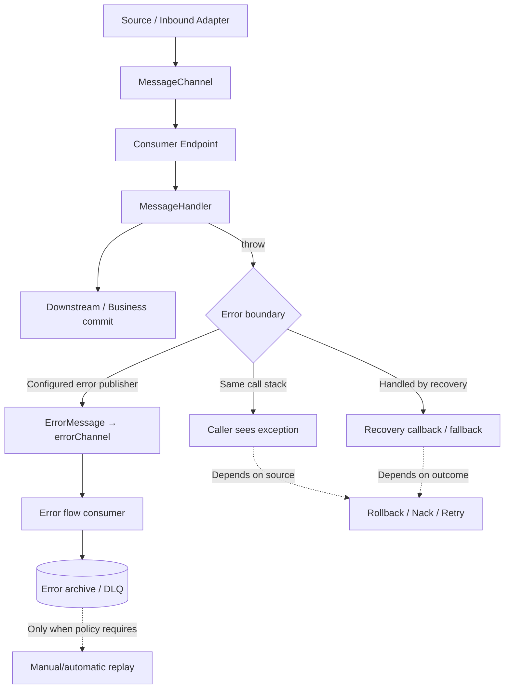
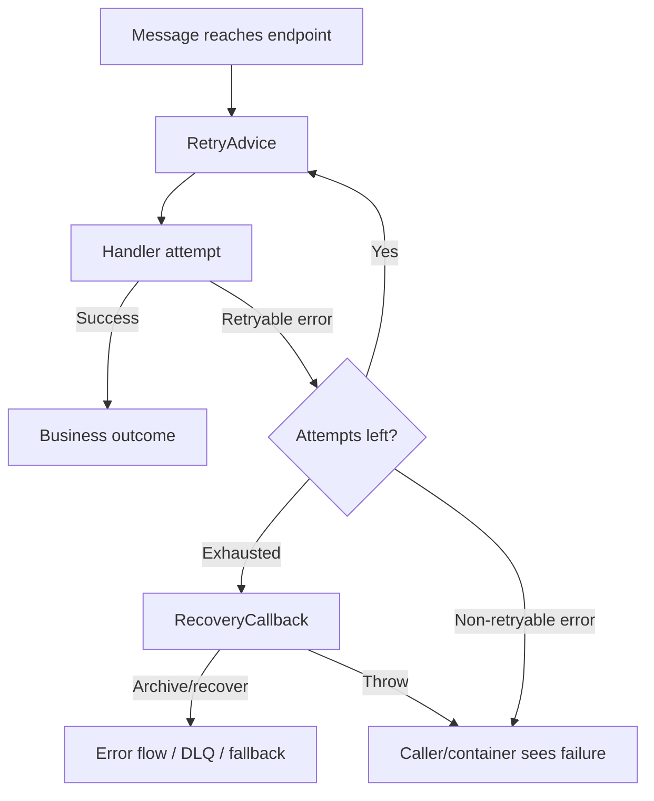

# Inspecting errorChannel and Recovery Flows in Spring Integration

## Learning Objectives

A message travels through a `DirectChannel` and the handler throws an exception, yet the dashboard shows nothing on `errorChannel`. In another flow, errors only surface on the error channel after the message crosses an `ExecutorChannel` or is handled by a poller; despite an `ErrorMessage` arriving, the broker keeps redelivering the same event. In other cases, a recovery callback logs "error handled" even though the business record never committed. These behaviors do not contradict one another: **exception propagation paths, ErrorMessage publication, and retry/ack decisions are separate mechanisms**.

The lesson **Inspecting errorChannel and Recovery Flows in Spring Integration** belongs to the **Debugging** chapter of the **SPRING_INTEGRATION_RUNTIME** module. We will trace messages across channels, endpoints, consumers, pollers, and executors; determine when errors unwind the call stack, when they turn into `ErrorMessage` instances, when recovery handles them, and why transactions, retries, message stores, correlation, and runtime state govern the final outcome.

After this lesson, you will be able to:

- Distinguish **synchronous exceptions**, **asynchronous ErrorMessages**, **recovery callbacks**, **durable error archives/DLQs**, and **business compensation**.
- Extract the error source, original message, `failedMessage`, `correlationId`, and endpoint ID from an `ErrorMessage`.
- Verify the message/header `errorChannel`, global `errorChannel` bean, and per-adapter/per-flow custom error channels.
- Diagnose scenarios such as "handler threw yet errorChannel is empty", "ErrorMessage exists without a failed message", and "error flow logged the failure yet upstream still redelivers".
- Use Spring Integration Java DSL and Spring Test to build probes/error consumers that assert payloads, cause chains, and propagation.
- Design retries, recovery, transactions/acks, replay, and idempotency without losing or duplicating side effects.
- Execute an ordered debugging runbook, preserve evidence, and declare an incident resolved only once the **business outcome** is verified.

> **Core point:** `errorChannel` is **a message channel carrying error information**, not "a sink where every JVM exception automatically lands." You must know **which component catches the exception and publishes the ErrorMessage**, as well as **where ack/rollback decisions are made**.

## 1. Runtime Error Map: Where Does a Throwable Go?

A real-world flow can include inbound adapters, channels, service activators, transformers, routers, aggregators, retry advice, and outbound handlers. At each thread boundary, errors may be observed or forwarded differently.



A single failure can pass through **multiple layers**: the root handler throws `IllegalStateException`, the endpoint or advice wraps it in `MessageHandlingException`, the poller/container routes it to an error handler, and the error consumer persists a durable record. If the error consumer also fails, we have a **secondary error**. Debugging must preserve information about both the original error and any secondary error.

### 1.1. Five Non-Equivalent Concepts

| Concept | What does it hold? | Responsibility | What it does NOT guarantee |
| --- | --- | --- | --- |
| `Throwable` | Exception/cause chain | Reports failure on a thread/call stack | Carrying a message for recovery |
| `MessagingException` | Exception that may carry `failedMessage` | Associates error with message context | Being published to a channel automatically |
| `ErrorMessage` | A `Message<Throwable>`, optionally with `originalMessage` | Represents an error as a message | Being durable or nacking the source |
| `errorChannel` | `MessageChannel` receiving `ErrorMessage` | Routes errors to error consumers | Retaining all errors indefinitely |
| Recovery callback/handler | Decides action upon failure | Exhausted-retry handling, fallback, archiving | Exactly-once semantics or preserving rollback |
| Error archive/DLQ | Error records with retention/replay policy | Investigation, data fixes, recovery | Making business side effects valid |

This distinction is foundational: "sent an ErrorMessage" differs from "persisted a durable error record," and "archived an error" differs from "the source is safe to ack."

## 2. Synchronous vs. Asynchronous: The Root of errorChannel Misconceptions

### 2.1. DirectChannel: Exceptions Unwind Back to the Sender

`DirectChannel` normally invokes subscribers on the same thread calling `send()`:

```text
HTTP/Gateway/Producer thread:
    input.send(message)
        -> DirectChannel
        -> EventDrivenConsumer
        -> Handler
        -> throw IllegalStateException
    <- caller receives exception (possibly wrapped)
```

Without an explicit error publisher or advice, the exception **does not automatically turn into an `ErrorMessage` on the global errorChannel**. This remains true even if the message carries an `errorChannel` header: the header instructs components that perform error publication, rather than wrapping every handler in an automatic try/catch.

Simple example:

```java
import org.springframework.integration.channel.DirectChannel;
import org.springframework.messaging.MessageChannel;
import org.springframework.messaging.support.MessageBuilder;

MessageChannel input = new DirectChannel();

// Simulate a synchronous subscriber/handler throwing an exception.
((DirectChannel) input).subscribe(message -> {
    throw new IllegalStateException("Inventory unavailable");
});

try {
    input.send(MessageBuilder.withPayload("ORD-42").build());
}
catch (RuntimeException failure) {
    System.err.println("Synchronous failure: " + failure);
}
```

This is a minimal example with a direct subscriber requiring no Spring context; the subscriber's error propagates back to the sender over the call stack (possibly wrapped by Spring Messaging). With real endpoints registered via Java DSL, the same synchronous principle holds. A Spring context test appears in section 9.

### 2.2. ExecutorChannel: Sender Thread Differs from Processing Thread

`ExecutorChannel` hands work to an executor, and the handler runs later on a worker thread. `send()` can return before the handler even starts:

```text
Sender thread:
    input.send(message) -> task enqueued -> return

Worker thread:
    executor -> handler -> throw
                           |
                           v
                  Error handler / log /
                  ErrorMessage publication
                  (depending on actual configuration)
```

The sender usually **does not directly receive handler errors occurring later**; however, it can still see errors at enqueue time such as `RejectedExecutionException` or dispatch errors before the executor boundary. Therefore, tests and runbooks must separate **task submission errors** from **task execution errors**.

Do not assume every `ExecutorChannel` always sends errors to an operator-named channel: inspect the actual `error handler`, `errorChannel` header, resolver, and how the framework/adapter integrates with the executor.

### 2.3. Pollers and Message-Driven Adapters

With `PollingConsumer`, `SourcePollingChannelAdapter`, or broker-backed inbound adapters, a scheduler/container-managed thread pulls a message and invokes the handler:

- Errors can be published by the poller/container error handler as an `ErrorMessage` when configured properly.
- Errors can also trigger rollback, nack/requeue, or dead-letter policies at the source.
- Source ack and business completion **must not** be inferred merely from the presence of an `ErrorMessage`.
- A poller has its own transaction advice; a transaction on one thread does not automatically follow across an `ExecutorChannel`.

An error appearing on `errorChannel` **does not prove** the source message was retained for replay; that is governed by the adapter, queue/broker, and recovery contract.

### 2.4. Quick Comparison by Boundary

| Topology | What does the caller see? | Where are runtime errors observed? | What NOT to assume |
| --- | --- | --- | --- |
| `DirectChannel → handler` | Synchronous exception when handler throws | Stack/caller, traces, advice | Global `errorChannel` catches all errors |
| `ExecutorChannel → handler` | Send accepted or enqueue error; handler failure happens later | Worker, error handler/channel, or logs | `send(true)` = business success |
| `QueueChannel → poller → handler` | Sender may only know enqueue succeeded | Poller/error handler, source/queue | Producer transaction covers worker |
| Broker inbound → handler | Container determines delivery outcome | Error publisher/adapter, broker DLQ | Writing `ErrorMessage` = ack succeeded |
| Gateway request/reply | Reply, exception, or timeout | Gateway/flow and errors per topology | Timeout means side effect never happened |
| Reactive bridge | Terminal `onError` or local handling | Reactor pipeline/error adapter | Reactor `Throwable` automatically becomes `ErrorMessage` |

## 3. What Is Inside ErrorMessage and How to Find the Failed Message?

`ErrorMessage` belongs to Spring Messaging. It holds a `Throwable` as its **payload**, and depending on the error emitter may retain the original message via `getOriginalMessage()`.

```text
ErrorMessage
  payload: MessageHandlingException
    cause: IllegalStateException("inventory timeout")
    failedMessage: Message<OrderCommand>  (may be present)
  originalMessage: Message<OrderCommand>  (may be null)
  headers:
    id: UUID of the ErrorMessage
    timestamp: ...
```

Multiple distinct UUIDs may appear: the original business message ID, post-transformer message IDs, and the `ErrorMessage`'s own ID. **Never substitute the ErrorMessage ID for a correlation/business key during business replay.**

### 3.1. Helper to Extract the Failed Message and Cause Chain

```java
import org.springframework.messaging.Message;
import org.springframework.messaging.MessagingException;
import org.springframework.messaging.support.ErrorMessage;

final class ErrorMessageInspector {

    static Message<?> failedMessage(ErrorMessage error) {
        Message<?> original = error.getOriginalMessage();
        if (original != null) {
            return original;
        }

        Throwable cursor = error.getPayload();
        while (cursor != null) {
            if (cursor instanceof MessagingException messaging) {
                Message<?> failed = messaging.getFailedMessage();
                if (failed != null) {
                    return failed;
                }
            }
            cursor = cursor.getCause();
        }

        return null;
    }

    static Throwable rootCause(Throwable error) {
        Throwable last = error;
        // Production: guard further against abnormal cyclic cause chains.
        while (last.getCause() != null && last.getCause() != last) {
            last = last.getCause();
        }
        return last;
    }

    static Object correlation(ErrorMessage error) {
        Message<?> failed = failedMessage(error);
        return failed == null
                ? null
                : failed.getHeaders().get("correlationId");
    }
}
```

`getOriginalMessage()` and `MessagingException.getFailedMessage()` are not always populated, especially when errors are converted/wrapped or the source did not attach the original message. If the helper returns `null`, **do not guess** the business payload from `ErrorMessage.getPayload()`; check logs, traces, or the source adapter's error records.

### 3.2. Fields to Record in an Error Record

| Field | Why is it needed? | Data Source |
| --- | --- | --- |
| `businessKey`/`eventId` | Deduplication and business lookup | Validated header/payload |
| `correlationId` | Links branches of the same workflow | Failed/original message |
| `messageId` | Tracks message instance | `MessageHeaders.ID` of failed message |
| `errorMessageId` | Tracks error publication instance | ID of `ErrorMessage` |
| `flowId`/`endpointId` | Pinpoints where the error occurred | Instrumentation, handler context |
| `flowVersion`/`schemaVersion` | Replays against matching code/schema | Header or registry |
| `exceptionClass`/`rootCause` | Classifies the failure | Throwable/cause chain |
| `attempt`/`deliveryCount` | Separates retries from redeliveries | Advice/adapter |
| `sourceAckStatus` | Tells if source can still redeliver | Broker/adapter |
| `firstSeenAt`/`lastFailedAt` | SLAs and cleanup | Clock/DB |
| `recoveryState` | PENDING, ARCHIVED, RETRYING, RESOLVED | Application error archive |

This is a **suggested schema**, not a list of headers Spring Integration supplies out of the box. Avoid storing payloads or stack traces containing secrets or sensitive data unnecessarily; archives must enforce proper access control and retention.

### 3.3. ErrorMessage Is Not the Original Business Message

A common mistake is:

```java
void wrong(ErrorMessage error) {
    Object order = error.getPayload(); // Actually a Throwable!
}
```

Instead, locate `originalMessage` or `failedMessage`, and only then read `getPayload()` from that **business message**. In flows with multiple transformers, the message attached to the exception may be from the **step nearest the failure**, not the raw inbound message; carry business keys/correlation across steps to correlate accurately.

## 4. Determining Which errorChannel Is Actually Used

### 4.1. Error Channel Header on the Message

Spring Messaging defines the `MessageHeaders.ERROR_CHANNEL` header, typically named `errorChannel`. Its value can be a `MessageChannel` or a channel name understood by the corresponding resolver, depending on the error-publishing component.

```java
import org.springframework.messaging.Message;
import org.springframework.messaging.MessageHeaders;
import org.springframework.messaging.support.MessageBuilder;

Message<String> order = MessageBuilder
        .withPayload("ORD-42")
        .setHeader("businessKey", "tenant-a:ORD-42")
        .setHeader("correlationId", "workflow-42")
        .setHeader(MessageHeaders.ERROR_CHANNEL, "orderErrors")
        .build();
```

Setting this header is an **error-routing instruction**. It does not wrap all downstream code in an automatic try/catch. For the header to take effect, some component must **catch exceptions and publish an ErrorMessage**, resolve the channel name, and deliver to a valid consumer on that channel.

### 4.2. Global errorChannel

Spring Integration typically registers an `errorChannel` bean when integration infrastructure is enabled, usually as a publish-subscribe channel with a default logging subscriber in standard setups. Never rely blindly on assumptions about subscriber counts or logging policies for your exact build: the bean may be overridden or vary by version and custom config.

Questions to verify at runtime:

1. Does an `errorChannel` bean exist, and what `MessageChannel` type is it?
2. Which consumers/subscribers are registered? Is the default logging handler still attached?
3. Is the adapter/poller/error publisher selecting the global channel or the message's specific channel?
4. Did a transformer or header mapper strip the `errorChannel` header?
5. Does the error flow run on another thread, with its own transaction or retry?
6. Is the current log level hiding errors? "No logs seen" is insufficient to prove the channel received nothing.

### 4.3. Dedicated Error Channel per Flow

For critical business flows, you can define dedicated error channels such as `orderErrors` to attach specific ownership, retry/quarantine rules, metrics, and retention. Still, a custom-named channel only helps when **an error publisher actually sends to it**; if endpoints throw back to callers, `orderErrors` will stay empty.

| Comparison Point | Global error channel | Dedicated error channel |
| --- | --- | --- |
| Scope | Multiple default/configured components | Per flow/tenant/source |
| Context clarity | May lack clear ownership if headers are missing | Easy to bind explicit owner/contract |
| Storage | Default is usually not a durable archive | Can wire directly to a durable archive consumer |
| Risks | Errors from unrelated sources mix; logging mistaken for recovery | Publisher routes to wrong name; channel has no consumer |
| Operations | Requires classification by endpoint/business key | Straightforward SLOs and dead-letter policies |

### 4.4. Do Not Enrich the Header at the End of a Flow and Expect Earlier Errors to Reroute

If an error occurs in a transformer prior to header enrichment, the `errorChannel` header added later **does not exist yet** at failure time. When debugging, inspect the message **at the exact endpoint throwing the exception**, not just a sample message at the producer or final output.

## 5. Java DSL Example: Creating an Observable errorChannel and Error Consumer

The following setup illustrates a separate **ErrorMessage receiving path**; a business handler can throw, yet on a synchronous `DirectChannel`, publishing to the dedicated channel **does not happen automatically** just because an error flow exists.

### 5.1. Channel and Two-Endpoint Configuration

```java
import org.springframework.context.annotation.Bean;
import org.springframework.context.annotation.Configuration;
import org.springframework.integration.channel.DirectChannel;
import org.springframework.integration.channel.PublishSubscribeChannel;
import org.springframework.integration.config.EnableIntegration;
import org.springframework.integration.dsl.IntegrationFlow;
import org.springframework.messaging.Message;
import org.springframework.messaging.MessageChannel;
import org.springframework.messaging.MessageHandler;
import org.springframework.messaging.support.ErrorMessage;

@Configuration
@EnableIntegration
class ErrorDiagnosticsConfiguration {

    @Bean("ordersInput")
    MessageChannel ordersInput() {
        return new DirectChannel();
    }

    @Bean("orderErrors")
    MessageChannel orderErrors() {
        return new PublishSubscribeChannel();
    }

    @Bean
    ErrorRecorder errorRecorder() {
        return new ErrorRecorder();
    }

    @Bean
    IntegrationFlow ordersFlow() {
        MessageHandler businessHandler = message -> {
            String orderId = String.valueOf(message.getPayload());
            if (orderId.equals("ORD-FAIL")) {
                throw new IllegalStateException("Inventory unavailable");
            }
        };

        return IntegrationFlow.from("ordersInput")
                .handle(businessHandler,
                        endpoint -> endpoint.id("ordersHandlerEndpoint"))
                .get();
    }

    @Bean
    IntegrationFlow orderErrorFlow(ErrorRecorder recorder) {
        MessageHandler errorHandler = message -> {
            if (!(message instanceof ErrorMessage error)) {
                throw new IllegalArgumentException(
                        "Expected ErrorMessage, got "
                                + message.getClass().getName());
            }
            recorder.record(error);
        };

        return IntegrationFlow.from("orderErrors")
                .handle(errorHandler,
                        endpoint -> endpoint.id("orderErrorsEndpoint"))
                .get();
    }

    static final class ErrorRecorder {
        private final java.util.List<ErrorMessage> received =
                new java.util.concurrent.CopyOnWriteArrayList<>();

        void record(ErrorMessage error) {
            received.add(error);
        }

        java.util.List<ErrorMessage> snapshot() {
            return java.util.List.copyOf(received);
        }

        void clear() {
            received.clear();
        }
    }
}
```

This is a compact Spring context for **observing an error flow**. An in-memory `ErrorRecorder` suits tests/demos, **not a durable error store**. The configuration does not yet attach an automatic error publisher for exceptions from `ordersHandlerEndpoint`; that lets tests distinguish "an error flow exists" from "a business exception was converted into an ErrorMessage."

### 5.2. Intentionally Publishing an ErrorMessage from a Boundary

When an application has a **boundary that actively catches errors**, it can build an `ErrorMessage` with the source message and publish to an authorized channel:

```java
import org.springframework.messaging.Message;
import org.springframework.messaging.MessageChannel;
import org.springframework.messaging.support.ErrorMessage;

final class ExplicitErrorPublisher {

    private final MessageChannel errorChannel;

    ExplicitErrorPublisher(MessageChannel errorChannel) {
        this.errorChannel = errorChannel;
    }

    void publish(Message<?> original, Throwable failure) {
        ErrorMessage error = new ErrorMessage(failure, original);

        boolean accepted = errorChannel.send(error);
        if (!accepted) {
            throw new IllegalStateException(
                    "Could not dispatch ErrorMessage", failure);
        }
    }
}
```

This helper **should not be added unconditionally to a flow that already has an error publisher**, as it could record the same exception twice. Calling it from a `catch` block and **swallowing the exception** may let upstream treat processing as successful; rethrowing it may cause the source to redeliver and trigger the same error again. The decision belongs to your transaction/ack policy, not the `ErrorMessage` constructor.

### 5.3. Runtime Usage Sequence

```text
1. Start the Spring context with ordersFlow and orderErrorFlow.
2. Send ORD-OK through ordersInput:
   -> handler processes normally.
3. Send ORD-FAIL through ordersInput:
   -> handler throws exception to caller (DirectChannel).
   -> orderErrors receives nothing automatically without a publisher.
4. Call ExplicitErrorPublisher.publish(original, failure)
   at a boundary designed to catch errors:
   -> orderErrorFlow receives the ErrorMessage.
5. For durable recovery, replace ErrorRecorder with a transactional
   error archive and a replay policy.
```

This clarifies the contract. In production, rather than scattering manual publish calls across handlers, use an **appropriate error publisher, adapter error channel, or recovery mechanism** for consistent behavior.

## 6. When errorChannel Is Empty: Diagnostic Table

| Symptom | Possible Cause | How to Verify |
| --- | --- | --- |
| Handler throws, caller sees exception, `errorChannel` has nothing | Synchronous `DirectChannel` without an error publisher | Trace call stack; check whether any handler/advice publishes errors |
| `send()` succeeds, no error logs, yet business fails | `ExecutorChannel` runs later; logs sit on another worker/handler | Executor error handler, error resolver, worker logs |
| `orderErrors` bean exists but gets no `ErrorMessage` | No component is wired to send to this channel | Inspect adapter/poller/recovery config and headers |
| `ErrorMessage` lands on global channel instead of custom | Header stripped, resolver missed name, adapter used default | Log headers right at failure point; inspect error-channel config |
| Error channel has messages but no recovery happens | Only a logging consumer exists, no durable archive/recovery | Inspect subscribers and archive state |
| Error flow gets `Throwable` but cannot find order ID | Reading `ErrorMessage` payload as if it were business payload | Use `originalMessage`/`failedMessage` and business keys |
| Two `ErrorMessage`s arrive for the same failure | Manual publisher + adapter publisher, or multi-layer retries | Compare message/error IDs, attempt/delivery counts, publisher owners |
| Error publishing itself fails | Error channel has no subscribers, or archive handler failed | Secondary exception, channel type, archive transaction |
| `ErrorMessage` exists yet broker still redelivers | Source rolled back/nacked; publishing error is not an ack | Ack policy, source transaction, recovery result |
| Recovery logs success yet business DB did not commit | Callback swallowed error, non-durable archive, or DB rollback | Business ledger, source ack, and transaction boundaries |
| Circuit breaker OPEN and handler never runs | Short-circuit before business handler | Advice/exception type and error publishing |
| Group stays pending forever without releasing | Failed branch never reached aggregator or correlation mismatch | Group ID, sequence, branch error flow, and DLQ |

### 6.1. Distinguishing "No Error Published" from "Published but Unreceived"

These two causes are often conflated:

```text
A. Handler throws with no publisher:
   Throwable --X--> ErrorMessage
   => inspect caller/advice/container.

B. Publisher created ErrorMessage but dispatch failed:
   ErrorMessage --> errorChannel --X--> consumer/archive
   => inspect channel, subscribers, secondary errors.
```

Log **before publishing**, **when the error consumer receives**, and **after the archive commits** (with redacted correlation metadata). This pinpoints the exact boundary where information is lost without enabling sensitive payload logging system-wide.

## 7. Retry Advice and Recovery Flows: When Are Errors Routed Away?

A handler wrapped in retry advice may throw multiple times yet only report failure or trigger recovery after exhausting attempts, depending on advice ordering and policy.



### 7.1. Clear Terminology

- **Retry attempt:** each re-invocation of the same execution by advice.
- **Backoff:** pause between attempts, not a message TTL.
- **Recovery callback:** logic invoked once the retry policy transitions to recovery.
- **Redelivery:** broker/source sending the message again in a new delivery.
- **Manual replay:** operator re-injecting an archived record back into the flow.
- **Compensation:** business action handling partial side effects, not synonymous with retry.

Some configurations treat `maxAttempts=3` as including the initial attempt; confirm your retry library version's contract. Never count `"Retrying"` log lines alone and assume that equals exact downstream API calls.

### 7.2. Advice Ordering Affects Recorded Error Counts

Conceptualizing two wrapping orders:

```text
Option A:
  Retry(Handler)
  -> Only after all attempts reach Recovery/ErrorPublisher

Option B:
  Retry(ErrorPublisher(Handler))
  -> Every failing attempt may be seen by ErrorPublisher before retrying
```

This is a **conceptual wrapping model**, not default Java DSL syntax. Putting an error publisher inside the retry loop can generate multiple `ErrorMessage` instances for one business event. Putting it outside typically emits one final `ErrorMessage`. With stateful retry, redelivery, and source transactions, inspect the exact configuration for additional interactions.

### 7.3. Recovery Callbacks Swallowing Errors and Ack Risks

Suppose a handler calls an inventory reservation service and fails after three attempts. The recovery callback catches the error, logs it, and returns normally. The poller/broker adapter may treat the invocation as complete and ack/commit the checkpoint per policy, even though the business step failed.

```text
Handler fails
  -> Retries exhausted
  -> Recovery callback logs + returns normally
  -> Upstream sees normal completion
  -> Source may ack/commit
  -> No durable recovery record
  => Risk of silent work loss
```

Safe recovery must define a **terminal action**: deferred retry, durable DLQ storage, compensation, a valid fallback response, or rethrowing so the source rolls back. There is no universal rule that "publishing an ErrorMessage makes it safe to ack."

### 7.4. When Should an Error Not Be Retried?

| Error | Retry? | Appropriate Recovery |
| --- | --- | --- |
| Temporary HTTP 503/timeout | Possible, with backoff/jitter and caps | Durable retry, circuit breaker/bulkhead |
| Connection pool exhausted under load | Investigate/tune first, throttle retries | Pause intake, backpressure |
| Invalid payload schema | Usually no | Validation error, quarantine |
| Missing business key | Usually no | Reject and record traceable error |
| Side effect created yet response timed out | Only when protected by idempotency | Check status/idempotency key before retrying |
| Circuit breaker OPEN | Avoid blind retry storms | Delay/backoff, await half-open per policy |
| Cannot deserialize message from store | Do not loop immediate retries | Quarantine/migrate schema |
| Error archive backend unavailable | Never ack if durable recovery is required | Fail closed/pause source or durable fallback |

## 8. Where Does the Error Flow End: Logging, Archive, DLQ, or Reply?

Not every recovery means "write an error message to a channel."

### 8.1. Four Common Patterns

| Pattern | Goal | What Must Be Verified |
| --- | --- | --- |
| **Logging-only** | Non-critical observability/telemetry | Is losing the business event acceptable? |
| **Durable error archive** | Store context for fixing and replay | Did the record commit? Business key/correlation, retention present? |
| **Dead-letter queue** | Isolate poison messages and curb retry storms | Routing key, broker ack, DLQ consumer, poison-message policy |
| **Fallback response** | Return a substitute value to caller | Is fallback business-valid and marked degraded? |
| **Compensation** | Reconcile partial side effects | Which steps committed, and is compensation idempotent? |

A logging handler on `errorChannel` only proves **the exception was observed**. It does not guarantee the message can be replayed after a restart.

### 8.2. Minimal Error Archive Design

When durable storage is needed, persist a decoupled, versioned **error record** instead of blindly serializing raw `Throwable` graphs and arbitrary runtime Java headers:

```text
error_record:
  errorId
  eventId / businessKey / correlationId
  flowVersion / schemaVersion
  originalPayloadReference or sanitized payload
  exceptionType / sanitizedMessage / stackFingerprint
  endpointId / source / tenant
  firstFailureAt / lastFailureAt
  attemptCount / deliveryCount
  recoveryState = PENDING | RETRYING | RESOLVED | QUARANTINED
  nextRetryAt / retentionUntil
  idempotencyKey
```

You can store full payloads in an encrypted, access-controlled store and reference them by ID. Headers can contain channel references, proxies, security principals, or non-serializable objects; persisting "raw `Message<?>`" into a persistent `MessageStore` requires verifying serializer and version compatibility.

### 8.3. Error Consumers Can Fail Too

Two-tier failure diagram:

```text
Business handler
   -> error publication
   -> error consumer
       -> Error archive DB unavailable
       -> error consumer throws
       -> secondary error
```

Never **swallow secondary errors** and ack the source when policy mandates durable error records. Conversely, if a synchronous error publisher calls a DB-backed subscriber while the DB is slow, the error path can become a bottleneck that stalls worker threads. Use timeouts, circuit breakers, fail-safe queues/brokers, and escalation alerts.

## 9. Spring Test: Proving errorChannel Does Not Automatically Catch Sync Errors

Use `ErrorDiagnosticsConfiguration` from section 5 inside a Spring Test context.

### 9.1. Testing That DirectChannel Throws While Recorder Stays Empty

```java
import org.junit.jupiter.api.BeforeEach;
import org.junit.jupiter.api.Test;
import org.springframework.beans.factory.annotation.Autowired;
import org.springframework.beans.factory.annotation.Qualifier;
import org.springframework.messaging.MessageChannel;
import org.springframework.messaging.support.MessageBuilder;
import org.springframework.test.context.junit.jupiter.SpringJUnitConfig;

import static org.junit.jupiter.api.Assertions.*;

@SpringJUnitConfig(ErrorDiagnosticsConfiguration.class)
class SynchronousErrorPathTest {

    @Autowired
    @Qualifier("ordersInput")
    MessageChannel input;

    @Autowired
    ErrorDiagnosticsConfiguration.ErrorRecorder errors;

    @BeforeEach
    void reset() {
        errors.clear();
    }

    @Test
    void synchronousExceptionDoesNotAutomaticallyPublishError() {
        RuntimeException failure = assertThrows(
                RuntimeException.class,
                () -> input.send(MessageBuilder
                        .withPayload("ORD-FAIL")
                        .setHeader("correlationId", "workflow-42")
                        .build()));

        assertNotNull(failure);
        assertTrue(errors.snapshot().isEmpty(),
                "No error publisher was configured for DirectChannel");
    }
}
```

This test **verifies a specific contract of the demo topology**. If you later add error-publishing advice or an adapter with an error handler, the expectation must change; do not generalize this into "no `DirectChannel` can ever publish errors."

### 9.2. Separately Testing the Error Consumer Receiving ErrorMessage

```java
import org.junit.jupiter.api.Test;
import org.springframework.beans.factory.annotation.Autowired;
import org.springframework.beans.factory.annotation.Qualifier;
import org.springframework.messaging.Message;
import org.springframework.messaging.MessageChannel;
import org.springframework.messaging.support.ErrorMessage;
import org.springframework.messaging.support.MessageBuilder;
import org.springframework.test.context.junit.jupiter.SpringJUnitConfig;

import static org.junit.jupiter.api.Assertions.*;

@SpringJUnitConfig(ErrorDiagnosticsConfiguration.class)
class ErrorFlowConsumerTest {

    @Autowired
    @Qualifier("orderErrors")
    MessageChannel errorsInput;

    @Autowired
    ErrorDiagnosticsConfiguration.ErrorRecorder recorder;

    @Test
    void errorChannelConsumerCanInspectOriginalMessage() {
        recorder.clear();

        Message<String> original = MessageBuilder
                .withPayload("ORD-42")
                .setHeader("businessKey", "tenant-a:ORD-42")
                .setHeader("correlationId", "workflow-42")
                .build();

        ErrorMessage published = new ErrorMessage(
                new IllegalStateException("inventory unavailable"),
                original);

        assertTrue(errorsInput.send(published));
        assertEquals(1, recorder.snapshot().size());

        ErrorMessage received = recorder.snapshot().get(0);
        assertEquals("workflow-42",
                ErrorMessageInspector.correlation(received));
        assertEquals(original.getHeaders().getId(),
                ErrorMessageInspector.failedMessage(received)
                        .getHeaders().getId());
    }
}
```

`ErrorMessageInspector` is the helper from section 3. This test verifies the **error consumer, channel, and originalMessage**, not that an exception from the business flow automatically routed into `orderErrors`: that requires a separate integration test with a real publisher/adapter.

### 9.3. Integration Testing an Async Source

To test automatic error routing on a poller or inbound adapter:

1. Initialize the source/adapter with an explicit `errorChannel` and supported error publisher.
2. Have the handler throw an exception with `businessKey` and `correlationId`.
3. Use a latch-backed error probe/recorder instead of `Thread.sleep()`; wait up to a bounded deadline.
4. Assert `ErrorMessage`, cause chain, and retained source message per contract.
5. Simulate error archive failure; verify source **ack/rollback/nack** follows policy.
6. Enable bounded retries; compare attempt count, `ErrorMessage` count, and delivery count.
7. Verify the error consumer keeps running after one failure, or raises alerts if it died.

If your topology uses an `ExecutorChannel` with an application/framework-configured error handler, test that exact error publisher rather than assuming identical behavior to a poller.

## 10. Boundaries Affecting Transactions and Acks

In Spring Integration, a handler can join a JDBC transaction on the caller thread, yet across an executor or another source that transaction normally does not carry over automatically. Map the **actual commit path**, rather than inferring from a logical flow diagram.

```text
Poller/Container thread:
  read source message
  begin transaction (if configured)
  send to DirectChannel -> handler
  commit or rollback / ack

After ExecutorChannel:
  schedule worker
  caller may finish early
  worker uses its own transaction or none
  handler calls API / writes DB later
```

### 10.1. Common Crash-Window Scenarios

| Failure Point | What May Already Have Happened | Consequence If Recovery Is Wrong |
| --- | --- | --- |
| Before error archiving | Handler threw, source not yet acked | Redelivery may occur; requires retry/idempotency |
| After `errorChannel` receives, before archive commit | Error exists only in RAM | Early ack can lose the message |
| After archive commit, before ack | Error record persisted, source may redeliver | Two paths process same event unless deduplicated |
| After external API succeeds, before DONE | Side effect may have committed | Retry/replay creates duplicates |
| After metadata checkpoint updates before processing | Source may skip record after restart | Unfinished work is lost |
| After ack, before durable error record | Source stops redelivering | Recovery opportunity is lost |

No single `errorChannel.send(error)` call atomically commits an external HTTP API, JDBC state, and a broker ack across independent systems.

### 10.2. Verify Recovery Completion Semantics

Explicitly check:

- Does the recovery callback **return normally** or **throw**?
- Did the error archive commit in the same transaction as the source, or was it only enqueued in RAM?
- Does retry advice mark recovery successful and let a gateway return a reply?
- Does the inbound adapter auto-ack when the handler finishes? Is a suitable transaction manager wired?
- Does the error consumer run on the same thread or another executor?
- Do source redelivery and manual replay use **the same idempotency key**?

In money movement, inventory, or order-creation flows, enforce unique business keys/ledgers in the business system rather than relying solely on the presence or absence of an `ErrorMessage`.

## 11. MessageStore, MessageGroupStore, and MetadataStore in Error Debugging

The three stores serve different problems:

| Store | Data and Key | Role During Failures | What It Does NOT Do Automatically |
| --- | --- | --- | --- |
| `MessageStore` | `Message<?>` by `MessageHeaders.ID`/UUID | Holds messages for claim-check/recovery | Automatically replay archived messages |
| `MessageGroupStore` | Messages grouped by group ID | Aggregator waiting on branches | Know which part failed on another branch |
| `MetadataStore` | `String key → String value` | Cursors, file filters, dedupe markers | Retain full business payloads or auto-ack |
| DLQ/error archive | Error records with schema/retention | Investigation and policy-driven replay | Guarantee side effects have not occurred |

A message failing upstream of an aggregator can leave a **group pending forever**. If an operator sees the group missing one part without checking the error flow of the remaining branch, they can mistakenly conclude the aggregator is "hung."

### 11.1. Inspect Correlation Before Forcing Release

Example:

```text
Order ORD-42:
  PaymentConfirmed  -> group tenant-a:ORD-42 (arrived)
  InventoryReserved -> group tenant-a:ORD-42 (arrived)
  ShippingQuoted    -> throw -> errorChannel/DLQ (missing)

Aggregator:
  group size = 2
  expected = 3 parts
  no output
```

Use `businessKey`/`correlationId` to locate `ShippingQuoted` in error records, inspect the exception, and decide whether to retry or accept a valid partial result. **Do not delete the group** or blindly raise release timeouts; keep versions and correlation keys stable during replay.

### 11.2. Easily Confused IDs and Group Keys

`MessageHeaders.ID` identifies an individual message, whereas the group key is returned by `CorrelationStrategy` (often derived from `headers['correlationId']`). `ErrorMessage` also has its own message ID. Log all three when debugging, but **never use them interchangeably**.

A transient error may be retried with the same message instance, whereas broker redelivery can construct a new instance with a different UUID. Deduplicating by message UUID alone fails if business logic must prevent duplicates across redeliveries or replays.

## 12. Diagnosing errorChannel via Logs and Metrics

### 12.1. Instrument Steps Instead of Only Logging Throwables

```text
stage=business-start
  endpoint=inventoryHandler
  messageId=UUID-A
  businessKey=tenant-a:ORD-42
  correlationId=workflow-42
  attempt=2

stage=business-failure
  exception=InventoryTimeout
  failedMessageId=UUID-A
  durationMs=1200

stage=error-publish
  errorChannel=orderErrors
  errorMessageId=UUID-E

stage=error-consumed
  errorMessageId=UUID-E
  originalMessageId=UUID-A

stage=error-archive-commit
  errorId=ERR-42
  recoveryState=PENDING

stage=source-outcome
  deliveryCount=3
  ack=false
  action=REQUEUE
```

This is an **application-defined structured log format**, not automatic Spring Integration output. Each line helps answer "where did information disappear?" without dumping full payloads.

### 12.2. Recommended Metrics

| Signal | Purpose | Avoiding Misinterpretation |
| --- | --- | --- |
| `handler.failure.count` | Business failure rate | Separate attempts from unique messages |
| `error.publish.attempt` / `error.publish.failed` | Is the publisher working? | Also track secondary errors |
| `errorChannel.received` | How many `ErrorMessage`s the consumer received | Not equal to archive commit |
| `error.archive.committed` | Durably persisted errors | Cross-check failures vs. storage failures |
| `retry.attempts` | Handler re-invocation count | Separate from broker delivery count |
| `source.redelivery` | Is the source redelivering? | Use business keys to detect duplicates |
| `recovery.pending.age` | How long errors await handling | Never treat error logging as recovery |
| `error.consumer.inflight` | Is the error consumer backed up? | Inspect queues/thread pools |
| `group.pending.age` | Correlation groups waiting long | Check the corresponding branch's error flow |
| `business.commit.count` | Real business progress | Never infer from channel send acceptance |

These are **suggested names**, not automatically emitted by Spring Integration/Actuator by default. Avoid using `messageId` or `correlationId` as metric labels due to high cardinality; store them in access-controlled logs or traces with defined retention.

### 12.3. Audit Logging Configuration

If the global error channel has a logging subscriber, proper log levels can reveal exceptions. Yet a logging handler does not persist durable data, and misconfigured log levels can hide failures from dashboards. Monitor **both error channel dispatch and durable archives**; never use "nothing in the logs" to conclude no errors happened.

## 13. Runbook: Investigating a Message Missing from errorChannel

### Step 1 — Lock Down the Exact Incident

Gather `businessKey`/`eventId`, `correlationId`, message IDs near the failing endpoint, flow version, endpoint ID, source name, tenant, and time window. If business keys are missing, flag missing metadata as a design flaw to fix.

### Step 2 — Identify Thread Boundaries and Failure Point

Trace the actual path: `DirectChannel`, `ExecutorChannel`, `QueueChannel`/poller, message-driven adapter, gateway, or reactive bridge. Do not guess from channel names and overlook an executor or queue inserted mid-flow.

### Step 3 — Confirm the Handler Actually Threw Rather Than Returning an Error Result

An HTTP client may return status 500 without the adapter throwing per config; a validator may return an error payload normally. In those cases, no `Throwable` enters the error flow. Inspect exception classes, stacks, and response mapping code.

### Step 4 — Locate the Owner of Error Publication

Inspect adapter/container/poller error handlers, advice/recovery callbacks, and explicit publishers. Is there an error publisher? On which attempt does it receive exceptions? Did a recovery callback intercept before publication?

### Step 5 — Verify Which Channel Was Actually Selected

Inspect `MessageHeaders.ERROR_CHANNEL` on the failed message, bean/global channels, resolvers, header mappers, and endpoint subscriptions. Match channel strings against actual bean names; do not inspect a different message's headers and generalize.

### Step 6 — Follow the ErrorMessage and Cause

If an `ErrorMessage` exists, read `getPayload()`, `getOriginalMessage()`, and `MessagingException.getFailedMessage()` along the cause chain. Log exception types, message IDs, and correlation; never assume `ErrorMessage` payload is the business payload.

### Step 7 — Inspect the Error Consumer and Durable Archive

Are subscribers present? Are there secondary errors from DB outages, broken serializers, or full DLQs? Did records commit or merely enqueue? Did a terminal error in the error flow stop the consumer?

### Step 8 — Reconcile Source Ack/Rollback and Business State

Verify whether the source can still redeliver. Check `businessKey` against the target DB/system to see if partial side effects succeeded. Only decide retry/replay/quarantine once true state is known.

### Step 9 — Apply the Minimal Fix and Verify

Fix the header/channel/publisher or dependency configuration; avoid restarting the entire service if only one error consumer failed. Send a canary with a dedicated business key, trigger a controlled failure, and verify the entire path: handler throw → publish → ErrorMessage received → archive commit → source outcome.

### Step 10 — Close the Incident with Evidence

Declare completion only when error records stop dropping, error backlogs drain, source acks match contract, and idempotency guards against duplicates. Document the flow segment, endpoint, root cause, and regression test.

## 14. Tricky Cases: Gateways, Breakers, Reactive, and Restarts

### 14.1. Gateway Timeout Even Though the Handler Succeeded

Request/reply gateways enforce timeouts; if a handler invokes an external command whose response arrives late, the caller sees a timeout even though the side effect committed. Do not replay blindly from the error archive; query business state by idempotency key first. In logs, separate **caller timeout** from **actual handler failure**.

### 14.2. Circuit Breaker OPEN Changes the Error Path

When a breaker is OPEN, the handler may never execute; advice rejects before reaching downstream. This is a short-circuit failure that must be categorized separately from API failures. Do not measure "downstream calls=0" and conclude the endpoint stopped running. If a breaker is wrapped inside retry advice, retries may hammer the OPEN error; inspect advice ordering and backoff.

### 14.3. Reactive Pipelines Do Not Auto-Publish ErrorMessages

In Reactor, `onError` is usually a terminal signal for a subscription. Routing errors into a Spring Integration error flow requires a bridge or endpoint configured with an explicit `ErrorMessage` publication policy. Never assume `Flux.onError` equals the global `errorChannel`. Handle errors at per-message scope when the stream must keep processing subsequent messages, while persisting failures durably.

### 14.4. Restarts When errorChannel Lives Only in RAM

`PublishSubscribeChannel` and `DirectChannel` used for errors do not durably persist messages across restarts. If an archive consumer is processing when the app is killed before commit, `ErrorMessage`s can be lost unless the source redelivers or a durable handoff exists. Test crashes across the **publish → archive → ack** boundary, not only happy-path `ErrorMessage` sends inside one JVM.

### 14.5. Dynamic IntegrationFlow Removed

If a flow version is removed while the error archive still holds messages tagged `flowVersion=v1`, replaying them to v2 can break schemas, retry policies, and correlation keys. Recovery flows should read the pinned version and resolve compatible decoders/handlers or run a controlled migration, rather than forcing old errors through active aliases.

## 15. Recovery Flow Testing Matrix

| Scenario | Setup | What to Assert |
| --- | --- | --- |
| Handler throws on `DirectChannel` | Sync endpoint, no publisher | Caller gets exception; error recorder empty |
| Explicit `ErrorMessage` | Publish to custom channel | Consumer gets `Throwable` + `originalMessage` |
| Presence/absence of `errorChannel` header | Two messages with different headers | Publisher picks the right target per config |
| Header stripped in transformer | Build new message dropping headers | Error route shifts or validation catches it |
| Executor handler failure | Worker runs after sender | Error observed at worker/error handler, not assumed at caller |
| Poller handler failure | Poller with error publisher | `ErrorMessage`/cause received and source outcome accurate |
| Retries exhausted | Multiple attempts then recovery | Attempt count and error record count match policy |
| Recovery swallows error | Callback returns normally | Verify ack and archive state; expose silent-loss risk |
| Archive DB unavailable | Error consumer throws | Secondary failure alerts without false ack |
| DLQ full/permission denied | Error route cannot publish | Fallback/fail-closed behavior per policy |
| Broker redelivery | Nack or rollback | Message redelivered with business idempotency |
| `ErrorMessage` missing original | Only `Throwable` present | Extract `failedMessage`/cause or flag missing context |
| Aggregator missing part | One branch fails | Group pending, correlation intact, recovery feeds right group |
| Timeout after side effect | External API committed | No duplicates upon replay |
| Process crash | Kill mid publish/archive/ack | Verify durable records or redelivery |
| Flow version change | Replay v1 message when v2 active | Version pinning/migration/quarantine |
| Multiple subscribers | Global `errorChannel` fan-out | Do not archive twice if two consumers both write |
| No traffic | Zero errors | No false alerts when source is validly idle |

### 15.1. Do Not Use Thread.sleep to Test Async Errors

An error probe can use a `CountDownLatch` or bounded queue to await an `ErrorMessage` with a timeout. Counting down the latch **after receiving the ErrorMessage** proves dispatch reached the consumer; to prove durable archive commit, signal after transaction commit or query the DB in a separate transaction.

```java
import java.util.concurrent.CountDownLatch;
import java.util.concurrent.TimeUnit;
import java.util.concurrent.atomic.AtomicReference;
import org.springframework.messaging.support.ErrorMessage;

final class ErrorProbe {
    private final CountDownLatch arrived = new CountDownLatch(1);
    private final AtomicReference<ErrorMessage> error =
            new AtomicReference<>();

    void accept(ErrorMessage received) {
        error.set(received);
        arrived.countDown();
    }

    ErrorMessage await() throws InterruptedException {
        if (!arrived.await(5, TimeUnit.SECONDS)) {
            throw new AssertionError(
                    "No ErrorMessage received within 5 seconds");
        }
        return error.get();
    }
}
```

Tests must create a fresh probe each run or reset cleanly; a latch already at 0 cannot be reused to await another error. For sources with retries producing multiple `ErrorMessage`s, use a bounded blocking queue or thread-safe list to assert exact ordering and counts per contract.

## 16. Guided Practice Labs

### Lab A — Prove Synchronous Exceptions Do Not Auto-Route to errorChannel

Build the config from section 5 and the test from section 9. Send `ORD-FAIL` through `ordersInput`, assert the exception at the sender, and verify `orderErrors` stays empty because no error publisher exists.

**Expected outcome:** explain why the `errorChannel` header does not automatically catch all exceptions and when an explicit error-publishing boundary is needed.

### Lab B — Inspecting ErrorMessage and Correlation

Construct an `ErrorMessage` whose `originalMessage` carries `businessKey` and `correlationId` and send it to a consumer. Next test an `ErrorMessage` missing `originalMessage` where the exception carries `failedMessage`, and then a case where both are missing.

**Expected outcome:** extract the original message whenever available, never cast `Throwable` to a business payload, and explicitly note when context is absent.

### Lab C — Debugging an Async Error Publisher

Move the handler behind an `ExecutorChannel` or poller in a Spring Test context with an appropriate error publisher. Make the handler throw, verify sender/worker threads and `ErrorMessage` counts via a latch. Intentionally misname the error channel to observe misrouting.

**Expected outcome:** distinguish enqueue success, handler failure, and error dispatch; produce test assertions matching your live topology.

### Lab D — Retry Advice and Recovery Policy

Make a handler fail twice and succeed on the third attempt. Next, make it always fail and use a recovery callback to write to an archive. Assert attempt counts, archive counts, caller response/exception, and source ack status in a fake adapter.

**Expected outcome:** avoid writing an error record per retry attempt unless policy requires it; never swallow errors and ack when recovery is non-durable.

### Lab E — Broken Error Archive

Replace the error archive with a fake repository that throws. Observe the secondary error, transaction outcome, and source redelivery behavior. Test fail-open and fail-closed policies under two simulated business contracts.

**Expected outcome:** know when to pause intake and retain messages rather than marking completion based on logging-only handling.

### Lab F — Aggregator Missing a Branch Due to Error

Build a three-branch order flow and make `ShippingQuoted` throw before the aggregator. Verify `MessageGroupStore` holds two parts, then replay the failed branch with a stable correlation key. Try a differently typed/namespaced key to see the group split.

**Expected outcome:** restore the exact group and release per business contract without arbitrarily force-releasing or deleting groups.

### Lab G — Transactions and Acks After Side Effects

Make a fake API create an order successfully yet time out before returning a response. The handler throws; the `ErrorMessage` is archived while the source has not acked. Start another consumer to simulate redelivery and use a unique business key to block duplicate creation.

**Expected outcome:** distinguish business commit, error record commit, and source ack; support redelivery without duplicating side effects.

### Lab H — Incident Drill: "Silent errorChannel"

Simulate a dashboard showing 0 error messages while handlers log exceptions and successful throughput drops to 0. Assign Person A to inspect source/handler, Person B to inspect publisher/channel, and Person C to inspect error consumer/archive and downstream owners.

**Expected outcome:** locate the exact drop-off point, provide before/after evidence, and close the incident only after a canary failure flows end-to-end into the durable archive.

## 17. Self-Check Questions

1. Why might an exception thrown on a synchronous `DirectChannel` produce no `ErrorMessage`?
2. What role does the `MessageHeaders.ERROR_CHANNEL` header play, and what does it NOT do automatically?
3. What does `ErrorMessage.getPayload()` hold? Why must you never read it as an order payload?
4. What is the difference between `ErrorMessage.getOriginalMessage()` and `MessagingException.getFailedMessage()`?
5. How do you extract a correlation ID when an exception is wrapped across multiple causes?
6. Can an `ErrorMessage`'s `MessageHeaders.ID` substitute for the business message ID during replay?
7. What does `ExecutorChannel.send(true)` prove, and what does it NOT prove?
8. When the error channel is empty, which signals distinguish "no publisher" from "publisher failed to send"?
9. How does the global `errorChannel` differ from a dedicated error channel in scope and recovery policy?
10. Why is the default logging subscriber not a durable error archive?
11. How does placing retry advice inside vs. outside an error publisher change `ErrorMessage` counts?
12. How can a recovery callback returning normally affect source acks?
13. Does persisting an `ErrorMessage` automatically prevent the broker from redelivering the original message?
14. If the error archive fails, why should you not ack the source when durable recovery is required?
15. Why does a poller's transaction usually fail to propagate automatically across an `ExecutorChannel`?
16. How do `MessageStore`, `MessageGroupStore`, and `MetadataStore` differ when investigating failures?
17. How does an aggregator waiting on a third part that errored manifest at runtime?
18. When a circuit breaker is OPEN, is the handler actually invoked? How should the failure be classified?
19. Does Reactor's `onError` automatically route into the global `errorChannel`?
20. After a process crash across the publish/archive/ack boundary, what kind of test is needed to verify recovery?
21. Why must business idempotency keys remain stable across retries, redeliveries, and replays?
22. If flow v1 was removed while the error archive still holds v1 messages, is replaying into v2 always safe?
23. Which metrics help separate handler failures, error publishing, and archive commits?
24. What exit criteria should a runbook enforce before declaring a failure recovered?

**Remember:** Debugging `errorChannel` means following the exact chain: **handler throws → error catcher → ErrorMessage created → channel selected → error consumer receives → archive/recovery commits → source ack or rollback → business outcome**. Every arrow can fail or run on a different thread or transaction. Separate synchronous from asynchronous errors, preserve `businessKey`/`correlationId`, track retries/redeliveries, and never treat "an ErrorMessage arrived" as proof that business processing succeeded or data was durably saved.
